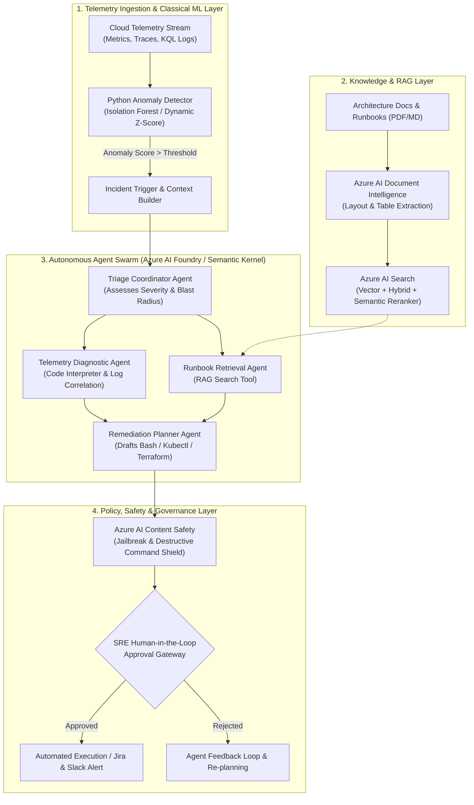

# Microsoft Exam AI-103: Developing AI Apps & Agents on Azure
## Complete Course Syllabus, Tooling Stack, and Advanced AIOps Capstone Project

---

## 1. Executive Summary & Certification Overview

* **Exam Name:** Microsoft Exam AI-103: Developing AI Apps and Agents on Azure
* **Credential:** Microsoft Certified: Azure AI Apps and Agents Developer Associate
* **Course Code:** AI-103T00-A (*Develop AI apps and agents on Azure*)
* **Primary Role:** Azure AI Engineer / Generative AI Application Developer
* **Prerequisites:** 
  1. Python programming proficiency (OOP, AsyncIO, REST APIs, JSON data structures).
  2. Foundational Machine Learning concepts (preferred: anomaly detection, feature engineering, classification).
  3. General cloud computing and generative AI fundamentals (LLMs, embeddings, tokens).

---

## 2. Complete Exam AI-103 Syllabus Breakdown

```
┌────────────────────────────────────────────────────────────────────────┐
│                      AI-103 Domain Weightage                           │
├────────────────────────────────────────────────────────────────────────┤
│ [30–35%] Domain 2: Implement Generative AI and Agentic Solutions       │
│ [25–30%] Domain 1: Plan and Manage an Azure AI Solution                │
│ [10–15%] Domain 3: Implement Information Extraction Solutions          │
│ [10–15%] Domain 4: Implement Text Analysis Solutions                   │
│ [10–15%] Domain 5: Implement Computer Vision Solutions                 │
└────────────────────────────────────────────────────────────────────────┘
```

### Domain 1: Plan and Manage an Azure AI Solution (25–30%)
1. **Azure AI Foundry Architecture & Governance**:
   - Provisioning and configuring Azure AI Foundry Hubs, Projects, and Connections.
   - Configuring authentication and access control with Microsoft Entra ID and Azure RBAC (Cognitive Services Contributor, OpenAI User, Custom Roles).
   - Securing endpoints via Managed Identities, Azure Key Vault secrets, and private virtual networks (VNet integration and Private Endpoints).
2. **Quota, Cost & Performance Management**:
   - Managing token allocations, Tokens-Per-Minute (TPM), and Requests-Per-Minute (RPM) limits.
   - Cost optimization across Standard, Provisioned Throughput Units (PTU), and Global Deployments.
   - Continuous observability, error logging, and latency tracing using Azure Monitor and Application Insights.
3. **Responsible AI & Content Safety**:
   - Implementing **Azure AI Content Safety** policies (hate, sexual, self-harm, violence thresholds).
   - Protecting applications against prompt injection, jailbreak exploits, and indirect prompt manipulation.
   - Running automated evaluations in Foundry for groundedness, coherence, relevance, and fluency.

---

### Domain 2: Implement Generative AI and Agentic Solutions (30–35%)
1. **Model Deployments & Azure OpenAI Core**:
   - Selecting and deploying frontier LLMs (GPT-4o, GPT-4o-mini, o1/o3-mini) and embeddings (`text-embedding-3-small/large`).
   - Advanced prompt engineering: system instructions, few-shot conditioning, structured output schema enforcement (JSON mode / Pydantic validation).
   - Function calling and tool use (specifying JSON schemas for agent function triggers).
2. **Retrieval-Augmented Generation (RAG) Architecture**:
   - Document chunking strategies (token-based, semantic boundary, recursive text splitting).
   - Generating vector embeddings and configuring **Azure AI Search**.
   - Implementing Hybrid Search (Vector Search + BM25 Full-Text) combined with the Semantic Reranker.
3. **Autonomous AI Agents & Multi-Agent Orchestration**:
   - Building persistent stateful agents using the **Azure AI Agent Service** (Threads, Runs, Messages).
   - Equipping agents with native capabilities: Code Interpreter, Azure AI Search tool, and custom REST API bindings.
   - Implementing multi-agent workflows (Sequential, Collaborative, Hierarchical) with **Semantic Kernel** or **AutoGen**.

---

### Domain 3: Implement Information Extraction Solutions (10–15%)
1. **Azure AI Document Intelligence**:
   - Utilizing prebuilt models (Receipts, Invoices, Tax forms, Identity documents, Business cards).
   - Training and evaluating Custom Extraction models and Custom Classification models.
   - Extracting structured data, nested tables, key-value pairs, and markdown formatted layouts from complex multi-page PDFs.
2. **Azure AI Content Understanding**:
   - Structuring unstructured media (combining audio, video, and tabular document data) into validated target schemas.

---

### Domain 4: Implement Text Analysis Solutions (10–15%)
1. **Azure AI Language**:
   - Sentiment analysis, opinion mining, key phrase extraction, and Named Entity Recognition (NER).
   - Personally Identifiable Information (PII) identification and automatic redaction.
   - Conversational Language Understanding (CLU) for intent recognition and entity mapping.
2. **Azure AI Translation & Speech**:
   - Real-time and batch document translation with Azure AI Translator.
   - Speech-to-Text transcription and Text-to-Speech synthesis with neural voices.

---

### Domain 5: Implement Computer Vision Solutions (10–15%)
1. **Azure AI Vision**:
   - Optical Character Recognition (OCR) with the Read API for dense document and signage parsing.
   - Multimodal visual reasoning with GPT-4o Vision for diagram analysis, screen inspection, and visual Q&A.
   - Custom Vision models for object detection, classification, and edge deployment.

---

## 3. Comprehensive Tooling & Technology Stack

| Category | Tools & Libraries | Purpose & Relevance |
| :--- | :--- | :--- |
| **Azure Platforms** | • Azure AI Foundry<br>• Azure Portal<br>• Azure CLI (`az`) & `azd` | Central workspace for models, evaluation, agent building, and infrastructure as code. |
| **Generative AI Services** | • Azure OpenAI Service<br>• Azure AI Search<br>• Azure AI Agent Service | Core infrastructure for model hosting, vector RAG indexing, and stateful agent threads. |
| **Cognitive Services** | • Azure AI Document Intelligence<br>• Azure AI Content Safety<br>• Azure AI Language / Vision | Document parsing, prompt injection defense, OCR, and sentiment/NER analysis. |
| **Python SDKs** | • `azure-ai-projects`<br>• `azure-ai-inference`<br>• `openai` (v1.x)<br>• `azure-search-documents`<br>• `azure-identity` | Programmatic orchestration, token-based authentication, and API interaction. |
| **Agent Frameworks** | • Microsoft Semantic Kernel<br>• Microsoft AutoGen / LangGraph | Orchestrating multi-agent collaboration, memory persistence, and dynamic tool calling. |
| **Data & ML Prerequisites** | • NumPy, Pandas, Scikit-learn<br>• PyTorch / Isolation Forest / DBSCAN | Anomaly detection on telemetry, feature engineering, and log clustering. |
| **Observability & Ops** | • Azure Monitor<br>• Application Insights<br>• OpenTelemetry | Distributed tracing, prompt latency measurement, and token cost analytics. |

---

## 4. Advanced Capstone Project: AIOps Multi-Agent Incident Commander

### Project Title
> **CloudSentinel AIOps: Autonomous Multi-Agent Telemetry Anomaly Detection & Root Cause Analysis Engine**

### Real-World Business Context
Modern cloud microservices generate gigabytes of telemetry (logs, metrics, distributed traces). When outages occur, SRE teams suffer from alert fatigue, slow manual correlation, and delayed Mean-Time-to-Resolution (MTTR). CloudSentinel automates this workflow: classical Machine Learning filters noisy telemetry spikes, and a swarm of Azure AI Agents identifies root causes, cross-references playbooks via RAG, and generates human-verified remediation plans.

---

### End-to-End System Architecture



---

### Step-by-Step Implementation Guide

#### Phase 1: Telemetry Preprocessing & ML Anomaly Detection (Python)
Leverage your Machine Learning background to build an unsupervised anomaly detection engine that identifies real performance anomalies before calling LLMs.

```python
import numpy as np
import pandas as pd
from sklearn.ensemble import IsolationForest

class TelemetryAnomalyDetector:
    def __init__(self, contamination=0.02):
        self.model = IsolationForest(
            n_estimators=100,
            contamination=contamination,
            random_state=42
        )
        self.is_fitted = False

    def train_baseline(self, historical_metrics: pd.DataFrame):
        """Features: cpu_utilization, mem_usage, error_rate_5xx, p99_latency_ms"""
        features = historical_metrics[['cpu_util', 'mem_util', 'error_rate_5xx', 'p99_latency']]
        self.model.fit(features)
        self.is_fitted = True

    def detect_incident(self, current_metrics: pd.DataFrame) -> dict:
        features = current_metrics[['cpu_util', 'mem_util', 'error_rate_5xx', 'p99_latency']]
        preds = self.model.predict(features)  # -1 is anomalous
        anomaly_scores = self.model.decision_function(features)
        
        anomalies = current_metrics[preds == -1]
        if not anomalies.empty:
            worst_idx = np.argmin(anomaly_scores)
            return {
                "triggered": True,
                "severity": "P1" if current_metrics.iloc[worst_idx]['error_rate_5xx'] > 0.15 else "P2",
                "details": current_metrics.iloc[worst_idx].to_dict(),
                "anomaly_score": float(anomaly_scores[worst_idx])
            }
        return {"triggered": False}
```

---

#### Phase 2: RAG Pipeline with Azure AI Search & Document Intelligence
1. Use **Azure AI Document Intelligence** to extract structured markdown and tables from Kubernetes runbooks, service topology maps, and past post-mortem reports.
2. Ingest the text chunks into **Azure AI Search** configured with vector embeddings (`text-embedding-3-large`) and the Semantic Reranker.

```python
from azure.identity import DefaultAzureCredential
from azure.search.documents import SearchClient
from azure.search.documents.models import VectorizedQuery

def retrieve_runbook_context(query: str, query_vector: list, search_endpoint: str, index_name: str):
    credential = DefaultAzureCredential()
    client = SearchClient(endpoint=search_endpoint, index_name=index_name, credential=credential)
    
    vector_query = VectorizedQuery(vector=query_vector, k_nearest_neighbors=3, fields="content_vector")
    
    results = client.search(
        search_text=query,
        vector_queries=[vector_query],
        query_type="semantic",
        semantic_configuration_name="my-semantic-config",
        top=3
    )
    return [doc["content"] for doc in results]
```

---

#### Phase 3: Multi-Agent Orchestration with Azure AI Agent Service
Configure autonomous agents with role specializations and tool bindings.

```python
from azure.ai.projects import AIProjectClient
from azure.identity import DefaultAzureCredential

# Initialize Project Client connected to Azure AI Foundry Hub
project_client = AIProjectClient.from_connection_string(
    credential=DefaultAzureCredential(),
    conn_str="<AIFoundry_Project_Connection_String>"
)

# 1. Diagnostic Agent with Code Interpreter tool
diagnostic_agent = project_client.agents.create_agent(
    model="gpt-4o",
    name="telemetry-diagnostic-agent",
    instructions="""You are an expert Cloud SRE. When provided with an incident anomaly payload
    and recent log excerpts, analyze the error patterns, correlate timestamps, and write Python scripts
    using Code Interpreter to inspect stack traces and identify the root cause.""",
    tools=[{"type": "code_interpreter"}]
)

# 2. Remediation Planner Agent with custom tool calling
remediation_agent = project_client.agents.create_agent(
    model="gpt-4o",
    name="remediation-planner-agent",
    instructions="""You evaluate the root cause determined by the diagnostic agent alongside
    retrieved runbook playbooks. Synthesize a non-destructive, phased remediation plan
    (kubectl rollback, pod scaling, or cache flush) formatted with dry-run flags.""",
    tools=[{"type": "code_interpreter"}]
)
```

---

#### Phase 4: Content Safety Guardrails & Human-in-the-Loop Gateway
Ensure generated remediation commands cannot execute destructive actions (`DROP TABLE`, `rm -rf /`, or unbounded cluster restarts).

```python
from azure.ai.contentsafety import ContentSafetyClient
from azure.ai.contentsafety.models import AnalyzeTextOptions
import re

BLOCKED_COMMAND_PATTERNS = [r"rm\s+-rf\s+/", r"DROP\s+DATABASE", r"format\s+[A-Z]:"]

def validate_remediation_safety(script: str, safety_endpoint: str) -> bool:
    # 1. Regex Guardrail for destructive shell commands
    for pattern in BLOCKED_COMMAND_PATTERNS:
        if re.search(pattern, script, re.IGNORECASE):
            return False

    # 2. Azure AI Content Safety API check
    client = ContentSafetyClient(endpoint=safety_endpoint, credential=DefaultAzureCredential())
    request = AnalyzeTextOptions(text=script)
    response = client.analyze_text(request)
    
    # Block if severe harm or violence levels are flagged
    if response.hate_result.severity > 0 or response.violence_result.severity > 0:
        return False
    
    return True
```

---

#### Phase 5: Evaluation & Metrics in Azure AI Foundry
Set up continuous evaluation metrics inside Azure AI Foundry:
* **Groundedness Score (Target: > 4.5/5.0):** Guarantees that the RCA explanation is strictly derived from actual logs and runbooks rather than LLM hallucination.
* **Relevance Score (Target: > 4.2/5.0):** Measures how effectively the remediation command addresses the root cause.
* **Latency & Token Efficiency:** Monitor end-to-end incident turnaround time (Goal: < 45 seconds from detection to SRE notification).

---

## 5. 6-Week Structured Study & Preparation Plan

| Week | Focus Areas | Key Milestone / Deliverable |
| :---: | :--- | :--- |
| **Week 1** | Azure AI Foundry, Hubs, Projects, Security, Entra ID RBAC, Key Vault | Provision secure Foundry Hub; configure Managed Identity and Cost Tracking. |
| **Week 2** | Azure OpenAI Service, prompt engineering, structured outputs, Content Safety | Deploy GPT-4o, configure content filters, test prompt injection defenses. |
| **Week 3** | Azure AI Search, embeddings, hybrid search, semantic reranking | Ingest incident playbooks into AI Search; test hybrid vector retrieval. |
| **Week 4** | Azure AI Agent Service, Semantic Kernel, Tool Calling, Code Interpreter | Build the multi-agent incident triage and diagnostic workflow. |
| **Week 5** | Document Intelligence, Language (NER/PII), Vision OCR, Speech | Parse complex PDF architecture diagrams and redact PII from error logs. |
| **Week 6** | Foundry Evaluations, Full AIOps Project Integration, Practice Exams | Run automated groundedness evaluations; complete official practice assessments. |
