# Course Syllabus & Training Proposal
## Microsoft Certified: Azure AI Apps and Agents Developer (Exam AI-103)
### Building Enterprise Generative AI, Multi-Agent Systems & AIOps Solutions

---

## 1. Course Information & Executive Summary

* **Course Title:** Developing Enterprise AI Apps & Autonomous Agents on Azure (AI-103)
* **Certification Alignment:** Microsoft Certified: Azure AI Apps and Agents Developer Associate (Exam AI-103)
* **Training Format:** 1 Month | Daily 2 Hours (Monday – Friday)
* **Total Duration:** 22 Days × 2 Hours = **44 Intensive Training Hours**
  * *40 Hours:* Core Concepts, Architecture, Coding Labs & Production AIOps Capstone
  * *4 Hours (2 Days):* Dedicated Microsoft Exam AI-103 Preparation, Case Studies & Mock Exams
* **Delivery Mode:** Live Interactive Sessions (50% Conceptual Lecture & Architecture + 50% Hands-on Lab Execution)
* **Target Audience:**
  * **Working Professionals:** Software Developers, Data Engineers, Cloud Architects, DevOps/SREs, and IT professionals transitioning into modern AI Engineering.
  * **University & College Students:** Undergraduate and Postgraduate students (B.Tech, B.E., BCA, MCA, B.Sc/M.Sc in CS/IT/Data Science) aspiring to gain a competitive edge in campus placements, secure high-paying AI internships, and graduate with a globally recognized Microsoft credential.

---

## 2. Prerequisites & Level Setting

* **Mandatory Prerequisites:**
  * Fundamental understanding of programming concepts (Basic **Python** syntax, variables, loops, and functions—as taught in standard university courses or beginner bootcamps).
  * Basic familiarity with web concepts (APIs, JSON).
* **Preferred (Good to Have, Covered in-course):**
  * Familiarity with Machine Learning fundamentals (Classification, Regression, Embeddings).
  * Basic familiarity with cloud platforms (Azure, AWS, or GCP).
* **Note for Students:** No prior professional cloud experience or advanced mathematics degree is required. All architectural concepts and cloud configurations are taught progressively from scratch.

---

## 3. Tools & Technology Stack (With Platform Logos)

| Logo | Tool / Technology | Category | Role in AI-103 & Enterprise Applications |
| :---: | :--- | :--- | :--- |
| 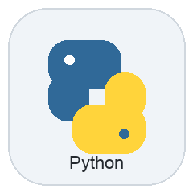 | **Python 3.10+** | Core Language | Primary implementation language for Azure AI SDKs, Pydantic schemas, AsyncIO, and ML pipelines. |
| 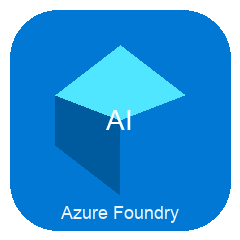 | **Azure AI Foundry** | Enterprise Platform | Central workspace for Hubs, Projects, model catalog, evaluation suites, and RBAC governance. |
| 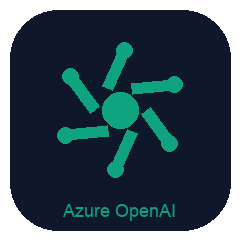 | **Azure OpenAI Service** | Frontier LLMs | Deploying and fine-tuning GPT-4o, GPT-4o-mini, reasoning models, and embedding models. |
| 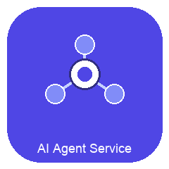 | **Azure AI Agent Service** | Agentic AI | Building stateful autonomous agents with persistent Threads, Runs, and sandboxed Code Interpreter. |
| 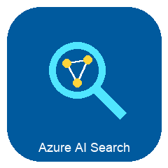 | **Azure AI Search** | Knowledge & RAG | High-performance vector indexing (HNSW), BM25 full-text search, and the deep-learning Semantic Reranker. |
| 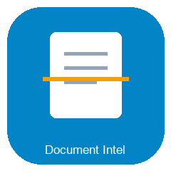 | **Azure AI Document Intelligence** | Document AI | Extracting tables, layout hierarchy, and markdown from complex unstructured enterprise PDFs. |
| 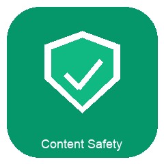 | **Azure AI Content Safety** | Safety & Policy | Real-time defense against prompt injection, jailbreaks, malicious payloads, and PII exposure. |
| 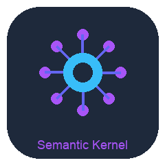 | **Semantic Kernel & AutoGen** | Multi-Agent Swarms | Multi-agent coordination, tool execution pipelines, and stateful collaborative workflows. |
| 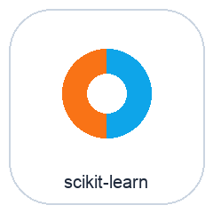 | **Scikit-learn & ML Core** | Telemetry Analytics | Machine learning feature engineering, statistical baselines, and unsupervised anomaly detection. |
| 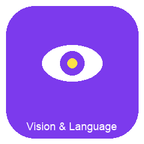 | **Azure AI Vision & Language** | Cognitive Services | OCR Read API, GPT-4o Multimodal visual reasoning, Named Entity Recognition, and PII redaction. |

---

## 4. Day-by-Day 22-Day Course Curriculum (44 Hours Total)

---

### Week 1: Azure AI Cloud Core, Python ML Foundations & Generative AI (Days 1–5 | 10 Hours)

* **Day 1: Cloud AI Architecture & Azure AI Foundry**
  * Overview of the Microsoft AI Ecosystem & Certification Exam AI-103 roadmap.
  * Setting up Azure AI Foundry Hubs, Projects, and Connected Compute Resources.
  * Security fundamentals: Microsoft Entra ID authentication and Azure RBAC roles.
  * *Hands-on Lab:* Provision a secure Azure AI Foundry Project with Key Vault and storage integration.

* **Day 2: Python for AI Engineers & API Workflows**
  * Python refresher for AI: AsyncIO, REST API interactions, and environment variables.
  * Working with JSON payloads and data modeling with Pydantic.
  * Programmatic access to Azure via `azure-identity` and `DefaultAzureCredential`.
  * *Hands-on Lab:* Build an authenticated Python client script that talks securely to Azure AI services without hardcoded API keys.

* **Day 3: Applied Machine Learning for AI Engineers**
  * Bridging classical ML with modern GenAI: What are high-dimensional vectors and embeddings?
  * Metric feature engineering, normalization, and baseline anomaly detection.
  * Training an unsupervised **Isolation Forest** model in `scikit-learn`.
  * *Hands-on Lab:* Train and export a Python ML anomaly detector for server performance telemetry.

* **Day 4: Azure OpenAI Frontier Models & Deployments**
  * LLM architecture: Tokens, context windows, temperature, top_p, and seed.
  * Model families: GPT-4o, GPT-4o-mini, reasoning models, and embedding models.
  * Deployment types: Standard vs. Global vs. Provisioned Throughput Units (PTU).
  * *Hands-on Lab:* Deploy GPT-4o and text-embedding-3 models in Azure OpenAI; test inference via Python SDK.

* **Day 5: Advanced Prompt Engineering & Structured Output Schemas**
  * System prompt design, role conditioning, and few-shot in-context learning.
  * Preventing hallucinations; enforcing deterministic responses.
  * Schema-constrained JSON outputs using Pydantic and JSON mode.
  * *Hands-on Lab:* Build a production-grade incident classifier that outputs validated JSON payloads with guaranteed schema compliance.

---

### Week 2: Enterprise RAG Architecture & Cognitive Knowledge Systems (Days 6–10 | 10 Hours)

* **Day 6: Retrieval-Augmented Generation (RAG) Architecture**
  * Why RAG? Solving knowledge cutoff, private enterprise data integration, and hallucination.
  * Document preprocessing: Chunking strategies (fixed-size, token-aware, semantic boundary).
  * Vector mathematical representations and cosine similarity vs. Euclidean distance.
  * *Hands-on Lab:* Implement a token-aware document chunker and vector embedding generator in Python.

* **Day 7: Vector Indexing with Azure AI Search**
  * Introduction to Azure AI Search architecture and index schemas.
  * Configuring vector fields, HNSW (Hierarchical Navigable Small World) algorithms, and vector profiles.
  * Ingesting and querying vector embeddings programmatically.
  * *Hands-on Lab:* Create an Azure AI Search vector index and execute pure vector search queries.

* **Day 8: Hybrid Search & Semantic Reranking**
  * The limits of pure vector search vs. keyword search (BM25).
  * Combining vector similarity with full-text search (Reciprocal Rank Fusion - RRF).
  * Activating Microsoft's deep-learning **Semantic Reranker** for ultra-high relevance.
  * *Hands-on Lab:* Benchmark Search Accuracy: Pure Vector vs. BM25 vs. Hybrid + Semantic Reranker.

* **Day 9: Azure AI Document Intelligence**
  * Extracting unstructured data from complex multi-page enterprise documents.
  * Prebuilt models: Invoices, Receipts, and Identity documents.
  * Layout model: Parsing nested tables, hierarchies, and markdown formatting.
  * *Hands-on Lab:* Ingest PDF operational playbooks, extract structured markdown tables, and prepare chunks for RAG.

* **Day 10: Building an Enterprise RAG Knowledge Base Pipeline**
  * End-to-end integration: Document Intelligence + Azure AI Search + Azure OpenAI.
  * Implementing conversation memory and multi-turn query rewriting.
  * Citation tracking and source verification.
  * *Hands-on Lab:* Build a complete RAG system that answers questions over technical PDF runbooks with exact page and section citations.

---

### Week 3: Autonomous AI Agents, Multi-Agent Swarms & Guardrails (Days 11–15 | 10 Hours)

* **Day 11: The Shift to Agentic AI (Agents vs. Chatbots)**
  * Understanding autonomous agents: Perception, Planning, Memory, and Action Execution.
  * The ReAct framework (Reason + Act) and dynamic plan creation.
  * Overview of the **Azure AI Agent Service** (Threads, Runs, Messages).
  * *Hands-on Lab:* Build a basic single-purpose autonomous agent with persistent conversation threads.

* **Day 12: Equipping Agents with Tools & Code Interpreter**
  * Native agent capabilities: Sandboxed Python **Code Interpreter** and File Search.
  * Custom function calling: Defining JSON tool definitions for external APIs.
  * State management across asynchronous agent runs.
  * *Hands-on Lab:* Build an agent that accepts a CSV file, writes and executes Python code in a sandbox, and returns generated charts.

* **Day 13: Multi-Agent Orchestration & Frameworks**
  * Why multi-agent? Specialization, modularity, and error isolation.
  * Multi-agent architectures: Sequential hand-offs, Group chats, and Hierarchical supervisor patterns.
  * Working with **Semantic Kernel** / **AutoGen** in Python.
  * *Hands-on Lab:* Build a 2-agent collaborative team (Researcher Agent + Editor Agent) that drafts technical summaries.

* **Day 14: Responsible AI, Safety & Policy Enforcement**
  * Direct and Indirect prompt injection attacks (jailbreaking, prompt leaks).
  * Deploying **Azure AI Content Safety** (Hate, Violence, Sexual, Self-Harm filters).
  * Custom blocklists, regex guardrails, and prompt shields.
  * *Hands-on Lab:* Build a security gateway that screens user inputs and model outputs against prompt injection and destructive commands.

* **Day 15: Automated Evaluation & Telemetry in Azure AI Foundry**
  * Measuring GenAI quality: Groundedness, Relevance, Coherence, and Fluency.
  * LLM-as-a-Judge evaluation pipelines.
  * Tracing agent latency, token consumption, and errors using Application Insights.
  * *Hands-on Lab:* Run an automated evaluation dataset against your RAG/Agent system and generate an enterprise evaluation report.

---

### Week 4: Cognitive Services & Production AIOps Capstone Project (Days 16–20 | 10 Hours)

* **Day 16: Computer Vision & Multimodal Text Analytics**
  * Azure AI Vision: OCR (Read API) and Multimodal GPT-4o with Vision.
  * Analyzing architectural diagrams, server racks, and error screenshots visually.
  * Azure AI Language: Entity Recognition (NER) and automatic PII redaction.
  * *Hands-on Lab:* Build a tool that redacts sensitive keys/passwords from error logs and analyzes architecture diagram images.

* **Day 17: Capstone Phase 1 – Telemetry Ingestion & ML Anomaly Detection**
  * Project Introduction: **CloudSentinel AIOps Incident Commander**.
  * Setting up the simulated cloud telemetry stream (CPU, RAM, 5xx errors, latency).
  * Implementing the unsupervised ML anomaly detector to identify system incidents.
  * *Hands-on Lab:* Complete the telemetry ingestion and ML anomaly detection engine.

* **Day 18: Capstone Phase 2 – Operational Runbook Knowledge Ingestion**
  * Ingesting complex SRE incident playbooks, network topologies, and disaster recovery docs.
  * Parsing tables and workflows with Document Intelligence; indexing with Azure AI Search.
  * *Hands-on Lab:* Deploy the vector/hybrid RAG knowledge base for cloud incident playbooks.

* **Day 19: Capstone Phase 3 – Autonomous Multi-Agent Incident Swarm**
  * Developing the multi-agent orchestration team:
    1. *Triage Agent:* Classifies severity (P1/P2) and blast radius.
    2. *Diagnostic Agent:* Analyzes logs and writes Python code to trace errors.
    3. *Remediation Agent:* Retrieves verified runbooks and drafts remediation commands.
  * *Hands-on Lab:* Connect the multi-agent swarm to the ML anomaly trigger.

* **Day 20: Capstone Phase 4 – Safety Gateways, Evals & System Defense**
  * Implementing the Human-in-the-Loop approval gateway and Content Safety validation.
  * Running Azure AI Foundry Groundedness evaluations.
  * *Hands-on Lab:* Live incident simulation test, capstone project demonstration, and peer code review.

---

### Certification Sprint: Microsoft Exam AI-103 Preparation (Days 21–22 | 4 Hours)

* **Day 21: AI-103 Domain Deep Dive, Case Study Analysis & Question Mechanics (2 Hours)**
  * **Exam Structure & Logistics:** Question formats (Multiple-choice, Drag-and-Drop, Case Studies, Hot Area, Repeated-Scenario questions).
  * **Domain Weightage Review:**
    * *Domain 1 (25–30%):* Plan and manage an Azure AI solution (RBAC, VNet, Quotas, Content Safety).
    * *Domain 2 (30–35%):* Implement generative AI & agentic solutions (Foundry, Agents, RAG, Semantic Search).
    * *Domain 3 (10–15%):* Information extraction (Document Intelligence, Content Understanding).
    * *Domain 4 (10–15%):* Text analysis (Language, Translator, Speech, PII).
    * *Domain 5 (10–15%):* Computer vision (Vision Read OCR, GPT-4o Multimodal).
  * **Case Study Dissection:** Walking through typical Microsoft enterprise case studies (analyzing business requirements, technical constraints, security compliance, and selecting optimal AI architectures).
  * **High-Yield Pitfall Traps:** Distinguishing between similar services (CLU vs. Azure OpenAI, Document Intelligence layout vs. custom models, Hybrid vs. Vector search).

* **Day 22: Full-Length Timed Mock Exam, Live Walkthrough & Readiness Sign-off (2 Hours)**
  * **Timed Mock Assessment (60 mins):** Students complete a curated 45-question practice exam simulating actual AI-103 testing conditions.
  * **Interactive Question-by-Question Review (45 mins):**
    * Detailed review of high-error questions.
    * Explaining the underlying rationale behind correct options and distractor elimination strategies.
  * **Final Certification Roadmap & Readiness Sign-off (15 mins):**
    * Scheduling guidelines via Pearson VUE.
    * Providing students with high-yield revision cheat sheets, official Microsoft Learn assessment links, and post-training support roadmap.

---

## 5. Flagship Capstone Project: CloudSentinel AIOps

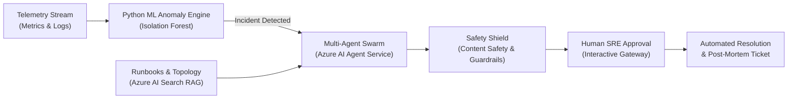

### Capstone Deliverables Built by Students:
1. **Telemetry Anomaly Engine:** Pure Python/Scikit-learn model that detects performance anomalies without wasting LLM tokens.
2. **Hybrid RAG Runbook System:** Azure AI Search + Document Intelligence knowledge store indexing technical disaster-recovery playbooks.
3. **Multi-Agent Incident Swarm:** Cooperative autonomous agents that isolate root causes, correlate traces, and draft remediation scripts.
4. **Safety & Governance Shield:** Regex filters and Azure AI Content Safety to prevent destructive operational commands.

---

## 6. Business Value & Measurable Course Outcomes

Upon completing this 44-hour course, participants will be able to:
1. **Clear Exam AI-103 on the First Attempt:** Equipped with comprehensive domain coverage, case study experience, and timed mock exam practice.
2. **Build Production Generative AI Applications:** Architect and deploy enterprise-grade RAG and Agentic solutions using official Azure AI Foundry services.
3. **Bridge Traditional ML & Modern LLMs:** Confidently combine predictive ML models with generative agent reasoning.
4. **Enforce Enterprise AI Governance:** Implement robust security, data privacy, PII redaction, and prompt injection defenses.
5. **Stand Out in Placements & Interviews:** College students enter technical job interviews backed by an enterprise GitHub capstone project and globally verified Microsoft Associate credentials.

---

## 7. Course Pricing & Enrollment Plans

We offer two transparent, high-value enrollment tiers designed for working professionals, career switchers, and ambitious university students:

| Feature / Benefit Included | Standard Plan (Training Only) | Certification Bundle (With $100 Voucher) |
| :--- | :---: | :---: |
| **Course Fee** | **₹14,999** | **₹19,999** |
| **Duration & Hours** | 22 Days (44 Hours Live) | 22 Days (44 Hours Live) |
| **Eligible Participants** | Professionals & College Students | Professionals & College Students |
| **50% Architecture + 50% Coding Labs** | Included | Included |
| **AIOps Production Capstone Project** | Included | Included |
| **GitHub Repository Access (Code & Starter Kits)** | Included | Included |
| **Lifetime Access to Session Recordings** | Included | Included |
| **2-Day Exam AI-103 Sprint & Timed Mock Tests** | Included | Included |
| **Course Completion Certificate** | Included | Included |
| **Official $100 USD Microsoft Exam AI-103 Voucher** | *Not Included* | **Included (Direct Pearson VUE Voucher)** |
| **1-on-1 Exam Scheduling & Voucher Guidance** | *Not Included* | **Included** |
| **Priority Architecture Code Review & Mentorship** | Standard | **Priority VIP Support** |

> [!TIP]
> **Why Choose the Certification Bundle (₹19,999)?**
> The official Microsoft Exam AI-103 certification fee is **$100 USD (approximately ₹8,300 – ₹8,500 INR)** when purchased standalone. The Certification Bundle saves learners over **₹3,500+** while providing an end-to-end, all-inclusive pass from training to certified credential.

---

## 8. Frequently Asked Questions (FAQ)

### General Course & Prerequisites

#### Q1: Can university/college students enroll, or is this only for working professionals?
* **Answer:** **University and college students can absolutely enroll!** This course is specially designed to cater to **both working professionals and university students** (pursuing B.Tech, B.E., BCA, MCA, B.Sc/M.Sc in CS, IT, or related STEM fields). 
  * *For College Students:* Having this associate-level Microsoft credential and a production-grade multi-agent AIOps capstone project on your resume provides an enormous competitive advantage during on-campus and off-campus placements, internship drives, and technical coding interviews.
  * *For Working Professionals:* It enables a rapid, structured transition from traditional software development, QA, or data roles into high-compensation AI Engineering roles.

#### Q2: What are the exact prerequisites? What if I only studied basic Python in college?
* **Answer:** Basic college-level Python is completely sufficient!
  1. *Mandatory:* Foundational Python knowledge (variables, loops, functions, lists/dictionaries, and basic familiarity with calling APIs).
  2. *Preferred:* High-level familiarity with basic Machine Learning concepts. If you haven't taken an advanced ML course, don't worry: our Day 3 applied session covers high-dimensional feature vectors, embeddings, and anomaly detection from first principles.

#### Q3: What is the format and timing of the classes?
* **Answer:** The course spans **1 Month (22 working days, Monday through Friday)**. Each session lasts **2 hours** (totaling 44 hours of live instruction). Each daily session is divided 50/50: the first hour covers enterprise architecture and concepts, and the second hour is dedicated to guided live coding in hands-on labs.

---

### Certification & Exam AI-103

#### Q4: How is Exam AI-103 different from AI-900 and AI-102?
* **Answer:**
  * **AI-900** is an entry-level, conceptual fundamentals exam with zero coding or architecture requirements.
  * **AI-102** was Microsoft's previous certification, heavily weighted toward older legacy cognitive services.
  * **AI-103** is Microsoft's newest, flagship associate credential focused explicitly on **Generative AI, Azure AI Foundry, Autonomous Agent Service, Multi-Agent Swarms, and Enterprise RAG**. It is the most up-to-date credential for modern AI engineers.

#### Q5: How does the official $100 Microsoft Exam Voucher work in the ₹19,999 plan?
* **Answer:** Upon completing the training, learners in the ₹19,999 plan receive an authentic **Microsoft Pearson VUE Exam Voucher code (valued at $100 USD)**. You can redeem this voucher on Pearson VUE to schedule your official proctored online or test-center exam anywhere globally at zero additional cost.

#### Q6: Are practice tests and exam simulations included?
* **Answer:** Yes! Days 21 and 22 are 100% dedicated to Microsoft Exam AI-103 preparation. You will complete a full-length 45-question timed mock exam under realistic testing conditions, followed by an in-depth question-by-question dissection of case studies and answer rationales.

---

### Hands-on Labs & Technical Projects

#### Q7: Do I need an active Azure subscription, and will it cost me extra?
* **Answer:** You will need an Azure account. During Day 1, we guide you through setting up an Azure Free Trial ($200 USD credit) or the Azure for Students program ($100 credit without credit card requirements for college students). Throughout the course, we teach cost-optimized architectures (such as using global `gpt-4o-mini` and shared search tiers) so that your lab exercises remain within free-tier thresholds.

#### Q8: What makes the Capstone Project (CloudSentinel AIOps) unique for resumes and placements?
* **Answer:** Unlike simple tutorial chatbots, **CloudSentinel** is a production-grade enterprise system. It combines classical machine learning (unsupervised telemetry anomaly detection) with a multi-agent swarm (triage, diagnostic, and remediation agents) and hybrid vector RAG over operational playbooks. It is a standout project for your technical portfolio, GitHub, and campus placement interviews.

---

### Access, Recordings & Support

#### Q9: What happens if I miss a live session due to college exams or office work?
* **Answer:** Every single session is recorded in high definition and uploaded to your student portal within 2 hours of class completion. You receive **lifetime access** to all session recordings, presentation slides, Jupyter notebooks, and solution source code repositories.

#### Q10: Will I receive a course completion certificate?
* **Answer:** Yes. Upon successfully completing the course labs and submitting the capstone project milestones, you will receive an official **Course Completion Certificate** validating 44 hours of specialized training in Azure AI & Agentic Development. Learners who pass the Pearson VUE exam will also earn the globally accredited **Microsoft Certified: Azure AI Apps and Agents Developer Associate** badge.
