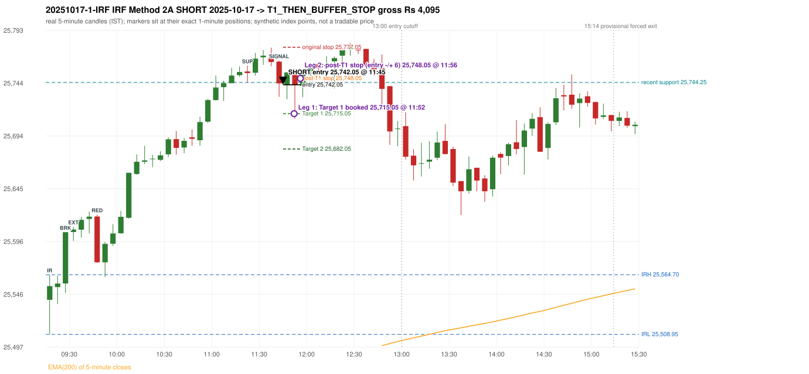

# Trading journal - 2025-10-17 (Friday)

> Automated, read-only reconstruction of the Phase 3.0 baseline. Synthetic NIFTY 50 index-point P&L (the index is not tradable). The owner's review status is intentionally blank.

## A. Trading day overview

| item | value |
|---|---|
| Date / weekday | 2025-10-17 / Friday |
| Session type | USABLE / VALID |
| Original session open (first 1-minute open) | 25,541.30 |
| Previous session | 2025-10-16 |
| Previous-day high / low | 25,624.80 / 25,382.85 |
| Previous-day official close / last 5-minute close | 25,585.30 / 25,566.30 |
| Raw engine records / confirmed signals / fully valid signals | 5 / 2 / 2 |
| Setups that did not complete (invalidated / incomplete) | 3 |
| Executed trades | 1 20251017-1-IRF |
| Gross P&L (Rs, synthetic) | 4,095.00 |
| Illustrative net P&L (Rs; Rs 500/trade + 0.5 pt/fill) | 3,205.00 |
| Day-end portfolio status | DAY_FINISHED |
| Manual journal trades (matched / unmatched) | 0 (0 / 0) |
| Extra automated trades | 1 |

## B. Daily strategy signal timeline (confirmed signals, chronological)

| time | strategy | method | dir | entry-rule status | valid for execution | <= 13:00 | portfolio state | accepted / ignored | specific reason | competing (same minute) |
|---|---|---|---|---|---|---|---|---|---|---|
| 11:45 | IRF | Method 2A | SHORT | PROPOSAL_DEPENDENT | True | True | FIRST_TRADE_ACTIVE | ACCEPTED -> 20251017-1-IRF | first eligible signal of the day; trade 1: T1_THEN_BUFFER_STOP |  |
| 12:40 | IRF | Method 2B | SHORT | PROPOSAL_DEPENDENT | True | True | DAY_FINISHED | IGNORED | DAY_FINISHED [blocked by IRF#1] |  |

Engine setups that did not complete (3); the complete list with failed rule ids is in `rejected_signals.csv`:

| candle | strategy | method | dir | status | precise reason | failed rules |
|---|---|---|---|---|---|---|
| 12:35 | IRF | Method 1/2 | SHORT | INCOMPLETE_AT_EOD | SESSION_ENDED_BEFORE_CONFIRMATION |  |
| 09:15 | ORB | Method 2 | SHORT | INVALIDATED | TREND:EMA_PREV_SESSION_CLOSE wrong side | ORB-TREND-001;ORB-TREND-002 |
| 09:15 | PDS | Method 1/2/3 | SHORT | INVALIDATED | GAP_DOWN_OPEN_NOT_BELOW_ZONE | PDS-006 |

## C. Detailed trade journals

### 20251017-1-IRF: IRF Method 2A SHORT (FIRST trade)

Chart: 

**Rule configuration:** CFG-baseline-be1db2a09d - signal verification status **PROPOSAL_DEPENDENT** (never VERIFIED while a rule rests on a proposal).

#### 1. Setup identification

IRF Method 2A SHORT: the 09:25-09:30 candle closed at 25,604.40, above IRH 25,564.70, and the next candle did not close back inside the range, so the setup is Method 2 and price stayed above it until the trigger. Extension candle 09:30-09:35, red candle 09:45-09:50. The trigger came 27 candles after the breakout candle: a completed candle closed below the recent pullback-low support (11:40-11:45); confirmed at 11:45 with close 25,743.35. Entry reference close 25,743.35 is 178.65 points above IRH 25,564.70.

#### 2. Candle and indicator calculations

| role | session | candle | O | H | L | C | range | body % | upper wick % | lower wick % | direction | EMA(200) | strong bull / bear | pin bull / bear | small (body<=30%) | used for |
|---|---|---|---|---|---|---|---|---|---|---|---|---|---|---|---|---|
| initial_range_candle | TODAY | 09:15-09:20 | 25,541.30 | 25,564.70 | 25,508.95 | 25,554.05 | 55.75 | 22.87 | 19.10 | 58.03 | BULLISH | 25,387.17 | False / False | True / False | True | initial range = high/low of the 09:15 candle |
| signal_candle | TODAY | 11:40-11:45 | 25,763.70 | 25,764.70 | 25,730.80 | 25,743.35 | 33.90 | 60.03 | 2.95 | 37.02 | BEARISH | 25,462.15 | False / False | False / False | False | candle whose close completed the trigger |
| breakout_candle | TODAY | 09:25-09:30 | 25,556.50 | 25,604.40 | 25,547.55 | 25,604.40 | 56.85 | 84.26 | 0.00 | 15.74 | BULLISH | 25,391.00 | True / False | False / False | False | breakout candle: a completed candle closing above IRH |
| extension_candle | TODAY | 09:30-09:35 | 25,604.55 | 25,609.55 | 25,596.25 | 25,606.90 | 13.30 | 17.67 | 19.92 | 62.41 | BULLISH | 25,393.15 | False / False | True / False | True | extension: first later candle trading above the breakout candle's high |
| red_candle | TODAY | 09:45-09:50 | 25,619.05 | 25,620.85 | 25,575.55 | 25,576.30 | 45.30 | 94.37 | 3.97 | 1.66 | BEARISH | 25,399.37 | False / True | False / False | False | first red candle during the extension |
| support_pivot | TODAY | 11:20-11:25 | 25,754.45 | 25,759.90 | 25,744.25 | 25,753.00 | 15.65 | 9.27 | 34.82 | 55.91 | BEARISH | 25,449.97 | False / False | False / False | True | recent support: latest 3-candle fractal low formed after the breakout |

Every condition, with the rule, the calculation, the observed values and the result:

| # | group | rule | result | status / numeric definition | calculation | observed | required | available at | why it matters |
|---|---|---|---|---|---|---|---|---|---|
| 1 | SELECTION | SEL-FIRST-001 | PASS | USER_APPROVED / USER_APPROVED | earliest CONFIRMED signal of the day across IRF/ORB/PDR/PDS/RF that passed the controller's checks | 0 confirmed signal(s) earlier today; 2 confirmed signals in the day in total, this one at 11:45 | no earlier executable signal | 2025-10-17 11:45 | the shared controller trades only the first valid signal; the five strategies are not independent positions |
| 2 | SELECTION | SEL-TIE-001 | PASS | USER_APPROVED / USER_APPROVED | other CONFIRMED signals with exactly the same confirmation timestamp | none | no different-strategy / opposite-direction signal in the same minute (otherwise an unresolved conflict, no trade) | 2025-10-17 11:45 | an unresolved same-minute collision would have produced no trade at all |
| 3 | SELECTION | ENTRY-CUTOFF-001 | PASS | USER_APPROVED / USER_APPROVED | fill timestamp vs 13:00:00 IST | signal confirmed 11:45; fill 11:45 | fill at or before 13:00:00 IST | 2025-10-17 11:45 | no new position may be entered with a fill after 13:00 IST |
| 4 | SELECTION | EXE-FILL-001 | PASS | PROPOSED_FOR_REVIEW / PROPOSED_FOR_REVIEW | fill = open of the 1-minute bar that starts at the signal candle's end | bar 11:45 O 25,742.05 H 25,742.85 L 25,736.90 C 25,736.90; executable=True; entry 25,742.05 | fill bar exists, starts exactly at the signal end, is fillable; entry = its open | 2025-10-17 11:45 | a 5-minute signal is known only when its candle closes; the first price that can be traded is the next minute's open |
| 5 | SELECTION | DAY-MAX-001 | PASS | USER_APPROVED / USER_APPROVED | number of entries today | trade 1 of at most 2 | <= 2 entries per day | 2025-10-17 11:45 | daily trade cap |
| 6 | SETUP | IRF-GLOBAL-001 | PASS | SOURCE_VERIFIED / EXPLICIT_IN_SOURCE | initial range = high and low (wicks included) of the first completed 5-minute candle | 09:15-09:20 IRH 25,564.70, IRL 25,508.95 (range 55.75; engine recorded IRH 25,564.70, IRL 25,508.95) | high/low of the 09:15-09:20 candle | 2025-10-17 09:20 | all three IRF methods measure price against this range |
| 7 | SETUP | IRF-GLOBAL-003 | PASS | SOURCE_VERIFIED / EXPLICIT_IN_SOURCE | closes confirm, wicks do not: every trigger is evaluated on a completed 5-minute candle | trigger candle 11:40-11:45 was complete when the signal was stamped 11:45; decision uses its close 25,743.35 | completed candle close, not an intra-candle wick | 2025-10-17 11:45 | an intra-candle wick can reverse before the candle closes |
| 8 | SETUP | IRF-GLOBAL-002 | PASS | SOURCE_VERIFIED / EXPLICIT_IN_SOURCE | direction | SHORT (IRF trades short only) | short only | 2025-10-17 11:45 | IRF fades failed upside breakouts |
| 9 | SETUP | IRF-M2-001 | PASS | SOURCE_VERIFIED / EXPLICIT_IN_SOURCE | breakout candle close vs IRH | 09:25-09:30 O 25,556.50 H 25,604.40 L 25,547.55 C 25,604.40; range 56.85, body 47.90 (84.26%), upper wick 0.00 (0.00%), lower wick 8.95 (15.74%), bullish; close 25,604.40 is 39.70 points above IRH 25,564.70 | close > IRH (a wick above IRH is not a breakout) | 2025-10-17 09:30 | starts every IRF setup |
| 10 | SETUP | IRF-M2-004 | PASS | SOURCE_VERIFIED / EXPLICIT_IN_SOURCE | the candle after the breakout must NOT close back inside the range (else the setup is Method 1) | 09:30 close 25,606.90 vs [25,508.95, 25,564.70) | not (IRL <= close < IRH) | 2025-10-17 09:35 | separates Method 2 (price holds above) from Method 1 (immediate failure) |
| 11 | SETUP | IRF-M2-002 | PASS | SOURCE_VERIFIED / QUALITATIVE_SOURCE_NUMERIC_DEFINITION_PROPOSED_FOR_REVIEW | extension = a later candle whose high exceeds the breakout candle's high (research definition E1) | 09:30 high 25,609.55 vs breakout candle high 25,604.40 (+5.15) | high > breakout candle high | 2025-10-17 09:35 | the guide says price 'extends further upward'; the numeric test is a proposal |
| 12 | SETUP | IRF-M2-003 | PASS | SOURCE_VERIFIED / QUALITATIVE_SOURCE_NUMERIC_DEFINITION_PROPOSED_FOR_REVIEW | a red candle (close < open) forms after the extension | 09:45-09:50 O 25,619.05 H 25,620.85 L 25,575.55 C 25,576.30; range 45.30, body 42.75 (94.37%), upper wick 1.80 (3.97%), lower wick 0.75 (1.66%), bearish | close < open, at or after the candle following the extension | 2025-10-17 09:50 | the red candle shows the first pause/reversal inside the extension |
| 13 | CONFIRMATION | IRF-M2A-001 | PASS | SOURCE_VERIFIED / QUALITATIVE_SOURCE_NUMERIC_DEFINITION_PROPOSED_FOR_REVIEW | recent support = latest 3-candle fractal low (k=1) among candles b+1 ... i-2 | 11:20 low 25,744.25; neighbours' lows 25,749.45 (11:15) and 25,750.55 (11:25) are not lower; engine recorded support 25,744.25 | pivot low known before the trigger candle | 2025-10-17 11:30 | the support is the level whose break completes Method 2A (the exact 'pullback low' definition is a proposal) |
| 14 | CONFIRMATION | IRF-M2A-002 | PASS | SOURCE_VERIFIED / EXPLICIT_WORDING_DETAIL_PROPOSED_FOR_REVIEW | trigger candle closes below recent support | 11:40 close 25,743.35 vs support 25,744.25: 0.90 points below | close < support (close, not wick) | 2025-10-17 11:45 | completes Method 2A |
| 15 | CONFIRMATION | IRF-M2-005 | PASS | SOURCE_VERIFIED / EXPLICIT_IN_SOURCE | chronology: the red candle precedes the break candle | red candle 09:45, break candle 11:40 | red candle index < break candle index (m2a_break_may_be_red_candle = False) | 2025-10-17 11:45 | a red candle alone is not confirmation; a level break is required |
| 16 | EXECUTION | EXE-STOP-001 | PASS | USER_APPROVED / USER_APPROVED | initial stop = entry + 35 points | entry 25,742.05 -> stop 25,777.05 | stop 35 index points (BASELINE) | 2025-10-17 11:45 | defines the loss if the setup fails before Target 1 |
| 17 | EXECUTION | EXE-T1-001 | PASS | SOURCE_VERIFIED / EXPLICIT_IN_SOURCE | Target 1 = entry +/- 27 points | T1 25,715.05 | 27 points | 2025-10-17 11:45 | Leg 1 (3 lots) is booked at Target 1 |
| 18 | EXECUTION | IRF-TGT-001 | PASS | SOURCE_VERIFIED / EXPLICIT_IN_SOURCE | Target 2 = entry +/- 60 points | T2 25,682.05 | 60 points | 2025-10-17 11:45 | Leg 2 (3 lots) is booked at Target 2 |
| 19 | EXECUTION | POST-T1-STOP-006 | PASS | USER_APPROVED / USER_APPROVED | after T1 the Leg-2 stop = entry + 6 (no trailing) | post-T1 stop 25,748.05 | entry -6 (LONG) / +6 (SHORT) | 2025-10-17 11:45 | protects the remaining three lots once the first three are booked |
| 20 | EXECUTION | SIZE-LOT-001 | PASS | USER_APPROVED / USER_APPROVED | 6 lots x 65 = 390, Leg 1 = 3 lots = 195, Leg 2 = 195 | 6 lots, lot size 65, legs 3+3 | 6 lots in two equal legs | 2025-10-17 11:45 | position size for the synthetic P&L |
| 21 | NOTE | IRF-M2-006 | UNRESOLVED | UNRESOLVED / UNRESOLVED | delay between the breakout candle and this trigger; expiry rule | 27 candles after the breakout; expiry none configured | the source states no expiry | 2025-10-17 11:45 | an old breakout can still trigger hours later |
| 22 | NOTE | IRF-M2-006 | UNRESOLVED | UNRESOLVED / UNRESOLVED | did price stay above IRH between the breakout and the trigger? | 0 closes at or below IRH between 09:30 and 11:40; trigger close 25,743.35 above IRH 25,564.70 | the engine does not require price to stay above IRH | 2025-10-17 11:45 | the guide describes price 'holding above IRH and keeping rising'; the code only needs the level break |
| 23 | NOTE | IRF-GLOBAL-004 | UNRESOLVED | UNRESOLVED / UNRESOLVED | which close above IRH of the session produced this attempt; repeat setups | this breakout is upward crossing no. 1 of the session (a close above IRH after a close at/below it) | the source states no first-breakout-only, re-arming, expiry or trades-per-day rule | 2025-10-17 11:45 | IRF re-arms on every later breakout in the code, producing many raw setups; the controller keeps only the first |
| 24 | NOTE | NOTE-IRF-REPEATED-SETUPS | NOT_APPLICABLE | NOT_A_RULE / NOT_A_REGISTRY_RULE | other IRF signals later in the session (not traded) | 1 further confirmed IRF signal(s): Method 2B@12:40 | disclosure of repeated raw setups | 2025-10-17 11:45 | repeated raw IRF setups are not hidden; they are logged as ignored |
| 25 | NOTE | IRF-SL-001 | NOT_APPLICABLE | SOURCE_VERIFIED / QUALITATIVE_SOURCE_NUMERIC_DEFINITION_PROPOSED_FOR_REVIEW | the guide's 35-or-40 rule: 35 if the most recent green candle's high is within 35 points of entry, else 40 | most recent green candle high 25,774.55 is 32.50 points from the entry 25,742.05: the guide's rule would select 35 points; the baseline applies a fixed 35 (USER_APPROVED research baseline; the 35-vs-40 selection and the 40-point variant are separate labelled scenarios) | source selection rule | 2025-10-17 11:45 | the stop distance is a modelling choice and changes losses, not entries |
| 26 | NOTE | NOTE-UNRESOLVED-DEPENDENCIES | UNRESOLVED | NOT_A_RULE / NOT_A_REGISTRY_RULE | rules the signal depends on that the sources leave unresolved | engine-recorded unresolved rule ids: IRF-GLOBAL-004; verification status PROPOSAL_DEPENDENT | n/a (disclosure) | 2025-10-17 11:45 | the entry is only as verified as the rules it rests on |

#### 3. Entry decision and explanation

IRF Method 2A SHORT: the 09:25-09:30 candle closed at 25,604.40, above IRH 25,564.70, and the next candle did not close back inside the range, so the setup is Method 2 and price stayed above it until the trigger. Extension candle 09:30-09:35, red candle 09:45-09:50. The trigger came 27 candles after the breakout candle: a completed candle closed below the recent pullback-low support (11:40-11:45); confirmed at 11:45 with close 25,743.35. Entry reference close 25,743.35 is 178.65 points above IRH 25,564.70.

**Why this trade ahead of the other strategies:** This IRF Method 2A signal was the earliest executable signal of the day: 0 confirmed signal(s) earlier, 0 other in the same minute. 1 later confirmed signal(s) (IRF x1) are logged as ignored or rejected. State of the other four engines at that moment: [ORB: Method 2 invalidated at 09:15: TREND:EMA_PREV_SESSION_CLOSE wrong side] [PDR: no setup record before this time (a base condition was not met, or nothing triggered)] [PDS: Method 1/2/3 invalidated at 09:15: GAP_DOWN_OPEN_NOT_BELOW_ZONE] [RF: no setup record before this time (a base condition was not met, or nothing triggered)]

#### 4. Actual entry execution

| item | value |
|---|---|
| Signal candle | 11:40-11:45 |
| Signal confirmed | 2025-10-17 11:45 |
| Fill timestamp | 2025-10-17 11:45 |
| Entry price | 25,742.05 |
| Source partition / 1-minute bar | data/processed/nifty50/year=2025/month=10/candles.parquet / 2025-10-17 11:45 |
| Source bar O / H / L / C | 25,742.05 / 25,742.85 / 25,736.90 / 25,736.90 |
| Fill assumption | open of the 1-minute bar starting at the signal candle's end (EXE-FILL-001, PROPOSED causal convention) |
| Initial stop / T1 / T2 / post-T1 stop | 25,777.05 / 25,715.05 / 25,682.05 / 25,748.05 |
| Position | 6 lots x 65 = 390 units (Leg 1 195, Leg 2 195) |

#### 5-8. Trade progress, Target 1, post-T1 stop and final exit

Between the 11:45 entry bar and the final exit (12 one-minute bars) the best excursion in favour was 31.65 points at 11:53 and the worst against was 12.05 points at 11:49. At 11:52 price reached Target 1 25,715.05 and three lots exited. At 11:52 the remaining three lots' protective stop was set to 25,748.05 (entry + 6; no trailing, no further change); the engine applies it from the Target-1 bar onward and tests it within that same bar. At 11:56 the remaining three lots stopped out at 25,748.05. T1_THEN_BUFFER_STOP: no second trade that day (DAY-BUF-001).

| leg | qty | exit time | exit price | reason | source 1-minute bar | O / H / L / C | gross points | gross Rs | slippage pts | flags |
|---|---|---|---|---|---|---|---|---|---|---|
| 1 | 195 | 11:52 | 25,715.05 | TARGET_1 | 11:52 | 25,720.85 / 25,723.65 / 25,713.95 / 25,720.10 | 27.00 | 5,265.00 | 0.00 |  |
| 2 | 195 | 11:56 | 25,748.05 | POST_T1_STOP_ENTRY_MINUS_PLUS_6 | 11:56 | 25,738.80 / 25,749.20 / 25,735.05 / 25,747.10 | -6.00 | -1,170.00 | 0.00 |  |

Exit evidence per leg:

* Leg 1: 1-minute bar 11:52 O 25,720.85 H 25,723.65 L 25,713.95 C 25,720.10: low 25,713.95 reached Target 1 25,715.05; Leg 1 booked at the target level
* Leg 2: 1-minute bar 11:56 O 25,738.80 H 25,749.20 L 25,735.05 C 25,747.10: high 25,749.20 reached the post-T1 stop 25,748.05; Leg 2 exits at 25,748.05 at the stop level

#### 9. Gross and illustrative net P&L

| item | value (Rs) |
|---|---|
| Leg 1 gross | 5,265.00 |
| Leg 2 gross | -1,170.00 |
| Trade gross (= Leg 1 + Leg 2) | 4,095.00 |
| Illustrative fixed cost | -500.00 |
| Illustrative slippage (0.5 pt on every fill, entry + exits, all units) | -390.00 |
| Illustrative net | 3,205.00 |

#### 10. Manual journal comparison

EXTRA_AUTOMATED_TRADE: the automated system took IRF Method 2A SHORT at 11:45 (no manual trade that day). The setup rests on: IRF-M2-006: No expiry / validity window for a Method 2 attempt | IRF-M2-006: Engine does not test that price held above IRH | IRF-GLOBAL-004: IRF trades per day / time window / re-arming are not stated in the guide | NOTE-UNRESOLVED-DEPENDENCIES: Disclosure of unresolved source rules behind this signal. The journal shows no corresponding entry.

## D. Manual journal comparison

| comparison | journal row | journal strategy | manual time | manual direction | manual outcome | match class | trade | auto entry | auto outcome | explanation |
|---|---|---|---|---|---|---|---|---|---|---|
| E017 |  |  |  |  |  | EXTRA_AUTOMATED_TRADE | 20251017-1-IRF | 11:45 @ 25,742.05 | T1_THEN_BUFFER_STOP | EXTRA_AUTOMATED_TRADE: the automated system took IRF Method 2A SHORT at 11:45 (no manual trade that day). The setup rests on: IRF-M2-006: No expiry / validity window for a Method 2 attempt \| IRF-M2-006: Engine does not test that price held above IRH \| IRF-GLOBAL-004: IRF trades per day / time window / re-arming are not stated in the guide \| NOTE-UNRESOLVED-DEPENDENCIES: Disclosure of unresolved source rules behind this signal. The journal shows no corresponding entry. |

The journal records no entry price and no exit price (NOT_RECORDED); matching uses date, strategy and candle start only - never P&L.

## E. Daily conclusion

* **Traded:** 20251017-1-IRF - IRF Method 2A SHORT at 11:45 (entry 25,742.05), outcome T1_THEN_BUFFER_STOP, gross Rs 4,095.00, illustrative net Rs 3,205.00. **Why:** This IRF Method 2A signal was the earliest executable signal of the day: 0 confirmed signal(s) earlier, 0 other in the same minute. 1 later confirmed signal(s) (IRF x1) are logged as ignored or rejected. State of the other four engines at that moment: [ORB: Method 2 invalidated at 09:15: TREND:EMA_PREV_SESSION_CLOSE wrong side] [PDR: no setup record before this time (a base condition was not met, or nothing triggered)] [PDS: Method 1/2/3 invalidated at 09:15: GAP_DOWN_OPEN_NOT_BELOW_ZONE] [RF: no setup record before this time (a base condition was not met, or nothing triggered)] **How it ended:** At 11:52 price reached Target 1 25,715.05 and three lots exited. At 11:52 the remaining three lots' protective stop was set to 25,748.05 (entry + 6; no trailing, no further change); the engine applies it from the Target-1 bar onward and tests it within that same bar. At 11:56 the remaining three lots stopped out at 25,748.05. T1_THEN_BUFFER_STOP: no second trade that day (DAY-BUF-001).
* **Ignored / rejected signals:** IRF IGNORED DAY_FINISHED x1
* **Extra automated trade 20251017-1-IRF:** EXTRA_AUTOMATED_TRADE: the automated system took IRF Method 2A SHORT at 11:45 (no manual trade that day). The setup rests on: IRF-M2-006: No expiry / validity window for a Method 2 attempt | IRF-M2-006: Engine does not test that price held above IRH | IRF-GLOBAL-004: IRF trades per day / time window / re-arming are not stated in the guide | NOTE-UNRESOLVED-DEPENDENCIES: Disclosure of unresolved source rules behind this signal. The journal shows no corresponding entry.
* **Open strategy-definition issues that affected this day:** IRF-GLOBAL-004 (NOT STATED: how many IRF trades per day, a latest entry time, and whether a new breakout may re-arm a setup after a signal), IRF-M2-006 (How long a Method 2 setup stays valid (expiry / invalidation before a level breaks) is not stated), NOTE-UNRESOLVED-DEPENDENCIES
* **Automated triage (not an approval; the owner's review status stays blank):** REVIEW: EXTRA_AUTOMATED
