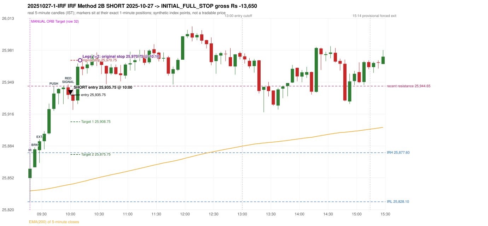

# Trading journal - 2025-10-27 (Monday)

> Automated, read-only reconstruction of the Phase 3.0 baseline. Synthetic NIFTY 50 index-point P&L (the index is not tradable). The owner's review status is intentionally blank.

## A. Trading day overview

| item | value |
|---|---|
| Date / weekday | 2025-10-27 / Monday |
| Session type | USABLE_WITH_FLAGS / VALID |
| Original session open (first 1-minute open) | 25,851.95 |
| Previous session | 2025-10-24 |
| Previous-day high / low | 25,939.30 / 25,718.65 |
| Previous-day official close / last 5-minute close | 25,795.15 / 25,797.45 |
| Raw engine records / confirmed signals / fully valid signals | 9 / 6 / 6 |
| Setups that did not complete (invalidated / incomplete) | 3 |
| Executed trades | 1 20251027-1-IRF |
| Gross P&L (Rs, synthetic) | -13,650.00 |
| Illustrative net P&L (Rs; Rs 500/trade + 0.5 pt/fill) | -14,540.00 |
| Day-end portfolio status | SECOND_TRADE_ELIGIBLE |
| Manual journal trades (matched / unmatched) | 1 (0 / 1) |
| Extra automated trades | 1 |

## B. Daily strategy signal timeline (confirmed signals, chronological)

| time | strategy | method | dir | entry-rule status | valid for execution | <= 13:00 | portfolio state | accepted / ignored | specific reason | competing (same minute) |
|---|---|---|---|---|---|---|---|---|---|---|
| 10:00 | IRF | Method 2B | SHORT | PROPOSAL_DEPENDENT | True | True | FIRST_TRADE_ACTIVE | ACCEPTED -> 20251027-1-IRF | first eligible signal of the day; trade 1: INITIAL_FULL_STOP |  |
| 11:45 | IRF | Method 2A | SHORT | PROPOSAL_DEPENDENT | True | True | SECOND_TRADE_ELIGIBLE | REJECTED | SECOND_TRADE_RESTRICTED_TO_PDR_PDS [blocked by IRF#1] |  |
| 12:25 | IRF | Method 2A | SHORT | PROPOSAL_DEPENDENT | True | True | SECOND_TRADE_ELIGIBLE | REJECTED | SECOND_TRADE_RESTRICTED_TO_PDR_PDS [blocked by IRF#1] |  |
| 13:20 | IRF | Method 2A | SHORT | PROPOSAL_DEPENDENT | True | False | SECOND_TRADE_ELIGIBLE | REJECTED | SECOND_TRADE_RESTRICTED_TO_PDR_PDS [blocked by IRF#1] |  |
| 14:15 | IRF | Method 2B | SHORT | PROPOSAL_DEPENDENT | True | False | SECOND_TRADE_ELIGIBLE | REJECTED | SECOND_TRADE_RESTRICTED_TO_PDR_PDS [blocked by IRF#1] |  |
| 14:40 | IRF | Method 2B | SHORT | PROPOSAL_DEPENDENT | True | False | SECOND_TRADE_ELIGIBLE | REJECTED | SECOND_TRADE_RESTRICTED_TO_PDR_PDS [blocked by IRF#1] |  |

Engine setups that did not complete (3); the complete list with failed rule ids is in `rejected_signals.csv`:

| candle | strategy | method | dir | status | precise reason | failed rules |
|---|---|---|---|---|---|---|
| 14:35 | IRF | Method 1/2 | SHORT | INCOMPLETE_AT_EOD | SESSION_ENDED_BEFORE_CONFIRMATION |  |
| 09:15 | ORB | Method 2 | LONG | INVALIDATED | TREND:EMA_PREV_SESSION_CLOSE wrong side | ORB-TREND-001;ORB-TREND-002 |
| 09:15 | ORB | Gap/200DMA | LONG | INVALIDATED | CANDLE_QUALITY_OR_REJECTION_WICK | ORB-GAP-LONG-004 |

## C. Detailed trade journals

### 20251027-1-IRF: IRF Method 2B SHORT (FIRST trade)

Chart: 

**Rule configuration:** CFG-baseline-be1db2a09d - signal verification status **PROPOSAL_DEPENDENT** (never VERIFIED while a rule rests on a proposal).

#### 1. Setup identification

IRF Method 2B SHORT: the 09:20-09:25 candle closed at 25,880.95, above IRH 25,877.60, and the next candle did not close back inside the range, so the setup is Method 2 and price stayed above it until the trigger. Extension candle 09:25-09:30, red candle 09:55-10:00. The trigger came 7 candles after the breakout candle: a red candle closed back below the first-push resistance after price had traded above it (09:55-10:00); confirmed at 10:00 with close 25,935.85. Entry reference close 25,935.85 is 58.25 points above IRH 25,877.60.

#### 2. Candle and indicator calculations

| role | session | candle | O | H | L | C | range | body % | upper wick % | lower wick % | direction | EMA(200) | strong bull / bear | pin bull / bear | small (body<=30%) | used for |
|---|---|---|---|---|---|---|---|---|---|---|---|---|---|---|---|---|
| initial_range_candle | TODAY | 09:15-09:20 | 25,851.95 | 25,877.60 | 25,828.10 | 25,861.40 | 49.50 | 19.09 | 32.73 | 48.18 | BULLISH | 25,839.10 | False / False | False / False | True | initial range = high/low of the 09:15 candle |
| signal_candle | TODAY | 09:55-10:00 | 25,943.45 | 25,946.45 | 25,931.65 | 25,935.85 | 14.80 | 51.35 | 20.27 | 28.38 | BEARISH | 25,845.22 | False / False | False / False | False | candle whose close completed the trigger |
| breakout_candle | TODAY | 09:20-09:25 | 25,862.85 | 25,882.90 | 25,862.85 | 25,880.95 | 20.05 | 90.27 | 9.73 | 0.00 | BULLISH | 25,839.51 | True / False | False / False | False | breakout candle: a completed candle closing above IRH |
| extension_candle | TODAY | 09:25-09:30 | 25,880.10 | 25,891.00 | 25,867.25 | 25,889.05 | 23.75 | 37.68 | 8.21 | 54.11 | BULLISH | 25,840.00 | False / False | False / False | False | extension: first later candle trading above the breakout candle's high |
| red_candle | TODAY | 09:55-10:00 | 25,943.45 | 25,946.45 | 25,931.65 | 25,935.85 | 14.80 | 51.35 | 20.27 | 28.38 | BEARISH | 25,845.22 | False / False | False / False | False | first red candle during the extension |
| first_push_top | TODAY | 09:40-09:45 | 25,921.70 | 25,944.65 | 25,919.75 | 25,937.20 | 24.90 | 62.25 | 29.92 | 7.83 | BULLISH | 25,842.33 | False / False | False / False | False | recent resistance = top of the first push after the breakout |

Every condition, with the rule, the calculation, the observed values and the result:

| # | group | rule | result | status / numeric definition | calculation | observed | required | available at | why it matters |
|---|---|---|---|---|---|---|---|---|---|
| 1 | SELECTION | SEL-FIRST-001 | PASS | USER_APPROVED / USER_APPROVED | earliest CONFIRMED signal of the day across IRF/ORB/PDR/PDS/RF that passed the controller's checks | 0 confirmed signal(s) earlier today; 6 confirmed signals in the day in total, this one at 10:00 | no earlier executable signal | 2025-10-27 10:00 | the shared controller trades only the first valid signal; the five strategies are not independent positions |
| 2 | SELECTION | SEL-TIE-001 | PASS | USER_APPROVED / USER_APPROVED | other CONFIRMED signals with exactly the same confirmation timestamp | none | no different-strategy / opposite-direction signal in the same minute (otherwise an unresolved conflict, no trade) | 2025-10-27 10:00 | an unresolved same-minute collision would have produced no trade at all |
| 3 | SELECTION | ENTRY-CUTOFF-001 | PASS | USER_APPROVED / USER_APPROVED | fill timestamp vs 13:00:00 IST | signal confirmed 10:00; fill 10:00 | fill at or before 13:00:00 IST | 2025-10-27 10:00 | no new position may be entered with a fill after 13:00 IST |
| 4 | SELECTION | EXE-FILL-001 | PASS | PROPOSED_FOR_REVIEW / PROPOSED_FOR_REVIEW | fill = open of the 1-minute bar that starts at the signal candle's end | bar 10:00 O 25,935.75 H 25,942.40 L 25,934.80 C 25,939.05; executable=True; entry 25,935.75 | fill bar exists, starts exactly at the signal end, is fillable; entry = its open | 2025-10-27 10:00 | a 5-minute signal is known only when its candle closes; the first price that can be traded is the next minute's open |
| 5 | SELECTION | DAY-MAX-001 | PASS | USER_APPROVED / USER_APPROVED | number of entries today | trade 1 of at most 2 | <= 2 entries per day | 2025-10-27 10:00 | daily trade cap |
| 6 | SETUP | IRF-GLOBAL-001 | PASS | SOURCE_VERIFIED / EXPLICIT_IN_SOURCE | initial range = high and low (wicks included) of the first completed 5-minute candle | 09:15-09:20 IRH 25,877.60, IRL 25,828.10 (range 49.50; engine recorded IRH 25,877.60, IRL 25,828.10) | high/low of the 09:15-09:20 candle | 2025-10-27 09:20 | all three IRF methods measure price against this range |
| 7 | SETUP | IRF-GLOBAL-003 | PASS | SOURCE_VERIFIED / EXPLICIT_IN_SOURCE | closes confirm, wicks do not: every trigger is evaluated on a completed 5-minute candle | trigger candle 09:55-10:00 was complete when the signal was stamped 10:00; decision uses its close 25,935.85 | completed candle close, not an intra-candle wick | 2025-10-27 10:00 | an intra-candle wick can reverse before the candle closes |
| 8 | SETUP | IRF-GLOBAL-002 | PASS | SOURCE_VERIFIED / EXPLICIT_IN_SOURCE | direction | SHORT (IRF trades short only) | short only | 2025-10-27 10:00 | IRF fades failed upside breakouts |
| 9 | SETUP | IRF-M2-001 | PASS | SOURCE_VERIFIED / EXPLICIT_IN_SOURCE | breakout candle close vs IRH | 09:20-09:25 O 25,862.85 H 25,882.90 L 25,862.85 C 25,880.95; range 20.05, body 18.10 (90.27%), upper wick 1.95 (9.73%), lower wick 0.00 (0.00%), bullish; close 25,880.95 is 3.35 points above IRH 25,877.60 | close > IRH (a wick above IRH is not a breakout) | 2025-10-27 09:25 | starts every IRF setup |
| 10 | SETUP | IRF-M2-004 | PASS | SOURCE_VERIFIED / EXPLICIT_IN_SOURCE | the candle after the breakout must NOT close back inside the range (else the setup is Method 1) | 09:25 close 25,889.05 vs [25,828.10, 25,877.60) | not (IRL <= close < IRH) | 2025-10-27 09:30 | separates Method 2 (price holds above) from Method 1 (immediate failure) |
| 11 | SETUP | IRF-M2-002 | PASS | SOURCE_VERIFIED / QUALITATIVE_SOURCE_NUMERIC_DEFINITION_PROPOSED_FOR_REVIEW | extension = a later candle whose high exceeds the breakout candle's high (research definition E1) | 09:25 high 25,891.00 vs breakout candle high 25,882.90 (+8.10) | high > breakout candle high | 2025-10-27 09:30 | the guide says price 'extends further upward'; the numeric test is a proposal |
| 12 | SETUP | IRF-M2-003 | PASS | SOURCE_VERIFIED / QUALITATIVE_SOURCE_NUMERIC_DEFINITION_PROPOSED_FOR_REVIEW | a red candle (close < open) forms after the extension | 09:55-10:00 O 25,943.45 H 25,946.45 L 25,931.65 C 25,935.85; range 14.80, body 7.60 (51.35%), upper wick 3.00 (20.27%), lower wick 4.20 (28.38%), bearish | close < open, at or after the candle following the extension | 2025-10-27 10:00 | the red candle shows the first pause/reversal inside the extension |
| 13 | CONFIRMATION | IRF-M2-005 | PASS | SOURCE_VERIFIED / EXPLICIT_IN_SOURCE | a red candle alone is not confirmation: a level break is required | red trigger candle 09:55 also closes below the resistance (see IRF-M2B-003) | a red candle plus a closing break of the level | 2025-10-27 10:00 | a red candle with no level break does not qualify |
| 14 | CONFIRMATION | IRF-M2B-001 | PASS | SOURCE_VERIFIED / QUALITATIVE_SOURCE_NUMERIC_DEFINITION_PROPOSED_FOR_REVIEW | recent resistance = first 3-candle fractal high (k=1) at/after the breakout candle (FIRST_PUSH_TOP) | 09:40 high 25,944.65; engine recorded 25,944.65 | first push top | 2025-10-27 09:50 | the level whose retake-and-fail completes Method 2B (definition is a proposal) |
| 15 | CONFIRMATION | IRF-M2B-002 | PASS | SOURCE_VERIFIED / QUALITATIVE_SOURCE_NUMERIC_DEFINITION_PROPOSED_FOR_REVIEW | price trades back above the resistance after the first push | first candle with high above 25,944.65: 09:50 high 25,945.20 | some candle after the first push has high > resistance (the push may be the trigger candle: m2b_push_must_precede_red_candle = False) | 2025-10-27 10:00 | the guide's figure shows three separate candles; the engine also accepts a single candle |
| 16 | CONFIRMATION | IRF-M2B-003 | PASS | SOURCE_VERIFIED / EXPLICIT_IN_SOURCE | trigger = a red candle closing back below the resistance | 09:55-10:00 O 25,943.45 H 25,946.45 L 25,931.65 C 25,935.85; range 14.80, body 7.60 (51.35%), upper wick 3.00 (20.27%), lower wick 4.20 (28.38%), bearish; close 25,935.85 vs resistance 25,944.65 | red candle and close < resistance | 2025-10-27 10:00 | completes Method 2B |
| 17 | EXECUTION | EXE-STOP-001 | PASS | USER_APPROVED / USER_APPROVED | initial stop = entry + 35 points | entry 25,935.75 -> stop 25,970.75 | stop 35 index points (BASELINE) | 2025-10-27 10:00 | defines the loss if the setup fails before Target 1 |
| 18 | EXECUTION | EXE-T1-001 | PASS | SOURCE_VERIFIED / EXPLICIT_IN_SOURCE | Target 1 = entry +/- 27 points | T1 25,908.75 | 27 points | 2025-10-27 10:00 | Leg 1 (3 lots) is booked at Target 1 |
| 19 | EXECUTION | IRF-TGT-001 | PASS | SOURCE_VERIFIED / EXPLICIT_IN_SOURCE | Target 2 = entry +/- 60 points | T2 25,875.75 | 60 points | 2025-10-27 10:00 | Leg 2 (3 lots) is booked at Target 2 |
| 20 | EXECUTION | POST-T1-STOP-006 | PASS | USER_APPROVED / USER_APPROVED | after T1 the Leg-2 stop = entry + 6 (no trailing) | post-T1 stop 25,941.75 | entry -6 (LONG) / +6 (SHORT) | 2025-10-27 10:00 | protects the remaining three lots once the first three are booked |
| 21 | EXECUTION | SIZE-LOT-001 | PASS | USER_APPROVED / USER_APPROVED | 6 lots x 65 = 390, Leg 1 = 3 lots = 195, Leg 2 = 195 | 6 lots, lot size 65, legs 3+3 | 6 lots in two equal legs | 2025-10-27 10:00 | position size for the synthetic P&L |
| 22 | NOTE | IRF-M2-006 | UNRESOLVED | UNRESOLVED / UNRESOLVED | delay between the breakout candle and this trigger; expiry rule | 7 candles after the breakout; expiry none configured | the source states no expiry | 2025-10-27 10:00 | an old breakout can still trigger hours later |
| 23 | NOTE | IRF-M2-006 | UNRESOLVED | UNRESOLVED / UNRESOLVED | did price stay above IRH between the breakout and the trigger? | 0 closes at or below IRH between 09:25 and 09:55; trigger close 25,935.85 above IRH 25,877.60 | the engine does not require price to stay above IRH | 2025-10-27 10:00 | the guide describes price 'holding above IRH and keeping rising'; the code only needs the level break |
| 24 | NOTE | IRF-GLOBAL-004 | UNRESOLVED | UNRESOLVED / UNRESOLVED | which close above IRH of the session produced this attempt; repeat setups | this breakout is upward crossing no. 1 of the session (a close above IRH after a close at/below it) | the source states no first-breakout-only, re-arming, expiry or trades-per-day rule | 2025-10-27 10:00 | IRF re-arms on every later breakout in the code, producing many raw setups; the controller keeps only the first |
| 25 | NOTE | NOTE-IRF-REPEATED-SETUPS | NOT_APPLICABLE | NOT_A_RULE / NOT_A_REGISTRY_RULE | other IRF signals later in the session (not traded) | 5 further confirmed IRF signal(s): Method 2A@11:45, Method 2A@12:25, Method 2A@13:20, Method 2B@14:15, Method 2B@14:40 | disclosure of repeated raw setups | 2025-10-27 10:00 | repeated raw IRF setups are not hidden; they are logged as ignored |
| 26 | NOTE | IRF-SL-001 | NOT_APPLICABLE | SOURCE_VERIFIED / QUALITATIVE_SOURCE_NUMERIC_DEFINITION_PROPOSED_FOR_REVIEW | the guide's 35-or-40 rule: 35 if the most recent green candle's high is within 35 points of entry, else 40 | most recent green candle high 25,945.20 is 9.45 points from the entry 25,935.75: the guide's rule would select 35 points; the baseline applies a fixed 35 (USER_APPROVED research baseline; the 35-vs-40 selection and the 40-point variant are separate labelled scenarios) | source selection rule | 2025-10-27 10:00 | the stop distance is a modelling choice and changes losses, not entries |
| 27 | NOTE | NOTE-UNRESOLVED-DEPENDENCIES | UNRESOLVED | NOT_A_RULE / NOT_A_REGISTRY_RULE | rules the signal depends on that the sources leave unresolved | engine-recorded unresolved rule ids: IRF-GLOBAL-004; verification status PROPOSAL_DEPENDENT | n/a (disclosure) | 2025-10-27 10:00 | the entry is only as verified as the rules it rests on |

#### 3. Entry decision and explanation

IRF Method 2B SHORT: the 09:20-09:25 candle closed at 25,880.95, above IRH 25,877.60, and the next candle did not close back inside the range, so the setup is Method 2 and price stayed above it until the trigger. Extension candle 09:25-09:30, red candle 09:55-10:00. The trigger came 7 candles after the breakout candle: a red candle closed back below the first-push resistance after price had traded above it (09:55-10:00); confirmed at 10:00 with close 25,935.85. Entry reference close 25,935.85 is 58.25 points above IRH 25,877.60.

**Why this trade ahead of the other strategies:** This IRF Method 2B signal was the earliest executable signal of the day: 0 confirmed signal(s) earlier, 0 other in the same minute. 5 later confirmed signal(s) (IRF x5) are logged as ignored or rejected. State of the other four engines at that moment: [ORB: Method 2 invalidated at 09:15: TREND:EMA_PREV_SESSION_CLOSE wrong side; Gap/200DMA invalidated at 09:15: CANDLE_QUALITY_OR_REJECTION_WICK] [PDR: no setup record before this time (a base condition was not met, or nothing triggered)] [PDS: no setup record before this time (a base condition was not met, or nothing triggered)] [RF: no setup record before this time (a base condition was not met, or nothing triggered)]

#### 4. Actual entry execution

| item | value |
|---|---|
| Signal candle | 09:55-10:00 |
| Signal confirmed | 2025-10-27 10:00 |
| Fill timestamp | 2025-10-27 10:00 |
| Entry price | 25,935.75 |
| Source partition / 1-minute bar | data/processed/nifty50/year=2025/month=10/candles.parquet / 2025-10-27 10:00 |
| Source bar O / H / L / C | 25,935.75 / 25,942.40 / 25,934.80 / 25,939.05 |
| Fill assumption | open of the 1-minute bar starting at the signal candle's end (EXE-FILL-001, PROPOSED causal convention) |
| Initial stop / T1 / T2 / post-T1 stop | 25,970.75 / 25,908.75 / 25,875.75 / 25,941.75 |
| Position | 6 lots x 65 = 390 units (Leg 1 195, Leg 2 195) |

#### 5-8. Trade progress, Target 1, post-T1 stop and final exit

Between the 10:00 entry bar and the final exit (11 one-minute bars) the best excursion in favour was 15.05 points at 10:03 and the worst against was 39.10 points at 10:10. At 10:10 price reached the original stop 25,970.75 before Target 1 25,908.75, so all six lots exited together at 25,970.75. This is an INITIAL_FULL_STOP: one more trade is allowed that day, only a newly confirmed PDR/PDS signal.

| leg | qty | exit time | exit price | reason | source 1-minute bar | O / H / L / C | gross points | gross Rs | slippage pts | flags |
|---|---|---|---|---|---|---|---|---|---|---|
| 1 | 195 | 10:10 | 25,970.75 | ORIGINAL_STOP_BEFORE_T1 | 10:10 | 25,964.35 / 25,974.85 / 25,963.15 / 25,970.30 | -35.00 | -6,825.00 | 0.00 |  |
| 2 | 195 | 10:10 | 25,970.75 | ORIGINAL_STOP_BEFORE_T1 | 10:10 | 25,964.35 / 25,974.85 / 25,963.15 / 25,970.30 | -35.00 | -6,825.00 | 0.00 |  |

Exit evidence per leg:

* Leg 1: 1-minute bar 10:10 O 25,964.35 H 25,974.85 L 25,963.15 C 25,970.30: high 25,974.85 reached the original stop 25,970.75 before Target 1 25,908.75 was touched; both legs exit at the stop level 25,970.75
* Leg 2: 1-minute bar 10:10 O 25,964.35 H 25,974.85 L 25,963.15 C 25,970.30: high 25,974.85 reached the original stop 25,970.75 before Target 1 25,908.75 was touched; both legs exit at the stop level 25,970.75

#### 9. Gross and illustrative net P&L

| item | value (Rs) |
|---|---|
| Leg 1 gross | -6,825.00 |
| Leg 2 gross | -6,825.00 |
| Trade gross (= Leg 1 + Leg 2) | -13,650.00 |
| Illustrative fixed cost | -500.00 |
| Illustrative slippage (0.5 pt on every fill, entry + exits, all units) | -390.00 |
| Illustrative net | -14,540.00 |

#### 10. Manual journal comparison

EXTRA_AUTOMATED_TRADE: the automated system took IRF Method 2B SHORT at 10:00 (manual traded only other strategies: ORB 09:15 Target). The setup rests on: IRF-M2-006: No expiry / validity window for a Method 2 attempt | IRF-M2-006: Engine does not test that price held above IRH | IRF-GLOBAL-004: IRF trades per day / time window / re-arming are not stated in the guide | NOTE-UNRESOLVED-DEPENDENCIES: Disclosure of unresolved source rules behind this signal. The journal shows no corresponding entry.

## D. Manual journal comparison

| comparison | journal row | journal strategy | manual time | manual direction | manual outcome | match class | trade | auto entry | auto outcome | explanation |
|---|---|---|---|---|---|---|---|---|---|---|
| M032 | 32 | ORB | 09:15 | UNKNOWN | Target | SIGNAL_REJECTED_BY_ENTRY_RULE |  |  |  | SIGNAL_REJECTED_BY_ENTRY_RULE: SETUP_INVALIDATED Gap/200DMA - CANDLE_QUALITY_OR_REJECTION_WICK; failed=ORB-GAP-LONG-004. Heuristic primary cause: PROPOSED_NUMERICAL_THRESHOLD; blocked by: n/a |
| E018 |  |  |  |  |  | EXTRA_AUTOMATED_TRADE | 20251027-1-IRF | 10:00 @ 25,935.75 | INITIAL_FULL_STOP | EXTRA_AUTOMATED_TRADE: the automated system took IRF Method 2B SHORT at 10:00 (manual traded only other strategies: ORB 09:15 Target). The setup rests on: IRF-M2-006: No expiry / validity window for a Method 2 attempt \| IRF-M2-006: Engine does not test that price held above IRH \| IRF-GLOBAL-004: IRF trades per day / time window / re-arming are not stated in the guide \| NOTE-UNRESOLVED-DEPENDENCIES: Disclosure of unresolved source rules behind this signal. The journal shows no corresponding entry. |

The journal records no entry price and no exit price (NOT_RECORDED); matching uses date, strategy and candle start only - never P&L.

## E. Daily conclusion

* **Traded:** 20251027-1-IRF - IRF Method 2B SHORT at 10:00 (entry 25,935.75), outcome INITIAL_FULL_STOP, gross Rs -13,650.00, illustrative net Rs -14,540.00. **Why:** This IRF Method 2B signal was the earliest executable signal of the day: 0 confirmed signal(s) earlier, 0 other in the same minute. 5 later confirmed signal(s) (IRF x5) are logged as ignored or rejected. State of the other four engines at that moment: [ORB: Method 2 invalidated at 09:15: TREND:EMA_PREV_SESSION_CLOSE wrong side; Gap/200DMA invalidated at 09:15: CANDLE_QUALITY_OR_REJECTION_WICK] [PDR: no setup record before this time (a base condition was not met, or nothing triggered)] [PDS: no setup record before this time (a base condition was not met, or nothing triggered)] [RF: no setup record before this time (a base condition was not met, or nothing triggered)] **How it ended:** At 10:10 price reached the original stop 25,970.75 before Target 1 25,908.75, so all six lots exited together at 25,970.75. This is an INITIAL_FULL_STOP: one more trade is allowed that day, only a newly confirmed PDR/PDS signal.
* **Ignored / rejected signals:** IRF REJECTED SECOND_TRADE_RESTRICTED_TO_PDR_PDS x5
* **Unmatched manual trade (row 32, ORB 09:15 Target):** SIGNAL_REJECTED_BY_ENTRY_RULE: SETUP_INVALIDATED Gap/200DMA - CANDLE_QUALITY_OR_REJECTION_WICK; failed=ORB-GAP-LONG-004. Heuristic primary cause: PROPOSED_NUMERICAL_THRESHOLD; blocked by: n/a
* **Extra automated trade 20251027-1-IRF:** EXTRA_AUTOMATED_TRADE: the automated system took IRF Method 2B SHORT at 10:00 (manual traded only other strategies: ORB 09:15 Target). The setup rests on: IRF-M2-006: No expiry / validity window for a Method 2 attempt | IRF-M2-006: Engine does not test that price held above IRH | IRF-GLOBAL-004: IRF trades per day / time window / re-arming are not stated in the guide | NOTE-UNRESOLVED-DEPENDENCIES: Disclosure of unresolved source rules behind this signal. The journal shows no corresponding entry.
* **Open strategy-definition issues that affected this day:** IRF-GLOBAL-004 (NOT STATED: how many IRF trades per day, a latest entry time, and whether a new breakout may re-arm a setup after a signal), IRF-M2-006 (How long a Method 2 setup stays valid (expiry / invalidation before a level breaks) is not stated), NOTE-UNRESOLVED-DEPENDENCIES
* **Automated triage (not an approval; the owner's review status stays blank):** REVIEW: UNMATCHED_MANUAL+EXTRA_AUTOMATED
