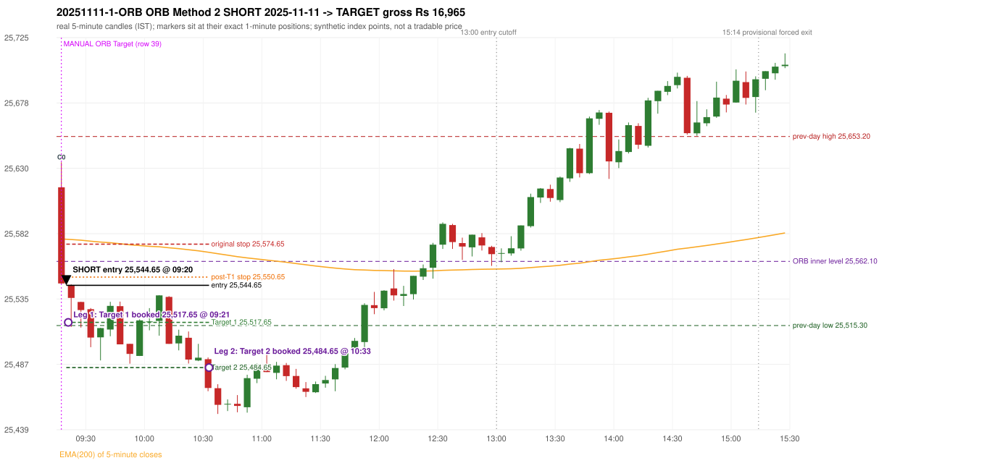

# Trading journal - 2025-11-11 (Tuesday)

> Automated, read-only reconstruction of the Phase 3.0 baseline. Synthetic NIFTY 50 index-point P&L (the index is not tradable). The owner's review status is intentionally blank.

## A. Trading day overview

| item | value |
|---|---|
| Date / weekday | 2025-11-11 / Tuesday |
| Session type | USABLE_WITH_FLAGS / VALID |
| Original session open (first 1-minute open) | 25,616.15 |
| Previous session | 2025-11-10 |
| Previous-day high / low | 25,653.20 / 25,515.30 |
| Previous-day official close / last 5-minute close | 25,574.35 / 25,574.25 |
| Raw engine records / confirmed signals / fully valid signals | 10 / 7 / 7 |
| Setups that did not complete (invalidated / incomplete) | 3 |
| Executed trades | 1 20251111-1-ORB |
| Gross P&L (Rs, synthetic) | 16,965.00 |
| Illustrative net P&L (Rs; Rs 500/trade + 0.5 pt/fill) | 16,075.00 |
| Day-end portfolio status | DAY_FINISHED |
| Manual journal trades (matched / unmatched) | 1 (1 / 0) |
| Extra automated trades | 0 |

## B. Daily strategy signal timeline (confirmed signals, chronological)

| time | strategy | method | dir | entry-rule status | valid for execution | <= 13:00 | portfolio state | accepted / ignored | specific reason | competing (same minute) |
|---|---|---|---|---|---|---|---|---|---|---|
| 09:20 | ORB | Method 2 | SHORT | RESEARCH_VARIANT | True | True | FIRST_TRADE_ACTIVE | ACCEPTED -> 20251111-1-ORB | first eligible signal of the day; trade 1: TARGET |  |
| 09:40 | PDR | PDR | LONG | PROPOSAL_DEPENDENT | True | True | FIRST_TRADE_ACTIVE | IGNORED | POSITION_ACTIVE (signal kept for diagnostics only; never reused) [blocked by ORB#1] |  |
| 13:25 | PDR | PDR | LONG | PROPOSAL_DEPENDENT | True | False | DAY_FINISHED | IGNORED | DAY_FINISHED [blocked by ORB#1] |  |
| 13:35 | PDR | PDR | LONG | PROPOSAL_DEPENDENT | True | False | DAY_FINISHED | IGNORED | DAY_FINISHED [blocked by ORB#1] |  |
| 13:45 | IRF | Method 1 | SHORT | PROPOSAL_DEPENDENT | True | False | DAY_FINISHED | IGNORED | DAY_FINISHED [blocked by ORB#1] |  |
| 14:40 | IRF | Method 2B | SHORT | PROPOSAL_DEPENDENT | True | False | DAY_FINISHED | IGNORED | DAY_FINISHED [blocked by ORB#1] |  |
| 15:10 | IRF | Method 2B | SHORT | PROPOSAL_DEPENDENT | True | False | DAY_FINISHED | IGNORED | DAY_FINISHED [blocked by ORB#1] |  |

Engine setups that did not complete (3); the complete list with failed rule ids is in `rejected_signals.csv`:

| candle | strategy | method | dir | status | precise reason | failed rules |
|---|---|---|---|---|---|---|
| 15:05 | IRF | Method 1/2 | SHORT | INCOMPLETE_AT_EOD | SESSION_ENDED_BEFORE_CONFIRMATION |  |
| 09:15 | ORB | Gap/200DMA | LONG | INVALIDATED | CLOSE_NOT_BEYOND_MA | ORB-GAP-LONG-003 |
| 12:15 | RF | RF | LONG | INVALIDATED | TREND:EMA_PREV_SESSION_CLOSE wrong side | RF-001;RF-008 |

## C. Detailed trade journals

### 20251111-1-ORB: ORB Method 2 SHORT (FIRST trade)

Chart: 

**Rule configuration:** CFG-baseline-be1db2a09d - signal verification status **RESEARCH_VARIANT** (never VERIFIED while a rule rests on a proposal).

#### 1. Setup identification

ORB Method 2 SHORT (research variant): the first candle closed at 25,546.00, beyond the inner support 25,562.10 built from the previous session's latest fractal (15:10), with a supportive trendline (25,573.18); its body occupied 79.04% of its range and its lower wick 0.39% (thresholds 60% / 20%): the strong-bearish candle test passed. The source gives no construction for the inner level or the trendline.

#### 2. Candle and indicator calculations

| role | session | candle | O | H | L | C | range | body % | upper wick % | lower wick % | direction | EMA(200) | strong bull / bear | pin bull / bear | small (body<=30%) | used for |
|---|---|---|---|---|---|---|---|---|---|---|---|---|---|---|---|---|
| first_candle | TODAY | 09:15-09:20 | 25,616.15 | 25,634.40 | 25,545.65 | 25,546.00 | 88.75 | 79.04 | 20.56 | 0.39 | BEARISH | 25,578.49 | False / True | False / False | False | the 09:15 first five-minute candle - the ORB decision candle |
| inner_level_candle | PREVIOUS | 15:10-15:15 | 25,577.25 | 25,577.80 | 25,562.10 | 25,565.45 | 15.70 | 75.16 | 3.50 | 21.34 | BEARISH | 25,579.05 | False / False | False / False | False | inner level: latest 5-candle fractal extreme of the previous session inside its range |
| prev_session_last_candle | PREVIOUS | 15:25-15:30 | 25,569.80 | 25,579.05 | 25,567.00 | 25,574.25 | 12.05 | 36.93 | 39.83 | 23.24 | BULLISH | 25,578.82 | False / False | False / False | False | trend: previous session's last 5-minute close vs its EMA(200) |
| trendline_point_1 | PREVIOUS | 14:25-14:30 | 25,643.35 | 25,649.45 | 25,633.70 | 25,636.80 | 15.75 | 41.59 | 38.73 | 19.68 | BEARISH | 25,577.00 | False / False | False / False | False | first fractal point of the trendline |
| trendline_point_2 | PREVIOUS | 14:55-15:00 | 25,606.00 | 25,614.25 | 25,601.95 | 25,605.90 | 12.30 | 0.81 | 67.07 | 32.11 | BEARISH | 25,579.09 | False / False | False / False | True | second fractal point of the trendline |

Every condition, with the rule, the calculation, the observed values and the result:

| # | group | rule | result | status / numeric definition | calculation | observed | required | available at | why it matters |
|---|---|---|---|---|---|---|---|---|---|
| 1 | SELECTION | SEL-FIRST-001 | PASS | USER_APPROVED / USER_APPROVED | earliest CONFIRMED signal of the day across IRF/ORB/PDR/PDS/RF that passed the controller's checks | 0 confirmed signal(s) earlier today; 7 confirmed signals in the day in total, this one at 09:20 | no earlier executable signal | 2025-11-11 09:20 | the shared controller trades only the first valid signal; the five strategies are not independent positions |
| 2 | SELECTION | SEL-TIE-001 | PASS | USER_APPROVED / USER_APPROVED | other CONFIRMED signals with exactly the same confirmation timestamp | none | no different-strategy / opposite-direction signal in the same minute (otherwise an unresolved conflict, no trade) | 2025-11-11 09:20 | an unresolved same-minute collision would have produced no trade at all |
| 3 | SELECTION | ENTRY-CUTOFF-001 | PASS | USER_APPROVED / USER_APPROVED | fill timestamp vs 13:00:00 IST | signal confirmed 09:20; fill 09:20 | fill at or before 13:00:00 IST | 2025-11-11 09:20 | no new position may be entered with a fill after 13:00 IST |
| 4 | SELECTION | EXE-FILL-001 | PASS | PROPOSED_FOR_REVIEW / PROPOSED_FOR_REVIEW | fill = open of the 1-minute bar that starts at the signal candle's end | bar 09:20 O 25,544.65 H 25,545.35 L 25,526.60 C 25,526.60; executable=True; entry 25,544.65 | fill bar exists, starts exactly at the signal end, is fillable; entry = its open | 2025-11-11 09:20 | a 5-minute signal is known only when its candle closes; the first price that can be traded is the next minute's open |
| 5 | SELECTION | DAY-MAX-001 | PASS | USER_APPROVED / USER_APPROVED | number of entries today | trade 1 of at most 2 | <= 2 entries per day | 2025-11-11 09:20 | daily trade cap |
| 6 | SETUP | ORB-GLOBAL-001 | PASS | SOURCE_VERIFIED / EXPLICIT_IN_SOURCE | decision is taken once the first 5-minute candle (09:15-09:20) has closed | candle 09:15-09:20; signal confirmed 09:20 | decision at 09:20, never before the close | 2025-11-11 09:20 | the close of the first candle is unknown before 09:20 |
| 7 | SETUP | ORB-GLOBAL-002 | PASS | SOURCE_VERIFIED / EXPLICIT_IN_SOURCE | direction | SHORT | same rules in both directions | 2025-11-11 09:20 | ORB trades the side of the break |
| 8 | SETUP | ORB-GLOBAL-004 | PASS | SOURCE_VERIFIED / QUALITATIVE_SOURCE_NUMERIC_DEFINITION_PROPOSED_FOR_REVIEW | entry at 09:20, after the first-candle close | signal confirmed 09:20; fill 09:20 at the open of that minute | 09:20 entry | 2025-11-11 09:20 | the guide enters at 9:20; the fill price convention (next minute open) is a proposal |
| 9 | SETUP | ORB-M2-SHORT-001 | PASS | UNRESOLVED / UNRESOLVED | inner level = latest fractal (k=2) extreme of the previous session below the day's high / above the day's low | inner support 25,562.10 from the 15:10 candle of 2025-11-10 (previous range 25,515.30 - 25,653.20; engine recorded 25,562.10) | an inner level inside yesterday's range | 2025-11-10 15:25 | the source gives NO objective construction for the inner level: this is a research variant |
| 10 | SETUP | ORB-M2-SHORT-002 | PASS | SOURCE_VERIFIED / EXPLICIT_IN_SOURCE | first candle breaks and closes beyond the inner level | close 25,546.00 vs inner level 25,562.10: 16.10 points beyond | high/low and close beyond the level | 2025-11-11 09:20 | the breakout itself |
| 11 | TREND | ORB-TREND-001 | PASS | SOURCE_VERIFIED / QUALITATIVE_SOURCE_NUMERIC_DEFINITION_PROPOSED_FOR_REVIEW | previous session's final completed 5-minute candle: close vs its EMA(200 of 5-minute closes) | previous session 2025-11-10 last candle 15:25-15:30 close 25,574.25 vs EMA(200) 25,578.82: 4.57 points below the EMA -> trend bearish (EMA_PREV_SESSION_CLOSE; research variant A, EMA-only) | close < EMA(200) | 2025-11-10 15:30 | the opening gap can never create the trend: only information that existed before today's open is used |
| 12 | TREND | ORB-TREND-002 | PASS | SOURCE_VERIFIED / QUALITATIVE_SOURCE_NUMERIC_DEFINITION_PROPOSED_FOR_REVIEW | price location versus the 200 EMA is the basic confirmation; structure is only 'supporting' | 4.57 points below the EMA(200) on the previous session's last 5-minute close; swing structure not used in variant A | price on the trend side of the 200 EMA | 2025-11-10 15:30 | the rulebook calls EMA position 'a basic confirmation, supported by bullish structure'; the structure part has no numeric definition |
| 13 | TREND | TREND-SWING-001 | NOT_APPLICABLE | PROPOSED_FOR_REVIEW / PROPOSED_FOR_REVIEW | confirmed swing structure | not required by the active trend variant (variant A is the EMA price location only) | n/a | 2025-11-10 15:30 | variant B would additionally require higher-high/higher-low swings; it is a separate labelled scenario |
| 14 | CONFIRMATION | ORB-M2-SHORT-001 | PASS | UNRESOLVED / UNRESOLVED | trendline through the last two fractal lows (long) / highs (short) of the previous session | points 14:25 25,649.45 and 14:55 25,614.25 (6 candles apart): slope -5.8667 per candle; line value at the 09:15 candle 25,573.18; first-candle close 25,546.00 is on the supportive side (engine recorded 25,573.18) | rising (long) / falling (short) line with price on the trend side | 2025-11-10 15:00 | the guide requires a trendline but defines no construction or 'near' distance: research variant |
| 15 | CONFIRMATION | ORB-M2-SHORT-003 | PASS | SOURCE_VERIFIED / QUALITATIVE_SOURCE_NUMERIC_DEFINITION_PROPOSED_FOR_REVIEW | candle quality: strong body and limited opposite wick (or pin bar) | 09:15-09:20 O 25,616.15 H 25,634.40 L 25,545.65 C 25,546.00; range 88.75, body 70.15 (79.04%), upper wick 18.25 (20.56%), lower wick 0.35 (0.39%), bearish. Strong-bearish test: bearish close, body >= 60% (observed 79.04%), lower wick <= 20% (observed 0.39%) -> PASS | strong candle or pin bar | 2025-11-11 09:20 | same proposed thresholds as Method 1 |
| 16 | CONFIRMATION | ORB-M2-SHORT-004 | PASS | SOURCE_VERIFIED / QUALITATIVE_SOURCE_NUMERIC_DEFINITION_PROPOSED_FOR_REVIEW | if the close is near the 5-minute EMA(200) a convincing close beyond it is needed | EMA(200) at the 09:15 candle 25,578.49; close 25,546.00 is 32.49 points below it; 'near' band 15 points -> not near, test not applicable | outside the 15-point band, or beyond the EMA by >= 5 | 2025-11-11 09:20 | ORB p.5: 'if the breakout is near the EMA, wait for a convincing close' |
| 17 | EXECUTION | ORB-GLOBAL-003 | PASS | SOURCE_VERIFIED / EXPLICIT_IN_SOURCE | initial stop = entry + 30 points | entry 25,544.65 -> stop 25,574.65 | stop 30 index points (BASELINE) | 2025-11-11 09:20 | defines the loss if the setup fails before Target 1 |
| 18 | EXECUTION | EXE-T1-001 | PASS | SOURCE_VERIFIED / EXPLICIT_IN_SOURCE | Target 1 = entry +/- 27 points | T1 25,517.65 | 27 points | 2025-11-11 09:20 | Leg 1 (3 lots) is booked at Target 1 |
| 19 | EXECUTION | ORB-GLOBAL-003 | PASS | SOURCE_VERIFIED / EXPLICIT_IN_SOURCE | Target 2 = entry +/- 60 points | T2 25,484.65 | 60 points | 2025-11-11 09:20 | Leg 2 (3 lots) is booked at Target 2 |
| 20 | EXECUTION | POST-T1-STOP-006 | PASS | USER_APPROVED / USER_APPROVED | after T1 the Leg-2 stop = entry + 6 (no trailing) | post-T1 stop 25,550.65 | entry -6 (LONG) / +6 (SHORT) | 2025-11-11 09:20 | protects the remaining three lots once the first three are booked |
| 21 | EXECUTION | SIZE-LOT-001 | PASS | USER_APPROVED / USER_APPROVED | 6 lots x 65 = 390, Leg 1 = 3 lots = 195, Leg 2 = 195 | 6 lots, lot size 65, legs 3+3 | 6 lots in two equal legs | 2025-11-11 09:20 | position size for the synthetic P&L |
| 22 | NOTE | ORB-MA-001 | UNRESOLVED | CONFLICTING / CONFLICTING | which moving average the code uses | EMA(200) of 5-minute closes (the guide says '200 DMA' in some places and '200 EMA' in others); active ma_mode EMA200_5M | the source terminology conflicts | 2025-11-11 09:20 | a daily 200 DMA would give different values |
| 23 | NOTE | NOTE-UNRESOLVED-DEPENDENCIES | UNRESOLVED | NOT_A_RULE / NOT_A_REGISTRY_RULE | rules the signal depends on that the sources leave unresolved | engine-recorded unresolved rule ids: ORB-M2-SHORT-001, ORB-MA-001; verification status RESEARCH_VARIANT | n/a (disclosure) | 2025-11-11 09:20 | the entry is only as verified as the rules it rests on |

#### 3. Entry decision and explanation

ORB Method 2 SHORT (research variant): the first candle closed at 25,546.00, beyond the inner support 25,562.10 built from the previous session's latest fractal (15:10), with a supportive trendline (25,573.18); its body occupied 79.04% of its range and its lower wick 0.39% (thresholds 60% / 20%): the strong-bearish candle test passed. The source gives no construction for the inner level or the trendline.

**Why this trade ahead of the other strategies:** This ORB Method 2 signal was the earliest executable signal of the day: 0 confirmed signal(s) earlier, 0 other in the same minute. 6 later confirmed signal(s) (IRF x3, PDR x3) are logged as ignored or rejected. State of the other four engines at that moment: [IRF: no setup record before this time (a base condition was not met, or nothing triggered)] [PDR: no setup record before this time (a base condition was not met, or nothing triggered)] [PDS: no setup record before this time (a base condition was not met, or nothing triggered)] [RF: no setup record before this time (a base condition was not met, or nothing triggered)]

#### 4. Actual entry execution

| item | value |
|---|---|
| Signal candle | 09:15-09:20 |
| Signal confirmed | 2025-11-11 09:20 |
| Fill timestamp | 2025-11-11 09:20 |
| Entry price | 25,544.65 |
| Source partition / 1-minute bar | data/processed/nifty50/year=2025/month=11/candles.parquet / 2025-11-11 09:20 |
| Source bar O / H / L / C | 25,544.65 / 25,545.35 / 25,526.60 / 25,526.60 |
| Fill assumption | open of the 1-minute bar starting at the signal candle's end (EXE-FILL-001, PROPOSED causal convention) |
| Initial stop / T1 / T2 / post-T1 stop | 25,574.65 / 25,517.65 / 25,484.65 / 25,550.65 |
| Position | 6 lots x 65 = 390 units (Leg 1 195, Leg 2 195) |

#### 5-8. Trade progress, Target 1, post-T1 stop and final exit

Between the 09:20 entry bar and the final exit (74 one-minute bars) the best excursion in favour was 74.55 points at 10:33 and the worst against was 0.70 points at 09:20. At 09:21 price reached Target 1 25,517.65 and three lots exited. At 09:21 the remaining three lots' protective stop was set to 25,550.65 (entry + 6; no trailing, no further change); the engine applies it from the Target-1 bar onward and tests it within that same bar. At 10:33 price reached Target 2 25,484.65 and the remaining three lots exited. No further trade that day (DAY-T2-001).

| leg | qty | exit time | exit price | reason | source 1-minute bar | O / H / L / C | gross points | gross Rs | slippage pts | flags |
|---|---|---|---|---|---|---|---|---|---|---|
| 1 | 195 | 09:21 | 25,517.65 | TARGET_1 | 09:21 | 25,526.30 / 25,530.95 / 25,514.30 / 25,526.70 | 27.00 | 5,265.00 | 0.00 |  |
| 2 | 195 | 10:33 | 25,484.65 | TARGET_2 | 10:33 | 25,481.65 / 25,482.25 / 25,470.10 / 25,471.15 | 60.00 | 11,700.00 | 0.00 |  |

Exit evidence per leg:

* Leg 1: 1-minute bar 09:21 O 25,526.30 H 25,530.95 L 25,514.30 C 25,526.70: low 25,514.30 reached Target 1 25,517.65; Leg 1 booked at the target level
* Leg 2: 1-minute bar 10:33 O 25,481.65 H 25,482.25 L 25,470.10 C 25,471.15: low 25,470.10 reached Target 2 25,484.65; Leg 2 booked at the target level

#### 9. Gross and illustrative net P&L

| item | value (Rs) |
|---|---|
| Leg 1 gross | 5,265.00 |
| Leg 2 gross | 11,700.00 |
| Trade gross (= Leg 1 + Leg 2) | 16,965.00 |
| Illustrative fixed cost | -500.00 |
| Illustrative slippage (0.5 pt on every fill, entry + exits, all units) | -390.00 |
| Illustrative net | 16,075.00 |

#### 10. Manual journal comparison

EXACT_MATCH: manual ORB labelled 09:15 (candle start) vs automated ORB Method 2 SHORT candle 09:15, filled 09:20 at 25,544.65; time difference 0 minutes. Journal outcome Target vs automated TARGET (same outcome class). The journal records no entry or exit price.

## D. Manual journal comparison

| comparison | journal row | journal strategy | manual time | manual direction | manual outcome | match class | trade | auto entry | auto outcome | explanation |
|---|---|---|---|---|---|---|---|---|---|---|
| M039 | 39 | ORB | 09:15 | UNKNOWN | Target | EXACT_MATCH | 20251111-1-ORB | 09:20 @ 25,544.65 | TARGET | EXACT_MATCH: manual ORB labelled 09:15 (candle start) vs automated ORB Method 2 SHORT candle 09:15, filled 09:20 at 25,544.65; time difference 0 minutes. Journal outcome Target vs automated TARGET (same outcome class). The journal records no entry or exit price. |

The journal records no entry price and no exit price (NOT_RECORDED); matching uses date, strategy and candle start only - never P&L.

## E. Daily conclusion

* **Traded:** 20251111-1-ORB - ORB Method 2 SHORT at 09:20 (entry 25,544.65), outcome TARGET, gross Rs 16,965.00, illustrative net Rs 16,075.00. **Why:** This ORB Method 2 signal was the earliest executable signal of the day: 0 confirmed signal(s) earlier, 0 other in the same minute. 6 later confirmed signal(s) (IRF x3, PDR x3) are logged as ignored or rejected. State of the other four engines at that moment: [IRF: no setup record before this time (a base condition was not met, or nothing triggered)] [PDR: no setup record before this time (a base condition was not met, or nothing triggered)] [PDS: no setup record before this time (a base condition was not met, or nothing triggered)] [RF: no setup record before this time (a base condition was not met, or nothing triggered)] **How it ended:** At 09:21 price reached Target 1 25,517.65 and three lots exited. At 09:21 the remaining three lots' protective stop was set to 25,550.65 (entry + 6; no trailing, no further change); the engine applies it from the Target-1 bar onward and tests it within that same bar. At 10:33 price reached Target 2 25,484.65 and the remaining three lots exited. No further trade that day (DAY-T2-001).
* **Ignored / rejected signals:** IRF IGNORED DAY_FINISHED x3; PDR IGNORED DAY_FINISHED x2; PDR IGNORED POSITION_ACTIVE x1
* **Open strategy-definition issues that affected this day:** NOTE-UNRESOLVED-DEPENDENCIES, ORB-MA-001 (Terminology conflict: '200 DMA / EMA' (p.2), '200 EMA' (pp.3,5,7), '200 DMA' (pp.1,8,9,12) for what the charts show as one curved line on a 5-minute chart)
* **Automated triage (not an approval; the owner's review status stays blank):** MATCHED_EXACT_NO_FLAGS
