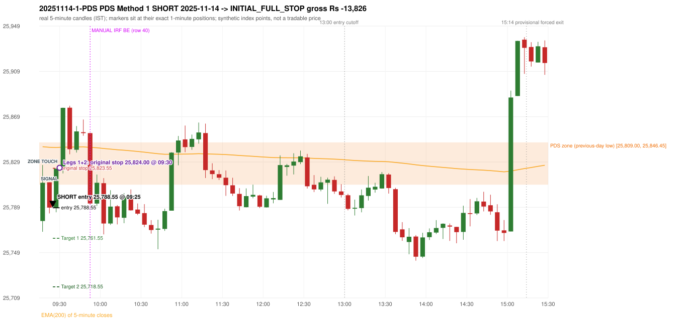
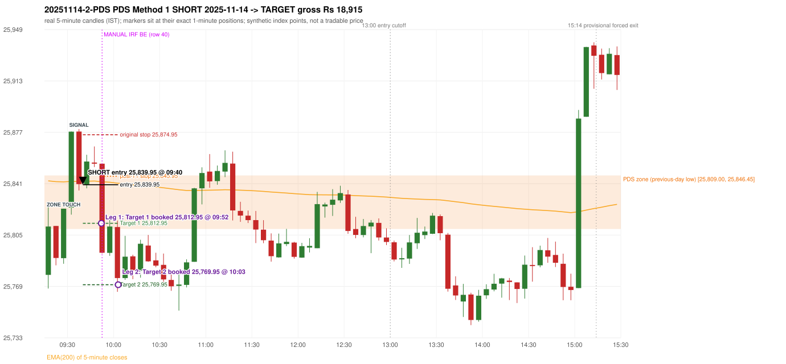

# Trading journal - 2025-11-14 (Friday)

> Automated, read-only reconstruction of the Phase 3.0 baseline. Synthetic NIFTY 50 index-point P&L (the index is not tradable). The owner's review status is intentionally blank.

## A. Trading day overview

| item | value |
|---|---|
| Date / weekday | 2025-11-14 / Friday |
| Session type | USABLE_WITH_FLAGS / VALID |
| Original session open (first 1-minute open) | 25,776.85 |
| Previous session | 2025-11-13 |
| Previous-day high / low | 26,010.00 / 25,809.00 |
| Previous-day official close / last 5-minute close | 25,879.15 / 25,884.10 |
| Raw engine records / confirmed signals / fully valid signals | 14 / 9 / 9 |
| Setups that did not complete (invalidated / incomplete) | 5 |
| Executed trades | 2 20251114-1-PDS;20251114-2-PDS |
| Gross P&L (Rs, synthetic) | 5,089.50 |
| Illustrative net P&L (Rs; Rs 500/trade + 0.5 pt/fill) | 3,309.50 |
| Day-end portfolio status | DAY_FINISHED |
| Manual journal trades (matched / unmatched) | 1 (0 / 1) |
| Extra automated trades | 2 |

## B. Daily strategy signal timeline (confirmed signals, chronological)

| time | strategy | method | dir | entry-rule status | valid for execution | <= 13:00 | portfolio state | accepted / ignored | specific reason | competing (same minute) |
|---|---|---|---|---|---|---|---|---|---|---|
| 09:25 | PDS | Method 1 | SHORT | PROPOSAL_DEPENDENT | True | True | FIRST_TRADE_ACTIVE | ACCEPTED -> 20251114-1-PDS | first eligible signal of the day; trade 1: INITIAL_FULL_STOP |  |
| 09:40 | PDS | Method 1 | SHORT | PROPOSAL_DEPENDENT | True | True | SECOND_TRADE_ACTIVE | ACCEPTED -> 20251114-2-PDS | permitted second trade: newly confirmed PDR/PDS after the original full stop; trade 2: TARGET |  |
| 09:55 | IRF | Method 1 | SHORT | PROPOSAL_DEPENDENT | True | True | SECOND_TRADE_ACTIVE | IGNORED | POSITION_ACTIVE (signal kept for diagnostics only; never reused) [blocked by PDS#2] | PDS Method 1 SHORT |
| 09:55 | PDS | Method 1 | SHORT | PROPOSAL_DEPENDENT | True | True | SECOND_TRADE_ACTIVE | IGNORED | POSITION_ACTIVE (signal kept for diagnostics only; never reused) [blocked by PDS#2] | IRF Method 1 SHORT |
| 10:05 | PDS | Method 1 | SHORT | PROPOSAL_DEPENDENT | True | True | DAY_FINISHED | IGNORED | DAY_FINISHED [blocked by PDS#2] |  |
| 11:20 | IRF | Method 1 | SHORT | PROPOSAL_DEPENDENT | True | True | DAY_FINISHED | IGNORED | DAY_FINISHED [blocked by PDS#2] |  |
| 12:35 | IRF | Method 1 | SHORT | PROPOSAL_DEPENDENT | True | True | DAY_FINISHED | IGNORED | DAY_FINISHED [blocked by PDS#2] |  |
| 13:05 | IRF | Method 2A | SHORT | PROPOSAL_DEPENDENT | True | False | DAY_FINISHED | IGNORED | DAY_FINISHED [blocked by PDS#2] | PDS Method 3 SHORT |
| 13:05 | PDS | Method 3 | SHORT | PROPOSAL_DEPENDENT | True | False | DAY_FINISHED | IGNORED | DAY_FINISHED [blocked by PDS#2] | IRF Method 2A SHORT |

Engine setups that did not complete (5); the complete list with failed rule ids is in `rejected_signals.csv`:

| candle | strategy | method | dir | status | precise reason | failed rules |
|---|---|---|---|---|---|---|
| 15:00 | IRF | Method 1/2 | SHORT | INCOMPLETE_AT_EOD | SESSION_ENDED_BEFORE_CONFIRMATION |  |
| 09:15 | ORB | Method 2 | SHORT | INVALIDATED | TREND:EMA_PREV_SESSION_CLOSE wrong side | ORB-TREND-001;ORB-TREND-002 |
| 09:15 | ORB | Gap/200DMA | SHORT | INVALIDATED | CANDLE_QUALITY_OR_REJECTION_WICK | ORB-GAP-SHORT-003 |
| 13:15 | PDS | Method 1/2/3 | SHORT | INCOMPLETE_AT_EOD | NO_QUALIFYING_ENTRY_BEFORE_SESSION_END |  |
| 14:05 | RF | RF | LONG | INVALIDATED | GAP_NOT_UP(DOWN) | RF-003 |

## C. Detailed trade journals

### 20251114-1-PDS: PDS Method 1 SHORT (FIRST trade)

Chart: 

**Rule configuration:** CFG-baseline-be1db2a09d - signal verification status **PROPOSAL_DEPENDENT** (never VERIFIED while a rule rests on a proposal).

#### 1. Setup identification

PDS Method 1 SHORT: the session opened 32.15 points below the previous-day-low zone [25,809.00, 25,846.45]; price rose to the zone at 09:15 and the first red candle at the zone (09:20, close 25,788.70) had a good body; confirmed 09:25.

#### 2. Candle and indicator calculations

| role | session | candle | O | H | L | C | range | body % | upper wick % | lower wick % | direction | EMA(200) | strong bull / bear | pin bull / bear | small (body<=30%) | used for |
|---|---|---|---|---|---|---|---|---|---|---|---|---|---|---|---|---|
| zone_source_candle | PREVIOUS | 09:20-09:25 | 25,842.75 | 25,846.45 | 25,809.00 | 25,846.45 | 37.45 | 9.88 | 0.00 | 90.12 | BULLISH | 25,744.99 | False / False | True / False | True | previous-day low candle that defines the zone (A_LOWEST_LOW) |
| zone_retest_candle | TODAY | 09:15-09:20 | 25,776.85 | 25,826.45 | 25,767.30 | 25,810.70 | 59.15 | 57.23 | 26.63 | 16.15 | BULLISH | 25,842.66 | False / False | False / False | False | first candle whose range reaches the zone from below |
| signal_candle | TODAY | 09:20-09:25 | 25,811.10 | 25,811.10 | 25,783.55 | 25,788.70 | 27.55 | 81.31 | 0.00 | 18.69 | BEARISH | 25,842.12 | False / True | False / False | False | trigger candle |

Every condition, with the rule, the calculation, the observed values and the result:

| # | group | rule | result | status / numeric definition | calculation | observed | required | available at | why it matters |
|---|---|---|---|---|---|---|---|---|---|
| 1 | SELECTION | SEL-FIRST-001 | PASS | USER_APPROVED / USER_APPROVED | earliest CONFIRMED signal of the day across IRF/ORB/PDR/PDS/RF that passed the controller's checks | 0 confirmed signal(s) earlier today; 9 confirmed signals in the day in total, this one at 09:25 | no earlier executable signal | 2025-11-14 09:25 | the shared controller trades only the first valid signal; the five strategies are not independent positions |
| 2 | SELECTION | SEL-TIE-001 | PASS | USER_APPROVED / USER_APPROVED | other CONFIRMED signals with exactly the same confirmation timestamp | none | no different-strategy / opposite-direction signal in the same minute (otherwise an unresolved conflict, no trade) | 2025-11-14 09:25 | an unresolved same-minute collision would have produced no trade at all |
| 3 | SELECTION | ENTRY-CUTOFF-001 | PASS | USER_APPROVED / USER_APPROVED | fill timestamp vs 13:00:00 IST | signal confirmed 09:25; fill 09:25 | fill at or before 13:00:00 IST | 2025-11-14 09:25 | no new position may be entered with a fill after 13:00 IST |
| 4 | SELECTION | EXE-FILL-001 | PASS | PROPOSED_FOR_REVIEW / PROPOSED_FOR_REVIEW | fill = open of the 1-minute bar that starts at the signal candle's end | bar 09:25 O 25,788.55 H 25,799.10 L 25,784.60 C 25,796.50; executable=True; entry 25,788.55 | fill bar exists, starts exactly at the signal end, is fillable; entry = its open | 2025-11-14 09:25 | a 5-minute signal is known only when its candle closes; the first price that can be traded is the next minute's open |
| 5 | SELECTION | DAY-MAX-001 | PASS | USER_APPROVED / USER_APPROVED | number of entries today | trade 1 of at most 2 | <= 2 entries per day | 2025-11-14 09:25 | daily trade cap |
| 6 | SETUP | PDS-003 | PASS | SOURCE_VERIFIED / EXPLICIT_WORDING_DETAIL_PROPOSED_FOR_REVIEW | gap = first 1-minute open of today - previous session's OFFICIAL close | today's open 25,776.85 (first 1-minute bar 09:15) - previous close 25,879.15 (DAILY_VENDOR, 2025-11-13) = -102.30 points -> gap DOWN | gap DOWN (more than 0 points) | 2025-11-14 09:15 | approved convention: the original first-minute open, never the vendor daily open |
| 7 | SETUP | PDS-006 | PASS | SOURCE_VERIFIED / QUALITATIVE_SOURCE_NUMERIC_DEFINITION_PROPOSED_FOR_REVIEW | gap-down open below the zone | today's open 25,776.85 vs zone low 25,809.00: 32.15 points below | open < zone low | 2025-11-14 09:15 | the guide: 'price is trading below the previous day's support zone' after the gap; a PROPOSED strict reading |
| 8 | SETUP | PDS-004 | PASS | SOURCE_VERIFIED / EXPLICIT_IN_SOURCE | PDS is not a breakdown strategy: the zone must be tested from below first | open 25,776.85 below the zone floor 25,809.00; the first candle to reach the zone is 09:15 | price rises to the zone before any short | 2025-11-14 09:15 | a short below the level without a retest is not this strategy |
| 9 | SETUP | PDS-005 | PASS | SOURCE_VERIFIED / QUALITATIVE_SOURCE_NUMERIC_DEFINITION_PROPOSED_FOR_REVIEW | price comes up to the zone: first candle whose [low, high] intersects it (+/- proximity) | 09:15-09:20 O 25,776.85 H 25,826.45 L 25,767.30 C 25,810.70; range 59.15, body 33.85 (57.23%), upper wick 15.75 (26.63%), lower wick 9.55 (16.15%), bullish; high 25,826.45 vs zone low 25,809.00 | range intersects the zone | 2025-11-14 09:20 | PDS is not a breakdown strategy: the zone must be tested from below first |
| 10 | ZONE | PDS-001 | PASS | SOURCE_VERIFIED / EXPLICIT_IN_SOURCE | direction | SHORT (PDS is short only) | short-only | 2025-11-14 09:25 | PDS sells a retest of previous-day support from below |
| 11 | ZONE | PDS-002 | PASS | SOURCE_VERIFIED / QUALITATIVE_SOURCE_NUMERIC_DEFINITION_PROPOSED_FOR_REVIEW | zone = [lowest low, body top] of the previous session's absolute-low candle (method A_LOWEST_LOW; the lower wick is part of the zone) | zone [25,809.00, 25,846.45] from the 09:20 candle of 2025-11-13 (09:20-09:25 O 25,842.75 H 25,846.45 L 25,809.00 C 25,846.45; range 37.45, body 3.70 (9.88%), upper wick 0.00 (0.00%), lower wick 33.75 (90.12%), bullish); engine recorded [25,809.00, 25,846.45] | previous trading day's low where price took support (body + lower wick) | 2025-11-13 09:25 | the reference level of the strategy; the exact candle(s) are a research choice (PDS-ZONE-002) |
| 12 | CONFIRMATION | PDS-M-001 | PASS | SOURCE_VERIFIED / QUALITATIVE_SOURCE_NUMERIC_DEFINITION_PROPOSED_FOR_REVIEW | Methods 1/2 apply to the FIRST red candle at the zone | first red candle at the zone: 09:20; signal candle 09:20 | the trigger is the first red candle at the zone | 2025-11-14 09:25 | a later red candle would only qualify through Method 3 |
| 13 | CONFIRMATION | PDS-M1-001 | PASS | SOURCE_VERIFIED / QUALITATIVE_SOURCE_NUMERIC_DEFINITION_PROPOSED_FOR_REVIEW | good red candle: bearish close, body >= 60% of range, lower wick <= 20% of range | 09:20-09:25 O 25,811.10 H 25,811.10 L 25,783.55 C 25,788.70; range 27.55, body 22.40 (81.31%), upper wick 0.00 (0.00%), lower wick 5.15 (18.69%), bearish -> body 81.31% / lower wick 18.69% | strong bearish candle (research thresholds) | 2025-11-14 09:25 | the guide: 'a red candle with a good body' - body size is explicitly not numerically defined |
| 14 | EXECUTION | EXE-STOP-001 | PASS | USER_APPROVED / USER_APPROVED | initial stop = entry + 35 points | entry 25,788.55 -> stop 25,823.55 | stop 35 index points (BASELINE) | 2025-11-14 09:25 | defines the loss if the setup fails before Target 1 |
| 15 | EXECUTION | EXE-T1-001 | PASS | SOURCE_VERIFIED / EXPLICIT_IN_SOURCE | Target 1 = entry +/- 27 points | T1 25,761.55 | 27 points | 2025-11-14 09:25 | Leg 1 (3 lots) is booked at Target 1 |
| 16 | EXECUTION | PDS-TGT-001 | PASS | SOURCE_VERIFIED / EXPLICIT_IN_SOURCE | Target 2 = entry +/- 70 points | T2 25,718.55 (the guide says 70; the report suggests 60 - CONFLICTING) | 70 points | 2025-11-14 09:25 | Leg 2 (3 lots) is booked at Target 2 |
| 17 | EXECUTION | POST-T1-STOP-006 | PASS | USER_APPROVED / USER_APPROVED | after T1 the Leg-2 stop = entry + 6 (no trailing) | post-T1 stop 25,794.55 | entry -6 (LONG) / +6 (SHORT) | 2025-11-14 09:25 | protects the remaining three lots once the first three are booked |
| 18 | EXECUTION | SIZE-LOT-001 | PASS | USER_APPROVED / USER_APPROVED | 6 lots x 65 = 390, Leg 1 = 3 lots = 195, Leg 2 = 195 | 6 lots, lot size 65, legs 3+3 | 6 lots in two equal legs | 2025-11-14 09:25 | position size for the synthetic P&L |
| 19 | NOTE | PDS-007 | NOT_APPLICABLE | PROPOSED_FOR_REVIEW / PROPOSED_FOR_REVIEW | repeated PDS signals today | 5 confirmed PDS signal(s) in the session | n/a (disclosure) | 2025-11-14 09:25 | the per-session cap is lifted for the controller runs; the controller trades only the first (or the permitted second) trade |
| 20 | NOTE | PDS-SL-001 | NOT_APPLICABLE | SOURCE_VERIFIED / QUALITATIVE_SOURCE_NUMERIC_DEFINITION_PROPOSED_FOR_REVIEW | the guide's 35-or-40 rule: 35 if the most recent green candle's high is within 35 points of entry, else 40 | most recent green candle high 25,826.45 is 37.90 points from the entry 25,788.55: the guide's rule would select 40 points; the baseline applies a fixed 35 (USER_APPROVED research baseline; the 35-vs-40 selection and the 40-point variant are separate labelled scenarios) | source selection rule | 2025-11-14 09:25 | the stop distance is a modelling choice and changes losses, not entries |
| 21 | NOTE | NOTE-UNRESOLVED-DEPENDENCIES | NOT_APPLICABLE | NOT_A_RULE / NOT_A_REGISTRY_RULE | rules the signal depends on that the sources leave unresolved | engine-recorded unresolved rule ids: none; verification status PROPOSAL_DEPENDENT | n/a (disclosure) | 2025-11-14 09:25 | the entry is only as verified as the rules it rests on |

#### 3. Entry decision and explanation

PDS Method 1 SHORT: the session opened 32.15 points below the previous-day-low zone [25,809.00, 25,846.45]; price rose to the zone at 09:15 and the first red candle at the zone (09:20, close 25,788.70) had a good body; confirmed 09:25.

**Why this trade ahead of the other strategies:** This PDS Method 1 signal was the earliest executable signal of the day: 0 confirmed signal(s) earlier, 0 other in the same minute. 8 later confirmed signal(s) (IRF x4, PDS x4) are logged as ignored or rejected. State of the other four engines at that moment: [IRF: no setup record before this time (a base condition was not met, or nothing triggered)] [ORB: Method 2 invalidated at 09:15: TREND:EMA_PREV_SESSION_CLOSE wrong side; Gap/200DMA invalidated at 09:15: CANDLE_QUALITY_OR_REJECTION_WICK] [PDR: no setup record before this time (a base condition was not met, or nothing triggered)] [RF: no setup record before this time (a base condition was not met, or nothing triggered)]

#### 4. Actual entry execution

| item | value |
|---|---|
| Signal candle | 09:20-09:25 |
| Signal confirmed | 2025-11-14 09:25 |
| Fill timestamp | 2025-11-14 09:25 |
| Entry price | 25,788.55 |
| Source partition / 1-minute bar | data/processed/nifty50/year=2025/month=11/candles.parquet / 2025-11-14 09:25 |
| Source bar O / H / L / C | 25,788.55 / 25,799.10 / 25,784.60 / 25,796.50 |
| Fill assumption | open of the 1-minute bar starting at the signal candle's end (EXE-FILL-001, PROPOSED causal convention) |
| Initial stop / T1 / T2 / post-T1 stop | 25,823.55 / 25,761.55 / 25,718.55 / 25,794.55 |
| Position | 6 lots x 65 = 390 units (Leg 1 195, Leg 2 195) |

#### 5-8. Trade progress, Target 1, post-T1 stop and final exit

Between the 09:25 entry bar and the final exit (6 one-minute bars) the best excursion in favour was 3.95 points at 09:25 and the worst against was 39.80 points at 09:30. At 09:30 price reached the original stop 25,823.55 before Target 1 25,761.55, so all six lots exited together at 25,824.00 (gap through the stop, slippage 0.45 points). This is an INITIAL_FULL_STOP: one more trade is allowed that day, only a newly confirmed PDR/PDS signal.

| leg | qty | exit time | exit price | reason | source 1-minute bar | O / H / L / C | gross points | gross Rs | slippage pts | flags |
|---|---|---|---|---|---|---|---|---|---|---|
| 1 | 195 | 09:30 | 25,824.00 | ORIGINAL_STOP_BEFORE_T1 | 09:30 | 25,824.00 / 25,828.35 / 25,819.00 / 25,827.60 | -35.45 | -6,912.75 | 0.45 |  |
| 2 | 195 | 09:30 | 25,824.00 | ORIGINAL_STOP_BEFORE_T1 | 09:30 | 25,824.00 / 25,828.35 / 25,819.00 / 25,827.60 | -35.45 | -6,912.75 | 0.45 |  |

Exit evidence per leg:

* Leg 1: 1-minute bar 09:30 O 25,824.00 H 25,828.35 L 25,819.00 C 25,827.60: high 25,828.35 reached the original stop 25,823.55 before Target 1 25,761.55 was touched; both legs exit at 25,824.00 (gap through the stop: bar open 25,824.00 is worse than the stop; adverse slippage 0.45 points)
* Leg 2: 1-minute bar 09:30 O 25,824.00 H 25,828.35 L 25,819.00 C 25,827.60: high 25,828.35 reached the original stop 25,823.55 before Target 1 25,761.55 was touched; both legs exit at 25,824.00 (gap through the stop: bar open 25,824.00 is worse than the stop; adverse slippage 0.45 points)

#### 9. Gross and illustrative net P&L

| item | value (Rs) |
|---|---|
| Leg 1 gross | -6,912.75 |
| Leg 2 gross | -6,912.75 |
| Trade gross (= Leg 1 + Leg 2) | -13,825.50 |
| Illustrative fixed cost | -500.00 |
| Illustrative slippage (0.5 pt on every fill, entry + exits, all units) | -390.00 |
| Illustrative net | -14,715.50 |

#### 10. Manual journal comparison

EXTRA_AUTOMATED_TRADE: the automated system took PDS Method 1 SHORT at 09:25 (manual traded only other strategies: IRF 09:50 BE). The setup rests on: no unresolved rule. The journal shows no corresponding entry.

### 20251114-2-PDS: PDS Method 1 SHORT (SECOND trade)

Chart: 

**Rule configuration:** CFG-baseline-be1db2a09d - signal verification status **PROPOSAL_DEPENDENT** (never VERIFIED while a rule rests on a proposal).

#### 1. Setup identification

PDS Method 1 SHORT: the session opened 32.15 points below the previous-day-low zone [25,809.00, 25,846.45]; price rose to the zone at 09:25 and the first red candle at the zone (09:35, close 25,840.40) had a good body; confirmed 09:40.

#### 2. Candle and indicator calculations

| role | session | candle | O | H | L | C | range | body % | upper wick % | lower wick % | direction | EMA(200) | strong bull / bear | pin bull / bear | small (body<=30%) | used for |
|---|---|---|---|---|---|---|---|---|---|---|---|---|---|---|---|---|
| zone_source_candle | PREVIOUS | 09:20-09:25 | 25,842.75 | 25,846.45 | 25,809.00 | 25,846.45 | 37.45 | 9.88 | 0.00 | 90.12 | BULLISH | 25,744.99 | False / False | True / False | True | previous-day low candle that defines the zone (A_LOWEST_LOW) |
| zone_retest_candle | TODAY | 09:25-09:30 | 25,788.55 | 25,823.20 | 25,784.60 | 25,823.20 | 38.60 | 89.77 | 0.00 | 10.23 | BULLISH | 25,841.94 | True / False | False / False | False | first candle whose range reaches the zone from below |
| signal_candle | TODAY | 09:35-09:40 | 25,877.20 | 25,878.95 | 25,835.95 | 25,840.40 | 43.00 | 85.58 | 4.07 | 10.35 | BEARISH | 25,842.27 | False / True | False / False | False | trigger candle |

Every condition, with the rule, the calculation, the observed values and the result:

| # | group | rule | result | status / numeric definition | calculation | observed | required | available at | why it matters |
|---|---|---|---|---|---|---|---|---|---|
| 1 | SELECTION | DAY-SL-001 | PASS | USER_APPROVED / USER_APPROVED | first trade outcome, strategy of this signal, position-close time vs this signal's timestamp | first trade PDS Method 1 closed as INITIAL_FULL_STOP at 09:30; position free from 09:31; this PDS signal confirmed 09:40 | first trade INITIAL_FULL_STOP before Target 1, and a NEWLY confirmed PDR/PDS signal after the first position closed | 2025-11-14 09:40 | the only way a second trade is allowed |
| 2 | SELECTION | DAY-NOREUSE-001 | PASS | USER_APPROVED / USER_APPROVED | signals confirmed while the first position was open | 1 signal(s) were ignored during the first trade (never reused): PDS Method 1 SHORT @09:25 | this trade comes from a signal confirmed after the first exit, not from an ignored one | 2025-11-14 09:40 | an ignored signal can never become the second trade |
| 3 | SELECTION | ENTRY-CUTOFF-001 | PASS | USER_APPROVED / USER_APPROVED | fill timestamp vs 13:00:00 IST | signal confirmed 09:40; fill 09:40 | fill at or before 13:00:00 IST | 2025-11-14 09:40 | no new position may be entered with a fill after 13:00 IST |
| 4 | SELECTION | EXE-FILL-001 | PASS | PROPOSED_FOR_REVIEW / PROPOSED_FOR_REVIEW | fill = open of the 1-minute bar that starts at the signal candle's end | bar 09:40 O 25,839.95 H 25,846.70 L 25,837.45 C 25,843.90; executable=True; entry 25,839.95 | fill bar exists, starts exactly at the signal end, is fillable; entry = its open | 2025-11-14 09:40 | a 5-minute signal is known only when its candle closes; the first price that can be traded is the next minute's open |
| 5 | SELECTION | DAY-MAX-001 | PASS | USER_APPROVED / USER_APPROVED | number of entries today | trade 2 of at most 2 | <= 2 entries per day | 2025-11-14 09:40 | daily trade cap |
| 6 | SETUP | PDS-003 | PASS | SOURCE_VERIFIED / EXPLICIT_WORDING_DETAIL_PROPOSED_FOR_REVIEW | gap = first 1-minute open of today - previous session's OFFICIAL close | today's open 25,776.85 (first 1-minute bar 09:15) - previous close 25,879.15 (DAILY_VENDOR, 2025-11-13) = -102.30 points -> gap DOWN | gap DOWN (more than 0 points) | 2025-11-14 09:15 | approved convention: the original first-minute open, never the vendor daily open |
| 7 | SETUP | PDS-006 | PASS | SOURCE_VERIFIED / QUALITATIVE_SOURCE_NUMERIC_DEFINITION_PROPOSED_FOR_REVIEW | gap-down open below the zone | today's open 25,776.85 vs zone low 25,809.00: 32.15 points below | open < zone low | 2025-11-14 09:15 | the guide: 'price is trading below the previous day's support zone' after the gap; a PROPOSED strict reading |
| 8 | SETUP | PDS-004 | PASS | SOURCE_VERIFIED / EXPLICIT_IN_SOURCE | PDS is not a breakdown strategy: the zone must be tested from below first | open 25,776.85 below the zone floor 25,809.00; the first candle to reach the zone is 09:25 | price rises to the zone before any short | 2025-11-14 09:15 | a short below the level without a retest is not this strategy |
| 9 | SETUP | PDS-005 | PASS | SOURCE_VERIFIED / QUALITATIVE_SOURCE_NUMERIC_DEFINITION_PROPOSED_FOR_REVIEW | price comes up to the zone: first candle whose [low, high] intersects it (+/- proximity) | 09:25-09:30 O 25,788.55 H 25,823.20 L 25,784.60 C 25,823.20; range 38.60, body 34.65 (89.77%), upper wick 0.00 (0.00%), lower wick 3.95 (10.23%), bullish; high 25,823.20 vs zone low 25,809.00 | range intersects the zone | 2025-11-14 09:30 | PDS is not a breakdown strategy: the zone must be tested from below first |
| 10 | ZONE | PDS-001 | PASS | SOURCE_VERIFIED / EXPLICIT_IN_SOURCE | direction | SHORT (PDS is short only) | short-only | 2025-11-14 09:40 | PDS sells a retest of previous-day support from below |
| 11 | ZONE | PDS-002 | PASS | SOURCE_VERIFIED / QUALITATIVE_SOURCE_NUMERIC_DEFINITION_PROPOSED_FOR_REVIEW | zone = [lowest low, body top] of the previous session's absolute-low candle (method A_LOWEST_LOW; the lower wick is part of the zone) | zone [25,809.00, 25,846.45] from the 09:20 candle of 2025-11-13 (09:20-09:25 O 25,842.75 H 25,846.45 L 25,809.00 C 25,846.45; range 37.45, body 3.70 (9.88%), upper wick 0.00 (0.00%), lower wick 33.75 (90.12%), bullish); engine recorded [25,809.00, 25,846.45] | previous trading day's low where price took support (body + lower wick) | 2025-11-13 09:25 | the reference level of the strategy; the exact candle(s) are a research choice (PDS-ZONE-002) |
| 12 | CONFIRMATION | PDS-M-001 | PASS | SOURCE_VERIFIED / QUALITATIVE_SOURCE_NUMERIC_DEFINITION_PROPOSED_FOR_REVIEW | Methods 1/2 apply to the FIRST red candle at the zone | first red candle at the zone: 09:35; signal candle 09:35 | the trigger is the first red candle at the zone | 2025-11-14 09:40 | a later red candle would only qualify through Method 3 |
| 13 | CONFIRMATION | PDS-M1-001 | PASS | SOURCE_VERIFIED / QUALITATIVE_SOURCE_NUMERIC_DEFINITION_PROPOSED_FOR_REVIEW | good red candle: bearish close, body >= 60% of range, lower wick <= 20% of range | 09:35-09:40 O 25,877.20 H 25,878.95 L 25,835.95 C 25,840.40; range 43.00, body 36.80 (85.58%), upper wick 1.75 (4.07%), lower wick 4.45 (10.35%), bearish -> body 85.58% / lower wick 10.35% | strong bearish candle (research thresholds) | 2025-11-14 09:40 | the guide: 'a red candle with a good body' - body size is explicitly not numerically defined |
| 14 | EXECUTION | EXE-STOP-001 | PASS | USER_APPROVED / USER_APPROVED | initial stop = entry + 35 points | entry 25,839.95 -> stop 25,874.95 | stop 35 index points (BASELINE) | 2025-11-14 09:40 | defines the loss if the setup fails before Target 1 |
| 15 | EXECUTION | EXE-T1-001 | PASS | SOURCE_VERIFIED / EXPLICIT_IN_SOURCE | Target 1 = entry +/- 27 points | T1 25,812.95 | 27 points | 2025-11-14 09:40 | Leg 1 (3 lots) is booked at Target 1 |
| 16 | EXECUTION | PDS-TGT-001 | PASS | SOURCE_VERIFIED / EXPLICIT_IN_SOURCE | Target 2 = entry +/- 70 points | T2 25,769.95 (the guide says 70; the report suggests 60 - CONFLICTING) | 70 points | 2025-11-14 09:40 | Leg 2 (3 lots) is booked at Target 2 |
| 17 | EXECUTION | POST-T1-STOP-006 | PASS | USER_APPROVED / USER_APPROVED | after T1 the Leg-2 stop = entry + 6 (no trailing) | post-T1 stop 25,845.95 | entry -6 (LONG) / +6 (SHORT) | 2025-11-14 09:40 | protects the remaining three lots once the first three are booked |
| 18 | EXECUTION | SIZE-LOT-001 | PASS | USER_APPROVED / USER_APPROVED | 6 lots x 65 = 390, Leg 1 = 3 lots = 195, Leg 2 = 195 | 6 lots, lot size 65, legs 3+3 | 6 lots in two equal legs | 2025-11-14 09:40 | position size for the synthetic P&L |
| 19 | NOTE | PDS-007 | NOT_APPLICABLE | PROPOSED_FOR_REVIEW / PROPOSED_FOR_REVIEW | repeated PDS signals today | 5 confirmed PDS signal(s) in the session | n/a (disclosure) | 2025-11-14 09:40 | the per-session cap is lifted for the controller runs; the controller trades only the first (or the permitted second) trade |
| 20 | NOTE | PDS-SL-001 | NOT_APPLICABLE | SOURCE_VERIFIED / QUALITATIVE_SOURCE_NUMERIC_DEFINITION_PROPOSED_FOR_REVIEW | the guide's 35-or-40 rule: 35 if the most recent green candle's high is within 35 points of entry, else 40 | most recent green candle high 25,877.25 is 37.30 points from the entry 25,839.95: the guide's rule would select 40 points; the baseline applies a fixed 35 (USER_APPROVED research baseline; the 35-vs-40 selection and the 40-point variant are separate labelled scenarios) | source selection rule | 2025-11-14 09:40 | the stop distance is a modelling choice and changes losses, not entries |
| 21 | NOTE | NOTE-UNRESOLVED-DEPENDENCIES | NOT_APPLICABLE | NOT_A_RULE / NOT_A_REGISTRY_RULE | rules the signal depends on that the sources leave unresolved | engine-recorded unresolved rule ids: none; verification status PROPOSAL_DEPENDENT | n/a (disclosure) | 2025-11-14 09:40 | the entry is only as verified as the rules it rests on |

#### 3. Entry decision and explanation

PDS Method 1 SHORT: the session opened 32.15 points below the previous-day-low zone [25,809.00, 25,846.45]; price rose to the zone at 09:25 and the first red candle at the zone (09:35, close 25,840.40) had a good body; confirmed 09:40.

**Why this trade ahead of the other strategies:** The first trade (PDS Method 1) was stopped out before Target 1 at 09:30; this newly confirmed PDS signal at 09:40 is the first PDR/PDS signal after that exit, so it is the day's permitted second trade. State of the other engines at that moment: [IRF: no setup record before this time (a base condition was not met, or nothing triggered)] [ORB: Method 2 invalidated at 09:15: TREND:EMA_PREV_SESSION_CLOSE wrong side; Gap/200DMA invalidated at 09:15: CANDLE_QUALITY_OR_REJECTION_WICK] [PDR: no setup record before this time (a base condition was not met, or nothing triggered)] [RF: no setup record before this time (a base condition was not met, or nothing triggered)]

#### 4. Actual entry execution

| item | value |
|---|---|
| Signal candle | 09:35-09:40 |
| Signal confirmed | 2025-11-14 09:40 |
| Fill timestamp | 2025-11-14 09:40 |
| Entry price | 25,839.95 |
| Source partition / 1-minute bar | data/processed/nifty50/year=2025/month=11/candles.parquet / 2025-11-14 09:40 |
| Source bar O / H / L / C | 25,839.95 / 25,846.70 / 25,837.45 / 25,843.90 |
| Fill assumption | open of the 1-minute bar starting at the signal candle's end (EXE-FILL-001, PROPOSED causal convention) |
| Initial stop / T1 / T2 / post-T1 stop | 25,874.95 / 25,812.95 / 25,769.95 / 25,845.95 |
| Position | 6 lots x 65 = 390 units (Leg 1 195, Leg 2 195) |

#### 5-8. Trade progress, Target 1, post-T1 stop and final exit

Between the 09:40 entry bar and the final exit (24 one-minute bars) the best excursion in favour was 71.10 points at 10:03 and the worst against was 26.80 points at 09:47. At 09:52 price reached Target 1 25,812.95 and three lots exited. At 09:52 the remaining three lots' protective stop was set to 25,845.95 (entry + 6; no trailing, no further change); the engine applies it from the Target-1 bar onward and tests it within that same bar. At 10:03 price reached Target 2 25,769.95 and the remaining three lots exited. No further trade that day (DAY-T2-001).

| leg | qty | exit time | exit price | reason | source 1-minute bar | O / H / L / C | gross points | gross Rs | slippage pts | flags |
|---|---|---|---|---|---|---|---|---|---|---|
| 1 | 195 | 09:52 | 25,812.95 | TARGET_1 | 09:52 | 25,821.05 / 25,821.05 / 25,812.30 / 25,812.30 | 27.00 | 5,265.00 | 0.00 |  |
| 2 | 195 | 10:03 | 25,769.95 | TARGET_2 | 10:03 | 25,772.95 / 25,773.20 / 25,768.85 / 25,768.85 | 70.00 | 13,650.00 | 0.00 |  |

Exit evidence per leg:

* Leg 1: 1-minute bar 09:52 O 25,821.05 H 25,821.05 L 25,812.30 C 25,812.30: low 25,812.30 reached Target 1 25,812.95; Leg 1 booked at the target level
* Leg 2: 1-minute bar 10:03 O 25,772.95 H 25,773.20 L 25,768.85 C 25,768.85: low 25,768.85 reached Target 2 25,769.95; Leg 2 booked at the target level

#### 9. Gross and illustrative net P&L

| item | value (Rs) |
|---|---|
| Leg 1 gross | 5,265.00 |
| Leg 2 gross | 13,650.00 |
| Trade gross (= Leg 1 + Leg 2) | 18,915.00 |
| Illustrative fixed cost | -500.00 |
| Illustrative slippage (0.5 pt on every fill, entry + exits, all units) | -390.00 |
| Illustrative net | 18,025.00 |

#### 10. Manual journal comparison

EXTRA_AUTOMATED_TRADE: the automated system took PDS Method 1 SHORT at 09:40 (manual traded only other strategies: IRF 09:50 BE). The setup rests on: no unresolved rule. The journal shows no corresponding entry.

## D. Manual journal comparison

| comparison | journal row | journal strategy | manual time | manual direction | manual outcome | match class | trade | auto entry | auto outcome | explanation |
|---|---|---|---|---|---|---|---|---|---|---|
| M040 | 40 | IRF | 09:50 | SHORT | BE | SIGNAL_REJECTED_BY_PORTFOLIO_CONTROLLER |  |  |  | SIGNAL_REJECTED_BY_PORTFOLIO_CONTROLLER: RAW_CONFIRMED_SIGNAL Method 1 09:55 -> IGNORED - POSITION_ACTIVE (signal kept for diagnostics only; never reused). Heuristic primary cause: PORTFOLIO_COMPETITION; blocked by: PDS#2 |
| E026 |  |  |  |  |  | EXTRA_AUTOMATED_TRADE | 20251114-1-PDS | 09:25 @ 25,788.55 | INITIAL_FULL_STOP | EXTRA_AUTOMATED_TRADE: the automated system took PDS Method 1 SHORT at 09:25 (manual traded only other strategies: IRF 09:50 BE). The setup rests on: no unresolved rule. The journal shows no corresponding entry. |
| E027 |  |  |  |  |  | EXTRA_AUTOMATED_TRADE | 20251114-2-PDS | 09:40 @ 25,839.95 | TARGET | EXTRA_AUTOMATED_TRADE: the automated system took PDS Method 1 SHORT at 09:40 (manual traded only other strategies: IRF 09:50 BE). The setup rests on: no unresolved rule. The journal shows no corresponding entry. |

The journal records no entry price and no exit price (NOT_RECORDED); matching uses date, strategy and candle start only - never P&L.

## E. Daily conclusion

* **Traded:** 20251114-1-PDS - PDS Method 1 SHORT at 09:25 (entry 25,788.55), outcome INITIAL_FULL_STOP, gross Rs -13,825.50, illustrative net Rs -14,715.50. **Why:** This PDS Method 1 signal was the earliest executable signal of the day: 0 confirmed signal(s) earlier, 0 other in the same minute. 8 later confirmed signal(s) (IRF x4, PDS x4) are logged as ignored or rejected. State of the other four engines at that moment: [IRF: no setup record before this time (a base condition was not met, or nothing triggered)] [ORB: Method 2 invalidated at 09:15: TREND:EMA_PREV_SESSION_CLOSE wrong side; Gap/200DMA invalidated at 09:15: CANDLE_QUALITY_OR_REJECTION_WICK] [PDR: no setup record before this time (a base condition was not met, or nothing triggered)] [RF: no setup record before this time (a base condition was not met, or nothing triggered)] **How it ended:** At 09:30 price reached the original stop 25,823.55 before Target 1 25,761.55, so all six lots exited together at 25,824.00 (gap through the stop, slippage 0.45 points). This is an INITIAL_FULL_STOP: one more trade is allowed that day, only a newly confirmed PDR/PDS signal.
* **Traded:** 20251114-2-PDS - PDS Method 1 SHORT at 09:40 (entry 25,839.95), outcome TARGET, gross Rs 18,915.00, illustrative net Rs 18,025.00. **Why:** The first trade (PDS Method 1) was stopped out before Target 1 at 09:30; this newly confirmed PDS signal at 09:40 is the first PDR/PDS signal after that exit, so it is the day's permitted second trade. State of the other engines at that moment: [IRF: no setup record before this time (a base condition was not met, or nothing triggered)] [ORB: Method 2 invalidated at 09:15: TREND:EMA_PREV_SESSION_CLOSE wrong side; Gap/200DMA invalidated at 09:15: CANDLE_QUALITY_OR_REJECTION_WICK] [PDR: no setup record before this time (a base condition was not met, or nothing triggered)] [RF: no setup record before this time (a base condition was not met, or nothing triggered)] **How it ended:** At 09:52 price reached Target 1 25,812.95 and three lots exited. At 09:52 the remaining three lots' protective stop was set to 25,845.95 (entry + 6; no trailing, no further change); the engine applies it from the Target-1 bar onward and tests it within that same bar. At 10:03 price reached Target 2 25,769.95 and the remaining three lots exited. No further trade that day (DAY-T2-001).
* **Ignored / rejected signals:** IRF IGNORED DAY_FINISHED x3; PDS IGNORED DAY_FINISHED x2; IRF IGNORED POSITION_ACTIVE x1; PDS IGNORED POSITION_ACTIVE x1
* **Unmatched manual trade (row 40, IRF 09:50 BE):** SIGNAL_REJECTED_BY_PORTFOLIO_CONTROLLER: RAW_CONFIRMED_SIGNAL Method 1 09:55 -> IGNORED - POSITION_ACTIVE (signal kept for diagnostics only; never reused). Heuristic primary cause: PORTFOLIO_COMPETITION; blocked by: PDS#2
* **Extra automated trade 20251114-1-PDS:** EXTRA_AUTOMATED_TRADE: the automated system took PDS Method 1 SHORT at 09:25 (manual traded only other strategies: IRF 09:50 BE). The setup rests on: no unresolved rule. The journal shows no corresponding entry.
* **Extra automated trade 20251114-2-PDS:** EXTRA_AUTOMATED_TRADE: the automated system took PDS Method 1 SHORT at 09:40 (manual traded only other strategies: IRF 09:50 BE). The setup rests on: no unresolved rule. The journal shows no corresponding entry.
* **Automated triage (not an approval; the owner's review status stays blank):** REVIEW: UNMATCHED_MANUAL+EXTRA_AUTOMATED
