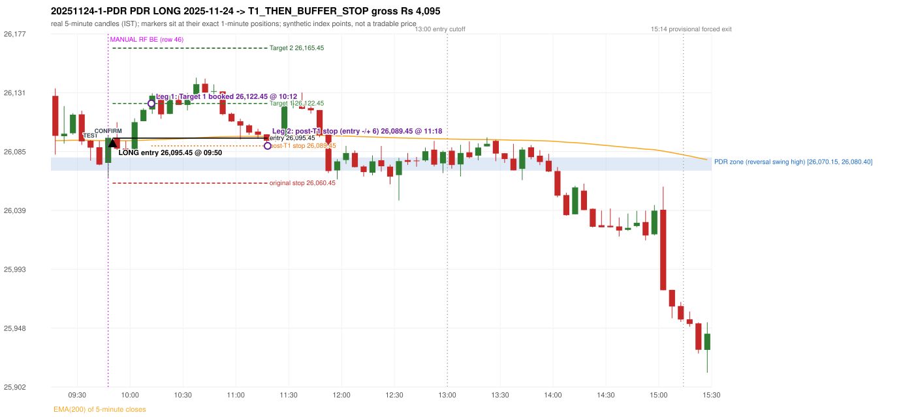

# Trading journal - 2025-11-24 (Monday)

> Automated, read-only reconstruction of the Phase 3.0 baseline. Synthetic NIFTY 50 index-point P&L (the index is not tradable). The owner's review status is intentionally blank.

## A. Trading day overview

| item | value |
|---|---|
| Date / weekday | 2025-11-24 / Monday |
| Session type | USABLE_WITH_FLAGS / VALID |
| Original session open (first 1-minute open) | 26,128.30 |
| Previous session | 2025-11-21 |
| Previous-day high / low | 26,179.10 / 26,052.80 |
| Previous-day official close / last 5-minute close | 26,068.15 / 26,063.95 |
| Raw engine records / confirmed signals / fully valid signals | 15 / 11 / 11 |
| Setups that did not complete (invalidated / incomplete) | 4 |
| Executed trades | 1 20251124-1-PDR |
| Gross P&L (Rs, synthetic) | 4,095.00 |
| Illustrative net P&L (Rs; Rs 500/trade + 0.5 pt/fill) | 3,205.00 |
| Day-end portfolio status | DAY_FINISHED |
| Manual journal trades (matched / unmatched) | 1 (0 / 1) |
| Extra automated trades | 1 |

## B. Daily strategy signal timeline (confirmed signals, chronological)

| time | strategy | method | dir | entry-rule status | valid for execution | <= 13:00 | portfolio state | accepted / ignored | specific reason | competing (same minute) |
|---|---|---|---|---|---|---|---|---|---|---|
| 09:50 | PDR | PDR | LONG | PROPOSAL_DEPENDENT | True | True | FIRST_TRADE_ACTIVE | ACCEPTED -> 20251124-1-PDR | first eligible signal of the day; trade 1: T1_THEN_BUFFER_STOP |  |
| 10:45 | IRF | Method 1 | SHORT | PROPOSAL_DEPENDENT | True | True | FIRST_TRADE_ACTIVE | IGNORED | POSITION_ACTIVE (signal kept for diagnostics only; never reused) [blocked by PDR#1] |  |
| 12:00 | PDR | PDR | LONG | PROPOSAL_DEPENDENT | True | True | DAY_FINISHED | IGNORED | DAY_FINISHED [blocked by PDR#1] |  |
| 12:20 | PDR | PDR | LONG | PROPOSAL_DEPENDENT | True | True | DAY_FINISHED | IGNORED | DAY_FINISHED [blocked by PDR#1] |  |
| 12:35 | PDR | PDR | LONG | PROPOSAL_DEPENDENT | True | True | DAY_FINISHED | IGNORED | DAY_FINISHED [blocked by PDR#1] |  |
| 12:50 | PDR | PDR | LONG | PROPOSAL_DEPENDENT | True | True | DAY_FINISHED | IGNORED | DAY_FINISHED [blocked by PDR#1] |  |
| 13:00 | PDR | PDR | LONG | PROPOSAL_DEPENDENT | True | True | DAY_FINISHED | IGNORED | DAY_FINISHED [blocked by PDR#1] |  |
| 13:10 | PDR | PDR | LONG | PROPOSAL_DEPENDENT | True | False | DAY_FINISHED | IGNORED | DAY_FINISHED [blocked by PDR#1] |  |
| 13:20 | PDR | PDR | LONG | PROPOSAL_DEPENDENT | True | False | DAY_FINISHED | IGNORED | DAY_FINISHED [blocked by PDR#1] |  |
| 13:45 | PDR | PDR | LONG | PROPOSAL_DEPENDENT | True | False | DAY_FINISHED | IGNORED | DAY_FINISHED [blocked by PDR#1] |  |
| 14:15 | PDR | PDR | LONG | PROPOSAL_DEPENDENT | True | False | DAY_FINISHED | IGNORED | DAY_FINISHED [blocked by PDR#1] |  |

Engine setups that did not complete (4); the complete list with failed rule ids is in `rejected_signals.csv`:

| candle | strategy | method | dir | status | precise reason | failed rules |
|---|---|---|---|---|---|---|
| 09:15 | ORB | Method 2 | LONG | INVALIDATED | TREND:EMA_PREV_SESSION_CLOSE wrong side | ORB-TREND-001;ORB-TREND-002 |
| 09:15 | ORB | Gap/200DMA | LONG | INVALIDATED | CANDLE_QUALITY_OR_REJECTION_WICK | ORB-GAP-LONG-004 |
| 09:15 | ORB | Method 2 | SHORT | INVALIDATED | TRENDLINE_NOT_SUPPORTIVE | ORB-M2-SHORT-001 |
| 09:45 | RF | RF | LONG | INVALIDATED | TREND:EMA_PREV_SESSION_CLOSE wrong side | RF-001;RF-008 |

## C. Detailed trade journals

### 20251124-1-PDR: PDR LONG (FIRST trade)

Chart: 

**Rule configuration:** CFG-baseline-be1db2a09d - signal verification status **PROPOSAL_DEPENDENT** (never VERIFIED while a rule rests on a proposal).

#### 1. Setup identification

PDR LONG: the session opened 60.15 points above the previous close and 47.90 points above the resistance zone [26,070.15, 26,080.40] taken from the 15:15 swing-high candle of 2025-11-21. The 09:35 candle (26,077.95 - 26,093.90) retested the zone, and the 09:45 candle closed green at 26,095.70, confirming the entry at 09:50. The engine does not check that the zone held (confirmation close inside/above the zone floor).

#### 2. Candle and indicator calculations

| role | session | candle | O | H | L | C | range | body % | upper wick % | lower wick % | direction | EMA(200) | strong bull / bear | pin bull / bear | small (body<=30%) | used for |
|---|---|---|---|---|---|---|---|---|---|---|---|---|---|---|---|---|
| zone_source_candle | PREVIOUS | 15:15-15:20 | 26,070.15 | 26,080.40 | 26,064.35 | 26,064.45 | 16.05 | 35.51 | 63.86 | 0.62 | BEARISH | 26,094.20 | False / False | False / False | False | swing-high candle that defines the zone (B_SWING_HIGH_REVERSAL) |
| prev_day_high_candle | PREVIOUS | 12:50-12:55 | 26,162.45 | 26,179.10 | 26,160.55 | 26,172.20 | 18.55 | 52.56 | 37.20 | 10.24 | BULLISH | 26,085.38 | False / False | False / False | False | candle of the previous session's absolute high (for comparison) |
| interaction_candle | TODAY | 09:35-09:40 | 26,093.45 | 26,093.90 | 26,077.95 | 26,088.10 | 15.95 | 33.54 | 2.82 | 63.64 | BEARISH | 26,093.74 | False / False | False / False | False | first candle whose range intersects the zone |
| confirmation_candle | TODAY | 09:45-09:50 | 26,076.20 | 26,097.45 | 26,064.70 | 26,095.70 | 32.75 | 59.54 | 5.34 | 35.11 | BULLISH | 26,093.57 | False / False | False / False | False | first green candle after the interaction candle |

Every condition, with the rule, the calculation, the observed values and the result:

| # | group | rule | result | status / numeric definition | calculation | observed | required | available at | why it matters |
|---|---|---|---|---|---|---|---|---|---|
| 1 | SELECTION | SEL-FIRST-001 | PASS | USER_APPROVED / USER_APPROVED | earliest CONFIRMED signal of the day across IRF/ORB/PDR/PDS/RF that passed the controller's checks | 0 confirmed signal(s) earlier today; 11 confirmed signals in the day in total, this one at 09:50 | no earlier executable signal | 2025-11-24 09:50 | the shared controller trades only the first valid signal; the five strategies are not independent positions |
| 2 | SELECTION | SEL-TIE-001 | PASS | USER_APPROVED / USER_APPROVED | other CONFIRMED signals with exactly the same confirmation timestamp | none | no different-strategy / opposite-direction signal in the same minute (otherwise an unresolved conflict, no trade) | 2025-11-24 09:50 | an unresolved same-minute collision would have produced no trade at all |
| 3 | SELECTION | ENTRY-CUTOFF-001 | PASS | USER_APPROVED / USER_APPROVED | fill timestamp vs 13:00:00 IST | signal confirmed 09:50; fill 09:50 | fill at or before 13:00:00 IST | 2025-11-24 09:50 | no new position may be entered with a fill after 13:00 IST |
| 4 | SELECTION | EXE-FILL-001 | PASS | PROPOSED_FOR_REVIEW / PROPOSED_FOR_REVIEW | fill = open of the 1-minute bar that starts at the signal candle's end | bar 09:50 O 26,095.45 H 26,103.65 L 26,094.30 C 26,103.10; executable=True; entry 26,095.45 | fill bar exists, starts exactly at the signal end, is fillable; entry = its open | 2025-11-24 09:50 | a 5-minute signal is known only when its candle closes; the first price that can be traded is the next minute's open |
| 5 | SELECTION | DAY-MAX-001 | PASS | USER_APPROVED / USER_APPROVED | number of entries today | trade 1 of at most 2 | <= 2 entries per day | 2025-11-24 09:50 | daily trade cap |
| 6 | SETUP | PDR-004 | PASS | SOURCE_VERIFIED / EXPLICIT_WORDING_DETAIL_PROPOSED_FOR_REVIEW | gap = first 1-minute open of today - previous session's OFFICIAL close | today's open 26,128.30 (first 1-minute bar 09:15) - previous close 26,068.15 (DAILY_VENDOR, 2025-11-21) = +60.15 points -> gap UP | gap UP (more than 0 points) | 2025-11-24 09:15 | approved convention: the original first-minute open, never the vendor daily open |
| 7 | SETUP | PDR-011 | PASS | SOURCE_VERIFIED / QUALITATIVE_SOURCE_NUMERIC_DEFINITION_PROPOSED_FOR_REVIEW | open relative to the zone (ABOVE_ZONE) | today's open 26,128.30 vs zone high 26,080.40: 47.90 points above | open > zone high | 2025-11-24 09:15 | the guide has price 'pull back into the zone', so the gap-up open is above it; this exclusion is a proposal |
| 8 | ZONE | PDR-001 | PASS | SOURCE_VERIFIED / EXPLICIT_IN_SOURCE | direction | LONG (PDR is long only) | long-only | 2025-11-24 09:50 | PDR buys a retest of previous-day resistance after a gap up |
| 9 | ZONE | PDR-002 | PASS | SOURCE_VERIFIED / QUALITATIVE_SOURCE_NUMERIC_DEFINITION_PROPOSED_FOR_REVIEW | zone = [body top, wick high] of the latest confirmed swing high (k=2) that has a red candle among the peak and the next 2 candles (method B_SWING_HIGH_REVERSAL) | zone [26,070.15, 26,080.40] from the 15:15 candle of 2025-11-21 (body top 26,070.15, wick high 26,080.40; 15:15-15:20 O 26,070.15 H 26,080.40 L 26,064.35 C 26,064.45; range 16.05, body 5.70 (35.51%), upper wick 10.25 (63.86%), lower wick 0.10 (0.62%), bearish); engine recorded [26,070.15, 26,080.40]. Previous session's absolute high 26,179.10 (candle 12:50) - the zone is NOT the day high (distance 98.70 points). Swing confirmed once candle 15:25 closed. | previous-day high where price peaked and reversed | 2025-11-21 15:30 | the source says 'previous day's high/reversal'; which candle marks the zone is an owner-approved research candidate, not a source rule |
| 10 | ZONE | PDR-003 | PASS | SOURCE_VERIFIED / EXPLICIT_IN_SOURCE | the zone is an area, not a single price | zone height 10.25 points [26,070.15, 26,080.40] | a rectangle with positive height | 2025-11-21 15:30 | price may touch any part of the area |
| 11 | ZONE | PDR-010 | UNRESOLVED | SOURCE_VERIFIED / QUALITATIVE_SOURCE_NUMERIC_DEFINITION_PROPOSED_FOR_REVIEW | reversal-quality filter ('clear high and reversal identified') | filter setting OFF | checklist item: a clear previous-day high and reversal | 2025-11-21 | the engine does not test reversal depth in the baseline (filter OFF) |
| 12 | CONFIRMATION | PDR-006 | PASS | SOURCE_VERIFIED / QUALITATIVE_SOURCE_NUMERIC_DEFINITION_PROPOSED_FOR_REVIEW | the first candle whose [low, high] intersects the zone (+/- proximity) | 09:35-09:40 O 26,093.45 H 26,093.90 L 26,077.95 C 26,088.10; range 15.95, body 5.35 (33.54%), upper wick 0.45 (2.82%), lower wick 10.15 (63.64%), bearish; low 26,077.95 vs zone high 26,080.40 (2.45 points inside/below the zone top), high 26,093.90 vs zone low 26,070.15; proximity 0 | range intersects the zone | 2025-11-24 09:40 | the retest of the previous-day resistance |
| 13 | CONFIRMATION | PDR-007 | PASS | SOURCE_VERIFIED / QUALITATIVE_SOURCE_NUMERIC_DEFINITION_PROPOSED_FOR_REVIEW | the first GREEN candle after the interaction candle | 09:45-09:50 O 26,076.20 H 26,097.45 L 26,064.70 C 26,095.70; range 32.75, body 19.50 (59.54%), upper wick 1.75 (5.34%), lower wick 11.50 (35.11%), bullish; interaction candle 09:35, confirmation candle 09:45 | close > open, strictly after the interaction candle | 2025-11-24 09:50 | the guide asks for 'a green candle' after the test; it gives no size or position test |
| 14 | CONFIRMATION | PDR-005 | PASS | SOURCE_VERIFIED / EXPLICIT_IN_SOURCE | no entry at the open: price must first come back toward the zone | interaction candle 09:35 (candle no. 5 of the session) precedes the entry candle 09:45; fill 09:50 | interaction before the entry; fill after 09:20 | 2025-11-24 09:50 | if price keeps rising without returning to the zone there is no setup |
| 15 | EXECUTION | EXE-STOP-001 | PASS | USER_APPROVED / USER_APPROVED | initial stop = entry - 35 points | entry 26,095.45 -> stop 26,060.45 | stop 35 index points (BASELINE) | 2025-11-24 09:50 | defines the loss if the setup fails before Target 1 |
| 16 | EXECUTION | EXE-T1-001 | PASS | SOURCE_VERIFIED / EXPLICIT_IN_SOURCE | Target 1 = entry +/- 27 points | T1 26,122.45 | 27 points | 2025-11-24 09:50 | Leg 1 (3 lots) is booked at Target 1 |
| 17 | EXECUTION | PDR-008 | PASS | SOURCE_VERIFIED / EXPLICIT_IN_SOURCE | Target 2 = entry +/- 70 points | T2 26,165.45 (the guide says 70; the performance report's winners suggest 60 - CONFLICTING, recorded) | 70 points | 2025-11-24 09:50 | Leg 2 (3 lots) is booked at Target 2 |
| 18 | EXECUTION | POST-T1-STOP-006 | PASS | USER_APPROVED / USER_APPROVED | after T1 the Leg-2 stop = entry - 6 (no trailing) | post-T1 stop 26,089.45 | entry -6 (LONG) / +6 (SHORT) | 2025-11-24 09:50 | protects the remaining three lots once the first three are booked |
| 19 | EXECUTION | SIZE-LOT-001 | PASS | USER_APPROVED / USER_APPROVED | 6 lots x 65 = 390, Leg 1 = 3 lots = 195, Leg 2 = 195 | 6 lots, lot size 65, legs 3+3 | 6 lots in two equal legs | 2025-11-24 09:50 | position size for the synthetic P&L |
| 20 | NOTE | PDR-007 | UNRESOLVED | SOURCE_VERIFIED / QUALITATIVE_SOURCE_NUMERIC_DEFINITION_PROPOSED_FOR_REVIEW | did the zone hold? (is the confirmation candle's close back at/above the zone floor?) | confirmation close 26,095.70 vs zone floor 26,070.15 / top 26,080.40: above the zone top; interaction low 26,077.95 | the engine does NOT test that resistance-turned-support held | 2025-11-24 09:50 | a later green candle is accepted even after price traded through the zone; a human would normally check the hold |
| 21 | NOTE | PDR-012 | NOT_APPLICABLE | PROPOSED_FOR_REVIEW / PROPOSED_FOR_REVIEW | repeated PDR signals today | 10 confirmed PDR signal(s) in the session | n/a (disclosure) | 2025-11-24 09:50 | the per-session cap is lifted for the controller runs; the controller trades only the first |
| 22 | NOTE | PDR-009 | UNRESOLVED | UNRESOLVED / UNRESOLVED | stop 35 or 40 'depending on the situation' | the guide gives no selection rule; baseline fixed 35 points | unresolved in the source | 2025-11-24 09:50 | PDR stop selection is left to the owner |
| 23 | NOTE | NOTE-UNRESOLVED-DEPENDENCIES | UNRESOLVED | NOT_A_RULE / NOT_A_REGISTRY_RULE | rules the signal depends on that the sources leave unresolved | engine-recorded unresolved rule ids: PDR-010; verification status PROPOSAL_DEPENDENT | n/a (disclosure) | 2025-11-24 09:50 | the entry is only as verified as the rules it rests on |

#### 3. Entry decision and explanation

PDR LONG: the session opened 60.15 points above the previous close and 47.90 points above the resistance zone [26,070.15, 26,080.40] taken from the 15:15 swing-high candle of 2025-11-21. The 09:35 candle (26,077.95 - 26,093.90) retested the zone, and the 09:45 candle closed green at 26,095.70, confirming the entry at 09:50. The engine does not check that the zone held (confirmation close inside/above the zone floor).

**Why this trade ahead of the other strategies:** This PDR signal was the earliest executable signal of the day: 0 confirmed signal(s) earlier, 0 other in the same minute. 10 later confirmed signal(s) (IRF x1, PDR x9) are logged as ignored or rejected. State of the other four engines at that moment: [IRF: no setup record before this time (a base condition was not met, or nothing triggered)] [ORB: Method 2 invalidated at 09:15: TREND:EMA_PREV_SESSION_CLOSE wrong side; Gap/200DMA invalidated at 09:15: CANDLE_QUALITY_OR_REJECTION_WICK] [PDS: no setup record before this time (a base condition was not met, or nothing triggered)] [RF: RF invalidated at 09:45: TREND:EMA_PREV_SESSION_CLOSE wrong side]

#### 4. Actual entry execution

| item | value |
|---|---|
| Signal candle | 09:45-09:50 |
| Signal confirmed | 2025-11-24 09:50 |
| Fill timestamp | 2025-11-24 09:50 |
| Entry price | 26,095.45 |
| Source partition / 1-minute bar | data/processed/nifty50/year=2025/month=11/candles.parquet / 2025-11-24 09:50 |
| Source bar O / H / L / C | 26,095.45 / 26,103.65 / 26,094.30 / 26,103.10 |
| Fill assumption | open of the 1-minute bar starting at the signal candle's end (EXE-FILL-001, PROPOSED causal convention) |
| Initial stop / T1 / T2 / post-T1 stop | 26,060.45 / 26,122.45 / 26,165.45 / 26,089.45 |
| Position | 6 lots x 65 = 390 units (Leg 1 195, Leg 2 195) |

#### 5-8. Trade progress, Target 1, post-T1 stop and final exit

Between the 09:50 entry bar and the final exit (89 one-minute bars) the best excursion in favour was 47.05 points at 10:38 and the worst against was 11.45 points at 09:59. At 10:12 price reached Target 1 26,122.45 and three lots exited. At 10:12 the remaining three lots' protective stop was set to 26,089.45 (entry - 6; no trailing, no further change); the engine applies it from the Target-1 bar onward and tests it within that same bar. At 11:18 the remaining three lots stopped out at 26,089.45. T1_THEN_BUFFER_STOP: no second trade that day (DAY-BUF-001).

| leg | qty | exit time | exit price | reason | source 1-minute bar | O / H / L / C | gross points | gross Rs | slippage pts | flags |
|---|---|---|---|---|---|---|---|---|---|---|
| 1 | 195 | 10:12 | 26,122.45 | TARGET_1 | 10:12 | 26,116.05 / 26,123.50 / 26,114.25 / 26,123.50 | 27.00 | 5,265.00 | 0.00 |  |
| 2 | 195 | 11:18 | 26,089.45 | POST_T1_STOP_ENTRY_MINUS_PLUS_6 | 11:18 | 26,093.55 / 26,094.00 / 26,088.10 / 26,090.05 | -6.00 | -1,170.00 | 0.00 |  |

Exit evidence per leg:

* Leg 1: 1-minute bar 10:12 O 26,116.05 H 26,123.50 L 26,114.25 C 26,123.50: high 26,123.50 reached Target 1 26,122.45; Leg 1 booked at the target level
* Leg 2: 1-minute bar 11:18 O 26,093.55 H 26,094.00 L 26,088.10 C 26,090.05: low 26,088.10 reached the post-T1 stop 26,089.45; Leg 2 exits at 26,089.45 at the stop level

#### 9. Gross and illustrative net P&L

| item | value (Rs) |
|---|---|
| Leg 1 gross | 5,265.00 |
| Leg 2 gross | -1,170.00 |
| Trade gross (= Leg 1 + Leg 2) | 4,095.00 |
| Illustrative fixed cost | -500.00 |
| Illustrative slippage (0.5 pt on every fill, entry + exits, all units) | -390.00 |
| Illustrative net | 3,205.00 |

#### 10. Manual journal comparison

EXTRA_AUTOMATED_TRADE: the automated system took PDR PDR LONG at 09:50 (manual traded only other strategies: RF 09:45 BE). The setup rests on: PDR-010: Reversal-quality filter is OFF in the baseline | PDR-007: Engine does not test whether the zone held | PDR-009: PDR stop selection rule is not defined | NOTE-UNRESOLVED-DEPENDENCIES: Disclosure of unresolved source rules behind this signal. The journal shows no corresponding entry.

## D. Manual journal comparison

| comparison | journal row | journal strategy | manual time | manual direction | manual outcome | match class | trade | auto entry | auto outcome | explanation |
|---|---|---|---|---|---|---|---|---|---|---|
| M046 | 46 | RF | 09:45 | LONG | BE | SIGNAL_REJECTED_BY_ENTRY_RULE |  |  |  | SIGNAL_REJECTED_BY_ENTRY_RULE: SETUP_INVALIDATED RF - TREND:EMA_PREV_SESSION_CLOSE wrong side; failed=RF-001;RF-008. Heuristic primary cause: TREND_FILTER; blocked by: n/a |
| E029 |  |  |  |  |  | EXTRA_AUTOMATED_TRADE | 20251124-1-PDR | 09:50 @ 26,095.45 | T1_THEN_BUFFER_STOP | EXTRA_AUTOMATED_TRADE: the automated system took PDR PDR LONG at 09:50 (manual traded only other strategies: RF 09:45 BE). The setup rests on: PDR-010: Reversal-quality filter is OFF in the baseline \| PDR-007: Engine does not test whether the zone held \| PDR-009: PDR stop selection rule is not defined \| NOTE-UNRESOLVED-DEPENDENCIES: Disclosure of unresolved source rules behind this signal. The journal shows no corresponding entry. |

The journal records no entry price and no exit price (NOT_RECORDED); matching uses date, strategy and candle start only - never P&L.

## E. Daily conclusion

* **Traded:** 20251124-1-PDR - PDR PDR LONG at 09:50 (entry 26,095.45), outcome T1_THEN_BUFFER_STOP, gross Rs 4,095.00, illustrative net Rs 3,205.00. **Why:** This PDR signal was the earliest executable signal of the day: 0 confirmed signal(s) earlier, 0 other in the same minute. 10 later confirmed signal(s) (IRF x1, PDR x9) are logged as ignored or rejected. State of the other four engines at that moment: [IRF: no setup record before this time (a base condition was not met, or nothing triggered)] [ORB: Method 2 invalidated at 09:15: TREND:EMA_PREV_SESSION_CLOSE wrong side; Gap/200DMA invalidated at 09:15: CANDLE_QUALITY_OR_REJECTION_WICK] [PDS: no setup record before this time (a base condition was not met, or nothing triggered)] [RF: RF invalidated at 09:45: TREND:EMA_PREV_SESSION_CLOSE wrong side] **How it ended:** At 10:12 price reached Target 1 26,122.45 and three lots exited. At 10:12 the remaining three lots' protective stop was set to 26,089.45 (entry - 6; no trailing, no further change); the engine applies it from the Target-1 bar onward and tests it within that same bar. At 11:18 the remaining three lots stopped out at 26,089.45. T1_THEN_BUFFER_STOP: no second trade that day (DAY-BUF-001).
* **Ignored / rejected signals:** PDR IGNORED DAY_FINISHED x9; IRF IGNORED POSITION_ACTIVE x1
* **Unmatched manual trade (row 46, RF 09:45 BE):** SIGNAL_REJECTED_BY_ENTRY_RULE: SETUP_INVALIDATED RF - TREND:EMA_PREV_SESSION_CLOSE wrong side; failed=RF-001;RF-008. Heuristic primary cause: TREND_FILTER; blocked by: n/a
* **Extra automated trade 20251124-1-PDR:** EXTRA_AUTOMATED_TRADE: the automated system took PDR PDR LONG at 09:50 (manual traded only other strategies: RF 09:45 BE). The setup rests on: PDR-010: Reversal-quality filter is OFF in the baseline | PDR-007: Engine does not test whether the zone held | PDR-009: PDR stop selection rule is not defined | NOTE-UNRESOLVED-DEPENDENCIES: Disclosure of unresolved source rules behind this signal. The journal shows no corresponding entry.
* **Open strategy-definition issues that affected this day:** NOTE-UNRESOLVED-DEPENDENCIES, PDR-007 (After the zone has been tested, wait for a green candle and take the long on that confirmation), PDR-009 (Stop-loss 35 or 40 'depending on the situation'; choose before entering, do not move after entry), PDR-010 (Checklist: a clear previous-day high and reversal must be identified)
* **Automated triage (not an approval; the owner's review status stays blank):** REVIEW: UNMATCHED_MANUAL+EXTRA_AUTOMATED
