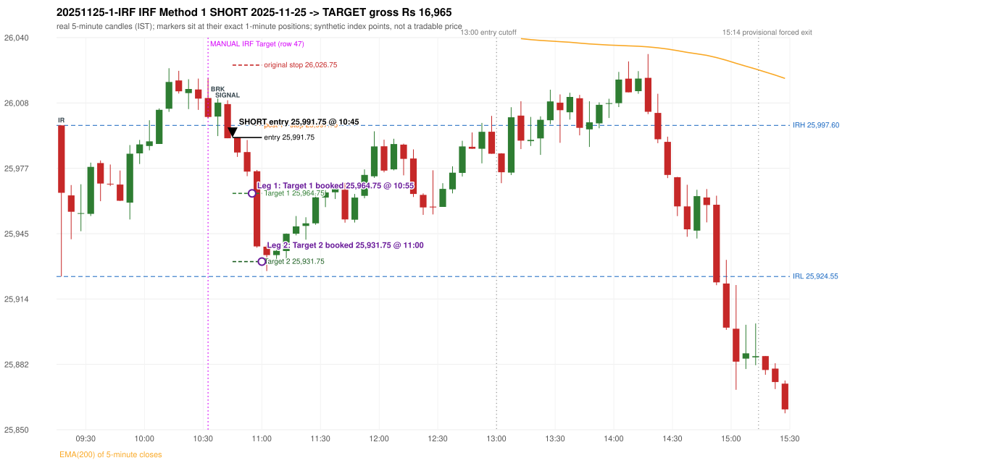

# Trading journal - 2025-11-25 (Tuesday)

> Automated, read-only reconstruction of the Phase 3.0 baseline. Synthetic NIFTY 50 index-point P&L (the index is not tradable). The owner's review status is intentionally blank.

## A. Trading day overview

| item | value |
|---|---|
| Date / weekday | 2025-11-25 / Tuesday |
| Session type | USABLE_WITH_FLAGS / VALID |
| Original session open (first 1-minute open) | 25,997.60 |
| Previous session | 2025-11-24 |
| Previous-day high / low | 26,142.50 / 25,913.00 |
| Previous-day official close / last 5-minute close | 25,959.50 / 25,943.35 |
| Raw engine records / confirmed signals / fully valid signals | 10 / 7 / 7 |
| Setups that did not complete (invalidated / incomplete) | 3 |
| Executed trades | 1 20251125-1-IRF |
| Gross P&L (Rs, synthetic) | 16,965.00 |
| Illustrative net P&L (Rs; Rs 500/trade + 0.5 pt/fill) | 16,075.00 |
| Day-end portfolio status | DAY_FINISHED |
| Manual journal trades (matched / unmatched) | 1 (1 / 0) |
| Extra automated trades | 0 |

## B. Daily strategy signal timeline (confirmed signals, chronological)

| time | strategy | method | dir | entry-rule status | valid for execution | <= 13:00 | portfolio state | accepted / ignored | specific reason | competing (same minute) |
|---|---|---|---|---|---|---|---|---|---|---|
| 10:45 | IRF | Method 1 | SHORT | PROPOSAL_DEPENDENT | True | True | FIRST_TRADE_ACTIVE | ACCEPTED -> 20251125-1-IRF | first eligible signal of the day; trade 1: TARGET |  |
| 13:05 | IRF | Method 2A | SHORT | PROPOSAL_DEPENDENT | True | False | DAY_FINISHED | IGNORED | DAY_FINISHED [blocked by IRF#1] |  |
| 13:15 | IRF | Method 1 | SHORT | PROPOSAL_DEPENDENT | True | False | DAY_FINISHED | IGNORED | DAY_FINISHED [blocked by IRF#1] |  |
| 13:45 | IRF | Method 1 | SHORT | PROPOSAL_DEPENDENT | True | False | DAY_FINISHED | IGNORED | DAY_FINISHED [blocked by IRF#1] |  |
| 14:10 | IRF | Method 2B | SHORT | PROPOSAL_DEPENDENT | True | False | DAY_FINISHED | IGNORED | DAY_FINISHED [blocked by IRF#1] |  |
| 14:20 | IRF | Method 2B | SHORT | PROPOSAL_DEPENDENT | True | False | DAY_FINISHED | IGNORED | DAY_FINISHED [blocked by IRF#1] |  |
| 14:25 | IRF | Method 1 | SHORT | PROPOSAL_DEPENDENT | True | False | DAY_FINISHED | IGNORED | DAY_FINISHED [blocked by IRF#1] |  |

Engine setups that did not complete (3); the complete list with failed rule ids is in `rejected_signals.csv`:

| candle | strategy | method | dir | status | precise reason | failed rules |
|---|---|---|---|---|---|---|
| 09:15 | ORB | Method 2 | SHORT | INVALIDATED | CANDLE_QUALITY | ORB-M2-SHORT-003 |
| 09:15 | PDR | PDR | LONG | INVALIDATED | GAP_UP_OPEN_NOT_ABOVE_ZONE | PDR-011 |
| 14:50 | RF | RF | LONG | INCOMPLETE_AT_EOD | NO_RETURN_INSIDE_BEFORE_SESSION_END |  |

## C. Detailed trade journals

### 20251125-1-IRF: IRF Method 1 SHORT (FIRST trade)

Chart: 

**Rule configuration:** CFG-baseline-be1db2a09d - signal verification status **PROPOSAL_DEPENDENT** (never VERIFIED while a rule rests on a proposal).

#### 1. Setup identification

IRF Method 1 SHORT: the completed 10:35 candle closed at 26,008.65, 11.05 points above the initial range high 25,997.60 (range [25,924.55, 25,997.60] from the 09:15 candle); the immediately following completed 10:40 candle closed at 25,991.40, back inside the range. The short signal was confirmed at 10:45 on that close. Entry reference close 25,991.40 is 6.20 points below IRH 25,997.60.

#### 2. Candle and indicator calculations

| role | session | candle | O | H | L | C | range | body % | upper wick % | lower wick % | direction | EMA(200) | strong bull / bear | pin bull / bear | small (body<=30%) | used for |
|---|---|---|---|---|---|---|---|---|---|---|---|---|---|---|---|---|
| initial_range_candle | TODAY | 09:15-09:20 | 25,997.60 | 25,997.60 | 25,924.55 | 25,965.00 | 73.05 | 44.63 | 0.00 | 55.37 | BEARISH | 26,077.57 | False / False | False / False | False | initial range = high/low of the 09:15 candle |
| signal_candle | TODAY | 10:40-10:45 | 26,007.90 | 26,009.75 | 25,991.40 | 25,991.40 | 18.35 | 89.92 | 10.08 | 0.00 | BEARISH | 26,063.88 | False / True | False / False | False | candle whose close completed the trigger |
| breakout_candle | TODAY | 10:35-10:40 | 26,001.90 | 26,012.65 | 25,992.45 | 26,008.65 | 20.20 | 33.42 | 19.80 | 46.78 | BULLISH | 26,064.61 | False / False | False / False | False | breakout candle: a completed candle closing above IRH |

Every condition, with the rule, the calculation, the observed values and the result:

| # | group | rule | result | status / numeric definition | calculation | observed | required | available at | why it matters |
|---|---|---|---|---|---|---|---|---|---|
| 1 | SELECTION | SEL-FIRST-001 | PASS | USER_APPROVED / USER_APPROVED | earliest CONFIRMED signal of the day across IRF/ORB/PDR/PDS/RF that passed the controller's checks | 0 confirmed signal(s) earlier today; 7 confirmed signals in the day in total, this one at 10:45 | no earlier executable signal | 2025-11-25 10:45 | the shared controller trades only the first valid signal; the five strategies are not independent positions |
| 2 | SELECTION | SEL-TIE-001 | PASS | USER_APPROVED / USER_APPROVED | other CONFIRMED signals with exactly the same confirmation timestamp | none | no different-strategy / opposite-direction signal in the same minute (otherwise an unresolved conflict, no trade) | 2025-11-25 10:45 | an unresolved same-minute collision would have produced no trade at all |
| 3 | SELECTION | ENTRY-CUTOFF-001 | PASS | USER_APPROVED / USER_APPROVED | fill timestamp vs 13:00:00 IST | signal confirmed 10:45; fill 10:45 | fill at or before 13:00:00 IST | 2025-11-25 10:45 | no new position may be entered with a fill after 13:00 IST |
| 4 | SELECTION | EXE-FILL-001 | PASS | PROPOSED_FOR_REVIEW / PROPOSED_FOR_REVIEW | fill = open of the 1-minute bar that starts at the signal candle's end | bar 10:45 O 25,991.75 H 25,991.90 L 25,986.10 C 25,986.10; executable=True; entry 25,991.75 | fill bar exists, starts exactly at the signal end, is fillable; entry = its open | 2025-11-25 10:45 | a 5-minute signal is known only when its candle closes; the first price that can be traded is the next minute's open |
| 5 | SELECTION | DAY-MAX-001 | PASS | USER_APPROVED / USER_APPROVED | number of entries today | trade 1 of at most 2 | <= 2 entries per day | 2025-11-25 10:45 | daily trade cap |
| 6 | SETUP | IRF-GLOBAL-001 | PASS | SOURCE_VERIFIED / EXPLICIT_IN_SOURCE | initial range = high and low (wicks included) of the first completed 5-minute candle | 09:15-09:20 IRH 25,997.60, IRL 25,924.55 (range 73.05; engine recorded IRH 25,997.60, IRL 25,924.55) | high/low of the 09:15-09:20 candle | 2025-11-25 09:20 | all three IRF methods measure price against this range |
| 7 | SETUP | IRF-GLOBAL-003 | PASS | SOURCE_VERIFIED / EXPLICIT_IN_SOURCE | closes confirm, wicks do not: every trigger is evaluated on a completed 5-minute candle | trigger candle 10:40-10:45 was complete when the signal was stamped 10:45; decision uses its close 25,991.40 | completed candle close, not an intra-candle wick | 2025-11-25 10:45 | an intra-candle wick can reverse before the candle closes |
| 8 | SETUP | IRF-GLOBAL-002 | PASS | SOURCE_VERIFIED / EXPLICIT_IN_SOURCE | direction | SHORT (IRF trades short only) | short only | 2025-11-25 10:45 | IRF fades failed upside breakouts |
| 9 | SETUP | IRF-M1-001 | PASS | SOURCE_VERIFIED / EXPLICIT_IN_SOURCE | breakout candle close vs IRH | 10:35-10:40 O 26,001.90 H 26,012.65 L 25,992.45 C 26,008.65; range 20.20, body 6.75 (33.42%), upper wick 4.00 (19.80%), lower wick 9.45 (46.78%), bullish; close 26,008.65 is 11.05 points above IRH 25,997.60 | close > IRH (a wick above IRH is not a breakout) | 2025-11-25 10:40 | starts every IRF setup |
| 10 | CONFIRMATION | IRF-M1-002 | PASS | SOURCE_VERIFIED / EXPLICIT_IN_SOURCE | candle after the breakout closes back inside [IRL, IRH) | 10:40-10:45 O 26,007.90 H 26,009.75 L 25,991.40 C 25,991.40; range 18.35, body 16.50 (89.92%), upper wick 1.85 (10.08%), lower wick 0.00 (0.00%), bearish; close 25,991.40 vs range [25,924.55, 25,997.60) | IRL <= close < IRH | 2025-11-25 10:45 | the failed breakout: price could not hold above the opening range |
| 11 | CONFIRMATION | IRF-M1-004 | PASS | SOURCE_VERIFIED / EXPLICIT_IN_SOURCE | failure candle is the candle immediately after the breakout (k = 1) | breakout 10:35, failure candle 10:40: k = 1 | k = 1 (pp.5, 6, 13); the p.14 'next or following' reading (IRF-M1-C001) is CONFLICTING and not used in the baseline | 2025-11-25 10:45 | the guide's worked example enters at the close of the very next candle; no support/resistance break is required |
| 12 | EXECUTION | EXE-STOP-001 | PASS | USER_APPROVED / USER_APPROVED | initial stop = entry + 35 points | entry 25,991.75 -> stop 26,026.75 | stop 35 index points (BASELINE) | 2025-11-25 10:45 | defines the loss if the setup fails before Target 1 |
| 13 | EXECUTION | EXE-T1-001 | PASS | SOURCE_VERIFIED / EXPLICIT_IN_SOURCE | Target 1 = entry +/- 27 points | T1 25,964.75 | 27 points | 2025-11-25 10:45 | Leg 1 (3 lots) is booked at Target 1 |
| 14 | EXECUTION | IRF-TGT-001 | PASS | SOURCE_VERIFIED / EXPLICIT_IN_SOURCE | Target 2 = entry +/- 60 points | T2 25,931.75 | 60 points | 2025-11-25 10:45 | Leg 2 (3 lots) is booked at Target 2 |
| 15 | EXECUTION | POST-T1-STOP-006 | PASS | USER_APPROVED / USER_APPROVED | after T1 the Leg-2 stop = entry + 6 (no trailing) | post-T1 stop 25,997.75 | entry -6 (LONG) / +6 (SHORT) | 2025-11-25 10:45 | protects the remaining three lots once the first three are booked |
| 16 | EXECUTION | SIZE-LOT-001 | PASS | USER_APPROVED / USER_APPROVED | 6 lots x 65 = 390, Leg 1 = 3 lots = 195, Leg 2 = 195 | 6 lots, lot size 65, legs 3+3 | 6 lots in two equal legs | 2025-11-25 10:45 | position size for the synthetic P&L |
| 17 | NOTE | IRF-GLOBAL-004 | UNRESOLVED | UNRESOLVED / UNRESOLVED | which close above IRH of the session produced this attempt; repeat setups | this breakout is upward crossing no. 1 of the session (a close above IRH after a close at/below it) | the source states no first-breakout-only, re-arming, expiry or trades-per-day rule | 2025-11-25 10:45 | IRF re-arms on every later breakout in the code, producing many raw setups; the controller keeps only the first |
| 18 | NOTE | NOTE-IRF-REPEATED-SETUPS | NOT_APPLICABLE | NOT_A_RULE / NOT_A_REGISTRY_RULE | other IRF signals later in the session (not traded) | 6 further confirmed IRF signal(s): Method 2A@13:05, Method 1@13:15, Method 1@13:45, Method 2B@14:10, Method 2B@14:20, Method 1@14:25 | disclosure of repeated raw setups | 2025-11-25 10:45 | repeated raw IRF setups are not hidden; they are logged as ignored |
| 19 | NOTE | IRF-SL-001 | NOT_APPLICABLE | SOURCE_VERIFIED / QUALITATIVE_SOURCE_NUMERIC_DEFINITION_PROPOSED_FOR_REVIEW | the guide's 35-or-40 rule: 35 if the most recent green candle's high is within 35 points of entry, else 40 | most recent green candle high 26,012.65 is 20.90 points from the entry 25,991.75: the guide's rule would select 35 points; the baseline applies a fixed 35 (USER_APPROVED research baseline; the 35-vs-40 selection and the 40-point variant are separate labelled scenarios) | source selection rule | 2025-11-25 10:45 | the stop distance is a modelling choice and changes losses, not entries |
| 20 | NOTE | NOTE-UNRESOLVED-DEPENDENCIES | UNRESOLVED | NOT_A_RULE / NOT_A_REGISTRY_RULE | rules the signal depends on that the sources leave unresolved | engine-recorded unresolved rule ids: IRF-GLOBAL-004; verification status PROPOSAL_DEPENDENT | n/a (disclosure) | 2025-11-25 10:45 | the entry is only as verified as the rules it rests on |

#### 3. Entry decision and explanation

IRF Method 1 SHORT: the completed 10:35 candle closed at 26,008.65, 11.05 points above the initial range high 25,997.60 (range [25,924.55, 25,997.60] from the 09:15 candle); the immediately following completed 10:40 candle closed at 25,991.40, back inside the range. The short signal was confirmed at 10:45 on that close. Entry reference close 25,991.40 is 6.20 points below IRH 25,997.60.

**Why this trade ahead of the other strategies:** This IRF Method 1 signal was the earliest executable signal of the day: 0 confirmed signal(s) earlier, 0 other in the same minute. 6 later confirmed signal(s) (IRF x6) are logged as ignored or rejected. State of the other four engines at that moment: [ORB: Method 2 invalidated at 09:15: CANDLE_QUALITY] [PDR: PDR invalidated at 09:15: GAP_UP_OPEN_NOT_ABOVE_ZONE] [PDS: no setup record before this time (a base condition was not met, or nothing triggered)] [RF: no setup record before this time (a base condition was not met, or nothing triggered)]

#### 4. Actual entry execution

| item | value |
|---|---|
| Signal candle | 10:40-10:45 |
| Signal confirmed | 2025-11-25 10:45 |
| Fill timestamp | 2025-11-25 10:45 |
| Entry price | 25,991.75 |
| Source partition / 1-minute bar | data/processed/nifty50/year=2025/month=11/candles.parquet / 2025-11-25 10:45 |
| Source bar O / H / L / C | 25,991.75 / 25,991.90 / 25,986.10 / 25,986.10 |
| Fill assumption | open of the 1-minute bar starting at the signal candle's end (EXE-FILL-001, PROPOSED causal convention) |
| Initial stop / T1 / T2 / post-T1 stop | 26,026.75 / 25,964.75 / 25,931.75 / 25,997.75 |
| Position | 6 lots x 65 = 390 units (Leg 1 195, Leg 2 195) |

#### 5-8. Trade progress, Target 1, post-T1 stop and final exit

Between the 10:45 entry bar and the final exit (16 one-minute bars) the best excursion in favour was 64.60 points at 11:00 and the worst against was 0.15 points at 10:45. At 10:55 price reached Target 1 25,964.75 and three lots exited. At 10:55 the remaining three lots' protective stop was set to 25,997.75 (entry + 6; no trailing, no further change); the engine applies it from the Target-1 bar onward and tests it within that same bar. At 11:00 price reached Target 2 25,931.75 and the remaining three lots exited. No further trade that day (DAY-T2-001).

| leg | qty | exit time | exit price | reason | source 1-minute bar | O / H / L / C | gross points | gross Rs | slippage pts | flags |
|---|---|---|---|---|---|---|---|---|---|---|
| 1 | 195 | 10:55 | 25,964.75 | TARGET_1 | 10:55 | 25,975.45 / 25,976.05 / 25,959.35 / 25,964.00 | 27.00 | 5,265.00 | 0.00 |  |
| 2 | 195 | 11:00 | 25,931.75 | TARGET_2 | 11:00 | 25,938.95 / 25,939.90 / 25,927.15 / 25,933.55 | 60.00 | 11,700.00 | 0.00 |  |

Exit evidence per leg:

* Leg 1: 1-minute bar 10:55 O 25,975.45 H 25,976.05 L 25,959.35 C 25,964.00: low 25,959.35 reached Target 1 25,964.75; Leg 1 booked at the target level
* Leg 2: 1-minute bar 11:00 O 25,938.95 H 25,939.90 L 25,927.15 C 25,933.55: low 25,927.15 reached Target 2 25,931.75; Leg 2 booked at the target level

#### 9. Gross and illustrative net P&L

| item | value (Rs) |
|---|---|
| Leg 1 gross | 5,265.00 |
| Leg 2 gross | 11,700.00 |
| Trade gross (= Leg 1 + Leg 2) | 16,965.00 |
| Illustrative fixed cost | -500.00 |
| Illustrative slippage (0.5 pt on every fill, entry + exits, all units) | -390.00 |
| Illustrative net | 16,075.00 |

#### 10. Manual journal comparison

TIME_SHIFTED_MATCH: manual IRF labelled 10:30 (candle start) vs automated IRF Method 1 SHORT candle 10:40, filled 10:45 at 25,991.75; time difference 10 minutes. Journal outcome Target vs automated TARGET (same outcome class). The journal records no entry or exit price.

## D. Manual journal comparison

| comparison | journal row | journal strategy | manual time | manual direction | manual outcome | match class | trade | auto entry | auto outcome | explanation |
|---|---|---|---|---|---|---|---|---|---|---|
| M047 | 47 | IRF | 10:30 | SHORT | Target | TIME_SHIFTED_MATCH | 20251125-1-IRF | 10:45 @ 25,991.75 | TARGET | TIME_SHIFTED_MATCH: manual IRF labelled 10:30 (candle start) vs automated IRF Method 1 SHORT candle 10:40, filled 10:45 at 25,991.75; time difference 10 minutes. Journal outcome Target vs automated TARGET (same outcome class). The journal records no entry or exit price. |

The journal records no entry price and no exit price (NOT_RECORDED); matching uses date, strategy and candle start only - never P&L.

## E. Daily conclusion

* **Traded:** 20251125-1-IRF - IRF Method 1 SHORT at 10:45 (entry 25,991.75), outcome TARGET, gross Rs 16,965.00, illustrative net Rs 16,075.00. **Why:** This IRF Method 1 signal was the earliest executable signal of the day: 0 confirmed signal(s) earlier, 0 other in the same minute. 6 later confirmed signal(s) (IRF x6) are logged as ignored or rejected. State of the other four engines at that moment: [ORB: Method 2 invalidated at 09:15: CANDLE_QUALITY] [PDR: PDR invalidated at 09:15: GAP_UP_OPEN_NOT_ABOVE_ZONE] [PDS: no setup record before this time (a base condition was not met, or nothing triggered)] [RF: no setup record before this time (a base condition was not met, or nothing triggered)] **How it ended:** At 10:55 price reached Target 1 25,964.75 and three lots exited. At 10:55 the remaining three lots' protective stop was set to 25,997.75 (entry + 6; no trailing, no further change); the engine applies it from the Target-1 bar onward and tests it within that same bar. At 11:00 price reached Target 2 25,931.75 and the remaining three lots exited. No further trade that day (DAY-T2-001).
* **Ignored / rejected signals:** IRF IGNORED DAY_FINISHED x6
* **Open strategy-definition issues that affected this day:** IRF-GLOBAL-004 (NOT STATED: how many IRF trades per day, a latest entry time, and whether a new breakout may re-arm a setup after a signal), NOTE-UNRESOLVED-DEPENDENCIES
* **Automated triage (not an approval; the owner's review status stays blank):** REVIEW: TIME_SHIFTED
