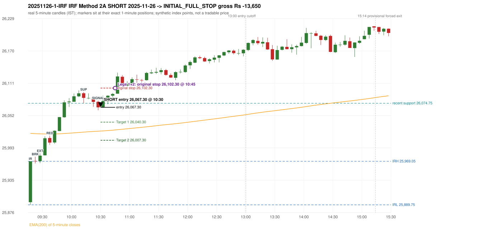

# Trading journal - 2025-11-26 (Wednesday)

> Automated, read-only reconstruction of the Phase 3.0 baseline. Synthetic NIFTY 50 index-point P&L (the index is not tradable). The owner's review status is intentionally blank.

## A. Trading day overview

| item | value |
|---|---|
| Date / weekday | 2025-11-26 / Wednesday |
| Session type | USABLE_WITH_FLAGS / VALID |
| Original session open (first 1-minute open) | 25,894.60 |
| Previous session | 2025-11-25 |
| Previous-day high / low | 26,032.10 / 25,858.40 |
| Previous-day official close / last 5-minute close | 25,884.80 / 25,860.30 |
| Raw engine records / confirmed signals / fully valid signals | 7 / 5 / 5 |
| Setups that did not complete (invalidated / incomplete) | 2 |
| Executed trades | 1 20251126-1-IRF |
| Gross P&L (Rs, synthetic) | -13,650.00 |
| Illustrative net P&L (Rs; Rs 500/trade + 0.5 pt/fill) | -14,540.00 |
| Day-end portfolio status | SECOND_TRADE_ELIGIBLE |
| Manual journal trades (matched / unmatched) | 0 (0 / 0) |
| Extra automated trades | 1 |

## B. Daily strategy signal timeline (confirmed signals, chronological)

| time | strategy | method | dir | entry-rule status | valid for execution | <= 13:00 | portfolio state | accepted / ignored | specific reason | competing (same minute) |
|---|---|---|---|---|---|---|---|---|---|---|
| 10:30 | IRF | Method 2A | SHORT | PROPOSAL_DEPENDENT | True | True | FIRST_TRADE_ACTIVE | ACCEPTED -> 20251126-1-IRF | first eligible signal of the day; trade 1: INITIAL_FULL_STOP |  |
| 11:40 | IRF | Method 2B | SHORT | PROPOSAL_DEPENDENT | True | True | SECOND_TRADE_ELIGIBLE | REJECTED | SECOND_TRADE_RESTRICTED_TO_PDR_PDS [blocked by IRF#1] |  |
| 13:30 | IRF | Method 2A | SHORT | PROPOSAL_DEPENDENT | True | False | SECOND_TRADE_ELIGIBLE | REJECTED | SECOND_TRADE_RESTRICTED_TO_PDR_PDS [blocked by IRF#1] | IRF Method 2B SHORT |
| 13:30 | IRF | Method 2B | SHORT | PROPOSAL_DEPENDENT | True | False | SECOND_TRADE_ELIGIBLE | REJECTED | SECOND_TRADE_RESTRICTED_TO_PDR_PDS [blocked by IRF#1] | IRF Method 2A SHORT |
| 14:20 | IRF | Method 2B | SHORT | PROPOSAL_DEPENDENT | True | False | SECOND_TRADE_ELIGIBLE | REJECTED | SECOND_TRADE_RESTRICTED_TO_PDR_PDS [blocked by IRF#1] |  |

Engine setups that did not complete (2); the complete list with failed rule ids is in `rejected_signals.csv`:

| candle | strategy | method | dir | status | precise reason | failed rules |
|---|---|---|---|---|---|---|
| 14:15 | IRF | Method 1/2 | SHORT | INCOMPLETE_AT_EOD | SESSION_ENDED_BEFORE_CONFIRMATION |  |
| 09:15 | PDR | PDR | LONG | INVALIDATED | GAP_UP_OPEN_NOT_ABOVE_ZONE | PDR-011 |

## C. Detailed trade journals

### 20251126-1-IRF: IRF Method 2A SHORT (FIRST trade)

Chart: 

**Rule configuration:** CFG-baseline-be1db2a09d - signal verification status **PROPOSAL_DEPENDENT** (never VERIFIED while a rule rests on a proposal).

#### 1. Setup identification

IRF Method 2A SHORT: the 09:20-09:25 candle closed at 25,969.35, above IRH 25,969.05, and the next candle did not close back inside the range, so the setup is Method 2 and price stayed above it until the trigger. Extension candle 09:25-09:30, red candle 09:35-09:40. The trigger came 13 candles after the breakout candle: a completed candle closed below the recent pullback-low support (10:25-10:30); confirmed at 10:30 with close 26,067.25. Entry reference close 26,067.25 is 98.20 points above IRH 25,969.05.

#### 2. Candle and indicator calculations

| role | session | candle | O | H | L | C | range | body % | upper wick % | lower wick % | direction | EMA(200) | strong bull / bear | pin bull / bear | small (body<=30%) | used for |
|---|---|---|---|---|---|---|---|---|---|---|---|---|---|---|---|---|
| initial_range_candle | TODAY | 09:15-09:20 | 25,894.60 | 25,969.05 | 25,889.75 | 25,969.05 | 79.30 | 93.88 | 0.00 | 6.12 | BULLISH | 26,019.79 | True / False | False / False | False | initial range = high/low of the 09:15 candle |
| signal_candle | TODAY | 10:25-10:30 | 26,077.40 | 26,079.65 | 26,061.90 | 26,067.25 | 17.75 | 57.18 | 12.68 | 30.14 | BEARISH | 26,023.78 | False / False | False / False | False | candle whose close completed the trigger |
| breakout_candle | TODAY | 09:20-09:25 | 25,969.65 | 25,977.35 | 25,965.10 | 25,969.35 | 12.25 | 2.45 | 62.86 | 34.69 | BEARISH | 26,019.29 | False / False | False / False | True | breakout candle: a completed candle closing above IRH |
| extension_candle | TODAY | 09:25-09:30 | 25,969.30 | 25,983.40 | 25,965.60 | 25,979.30 | 17.80 | 56.18 | 23.03 | 20.79 | BULLISH | 26,018.89 | False / False | False / False | False | extension: first later candle trading above the breakout candle's high |
| red_candle | TODAY | 09:35-09:40 | 26,011.45 | 26,015.75 | 25,999.10 | 26,003.10 | 16.65 | 50.15 | 25.83 | 24.02 | BEARISH | 26,018.66 | False / False | False / False | False | first red candle during the extension |
| support_pivot | TODAY | 10:10-10:15 | 26,092.95 | 26,095.20 | 26,074.75 | 26,084.50 | 20.45 | 41.32 | 11.00 | 47.68 | BEARISH | 26,022.18 | False / False | False / False | False | recent support: latest 3-candle fractal low formed after the breakout |

Every condition, with the rule, the calculation, the observed values and the result:

| # | group | rule | result | status / numeric definition | calculation | observed | required | available at | why it matters |
|---|---|---|---|---|---|---|---|---|---|
| 1 | SELECTION | SEL-FIRST-001 | PASS | USER_APPROVED / USER_APPROVED | earliest CONFIRMED signal of the day across IRF/ORB/PDR/PDS/RF that passed the controller's checks | 0 confirmed signal(s) earlier today; 5 confirmed signals in the day in total, this one at 10:30 | no earlier executable signal | 2025-11-26 10:30 | the shared controller trades only the first valid signal; the five strategies are not independent positions |
| 2 | SELECTION | SEL-TIE-001 | PASS | USER_APPROVED / USER_APPROVED | other CONFIRMED signals with exactly the same confirmation timestamp | none | no different-strategy / opposite-direction signal in the same minute (otherwise an unresolved conflict, no trade) | 2025-11-26 10:30 | an unresolved same-minute collision would have produced no trade at all |
| 3 | SELECTION | ENTRY-CUTOFF-001 | PASS | USER_APPROVED / USER_APPROVED | fill timestamp vs 13:00:00 IST | signal confirmed 10:30; fill 10:30 | fill at or before 13:00:00 IST | 2025-11-26 10:30 | no new position may be entered with a fill after 13:00 IST |
| 4 | SELECTION | EXE-FILL-001 | PASS | PROPOSED_FOR_REVIEW / PROPOSED_FOR_REVIEW | fill = open of the 1-minute bar that starts at the signal candle's end | bar 10:30 O 26,067.30 H 26,073.85 L 26,066.20 C 26,068.60; executable=True; entry 26,067.30 | fill bar exists, starts exactly at the signal end, is fillable; entry = its open | 2025-11-26 10:30 | a 5-minute signal is known only when its candle closes; the first price that can be traded is the next minute's open |
| 5 | SELECTION | DAY-MAX-001 | PASS | USER_APPROVED / USER_APPROVED | number of entries today | trade 1 of at most 2 | <= 2 entries per day | 2025-11-26 10:30 | daily trade cap |
| 6 | SETUP | IRF-GLOBAL-001 | PASS | SOURCE_VERIFIED / EXPLICIT_IN_SOURCE | initial range = high and low (wicks included) of the first completed 5-minute candle | 09:15-09:20 IRH 25,969.05, IRL 25,889.75 (range 79.30; engine recorded IRH 25,969.05, IRL 25,889.75) | high/low of the 09:15-09:20 candle | 2025-11-26 09:20 | all three IRF methods measure price against this range |
| 7 | SETUP | IRF-GLOBAL-003 | PASS | SOURCE_VERIFIED / EXPLICIT_IN_SOURCE | closes confirm, wicks do not: every trigger is evaluated on a completed 5-minute candle | trigger candle 10:25-10:30 was complete when the signal was stamped 10:30; decision uses its close 26,067.25 | completed candle close, not an intra-candle wick | 2025-11-26 10:30 | an intra-candle wick can reverse before the candle closes |
| 8 | SETUP | IRF-GLOBAL-002 | PASS | SOURCE_VERIFIED / EXPLICIT_IN_SOURCE | direction | SHORT (IRF trades short only) | short only | 2025-11-26 10:30 | IRF fades failed upside breakouts |
| 9 | SETUP | IRF-M2-001 | PASS | SOURCE_VERIFIED / EXPLICIT_IN_SOURCE | breakout candle close vs IRH | 09:20-09:25 O 25,969.65 H 25,977.35 L 25,965.10 C 25,969.35; range 12.25, body 0.30 (2.45%), upper wick 7.70 (62.86%), lower wick 4.25 (34.69%), bearish; close 25,969.35 is 0.30 points above IRH 25,969.05 | close > IRH (a wick above IRH is not a breakout) | 2025-11-26 09:25 | starts every IRF setup |
| 10 | SETUP | IRF-M2-004 | PASS | SOURCE_VERIFIED / EXPLICIT_IN_SOURCE | the candle after the breakout must NOT close back inside the range (else the setup is Method 1) | 09:25 close 25,979.30 vs [25,889.75, 25,969.05) | not (IRL <= close < IRH) | 2025-11-26 09:30 | separates Method 2 (price holds above) from Method 1 (immediate failure) |
| 11 | SETUP | IRF-M2-002 | PASS | SOURCE_VERIFIED / QUALITATIVE_SOURCE_NUMERIC_DEFINITION_PROPOSED_FOR_REVIEW | extension = a later candle whose high exceeds the breakout candle's high (research definition E1) | 09:25 high 25,983.40 vs breakout candle high 25,977.35 (+6.05) | high > breakout candle high | 2025-11-26 09:30 | the guide says price 'extends further upward'; the numeric test is a proposal |
| 12 | SETUP | IRF-M2-003 | PASS | SOURCE_VERIFIED / QUALITATIVE_SOURCE_NUMERIC_DEFINITION_PROPOSED_FOR_REVIEW | a red candle (close < open) forms after the extension | 09:35-09:40 O 26,011.45 H 26,015.75 L 25,999.10 C 26,003.10; range 16.65, body 8.35 (50.15%), upper wick 4.30 (25.83%), lower wick 4.00 (24.02%), bearish | close < open, at or after the candle following the extension | 2025-11-26 09:40 | the red candle shows the first pause/reversal inside the extension |
| 13 | CONFIRMATION | IRF-M2A-001 | PASS | SOURCE_VERIFIED / QUALITATIVE_SOURCE_NUMERIC_DEFINITION_PROPOSED_FOR_REVIEW | recent support = latest 3-candle fractal low (k=1) among candles b+1 ... i-2 | 10:10 low 26,074.75; neighbours' lows 26,085.90 (10:05) and 26,082.05 (10:15) are not lower; engine recorded support 26,074.75 | pivot low known before the trigger candle | 2025-11-26 10:20 | the support is the level whose break completes Method 2A (the exact 'pullback low' definition is a proposal) |
| 14 | CONFIRMATION | IRF-M2A-002 | PASS | SOURCE_VERIFIED / EXPLICIT_WORDING_DETAIL_PROPOSED_FOR_REVIEW | trigger candle closes below recent support | 10:25 close 26,067.25 vs support 26,074.75: 7.50 points below | close < support (close, not wick) | 2025-11-26 10:30 | completes Method 2A |
| 15 | CONFIRMATION | IRF-M2-005 | PASS | SOURCE_VERIFIED / EXPLICIT_IN_SOURCE | chronology: the red candle precedes the break candle | red candle 09:35, break candle 10:25 | red candle index < break candle index (m2a_break_may_be_red_candle = False) | 2025-11-26 10:30 | a red candle alone is not confirmation; a level break is required |
| 16 | EXECUTION | EXE-STOP-001 | PASS | USER_APPROVED / USER_APPROVED | initial stop = entry + 35 points | entry 26,067.30 -> stop 26,102.30 | stop 35 index points (BASELINE) | 2025-11-26 10:30 | defines the loss if the setup fails before Target 1 |
| 17 | EXECUTION | EXE-T1-001 | PASS | SOURCE_VERIFIED / EXPLICIT_IN_SOURCE | Target 1 = entry +/- 27 points | T1 26,040.30 | 27 points | 2025-11-26 10:30 | Leg 1 (3 lots) is booked at Target 1 |
| 18 | EXECUTION | IRF-TGT-001 | PASS | SOURCE_VERIFIED / EXPLICIT_IN_SOURCE | Target 2 = entry +/- 60 points | T2 26,007.30 | 60 points | 2025-11-26 10:30 | Leg 2 (3 lots) is booked at Target 2 |
| 19 | EXECUTION | POST-T1-STOP-006 | PASS | USER_APPROVED / USER_APPROVED | after T1 the Leg-2 stop = entry + 6 (no trailing) | post-T1 stop 26,073.30 | entry -6 (LONG) / +6 (SHORT) | 2025-11-26 10:30 | protects the remaining three lots once the first three are booked |
| 20 | EXECUTION | SIZE-LOT-001 | PASS | USER_APPROVED / USER_APPROVED | 6 lots x 65 = 390, Leg 1 = 3 lots = 195, Leg 2 = 195 | 6 lots, lot size 65, legs 3+3 | 6 lots in two equal legs | 2025-11-26 10:30 | position size for the synthetic P&L |
| 21 | NOTE | IRF-M2-006 | UNRESOLVED | UNRESOLVED / UNRESOLVED | delay between the breakout candle and this trigger; expiry rule | 13 candles after the breakout; expiry none configured | the source states no expiry | 2025-11-26 10:30 | an old breakout can still trigger hours later |
| 22 | NOTE | IRF-M2-006 | UNRESOLVED | UNRESOLVED / UNRESOLVED | did price stay above IRH between the breakout and the trigger? | 0 closes at or below IRH between 09:25 and 10:25; trigger close 26,067.25 above IRH 25,969.05 | the engine does not require price to stay above IRH | 2025-11-26 10:30 | the guide describes price 'holding above IRH and keeping rising'; the code only needs the level break |
| 23 | NOTE | IRF-GLOBAL-004 | UNRESOLVED | UNRESOLVED / UNRESOLVED | which close above IRH of the session produced this attempt; repeat setups | this breakout is upward crossing no. 1 of the session (a close above IRH after a close at/below it) | the source states no first-breakout-only, re-arming, expiry or trades-per-day rule | 2025-11-26 10:30 | IRF re-arms on every later breakout in the code, producing many raw setups; the controller keeps only the first |
| 24 | NOTE | NOTE-IRF-REPEATED-SETUPS | NOT_APPLICABLE | NOT_A_RULE / NOT_A_REGISTRY_RULE | other IRF signals later in the session (not traded) | 4 further confirmed IRF signal(s): Method 2B@11:40, Method 2A@13:30, Method 2B@13:30, Method 2B@14:20 | disclosure of repeated raw setups | 2025-11-26 10:30 | repeated raw IRF setups are not hidden; they are logged as ignored |
| 25 | NOTE | IRF-SL-001 | NOT_APPLICABLE | SOURCE_VERIFIED / QUALITATIVE_SOURCE_NUMERIC_DEFINITION_PROPOSED_FOR_REVIEW | the guide's 35-or-40 rule: 35 if the most recent green candle's high is within 35 points of entry, else 40 | most recent green candle high 26,092.70 is 25.40 points from the entry 26,067.30: the guide's rule would select 35 points; the baseline applies a fixed 35 (USER_APPROVED research baseline; the 35-vs-40 selection and the 40-point variant are separate labelled scenarios) | source selection rule | 2025-11-26 10:30 | the stop distance is a modelling choice and changes losses, not entries |
| 26 | NOTE | NOTE-UNRESOLVED-DEPENDENCIES | UNRESOLVED | NOT_A_RULE / NOT_A_REGISTRY_RULE | rules the signal depends on that the sources leave unresolved | engine-recorded unresolved rule ids: IRF-GLOBAL-004; verification status PROPOSAL_DEPENDENT | n/a (disclosure) | 2025-11-26 10:30 | the entry is only as verified as the rules it rests on |

#### 3. Entry decision and explanation

IRF Method 2A SHORT: the 09:20-09:25 candle closed at 25,969.35, above IRH 25,969.05, and the next candle did not close back inside the range, so the setup is Method 2 and price stayed above it until the trigger. Extension candle 09:25-09:30, red candle 09:35-09:40. The trigger came 13 candles after the breakout candle: a completed candle closed below the recent pullback-low support (10:25-10:30); confirmed at 10:30 with close 26,067.25. Entry reference close 26,067.25 is 98.20 points above IRH 25,969.05.

**Why this trade ahead of the other strategies:** This IRF Method 2A signal was the earliest executable signal of the day: 0 confirmed signal(s) earlier, 0 other in the same minute. 4 later confirmed signal(s) (IRF x4) are logged as ignored or rejected. State of the other four engines at that moment: [ORB: no setup record before this time (a base condition was not met, or nothing triggered)] [PDR: PDR invalidated at 09:15: GAP_UP_OPEN_NOT_ABOVE_ZONE] [PDS: no setup record before this time (a base condition was not met, or nothing triggered)] [RF: no setup record before this time (a base condition was not met, or nothing triggered)]

#### 4. Actual entry execution

| item | value |
|---|---|
| Signal candle | 10:25-10:30 |
| Signal confirmed | 2025-11-26 10:30 |
| Fill timestamp | 2025-11-26 10:30 |
| Entry price | 26,067.30 |
| Source partition / 1-minute bar | data/processed/nifty50/year=2025/month=11/candles.parquet / 2025-11-26 10:30 |
| Source bar O / H / L / C | 26,067.30 / 26,073.85 / 26,066.20 / 26,068.60 |
| Fill assumption | open of the 1-minute bar starting at the signal candle's end (EXE-FILL-001, PROPOSED causal convention) |
| Initial stop / T1 / T2 / post-T1 stop | 26,102.30 / 26,040.30 / 26,007.30 / 26,073.30 |
| Position | 6 lots x 65 = 390 units (Leg 1 195, Leg 2 195) |

#### 5-8. Trade progress, Target 1, post-T1 stop and final exit

Between the 10:30 entry bar and the final exit (16 one-minute bars) the best excursion in favour was 1.10 points at 10:30 and the worst against was 41.95 points at 10:45. At 10:45 price reached the original stop 26,102.30 before Target 1 26,040.30, so all six lots exited together at 26,102.30. This is an INITIAL_FULL_STOP: one more trade is allowed that day, only a newly confirmed PDR/PDS signal.

| leg | qty | exit time | exit price | reason | source 1-minute bar | O / H / L / C | gross points | gross Rs | slippage pts | flags |
|---|---|---|---|---|---|---|---|---|---|---|
| 1 | 195 | 10:45 | 26,102.30 | ORIGINAL_STOP_BEFORE_T1 | 10:45 | 26,092.10 / 26,109.25 / 26,092.10 / 26,107.00 | -35.00 | -6,825.00 | 0.00 |  |
| 2 | 195 | 10:45 | 26,102.30 | ORIGINAL_STOP_BEFORE_T1 | 10:45 | 26,092.10 / 26,109.25 / 26,092.10 / 26,107.00 | -35.00 | -6,825.00 | 0.00 |  |

Exit evidence per leg:

* Leg 1: 1-minute bar 10:45 O 26,092.10 H 26,109.25 L 26,092.10 C 26,107.00: high 26,109.25 reached the original stop 26,102.30 before Target 1 26,040.30 was touched; both legs exit at the stop level 26,102.30
* Leg 2: 1-minute bar 10:45 O 26,092.10 H 26,109.25 L 26,092.10 C 26,107.00: high 26,109.25 reached the original stop 26,102.30 before Target 1 26,040.30 was touched; both legs exit at the stop level 26,102.30

#### 9. Gross and illustrative net P&L

| item | value (Rs) |
|---|---|
| Leg 1 gross | -6,825.00 |
| Leg 2 gross | -6,825.00 |
| Trade gross (= Leg 1 + Leg 2) | -13,650.00 |
| Illustrative fixed cost | -500.00 |
| Illustrative slippage (0.5 pt on every fill, entry + exits, all units) | -390.00 |
| Illustrative net | -14,540.00 |

#### 10. Manual journal comparison

EXTRA_AUTOMATED_TRADE: the automated system took IRF Method 2A SHORT at 10:30 (no manual trade that day). The setup rests on: IRF-M2-006: No expiry / validity window for a Method 2 attempt | IRF-M2-006: Engine does not test that price held above IRH | IRF-GLOBAL-004: IRF trades per day / time window / re-arming are not stated in the guide | NOTE-UNRESOLVED-DEPENDENCIES: Disclosure of unresolved source rules behind this signal. The journal shows no corresponding entry.

## D. Manual journal comparison

| comparison | journal row | journal strategy | manual time | manual direction | manual outcome | match class | trade | auto entry | auto outcome | explanation |
|---|---|---|---|---|---|---|---|---|---|---|
| E030 |  |  |  |  |  | EXTRA_AUTOMATED_TRADE | 20251126-1-IRF | 10:30 @ 26,067.30 | INITIAL_FULL_STOP | EXTRA_AUTOMATED_TRADE: the automated system took IRF Method 2A SHORT at 10:30 (no manual trade that day). The setup rests on: IRF-M2-006: No expiry / validity window for a Method 2 attempt \| IRF-M2-006: Engine does not test that price held above IRH \| IRF-GLOBAL-004: IRF trades per day / time window / re-arming are not stated in the guide \| NOTE-UNRESOLVED-DEPENDENCIES: Disclosure of unresolved source rules behind this signal. The journal shows no corresponding entry. |

The journal records no entry price and no exit price (NOT_RECORDED); matching uses date, strategy and candle start only - never P&L.

## E. Daily conclusion

* **Traded:** 20251126-1-IRF - IRF Method 2A SHORT at 10:30 (entry 26,067.30), outcome INITIAL_FULL_STOP, gross Rs -13,650.00, illustrative net Rs -14,540.00. **Why:** This IRF Method 2A signal was the earliest executable signal of the day: 0 confirmed signal(s) earlier, 0 other in the same minute. 4 later confirmed signal(s) (IRF x4) are logged as ignored or rejected. State of the other four engines at that moment: [ORB: no setup record before this time (a base condition was not met, or nothing triggered)] [PDR: PDR invalidated at 09:15: GAP_UP_OPEN_NOT_ABOVE_ZONE] [PDS: no setup record before this time (a base condition was not met, or nothing triggered)] [RF: no setup record before this time (a base condition was not met, or nothing triggered)] **How it ended:** At 10:45 price reached the original stop 26,102.30 before Target 1 26,040.30, so all six lots exited together at 26,102.30. This is an INITIAL_FULL_STOP: one more trade is allowed that day, only a newly confirmed PDR/PDS signal.
* **Ignored / rejected signals:** IRF REJECTED SECOND_TRADE_RESTRICTED_TO_PDR_PDS x4
* **Extra automated trade 20251126-1-IRF:** EXTRA_AUTOMATED_TRADE: the automated system took IRF Method 2A SHORT at 10:30 (no manual trade that day). The setup rests on: IRF-M2-006: No expiry / validity window for a Method 2 attempt | IRF-M2-006: Engine does not test that price held above IRH | IRF-GLOBAL-004: IRF trades per day / time window / re-arming are not stated in the guide | NOTE-UNRESOLVED-DEPENDENCIES: Disclosure of unresolved source rules behind this signal. The journal shows no corresponding entry.
* **Open strategy-definition issues that affected this day:** IRF-GLOBAL-004 (NOT STATED: how many IRF trades per day, a latest entry time, and whether a new breakout may re-arm a setup after a signal), IRF-M2-006 (How long a Method 2 setup stays valid (expiry / invalidation before a level breaks) is not stated), NOTE-UNRESOLVED-DEPENDENCIES
* **Automated triage (not an approval; the owner's review status stays blank):** REVIEW: EXTRA_AUTOMATED
