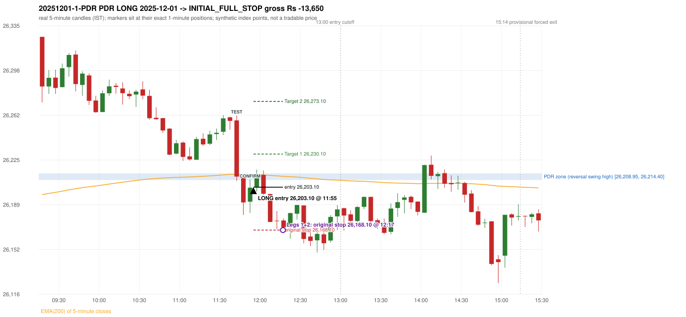
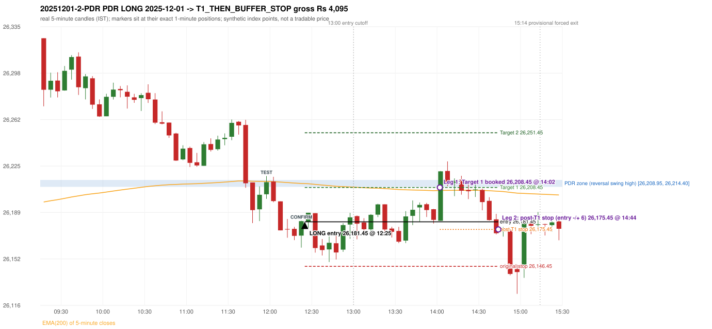

# Trading journal - 2025-12-01 (Monday)

> Automated, read-only reconstruction of the Phase 3.0 baseline. Synthetic NIFTY 50 index-point P&L (the index is not tradable). The owner's review status is intentionally blank.

## A. Trading day overview

| item | value |
|---|---|
| Date / weekday | 2025-12-01 / Monday |
| Session type | USABLE_WITH_FLAGS / VALID |
| Original session open (first 1-minute open) | 26,325.80 |
| Previous session | 2025-11-28 |
| Previous-day high / low | 26,280.20 / 26,172.90 |
| Previous-day official close / last 5-minute close | 26,202.95 / 26,204.55 |
| Raw engine records / confirmed signals / fully valid signals | 7 / 4 / 4 |
| Setups that did not complete (invalidated / incomplete) | 3 |
| Executed trades | 2 20251201-1-PDR;20251201-2-PDR |
| Gross P&L (Rs, synthetic) | -9,555.00 |
| Illustrative net P&L (Rs; Rs 500/trade + 0.5 pt/fill) | -11,335.00 |
| Day-end portfolio status | DAY_FINISHED |
| Manual journal trades (matched / unmatched) | 0 (0 / 0) |
| Extra automated trades | 2 |

## B. Daily strategy signal timeline (confirmed signals, chronological)

| time | strategy | method | dir | entry-rule status | valid for execution | <= 13:00 | portfolio state | accepted / ignored | specific reason | competing (same minute) |
|---|---|---|---|---|---|---|---|---|---|---|
| 11:55 | PDR | PDR | LONG | PROPOSAL_DEPENDENT | True | True | FIRST_TRADE_ACTIVE | ACCEPTED -> 20251201-1-PDR | first eligible signal of the day; trade 1: INITIAL_FULL_STOP |  |
| 12:25 | PDR | PDR | LONG | PROPOSAL_DEPENDENT | True | True | SECOND_TRADE_ACTIVE | ACCEPTED -> 20251201-2-PDR | permitted second trade: newly confirmed PDR/PDS after the original full stop; trade 2: T1_THEN_BUFFER_STOP |  |
| 14:15 | PDR | PDR | LONG | PROPOSAL_DEPENDENT | True | False | SECOND_TRADE_ACTIVE | IGNORED | POSITION_ACTIVE (signal kept for diagnostics only; never reused) [blocked by PDR#2] |  |
| 14:30 | PDR | PDR | LONG | PROPOSAL_DEPENDENT | True | False | SECOND_TRADE_ACTIVE | IGNORED | POSITION_ACTIVE (signal kept for diagnostics only; never reused) [blocked by PDR#2] |  |

Engine setups that did not complete (3); the complete list with failed rule ids is in `rejected_signals.csv`:

| candle | strategy | method | dir | status | precise reason | failed rules |
|---|---|---|---|---|---|---|
| 09:15 | ORB | Method 1 | LONG | INVALIDATED | CANDLE_QUALITY(not a strong body / wick too large) | ORB-M1-LONG-003 |
| 09:15 | ORB | Method 2 | LONG | INVALIDATED | CANDLE_QUALITY | ORB-M2-LONG-003 |
| 10:00 | RF | RF | LONG | INVALIDATED | GAP_UP_OUTSIDE_YESTERDAYS_RANGE | RF-004 |

## C. Detailed trade journals

### 20251201-1-PDR: PDR LONG (FIRST trade)

Chart: 

**Rule configuration:** CFG-baseline-be1db2a09d - signal verification status **PROPOSAL_DEPENDENT** (never VERIFIED while a rule rests on a proposal).

#### 1. Setup identification

PDR LONG: the session opened 122.85 points above the previous close and 111.40 points above the resistance zone [26,208.95, 26,214.40] taken from the 14:55 swing-high candle of 2025-11-28. The 11:40 candle (26,208.15 - 26,261.65) retested the zone, and the 11:50 candle closed green at 26,202.70, confirming the entry at 11:55. The engine does not check that the zone held (confirmation close BELOW the zone floor).

#### 2. Candle and indicator calculations

| role | session | candle | O | H | L | C | range | body % | upper wick % | lower wick % | direction | EMA(200) | strong bull / bear | pin bull / bear | small (body<=30%) | used for |
|---|---|---|---|---|---|---|---|---|---|---|---|---|---|---|---|---|
| zone_source_candle | PREVIOUS | 14:55-15:00 | 26,207.60 | 26,214.40 | 26,204.50 | 26,208.95 | 9.90 | 13.64 | 55.05 | 31.31 | BULLISH | 26,195.77 | False / False | False / False | True | swing-high candle that defines the zone (B_SWING_HIGH_REVERSAL) |
| prev_day_high_candle | PREVIOUS | 10:45-10:50 | 26,273.95 | 26,280.20 | 26,269.30 | 26,273.45 | 10.90 | 4.59 | 57.34 | 38.07 | BEARISH | 26,176.40 | False / False | False / False | True | candle of the previous session's absolute high (for comparison) |
| interaction_candle | TODAY | 11:40-11:45 | 26,257.60 | 26,261.65 | 26,208.15 | 26,211.75 | 53.50 | 85.70 | 7.57 | 6.73 | BEARISH | 26,213.57 | False / True | False / False | False | first candle whose range intersects the zone |
| confirmation_candle | TODAY | 11:50-11:55 | 26,191.25 | 26,209.30 | 26,182.00 | 26,202.70 | 27.30 | 41.94 | 24.18 | 33.88 | BULLISH | 26,213.23 | False / False | False / False | False | first green candle after the interaction candle |

Every condition, with the rule, the calculation, the observed values and the result:

| # | group | rule | result | status / numeric definition | calculation | observed | required | available at | why it matters |
|---|---|---|---|---|---|---|---|---|---|
| 1 | SELECTION | SEL-FIRST-001 | PASS | USER_APPROVED / USER_APPROVED | earliest CONFIRMED signal of the day across IRF/ORB/PDR/PDS/RF that passed the controller's checks | 0 confirmed signal(s) earlier today; 4 confirmed signals in the day in total, this one at 11:55 | no earlier executable signal | 2025-12-01 11:55 | the shared controller trades only the first valid signal; the five strategies are not independent positions |
| 2 | SELECTION | SEL-TIE-001 | PASS | USER_APPROVED / USER_APPROVED | other CONFIRMED signals with exactly the same confirmation timestamp | none | no different-strategy / opposite-direction signal in the same minute (otherwise an unresolved conflict, no trade) | 2025-12-01 11:55 | an unresolved same-minute collision would have produced no trade at all |
| 3 | SELECTION | ENTRY-CUTOFF-001 | PASS | USER_APPROVED / USER_APPROVED | fill timestamp vs 13:00:00 IST | signal confirmed 11:55; fill 11:55 | fill at or before 13:00:00 IST | 2025-12-01 11:55 | no new position may be entered with a fill after 13:00 IST |
| 4 | SELECTION | EXE-FILL-001 | PASS | PROPOSED_FOR_REVIEW / PROPOSED_FOR_REVIEW | fill = open of the 1-minute bar that starts at the signal candle's end | bar 11:55 O 26,203.10 H 26,206.30 L 26,199.50 C 26,206.30; executable=True; entry 26,203.10 | fill bar exists, starts exactly at the signal end, is fillable; entry = its open | 2025-12-01 11:55 | a 5-minute signal is known only when its candle closes; the first price that can be traded is the next minute's open |
| 5 | SELECTION | DAY-MAX-001 | PASS | USER_APPROVED / USER_APPROVED | number of entries today | trade 1 of at most 2 | <= 2 entries per day | 2025-12-01 11:55 | daily trade cap |
| 6 | SETUP | PDR-004 | PASS | SOURCE_VERIFIED / EXPLICIT_WORDING_DETAIL_PROPOSED_FOR_REVIEW | gap = first 1-minute open of today - previous session's OFFICIAL close | today's open 26,325.80 (first 1-minute bar 09:15) - previous close 26,202.95 (DAILY_VENDOR, 2025-11-28) = +122.85 points -> gap UP | gap UP (more than 0 points) | 2025-12-01 09:15 | approved convention: the original first-minute open, never the vendor daily open |
| 7 | SETUP | PDR-011 | PASS | SOURCE_VERIFIED / QUALITATIVE_SOURCE_NUMERIC_DEFINITION_PROPOSED_FOR_REVIEW | open relative to the zone (ABOVE_ZONE) | today's open 26,325.80 vs zone high 26,214.40: 111.40 points above | open > zone high | 2025-12-01 09:15 | the guide has price 'pull back into the zone', so the gap-up open is above it; this exclusion is a proposal |
| 8 | ZONE | PDR-001 | PASS | SOURCE_VERIFIED / EXPLICIT_IN_SOURCE | direction | LONG (PDR is long only) | long-only | 2025-12-01 11:55 | PDR buys a retest of previous-day resistance after a gap up |
| 9 | ZONE | PDR-002 | PASS | SOURCE_VERIFIED / QUALITATIVE_SOURCE_NUMERIC_DEFINITION_PROPOSED_FOR_REVIEW | zone = [body top, wick high] of the latest confirmed swing high (k=2) that has a red candle among the peak and the next 2 candles (method B_SWING_HIGH_REVERSAL) | zone [26,208.95, 26,214.40] from the 14:55 candle of 2025-11-28 (body top 26,208.95, wick high 26,214.40; 14:55-15:00 O 26,207.60 H 26,214.40 L 26,204.50 C 26,208.95; range 9.90, body 1.35 (13.64%), upper wick 5.45 (55.05%), lower wick 3.10 (31.31%), bullish); engine recorded [26,208.95, 26,214.40]. Previous session's absolute high 26,280.20 (candle 10:45) - the zone is NOT the day high (distance 65.80 points). Swing confirmed once candle 15:05 closed. | previous-day high where price peaked and reversed | 2025-11-28 15:10 | the source says 'previous day's high/reversal'; which candle marks the zone is an owner-approved research candidate, not a source rule |
| 10 | ZONE | PDR-003 | PASS | SOURCE_VERIFIED / EXPLICIT_IN_SOURCE | the zone is an area, not a single price | zone height 5.45 points [26,208.95, 26,214.40] | a rectangle with positive height | 2025-11-28 15:10 | price may touch any part of the area |
| 11 | ZONE | PDR-010 | UNRESOLVED | SOURCE_VERIFIED / QUALITATIVE_SOURCE_NUMERIC_DEFINITION_PROPOSED_FOR_REVIEW | reversal-quality filter ('clear high and reversal identified') | filter setting OFF | checklist item: a clear previous-day high and reversal | 2025-11-28 | the engine does not test reversal depth in the baseline (filter OFF) |
| 12 | CONFIRMATION | PDR-006 | PASS | SOURCE_VERIFIED / QUALITATIVE_SOURCE_NUMERIC_DEFINITION_PROPOSED_FOR_REVIEW | the first candle whose [low, high] intersects the zone (+/- proximity) | 11:40-11:45 O 26,257.60 H 26,261.65 L 26,208.15 C 26,211.75; range 53.50, body 45.85 (85.70%), upper wick 4.05 (7.57%), lower wick 3.60 (6.73%), bearish; low 26,208.15 vs zone high 26,214.40 (6.25 points inside/below the zone top), high 26,261.65 vs zone low 26,208.95; proximity 0 | range intersects the zone | 2025-12-01 11:45 | the retest of the previous-day resistance |
| 13 | CONFIRMATION | PDR-007 | PASS | SOURCE_VERIFIED / QUALITATIVE_SOURCE_NUMERIC_DEFINITION_PROPOSED_FOR_REVIEW | the first GREEN candle after the interaction candle | 11:50-11:55 O 26,191.25 H 26,209.30 L 26,182.00 C 26,202.70; range 27.30, body 11.45 (41.94%), upper wick 6.60 (24.18%), lower wick 9.25 (33.88%), bullish; interaction candle 11:40, confirmation candle 11:50 | close > open, strictly after the interaction candle | 2025-12-01 11:55 | the guide asks for 'a green candle' after the test; it gives no size or position test |
| 14 | CONFIRMATION | PDR-005 | PASS | SOURCE_VERIFIED / EXPLICIT_IN_SOURCE | no entry at the open: price must first come back toward the zone | interaction candle 11:40 (candle no. 30 of the session) precedes the entry candle 11:50; fill 11:55 | interaction before the entry; fill after 09:20 | 2025-12-01 11:55 | if price keeps rising without returning to the zone there is no setup |
| 15 | EXECUTION | EXE-STOP-001 | PASS | USER_APPROVED / USER_APPROVED | initial stop = entry - 35 points | entry 26,203.10 -> stop 26,168.10 | stop 35 index points (BASELINE) | 2025-12-01 11:55 | defines the loss if the setup fails before Target 1 |
| 16 | EXECUTION | EXE-T1-001 | PASS | SOURCE_VERIFIED / EXPLICIT_IN_SOURCE | Target 1 = entry +/- 27 points | T1 26,230.10 | 27 points | 2025-12-01 11:55 | Leg 1 (3 lots) is booked at Target 1 |
| 17 | EXECUTION | PDR-008 | PASS | SOURCE_VERIFIED / EXPLICIT_IN_SOURCE | Target 2 = entry +/- 70 points | T2 26,273.10 (the guide says 70; the performance report's winners suggest 60 - CONFLICTING, recorded) | 70 points | 2025-12-01 11:55 | Leg 2 (3 lots) is booked at Target 2 |
| 18 | EXECUTION | POST-T1-STOP-006 | PASS | USER_APPROVED / USER_APPROVED | after T1 the Leg-2 stop = entry - 6 (no trailing) | post-T1 stop 26,197.10 | entry -6 (LONG) / +6 (SHORT) | 2025-12-01 11:55 | protects the remaining three lots once the first three are booked |
| 19 | EXECUTION | SIZE-LOT-001 | PASS | USER_APPROVED / USER_APPROVED | 6 lots x 65 = 390, Leg 1 = 3 lots = 195, Leg 2 = 195 | 6 lots, lot size 65, legs 3+3 | 6 lots in two equal legs | 2025-12-01 11:55 | position size for the synthetic P&L |
| 20 | NOTE | PDR-007 | UNRESOLVED | SOURCE_VERIFIED / QUALITATIVE_SOURCE_NUMERIC_DEFINITION_PROPOSED_FOR_REVIEW | did the zone hold? (is the confirmation candle's close back at/above the zone floor?) | confirmation close 26,202.70 vs zone floor 26,208.95 / top 26,214.40: BELOW the zone floor by 6.25; interaction low 26,208.15 | the engine does NOT test that resistance-turned-support held | 2025-12-01 11:55 | a later green candle is accepted even after price traded through the zone; a human would normally check the hold (here the close is below the zone floor) |
| 21 | NOTE | PDR-012 | NOT_APPLICABLE | PROPOSED_FOR_REVIEW / PROPOSED_FOR_REVIEW | repeated PDR signals today | 4 confirmed PDR signal(s) in the session | n/a (disclosure) | 2025-12-01 11:55 | the per-session cap is lifted for the controller runs; the controller trades only the first |
| 22 | NOTE | PDR-009 | UNRESOLVED | UNRESOLVED / UNRESOLVED | stop 35 or 40 'depending on the situation' | the guide gives no selection rule; baseline fixed 35 points | unresolved in the source | 2025-12-01 11:55 | PDR stop selection is left to the owner |
| 23 | NOTE | NOTE-UNRESOLVED-DEPENDENCIES | UNRESOLVED | NOT_A_RULE / NOT_A_REGISTRY_RULE | rules the signal depends on that the sources leave unresolved | engine-recorded unresolved rule ids: PDR-010; verification status PROPOSAL_DEPENDENT | n/a (disclosure) | 2025-12-01 11:55 | the entry is only as verified as the rules it rests on |

#### 3. Entry decision and explanation

PDR LONG: the session opened 122.85 points above the previous close and 111.40 points above the resistance zone [26,208.95, 26,214.40] taken from the 14:55 swing-high candle of 2025-11-28. The 11:40 candle (26,208.15 - 26,261.65) retested the zone, and the 11:50 candle closed green at 26,202.70, confirming the entry at 11:55. The engine does not check that the zone held (confirmation close BELOW the zone floor).

**Why this trade ahead of the other strategies:** This PDR signal was the earliest executable signal of the day: 0 confirmed signal(s) earlier, 0 other in the same minute. 3 later confirmed signal(s) (PDR x3) are logged as ignored or rejected. State of the other four engines at that moment: [IRF: no setup record before this time (a base condition was not met, or nothing triggered)] [ORB: Method 1 invalidated at 09:15: CANDLE_QUALITY(not a strong body / wick too large); Method 2 invalidated at 09:15: CANDLE_QUALITY] [PDS: no setup record before this time (a base condition was not met, or nothing triggered)] [RF: RF invalidated at 10:00: GAP_UP_OUTSIDE_YESTERDAYS_RANGE]

#### 4. Actual entry execution

| item | value |
|---|---|
| Signal candle | 11:50-11:55 |
| Signal confirmed | 2025-12-01 11:55 |
| Fill timestamp | 2025-12-01 11:55 |
| Entry price | 26,203.10 |
| Source partition / 1-minute bar | data/processed/nifty50/year=2025/month=12/candles.parquet / 2025-12-01 11:55 |
| Source bar O / H / L / C | 26,203.10 / 26,206.30 / 26,199.50 / 26,206.30 |
| Fill assumption | open of the 1-minute bar starting at the signal candle's end (EXE-FILL-001, PROPOSED causal convention) |
| Initial stop / T1 / T2 / post-T1 stop | 26,168.10 / 26,230.10 / 26,273.10 / 26,197.10 |
| Position | 6 lots x 65 = 390 units (Leg 1 195, Leg 2 195) |

#### 5-8. Trade progress, Target 1, post-T1 stop and final exit

Between the 11:55 entry bar and the final exit (23 one-minute bars) the best excursion in favour was 14.30 points at 11:58 and the worst against was 36.05 points at 12:17. At 12:17 price reached the original stop 26,168.10 before Target 1 26,230.10, so all six lots exited together at 26,168.10. This is an INITIAL_FULL_STOP: one more trade is allowed that day, only a newly confirmed PDR/PDS signal.

| leg | qty | exit time | exit price | reason | source 1-minute bar | O / H / L / C | gross points | gross Rs | slippage pts | flags |
|---|---|---|---|---|---|---|---|---|---|---|
| 1 | 195 | 12:17 | 26,168.10 | ORIGINAL_STOP_BEFORE_T1 | 12:17 | 26,170.15 / 26,176.25 / 26,167.05 / 26,175.40 | -35.00 | -6,825.00 | 0.00 |  |
| 2 | 195 | 12:17 | 26,168.10 | ORIGINAL_STOP_BEFORE_T1 | 12:17 | 26,170.15 / 26,176.25 / 26,167.05 / 26,175.40 | -35.00 | -6,825.00 | 0.00 |  |

Exit evidence per leg:

* Leg 1: 1-minute bar 12:17 O 26,170.15 H 26,176.25 L 26,167.05 C 26,175.40: low 26,167.05 reached the original stop 26,168.10 before Target 1 26,230.10 was touched; both legs exit at the stop level 26,168.10
* Leg 2: 1-minute bar 12:17 O 26,170.15 H 26,176.25 L 26,167.05 C 26,175.40: low 26,167.05 reached the original stop 26,168.10 before Target 1 26,230.10 was touched; both legs exit at the stop level 26,168.10

#### 9. Gross and illustrative net P&L

| item | value (Rs) |
|---|---|
| Leg 1 gross | -6,825.00 |
| Leg 2 gross | -6,825.00 |
| Trade gross (= Leg 1 + Leg 2) | -13,650.00 |
| Illustrative fixed cost | -500.00 |
| Illustrative slippage (0.5 pt on every fill, entry + exits, all units) | -390.00 |
| Illustrative net | -14,540.00 |

#### 10. Manual journal comparison

EXTRA_AUTOMATED_TRADE: the automated system took PDR PDR LONG at 11:55 (no manual trade that day). The setup rests on: PDR-010: Reversal-quality filter is OFF in the baseline | PDR-007: Engine does not test whether the zone held | PDR-009: PDR stop selection rule is not defined | NOTE-UNRESOLVED-DEPENDENCIES: Disclosure of unresolved source rules behind this signal. The journal shows no corresponding entry.

### 20251201-2-PDR: PDR LONG (SECOND trade)

Chart: 

**Rule configuration:** CFG-baseline-be1db2a09d - signal verification status **PROPOSAL_DEPENDENT** (never VERIFIED while a rule rests on a proposal).

#### 1. Setup identification

PDR LONG: the session opened 122.85 points above the previous close and 111.40 points above the resistance zone [26,208.95, 26,214.40] taken from the 14:55 swing-high candle of 2025-11-28. The 11:55 candle (26,199.50 - 26,217.40) retested the zone, and the 12:20 candle closed green at 26,181.95, confirming the entry at 12:25. The engine does not check that the zone held (confirmation close BELOW the zone floor).

#### 2. Candle and indicator calculations

| role | session | candle | O | H | L | C | range | body % | upper wick % | lower wick % | direction | EMA(200) | strong bull / bear | pin bull / bear | small (body<=30%) | used for |
|---|---|---|---|---|---|---|---|---|---|---|---|---|---|---|---|---|
| zone_source_candle | PREVIOUS | 14:55-15:00 | 26,207.60 | 26,214.40 | 26,204.50 | 26,208.95 | 9.90 | 13.64 | 55.05 | 31.31 | BULLISH | 26,195.77 | False / False | False / False | True | swing-high candle that defines the zone (B_SWING_HIGH_REVERSAL) |
| prev_day_high_candle | PREVIOUS | 10:45-10:50 | 26,273.95 | 26,280.20 | 26,269.30 | 26,273.45 | 10.90 | 4.59 | 57.34 | 38.07 | BEARISH | 26,176.40 | False / False | False / False | True | candle of the previous session's absolute high (for comparison) |
| interaction_candle | TODAY | 11:55-12:00 | 26,203.10 | 26,217.40 | 26,199.50 | 26,212.60 | 17.90 | 53.07 | 26.82 | 20.11 | BULLISH | 26,213.23 | False / False | False / False | False | first candle whose range intersects the zone |
| confirmation_candle | TODAY | 12:20-12:25 | 26,170.60 | 26,182.30 | 26,161.15 | 26,181.95 | 21.15 | 53.66 | 1.65 | 44.68 | BULLISH | 26,211.61 | False / False | False / False | False | first green candle after the interaction candle |

Every condition, with the rule, the calculation, the observed values and the result:

| # | group | rule | result | status / numeric definition | calculation | observed | required | available at | why it matters |
|---|---|---|---|---|---|---|---|---|---|
| 1 | SELECTION | DAY-SL-001 | PASS | USER_APPROVED / USER_APPROVED | first trade outcome, strategy of this signal, position-close time vs this signal's timestamp | first trade PDR PDR closed as INITIAL_FULL_STOP at 12:17; position free from 12:18; this PDR signal confirmed 12:25 | first trade INITIAL_FULL_STOP before Target 1, and a NEWLY confirmed PDR/PDS signal after the first position closed | 2025-12-01 12:25 | the only way a second trade is allowed |
| 2 | SELECTION | DAY-NOREUSE-001 | PASS | USER_APPROVED / USER_APPROVED | signals confirmed while the first position was open | 1 signal(s) were ignored during the first trade (never reused): PDR PDR LONG @11:55 | this trade comes from a signal confirmed after the first exit, not from an ignored one | 2025-12-01 12:25 | an ignored signal can never become the second trade |
| 3 | SELECTION | ENTRY-CUTOFF-001 | PASS | USER_APPROVED / USER_APPROVED | fill timestamp vs 13:00:00 IST | signal confirmed 12:25; fill 12:25 | fill at or before 13:00:00 IST | 2025-12-01 12:25 | no new position may be entered with a fill after 13:00 IST |
| 4 | SELECTION | EXE-FILL-001 | PASS | PROPOSED_FOR_REVIEW / PROPOSED_FOR_REVIEW | fill = open of the 1-minute bar that starts at the signal candle's end | bar 12:25 O 26,181.45 H 26,186.10 L 26,180.95 C 26,184.90; executable=True; entry 26,181.45 | fill bar exists, starts exactly at the signal end, is fillable; entry = its open | 2025-12-01 12:25 | a 5-minute signal is known only when its candle closes; the first price that can be traded is the next minute's open |
| 5 | SELECTION | DAY-MAX-001 | PASS | USER_APPROVED / USER_APPROVED | number of entries today | trade 2 of at most 2 | <= 2 entries per day | 2025-12-01 12:25 | daily trade cap |
| 6 | SETUP | PDR-004 | PASS | SOURCE_VERIFIED / EXPLICIT_WORDING_DETAIL_PROPOSED_FOR_REVIEW | gap = first 1-minute open of today - previous session's OFFICIAL close | today's open 26,325.80 (first 1-minute bar 09:15) - previous close 26,202.95 (DAILY_VENDOR, 2025-11-28) = +122.85 points -> gap UP | gap UP (more than 0 points) | 2025-12-01 09:15 | approved convention: the original first-minute open, never the vendor daily open |
| 7 | SETUP | PDR-011 | PASS | SOURCE_VERIFIED / QUALITATIVE_SOURCE_NUMERIC_DEFINITION_PROPOSED_FOR_REVIEW | open relative to the zone (ABOVE_ZONE) | today's open 26,325.80 vs zone high 26,214.40: 111.40 points above | open > zone high | 2025-12-01 09:15 | the guide has price 'pull back into the zone', so the gap-up open is above it; this exclusion is a proposal |
| 8 | ZONE | PDR-001 | PASS | SOURCE_VERIFIED / EXPLICIT_IN_SOURCE | direction | LONG (PDR is long only) | long-only | 2025-12-01 12:25 | PDR buys a retest of previous-day resistance after a gap up |
| 9 | ZONE | PDR-002 | PASS | SOURCE_VERIFIED / QUALITATIVE_SOURCE_NUMERIC_DEFINITION_PROPOSED_FOR_REVIEW | zone = [body top, wick high] of the latest confirmed swing high (k=2) that has a red candle among the peak and the next 2 candles (method B_SWING_HIGH_REVERSAL) | zone [26,208.95, 26,214.40] from the 14:55 candle of 2025-11-28 (body top 26,208.95, wick high 26,214.40; 14:55-15:00 O 26,207.60 H 26,214.40 L 26,204.50 C 26,208.95; range 9.90, body 1.35 (13.64%), upper wick 5.45 (55.05%), lower wick 3.10 (31.31%), bullish); engine recorded [26,208.95, 26,214.40]. Previous session's absolute high 26,280.20 (candle 10:45) - the zone is NOT the day high (distance 65.80 points). Swing confirmed once candle 15:05 closed. | previous-day high where price peaked and reversed | 2025-11-28 15:10 | the source says 'previous day's high/reversal'; which candle marks the zone is an owner-approved research candidate, not a source rule |
| 10 | ZONE | PDR-003 | PASS | SOURCE_VERIFIED / EXPLICIT_IN_SOURCE | the zone is an area, not a single price | zone height 5.45 points [26,208.95, 26,214.40] | a rectangle with positive height | 2025-11-28 15:10 | price may touch any part of the area |
| 11 | ZONE | PDR-010 | UNRESOLVED | SOURCE_VERIFIED / QUALITATIVE_SOURCE_NUMERIC_DEFINITION_PROPOSED_FOR_REVIEW | reversal-quality filter ('clear high and reversal identified') | filter setting OFF | checklist item: a clear previous-day high and reversal | 2025-11-28 | the engine does not test reversal depth in the baseline (filter OFF) |
| 12 | CONFIRMATION | PDR-006 | PASS | SOURCE_VERIFIED / QUALITATIVE_SOURCE_NUMERIC_DEFINITION_PROPOSED_FOR_REVIEW | the first candle whose [low, high] intersects the zone (+/- proximity) | 11:55-12:00 O 26,203.10 H 26,217.40 L 26,199.50 C 26,212.60; range 17.90, body 9.50 (53.07%), upper wick 4.80 (26.82%), lower wick 3.60 (20.11%), bullish; low 26,199.50 vs zone high 26,214.40 (14.90 points inside/below the zone top), high 26,217.40 vs zone low 26,208.95; proximity 0 | range intersects the zone | 2025-12-01 12:00 | the retest of the previous-day resistance (the engine re-arms after an earlier signal: scanning restarted after the 11:50 candle) |
| 13 | CONFIRMATION | PDR-007 | PASS | SOURCE_VERIFIED / QUALITATIVE_SOURCE_NUMERIC_DEFINITION_PROPOSED_FOR_REVIEW | the first GREEN candle after the interaction candle | 12:20-12:25 O 26,170.60 H 26,182.30 L 26,161.15 C 26,181.95; range 21.15, body 11.35 (53.66%), upper wick 0.35 (1.65%), lower wick 9.45 (44.68%), bullish; interaction candle 11:55, confirmation candle 12:20 | close > open, strictly after the interaction candle | 2025-12-01 12:25 | the guide asks for 'a green candle' after the test; it gives no size or position test |
| 14 | CONFIRMATION | PDR-005 | PASS | SOURCE_VERIFIED / EXPLICIT_IN_SOURCE | no entry at the open: price must first come back toward the zone | interaction candle 11:55 (candle no. 33 of the session) precedes the entry candle 12:20; fill 12:25 | interaction before the entry; fill after 09:20 | 2025-12-01 12:25 | if price keeps rising without returning to the zone there is no setup |
| 15 | EXECUTION | EXE-STOP-001 | PASS | USER_APPROVED / USER_APPROVED | initial stop = entry - 35 points | entry 26,181.45 -> stop 26,146.45 | stop 35 index points (BASELINE) | 2025-12-01 12:25 | defines the loss if the setup fails before Target 1 |
| 16 | EXECUTION | EXE-T1-001 | PASS | SOURCE_VERIFIED / EXPLICIT_IN_SOURCE | Target 1 = entry +/- 27 points | T1 26,208.45 | 27 points | 2025-12-01 12:25 | Leg 1 (3 lots) is booked at Target 1 |
| 17 | EXECUTION | PDR-008 | PASS | SOURCE_VERIFIED / EXPLICIT_IN_SOURCE | Target 2 = entry +/- 70 points | T2 26,251.45 (the guide says 70; the performance report's winners suggest 60 - CONFLICTING, recorded) | 70 points | 2025-12-01 12:25 | Leg 2 (3 lots) is booked at Target 2 |
| 18 | EXECUTION | POST-T1-STOP-006 | PASS | USER_APPROVED / USER_APPROVED | after T1 the Leg-2 stop = entry - 6 (no trailing) | post-T1 stop 26,175.45 | entry -6 (LONG) / +6 (SHORT) | 2025-12-01 12:25 | protects the remaining three lots once the first three are booked |
| 19 | EXECUTION | SIZE-LOT-001 | PASS | USER_APPROVED / USER_APPROVED | 6 lots x 65 = 390, Leg 1 = 3 lots = 195, Leg 2 = 195 | 6 lots, lot size 65, legs 3+3 | 6 lots in two equal legs | 2025-12-01 12:25 | position size for the synthetic P&L |
| 20 | NOTE | PDR-007 | UNRESOLVED | SOURCE_VERIFIED / QUALITATIVE_SOURCE_NUMERIC_DEFINITION_PROPOSED_FOR_REVIEW | did the zone hold? (is the confirmation candle's close back at/above the zone floor?) | confirmation close 26,181.95 vs zone floor 26,208.95 / top 26,214.40: BELOW the zone floor by 27.00; interaction low 26,199.50 | the engine does NOT test that resistance-turned-support held | 2025-12-01 12:25 | a later green candle is accepted even after price traded through the zone; a human would normally check the hold (here the close is below the zone floor) |
| 21 | NOTE | PDR-012 | NOT_APPLICABLE | PROPOSED_FOR_REVIEW / PROPOSED_FOR_REVIEW | repeated PDR signals today | 4 confirmed PDR signal(s) in the session | n/a (disclosure) | 2025-12-01 12:25 | the per-session cap is lifted for the controller runs; the controller trades only the first |
| 22 | NOTE | PDR-009 | UNRESOLVED | UNRESOLVED / UNRESOLVED | stop 35 or 40 'depending on the situation' | the guide gives no selection rule; baseline fixed 35 points | unresolved in the source | 2025-12-01 12:25 | PDR stop selection is left to the owner |
| 23 | NOTE | NOTE-UNRESOLVED-DEPENDENCIES | UNRESOLVED | NOT_A_RULE / NOT_A_REGISTRY_RULE | rules the signal depends on that the sources leave unresolved | engine-recorded unresolved rule ids: PDR-010; verification status PROPOSAL_DEPENDENT | n/a (disclosure) | 2025-12-01 12:25 | the entry is only as verified as the rules it rests on |

#### 3. Entry decision and explanation

PDR LONG: the session opened 122.85 points above the previous close and 111.40 points above the resistance zone [26,208.95, 26,214.40] taken from the 14:55 swing-high candle of 2025-11-28. The 11:55 candle (26,199.50 - 26,217.40) retested the zone, and the 12:20 candle closed green at 26,181.95, confirming the entry at 12:25. The engine does not check that the zone held (confirmation close BELOW the zone floor).

**Why this trade ahead of the other strategies:** The first trade (PDR PDR) was stopped out before Target 1 at 12:17; this newly confirmed PDR signal at 12:25 is the first PDR/PDS signal after that exit, so it is the day's permitted second trade. State of the other engines at that moment: [IRF: no setup record before this time (a base condition was not met, or nothing triggered)] [ORB: Method 1 invalidated at 09:15: CANDLE_QUALITY(not a strong body / wick too large); Method 2 invalidated at 09:15: CANDLE_QUALITY] [PDS: no setup record before this time (a base condition was not met, or nothing triggered)] [RF: RF invalidated at 10:00: GAP_UP_OUTSIDE_YESTERDAYS_RANGE]

#### 4. Actual entry execution

| item | value |
|---|---|
| Signal candle | 12:20-12:25 |
| Signal confirmed | 2025-12-01 12:25 |
| Fill timestamp | 2025-12-01 12:25 |
| Entry price | 26,181.45 |
| Source partition / 1-minute bar | data/processed/nifty50/year=2025/month=12/candles.parquet / 2025-12-01 12:25 |
| Source bar O / H / L / C | 26,181.45 / 26,186.10 / 26,180.95 / 26,184.90 |
| Fill assumption | open of the 1-minute bar starting at the signal candle's end (EXE-FILL-001, PROPOSED causal convention) |
| Initial stop / T1 / T2 / post-T1 stop | 26,146.45 / 26,208.45 / 26,251.45 / 26,175.45 |
| Position | 6 lots x 65 = 390 units (Leg 1 195, Leg 2 195) |

#### 5-8. Trade progress, Target 1, post-T1 stop and final exit

Between the 12:25 entry bar and the final exit (140 one-minute bars) the best excursion in favour was 47.50 points at 14:06 and the worst against was 31.60 points at 12:43. At 14:02 price reached Target 1 26,208.45 and three lots exited. At 14:02 the remaining three lots' protective stop was set to 26,175.45 (entry - 6; no trailing, no further change); the engine applies it from the Target-1 bar onward and tests it within that same bar. At 14:44 the remaining three lots stopped out at 26,175.45. T1_THEN_BUFFER_STOP: no second trade that day (DAY-BUF-001).

| leg | qty | exit time | exit price | reason | source 1-minute bar | O / H / L / C | gross points | gross Rs | slippage pts | flags |
|---|---|---|---|---|---|---|---|---|---|---|
| 1 | 195 | 14:02 | 26,208.45 | TARGET_1 | 14:02 | 26,196.90 / 26,211.10 / 26,196.85 / 26,209.85 | 27.00 | 5,265.00 | 0.00 |  |
| 2 | 195 | 14:44 | 26,175.45 | POST_T1_STOP_ENTRY_MINUS_PLUS_6 | 14:44 | 26,182.60 / 26,182.60 / 26,171.55 / 26,172.50 | -6.00 | -1,170.00 | 0.00 |  |

Exit evidence per leg:

* Leg 1: 1-minute bar 14:02 O 26,196.90 H 26,211.10 L 26,196.85 C 26,209.85: high 26,211.10 reached Target 1 26,208.45; Leg 1 booked at the target level
* Leg 2: 1-minute bar 14:44 O 26,182.60 H 26,182.60 L 26,171.55 C 26,172.50: low 26,171.55 reached the post-T1 stop 26,175.45; Leg 2 exits at 26,175.45 at the stop level

#### 9. Gross and illustrative net P&L

| item | value (Rs) |
|---|---|
| Leg 1 gross | 5,265.00 |
| Leg 2 gross | -1,170.00 |
| Trade gross (= Leg 1 + Leg 2) | 4,095.00 |
| Illustrative fixed cost | -500.00 |
| Illustrative slippage (0.5 pt on every fill, entry + exits, all units) | -390.00 |
| Illustrative net | 3,205.00 |

#### 10. Manual journal comparison

EXTRA_AUTOMATED_TRADE: the automated system took PDR PDR LONG at 12:25 (no manual trade that day). The setup rests on: PDR-010: Reversal-quality filter is OFF in the baseline | PDR-007: Engine does not test whether the zone held | PDR-009: PDR stop selection rule is not defined | NOTE-UNRESOLVED-DEPENDENCIES: Disclosure of unresolved source rules behind this signal. The journal shows no corresponding entry.

## D. Manual journal comparison

| comparison | journal row | journal strategy | manual time | manual direction | manual outcome | match class | trade | auto entry | auto outcome | explanation |
|---|---|---|---|---|---|---|---|---|---|---|
| E033 |  |  |  |  |  | EXTRA_AUTOMATED_TRADE | 20251201-1-PDR | 11:55 @ 26,203.10 | INITIAL_FULL_STOP | EXTRA_AUTOMATED_TRADE: the automated system took PDR PDR LONG at 11:55 (no manual trade that day). The setup rests on: PDR-010: Reversal-quality filter is OFF in the baseline \| PDR-007: Engine does not test whether the zone held \| PDR-009: PDR stop selection rule is not defined \| NOTE-UNRESOLVED-DEPENDENCIES: Disclosure of unresolved source rules behind this signal. The journal shows no corresponding entry. |
| E034 |  |  |  |  |  | EXTRA_AUTOMATED_TRADE | 20251201-2-PDR | 12:25 @ 26,181.45 | T1_THEN_BUFFER_STOP | EXTRA_AUTOMATED_TRADE: the automated system took PDR PDR LONG at 12:25 (no manual trade that day). The setup rests on: PDR-010: Reversal-quality filter is OFF in the baseline \| PDR-007: Engine does not test whether the zone held \| PDR-009: PDR stop selection rule is not defined \| NOTE-UNRESOLVED-DEPENDENCIES: Disclosure of unresolved source rules behind this signal. The journal shows no corresponding entry. |

The journal records no entry price and no exit price (NOT_RECORDED); matching uses date, strategy and candle start only - never P&L.

## E. Daily conclusion

* **Traded:** 20251201-1-PDR - PDR PDR LONG at 11:55 (entry 26,203.10), outcome INITIAL_FULL_STOP, gross Rs -13,650.00, illustrative net Rs -14,540.00. **Why:** This PDR signal was the earliest executable signal of the day: 0 confirmed signal(s) earlier, 0 other in the same minute. 3 later confirmed signal(s) (PDR x3) are logged as ignored or rejected. State of the other four engines at that moment: [IRF: no setup record before this time (a base condition was not met, or nothing triggered)] [ORB: Method 1 invalidated at 09:15: CANDLE_QUALITY(not a strong body / wick too large); Method 2 invalidated at 09:15: CANDLE_QUALITY] [PDS: no setup record before this time (a base condition was not met, or nothing triggered)] [RF: RF invalidated at 10:00: GAP_UP_OUTSIDE_YESTERDAYS_RANGE] **How it ended:** At 12:17 price reached the original stop 26,168.10 before Target 1 26,230.10, so all six lots exited together at 26,168.10. This is an INITIAL_FULL_STOP: one more trade is allowed that day, only a newly confirmed PDR/PDS signal.
* **Traded:** 20251201-2-PDR - PDR PDR LONG at 12:25 (entry 26,181.45), outcome T1_THEN_BUFFER_STOP, gross Rs 4,095.00, illustrative net Rs 3,205.00. **Why:** The first trade (PDR PDR) was stopped out before Target 1 at 12:17; this newly confirmed PDR signal at 12:25 is the first PDR/PDS signal after that exit, so it is the day's permitted second trade. State of the other engines at that moment: [IRF: no setup record before this time (a base condition was not met, or nothing triggered)] [ORB: Method 1 invalidated at 09:15: CANDLE_QUALITY(not a strong body / wick too large); Method 2 invalidated at 09:15: CANDLE_QUALITY] [PDS: no setup record before this time (a base condition was not met, or nothing triggered)] [RF: RF invalidated at 10:00: GAP_UP_OUTSIDE_YESTERDAYS_RANGE] **How it ended:** At 14:02 price reached Target 1 26,208.45 and three lots exited. At 14:02 the remaining three lots' protective stop was set to 26,175.45 (entry - 6; no trailing, no further change); the engine applies it from the Target-1 bar onward and tests it within that same bar. At 14:44 the remaining three lots stopped out at 26,175.45. T1_THEN_BUFFER_STOP: no second trade that day (DAY-BUF-001).
* **Ignored / rejected signals:** PDR IGNORED POSITION_ACTIVE x2
* **Extra automated trade 20251201-1-PDR:** EXTRA_AUTOMATED_TRADE: the automated system took PDR PDR LONG at 11:55 (no manual trade that day). The setup rests on: PDR-010: Reversal-quality filter is OFF in the baseline | PDR-007: Engine does not test whether the zone held | PDR-009: PDR stop selection rule is not defined | NOTE-UNRESOLVED-DEPENDENCIES: Disclosure of unresolved source rules behind this signal. The journal shows no corresponding entry.
* **Extra automated trade 20251201-2-PDR:** EXTRA_AUTOMATED_TRADE: the automated system took PDR PDR LONG at 12:25 (no manual trade that day). The setup rests on: PDR-010: Reversal-quality filter is OFF in the baseline | PDR-007: Engine does not test whether the zone held | PDR-009: PDR stop selection rule is not defined | NOTE-UNRESOLVED-DEPENDENCIES: Disclosure of unresolved source rules behind this signal. The journal shows no corresponding entry.
* **Open strategy-definition issues that affected this day:** NOTE-UNRESOLVED-DEPENDENCIES, PDR-007 (After the zone has been tested, wait for a green candle and take the long on that confirmation), PDR-009 (Stop-loss 35 or 40 'depending on the situation'; choose before entering, do not move after entry), PDR-010 (Checklist: a clear previous-day high and reversal must be identified)
* **Automated triage (not an approval; the owner's review status stays blank):** REVIEW: EXTRA_AUTOMATED
