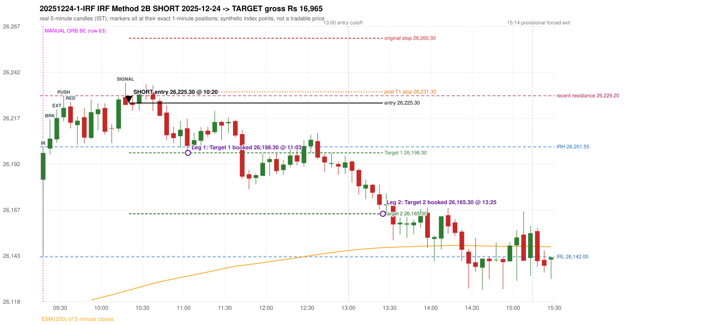

# Trading journal - 2025-12-24 (Wednesday)

> Automated, read-only reconstruction of the Phase 3.0 baseline. Synthetic NIFTY 50 index-point P&L (the index is not tradable). The owner's review status is intentionally blank.

## A. Trading day overview

| item | value |
|---|---|
| Date / weekday | 2025-12-24 / Wednesday |
| Session type | USABLE_WITH_FLAGS / VALID |
| Original session open (first 1-minute open) | 26,183.75 |
| Previous session | 2025-12-23 |
| Previous-day high / low | 26,233.55 / 26,120.00 |
| Previous-day official close / last 5-minute close | 26,177.15 / 26,164.55 |
| Raw engine records / confirmed signals / fully valid signals | 6 / 4 / 4 |
| Setups that did not complete (invalidated / incomplete) | 2 |
| Executed trades | 1 20251224-1-IRF |
| Gross P&L (Rs, synthetic) | 16,965.00 |
| Illustrative net P&L (Rs; Rs 500/trade + 0.5 pt/fill) | 16,075.00 |
| Day-end portfolio status | DAY_FINISHED |
| Manual journal trades (matched / unmatched) | 1 (0 / 1) |
| Extra automated trades | 1 |

## B. Daily strategy signal timeline (confirmed signals, chronological)

| time | strategy | method | dir | entry-rule status | valid for execution | <= 13:00 | portfolio state | accepted / ignored | specific reason | competing (same minute) |
|---|---|---|---|---|---|---|---|---|---|---|
| 10:20 | IRF | Method 2B | SHORT | PROPOSAL_DEPENDENT | True | True | FIRST_TRADE_ACTIVE | ACCEPTED -> 20251224-1-IRF | first eligible signal of the day; trade 1: TARGET |  |
| 11:45 | IRF | Method 1 | SHORT | PROPOSAL_DEPENDENT | True | True | FIRST_TRADE_ACTIVE | IGNORED | POSITION_ACTIVE (signal kept for diagnostics only; never reused) [blocked by IRF#1] |  |
| 12:40 | IRF | Method 1 | SHORT | PROPOSAL_DEPENDENT | True | True | FIRST_TRADE_ACTIVE | IGNORED | POSITION_ACTIVE (signal kept for diagnostics only; never reused) [blocked by IRF#1] |  |
| 15:00 | RF | RF | LONG | PROPOSAL_DEPENDENT | True | False | DAY_FINISHED | IGNORED | DAY_FINISHED [blocked by IRF#1] |  |

Engine setups that did not complete (2); the complete list with failed rule ids is in `rejected_signals.csv`:

| candle | strategy | method | dir | status | precise reason | failed rules |
|---|---|---|---|---|---|---|
| 10:15 | IRF | Method 1/2 | SHORT | INCOMPLETE_AT_EOD | SESSION_ENDED_BEFORE_CONFIRMATION |  |
| 09:15 | PDR | PDR | LONG | INVALIDATED | GAP_UP_OPEN_NOT_ABOVE_ZONE | PDR-011 |

## C. Detailed trade journals

### 20251224-1-IRF: IRF Method 2B SHORT (FIRST trade)

Chart: 

**Rule configuration:** CFG-baseline-be1db2a09d - signal verification status **PROPOSAL_DEPENDENT** (never VERIFIED while a rule rests on a proposal).

#### 1. Setup identification

IRF Method 2B SHORT: the 09:20-09:25 candle closed at 26,206.00, above IRH 26,201.55, and the next candle did not close back inside the range, so the setup is Method 2 and price stayed above it until the trigger. Extension candle 09:25-09:30, red candle 09:35-09:40. The trigger came 11 candles after the breakout candle: a red candle closed back below the first-push resistance after price had traded above it (10:15-10:20); confirmed at 10:20 with close 26,224.25. Entry reference close 26,224.25 is 22.70 points above IRH 26,201.55.

#### 2. Candle and indicator calculations

| role | session | candle | O | H | L | C | range | body % | upper wick % | lower wick % | direction | EMA(200) | strong bull / bear | pin bull / bear | small (body<=30%) | used for |
|---|---|---|---|---|---|---|---|---|---|---|---|---|---|---|---|---|
| initial_range_candle | TODAY | 09:15-09:20 | 26,183.75 | 26,201.55 | 26,142.00 | 26,198.25 | 59.55 | 24.35 | 5.54 | 70.11 | BULLISH | 26,111.60 | False / False | True / False | True | initial range = high/low of the 09:15 candle |
| signal_candle | TODAY | 10:15-10:20 | 26,228.50 | 26,236.30 | 26,224.25 | 26,224.25 | 12.05 | 35.27 | 64.73 | 0.00 | BEARISH | 26,123.47 | False / False | False / False | False | candle whose close completed the trigger |
| breakout_candle | TODAY | 09:20-09:25 | 26,200.65 | 26,216.45 | 26,197.35 | 26,206.00 | 19.10 | 28.01 | 54.71 | 17.28 | BULLISH | 26,112.54 | False / False | False / False | True | breakout candle: a completed candle closing above IRH |
| extension_candle | TODAY | 09:25-09:30 | 26,205.60 | 26,221.90 | 26,203.80 | 26,217.10 | 18.10 | 63.54 | 26.52 | 9.94 | BULLISH | 26,113.58 | False / False | False / False | False | extension: first later candle trading above the breakout candle's high |
| red_candle | TODAY | 09:35-09:40 | 26,223.40 | 26,225.95 | 26,211.55 | 26,214.60 | 14.40 | 61.11 | 17.71 | 21.18 | BEARISH | 26,115.66 | False / False | False / False | False | first red candle during the extension |
| first_push_top | TODAY | 09:30-09:35 | 26,217.60 | 26,229.20 | 26,215.40 | 26,222.65 | 13.80 | 36.59 | 47.46 | 15.94 | BULLISH | 26,114.67 | False / False | False / False | False | recent resistance = top of the first push after the breakout |

Every condition, with the rule, the calculation, the observed values and the result:

| # | group | rule | result | status / numeric definition | calculation | observed | required | available at | why it matters |
|---|---|---|---|---|---|---|---|---|---|
| 1 | SELECTION | SEL-FIRST-001 | PASS | USER_APPROVED / USER_APPROVED | earliest CONFIRMED signal of the day across IRF/ORB/PDR/PDS/RF that passed the controller's checks | 0 confirmed signal(s) earlier today; 4 confirmed signals in the day in total, this one at 10:20 | no earlier executable signal | 2025-12-24 10:20 | the shared controller trades only the first valid signal; the five strategies are not independent positions |
| 2 | SELECTION | SEL-TIE-001 | PASS | USER_APPROVED / USER_APPROVED | other CONFIRMED signals with exactly the same confirmation timestamp | none | no different-strategy / opposite-direction signal in the same minute (otherwise an unresolved conflict, no trade) | 2025-12-24 10:20 | an unresolved same-minute collision would have produced no trade at all |
| 3 | SELECTION | ENTRY-CUTOFF-001 | PASS | USER_APPROVED / USER_APPROVED | fill timestamp vs 13:00:00 IST | signal confirmed 10:20; fill 10:20 | fill at or before 13:00:00 IST | 2025-12-24 10:20 | no new position may be entered with a fill after 13:00 IST |
| 4 | SELECTION | EXE-FILL-001 | PASS | PROPOSED_FOR_REVIEW / PROPOSED_FOR_REVIEW | fill = open of the 1-minute bar that starts at the signal candle's end | bar 10:20 O 26,225.30 H 26,227.75 L 26,221.10 C 26,224.00; executable=True; entry 26,225.30 | fill bar exists, starts exactly at the signal end, is fillable; entry = its open | 2025-12-24 10:20 | a 5-minute signal is known only when its candle closes; the first price that can be traded is the next minute's open |
| 5 | SELECTION | DAY-MAX-001 | PASS | USER_APPROVED / USER_APPROVED | number of entries today | trade 1 of at most 2 | <= 2 entries per day | 2025-12-24 10:20 | daily trade cap |
| 6 | SETUP | IRF-GLOBAL-001 | PASS | SOURCE_VERIFIED / EXPLICIT_IN_SOURCE | initial range = high and low (wicks included) of the first completed 5-minute candle | 09:15-09:20 IRH 26,201.55, IRL 26,142.00 (range 59.55; engine recorded IRH 26,201.55, IRL 26,142.00) | high/low of the 09:15-09:20 candle | 2025-12-24 09:20 | all three IRF methods measure price against this range |
| 7 | SETUP | IRF-GLOBAL-003 | PASS | SOURCE_VERIFIED / EXPLICIT_IN_SOURCE | closes confirm, wicks do not: every trigger is evaluated on a completed 5-minute candle | trigger candle 10:15-10:20 was complete when the signal was stamped 10:20; decision uses its close 26,224.25 | completed candle close, not an intra-candle wick | 2025-12-24 10:20 | an intra-candle wick can reverse before the candle closes |
| 8 | SETUP | IRF-GLOBAL-002 | PASS | SOURCE_VERIFIED / EXPLICIT_IN_SOURCE | direction | SHORT (IRF trades short only) | short only | 2025-12-24 10:20 | IRF fades failed upside breakouts |
| 9 | SETUP | IRF-M2-001 | PASS | SOURCE_VERIFIED / EXPLICIT_IN_SOURCE | breakout candle close vs IRH | 09:20-09:25 O 26,200.65 H 26,216.45 L 26,197.35 C 26,206.00; range 19.10, body 5.35 (28.01%), upper wick 10.45 (54.71%), lower wick 3.30 (17.28%), bullish; close 26,206.00 is 4.45 points above IRH 26,201.55 | close > IRH (a wick above IRH is not a breakout) | 2025-12-24 09:25 | starts every IRF setup |
| 10 | SETUP | IRF-M2-004 | PASS | SOURCE_VERIFIED / EXPLICIT_IN_SOURCE | the candle after the breakout must NOT close back inside the range (else the setup is Method 1) | 09:25 close 26,217.10 vs [26,142.00, 26,201.55) | not (IRL <= close < IRH) | 2025-12-24 09:30 | separates Method 2 (price holds above) from Method 1 (immediate failure) |
| 11 | SETUP | IRF-M2-002 | PASS | SOURCE_VERIFIED / QUALITATIVE_SOURCE_NUMERIC_DEFINITION_PROPOSED_FOR_REVIEW | extension = a later candle whose high exceeds the breakout candle's high (research definition E1) | 09:25 high 26,221.90 vs breakout candle high 26,216.45 (+5.45) | high > breakout candle high | 2025-12-24 09:30 | the guide says price 'extends further upward'; the numeric test is a proposal |
| 12 | SETUP | IRF-M2-003 | PASS | SOURCE_VERIFIED / QUALITATIVE_SOURCE_NUMERIC_DEFINITION_PROPOSED_FOR_REVIEW | a red candle (close < open) forms after the extension | 09:35-09:40 O 26,223.40 H 26,225.95 L 26,211.55 C 26,214.60; range 14.40, body 8.80 (61.11%), upper wick 2.55 (17.71%), lower wick 3.05 (21.18%), bearish | close < open, at or after the candle following the extension | 2025-12-24 09:40 | the red candle shows the first pause/reversal inside the extension |
| 13 | CONFIRMATION | IRF-M2-005 | PASS | SOURCE_VERIFIED / EXPLICIT_IN_SOURCE | a red candle alone is not confirmation: a level break is required | red trigger candle 10:15 also closes below the resistance (see IRF-M2B-003) | a red candle plus a closing break of the level | 2025-12-24 10:20 | a red candle with no level break does not qualify |
| 14 | CONFIRMATION | IRF-M2B-001 | PASS | SOURCE_VERIFIED / QUALITATIVE_SOURCE_NUMERIC_DEFINITION_PROPOSED_FOR_REVIEW | recent resistance = first 3-candle fractal high (k=1) at/after the breakout candle (FIRST_PUSH_TOP) | 09:30 high 26,229.20; engine recorded 26,229.20 | first push top | 2025-12-24 09:40 | the level whose retake-and-fail completes Method 2B (definition is a proposal) |
| 15 | CONFIRMATION | IRF-M2B-002 | PASS | SOURCE_VERIFIED / QUALITATIVE_SOURCE_NUMERIC_DEFINITION_PROPOSED_FOR_REVIEW | price trades back above the resistance after the first push | first candle with high above 26,229.20: 10:15 high 26,236.30 - this IS the trigger candle itself (the push and the red close back below happen on the same candle) | some candle after the first push has high > resistance (the push may be the trigger candle: m2b_push_must_precede_red_candle = False) | 2025-12-24 10:20 | the guide's figure shows three separate candles; the engine also accepts a single candle |
| 16 | CONFIRMATION | IRF-M2B-003 | PASS | SOURCE_VERIFIED / EXPLICIT_IN_SOURCE | trigger = a red candle closing back below the resistance | 10:15-10:20 O 26,228.50 H 26,236.30 L 26,224.25 C 26,224.25; range 12.05, body 4.25 (35.27%), upper wick 7.80 (64.73%), lower wick 0.00 (0.00%), bearish; close 26,224.25 vs resistance 26,229.20 | red candle and close < resistance | 2025-12-24 10:20 | completes Method 2B |
| 17 | EXECUTION | EXE-STOP-001 | PASS | USER_APPROVED / USER_APPROVED | initial stop = entry + 35 points | entry 26,225.30 -> stop 26,260.30 | stop 35 index points (BASELINE) | 2025-12-24 10:20 | defines the loss if the setup fails before Target 1 |
| 18 | EXECUTION | EXE-T1-001 | PASS | SOURCE_VERIFIED / EXPLICIT_IN_SOURCE | Target 1 = entry +/- 27 points | T1 26,198.30 | 27 points | 2025-12-24 10:20 | Leg 1 (3 lots) is booked at Target 1 |
| 19 | EXECUTION | IRF-TGT-001 | PASS | SOURCE_VERIFIED / EXPLICIT_IN_SOURCE | Target 2 = entry +/- 60 points | T2 26,165.30 | 60 points | 2025-12-24 10:20 | Leg 2 (3 lots) is booked at Target 2 |
| 20 | EXECUTION | POST-T1-STOP-006 | PASS | USER_APPROVED / USER_APPROVED | after T1 the Leg-2 stop = entry + 6 (no trailing) | post-T1 stop 26,231.30 | entry -6 (LONG) / +6 (SHORT) | 2025-12-24 10:20 | protects the remaining three lots once the first three are booked |
| 21 | EXECUTION | SIZE-LOT-001 | PASS | USER_APPROVED / USER_APPROVED | 6 lots x 65 = 390, Leg 1 = 3 lots = 195, Leg 2 = 195 | 6 lots, lot size 65, legs 3+3 | 6 lots in two equal legs | 2025-12-24 10:20 | position size for the synthetic P&L |
| 22 | NOTE | IRF-M2-006 | UNRESOLVED | UNRESOLVED / UNRESOLVED | delay between the breakout candle and this trigger; expiry rule | 11 candles after the breakout; expiry none configured | the source states no expiry | 2025-12-24 10:20 | an old breakout can still trigger hours later |
| 23 | NOTE | IRF-M2-006 | UNRESOLVED | UNRESOLVED / UNRESOLVED | did price stay above IRH between the breakout and the trigger? | 0 closes at or below IRH between 09:25 and 10:15; trigger close 26,224.25 above IRH 26,201.55 | the engine does not require price to stay above IRH | 2025-12-24 10:20 | the guide describes price 'holding above IRH and keeping rising'; the code only needs the level break |
| 24 | NOTE | IRF-GLOBAL-004 | UNRESOLVED | UNRESOLVED / UNRESOLVED | which close above IRH of the session produced this attempt; repeat setups | this breakout is upward crossing no. 1 of the session (a close above IRH after a close at/below it) | the source states no first-breakout-only, re-arming, expiry or trades-per-day rule | 2025-12-24 10:20 | IRF re-arms on every later breakout in the code, producing many raw setups; the controller keeps only the first |
| 25 | NOTE | NOTE-IRF-REPEATED-SETUPS | NOT_APPLICABLE | NOT_A_RULE / NOT_A_REGISTRY_RULE | other IRF signals later in the session (not traded) | 2 further confirmed IRF signal(s): Method 1@11:45, Method 1@12:40 | disclosure of repeated raw setups | 2025-12-24 10:20 | repeated raw IRF setups are not hidden; they are logged as ignored |
| 26 | NOTE | IRF-SL-001 | NOT_APPLICABLE | SOURCE_VERIFIED / QUALITATIVE_SOURCE_NUMERIC_DEFINITION_PROPOSED_FOR_REVIEW | the guide's 35-or-40 rule: 35 if the most recent green candle's high is within 35 points of entry, else 40 | most recent green candle high 26,228.65 is 3.35 points from the entry 26,225.30: the guide's rule would select 35 points; the baseline applies a fixed 35 (USER_APPROVED research baseline; the 35-vs-40 selection and the 40-point variant are separate labelled scenarios) | source selection rule | 2025-12-24 10:20 | the stop distance is a modelling choice and changes losses, not entries |
| 27 | NOTE | NOTE-UNRESOLVED-DEPENDENCIES | UNRESOLVED | NOT_A_RULE / NOT_A_REGISTRY_RULE | rules the signal depends on that the sources leave unresolved | engine-recorded unresolved rule ids: IRF-GLOBAL-004; verification status PROPOSAL_DEPENDENT | n/a (disclosure) | 2025-12-24 10:20 | the entry is only as verified as the rules it rests on |

#### 3. Entry decision and explanation

IRF Method 2B SHORT: the 09:20-09:25 candle closed at 26,206.00, above IRH 26,201.55, and the next candle did not close back inside the range, so the setup is Method 2 and price stayed above it until the trigger. Extension candle 09:25-09:30, red candle 09:35-09:40. The trigger came 11 candles after the breakout candle: a red candle closed back below the first-push resistance after price had traded above it (10:15-10:20); confirmed at 10:20 with close 26,224.25. Entry reference close 26,224.25 is 22.70 points above IRH 26,201.55.

**Why this trade ahead of the other strategies:** This IRF Method 2B signal was the earliest executable signal of the day: 0 confirmed signal(s) earlier, 0 other in the same minute. 3 later confirmed signal(s) (IRF x2, RF x1) are logged as ignored or rejected. State of the other four engines at that moment: [ORB: no setup record before this time (a base condition was not met, or nothing triggered)] [PDR: PDR invalidated at 09:15: GAP_UP_OPEN_NOT_ABOVE_ZONE] [PDS: no setup record before this time (a base condition was not met, or nothing triggered)] [RF: no setup record before this time (a base condition was not met, or nothing triggered)]

#### 4. Actual entry execution

| item | value |
|---|---|
| Signal candle | 10:15-10:20 |
| Signal confirmed | 2025-12-24 10:20 |
| Fill timestamp | 2025-12-24 10:20 |
| Entry price | 26,225.30 |
| Source partition / 1-minute bar | data/processed/nifty50/year=2025/month=12/candles.parquet / 2025-12-24 10:20 |
| Source bar O / H / L / C | 26,225.30 / 26,227.75 / 26,221.10 / 26,224.00 |
| Fill assumption | open of the 1-minute bar starting at the signal candle's end (EXE-FILL-001, PROPOSED causal convention) |
| Initial stop / T1 / T2 / post-T1 stop | 26,260.30 / 26,198.30 / 26,165.30 / 26,231.30 |
| Position | 6 lots x 65 = 390 units (Leg 1 195, Leg 2 195) |

#### 5-8. Trade progress, Target 1, post-T1 stop and final exit

Between the 10:20 entry bar and the final exit (186 one-minute bars) the best excursion in favour was 60.40 points at 13:25 and the worst against was 10.05 points at 10:33. At 11:03 price reached Target 1 26,198.30 and three lots exited. At 11:03 the remaining three lots' protective stop was set to 26,231.30 (entry + 6; no trailing, no further change); the engine applies it from the Target-1 bar onward and tests it within that same bar. At 13:25 price reached Target 2 26,165.30 and the remaining three lots exited. No further trade that day (DAY-T2-001).

| leg | qty | exit time | exit price | reason | source 1-minute bar | O / H / L / C | gross points | gross Rs | slippage pts | flags |
|---|---|---|---|---|---|---|---|---|---|---|
| 1 | 195 | 11:03 | 26,198.30 | TARGET_1 | 11:03 | 26,201.35 / 26,205.15 / 26,198.05 / 26,203.55 | 27.00 | 5,265.00 | 0.00 |  |
| 2 | 195 | 13:25 | 26,165.30 | TARGET_2 | 13:25 | 26,169.95 / 26,171.75 / 26,164.90 / 26,167.50 | 60.00 | 11,700.00 | 0.00 |  |

Exit evidence per leg:

* Leg 1: 1-minute bar 11:03 O 26,201.35 H 26,205.15 L 26,198.05 C 26,203.55: low 26,198.05 reached Target 1 26,198.30; Leg 1 booked at the target level
* Leg 2: 1-minute bar 13:25 O 26,169.95 H 26,171.75 L 26,164.90 C 26,167.50: low 26,164.90 reached Target 2 26,165.30; Leg 2 booked at the target level

#### 9. Gross and illustrative net P&L

| item | value (Rs) |
|---|---|
| Leg 1 gross | 5,265.00 |
| Leg 2 gross | 11,700.00 |
| Trade gross (= Leg 1 + Leg 2) | 16,965.00 |
| Illustrative fixed cost | -500.00 |
| Illustrative slippage (0.5 pt on every fill, entry + exits, all units) | -390.00 |
| Illustrative net | 16,075.00 |

#### 10. Manual journal comparison

EXTRA_AUTOMATED_TRADE: the automated system took IRF Method 2B SHORT at 10:20 (manual traded only other strategies: ORB 09:15 BE). The setup rests on: IRF-M2-006: No expiry / validity window for a Method 2 attempt | IRF-M2-006: Engine does not test that price held above IRH | IRF-GLOBAL-004: IRF trades per day / time window / re-arming are not stated in the guide | NOTE-UNRESOLVED-DEPENDENCIES: Disclosure of unresolved source rules behind this signal. The journal shows no corresponding entry.

## D. Manual journal comparison

| comparison | journal row | journal strategy | manual time | manual direction | manual outcome | match class | trade | auto entry | auto outcome | explanation |
|---|---|---|---|---|---|---|---|---|---|---|
| M063 | 63 | ORB | 09:15 | UNKNOWN | BE | MISSING_AUTOMATED_SIGNAL |  |  |  | MISSING_AUTOMATED_SIGNAL: NO_CONFIRMED_SIGNAL_WITHIN_TOLERANCE_AND_NO_ANCHORED_SETUP_RECORD - FIRST_CANDLE_DID_NOT_CLOSE_BEYOND_PREV_DAY_HIGH_OR_LOW. Heuristic primary cause: SOURCE_AMBIGUITY; blocked by: n/a |
| E045 |  |  |  |  |  | EXTRA_AUTOMATED_TRADE | 20251224-1-IRF | 10:20 @ 26,225.30 | TARGET | EXTRA_AUTOMATED_TRADE: the automated system took IRF Method 2B SHORT at 10:20 (manual traded only other strategies: ORB 09:15 BE). The setup rests on: IRF-M2-006: No expiry / validity window for a Method 2 attempt \| IRF-M2-006: Engine does not test that price held above IRH \| IRF-GLOBAL-004: IRF trades per day / time window / re-arming are not stated in the guide \| NOTE-UNRESOLVED-DEPENDENCIES: Disclosure of unresolved source rules behind this signal. The journal shows no corresponding entry. |

The journal records no entry price and no exit price (NOT_RECORDED); matching uses date, strategy and candle start only - never P&L.

## E. Daily conclusion

* **Traded:** 20251224-1-IRF - IRF Method 2B SHORT at 10:20 (entry 26,225.30), outcome TARGET, gross Rs 16,965.00, illustrative net Rs 16,075.00. **Why:** This IRF Method 2B signal was the earliest executable signal of the day: 0 confirmed signal(s) earlier, 0 other in the same minute. 3 later confirmed signal(s) (IRF x2, RF x1) are logged as ignored or rejected. State of the other four engines at that moment: [ORB: no setup record before this time (a base condition was not met, or nothing triggered)] [PDR: PDR invalidated at 09:15: GAP_UP_OPEN_NOT_ABOVE_ZONE] [PDS: no setup record before this time (a base condition was not met, or nothing triggered)] [RF: no setup record before this time (a base condition was not met, or nothing triggered)] **How it ended:** At 11:03 price reached Target 1 26,198.30 and three lots exited. At 11:03 the remaining three lots' protective stop was set to 26,231.30 (entry + 6; no trailing, no further change); the engine applies it from the Target-1 bar onward and tests it within that same bar. At 13:25 price reached Target 2 26,165.30 and the remaining three lots exited. No further trade that day (DAY-T2-001).
* **Ignored / rejected signals:** IRF IGNORED POSITION_ACTIVE x2; RF IGNORED DAY_FINISHED x1
* **Unmatched manual trade (row 63, ORB 09:15 BE):** MISSING_AUTOMATED_SIGNAL: NO_CONFIRMED_SIGNAL_WITHIN_TOLERANCE_AND_NO_ANCHORED_SETUP_RECORD - FIRST_CANDLE_DID_NOT_CLOSE_BEYOND_PREV_DAY_HIGH_OR_LOW. Heuristic primary cause: SOURCE_AMBIGUITY; blocked by: n/a
* **Extra automated trade 20251224-1-IRF:** EXTRA_AUTOMATED_TRADE: the automated system took IRF Method 2B SHORT at 10:20 (manual traded only other strategies: ORB 09:15 BE). The setup rests on: IRF-M2-006: No expiry / validity window for a Method 2 attempt | IRF-M2-006: Engine does not test that price held above IRH | IRF-GLOBAL-004: IRF trades per day / time window / re-arming are not stated in the guide | NOTE-UNRESOLVED-DEPENDENCIES: Disclosure of unresolved source rules behind this signal. The journal shows no corresponding entry.
* **Open strategy-definition issues that affected this day:** IRF-GLOBAL-004 (NOT STATED: how many IRF trades per day, a latest entry time, and whether a new breakout may re-arm a setup after a signal), IRF-M2-006 (How long a Method 2 setup stays valid (expiry / invalidation before a level breaks) is not stated), NOTE-UNRESOLVED-DEPENDENCIES
* **Automated triage (not an approval; the owner's review status stays blank):** REVIEW: UNMATCHED_MANUAL+EXTRA_AUTOMATED
