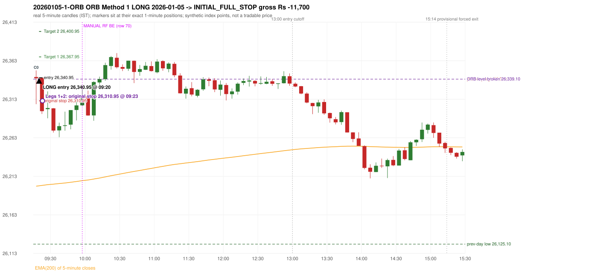
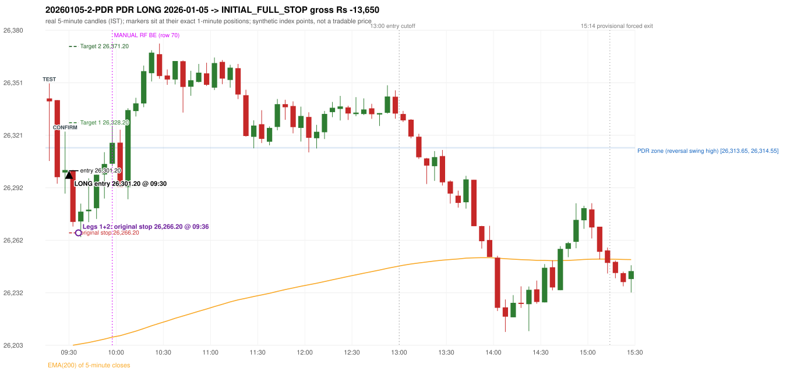

# Trading journal - 2026-01-05 (Monday)

> Automated, read-only reconstruction of the Phase 3.0 baseline. Synthetic NIFTY 50 index-point P&L (the index is not tradable). The owner's review status is intentionally blank.

## A. Trading day overview

| item | value |
|---|---|
| Date / weekday | 2026-01-05 / Monday |
| Session type | USABLE_WITH_FLAGS / VALID |
| Original session open (first 1-minute open) | 26,341.90 |
| Previous session | 2026-01-02 |
| Previous-day high / low | 26,339.10 / 26,125.10 |
| Previous-day official close / last 5-minute close | 26,328.55 / 26,335.70 |
| Raw engine records / confirmed signals / fully valid signals | 13 / 11 / 11 |
| Setups that did not complete (invalidated / incomplete) | 2 |
| Executed trades | 2 20260105-1-ORB;20260105-2-PDR |
| Gross P&L (Rs, synthetic) | -25,350.00 |
| Illustrative net P&L (Rs; Rs 500/trade + 0.5 pt/fill) | -27,130.00 |
| Day-end portfolio status | DAY_FINISHED |
| Manual journal trades (matched / unmatched) | 1 (0 / 1) |
| Extra automated trades | 2 |

## B. Daily strategy signal timeline (confirmed signals, chronological)

| time | strategy | method | dir | entry-rule status | valid for execution | <= 13:00 | portfolio state | accepted / ignored | specific reason | competing (same minute) |
|---|---|---|---|---|---|---|---|---|---|---|
| 09:20 | ORB | Method 1 | LONG | PROPOSAL_DEPENDENT | True | True | FIRST_TRADE_ACTIVE | ACCEPTED -> 20260105-1-ORB | first eligible signal of the day; trade 1: INITIAL_FULL_STOP |  |
| 09:30 | PDR | PDR | LONG | PROPOSAL_DEPENDENT | True | True | SECOND_TRADE_ACTIVE | ACCEPTED -> 20260105-2-PDR | permitted second trade: newly confirmed PDR/PDS after the original full stop; trade 2: INITIAL_FULL_STOP |  |
| 10:10 | PDR | PDR | LONG | PROPOSAL_DEPENDENT | True | True | DAY_FINISHED | IGNORED | DAY_FINISHED [blocked by PDR#2] |  |
| 10:45 | IRF | Method 1 | SHORT | PROPOSAL_DEPENDENT | True | True | DAY_FINISHED | IGNORED | DAY_FINISHED [blocked by PDR#2] | IRF Method 2A SHORT |
| 10:45 | IRF | Method 2A | SHORT | PROPOSAL_DEPENDENT | True | True | DAY_FINISHED | IGNORED | DAY_FINISHED [blocked by PDR#2] | IRF Method 1 SHORT |
| 11:00 | IRF | Method 1 | SHORT | PROPOSAL_DEPENDENT | True | True | DAY_FINISHED | IGNORED | DAY_FINISHED [blocked by PDR#2] |  |
| 11:20 | IRF | Method 1 | SHORT | PROPOSAL_DEPENDENT | True | True | DAY_FINISHED | IGNORED | DAY_FINISHED [blocked by PDR#2] | IRF Method 2A SHORT |
| 11:20 | IRF | Method 2A | SHORT | PROPOSAL_DEPENDENT | True | True | DAY_FINISHED | IGNORED | DAY_FINISHED [blocked by PDR#2] | IRF Method 1 SHORT |
| 11:40 | PDR | PDR | LONG | PROPOSAL_DEPENDENT | True | True | DAY_FINISHED | IGNORED | DAY_FINISHED [blocked by PDR#2] |  |
| 12:10 | PDR | PDR | LONG | PROPOSAL_DEPENDENT | True | True | DAY_FINISHED | IGNORED | DAY_FINISHED [blocked by PDR#2] |  |
| 13:25 | PDR | PDR | LONG | PROPOSAL_DEPENDENT | True | False | DAY_FINISHED | IGNORED | DAY_FINISHED [blocked by PDR#2] |  |

Engine setups that did not complete (2); the complete list with failed rule ids is in `rejected_signals.csv`:

| candle | strategy | method | dir | status | precise reason | failed rules |
|---|---|---|---|---|---|---|
| 09:15 | ORB | Method 2 | LONG | INVALIDATED | TRENDLINE_NOT_SUPPORTIVE | ORB-M2-LONG-001 |
| 09:55 | RF | RF | LONG | INVALIDATED | GAP_UP_OUTSIDE_YESTERDAYS_RANGE | RF-004 |

## C. Detailed trade journals

### 20260105-1-ORB: ORB Method 1 LONG (FIRST trade)

Chart: 

**Rule configuration:** CFG-baseline-be1db2a09d - signal verification status **PROPOSAL_DEPENDENT** (never VERIFIED while a rule rests on a proposal).

#### 1. Setup identification

ORB Method 1 LONG: the first completed 5-minute candle (09:15-09:20) closed at 26,340.25, 1.15 points above the previous-day high 26,339.10; its body occupied 3.77% of its range and its upper wick 19.43% (thresholds 60% / 20%): the strong-candle test FAILED; the candle was admitted through the conditional PIN-BAR alternative instead (the lower wick 33.60 points is 20.36 x the body, required 2x; the close is 23.20% of the range from the high, allowed 30%). Note: the candle is bearish, i.e. against the trade direction; the pin route accepts it because the level break and close beyond it carry the direction; the EMA-only trend filter passed. Entry decision at 09:20.

#### 2. Candle and indicator calculations

| role | session | candle | O | H | L | C | range | body % | upper wick % | lower wick % | direction | EMA(200) | strong bull / bear | pin bull / bear | small (body<=30%) | used for |
|---|---|---|---|---|---|---|---|---|---|---|---|---|---|---|---|---|
| first_candle | TODAY | 09:15-09:20 | 26,341.90 | 26,350.40 | 26,306.65 | 26,340.25 | 43.75 | 3.77 | 19.43 | 76.80 | BEARISH | 26,200.22 | False / False | True / False | True | the 09:15 first five-minute candle - the ORB decision candle |
| prev_day_extreme_candle | PREVIOUS | 15:25-15:30 | 26,332.20 | 26,339.10 | 26,329.45 | 26,335.70 | 9.65 | 36.27 | 35.23 | 28.50 | BULLISH | 26,198.81 | False / False | False / False | False | candle that made the previous session's high/low used as the level |
| prev_session_last_candle | PREVIOUS | 15:25-15:30 | 26,332.20 | 26,339.10 | 26,329.45 | 26,335.70 | 9.65 | 36.27 | 35.23 | 28.50 | BULLISH | 26,198.81 | False / False | False / False | False | trend: previous session's last 5-minute close vs its EMA(200) |

Every condition, with the rule, the calculation, the observed values and the result:

| # | group | rule | result | status / numeric definition | calculation | observed | required | available at | why it matters |
|---|---|---|---|---|---|---|---|---|---|
| 1 | SELECTION | SEL-FIRST-001 | PASS | USER_APPROVED / USER_APPROVED | earliest CONFIRMED signal of the day across IRF/ORB/PDR/PDS/RF that passed the controller's checks | 0 confirmed signal(s) earlier today; 11 confirmed signals in the day in total, this one at 09:20 | no earlier executable signal | 2026-01-05 09:20 | the shared controller trades only the first valid signal; the five strategies are not independent positions |
| 2 | SELECTION | SEL-TIE-001 | PASS | USER_APPROVED / USER_APPROVED | other CONFIRMED signals with exactly the same confirmation timestamp | none | no different-strategy / opposite-direction signal in the same minute (otherwise an unresolved conflict, no trade) | 2026-01-05 09:20 | an unresolved same-minute collision would have produced no trade at all |
| 3 | SELECTION | ENTRY-CUTOFF-001 | PASS | USER_APPROVED / USER_APPROVED | fill timestamp vs 13:00:00 IST | signal confirmed 09:20; fill 09:20 | fill at or before 13:00:00 IST | 2026-01-05 09:20 | no new position may be entered with a fill after 13:00 IST |
| 4 | SELECTION | EXE-FILL-001 | PASS | PROPOSED_FOR_REVIEW / PROPOSED_FOR_REVIEW | fill = open of the 1-minute bar that starts at the signal candle's end | bar 09:20 O 26,340.95 H 26,340.95 L 26,323.90 C 26,323.90; executable=True; entry 26,340.95 | fill bar exists, starts exactly at the signal end, is fillable; entry = its open | 2026-01-05 09:20 | a 5-minute signal is known only when its candle closes; the first price that can be traded is the next minute's open |
| 5 | SELECTION | DAY-MAX-001 | PASS | USER_APPROVED / USER_APPROVED | number of entries today | trade 1 of at most 2 | <= 2 entries per day | 2026-01-05 09:20 | daily trade cap |
| 6 | SETUP | ORB-GLOBAL-001 | PASS | SOURCE_VERIFIED / EXPLICIT_IN_SOURCE | decision is taken once the first 5-minute candle (09:15-09:20) has closed | candle 09:15-09:20; signal confirmed 09:20 | decision at 09:20, never before the close | 2026-01-05 09:20 | the close of the first candle is unknown before 09:20 |
| 7 | SETUP | ORB-GLOBAL-002 | PASS | SOURCE_VERIFIED / EXPLICIT_IN_SOURCE | direction | LONG | same rules in both directions | 2026-01-05 09:20 | ORB trades the side of the break |
| 8 | SETUP | ORB-GLOBAL-004 | PASS | SOURCE_VERIFIED / QUALITATIVE_SOURCE_NUMERIC_DEFINITION_PROPOSED_FOR_REVIEW | entry at 09:20, after the first-candle close | signal confirmed 09:20; fill 09:20 at the open of that minute | 09:20 entry | 2026-01-05 09:20 | the guide enters at 9:20; the fill price convention (next minute open) is a proposal |
| 9 | SETUP | ORB-M1-LONG-001 | PASS | SOURCE_VERIFIED / QUALITATIVE_SOURCE_NUMERIC_DEFINITION_PROPOSED_FOR_REVIEW | prev_day_high = the highest high of all 5-minute candles of the previous session 2026-01-02 | previous-day high 26,339.10 (set by the 15:25 candle; previous session range 26,125.10 - 26,339.10; engine recorded 26,339.10) | previous-day resistance (long) / support (short) | 2026-01-02 15:30 | a mechanical proxy for the guide's hand-drawn previous-day level; the source charts show multi-session boxes (documented difference) |
| 10 | SETUP | ORB-M1-LONG-002 | PASS | SOURCE_VERIFIED / EXPLICIT_IN_SOURCE | the first candle breaks and closes beyond the level | high 26,350.40 / low 26,306.65, close 26,340.25: 1.15 points beyond 26,339.10 | high and close > level | 2026-01-05 09:20 | a wick alone is not a breakout; the close decides |
| 11 | TREND | ORB-TREND-001 | PASS | SOURCE_VERIFIED / QUALITATIVE_SOURCE_NUMERIC_DEFINITION_PROPOSED_FOR_REVIEW | previous session's final completed 5-minute candle: close vs its EMA(200 of 5-minute closes) | previous session 2026-01-02 last candle 15:25-15:30 close 26,335.70 vs EMA(200) 26,198.81: 136.89 points above the EMA -> trend bullish (EMA_PREV_SESSION_CLOSE; research variant A, EMA-only) | close > EMA(200) | 2026-01-02 15:30 | the opening gap can never create the trend: only information that existed before today's open is used |
| 12 | TREND | ORB-TREND-002 | PASS | SOURCE_VERIFIED / QUALITATIVE_SOURCE_NUMERIC_DEFINITION_PROPOSED_FOR_REVIEW | price location versus the 200 EMA is the basic confirmation; structure is only 'supporting' | 136.89 points above the EMA(200) on the previous session's last 5-minute close; swing structure not used in variant A | price on the trend side of the 200 EMA | 2026-01-02 15:30 | the rulebook calls EMA position 'a basic confirmation, supported by bullish structure'; the structure part has no numeric definition |
| 13 | TREND | TREND-SWING-001 | NOT_APPLICABLE | PROPOSED_FOR_REVIEW / PROPOSED_FOR_REVIEW | confirmed swing structure | not required by the active trend variant (variant A is the EMA price location only) | n/a | 2026-01-02 15:30 | variant B would additionally require higher-high/higher-low swings; it is a separate labelled scenario |
| 14 | CONFIRMATION | ORB-M1-LONG-003 | PASS | SOURCE_VERIFIED / QUALITATIVE_SOURCE_NUMERIC_DEFINITION_PROPOSED_FOR_REVIEW | candle quality: strong body and limited opposite wick (or the conditional pin bar) | 09:15-09:20 O 26,341.90 H 26,350.40 L 26,306.65 C 26,340.25; range 43.75, body 1.65 (3.77%), upper wick 8.50 (19.43%), lower wick 33.60 (76.80%), bearish. Strong-bullish test: bullish close, body >= 60% (observed 3.77%), upper wick <= 20% (observed 19.43%) -> not met; pin-bar alternative: wick >= 2 x body and close within the favourable 30% -> met | strong candle (research thresholds) or pin bar | 2026-01-05 09:20 | the guide asks for a 'strong body, small wick' but gives no numbers; the thresholds are proposals |
| 15 | EXECUTION | ORB-GLOBAL-003 | PASS | SOURCE_VERIFIED / EXPLICIT_IN_SOURCE | initial stop = entry - 30 points | entry 26,340.95 -> stop 26,310.95 | stop 30 index points (BASELINE) | 2026-01-05 09:20 | defines the loss if the setup fails before Target 1 |
| 16 | EXECUTION | EXE-T1-001 | PASS | SOURCE_VERIFIED / EXPLICIT_IN_SOURCE | Target 1 = entry +/- 27 points | T1 26,367.95 | 27 points | 2026-01-05 09:20 | Leg 1 (3 lots) is booked at Target 1 |
| 17 | EXECUTION | ORB-GLOBAL-003 | PASS | SOURCE_VERIFIED / EXPLICIT_IN_SOURCE | Target 2 = entry +/- 60 points | T2 26,400.95 | 60 points | 2026-01-05 09:20 | Leg 2 (3 lots) is booked at Target 2 |
| 18 | EXECUTION | POST-T1-STOP-006 | PASS | USER_APPROVED / USER_APPROVED | after T1 the Leg-2 stop = entry - 6 (no trailing) | post-T1 stop 26,334.95 | entry -6 (LONG) / +6 (SHORT) | 2026-01-05 09:20 | protects the remaining three lots once the first three are booked |
| 19 | EXECUTION | SIZE-LOT-001 | PASS | USER_APPROVED / USER_APPROVED | 6 lots x 65 = 390, Leg 1 = 3 lots = 195, Leg 2 = 195 | 6 lots, lot size 65, legs 3+3 | 6 lots in two equal legs | 2026-01-05 09:20 | position size for the synthetic P&L |
| 20 | NOTE | ORB-MA-001 | UNRESOLVED | CONFLICTING / CONFLICTING | which moving average the code uses | EMA(200) of 5-minute closes (the guide says '200 DMA' in some places and '200 EMA' in others); active ma_mode EMA200_5M | the source terminology conflicts | 2026-01-05 09:20 | a daily 200 DMA would give different values |
| 21 | NOTE | NOTE-UNRESOLVED-DEPENDENCIES | UNRESOLVED | NOT_A_RULE / NOT_A_REGISTRY_RULE | rules the signal depends on that the sources leave unresolved | engine-recorded unresolved rule ids: ORB-MA-001; verification status PROPOSAL_DEPENDENT | n/a (disclosure) | 2026-01-05 09:20 | the entry is only as verified as the rules it rests on |

#### 3. Entry decision and explanation

ORB Method 1 LONG: the first completed 5-minute candle (09:15-09:20) closed at 26,340.25, 1.15 points above the previous-day high 26,339.10; its body occupied 3.77% of its range and its upper wick 19.43% (thresholds 60% / 20%): the strong-candle test FAILED; the candle was admitted through the conditional PIN-BAR alternative instead (the lower wick 33.60 points is 20.36 x the body, required 2x; the close is 23.20% of the range from the high, allowed 30%). Note: the candle is bearish, i.e. against the trade direction; the pin route accepts it because the level break and close beyond it carry the direction; the EMA-only trend filter passed. Entry decision at 09:20.

**Why this trade ahead of the other strategies:** This ORB Method 1 signal was the earliest executable signal of the day: 0 confirmed signal(s) earlier, 0 other in the same minute. 10 later confirmed signal(s) (IRF x5, PDR x5) are logged as ignored or rejected. State of the other four engines at that moment: [IRF: no setup record before this time (a base condition was not met, or nothing triggered)] [PDR: no setup record before this time (a base condition was not met, or nothing triggered)] [PDS: no setup record before this time (a base condition was not met, or nothing triggered)] [RF: no setup record before this time (a base condition was not met, or nothing triggered)]

#### 4. Actual entry execution

| item | value |
|---|---|
| Signal candle | 09:15-09:20 |
| Signal confirmed | 2026-01-05 09:20 |
| Fill timestamp | 2026-01-05 09:20 |
| Entry price | 26,340.95 |
| Source partition / 1-minute bar | data/processed/nifty50/year=2026/month=01/candles.parquet / 2026-01-05 09:20 |
| Source bar O / H / L / C | 26,340.95 / 26,340.95 / 26,323.90 / 26,323.90 |
| Fill assumption | open of the 1-minute bar starting at the signal candle's end (EXE-FILL-001, PROPOSED causal convention) |
| Initial stop / T1 / T2 / post-T1 stop | 26,310.95 / 26,367.95 / 26,400.95 / 26,334.95 |
| Position | 6 lots x 65 = 390 units (Leg 1 195, Leg 2 195) |

#### 5-8. Trade progress, Target 1, post-T1 stop and final exit

Between the 09:20 entry bar and the final exit (4 one-minute bars) the best excursion in favour was 0.00 points at 09:20 and the worst against was 37.35 points at 09:23. At 09:23 price reached the original stop 26,310.95 before Target 1 26,367.95, so all six lots exited together at 26,310.95. This is an INITIAL_FULL_STOP: one more trade is allowed that day, only a newly confirmed PDR/PDS signal.

| leg | qty | exit time | exit price | reason | source 1-minute bar | O / H / L / C | gross points | gross Rs | slippage pts | flags |
|---|---|---|---|---|---|---|---|---|---|---|
| 1 | 195 | 09:23 | 26,310.95 | ORIGINAL_STOP_BEFORE_T1 | 09:23 | 26,325.65 / 26,328.65 / 26,303.60 / 26,305.20 | -30.00 | -5,850.00 | 0.00 |  |
| 2 | 195 | 09:23 | 26,310.95 | ORIGINAL_STOP_BEFORE_T1 | 09:23 | 26,325.65 / 26,328.65 / 26,303.60 / 26,305.20 | -30.00 | -5,850.00 | 0.00 |  |

Exit evidence per leg:

* Leg 1: 1-minute bar 09:23 O 26,325.65 H 26,328.65 L 26,303.60 C 26,305.20: low 26,303.60 reached the original stop 26,310.95 before Target 1 26,367.95 was touched; both legs exit at the stop level 26,310.95
* Leg 2: 1-minute bar 09:23 O 26,325.65 H 26,328.65 L 26,303.60 C 26,305.20: low 26,303.60 reached the original stop 26,310.95 before Target 1 26,367.95 was touched; both legs exit at the stop level 26,310.95

#### 9. Gross and illustrative net P&L

| item | value (Rs) |
|---|---|
| Leg 1 gross | -5,850.00 |
| Leg 2 gross | -5,850.00 |
| Trade gross (= Leg 1 + Leg 2) | -11,700.00 |
| Illustrative fixed cost | -500.00 |
| Illustrative slippage (0.5 pt on every fill, entry + exits, all units) | -390.00 |
| Illustrative net | -12,590.00 |

#### 10. Manual journal comparison

EXTRA_AUTOMATED_TRADE: the automated system took ORB Method 1 LONG at 09:20 (manual traded only other strategies: RF 09:55 BE). The setup rests on: ORB-MA-001: 200 DMA versus 200 EMA terminology conflict | NOTE-UNRESOLVED-DEPENDENCIES: Disclosure of unresolved source rules behind this signal. The journal shows no corresponding entry.

### 20260105-2-PDR: PDR LONG (SECOND trade)

Chart: 

**Rule configuration:** CFG-baseline-be1db2a09d - signal verification status **PROPOSAL_DEPENDENT** (never VERIFIED while a rule rests on a proposal).

#### 1. Setup identification

PDR LONG: the session opened 13.35 points above the previous close and 27.35 points above the resistance zone [26,313.65, 26,314.55] taken from the 14:20 swing-high candle of 2026-01-02. The 09:15 candle (26,306.65 - 26,350.40) retested the zone, and the 09:25 candle closed green at 26,301.60, confirming the entry at 09:30. The engine does not check that the zone held (confirmation close BELOW the zone floor).

#### 2. Candle and indicator calculations

| role | session | candle | O | H | L | C | range | body % | upper wick % | lower wick % | direction | EMA(200) | strong bull / bear | pin bull / bear | small (body<=30%) | used for |
|---|---|---|---|---|---|---|---|---|---|---|---|---|---|---|---|---|
| zone_source_candle | PREVIOUS | 14:20-14:25 | 26,307.60 | 26,314.55 | 26,302.30 | 26,313.65 | 12.25 | 49.39 | 7.35 | 43.27 | BULLISH | 26,184.18 | False / False | False / False | False | swing-high candle that defines the zone (B_SWING_HIGH_REVERSAL) |
| prev_day_high_candle | PREVIOUS | 15:25-15:30 | 26,332.20 | 26,339.10 | 26,329.45 | 26,335.70 | 9.65 | 36.27 | 35.23 | 28.50 | BULLISH | 26,198.81 | False / False | False / False | False | candle of the previous session's absolute high (for comparison) |
| interaction_candle | TODAY | 09:15-09:20 | 26,341.90 | 26,350.40 | 26,306.65 | 26,340.25 | 43.75 | 3.77 | 19.43 | 76.80 | BEARISH | 26,200.22 | False / False | True / False | True | first candle whose range intersects the zone |
| confirmation_candle | TODAY | 09:25-09:30 | 26,300.20 | 26,323.25 | 26,288.30 | 26,301.60 | 34.95 | 4.01 | 61.95 | 34.05 | BULLISH | 26,202.19 | False / False | False / False | True | first green candle after the interaction candle |

Every condition, with the rule, the calculation, the observed values and the result:

| # | group | rule | result | status / numeric definition | calculation | observed | required | available at | why it matters |
|---|---|---|---|---|---|---|---|---|---|
| 1 | SELECTION | DAY-SL-001 | PASS | USER_APPROVED / USER_APPROVED | first trade outcome, strategy of this signal, position-close time vs this signal's timestamp | first trade ORB Method 1 closed as INITIAL_FULL_STOP at 09:23; position free from 09:24; this PDR signal confirmed 09:30 | first trade INITIAL_FULL_STOP before Target 1, and a NEWLY confirmed PDR/PDS signal after the first position closed | 2026-01-05 09:30 | the only way a second trade is allowed |
| 2 | SELECTION | DAY-NOREUSE-001 | PASS | USER_APPROVED / USER_APPROVED | signals confirmed while the first position was open | 1 signal(s) were ignored during the first trade (never reused): ORB Method 1 LONG @09:20 | this trade comes from a signal confirmed after the first exit, not from an ignored one | 2026-01-05 09:30 | an ignored signal can never become the second trade |
| 3 | SELECTION | ENTRY-CUTOFF-001 | PASS | USER_APPROVED / USER_APPROVED | fill timestamp vs 13:00:00 IST | signal confirmed 09:30; fill 09:30 | fill at or before 13:00:00 IST | 2026-01-05 09:30 | no new position may be entered with a fill after 13:00 IST |
| 4 | SELECTION | EXE-FILL-001 | PASS | PROPOSED_FOR_REVIEW / PROPOSED_FOR_REVIEW | fill = open of the 1-minute bar that starts at the signal candle's end | bar 09:30 O 26,301.20 H 26,301.65 L 26,289.85 C 26,295.70; executable=True; entry 26,301.20 | fill bar exists, starts exactly at the signal end, is fillable; entry = its open | 2026-01-05 09:30 | a 5-minute signal is known only when its candle closes; the first price that can be traded is the next minute's open |
| 5 | SELECTION | DAY-MAX-001 | PASS | USER_APPROVED / USER_APPROVED | number of entries today | trade 2 of at most 2 | <= 2 entries per day | 2026-01-05 09:30 | daily trade cap |
| 6 | SETUP | PDR-004 | PASS | SOURCE_VERIFIED / EXPLICIT_WORDING_DETAIL_PROPOSED_FOR_REVIEW | gap = first 1-minute open of today - previous session's OFFICIAL close | today's open 26,341.90 (first 1-minute bar 09:15) - previous close 26,328.55 (DAILY_VENDOR, 2026-01-02) = +13.35 points -> gap UP | gap UP (more than 0 points) | 2026-01-05 09:15 | approved convention: the original first-minute open, never the vendor daily open |
| 7 | SETUP | PDR-011 | PASS | SOURCE_VERIFIED / QUALITATIVE_SOURCE_NUMERIC_DEFINITION_PROPOSED_FOR_REVIEW | open relative to the zone (ABOVE_ZONE) | today's open 26,341.90 vs zone high 26,314.55: 27.35 points above | open > zone high | 2026-01-05 09:15 | the guide has price 'pull back into the zone', so the gap-up open is above it; this exclusion is a proposal |
| 8 | ZONE | PDR-001 | PASS | SOURCE_VERIFIED / EXPLICIT_IN_SOURCE | direction | LONG (PDR is long only) | long-only | 2026-01-05 09:30 | PDR buys a retest of previous-day resistance after a gap up |
| 9 | ZONE | PDR-002 | PASS | SOURCE_VERIFIED / QUALITATIVE_SOURCE_NUMERIC_DEFINITION_PROPOSED_FOR_REVIEW | zone = [body top, wick high] of the latest confirmed swing high (k=2) that has a red candle among the peak and the next 2 candles (method B_SWING_HIGH_REVERSAL) | zone [26,313.65, 26,314.55] from the 14:20 candle of 2026-01-02 (body top 26,313.65, wick high 26,314.55; 14:20-14:25 O 26,307.60 H 26,314.55 L 26,302.30 C 26,313.65; range 12.25, body 6.05 (49.39%), upper wick 0.90 (7.35%), lower wick 5.30 (43.27%), bullish); engine recorded [26,313.65, 26,314.55]. Previous session's absolute high 26,339.10 (candle 15:25) - the zone is NOT the day high (distance 24.55 points). Swing confirmed once candle 14:30 closed. | previous-day high where price peaked and reversed | 2026-01-02 14:35 | the source says 'previous day's high/reversal'; which candle marks the zone is an owner-approved research candidate, not a source rule |
| 10 | ZONE | PDR-003 | PASS | SOURCE_VERIFIED / EXPLICIT_IN_SOURCE | the zone is an area, not a single price | zone height 0.90 points [26,313.65, 26,314.55] | a rectangle with positive height | 2026-01-02 14:35 | price may touch any part of the area |
| 11 | ZONE | PDR-010 | UNRESOLVED | SOURCE_VERIFIED / QUALITATIVE_SOURCE_NUMERIC_DEFINITION_PROPOSED_FOR_REVIEW | reversal-quality filter ('clear high and reversal identified') | filter setting OFF | checklist item: a clear previous-day high and reversal | 2026-01-02 | the engine does not test reversal depth in the baseline (filter OFF) |
| 12 | CONFIRMATION | PDR-006 | PASS | SOURCE_VERIFIED / QUALITATIVE_SOURCE_NUMERIC_DEFINITION_PROPOSED_FOR_REVIEW | the first candle whose [low, high] intersects the zone (+/- proximity) | 09:15-09:20 O 26,341.90 H 26,350.40 L 26,306.65 C 26,340.25; range 43.75, body 1.65 (3.77%), upper wick 8.50 (19.43%), lower wick 33.60 (76.80%), bearish; low 26,306.65 vs zone high 26,314.55 (7.90 points inside/below the zone top), high 26,350.40 vs zone low 26,313.65; proximity 0 | range intersects the zone | 2026-01-05 09:20 | the retest of the previous-day resistance |
| 13 | CONFIRMATION | PDR-007 | PASS | SOURCE_VERIFIED / QUALITATIVE_SOURCE_NUMERIC_DEFINITION_PROPOSED_FOR_REVIEW | the first GREEN candle after the interaction candle | 09:25-09:30 O 26,300.20 H 26,323.25 L 26,288.30 C 26,301.60; range 34.95, body 1.40 (4.01%), upper wick 21.65 (61.95%), lower wick 11.90 (34.05%), bullish; interaction candle 09:15, confirmation candle 09:25 | close > open, strictly after the interaction candle | 2026-01-05 09:30 | the guide asks for 'a green candle' after the test; it gives no size or position test |
| 14 | CONFIRMATION | PDR-005 | PASS | SOURCE_VERIFIED / EXPLICIT_IN_SOURCE | no entry at the open: price must first come back toward the zone | interaction candle 09:15 (candle no. 1 of the session) precedes the entry candle 09:25; fill 09:30 | interaction before the entry; fill after 09:20 | 2026-01-05 09:30 | if price keeps rising without returning to the zone there is no setup |
| 15 | EXECUTION | EXE-STOP-001 | PASS | USER_APPROVED / USER_APPROVED | initial stop = entry - 35 points | entry 26,301.20 -> stop 26,266.20 | stop 35 index points (BASELINE) | 2026-01-05 09:30 | defines the loss if the setup fails before Target 1 |
| 16 | EXECUTION | EXE-T1-001 | PASS | SOURCE_VERIFIED / EXPLICIT_IN_SOURCE | Target 1 = entry +/- 27 points | T1 26,328.20 | 27 points | 2026-01-05 09:30 | Leg 1 (3 lots) is booked at Target 1 |
| 17 | EXECUTION | PDR-008 | PASS | SOURCE_VERIFIED / EXPLICIT_IN_SOURCE | Target 2 = entry +/- 70 points | T2 26,371.20 (the guide says 70; the performance report's winners suggest 60 - CONFLICTING, recorded) | 70 points | 2026-01-05 09:30 | Leg 2 (3 lots) is booked at Target 2 |
| 18 | EXECUTION | POST-T1-STOP-006 | PASS | USER_APPROVED / USER_APPROVED | after T1 the Leg-2 stop = entry - 6 (no trailing) | post-T1 stop 26,295.20 | entry -6 (LONG) / +6 (SHORT) | 2026-01-05 09:30 | protects the remaining three lots once the first three are booked |
| 19 | EXECUTION | SIZE-LOT-001 | PASS | USER_APPROVED / USER_APPROVED | 6 lots x 65 = 390, Leg 1 = 3 lots = 195, Leg 2 = 195 | 6 lots, lot size 65, legs 3+3 | 6 lots in two equal legs | 2026-01-05 09:30 | position size for the synthetic P&L |
| 20 | NOTE | PDR-007 | UNRESOLVED | SOURCE_VERIFIED / QUALITATIVE_SOURCE_NUMERIC_DEFINITION_PROPOSED_FOR_REVIEW | did the zone hold? (is the confirmation candle's close back at/above the zone floor?) | confirmation close 26,301.60 vs zone floor 26,313.65 / top 26,314.55: BELOW the zone floor by 12.05; interaction low 26,306.65 | the engine does NOT test that resistance-turned-support held | 2026-01-05 09:30 | a later green candle is accepted even after price traded through the zone; a human would normally check the hold (here the close is below the zone floor) |
| 21 | NOTE | PDR-012 | NOT_APPLICABLE | PROPOSED_FOR_REVIEW / PROPOSED_FOR_REVIEW | repeated PDR signals today | 5 confirmed PDR signal(s) in the session | n/a (disclosure) | 2026-01-05 09:30 | the per-session cap is lifted for the controller runs; the controller trades only the first |
| 22 | NOTE | PDR-009 | UNRESOLVED | UNRESOLVED / UNRESOLVED | stop 35 or 40 'depending on the situation' | the guide gives no selection rule; baseline fixed 35 points | unresolved in the source | 2026-01-05 09:30 | PDR stop selection is left to the owner |
| 23 | NOTE | NOTE-UNRESOLVED-DEPENDENCIES | UNRESOLVED | NOT_A_RULE / NOT_A_REGISTRY_RULE | rules the signal depends on that the sources leave unresolved | engine-recorded unresolved rule ids: PDR-010; verification status PROPOSAL_DEPENDENT | n/a (disclosure) | 2026-01-05 09:30 | the entry is only as verified as the rules it rests on |

#### 3. Entry decision and explanation

PDR LONG: the session opened 13.35 points above the previous close and 27.35 points above the resistance zone [26,313.65, 26,314.55] taken from the 14:20 swing-high candle of 2026-01-02. The 09:15 candle (26,306.65 - 26,350.40) retested the zone, and the 09:25 candle closed green at 26,301.60, confirming the entry at 09:30. The engine does not check that the zone held (confirmation close BELOW the zone floor).

**Why this trade ahead of the other strategies:** The first trade (ORB Method 1) was stopped out before Target 1 at 09:23; this newly confirmed PDR signal at 09:30 is the first PDR/PDS signal after that exit, so it is the day's permitted second trade. State of the other engines at that moment: [IRF: no setup record before this time (a base condition was not met, or nothing triggered)] [ORB: 1 confirmed signal(s) up to this time (Method 1@09:20)] [PDS: no setup record before this time (a base condition was not met, or nothing triggered)] [RF: no setup record before this time (a base condition was not met, or nothing triggered)]

#### 4. Actual entry execution

| item | value |
|---|---|
| Signal candle | 09:25-09:30 |
| Signal confirmed | 2026-01-05 09:30 |
| Fill timestamp | 2026-01-05 09:30 |
| Entry price | 26,301.20 |
| Source partition / 1-minute bar | data/processed/nifty50/year=2026/month=01/candles.parquet / 2026-01-05 09:30 |
| Source bar O / H / L / C | 26,301.20 / 26,301.65 / 26,289.85 / 26,295.70 |
| Fill assumption | open of the 1-minute bar starting at the signal candle's end (EXE-FILL-001, PROPOSED causal convention) |
| Initial stop / T1 / T2 / post-T1 stop | 26,266.20 / 26,328.20 / 26,371.20 / 26,295.20 |
| Position | 6 lots x 65 = 390 units (Leg 1 195, Leg 2 195) |

#### 5-8. Trade progress, Target 1, post-T1 stop and final exit

Between the 09:30 entry bar and the final exit (7 one-minute bars) the best excursion in favour was 0.45 points at 09:30 and the worst against was 37.40 points at 09:36. At 09:36 price reached the original stop 26,266.20 before Target 1 26,328.20, so all six lots exited together at 26,266.20. This is an INITIAL_FULL_STOP: one more trade is allowed that day, only a newly confirmed PDR/PDS signal.

| leg | qty | exit time | exit price | reason | source 1-minute bar | O / H / L / C | gross points | gross Rs | slippage pts | flags |
|---|---|---|---|---|---|---|---|---|---|---|
| 1 | 195 | 09:36 | 26,266.20 | ORIGINAL_STOP_BEFORE_T1 | 09:36 | 26,271.90 / 26,273.90 / 26,263.80 / 26,270.10 | -35.00 | -6,825.00 | 0.00 |  |
| 2 | 195 | 09:36 | 26,266.20 | ORIGINAL_STOP_BEFORE_T1 | 09:36 | 26,271.90 / 26,273.90 / 26,263.80 / 26,270.10 | -35.00 | -6,825.00 | 0.00 |  |

Exit evidence per leg:

* Leg 1: 1-minute bar 09:36 O 26,271.90 H 26,273.90 L 26,263.80 C 26,270.10: low 26,263.80 reached the original stop 26,266.20 before Target 1 26,328.20 was touched; both legs exit at the stop level 26,266.20
* Leg 2: 1-minute bar 09:36 O 26,271.90 H 26,273.90 L 26,263.80 C 26,270.10: low 26,263.80 reached the original stop 26,266.20 before Target 1 26,328.20 was touched; both legs exit at the stop level 26,266.20

#### 9. Gross and illustrative net P&L

| item | value (Rs) |
|---|---|
| Leg 1 gross | -6,825.00 |
| Leg 2 gross | -6,825.00 |
| Trade gross (= Leg 1 + Leg 2) | -13,650.00 |
| Illustrative fixed cost | -500.00 |
| Illustrative slippage (0.5 pt on every fill, entry + exits, all units) | -390.00 |
| Illustrative net | -14,540.00 |

#### 10. Manual journal comparison

EXTRA_AUTOMATED_TRADE: the automated system took PDR PDR LONG at 09:30 (manual traded only other strategies: RF 09:55 BE). The setup rests on: PDR-010: Reversal-quality filter is OFF in the baseline | PDR-007: Engine does not test whether the zone held | PDR-009: PDR stop selection rule is not defined | NOTE-UNRESOLVED-DEPENDENCIES: Disclosure of unresolved source rules behind this signal. The journal shows no corresponding entry.

## D. Manual journal comparison

| comparison | journal row | journal strategy | manual time | manual direction | manual outcome | match class | trade | auto entry | auto outcome | explanation |
|---|---|---|---|---|---|---|---|---|---|---|
| M070 | 70 | RF | 09:55 | LONG | BE | SIGNAL_REJECTED_BY_ENTRY_RULE |  |  |  | SIGNAL_REJECTED_BY_ENTRY_RULE: SETUP_INVALIDATED RF - GAP_UP_OUTSIDE_YESTERDAYS_RANGE; failed=RF-004. Heuristic primary cause: SOURCE_AMBIGUITY; blocked by: n/a |
| E052 |  |  |  |  |  | EXTRA_AUTOMATED_TRADE | 20260105-1-ORB | 09:20 @ 26,340.95 | INITIAL_FULL_STOP | EXTRA_AUTOMATED_TRADE: the automated system took ORB Method 1 LONG at 09:20 (manual traded only other strategies: RF 09:55 BE). The setup rests on: ORB-MA-001: 200 DMA versus 200 EMA terminology conflict \| NOTE-UNRESOLVED-DEPENDENCIES: Disclosure of unresolved source rules behind this signal. The journal shows no corresponding entry. |
| E053 |  |  |  |  |  | EXTRA_AUTOMATED_TRADE | 20260105-2-PDR | 09:30 @ 26,301.20 | INITIAL_FULL_STOP | EXTRA_AUTOMATED_TRADE: the automated system took PDR PDR LONG at 09:30 (manual traded only other strategies: RF 09:55 BE). The setup rests on: PDR-010: Reversal-quality filter is OFF in the baseline \| PDR-007: Engine does not test whether the zone held \| PDR-009: PDR stop selection rule is not defined \| NOTE-UNRESOLVED-DEPENDENCIES: Disclosure of unresolved source rules behind this signal. The journal shows no corresponding entry. |

The journal records no entry price and no exit price (NOT_RECORDED); matching uses date, strategy and candle start only - never P&L.

## E. Daily conclusion

* **Traded:** 20260105-1-ORB - ORB Method 1 LONG at 09:20 (entry 26,340.95), outcome INITIAL_FULL_STOP, gross Rs -11,700.00, illustrative net Rs -12,590.00. **Why:** This ORB Method 1 signal was the earliest executable signal of the day: 0 confirmed signal(s) earlier, 0 other in the same minute. 10 later confirmed signal(s) (IRF x5, PDR x5) are logged as ignored or rejected. State of the other four engines at that moment: [IRF: no setup record before this time (a base condition was not met, or nothing triggered)] [PDR: no setup record before this time (a base condition was not met, or nothing triggered)] [PDS: no setup record before this time (a base condition was not met, or nothing triggered)] [RF: no setup record before this time (a base condition was not met, or nothing triggered)] **How it ended:** At 09:23 price reached the original stop 26,310.95 before Target 1 26,367.95, so all six lots exited together at 26,310.95. This is an INITIAL_FULL_STOP: one more trade is allowed that day, only a newly confirmed PDR/PDS signal.
* **Traded:** 20260105-2-PDR - PDR PDR LONG at 09:30 (entry 26,301.20), outcome INITIAL_FULL_STOP, gross Rs -13,650.00, illustrative net Rs -14,540.00. **Why:** The first trade (ORB Method 1) was stopped out before Target 1 at 09:23; this newly confirmed PDR signal at 09:30 is the first PDR/PDS signal after that exit, so it is the day's permitted second trade. State of the other engines at that moment: [IRF: no setup record before this time (a base condition was not met, or nothing triggered)] [ORB: 1 confirmed signal(s) up to this time (Method 1@09:20)] [PDS: no setup record before this time (a base condition was not met, or nothing triggered)] [RF: no setup record before this time (a base condition was not met, or nothing triggered)] **How it ended:** At 09:36 price reached the original stop 26,266.20 before Target 1 26,328.20, so all six lots exited together at 26,266.20. This is an INITIAL_FULL_STOP: one more trade is allowed that day, only a newly confirmed PDR/PDS signal.
* **Ignored / rejected signals:** IRF IGNORED DAY_FINISHED x5; PDR IGNORED DAY_FINISHED x4
* **Unmatched manual trade (row 70, RF 09:55 BE):** SIGNAL_REJECTED_BY_ENTRY_RULE: SETUP_INVALIDATED RF - GAP_UP_OUTSIDE_YESTERDAYS_RANGE; failed=RF-004. Heuristic primary cause: SOURCE_AMBIGUITY; blocked by: n/a
* **Extra automated trade 20260105-1-ORB:** EXTRA_AUTOMATED_TRADE: the automated system took ORB Method 1 LONG at 09:20 (manual traded only other strategies: RF 09:55 BE). The setup rests on: ORB-MA-001: 200 DMA versus 200 EMA terminology conflict | NOTE-UNRESOLVED-DEPENDENCIES: Disclosure of unresolved source rules behind this signal. The journal shows no corresponding entry.
* **Extra automated trade 20260105-2-PDR:** EXTRA_AUTOMATED_TRADE: the automated system took PDR PDR LONG at 09:30 (manual traded only other strategies: RF 09:55 BE). The setup rests on: PDR-010: Reversal-quality filter is OFF in the baseline | PDR-007: Engine does not test whether the zone held | PDR-009: PDR stop selection rule is not defined | NOTE-UNRESOLVED-DEPENDENCIES: Disclosure of unresolved source rules behind this signal. The journal shows no corresponding entry.
* **Open strategy-definition issues that affected this day:** NOTE-UNRESOLVED-DEPENDENCIES, ORB-MA-001 (Terminology conflict: '200 DMA / EMA' (p.2), '200 EMA' (pp.3,5,7), '200 DMA' (pp.1,8,9,12) for what the charts show as one curved line on a 5-minute chart), PDR-007 (After the zone has been tested, wait for a green candle and take the long on that confirmation), PDR-009 (Stop-loss 35 or 40 'depending on the situation'; choose before entering, do not move after entry), PDR-010 (Checklist: a clear previous-day high and reversal must be identified)
* **Automated triage (not an approval; the owner's review status stays blank):** REVIEW: UNMATCHED_MANUAL+EXTRA_AUTOMATED
