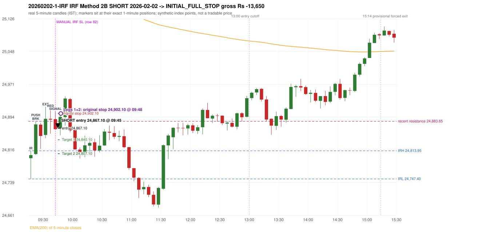

# Trading journal - 2026-02-02 (Monday)

> Automated, read-only reconstruction of the Phase 3.0 baseline. Synthetic NIFTY 50 index-point P&L (the index is not tradable). The owner's review status is intentionally blank.

## A. Trading day overview

| item | value |
|---|---|
| Date / weekday | 2026-02-02 / Monday |
| Session type | USABLE_WITH_FLAGS / VALID |
| Original session open (first 1-minute open) | 24,796.50 |
| Previous session | 2026-02-01 |
| Previous-day high / low | 25,439.45 / 24,575.10 |
| Previous-day official close / last 5-minute close | 24,825.45 / 24,768.00 |
| Raw engine records / confirmed signals / fully valid signals | 13 / 9 / 9 |
| Setups that did not complete (invalidated / incomplete) | 4 |
| Executed trades | 1 20260202-1-IRF |
| Gross P&L (Rs, synthetic) | -13,650.00 |
| Illustrative net P&L (Rs; Rs 500/trade + 0.5 pt/fill) | -14,540.00 |
| Day-end portfolio status | SECOND_TRADE_ELIGIBLE |
| Manual journal trades (matched / unmatched) | 1 (1 / 0) |
| Extra automated trades | 0 |

## B. Daily strategy signal timeline (confirmed signals, chronological)

| time | strategy | method | dir | entry-rule status | valid for execution | <= 13:00 | portfolio state | accepted / ignored | specific reason | competing (same minute) |
|---|---|---|---|---|---|---|---|---|---|---|
| 09:45 | IRF | Method 2B | SHORT | PROPOSAL_DEPENDENT | True | True | FIRST_TRADE_ACTIVE | ACCEPTED -> 20260202-1-IRF | first eligible signal of the day; trade 1: INITIAL_FULL_STOP |  |
| 10:05 | IRF | Method 2A | SHORT | PROPOSAL_DEPENDENT | True | True | SECOND_TRADE_ELIGIBLE | REJECTED | SECOND_TRADE_RESTRICTED_TO_PDR_PDS [blocked by IRF#1] |  |
| 10:10 | IRF | Method 1 | SHORT | PROPOSAL_DEPENDENT | True | True | SECOND_TRADE_ELIGIBLE | REJECTED | SECOND_TRADE_RESTRICTED_TO_PDR_PDS [blocked by IRF#1] |  |
| 10:45 | IRF | Method 2B | SHORT | PROPOSAL_DEPENDENT | True | True | SECOND_TRADE_ELIGIBLE | REJECTED | SECOND_TRADE_RESTRICTED_TO_PDR_PDS [blocked by IRF#1] |  |
| 11:00 | IRF | Method 1 | SHORT | PROPOSAL_DEPENDENT | True | True | SECOND_TRADE_ELIGIBLE | REJECTED | SECOND_TRADE_RESTRICTED_TO_PDR_PDS [blocked by IRF#1] |  |
| 12:05 | IRF | Method 2B | SHORT | PROPOSAL_DEPENDENT | True | True | SECOND_TRADE_ELIGIBLE | REJECTED | SECOND_TRADE_RESTRICTED_TO_PDR_PDS [blocked by IRF#1] |  |
| 12:35 | IRF | Method 2A | SHORT | PROPOSAL_DEPENDENT | True | True | SECOND_TRADE_ELIGIBLE | REJECTED | SECOND_TRADE_RESTRICTED_TO_PDR_PDS [blocked by IRF#1] |  |
| 14:00 | IRF | Method 2B | SHORT | PROPOSAL_DEPENDENT | True | False | SECOND_TRADE_ELIGIBLE | REJECTED | SECOND_TRADE_RESTRICTED_TO_PDR_PDS [blocked by IRF#1] |  |
| 14:35 | IRF | Method 2B | SHORT | PROPOSAL_DEPENDENT | True | False | SECOND_TRADE_ELIGIBLE | REJECTED | SECOND_TRADE_RESTRICTED_TO_PDR_PDS [blocked by IRF#1] |  |

Engine setups that did not complete (4); the complete list with failed rule ids is in `rejected_signals.csv`:

| candle | strategy | method | dir | status | precise reason | failed rules |
|---|---|---|---|---|---|---|
| 14:30 | IRF | Method 1/2 | SHORT | INCOMPLETE_AT_EOD | SESSION_ENDED_BEFORE_CONFIRMATION |  |
| 09:15 | ORB | Method 2 | SHORT | INVALIDATED | TRENDLINE_NOT_SUPPORTIVE | ORB-M2-SHORT-001 |
| 09:15 | PDS | Method 1/2/3 | SHORT | INVALIDATED | GAP_DOWN_OPEN_NOT_BELOW_ZONE | PDS-006 |
| 11:05 | RF | RF | LONG | INCOMPLETE_AT_EOD | NO_RETURN_INSIDE_BEFORE_SESSION_END |  |

## C. Detailed trade journals

### 20260202-1-IRF: IRF Method 2B SHORT (FIRST trade)

Chart: 

**Rule configuration:** CFG-baseline-be1db2a09d - signal verification status **PROPOSAL_DEPENDENT** (never VERIFIED while a rule rests on a proposal).

#### 1. Setup identification

IRF Method 2B SHORT: the 09:20-09:25 candle closed at 24,876.30, above IRH 24,813.95, and the next candle did not close back inside the range, so the setup is Method 2 and price stayed above it until the trigger. Extension candle 09:30-09:35, red candle 09:35-09:40. The trigger came 4 candles after the breakout candle: a red candle closed back below the first-push resistance after price had traded above it (09:40-09:45); confirmed at 09:45 with close 24,865.05. Entry reference close 24,865.05 is 51.10 points above IRH 24,813.95.

#### 2. Candle and indicator calculations

| role | session | candle | O | H | L | C | range | body % | upper wick % | lower wick % | direction | EMA(200) | strong bull / bear | pin bull / bear | small (body<=30%) | used for |
|---|---|---|---|---|---|---|---|---|---|---|---|---|---|---|---|---|
| initial_range_candle | TODAY | 09:15-09:20 | 24,796.50 | 24,813.95 | 24,747.40 | 24,803.70 | 66.55 | 10.82 | 15.40 | 73.78 | BULLISH | 25,200.03 | False / False | True / False | True | initial range = high/low of the 09:15 candle |
| signal_candle | TODAY | 09:40-09:45 | 24,888.70 | 24,907.20 | 24,864.70 | 24,865.05 | 42.50 | 55.65 | 43.53 | 0.82 | BEARISH | 25,184.11 | False / False | False / False | False | candle whose close completed the trigger |
| breakout_candle | TODAY | 09:20-09:25 | 24,806.35 | 24,883.65 | 24,803.90 | 24,876.30 | 79.75 | 87.71 | 9.22 | 3.07 | BULLISH | 25,196.81 | True / False | False / False | False | breakout candle: a completed candle closing above IRH |
| extension_candle | TODAY | 09:30-09:35 | 24,851.35 | 24,917.90 | 24,843.85 | 24,889.55 | 74.05 | 51.59 | 38.28 | 10.13 | BULLISH | 25,190.33 | False / False | False / False | False | extension: first later candle trading above the breakout candle's high |
| red_candle | TODAY | 09:35-09:40 | 24,889.60 | 24,914.10 | 24,854.40 | 24,887.75 | 59.70 | 3.10 | 41.04 | 55.86 | BEARISH | 25,187.31 | False / False | False / False | True | first red candle during the extension |
| first_push_top | TODAY | 09:20-09:25 | 24,806.35 | 24,883.65 | 24,803.90 | 24,876.30 | 79.75 | 87.71 | 9.22 | 3.07 | BULLISH | 25,196.81 | True / False | False / False | False | recent resistance = top of the first push after the breakout |

Every condition, with the rule, the calculation, the observed values and the result:

| # | group | rule | result | status / numeric definition | calculation | observed | required | available at | why it matters |
|---|---|---|---|---|---|---|---|---|---|
| 1 | SELECTION | SEL-FIRST-001 | PASS | USER_APPROVED / USER_APPROVED | earliest CONFIRMED signal of the day across IRF/ORB/PDR/PDS/RF that passed the controller's checks | 0 confirmed signal(s) earlier today; 9 confirmed signals in the day in total, this one at 09:45 | no earlier executable signal | 2026-02-02 09:45 | the shared controller trades only the first valid signal; the five strategies are not independent positions |
| 2 | SELECTION | SEL-TIE-001 | PASS | USER_APPROVED / USER_APPROVED | other CONFIRMED signals with exactly the same confirmation timestamp | none | no different-strategy / opposite-direction signal in the same minute (otherwise an unresolved conflict, no trade) | 2026-02-02 09:45 | an unresolved same-minute collision would have produced no trade at all |
| 3 | SELECTION | ENTRY-CUTOFF-001 | PASS | USER_APPROVED / USER_APPROVED | fill timestamp vs 13:00:00 IST | signal confirmed 09:45; fill 09:45 | fill at or before 13:00:00 IST | 2026-02-02 09:45 | no new position may be entered with a fill after 13:00 IST |
| 4 | SELECTION | EXE-FILL-001 | PASS | PROPOSED_FOR_REVIEW / PROPOSED_FOR_REVIEW | fill = open of the 1-minute bar that starts at the signal candle's end | bar 09:45 O 24,867.10 H 24,887.65 L 24,850.45 C 24,875.50; executable=True; entry 24,867.10 | fill bar exists, starts exactly at the signal end, is fillable; entry = its open | 2026-02-02 09:45 | a 5-minute signal is known only when its candle closes; the first price that can be traded is the next minute's open |
| 5 | SELECTION | DAY-MAX-001 | PASS | USER_APPROVED / USER_APPROVED | number of entries today | trade 1 of at most 2 | <= 2 entries per day | 2026-02-02 09:45 | daily trade cap |
| 6 | SETUP | IRF-GLOBAL-001 | PASS | SOURCE_VERIFIED / EXPLICIT_IN_SOURCE | initial range = high and low (wicks included) of the first completed 5-minute candle | 09:15-09:20 IRH 24,813.95, IRL 24,747.40 (range 66.55; engine recorded IRH 24,813.95, IRL 24,747.40) | high/low of the 09:15-09:20 candle | 2026-02-02 09:20 | all three IRF methods measure price against this range |
| 7 | SETUP | IRF-GLOBAL-003 | PASS | SOURCE_VERIFIED / EXPLICIT_IN_SOURCE | closes confirm, wicks do not: every trigger is evaluated on a completed 5-minute candle | trigger candle 09:40-09:45 was complete when the signal was stamped 09:45; decision uses its close 24,865.05 | completed candle close, not an intra-candle wick | 2026-02-02 09:45 | an intra-candle wick can reverse before the candle closes |
| 8 | SETUP | IRF-GLOBAL-002 | PASS | SOURCE_VERIFIED / EXPLICIT_IN_SOURCE | direction | SHORT (IRF trades short only) | short only | 2026-02-02 09:45 | IRF fades failed upside breakouts |
| 9 | SETUP | IRF-M2-001 | PASS | SOURCE_VERIFIED / EXPLICIT_IN_SOURCE | breakout candle close vs IRH | 09:20-09:25 O 24,806.35 H 24,883.65 L 24,803.90 C 24,876.30; range 79.75, body 69.95 (87.71%), upper wick 7.35 (9.22%), lower wick 2.45 (3.07%), bullish; close 24,876.30 is 62.35 points above IRH 24,813.95 | close > IRH (a wick above IRH is not a breakout) | 2026-02-02 09:25 | starts every IRF setup |
| 10 | SETUP | IRF-M2-004 | PASS | SOURCE_VERIFIED / EXPLICIT_IN_SOURCE | the candle after the breakout must NOT close back inside the range (else the setup is Method 1) | 09:25 close 24,849.05 vs [24,747.40, 24,813.95) | not (IRL <= close < IRH) | 2026-02-02 09:30 | separates Method 2 (price holds above) from Method 1 (immediate failure) |
| 11 | SETUP | IRF-M2-002 | PASS | SOURCE_VERIFIED / QUALITATIVE_SOURCE_NUMERIC_DEFINITION_PROPOSED_FOR_REVIEW | extension = a later candle whose high exceeds the breakout candle's high (research definition E1) | 09:30 high 24,917.90 vs breakout candle high 24,883.65 (+34.25) | high > breakout candle high | 2026-02-02 09:35 | the guide says price 'extends further upward'; the numeric test is a proposal |
| 12 | SETUP | IRF-M2-003 | PASS | SOURCE_VERIFIED / QUALITATIVE_SOURCE_NUMERIC_DEFINITION_PROPOSED_FOR_REVIEW | a red candle (close < open) forms after the extension | 09:35-09:40 O 24,889.60 H 24,914.10 L 24,854.40 C 24,887.75; range 59.70, body 1.85 (3.10%), upper wick 24.50 (41.04%), lower wick 33.35 (55.86%), bearish | close < open, at or after the candle following the extension | 2026-02-02 09:40 | the red candle shows the first pause/reversal inside the extension |
| 13 | CONFIRMATION | IRF-M2-005 | PASS | SOURCE_VERIFIED / EXPLICIT_IN_SOURCE | a red candle alone is not confirmation: a level break is required | red trigger candle 09:40 also closes below the resistance (see IRF-M2B-003) | a red candle plus a closing break of the level | 2026-02-02 09:45 | a red candle with no level break does not qualify |
| 14 | CONFIRMATION | IRF-M2B-001 | PASS | SOURCE_VERIFIED / QUALITATIVE_SOURCE_NUMERIC_DEFINITION_PROPOSED_FOR_REVIEW | recent resistance = first 3-candle fractal high (k=1) at/after the breakout candle (FIRST_PUSH_TOP) | 09:20 high 24,883.65; engine recorded 24,883.65 (the first push top IS the breakout candle itself) | first push top | 2026-02-02 09:30 | the level whose retake-and-fail completes Method 2B (definition is a proposal) |
| 15 | CONFIRMATION | IRF-M2B-002 | PASS | SOURCE_VERIFIED / QUALITATIVE_SOURCE_NUMERIC_DEFINITION_PROPOSED_FOR_REVIEW | price trades back above the resistance after the first push | first candle with high above 24,883.65: 09:30 high 24,917.90 | some candle after the first push has high > resistance (the push may be the trigger candle: m2b_push_must_precede_red_candle = False) | 2026-02-02 09:45 | the guide's figure shows three separate candles; the engine also accepts a single candle |
| 16 | CONFIRMATION | IRF-M2B-003 | PASS | SOURCE_VERIFIED / EXPLICIT_IN_SOURCE | trigger = a red candle closing back below the resistance | 09:40-09:45 O 24,888.70 H 24,907.20 L 24,864.70 C 24,865.05; range 42.50, body 23.65 (55.65%), upper wick 18.50 (43.53%), lower wick 0.35 (0.82%), bearish; close 24,865.05 vs resistance 24,883.65 | red candle and close < resistance | 2026-02-02 09:45 | completes Method 2B |
| 17 | EXECUTION | EXE-STOP-001 | PASS | USER_APPROVED / USER_APPROVED | initial stop = entry + 35 points | entry 24,867.10 -> stop 24,902.10 | stop 35 index points (BASELINE) | 2026-02-02 09:45 | defines the loss if the setup fails before Target 1 |
| 18 | EXECUTION | EXE-T1-001 | PASS | SOURCE_VERIFIED / EXPLICIT_IN_SOURCE | Target 1 = entry +/- 27 points | T1 24,840.10 | 27 points | 2026-02-02 09:45 | Leg 1 (3 lots) is booked at Target 1 |
| 19 | EXECUTION | IRF-TGT-001 | PASS | SOURCE_VERIFIED / EXPLICIT_IN_SOURCE | Target 2 = entry +/- 60 points | T2 24,807.10 | 60 points | 2026-02-02 09:45 | Leg 2 (3 lots) is booked at Target 2 |
| 20 | EXECUTION | POST-T1-STOP-006 | PASS | USER_APPROVED / USER_APPROVED | after T1 the Leg-2 stop = entry + 6 (no trailing) | post-T1 stop 24,873.10 | entry -6 (LONG) / +6 (SHORT) | 2026-02-02 09:45 | protects the remaining three lots once the first three are booked |
| 21 | EXECUTION | SIZE-LOT-001 | PASS | USER_APPROVED / USER_APPROVED | 6 lots x 65 = 390, Leg 1 = 3 lots = 195, Leg 2 = 195 | 6 lots, lot size 65, legs 3+3 | 6 lots in two equal legs | 2026-02-02 09:45 | position size for the synthetic P&L |
| 22 | NOTE | IRF-M2-006 | UNRESOLVED | UNRESOLVED / UNRESOLVED | delay between the breakout candle and this trigger; expiry rule | 4 candles after the breakout; expiry none configured | the source states no expiry | 2026-02-02 09:45 | an old breakout can still trigger hours later |
| 23 | NOTE | IRF-M2-006 | UNRESOLVED | UNRESOLVED / UNRESOLVED | did price stay above IRH between the breakout and the trigger? | 0 closes at or below IRH between 09:25 and 09:40; trigger close 24,865.05 above IRH 24,813.95 | the engine does not require price to stay above IRH | 2026-02-02 09:45 | the guide describes price 'holding above IRH and keeping rising'; the code only needs the level break |
| 24 | NOTE | IRF-GLOBAL-004 | UNRESOLVED | UNRESOLVED / UNRESOLVED | which close above IRH of the session produced this attempt; repeat setups | this breakout is upward crossing no. 1 of the session (a close above IRH after a close at/below it) | the source states no first-breakout-only, re-arming, expiry or trades-per-day rule | 2026-02-02 09:45 | IRF re-arms on every later breakout in the code, producing many raw setups; the controller keeps only the first |
| 25 | NOTE | NOTE-IRF-REPEATED-SETUPS | NOT_APPLICABLE | NOT_A_RULE / NOT_A_REGISTRY_RULE | other IRF signals later in the session (not traded) | 8 further confirmed IRF signal(s): Method 2A@10:05, Method 1@10:10, Method 2B@10:45, Method 1@11:00, Method 2B@12:05, Method 2A@12:35, Method 2B@14:00, Method 2B@14:35 | disclosure of repeated raw setups | 2026-02-02 09:45 | repeated raw IRF setups are not hidden; they are logged as ignored |
| 26 | NOTE | IRF-SL-001 | NOT_APPLICABLE | SOURCE_VERIFIED / QUALITATIVE_SOURCE_NUMERIC_DEFINITION_PROPOSED_FOR_REVIEW | the guide's 35-or-40 rule: 35 if the most recent green candle's high is within 35 points of entry, else 40 | most recent green candle high 24,917.90 is 50.80 points from the entry 24,867.10: the guide's rule would select 40 points; the baseline applies a fixed 35 (USER_APPROVED research baseline; the 35-vs-40 selection and the 40-point variant are separate labelled scenarios) | source selection rule | 2026-02-02 09:45 | the stop distance is a modelling choice and changes losses, not entries |
| 27 | NOTE | NOTE-UNRESOLVED-DEPENDENCIES | UNRESOLVED | NOT_A_RULE / NOT_A_REGISTRY_RULE | rules the signal depends on that the sources leave unresolved | engine-recorded unresolved rule ids: IRF-GLOBAL-004; verification status PROPOSAL_DEPENDENT | n/a (disclosure) | 2026-02-02 09:45 | the entry is only as verified as the rules it rests on |

#### 3. Entry decision and explanation

IRF Method 2B SHORT: the 09:20-09:25 candle closed at 24,876.30, above IRH 24,813.95, and the next candle did not close back inside the range, so the setup is Method 2 and price stayed above it until the trigger. Extension candle 09:30-09:35, red candle 09:35-09:40. The trigger came 4 candles after the breakout candle: a red candle closed back below the first-push resistance after price had traded above it (09:40-09:45); confirmed at 09:45 with close 24,865.05. Entry reference close 24,865.05 is 51.10 points above IRH 24,813.95.

**Why this trade ahead of the other strategies:** This IRF Method 2B signal was the earliest executable signal of the day: 0 confirmed signal(s) earlier, 0 other in the same minute. 8 later confirmed signal(s) (IRF x8) are logged as ignored or rejected. State of the other four engines at that moment: [ORB: Method 2 invalidated at 09:15: TRENDLINE_NOT_SUPPORTIVE] [PDR: no setup record before this time (a base condition was not met, or nothing triggered)] [PDS: Method 1/2/3 invalidated at 09:15: GAP_DOWN_OPEN_NOT_BELOW_ZONE] [RF: no setup record before this time (a base condition was not met, or nothing triggered)]

#### 4. Actual entry execution

| item | value |
|---|---|
| Signal candle | 09:40-09:45 |
| Signal confirmed | 2026-02-02 09:45 |
| Fill timestamp | 2026-02-02 09:45 |
| Entry price | 24,867.10 |
| Source partition / 1-minute bar | data/processed/nifty50/year=2026/month=02/candles.parquet / 2026-02-02 09:45 |
| Source bar O / H / L / C | 24,867.10 / 24,887.65 / 24,850.45 / 24,875.50 |
| Fill assumption | open of the 1-minute bar starting at the signal candle's end (EXE-FILL-001, PROPOSED causal convention) |
| Initial stop / T1 / T2 / post-T1 stop | 24,902.10 / 24,840.10 / 24,807.10 / 24,873.10 |
| Position | 6 lots x 65 = 390 units (Leg 1 195, Leg 2 195) |

#### 5-8. Trade progress, Target 1, post-T1 stop and final exit

Between the 09:45 entry bar and the final exit (4 one-minute bars) the best excursion in favour was 16.65 points at 09:45 and the worst against was 40.10 points at 09:48. At 09:48 price reached the original stop 24,902.10 before Target 1 24,840.10, so all six lots exited together at 24,902.10. This is an INITIAL_FULL_STOP: one more trade is allowed that day, only a newly confirmed PDR/PDS signal.

| leg | qty | exit time | exit price | reason | source 1-minute bar | O / H / L / C | gross points | gross Rs | slippage pts | flags |
|---|---|---|---|---|---|---|---|---|---|---|
| 1 | 195 | 09:48 | 24,902.10 | ORIGINAL_STOP_BEFORE_T1 | 09:48 | 24,884.45 / 24,907.20 / 24,884.45 / 24,905.95 | -35.00 | -6,825.00 | 0.00 |  |
| 2 | 195 | 09:48 | 24,902.10 | ORIGINAL_STOP_BEFORE_T1 | 09:48 | 24,884.45 / 24,907.20 / 24,884.45 / 24,905.95 | -35.00 | -6,825.00 | 0.00 |  |

Exit evidence per leg:

* Leg 1: 1-minute bar 09:48 O 24,884.45 H 24,907.20 L 24,884.45 C 24,905.95: high 24,907.20 reached the original stop 24,902.10 before Target 1 24,840.10 was touched; both legs exit at the stop level 24,902.10
* Leg 2: 1-minute bar 09:48 O 24,884.45 H 24,907.20 L 24,884.45 C 24,905.95: high 24,907.20 reached the original stop 24,902.10 before Target 1 24,840.10 was touched; both legs exit at the stop level 24,902.10

#### 9. Gross and illustrative net P&L

| item | value (Rs) |
|---|---|
| Leg 1 gross | -6,825.00 |
| Leg 2 gross | -6,825.00 |
| Trade gross (= Leg 1 + Leg 2) | -13,650.00 |
| Illustrative fixed cost | -500.00 |
| Illustrative slippage (0.5 pt on every fill, entry + exits, all units) | -390.00 |
| Illustrative net | -14,540.00 |

#### 10. Manual journal comparison

EXACT_MATCH: manual IRF labelled 09:40 (candle start) vs automated IRF Method 2B SHORT candle 09:40, filled 09:45 at 24,867.10; time difference 0 minutes. Journal outcome SL vs automated INITIAL_FULL_STOP (same outcome class). The journal records no entry or exit price.

## D. Manual journal comparison

| comparison | journal row | journal strategy | manual time | manual direction | manual outcome | match class | trade | auto entry | auto outcome | explanation |
|---|---|---|---|---|---|---|---|---|---|---|
| M082 | 82 | IRF | 09:40 | SHORT | SL | EXACT_MATCH | 20260202-1-IRF | 09:45 @ 24,867.10 | INITIAL_FULL_STOP | EXACT_MATCH: manual IRF labelled 09:40 (candle start) vs automated IRF Method 2B SHORT candle 09:40, filled 09:45 at 24,867.10; time difference 0 minutes. Journal outcome SL vs automated INITIAL_FULL_STOP (same outcome class). The journal records no entry or exit price. |

The journal records no entry price and no exit price (NOT_RECORDED); matching uses date, strategy and candle start only - never P&L.

## E. Daily conclusion

* **Traded:** 20260202-1-IRF - IRF Method 2B SHORT at 09:45 (entry 24,867.10), outcome INITIAL_FULL_STOP, gross Rs -13,650.00, illustrative net Rs -14,540.00. **Why:** This IRF Method 2B signal was the earliest executable signal of the day: 0 confirmed signal(s) earlier, 0 other in the same minute. 8 later confirmed signal(s) (IRF x8) are logged as ignored or rejected. State of the other four engines at that moment: [ORB: Method 2 invalidated at 09:15: TRENDLINE_NOT_SUPPORTIVE] [PDR: no setup record before this time (a base condition was not met, or nothing triggered)] [PDS: Method 1/2/3 invalidated at 09:15: GAP_DOWN_OPEN_NOT_BELOW_ZONE] [RF: no setup record before this time (a base condition was not met, or nothing triggered)] **How it ended:** At 09:48 price reached the original stop 24,902.10 before Target 1 24,840.10, so all six lots exited together at 24,902.10. This is an INITIAL_FULL_STOP: one more trade is allowed that day, only a newly confirmed PDR/PDS signal.
* **Ignored / rejected signals:** IRF REJECTED SECOND_TRADE_RESTRICTED_TO_PDR_PDS x8
* **Open strategy-definition issues that affected this day:** IRF-GLOBAL-004 (NOT STATED: how many IRF trades per day, a latest entry time, and whether a new breakout may re-arm a setup after a signal), IRF-M2-006 (How long a Method 2 setup stays valid (expiry / invalidation before a level breaks) is not stated), NOTE-UNRESOLVED-DEPENDENCIES
* **Automated triage (not an approval; the owner's review status stays blank):** MATCHED_EXACT_NO_FLAGS
