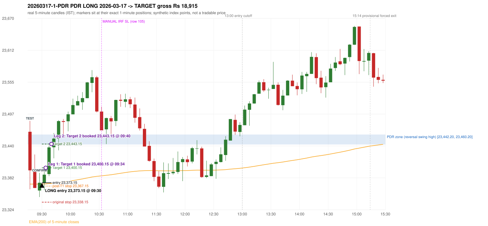

# Trading journal - 2026-03-17 (Tuesday)

> Automated, read-only reconstruction of the Phase 3.0 baseline. Synthetic NIFTY 50 index-point P&L (the index is not tradable). The owner's review status is intentionally blank.

## A. Trading day overview

| item | value |
|---|---|
| Date / weekday | 2026-03-17 / Tuesday |
| Session type | USABLE / VALID |
| Original session open (first 1-minute open) | 23,465.25 |
| Previous session | 2026-03-16 |
| Previous-day high / low | 23,502.00 / 22,955.55 |
| Previous-day official close / last 5-minute close | 23,408.80 / 23,355.60 |
| Raw engine records / confirmed signals / fully valid signals | 18 / 17 / 17 |
| Setups that did not complete (invalidated / incomplete) | 1 |
| Executed trades | 1 20260317-1-PDR |
| Gross P&L (Rs, synthetic) | 18,915.00 |
| Illustrative net P&L (Rs; Rs 500/trade + 0.5 pt/fill) | 18,025.00 |
| Day-end portfolio status | DAY_FINISHED |
| Manual journal trades (matched / unmatched) | 1 (0 / 1) |
| Extra automated trades | 1 |

## B. Daily strategy signal timeline (confirmed signals, chronological)

| time | strategy | method | dir | entry-rule status | valid for execution | <= 13:00 | portfolio state | accepted / ignored | specific reason | competing (same minute) |
|---|---|---|---|---|---|---|---|---|---|---|
| 09:30 | PDR | PDR | LONG | PROPOSAL_DEPENDENT | True | True | FIRST_TRADE_ACTIVE | ACCEPTED -> 20260317-1-PDR | first eligible signal of the day; trade 1: TARGET |  |
| 09:50 | PDR | PDR | LONG | PROPOSAL_DEPENDENT | True | True | DAY_FINISHED | IGNORED | DAY_FINISHED [blocked by PDR#1] |  |
| 10:00 | PDR | PDR | LONG | PROPOSAL_DEPENDENT | True | True | DAY_FINISHED | IGNORED | DAY_FINISHED [blocked by PDR#1] |  |
| 10:35 | IRF | Method 1 | SHORT | PROPOSAL_DEPENDENT | True | True | DAY_FINISHED | IGNORED | DAY_FINISHED [blocked by PDR#1] | IRF Method 2A SHORT |
| 10:35 | IRF | Method 2A | SHORT | PROPOSAL_DEPENDENT | True | True | DAY_FINISHED | IGNORED | DAY_FINISHED [blocked by PDR#1] | IRF Method 1 SHORT |
| 10:45 | IRF | Method 1 | SHORT | PROPOSAL_DEPENDENT | True | True | DAY_FINISHED | IGNORED | DAY_FINISHED [blocked by PDR#1] |  |
| 10:50 | PDR | PDR | LONG | PROPOSAL_DEPENDENT | True | True | DAY_FINISHED | IGNORED | DAY_FINISHED [blocked by PDR#1] |  |
| 11:15 | IRF | Method 1 | SHORT | PROPOSAL_DEPENDENT | True | True | DAY_FINISHED | IGNORED | DAY_FINISHED [blocked by PDR#1] |  |
| 11:40 | PDR | PDR | LONG | PROPOSAL_DEPENDENT | True | True | DAY_FINISHED | IGNORED | DAY_FINISHED [blocked by PDR#1] |  |
| 12:25 | PDR | PDR | LONG | PROPOSAL_DEPENDENT | True | True | DAY_FINISHED | IGNORED | DAY_FINISHED [blocked by PDR#1] |  |
| 12:50 | PDR | PDR | LONG | PROPOSAL_DEPENDENT | True | True | DAY_FINISHED | IGNORED | DAY_FINISHED [blocked by PDR#1] |  |
| 12:55 | IRF | Method 1 | SHORT | PROPOSAL_DEPENDENT | True | True | DAY_FINISHED | IGNORED | DAY_FINISHED [blocked by PDR#1] |  |
| 13:00 | PDR | PDR | LONG | PROPOSAL_DEPENDENT | True | True | DAY_FINISHED | IGNORED | DAY_FINISHED [blocked by PDR#1] |  |
| 13:40 | IRF | Method 2A | SHORT | PROPOSAL_DEPENDENT | True | False | DAY_FINISHED | IGNORED | DAY_FINISHED [blocked by PDR#1] | IRF Method 2B SHORT |
| 13:40 | IRF | Method 2B | SHORT | PROPOSAL_DEPENDENT | True | False | DAY_FINISHED | IGNORED | DAY_FINISHED [blocked by PDR#1] | IRF Method 2A SHORT |
| 14:20 | IRF | Method 2B | SHORT | PROPOSAL_DEPENDENT | True | False | DAY_FINISHED | IGNORED | DAY_FINISHED [blocked by PDR#1] |  |
| 15:05 | IRF | Method 2B | SHORT | PROPOSAL_DEPENDENT | True | False | DAY_FINISHED | IGNORED | DAY_FINISHED [blocked by PDR#1] |  |

Engine setups that did not complete (1); the complete list with failed rule ids is in `rejected_signals.csv`:

| candle | strategy | method | dir | status | precise reason | failed rules |
|---|---|---|---|---|---|---|
| 15:00 | IRF | Method 1/2 | SHORT | INCOMPLETE_AT_EOD | SESSION_ENDED_BEFORE_CONFIRMATION |  |

## C. Detailed trade journals

### 20260317-1-PDR: PDR LONG (FIRST trade)

Chart: 

**Rule configuration:** CFG-baseline-be1db2a09d - signal verification status **PROPOSAL_DEPENDENT** (never VERIFIED while a rule rests on a proposal).

#### 1. Setup identification

PDR LONG: the session opened 56.45 points above the previous close and 5.05 points above the resistance zone [23,442.20, 23,460.20] taken from the 15:10 swing-high candle of 2026-03-16. The 09:15 candle (23,361.35 - 23,484.80) traded through the zone and closed at 23,395.55, 46.65 points BELOW its floor, and the 09:25 candle closed green at 23,373.20, confirming the entry at 09:30. The engine does not check that the zone held (confirmation close BELOW the zone floor).

#### 2. Candle and indicator calculations

| role | session | candle | O | H | L | C | range | body % | upper wick % | lower wick % | direction | EMA(200) | strong bull / bear | pin bull / bear | small (body<=30%) | used for |
|---|---|---|---|---|---|---|---|---|---|---|---|---|---|---|---|---|
| zone_source_candle | PREVIOUS | 15:10-15:15 | 23,442.20 | 23,460.20 | 23,418.25 | 23,435.25 | 41.95 | 16.57 | 42.91 | 40.52 | BEARISH | 23,370.81 | False / False | False / False | True | swing-high candle that defines the zone (B_SWING_HIGH_REVERSAL) |
| prev_day_high_candle | PREVIOUS | 14:50-14:55 | 23,456.25 | 23,502.00 | 23,435.10 | 23,458.15 | 66.90 | 2.84 | 65.55 | 31.61 | BULLISH | 23,368.28 | False / False | False / False | True | candle of the previous session's absolute high (for comparison) |
| interaction_candle | TODAY | 09:15-09:20 | 23,465.25 | 23,484.80 | 23,361.35 | 23,395.55 | 123.45 | 56.46 | 15.84 | 27.70 | BEARISH | 23,370.79 | False / False | False / False | False | first candle whose range intersects the zone |
| confirmation_candle | TODAY | 09:25-09:30 | 23,359.15 | 23,391.05 | 23,347.40 | 23,373.20 | 43.65 | 32.19 | 40.89 | 26.92 | BULLISH | 23,370.75 | False / False | False / False | False | first green candle after the interaction candle |

Every condition, with the rule, the calculation, the observed values and the result:

| # | group | rule | result | status / numeric definition | calculation | observed | required | available at | why it matters |
|---|---|---|---|---|---|---|---|---|---|
| 1 | SELECTION | SEL-FIRST-001 | PASS | USER_APPROVED / USER_APPROVED | earliest CONFIRMED signal of the day across IRF/ORB/PDR/PDS/RF that passed the controller's checks | 0 confirmed signal(s) earlier today; 17 confirmed signals in the day in total, this one at 09:30 | no earlier executable signal | 2026-03-17 09:30 | the shared controller trades only the first valid signal; the five strategies are not independent positions |
| 2 | SELECTION | SEL-TIE-001 | PASS | USER_APPROVED / USER_APPROVED | other CONFIRMED signals with exactly the same confirmation timestamp | none | no different-strategy / opposite-direction signal in the same minute (otherwise an unresolved conflict, no trade) | 2026-03-17 09:30 | an unresolved same-minute collision would have produced no trade at all |
| 3 | SELECTION | ENTRY-CUTOFF-001 | PASS | USER_APPROVED / USER_APPROVED | fill timestamp vs 13:00:00 IST | signal confirmed 09:30; fill 09:30 | fill at or before 13:00:00 IST | 2026-03-17 09:30 | no new position may be entered with a fill after 13:00 IST |
| 4 | SELECTION | EXE-FILL-001 | PASS | PROPOSED_FOR_REVIEW / PROPOSED_FOR_REVIEW | fill = open of the 1-minute bar that starts at the signal candle's end | bar 09:30 O 23,373.15 H 23,390.10 L 23,362.15 C 23,367.70; executable=True; entry 23,373.15 | fill bar exists, starts exactly at the signal end, is fillable; entry = its open | 2026-03-17 09:30 | a 5-minute signal is known only when its candle closes; the first price that can be traded is the next minute's open |
| 5 | SELECTION | DAY-MAX-001 | PASS | USER_APPROVED / USER_APPROVED | number of entries today | trade 1 of at most 2 | <= 2 entries per day | 2026-03-17 09:30 | daily trade cap |
| 6 | SETUP | PDR-004 | PASS | SOURCE_VERIFIED / EXPLICIT_WORDING_DETAIL_PROPOSED_FOR_REVIEW | gap = first 1-minute open of today - previous session's OFFICIAL close | today's open 23,465.25 (first 1-minute bar 09:15) - previous close 23,408.80 (DAILY_VENDOR, 2026-03-16) = +56.45 points -> gap UP | gap UP (more than 0 points) | 2026-03-17 09:15 | approved convention: the original first-minute open, never the vendor daily open |
| 7 | SETUP | PDR-011 | PASS | SOURCE_VERIFIED / QUALITATIVE_SOURCE_NUMERIC_DEFINITION_PROPOSED_FOR_REVIEW | open relative to the zone (ABOVE_ZONE) | today's open 23,465.25 vs zone high 23,460.20: 5.05 points above | open > zone high | 2026-03-17 09:15 | the guide has price 'pull back into the zone', so the gap-up open is above it; this exclusion is a proposal |
| 8 | ZONE | PDR-001 | PASS | SOURCE_VERIFIED / EXPLICIT_IN_SOURCE | direction | LONG (PDR is long only) | long-only | 2026-03-17 09:30 | PDR buys a retest of previous-day resistance after a gap up |
| 9 | ZONE | PDR-002 | PASS | SOURCE_VERIFIED / QUALITATIVE_SOURCE_NUMERIC_DEFINITION_PROPOSED_FOR_REVIEW | zone = [body top, wick high] of the latest confirmed swing high (k=2) that has a red candle among the peak and the next 2 candles (method B_SWING_HIGH_REVERSAL) | zone [23,442.20, 23,460.20] from the 15:10 candle of 2026-03-16 (body top 23,442.20, wick high 23,460.20; 15:10-15:15 O 23,442.20 H 23,460.20 L 23,418.25 C 23,435.25; range 41.95, body 6.95 (16.57%), upper wick 18.00 (42.91%), lower wick 17.00 (40.52%), bearish); engine recorded [23,442.20, 23,460.20]. Previous session's absolute high 23,502.00 (candle 14:50) - the zone is NOT the day high (distance 41.80 points). Swing confirmed once candle 15:20 closed. | previous-day high where price peaked and reversed | 2026-03-16 15:25 | the source says 'previous day's high/reversal'; which candle marks the zone is an owner-approved research candidate, not a source rule |
| 10 | ZONE | PDR-003 | PASS | SOURCE_VERIFIED / EXPLICIT_IN_SOURCE | the zone is an area, not a single price | zone height 18.00 points [23,442.20, 23,460.20] | a rectangle with positive height | 2026-03-16 15:25 | price may touch any part of the area |
| 11 | ZONE | PDR-010 | UNRESOLVED | SOURCE_VERIFIED / QUALITATIVE_SOURCE_NUMERIC_DEFINITION_PROPOSED_FOR_REVIEW | reversal-quality filter ('clear high and reversal identified') | filter setting OFF | checklist item: a clear previous-day high and reversal | 2026-03-16 | the engine does not test reversal depth in the baseline (filter OFF) |
| 12 | CONFIRMATION | PDR-006 | PASS | SOURCE_VERIFIED / QUALITATIVE_SOURCE_NUMERIC_DEFINITION_PROPOSED_FOR_REVIEW | the first candle whose [low, high] intersects the zone (+/- proximity) | 09:15-09:20 O 23,465.25 H 23,484.80 L 23,361.35 C 23,395.55; range 123.45, body 69.70 (56.46%), upper wick 19.55 (15.84%), lower wick 34.20 (27.70%), bearish; low 23,361.35 vs zone high 23,460.20 (98.85 points inside/below the zone top), high 23,484.80 vs zone low 23,442.20; proximity 0 | range intersects the zone | 2026-03-17 09:20 | the retest of the previous-day resistance |
| 13 | CONFIRMATION | PDR-007 | PASS | SOURCE_VERIFIED / QUALITATIVE_SOURCE_NUMERIC_DEFINITION_PROPOSED_FOR_REVIEW | the first GREEN candle after the interaction candle | 09:25-09:30 O 23,359.15 H 23,391.05 L 23,347.40 C 23,373.20; range 43.65, body 14.05 (32.19%), upper wick 17.85 (40.89%), lower wick 11.75 (26.92%), bullish; interaction candle 09:15, confirmation candle 09:25 | close > open, strictly after the interaction candle | 2026-03-17 09:30 | the guide asks for 'a green candle' after the test; it gives no size or position test |
| 14 | CONFIRMATION | PDR-005 | PASS | SOURCE_VERIFIED / EXPLICIT_IN_SOURCE | no entry at the open: price must first come back toward the zone | interaction candle 09:15 (candle no. 1 of the session) precedes the entry candle 09:25; fill 09:30 | interaction before the entry; fill after 09:20 | 2026-03-17 09:30 | if price keeps rising without returning to the zone there is no setup |
| 15 | EXECUTION | EXE-STOP-001 | PASS | USER_APPROVED / USER_APPROVED | initial stop = entry - 35 points | entry 23,373.15 -> stop 23,338.15 | stop 35 index points (BASELINE) | 2026-03-17 09:30 | defines the loss if the setup fails before Target 1 |
| 16 | EXECUTION | EXE-T1-001 | PASS | SOURCE_VERIFIED / EXPLICIT_IN_SOURCE | Target 1 = entry +/- 27 points | T1 23,400.15 | 27 points | 2026-03-17 09:30 | Leg 1 (3 lots) is booked at Target 1 |
| 17 | EXECUTION | PDR-008 | PASS | SOURCE_VERIFIED / EXPLICIT_IN_SOURCE | Target 2 = entry +/- 70 points | T2 23,443.15 (the guide says 70; the performance report's winners suggest 60 - CONFLICTING, recorded) | 70 points | 2026-03-17 09:30 | Leg 2 (3 lots) is booked at Target 2 |
| 18 | EXECUTION | POST-T1-STOP-006 | PASS | USER_APPROVED / USER_APPROVED | after T1 the Leg-2 stop = entry - 6 (no trailing) | post-T1 stop 23,367.15 | entry -6 (LONG) / +6 (SHORT) | 2026-03-17 09:30 | protects the remaining three lots once the first three are booked |
| 19 | EXECUTION | SIZE-LOT-001 | PASS | USER_APPROVED / USER_APPROVED | 6 lots x 65 = 390, Leg 1 = 3 lots = 195, Leg 2 = 195 | 6 lots, lot size 65, legs 3+3 | 6 lots in two equal legs | 2026-03-17 09:30 | position size for the synthetic P&L |
| 20 | NOTE | PDR-007 | UNRESOLVED | SOURCE_VERIFIED / QUALITATIVE_SOURCE_NUMERIC_DEFINITION_PROPOSED_FOR_REVIEW | did the zone hold? (is the confirmation candle's close back at/above the zone floor?) | confirmation close 23,373.20 vs zone floor 23,442.20 / top 23,460.20: BELOW the zone floor by 69.00; interaction low 23,361.35 | the engine does NOT test that resistance-turned-support held | 2026-03-17 09:30 | a later green candle is accepted even after price traded through the zone; a human would normally check the hold (here the close is below the zone floor) |
| 21 | NOTE | PDR-012 | NOT_APPLICABLE | PROPOSED_FOR_REVIEW / PROPOSED_FOR_REVIEW | repeated PDR signals today | 8 confirmed PDR signal(s) in the session | n/a (disclosure) | 2026-03-17 09:30 | the per-session cap is lifted for the controller runs; the controller trades only the first |
| 22 | NOTE | PDR-009 | UNRESOLVED | UNRESOLVED / UNRESOLVED | stop 35 or 40 'depending on the situation' | the guide gives no selection rule; baseline fixed 35 points | unresolved in the source | 2026-03-17 09:30 | PDR stop selection is left to the owner |
| 23 | NOTE | NOTE-UNRESOLVED-DEPENDENCIES | UNRESOLVED | NOT_A_RULE / NOT_A_REGISTRY_RULE | rules the signal depends on that the sources leave unresolved | engine-recorded unresolved rule ids: PDR-010; verification status PROPOSAL_DEPENDENT | n/a (disclosure) | 2026-03-17 09:30 | the entry is only as verified as the rules it rests on |

#### 3. Entry decision and explanation

PDR LONG: the session opened 56.45 points above the previous close and 5.05 points above the resistance zone [23,442.20, 23,460.20] taken from the 15:10 swing-high candle of 2026-03-16. The 09:15 candle (23,361.35 - 23,484.80) traded through the zone and closed at 23,395.55, 46.65 points BELOW its floor, and the 09:25 candle closed green at 23,373.20, confirming the entry at 09:30. The engine does not check that the zone held (confirmation close BELOW the zone floor).

**Why this trade ahead of the other strategies:** This PDR signal was the earliest executable signal of the day: 0 confirmed signal(s) earlier, 0 other in the same minute. 16 later confirmed signal(s) (IRF x9, PDR x7) are logged as ignored or rejected. State of the other four engines at that moment: [IRF: no setup record before this time (a base condition was not met, or nothing triggered)] [ORB: no setup record before this time (a base condition was not met, or nothing triggered)] [PDS: no setup record before this time (a base condition was not met, or nothing triggered)] [RF: no setup record before this time (a base condition was not met, or nothing triggered)]

#### 4. Actual entry execution

| item | value |
|---|---|
| Signal candle | 09:25-09:30 |
| Signal confirmed | 2026-03-17 09:30 |
| Fill timestamp | 2026-03-17 09:30 |
| Entry price | 23,373.15 |
| Source partition / 1-minute bar | data/processed/nifty50/year=2026/month=03/candles.parquet / 2026-03-17 09:30 |
| Source bar O / H / L / C | 23,373.15 / 23,390.10 / 23,362.15 / 23,367.70 |
| Fill assumption | open of the 1-minute bar starting at the signal candle's end (EXE-FILL-001, PROPOSED causal convention) |
| Initial stop / T1 / T2 / post-T1 stop | 23,338.15 / 23,400.15 / 23,443.15 / 23,367.15 |
| Position | 6 lots x 65 = 390 units (Leg 1 195, Leg 2 195) |

#### 5-8. Trade progress, Target 1, post-T1 stop and final exit

Between the 09:30 entry bar and the final exit (11 one-minute bars) the best excursion in favour was 89.75 points at 09:40 and the worst against was 13.65 points at 09:31. At 09:34 price reached Target 1 23,400.15 and three lots exited. At 09:34 the remaining three lots' protective stop was set to 23,367.15 (entry - 6; no trailing, no further change); the engine applies it from the Target-1 bar onward and tests it within that same bar. At 09:40 price reached Target 2 23,443.15 and the remaining three lots exited. No further trade that day (DAY-T2-001).

| leg | qty | exit time | exit price | reason | source 1-minute bar | O / H / L / C | gross points | gross Rs | slippage pts | flags |
|---|---|---|---|---|---|---|---|---|---|---|
| 1 | 195 | 09:34 | 23,400.15 | TARGET_1 | 09:34 | 23,392.80 / 23,402.85 / 23,387.80 / 23,387.80 | 27.00 | 5,265.00 | 0.00 |  |
| 2 | 195 | 09:40 | 23,443.15 | TARGET_2 | 09:40 | 23,437.25 / 23,462.90 / 23,436.75 / 23,457.30 | 70.00 | 13,650.00 | 0.00 |  |

Exit evidence per leg:

* Leg 1: 1-minute bar 09:34 O 23,392.80 H 23,402.85 L 23,387.80 C 23,387.80: high 23,402.85 reached Target 1 23,400.15; Leg 1 booked at the target level
* Leg 2: 1-minute bar 09:40 O 23,437.25 H 23,462.90 L 23,436.75 C 23,457.30: high 23,462.90 reached Target 2 23,443.15; Leg 2 booked at the target level

#### 9. Gross and illustrative net P&L

| item | value (Rs) |
|---|---|
| Leg 1 gross | 5,265.00 |
| Leg 2 gross | 13,650.00 |
| Trade gross (= Leg 1 + Leg 2) | 18,915.00 |
| Illustrative fixed cost | -500.00 |
| Illustrative slippage (0.5 pt on every fill, entry + exits, all units) | -390.00 |
| Illustrative net | 18,025.00 |

#### 10. Manual journal comparison

EXTRA_AUTOMATED_TRADE: the automated system took PDR PDR LONG at 09:30 (manual traded only other strategies: IRF 10:30 SL). The setup rests on: PDR-010: Reversal-quality filter is OFF in the baseline | PDR-007: Engine does not test whether the zone held | PDR-009: PDR stop selection rule is not defined | NOTE-UNRESOLVED-DEPENDENCIES: Disclosure of unresolved source rules behind this signal. The journal shows no corresponding entry.

## D. Manual journal comparison

| comparison | journal row | journal strategy | manual time | manual direction | manual outcome | match class | trade | auto entry | auto outcome | explanation |
|---|---|---|---|---|---|---|---|---|---|---|
| M105 | 105 | IRF | 10:30 | SHORT | SL | SIGNAL_REJECTED_BY_PORTFOLIO_CONTROLLER |  |  |  | SIGNAL_REJECTED_BY_PORTFOLIO_CONTROLLER: RAW_CONFIRMED_SIGNAL Method 1 10:35 -> IGNORED - DAY_FINISHED. Heuristic primary cause: PORTFOLIO_COMPETITION; blocked by: PDR#1 |
| E074 |  |  |  |  |  | EXTRA_AUTOMATED_TRADE | 20260317-1-PDR | 09:30 @ 23,373.15 | TARGET | EXTRA_AUTOMATED_TRADE: the automated system took PDR PDR LONG at 09:30 (manual traded only other strategies: IRF 10:30 SL). The setup rests on: PDR-010: Reversal-quality filter is OFF in the baseline \| PDR-007: Engine does not test whether the zone held \| PDR-009: PDR stop selection rule is not defined \| NOTE-UNRESOLVED-DEPENDENCIES: Disclosure of unresolved source rules behind this signal. The journal shows no corresponding entry. |

The journal records no entry price and no exit price (NOT_RECORDED); matching uses date, strategy and candle start only - never P&L.

## E. Daily conclusion

* **Traded:** 20260317-1-PDR - PDR PDR LONG at 09:30 (entry 23,373.15), outcome TARGET, gross Rs 18,915.00, illustrative net Rs 18,025.00. **Why:** This PDR signal was the earliest executable signal of the day: 0 confirmed signal(s) earlier, 0 other in the same minute. 16 later confirmed signal(s) (IRF x9, PDR x7) are logged as ignored or rejected. State of the other four engines at that moment: [IRF: no setup record before this time (a base condition was not met, or nothing triggered)] [ORB: no setup record before this time (a base condition was not met, or nothing triggered)] [PDS: no setup record before this time (a base condition was not met, or nothing triggered)] [RF: no setup record before this time (a base condition was not met, or nothing triggered)] **How it ended:** At 09:34 price reached Target 1 23,400.15 and three lots exited. At 09:34 the remaining three lots' protective stop was set to 23,367.15 (entry - 6; no trailing, no further change); the engine applies it from the Target-1 bar onward and tests it within that same bar. At 09:40 price reached Target 2 23,443.15 and the remaining three lots exited. No further trade that day (DAY-T2-001).
* **Ignored / rejected signals:** IRF IGNORED DAY_FINISHED x9; PDR IGNORED DAY_FINISHED x7
* **Unmatched manual trade (row 105, IRF 10:30 SL):** SIGNAL_REJECTED_BY_PORTFOLIO_CONTROLLER: RAW_CONFIRMED_SIGNAL Method 1 10:35 -> IGNORED - DAY_FINISHED. Heuristic primary cause: PORTFOLIO_COMPETITION; blocked by: PDR#1
* **Extra automated trade 20260317-1-PDR:** EXTRA_AUTOMATED_TRADE: the automated system took PDR PDR LONG at 09:30 (manual traded only other strategies: IRF 10:30 SL). The setup rests on: PDR-010: Reversal-quality filter is OFF in the baseline | PDR-007: Engine does not test whether the zone held | PDR-009: PDR stop selection rule is not defined | NOTE-UNRESOLVED-DEPENDENCIES: Disclosure of unresolved source rules behind this signal. The journal shows no corresponding entry.
* **Open strategy-definition issues that affected this day:** NOTE-UNRESOLVED-DEPENDENCIES, PDR-007 (After the zone has been tested, wait for a green candle and take the long on that confirmation), PDR-009 (Stop-loss 35 or 40 'depending on the situation'; choose before entering, do not move after entry), PDR-010 (Checklist: a clear previous-day high and reversal must be identified)
* **Automated triage (not an approval; the owner's review status stays blank):** REVIEW: UNMATCHED_MANUAL+EXTRA_AUTOMATED
