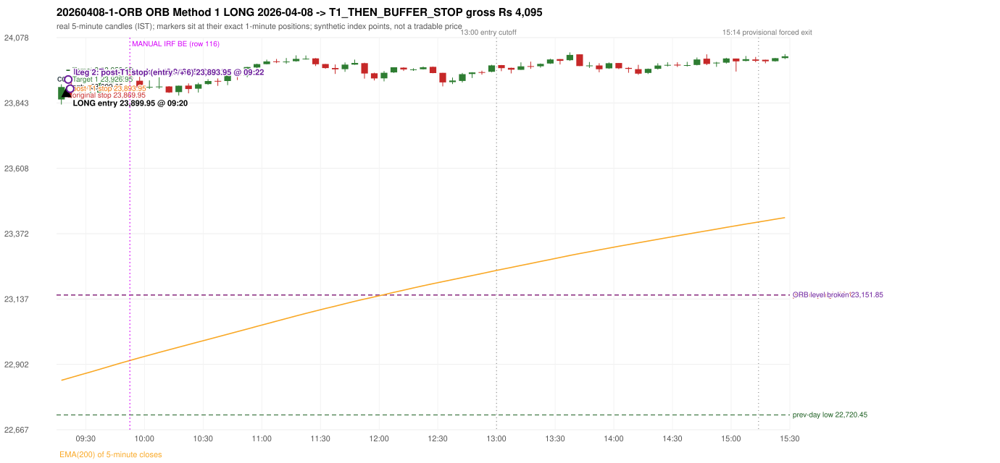

# Trading journal - 2026-04-08 (Wednesday)

> Automated, read-only reconstruction of the Phase 3.0 baseline. Synthetic NIFTY 50 index-point P&L (the index is not tradable). The owner's review status is intentionally blank.

## A. Trading day overview

| item | value |
|---|---|
| Date / weekday | 2026-04-08 / Wednesday |
| Session type | USABLE_WITH_FLAGS / VALID |
| Original session open (first 1-minute open) | 23,855.15 |
| Previous session | 2026-04-07 |
| Previous-day high / low | 23,151.85 / 22,720.45 |
| Previous-day official close / last 5-minute close | 23,123.65 / 23,129.95 |
| Raw engine records / confirmed signals / fully valid signals | 10 / 8 / 8 |
| Setups that did not complete (invalidated / incomplete) | 2 |
| Executed trades | 1 20260408-1-ORB |
| Gross P&L (Rs, synthetic) | 4,095.00 |
| Illustrative net P&L (Rs; Rs 500/trade + 0.5 pt/fill) | 3,205.00 |
| Day-end portfolio status | DAY_FINISHED |
| Manual journal trades (matched / unmatched) | 1 (0 / 1) |
| Extra automated trades | 1 |

## B. Daily strategy signal timeline (confirmed signals, chronological)

| time | strategy | method | dir | entry-rule status | valid for execution | <= 13:00 | portfolio state | accepted / ignored | specific reason | competing (same minute) |
|---|---|---|---|---|---|---|---|---|---|---|
| 09:20 | ORB | Method 1 | LONG | PROPOSAL_DEPENDENT | True | True | FIRST_TRADE_ACTIVE | ACCEPTED -> 20260408-1-ORB | first eligible signal of the day; trade 1: T1_THEN_BUFFER_STOP | ORB Method 2 LONG |
| 09:20 | ORB | Method 2 | LONG | RESEARCH_VARIANT | True | True | FIRST_TRADE_ACTIVE | MERGED_SAME_STRATEGY_METHOD | traded as another method of the same strategy/direction in the same minute | ORB Method 1 LONG |
| 10:00 | IRF | Method 1 | SHORT | PROPOSAL_DEPENDENT | True | True | DAY_FINISHED | IGNORED | DAY_FINISHED [blocked by ORB#1] |  |
| 10:15 | IRF | Method 2A | SHORT | PROPOSAL_DEPENDENT | True | True | DAY_FINISHED | IGNORED | DAY_FINISHED [blocked by ORB#1] |  |
| 11:30 | IRF | Method 2A | SHORT | PROPOSAL_DEPENDENT | True | True | DAY_FINISHED | IGNORED | DAY_FINISHED [blocked by ORB#1] |  |
| 13:35 | IRF | Method 2B | SHORT | PROPOSAL_DEPENDENT | True | False | DAY_FINISHED | IGNORED | DAY_FINISHED [blocked by ORB#1] |  |
| 14:15 | IRF | Method 2A | SHORT | PROPOSAL_DEPENDENT | True | False | DAY_FINISHED | IGNORED | DAY_FINISHED [blocked by ORB#1] |  |
| 14:35 | IRF | Method 2B | SHORT | PROPOSAL_DEPENDENT | True | False | DAY_FINISHED | IGNORED | DAY_FINISHED [blocked by ORB#1] |  |

Engine setups that did not complete (2); the complete list with failed rule ids is in `rejected_signals.csv`:

| candle | strategy | method | dir | status | precise reason | failed rules |
|---|---|---|---|---|---|---|
| 10:20 | IRF | Method 3 | SHORT | INVALIDATED | WICK_SHARE_OUT_OF_BAND | IRF-M3-003 |
| 14:30 | IRF | Method 1/2 | SHORT | INCOMPLETE_AT_EOD | SESSION_ENDED_BEFORE_CONFIRMATION |  |

## C. Detailed trade journals

### 20260408-1-ORB: ORB Method 1 LONG (FIRST trade)

Chart: 

**Rule configuration:** CFG-baseline-be1db2a09d - signal verification status **PROPOSAL_DEPENDENT** (never VERIFIED while a rule rests on a proposal).

#### 1. Setup identification

ORB Method 1 LONG: the first completed 5-minute candle (09:15-09:20) closed at 23,900.00, 748.15 points above the previous-day high 23,151.85; its body occupied 61.82% of its range and its upper wick 13.03% (thresholds 60% / 20%): the strong-bullish candle test passed; the EMA-only trend filter passed. Entry decision at 09:20.

#### 2. Candle and indicator calculations

| role | session | candle | O | H | L | C | range | body % | upper wick % | lower wick % | direction | EMA(200) | strong bull / bear | pin bull / bear | small (body<=30%) | used for |
|---|---|---|---|---|---|---|---|---|---|---|---|---|---|---|---|---|
| first_candle | TODAY | 09:15-09:20 | 23,855.15 | 23,909.45 | 23,836.90 | 23,900.00 | 72.55 | 61.82 | 13.03 | 25.16 | BULLISH | 22,844.92 | True / False | False / False | False | the 09:15 first five-minute candle - the ORB decision candle |
| prev_day_extreme_candle | PREVIOUS | 15:25-15:30 | 23,137.05 | 23,151.85 | 23,124.15 | 23,129.95 | 27.70 | 25.63 | 53.43 | 20.94 | BEARISH | 22,834.32 | False / False | False / True | True | candle that made the previous session's high/low used as the level |
| prev_session_last_candle | PREVIOUS | 15:25-15:30 | 23,137.05 | 23,151.85 | 23,124.15 | 23,129.95 | 27.70 | 25.63 | 53.43 | 20.94 | BEARISH | 22,834.32 | False / False | False / True | True | trend: previous session's last 5-minute close vs its EMA(200) |

Every condition, with the rule, the calculation, the observed values and the result:

| # | group | rule | result | status / numeric definition | calculation | observed | required | available at | why it matters |
|---|---|---|---|---|---|---|---|---|---|
| 1 | SELECTION | SEL-FIRST-001 | PASS | USER_APPROVED / USER_APPROVED | earliest CONFIRMED signal of the day across IRF/ORB/PDR/PDS/RF that passed the controller's checks | 0 confirmed signal(s) earlier today; 8 confirmed signals in the day in total, this one at 09:20 | no earlier executable signal | 2026-04-08 09:20 | the shared controller trades only the first valid signal; the five strategies are not independent positions |
| 2 | SELECTION | SEL-TIE-001 | PASS | USER_APPROVED / USER_APPROVED | other CONFIRMED signals with exactly the same confirmation timestamp | ORB Method 2 LONG @09:20 [NOTE: SAME_STRATEGY_CONCURRENT_METHOD]; merged same-strategy methods: Method 2 | no different-strategy / opposite-direction signal in the same minute (otherwise an unresolved conflict, no trade) | 2026-04-08 09:20 | an unresolved same-minute collision would have produced no trade at all |
| 3 | SELECTION | ENTRY-CUTOFF-001 | PASS | USER_APPROVED / USER_APPROVED | fill timestamp vs 13:00:00 IST | signal confirmed 09:20; fill 09:20 | fill at or before 13:00:00 IST | 2026-04-08 09:20 | no new position may be entered with a fill after 13:00 IST |
| 4 | SELECTION | EXE-FILL-001 | PASS | PROPOSED_FOR_REVIEW / PROPOSED_FOR_REVIEW | fill = open of the 1-minute bar that starts at the signal candle's end | bar 09:20 O 23,899.95 H 23,926.00 L 23,895.20 C 23,918.00; executable=True; entry 23,899.95 | fill bar exists, starts exactly at the signal end, is fillable; entry = its open | 2026-04-08 09:20 | a 5-minute signal is known only when its candle closes; the first price that can be traded is the next minute's open |
| 5 | SELECTION | DAY-MAX-001 | PASS | USER_APPROVED / USER_APPROVED | number of entries today | trade 1 of at most 2 | <= 2 entries per day | 2026-04-08 09:20 | daily trade cap |
| 6 | SETUP | ORB-GLOBAL-001 | PASS | SOURCE_VERIFIED / EXPLICIT_IN_SOURCE | decision is taken once the first 5-minute candle (09:15-09:20) has closed | candle 09:15-09:20; signal confirmed 09:20 | decision at 09:20, never before the close | 2026-04-08 09:20 | the close of the first candle is unknown before 09:20 |
| 7 | SETUP | ORB-GLOBAL-002 | PASS | SOURCE_VERIFIED / EXPLICIT_IN_SOURCE | direction | LONG | same rules in both directions | 2026-04-08 09:20 | ORB trades the side of the break |
| 8 | SETUP | ORB-GLOBAL-004 | PASS | SOURCE_VERIFIED / QUALITATIVE_SOURCE_NUMERIC_DEFINITION_PROPOSED_FOR_REVIEW | entry at 09:20, after the first-candle close | signal confirmed 09:20; fill 09:20 at the open of that minute | 09:20 entry | 2026-04-08 09:20 | the guide enters at 9:20; the fill price convention (next minute open) is a proposal |
| 9 | SETUP | ORB-M1-LONG-001 | PASS | SOURCE_VERIFIED / QUALITATIVE_SOURCE_NUMERIC_DEFINITION_PROPOSED_FOR_REVIEW | prev_day_high = the highest high of all 5-minute candles of the previous session 2026-04-07 | previous-day high 23,151.85 (set by the 15:25 candle; previous session range 22,720.45 - 23,151.85; engine recorded 23,151.85) | previous-day resistance (long) / support (short) | 2026-04-07 15:30 | a mechanical proxy for the guide's hand-drawn previous-day level; the source charts show multi-session boxes (documented difference) |
| 10 | SETUP | ORB-M1-LONG-002 | PASS | SOURCE_VERIFIED / EXPLICIT_IN_SOURCE | the first candle breaks and closes beyond the level | high 23,909.45 / low 23,836.90, close 23,900.00: 748.15 points beyond 23,151.85 | high and close > level | 2026-04-08 09:20 | a wick alone is not a breakout; the close decides |
| 11 | TREND | ORB-TREND-001 | PASS | SOURCE_VERIFIED / QUALITATIVE_SOURCE_NUMERIC_DEFINITION_PROPOSED_FOR_REVIEW | previous session's final completed 5-minute candle: close vs its EMA(200 of 5-minute closes) | previous session 2026-04-07 last candle 15:25-15:30 close 23,129.95 vs EMA(200) 22,834.32: 295.63 points above the EMA -> trend bullish (EMA_PREV_SESSION_CLOSE; research variant A, EMA-only) | close > EMA(200) | 2026-04-07 15:30 | the opening gap can never create the trend: only information that existed before today's open is used |
| 12 | TREND | ORB-TREND-002 | PASS | SOURCE_VERIFIED / QUALITATIVE_SOURCE_NUMERIC_DEFINITION_PROPOSED_FOR_REVIEW | price location versus the 200 EMA is the basic confirmation; structure is only 'supporting' | 295.63 points above the EMA(200) on the previous session's last 5-minute close; swing structure not used in variant A | price on the trend side of the 200 EMA | 2026-04-07 15:30 | the rulebook calls EMA position 'a basic confirmation, supported by bullish structure'; the structure part has no numeric definition |
| 13 | TREND | TREND-SWING-001 | NOT_APPLICABLE | PROPOSED_FOR_REVIEW / PROPOSED_FOR_REVIEW | confirmed swing structure | not required by the active trend variant (variant A is the EMA price location only) | n/a | 2026-04-07 15:30 | variant B would additionally require higher-high/higher-low swings; it is a separate labelled scenario |
| 14 | CONFIRMATION | ORB-M1-LONG-003 | PASS | SOURCE_VERIFIED / QUALITATIVE_SOURCE_NUMERIC_DEFINITION_PROPOSED_FOR_REVIEW | candle quality: strong body and limited opposite wick (or the conditional pin bar) | 09:15-09:20 O 23,855.15 H 23,909.45 L 23,836.90 C 23,900.00; range 72.55, body 44.85 (61.82%), upper wick 9.45 (13.03%), lower wick 18.25 (25.16%), bullish. Strong-bullish test: bullish close, body >= 60% (observed 61.82%), upper wick <= 20% (observed 13.03%) -> PASS | strong candle (research thresholds) or pin bar | 2026-04-08 09:20 | the guide asks for a 'strong body, small wick' but gives no numbers; the thresholds are proposals |
| 15 | EXECUTION | ORB-GLOBAL-003 | PASS | SOURCE_VERIFIED / EXPLICIT_IN_SOURCE | initial stop = entry - 30 points | entry 23,899.95 -> stop 23,869.95 | stop 30 index points (BASELINE) | 2026-04-08 09:20 | defines the loss if the setup fails before Target 1 |
| 16 | EXECUTION | EXE-T1-001 | PASS | SOURCE_VERIFIED / EXPLICIT_IN_SOURCE | Target 1 = entry +/- 27 points | T1 23,926.95 | 27 points | 2026-04-08 09:20 | Leg 1 (3 lots) is booked at Target 1 |
| 17 | EXECUTION | ORB-GLOBAL-003 | PASS | SOURCE_VERIFIED / EXPLICIT_IN_SOURCE | Target 2 = entry +/- 60 points | T2 23,959.95 | 60 points | 2026-04-08 09:20 | Leg 2 (3 lots) is booked at Target 2 |
| 18 | EXECUTION | POST-T1-STOP-006 | PASS | USER_APPROVED / USER_APPROVED | after T1 the Leg-2 stop = entry - 6 (no trailing) | post-T1 stop 23,893.95 | entry -6 (LONG) / +6 (SHORT) | 2026-04-08 09:20 | protects the remaining three lots once the first three are booked |
| 19 | EXECUTION | SIZE-LOT-001 | PASS | USER_APPROVED / USER_APPROVED | 6 lots x 65 = 390, Leg 1 = 3 lots = 195, Leg 2 = 195 | 6 lots, lot size 65, legs 3+3 | 6 lots in two equal legs | 2026-04-08 09:20 | position size for the synthetic P&L |
| 20 | NOTE | ORB-MA-001 | UNRESOLVED | CONFLICTING / CONFLICTING | which moving average the code uses | EMA(200) of 5-minute closes (the guide says '200 DMA' in some places and '200 EMA' in others); active ma_mode EMA200_5M | the source terminology conflicts | 2026-04-08 09:20 | a daily 200 DMA would give different values |
| 21 | NOTE | NOTE-UNRESOLVED-DEPENDENCIES | UNRESOLVED | NOT_A_RULE / NOT_A_REGISTRY_RULE | rules the signal depends on that the sources leave unresolved | engine-recorded unresolved rule ids: ORB-MA-001; verification status PROPOSAL_DEPENDENT | n/a (disclosure) | 2026-04-08 09:20 | the entry is only as verified as the rules it rests on |

#### 3. Entry decision and explanation

ORB Method 1 LONG: the first completed 5-minute candle (09:15-09:20) closed at 23,900.00, 748.15 points above the previous-day high 23,151.85; its body occupied 61.82% of its range and its upper wick 13.03% (thresholds 60% / 20%): the strong-bullish candle test passed; the EMA-only trend filter passed. Entry decision at 09:20.

**Why this trade ahead of the other strategies:** This ORB Method 1 signal was the earliest executable signal of the day: 0 confirmed signal(s) earlier, 1 other in the same minute. 6 later confirmed signal(s) (IRF x6) are logged as ignored or rejected. State of the other four engines at that moment: [IRF: no setup record before this time (a base condition was not met, or nothing triggered)] [PDR: no setup record before this time (a base condition was not met, or nothing triggered)] [PDS: no setup record before this time (a base condition was not met, or nothing triggered)] [RF: no setup record before this time (a base condition was not met, or nothing triggered)]

#### 4. Actual entry execution

| item | value |
|---|---|
| Signal candle | 09:15-09:20 |
| Signal confirmed | 2026-04-08 09:20 |
| Fill timestamp | 2026-04-08 09:20 |
| Entry price | 23,899.95 |
| Source partition / 1-minute bar | data/processed/nifty50/year=2026/month=04/candles.parquet / 2026-04-08 09:20 |
| Source bar O / H / L / C | 23,899.95 / 23,926.00 / 23,895.20 / 23,918.00 |
| Fill assumption | open of the 1-minute bar starting at the signal candle's end (EXE-FILL-001, PROPOSED causal convention) |
| Initial stop / T1 / T2 / post-T1 stop | 23,869.95 / 23,926.95 / 23,959.95 / 23,893.95 |
| Position | 6 lots x 65 = 390 units (Leg 1 195, Leg 2 195) |

#### 5-8. Trade progress, Target 1, post-T1 stop and final exit

Between the 09:20 entry bar and the final exit (3 one-minute bars) the best excursion in favour was 28.15 points at 09:21 and the worst against was 10.00 points at 09:22. At 09:21 price reached Target 1 23,926.95 and three lots exited. At 09:21 the remaining three lots' protective stop was set to 23,893.95 (entry - 6; no trailing, no further change); the engine applies it from the Target-1 bar onward and tests it within that same bar. At 09:22 the remaining three lots stopped out at 23,893.95. T1_THEN_BUFFER_STOP: no second trade that day (DAY-BUF-001).

| leg | qty | exit time | exit price | reason | source 1-minute bar | O / H / L / C | gross points | gross Rs | slippage pts | flags |
|---|---|---|---|---|---|---|---|---|---|---|
| 1 | 195 | 09:21 | 23,926.95 | TARGET_1 | 09:21 | 23,915.15 / 23,928.10 / 23,913.35 / 23,925.40 | 27.00 | 5,265.00 | 0.00 |  |
| 2 | 195 | 09:22 | 23,893.95 | POST_T1_STOP_ENTRY_MINUS_PLUS_6 | 09:22 | 23,921.65 / 23,926.40 / 23,889.95 / 23,890.30 | -6.00 | -1,170.00 | 0.00 |  |

Exit evidence per leg:

* Leg 1: 1-minute bar 09:21 O 23,915.15 H 23,928.10 L 23,913.35 C 23,925.40: high 23,928.10 reached Target 1 23,926.95; Leg 1 booked at the target level
* Leg 2: 1-minute bar 09:22 O 23,921.65 H 23,926.40 L 23,889.95 C 23,890.30: low 23,889.95 reached the post-T1 stop 23,893.95; Leg 2 exits at 23,893.95 at the stop level

#### 9. Gross and illustrative net P&L

| item | value (Rs) |
|---|---|
| Leg 1 gross | 5,265.00 |
| Leg 2 gross | -1,170.00 |
| Trade gross (= Leg 1 + Leg 2) | 4,095.00 |
| Illustrative fixed cost | -500.00 |
| Illustrative slippage (0.5 pt on every fill, entry + exits, all units) | -390.00 |
| Illustrative net | 3,205.00 |

#### 10. Manual journal comparison

EXTRA_AUTOMATED_TRADE: the automated system took ORB Method 1 LONG at 09:20 (manual traded only other strategies: IRF 09:50 BE). The setup rests on: ORB-MA-001: 200 DMA versus 200 EMA terminology conflict | NOTE-UNRESOLVED-DEPENDENCIES: Disclosure of unresolved source rules behind this signal. The journal shows no corresponding entry.

## D. Manual journal comparison

| comparison | journal row | journal strategy | manual time | manual direction | manual outcome | match class | trade | auto entry | auto outcome | explanation |
|---|---|---|---|---|---|---|---|---|---|---|
| M116 | 116 | IRF | 09:50 | SHORT | BE | SIGNAL_REJECTED_BY_PORTFOLIO_CONTROLLER |  |  |  | SIGNAL_REJECTED_BY_PORTFOLIO_CONTROLLER: RAW_CONFIRMED_SIGNAL Method 1 10:00 -> IGNORED - DAY_FINISHED. Heuristic primary cause: PORTFOLIO_COMPETITION; blocked by: ORB#1 |
| E078 |  |  |  |  |  | EXTRA_AUTOMATED_TRADE | 20260408-1-ORB | 09:20 @ 23,899.95 | T1_THEN_BUFFER_STOP | EXTRA_AUTOMATED_TRADE: the automated system took ORB Method 1 LONG at 09:20 (manual traded only other strategies: IRF 09:50 BE). The setup rests on: ORB-MA-001: 200 DMA versus 200 EMA terminology conflict \| NOTE-UNRESOLVED-DEPENDENCIES: Disclosure of unresolved source rules behind this signal. The journal shows no corresponding entry. |

The journal records no entry price and no exit price (NOT_RECORDED); matching uses date, strategy and candle start only - never P&L.

## E. Daily conclusion

* **Traded:** 20260408-1-ORB - ORB Method 1 LONG at 09:20 (entry 23,899.95), outcome T1_THEN_BUFFER_STOP, gross Rs 4,095.00, illustrative net Rs 3,205.00. **Why:** This ORB Method 1 signal was the earliest executable signal of the day: 0 confirmed signal(s) earlier, 1 other in the same minute. 6 later confirmed signal(s) (IRF x6) are logged as ignored or rejected. State of the other four engines at that moment: [IRF: no setup record before this time (a base condition was not met, or nothing triggered)] [PDR: no setup record before this time (a base condition was not met, or nothing triggered)] [PDS: no setup record before this time (a base condition was not met, or nothing triggered)] [RF: no setup record before this time (a base condition was not met, or nothing triggered)] **How it ended:** At 09:21 price reached Target 1 23,926.95 and three lots exited. At 09:21 the remaining three lots' protective stop was set to 23,893.95 (entry - 6; no trailing, no further change); the engine applies it from the Target-1 bar onward and tests it within that same bar. At 09:22 the remaining three lots stopped out at 23,893.95. T1_THEN_BUFFER_STOP: no second trade that day (DAY-BUF-001).
* **Ignored / rejected signals:** IRF IGNORED DAY_FINISHED x6; ORB MERGED_SAME_STRATEGY_METHOD traded as another method of the same strategy/direction in the same minute x1
* **Unmatched manual trade (row 116, IRF 09:50 BE):** SIGNAL_REJECTED_BY_PORTFOLIO_CONTROLLER: RAW_CONFIRMED_SIGNAL Method 1 10:00 -> IGNORED - DAY_FINISHED. Heuristic primary cause: PORTFOLIO_COMPETITION; blocked by: ORB#1
* **Extra automated trade 20260408-1-ORB:** EXTRA_AUTOMATED_TRADE: the automated system took ORB Method 1 LONG at 09:20 (manual traded only other strategies: IRF 09:50 BE). The setup rests on: ORB-MA-001: 200 DMA versus 200 EMA terminology conflict | NOTE-UNRESOLVED-DEPENDENCIES: Disclosure of unresolved source rules behind this signal. The journal shows no corresponding entry.
* **Open strategy-definition issues that affected this day:** NOTE-UNRESOLVED-DEPENDENCIES, ORB-MA-001 (Terminology conflict: '200 DMA / EMA' (p.2), '200 EMA' (pp.3,5,7), '200 DMA' (pp.1,8,9,12) for what the charts show as one curved line on a 5-minute chart)
* **Automated triage (not an approval; the owner's review status stays blank):** REVIEW: UNMATCHED_MANUAL+EXTRA_AUTOMATED
