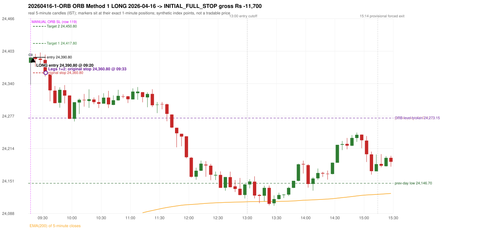
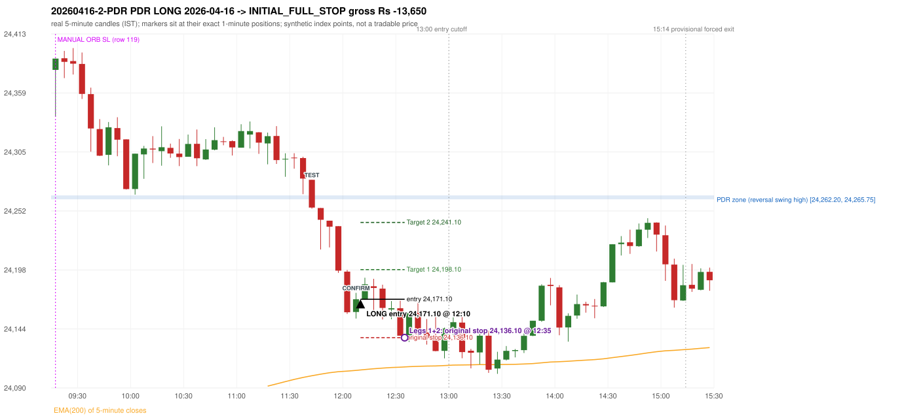

# Trading journal - 2026-04-16 (Thursday)

> Automated, read-only reconstruction of the Phase 3.0 baseline. Synthetic NIFTY 50 index-point P&L (the index is not tradable). The owner's review status is intentionally blank.

## A. Trading day overview

| item | value |
|---|---|
| Date / weekday | 2026-04-16 / Thursday |
| Session type | USABLE_WITH_FLAGS / VALID |
| Original session open (first 1-minute open) | 24,380.25 |
| Previous session | 2026-04-15 |
| Previous-day high / low | 24,273.15 / 24,146.70 |
| Previous-day official close / last 5-minute close | 24,231.30 / 24,211.90 |
| Raw engine records / confirmed signals / fully valid signals | 4 / 3 / 3 |
| Setups that did not complete (invalidated / incomplete) | 1 |
| Executed trades | 2 20260416-1-ORB;20260416-2-PDR |
| Gross P&L (Rs, synthetic) | -25,350.00 |
| Illustrative net P&L (Rs; Rs 500/trade + 0.5 pt/fill) | -27,130.00 |
| Day-end portfolio status | DAY_FINISHED |
| Manual journal trades (matched / unmatched) | 1 (1 / 0) |
| Extra automated trades | 1 |

## B. Daily strategy signal timeline (confirmed signals, chronological)

| time | strategy | method | dir | entry-rule status | valid for execution | <= 13:00 | portfolio state | accepted / ignored | specific reason | competing (same minute) |
|---|---|---|---|---|---|---|---|---|---|---|
| 09:20 | ORB | Method 1 | LONG | PROPOSAL_DEPENDENT | True | True | FIRST_TRADE_ACTIVE | ACCEPTED -> 20260416-1-ORB | first eligible signal of the day; trade 1: INITIAL_FULL_STOP | ORB Method 2 LONG |
| 09:20 | ORB | Method 2 | LONG | RESEARCH_VARIANT | True | True | FIRST_TRADE_ACTIVE | MERGED_SAME_STRATEGY_METHOD | traded as another method of the same strategy/direction in the same minute | ORB Method 1 LONG |
| 12:10 | PDR | PDR | LONG | PROPOSAL_DEPENDENT | True | True | SECOND_TRADE_ACTIVE | ACCEPTED -> 20260416-2-PDR | permitted second trade: newly confirmed PDR/PDS after the original full stop; trade 2: INITIAL_FULL_STOP |  |

Engine setups that did not complete (1); the complete list with failed rule ids is in `rejected_signals.csv`:

| candle | strategy | method | dir | status | precise reason | failed rules |
|---|---|---|---|---|---|---|
| 09:35 | RF | RF | LONG | INCOMPLETE_AT_EOD | NO_RETURN_INSIDE_BEFORE_SESSION_END |  |

## C. Detailed trade journals

### 20260416-1-ORB: ORB Method 1 LONG (FIRST trade)

Chart: 

**Rule configuration:** CFG-baseline-be1db2a09d - signal verification status **PROPOSAL_DEPENDENT** (never VERIFIED while a rule rests on a proposal).

#### 1. Setup identification

ORB Method 1 LONG: the first completed 5-minute candle (09:15-09:20) closed at 24,390.55, 117.40 points above the previous-day high 24,273.15; its body occupied 19.49% of its range and its upper wick 0.00% (thresholds 60% / 20%): the strong-candle test FAILED; the candle was admitted through the conditional PIN-BAR alternative instead (the lower wick 42.55 points is 4.13 x the body, required 2x; the close is 0.00% of the range from the high, allowed 30%); the EMA-only trend filter passed. Entry decision at 09:20.

#### 2. Candle and indicator calculations

| role | session | candle | O | H | L | C | range | body % | upper wick % | lower wick % | direction | EMA(200) | strong bull / bear | pin bull / bear | small (body<=30%) | used for |
|---|---|---|---|---|---|---|---|---|---|---|---|---|---|---|---|---|
| first_candle | TODAY | 09:15-09:20 | 24,380.25 | 24,390.55 | 24,337.70 | 24,390.55 | 52.85 | 19.49 | 0.00 | 80.51 | BULLISH | 24,030.48 | False / False | True / False | True | the 09:15 first five-minute candle - the ORB decision candle |
| prev_day_extreme_candle | PREVIOUS | 10:30-10:35 | 24,260.40 | 24,273.15 | 24,256.20 | 24,259.45 | 16.95 | 5.60 | 75.22 | 19.17 | BEARISH | 23,871.17 | False / False | False / True | True | candle that made the previous session's high/low used as the level |
| prev_session_last_candle | PREVIOUS | 15:25-15:30 | 24,224.65 | 24,229.25 | 24,206.50 | 24,211.90 | 22.75 | 56.04 | 20.22 | 23.74 | BEARISH | 24,026.86 | False / False | False / False | False | trend: previous session's last 5-minute close vs its EMA(200) |

Every condition, with the rule, the calculation, the observed values and the result:

| # | group | rule | result | status / numeric definition | calculation | observed | required | available at | why it matters |
|---|---|---|---|---|---|---|---|---|---|
| 1 | SELECTION | SEL-FIRST-001 | PASS | USER_APPROVED / USER_APPROVED | earliest CONFIRMED signal of the day across IRF/ORB/PDR/PDS/RF that passed the controller's checks | 0 confirmed signal(s) earlier today; 3 confirmed signals in the day in total, this one at 09:20 | no earlier executable signal | 2026-04-16 09:20 | the shared controller trades only the first valid signal; the five strategies are not independent positions |
| 2 | SELECTION | SEL-TIE-001 | PASS | USER_APPROVED / USER_APPROVED | other CONFIRMED signals with exactly the same confirmation timestamp | ORB Method 2 LONG @09:20 [NOTE: SAME_STRATEGY_CONCURRENT_METHOD]; merged same-strategy methods: Method 2 | no different-strategy / opposite-direction signal in the same minute (otherwise an unresolved conflict, no trade) | 2026-04-16 09:20 | an unresolved same-minute collision would have produced no trade at all |
| 3 | SELECTION | ENTRY-CUTOFF-001 | PASS | USER_APPROVED / USER_APPROVED | fill timestamp vs 13:00:00 IST | signal confirmed 09:20; fill 09:20 | fill at or before 13:00:00 IST | 2026-04-16 09:20 | no new position may be entered with a fill after 13:00 IST |
| 4 | SELECTION | EXE-FILL-001 | PASS | PROPOSED_FOR_REVIEW / PROPOSED_FOR_REVIEW | fill = open of the 1-minute bar that starts at the signal candle's end | bar 09:20 O 24,390.80 H 24,397.55 L 24,385.00 C 24,388.00; executable=True; entry 24,390.80 | fill bar exists, starts exactly at the signal end, is fillable; entry = its open | 2026-04-16 09:20 | a 5-minute signal is known only when its candle closes; the first price that can be traded is the next minute's open |
| 5 | SELECTION | DAY-MAX-001 | PASS | USER_APPROVED / USER_APPROVED | number of entries today | trade 1 of at most 2 | <= 2 entries per day | 2026-04-16 09:20 | daily trade cap |
| 6 | SETUP | ORB-GLOBAL-001 | PASS | SOURCE_VERIFIED / EXPLICIT_IN_SOURCE | decision is taken once the first 5-minute candle (09:15-09:20) has closed | candle 09:15-09:20; signal confirmed 09:20 | decision at 09:20, never before the close | 2026-04-16 09:20 | the close of the first candle is unknown before 09:20 |
| 7 | SETUP | ORB-GLOBAL-002 | PASS | SOURCE_VERIFIED / EXPLICIT_IN_SOURCE | direction | LONG | same rules in both directions | 2026-04-16 09:20 | ORB trades the side of the break |
| 8 | SETUP | ORB-GLOBAL-004 | PASS | SOURCE_VERIFIED / QUALITATIVE_SOURCE_NUMERIC_DEFINITION_PROPOSED_FOR_REVIEW | entry at 09:20, after the first-candle close | signal confirmed 09:20; fill 09:20 at the open of that minute | 09:20 entry | 2026-04-16 09:20 | the guide enters at 9:20; the fill price convention (next minute open) is a proposal |
| 9 | SETUP | ORB-M1-LONG-001 | PASS | SOURCE_VERIFIED / QUALITATIVE_SOURCE_NUMERIC_DEFINITION_PROPOSED_FOR_REVIEW | prev_day_high = the highest high of all 5-minute candles of the previous session 2026-04-15 | previous-day high 24,273.15 (set by the 10:30 candle; previous session range 24,146.70 - 24,273.15; engine recorded 24,273.15) | previous-day resistance (long) / support (short) | 2026-04-15 10:35 | a mechanical proxy for the guide's hand-drawn previous-day level; the source charts show multi-session boxes (documented difference) |
| 10 | SETUP | ORB-M1-LONG-002 | PASS | SOURCE_VERIFIED / EXPLICIT_IN_SOURCE | the first candle breaks and closes beyond the level | high 24,390.55 / low 24,337.70, close 24,390.55: 117.40 points beyond 24,273.15 | high and close > level | 2026-04-16 09:20 | a wick alone is not a breakout; the close decides |
| 11 | TREND | ORB-TREND-001 | PASS | SOURCE_VERIFIED / QUALITATIVE_SOURCE_NUMERIC_DEFINITION_PROPOSED_FOR_REVIEW | previous session's final completed 5-minute candle: close vs its EMA(200 of 5-minute closes) | previous session 2026-04-15 last candle 15:25-15:30 close 24,211.90 vs EMA(200) 24,026.86: 185.04 points above the EMA -> trend bullish (EMA_PREV_SESSION_CLOSE; research variant A, EMA-only) | close > EMA(200) | 2026-04-15 15:30 | the opening gap can never create the trend: only information that existed before today's open is used |
| 12 | TREND | ORB-TREND-002 | PASS | SOURCE_VERIFIED / QUALITATIVE_SOURCE_NUMERIC_DEFINITION_PROPOSED_FOR_REVIEW | price location versus the 200 EMA is the basic confirmation; structure is only 'supporting' | 185.04 points above the EMA(200) on the previous session's last 5-minute close; swing structure not used in variant A | price on the trend side of the 200 EMA | 2026-04-15 15:30 | the rulebook calls EMA position 'a basic confirmation, supported by bullish structure'; the structure part has no numeric definition |
| 13 | TREND | TREND-SWING-001 | NOT_APPLICABLE | PROPOSED_FOR_REVIEW / PROPOSED_FOR_REVIEW | confirmed swing structure | not required by the active trend variant (variant A is the EMA price location only) | n/a | 2026-04-15 15:30 | variant B would additionally require higher-high/higher-low swings; it is a separate labelled scenario |
| 14 | CONFIRMATION | ORB-M1-LONG-003 | PASS | SOURCE_VERIFIED / QUALITATIVE_SOURCE_NUMERIC_DEFINITION_PROPOSED_FOR_REVIEW | candle quality: strong body and limited opposite wick (or the conditional pin bar) | 09:15-09:20 O 24,380.25 H 24,390.55 L 24,337.70 C 24,390.55; range 52.85, body 10.30 (19.49%), upper wick 0.00 (0.00%), lower wick 42.55 (80.51%), bullish. Strong-bullish test: bullish close, body >= 60% (observed 19.49%), upper wick <= 20% (observed 0.00%) -> not met; pin-bar alternative: wick >= 2 x body and close within the favourable 30% -> met | strong candle (research thresholds) or pin bar | 2026-04-16 09:20 | the guide asks for a 'strong body, small wick' but gives no numbers; the thresholds are proposals |
| 15 | EXECUTION | ORB-GLOBAL-003 | PASS | SOURCE_VERIFIED / EXPLICIT_IN_SOURCE | initial stop = entry - 30 points | entry 24,390.80 -> stop 24,360.80 | stop 30 index points (BASELINE) | 2026-04-16 09:20 | defines the loss if the setup fails before Target 1 |
| 16 | EXECUTION | EXE-T1-001 | PASS | SOURCE_VERIFIED / EXPLICIT_IN_SOURCE | Target 1 = entry +/- 27 points | T1 24,417.80 | 27 points | 2026-04-16 09:20 | Leg 1 (3 lots) is booked at Target 1 |
| 17 | EXECUTION | ORB-GLOBAL-003 | PASS | SOURCE_VERIFIED / EXPLICIT_IN_SOURCE | Target 2 = entry +/- 60 points | T2 24,450.80 | 60 points | 2026-04-16 09:20 | Leg 2 (3 lots) is booked at Target 2 |
| 18 | EXECUTION | POST-T1-STOP-006 | PASS | USER_APPROVED / USER_APPROVED | after T1 the Leg-2 stop = entry - 6 (no trailing) | post-T1 stop 24,384.80 | entry -6 (LONG) / +6 (SHORT) | 2026-04-16 09:20 | protects the remaining three lots once the first three are booked |
| 19 | EXECUTION | SIZE-LOT-001 | PASS | USER_APPROVED / USER_APPROVED | 6 lots x 65 = 390, Leg 1 = 3 lots = 195, Leg 2 = 195 | 6 lots, lot size 65, legs 3+3 | 6 lots in two equal legs | 2026-04-16 09:20 | position size for the synthetic P&L |
| 20 | NOTE | ORB-MA-001 | UNRESOLVED | CONFLICTING / CONFLICTING | which moving average the code uses | EMA(200) of 5-minute closes (the guide says '200 DMA' in some places and '200 EMA' in others); active ma_mode EMA200_5M | the source terminology conflicts | 2026-04-16 09:20 | a daily 200 DMA would give different values |
| 21 | NOTE | NOTE-UNRESOLVED-DEPENDENCIES | UNRESOLVED | NOT_A_RULE / NOT_A_REGISTRY_RULE | rules the signal depends on that the sources leave unresolved | engine-recorded unresolved rule ids: ORB-MA-001; verification status PROPOSAL_DEPENDENT | n/a (disclosure) | 2026-04-16 09:20 | the entry is only as verified as the rules it rests on |

#### 3. Entry decision and explanation

ORB Method 1 LONG: the first completed 5-minute candle (09:15-09:20) closed at 24,390.55, 117.40 points above the previous-day high 24,273.15; its body occupied 19.49% of its range and its upper wick 0.00% (thresholds 60% / 20%): the strong-candle test FAILED; the candle was admitted through the conditional PIN-BAR alternative instead (the lower wick 42.55 points is 4.13 x the body, required 2x; the close is 0.00% of the range from the high, allowed 30%); the EMA-only trend filter passed. Entry decision at 09:20.

**Why this trade ahead of the other strategies:** This ORB Method 1 signal was the earliest executable signal of the day: 0 confirmed signal(s) earlier, 1 other in the same minute. 1 later confirmed signal(s) (PDR x1) are logged as ignored or rejected. State of the other four engines at that moment: [IRF: no setup record before this time (a base condition was not met, or nothing triggered)] [PDR: no setup record before this time (a base condition was not met, or nothing triggered)] [PDS: no setup record before this time (a base condition was not met, or nothing triggered)] [RF: no setup record before this time (a base condition was not met, or nothing triggered)]

#### 4. Actual entry execution

| item | value |
|---|---|
| Signal candle | 09:15-09:20 |
| Signal confirmed | 2026-04-16 09:20 |
| Fill timestamp | 2026-04-16 09:20 |
| Entry price | 24,390.80 |
| Source partition / 1-minute bar | data/processed/nifty50/year=2026/month=04/candles.parquet / 2026-04-16 09:20 |
| Source bar O / H / L / C | 24,390.80 / 24,397.55 / 24,385.00 / 24,388.00 |
| Fill assumption | open of the 1-minute bar starting at the signal candle's end (EXE-FILL-001, PROPOSED causal convention) |
| Initial stop / T1 / T2 / post-T1 stop | 24,360.80 / 24,417.80 / 24,450.80 / 24,384.80 |
| Position | 6 lots x 65 = 390 units (Leg 1 195, Leg 2 195) |

#### 5-8. Trade progress, Target 1, post-T1 stop and final exit

Between the 09:20 entry bar and the final exit (14 one-minute bars) the best excursion in favour was 9.30 points at 09:25 and the worst against was 32.30 points at 09:33. At 09:33 price reached the original stop 24,360.80 before Target 1 24,417.80, so all six lots exited together at 24,360.80. This is an INITIAL_FULL_STOP: one more trade is allowed that day, only a newly confirmed PDR/PDS signal.

| leg | qty | exit time | exit price | reason | source 1-minute bar | O / H / L / C | gross points | gross Rs | slippage pts | flags |
|---|---|---|---|---|---|---|---|---|---|---|
| 1 | 195 | 09:33 | 24,360.80 | ORIGINAL_STOP_BEFORE_T1 | 09:33 | 24,364.40 / 24,369.10 / 24,358.50 / 24,363.40 | -30.00 | -5,850.00 | 0.00 |  |
| 2 | 195 | 09:33 | 24,360.80 | ORIGINAL_STOP_BEFORE_T1 | 09:33 | 24,364.40 / 24,369.10 / 24,358.50 / 24,363.40 | -30.00 | -5,850.00 | 0.00 |  |

Exit evidence per leg:

* Leg 1: 1-minute bar 09:33 O 24,364.40 H 24,369.10 L 24,358.50 C 24,363.40: low 24,358.50 reached the original stop 24,360.80 before Target 1 24,417.80 was touched; both legs exit at the stop level 24,360.80
* Leg 2: 1-minute bar 09:33 O 24,364.40 H 24,369.10 L 24,358.50 C 24,363.40: low 24,358.50 reached the original stop 24,360.80 before Target 1 24,417.80 was touched; both legs exit at the stop level 24,360.80

#### 9. Gross and illustrative net P&L

| item | value (Rs) |
|---|---|
| Leg 1 gross | -5,850.00 |
| Leg 2 gross | -5,850.00 |
| Trade gross (= Leg 1 + Leg 2) | -11,700.00 |
| Illustrative fixed cost | -500.00 |
| Illustrative slippage (0.5 pt on every fill, entry + exits, all units) | -390.00 |
| Illustrative net | -12,590.00 |

#### 10. Manual journal comparison

EXACT_MATCH: manual ORB labelled 09:15 (candle start) vs automated ORB Method 1 LONG candle 09:15, filled 09:20 at 24,390.80; time difference 0 minutes. Journal outcome SL vs automated INITIAL_FULL_STOP (same outcome class). The journal records no entry or exit price.

### 20260416-2-PDR: PDR LONG (SECOND trade)

Chart: 

**Rule configuration:** CFG-baseline-be1db2a09d - signal verification status **PROPOSAL_DEPENDENT** (never VERIFIED while a rule rests on a proposal).

#### 1. Setup identification

PDR LONG: the session opened 148.95 points above the previous close and 114.50 points above the resistance zone [24,262.20, 24,265.75] taken from the 15:00 swing-high candle of 2026-04-15. The 11:40 candle (24,253.70 - 24,280.00) traded through the zone and closed at 24,254.70, 7.50 points BELOW its floor, and the 12:05 candle closed green at 24,171.10, confirming the entry at 12:10. The engine does not check that the zone held (confirmation close BELOW the zone floor).

#### 2. Candle and indicator calculations

| role | session | candle | O | H | L | C | range | body % | upper wick % | lower wick % | direction | EMA(200) | strong bull / bear | pin bull / bear | small (body<=30%) | used for |
|---|---|---|---|---|---|---|---|---|---|---|---|---|---|---|---|---|
| zone_source_candle | PREVIOUS | 15:00-15:05 | 24,262.20 | 24,265.75 | 24,235.65 | 24,245.45 | 30.10 | 55.65 | 11.79 | 32.56 | BEARISH | 24,016.69 | False / False | False / False | False | swing-high candle that defines the zone (B_SWING_HIGH_REVERSAL) |
| prev_day_high_candle | PREVIOUS | 10:30-10:35 | 24,260.40 | 24,273.15 | 24,256.20 | 24,259.45 | 16.95 | 5.60 | 75.22 | 19.17 | BEARISH | 23,871.17 | False / False | False / True | True | candle of the previous session's absolute high (for comparison) |
| interaction_candle | TODAY | 11:40-11:45 | 24,280.00 | 24,280.00 | 24,253.70 | 24,254.70 | 26.30 | 96.20 | 0.00 | 3.80 | BEARISH | 24,101.36 | False / True | False / False | False | first candle whose range intersects the zone |
| confirmation_candle | TODAY | 12:05-12:10 | 24,159.50 | 24,176.90 | 24,153.55 | 24,171.10 | 23.35 | 49.68 | 24.84 | 25.48 | BULLISH | 24,106.23 | False / False | False / False | False | first green candle after the interaction candle |

Every condition, with the rule, the calculation, the observed values and the result:

| # | group | rule | result | status / numeric definition | calculation | observed | required | available at | why it matters |
|---|---|---|---|---|---|---|---|---|---|
| 1 | SELECTION | DAY-SL-001 | PASS | USER_APPROVED / USER_APPROVED | first trade outcome, strategy of this signal, position-close time vs this signal's timestamp | first trade ORB Method 1 closed as INITIAL_FULL_STOP at 09:33; position free from 09:34; this PDR signal confirmed 12:10 | first trade INITIAL_FULL_STOP before Target 1, and a NEWLY confirmed PDR/PDS signal after the first position closed | 2026-04-16 12:10 | the only way a second trade is allowed |
| 2 | SELECTION | DAY-NOREUSE-001 | PASS | USER_APPROVED / USER_APPROVED | signals confirmed while the first position was open | 2 signal(s) were ignored during the first trade (never reused): ORB Method 1 LONG @09:20; ORB Method 2 LONG @09:20 [NOTE: SAME_STRATEGY_CONCURRENT_METHOD] | this trade comes from a signal confirmed after the first exit, not from an ignored one | 2026-04-16 12:10 | an ignored signal can never become the second trade |
| 3 | SELECTION | ENTRY-CUTOFF-001 | PASS | USER_APPROVED / USER_APPROVED | fill timestamp vs 13:00:00 IST | signal confirmed 12:10; fill 12:10 | fill at or before 13:00:00 IST | 2026-04-16 12:10 | no new position may be entered with a fill after 13:00 IST |
| 4 | SELECTION | EXE-FILL-001 | PASS | PROPOSED_FOR_REVIEW / PROPOSED_FOR_REVIEW | fill = open of the 1-minute bar that starts at the signal candle's end | bar 12:10 O 24,171.10 H 24,178.95 L 24,170.50 C 24,178.95; executable=True; entry 24,171.10 | fill bar exists, starts exactly at the signal end, is fillable; entry = its open | 2026-04-16 12:10 | a 5-minute signal is known only when its candle closes; the first price that can be traded is the next minute's open |
| 5 | SELECTION | DAY-MAX-001 | PASS | USER_APPROVED / USER_APPROVED | number of entries today | trade 2 of at most 2 | <= 2 entries per day | 2026-04-16 12:10 | daily trade cap |
| 6 | SETUP | PDR-004 | PASS | SOURCE_VERIFIED / EXPLICIT_WORDING_DETAIL_PROPOSED_FOR_REVIEW | gap = first 1-minute open of today - previous session's OFFICIAL close | today's open 24,380.25 (first 1-minute bar 09:15) - previous close 24,231.30 (DAILY_VENDOR, 2026-04-15) = +148.95 points -> gap UP | gap UP (more than 0 points) | 2026-04-16 09:15 | approved convention: the original first-minute open, never the vendor daily open |
| 7 | SETUP | PDR-011 | PASS | SOURCE_VERIFIED / QUALITATIVE_SOURCE_NUMERIC_DEFINITION_PROPOSED_FOR_REVIEW | open relative to the zone (ABOVE_ZONE) | today's open 24,380.25 vs zone high 24,265.75: 114.50 points above | open > zone high | 2026-04-16 09:15 | the guide has price 'pull back into the zone', so the gap-up open is above it; this exclusion is a proposal |
| 8 | ZONE | PDR-001 | PASS | SOURCE_VERIFIED / EXPLICIT_IN_SOURCE | direction | LONG (PDR is long only) | long-only | 2026-04-16 12:10 | PDR buys a retest of previous-day resistance after a gap up |
| 9 | ZONE | PDR-002 | PASS | SOURCE_VERIFIED / QUALITATIVE_SOURCE_NUMERIC_DEFINITION_PROPOSED_FOR_REVIEW | zone = [body top, wick high] of the latest confirmed swing high (k=2) that has a red candle among the peak and the next 2 candles (method B_SWING_HIGH_REVERSAL) | zone [24,262.20, 24,265.75] from the 15:00 candle of 2026-04-15 (body top 24,262.20, wick high 24,265.75; 15:00-15:05 O 24,262.20 H 24,265.75 L 24,235.65 C 24,245.45; range 30.10, body 16.75 (55.65%), upper wick 3.55 (11.79%), lower wick 9.80 (32.56%), bearish); engine recorded [24,262.20, 24,265.75]. Previous session's absolute high 24,273.15 (candle 10:30) - the zone is NOT the day high (distance 7.40 points). Swing confirmed once candle 15:10 closed. | previous-day high where price peaked and reversed | 2026-04-15 15:15 | the source says 'previous day's high/reversal'; which candle marks the zone is an owner-approved research candidate, not a source rule |
| 10 | ZONE | PDR-003 | PASS | SOURCE_VERIFIED / EXPLICIT_IN_SOURCE | the zone is an area, not a single price | zone height 3.55 points [24,262.20, 24,265.75] | a rectangle with positive height | 2026-04-15 15:15 | price may touch any part of the area |
| 11 | ZONE | PDR-010 | UNRESOLVED | SOURCE_VERIFIED / QUALITATIVE_SOURCE_NUMERIC_DEFINITION_PROPOSED_FOR_REVIEW | reversal-quality filter ('clear high and reversal identified') | filter setting OFF | checklist item: a clear previous-day high and reversal | 2026-04-15 | the engine does not test reversal depth in the baseline (filter OFF) |
| 12 | CONFIRMATION | PDR-006 | PASS | SOURCE_VERIFIED / QUALITATIVE_SOURCE_NUMERIC_DEFINITION_PROPOSED_FOR_REVIEW | the first candle whose [low, high] intersects the zone (+/- proximity) | 11:40-11:45 O 24,280.00 H 24,280.00 L 24,253.70 C 24,254.70; range 26.30, body 25.30 (96.20%), upper wick 0.00 (0.00%), lower wick 1.00 (3.80%), bearish; low 24,253.70 vs zone high 24,265.75 (12.05 points inside/below the zone top), high 24,280.00 vs zone low 24,262.20; proximity 0 | range intersects the zone | 2026-04-16 11:45 | the retest of the previous-day resistance |
| 13 | CONFIRMATION | PDR-007 | PASS | SOURCE_VERIFIED / QUALITATIVE_SOURCE_NUMERIC_DEFINITION_PROPOSED_FOR_REVIEW | the first GREEN candle after the interaction candle | 12:05-12:10 O 24,159.50 H 24,176.90 L 24,153.55 C 24,171.10; range 23.35, body 11.60 (49.68%), upper wick 5.80 (24.84%), lower wick 5.95 (25.48%), bullish; interaction candle 11:40, confirmation candle 12:05 | close > open, strictly after the interaction candle | 2026-04-16 12:10 | the guide asks for 'a green candle' after the test; it gives no size or position test |
| 14 | CONFIRMATION | PDR-005 | PASS | SOURCE_VERIFIED / EXPLICIT_IN_SOURCE | no entry at the open: price must first come back toward the zone | interaction candle 11:40 (candle no. 30 of the session) precedes the entry candle 12:05; fill 12:10 | interaction before the entry; fill after 09:20 | 2026-04-16 12:10 | if price keeps rising without returning to the zone there is no setup |
| 15 | EXECUTION | EXE-STOP-001 | PASS | USER_APPROVED / USER_APPROVED | initial stop = entry - 35 points | entry 24,171.10 -> stop 24,136.10 | stop 35 index points (BASELINE) | 2026-04-16 12:10 | defines the loss if the setup fails before Target 1 |
| 16 | EXECUTION | EXE-T1-001 | PASS | SOURCE_VERIFIED / EXPLICIT_IN_SOURCE | Target 1 = entry +/- 27 points | T1 24,198.10 | 27 points | 2026-04-16 12:10 | Leg 1 (3 lots) is booked at Target 1 |
| 17 | EXECUTION | PDR-008 | PASS | SOURCE_VERIFIED / EXPLICIT_IN_SOURCE | Target 2 = entry +/- 70 points | T2 24,241.10 (the guide says 70; the performance report's winners suggest 60 - CONFLICTING, recorded) | 70 points | 2026-04-16 12:10 | Leg 2 (3 lots) is booked at Target 2 |
| 18 | EXECUTION | POST-T1-STOP-006 | PASS | USER_APPROVED / USER_APPROVED | after T1 the Leg-2 stop = entry - 6 (no trailing) | post-T1 stop 24,165.10 | entry -6 (LONG) / +6 (SHORT) | 2026-04-16 12:10 | protects the remaining three lots once the first three are booked |
| 19 | EXECUTION | SIZE-LOT-001 | PASS | USER_APPROVED / USER_APPROVED | 6 lots x 65 = 390, Leg 1 = 3 lots = 195, Leg 2 = 195 | 6 lots, lot size 65, legs 3+3 | 6 lots in two equal legs | 2026-04-16 12:10 | position size for the synthetic P&L |
| 20 | NOTE | PDR-007 | UNRESOLVED | SOURCE_VERIFIED / QUALITATIVE_SOURCE_NUMERIC_DEFINITION_PROPOSED_FOR_REVIEW | did the zone hold? (is the confirmation candle's close back at/above the zone floor?) | confirmation close 24,171.10 vs zone floor 24,262.20 / top 24,265.75: BELOW the zone floor by 91.10; interaction low 24,253.70 | the engine does NOT test that resistance-turned-support held | 2026-04-16 12:10 | a later green candle is accepted even after price traded through the zone; a human would normally check the hold (here the close is below the zone floor) |
| 21 | NOTE | PDR-012 | NOT_APPLICABLE | PROPOSED_FOR_REVIEW / PROPOSED_FOR_REVIEW | repeated PDR signals today | 1 confirmed PDR signal(s) in the session | n/a (disclosure) | 2026-04-16 12:10 | the per-session cap is lifted for the controller runs; the controller trades only the first |
| 22 | NOTE | PDR-009 | UNRESOLVED | UNRESOLVED / UNRESOLVED | stop 35 or 40 'depending on the situation' | the guide gives no selection rule; baseline fixed 35 points | unresolved in the source | 2026-04-16 12:10 | PDR stop selection is left to the owner |
| 23 | NOTE | NOTE-UNRESOLVED-DEPENDENCIES | UNRESOLVED | NOT_A_RULE / NOT_A_REGISTRY_RULE | rules the signal depends on that the sources leave unresolved | engine-recorded unresolved rule ids: PDR-010; verification status PROPOSAL_DEPENDENT | n/a (disclosure) | 2026-04-16 12:10 | the entry is only as verified as the rules it rests on |

#### 3. Entry decision and explanation

PDR LONG: the session opened 148.95 points above the previous close and 114.50 points above the resistance zone [24,262.20, 24,265.75] taken from the 15:00 swing-high candle of 2026-04-15. The 11:40 candle (24,253.70 - 24,280.00) traded through the zone and closed at 24,254.70, 7.50 points BELOW its floor, and the 12:05 candle closed green at 24,171.10, confirming the entry at 12:10. The engine does not check that the zone held (confirmation close BELOW the zone floor).

**Why this trade ahead of the other strategies:** The first trade (ORB Method 1) was stopped out before Target 1 at 09:33; this newly confirmed PDR signal at 12:10 is the first PDR/PDS signal after that exit, so it is the day's permitted second trade. State of the other engines at that moment: [IRF: no setup record before this time (a base condition was not met, or nothing triggered)] [ORB: 2 confirmed signal(s) up to this time (Method 1@09:20, Method 2@09:20)] [PDS: no setup record before this time (a base condition was not met, or nothing triggered)] [RF: no setup record before this time (a base condition was not met, or nothing triggered)]

#### 4. Actual entry execution

| item | value |
|---|---|
| Signal candle | 12:05-12:10 |
| Signal confirmed | 2026-04-16 12:10 |
| Fill timestamp | 2026-04-16 12:10 |
| Entry price | 24,171.10 |
| Source partition / 1-minute bar | data/processed/nifty50/year=2026/month=04/candles.parquet / 2026-04-16 12:10 |
| Source bar O / H / L / C | 24,171.10 / 24,178.95 / 24,170.50 / 24,178.95 |
| Fill assumption | open of the 1-minute bar starting at the signal candle's end (EXE-FILL-001, PROPOSED causal convention) |
| Initial stop / T1 / T2 / post-T1 stop | 24,136.10 / 24,198.10 / 24,241.10 / 24,165.10 |
| Position | 6 lots x 65 = 390 units (Leg 1 195, Leg 2 195) |

#### 5-8. Trade progress, Target 1, post-T1 stop and final exit

Between the 12:10 entry bar and the final exit (26 one-minute bars) the best excursion in favour was 19.65 points at 12:12 and the worst against was 35.75 points at 12:35. At 12:35 price reached the original stop 24,136.10 before Target 1 24,198.10, so all six lots exited together at 24,136.10. This is an INITIAL_FULL_STOP: one more trade is allowed that day, only a newly confirmed PDR/PDS signal.

| leg | qty | exit time | exit price | reason | source 1-minute bar | O / H / L / C | gross points | gross Rs | slippage pts | flags |
|---|---|---|---|---|---|---|---|---|---|---|
| 1 | 195 | 12:35 | 24,136.10 | ORIGINAL_STOP_BEFORE_T1 | 12:35 | 24,138.05 / 24,145.05 / 24,135.35 / 24,140.35 | -35.00 | -6,825.00 | 0.00 |  |
| 2 | 195 | 12:35 | 24,136.10 | ORIGINAL_STOP_BEFORE_T1 | 12:35 | 24,138.05 / 24,145.05 / 24,135.35 / 24,140.35 | -35.00 | -6,825.00 | 0.00 |  |

Exit evidence per leg:

* Leg 1: 1-minute bar 12:35 O 24,138.05 H 24,145.05 L 24,135.35 C 24,140.35: low 24,135.35 reached the original stop 24,136.10 before Target 1 24,198.10 was touched; both legs exit at the stop level 24,136.10
* Leg 2: 1-minute bar 12:35 O 24,138.05 H 24,145.05 L 24,135.35 C 24,140.35: low 24,135.35 reached the original stop 24,136.10 before Target 1 24,198.10 was touched; both legs exit at the stop level 24,136.10

#### 9. Gross and illustrative net P&L

| item | value (Rs) |
|---|---|
| Leg 1 gross | -6,825.00 |
| Leg 2 gross | -6,825.00 |
| Trade gross (= Leg 1 + Leg 2) | -13,650.00 |
| Illustrative fixed cost | -500.00 |
| Illustrative slippage (0.5 pt on every fill, entry + exits, all units) | -390.00 |
| Illustrative net | -14,540.00 |

#### 10. Manual journal comparison

EXTRA_AUTOMATED_TRADE: the automated system took PDR PDR LONG at 12:10 (manual traded only other strategies: ORB 09:15 SL). The setup rests on: PDR-010: Reversal-quality filter is OFF in the baseline | PDR-007: Engine does not test whether the zone held | PDR-009: PDR stop selection rule is not defined | NOTE-UNRESOLVED-DEPENDENCIES: Disclosure of unresolved source rules behind this signal. The journal shows no corresponding entry.

## D. Manual journal comparison

| comparison | journal row | journal strategy | manual time | manual direction | manual outcome | match class | trade | auto entry | auto outcome | explanation |
|---|---|---|---|---|---|---|---|---|---|---|
| M119 | 119 | ORB | 09:15 | UNKNOWN | SL | EXACT_MATCH | 20260416-1-ORB | 09:20 @ 24,390.80 | INITIAL_FULL_STOP | EXACT_MATCH: manual ORB labelled 09:15 (candle start) vs automated ORB Method 1 LONG candle 09:15, filled 09:20 at 24,390.80; time difference 0 minutes. Journal outcome SL vs automated INITIAL_FULL_STOP (same outcome class). The journal records no entry or exit price. |
| E082 |  |  |  |  |  | EXTRA_AUTOMATED_TRADE | 20260416-2-PDR | 12:10 @ 24,171.10 | INITIAL_FULL_STOP | EXTRA_AUTOMATED_TRADE: the automated system took PDR PDR LONG at 12:10 (manual traded only other strategies: ORB 09:15 SL). The setup rests on: PDR-010: Reversal-quality filter is OFF in the baseline \| PDR-007: Engine does not test whether the zone held \| PDR-009: PDR stop selection rule is not defined \| NOTE-UNRESOLVED-DEPENDENCIES: Disclosure of unresolved source rules behind this signal. The journal shows no corresponding entry. |

The journal records no entry price and no exit price (NOT_RECORDED); matching uses date, strategy and candle start only - never P&L.

## E. Daily conclusion

* **Traded:** 20260416-1-ORB - ORB Method 1 LONG at 09:20 (entry 24,390.80), outcome INITIAL_FULL_STOP, gross Rs -11,700.00, illustrative net Rs -12,590.00. **Why:** This ORB Method 1 signal was the earliest executable signal of the day: 0 confirmed signal(s) earlier, 1 other in the same minute. 1 later confirmed signal(s) (PDR x1) are logged as ignored or rejected. State of the other four engines at that moment: [IRF: no setup record before this time (a base condition was not met, or nothing triggered)] [PDR: no setup record before this time (a base condition was not met, or nothing triggered)] [PDS: no setup record before this time (a base condition was not met, or nothing triggered)] [RF: no setup record before this time (a base condition was not met, or nothing triggered)] **How it ended:** At 09:33 price reached the original stop 24,360.80 before Target 1 24,417.80, so all six lots exited together at 24,360.80. This is an INITIAL_FULL_STOP: one more trade is allowed that day, only a newly confirmed PDR/PDS signal.
* **Traded:** 20260416-2-PDR - PDR PDR LONG at 12:10 (entry 24,171.10), outcome INITIAL_FULL_STOP, gross Rs -13,650.00, illustrative net Rs -14,540.00. **Why:** The first trade (ORB Method 1) was stopped out before Target 1 at 09:33; this newly confirmed PDR signal at 12:10 is the first PDR/PDS signal after that exit, so it is the day's permitted second trade. State of the other engines at that moment: [IRF: no setup record before this time (a base condition was not met, or nothing triggered)] [ORB: 2 confirmed signal(s) up to this time (Method 1@09:20, Method 2@09:20)] [PDS: no setup record before this time (a base condition was not met, or nothing triggered)] [RF: no setup record before this time (a base condition was not met, or nothing triggered)] **How it ended:** At 12:35 price reached the original stop 24,136.10 before Target 1 24,198.10, so all six lots exited together at 24,136.10. This is an INITIAL_FULL_STOP: one more trade is allowed that day, only a newly confirmed PDR/PDS signal.
* **Ignored / rejected signals:** ORB MERGED_SAME_STRATEGY_METHOD traded as another method of the same strategy/direction in the same minute x1
* **Extra automated trade 20260416-2-PDR:** EXTRA_AUTOMATED_TRADE: the automated system took PDR PDR LONG at 12:10 (manual traded only other strategies: ORB 09:15 SL). The setup rests on: PDR-010: Reversal-quality filter is OFF in the baseline | PDR-007: Engine does not test whether the zone held | PDR-009: PDR stop selection rule is not defined | NOTE-UNRESOLVED-DEPENDENCIES: Disclosure of unresolved source rules behind this signal. The journal shows no corresponding entry.
* **Open strategy-definition issues that affected this day:** NOTE-UNRESOLVED-DEPENDENCIES, ORB-MA-001 (Terminology conflict: '200 DMA / EMA' (p.2), '200 EMA' (pp.3,5,7), '200 DMA' (pp.1,8,9,12) for what the charts show as one curved line on a 5-minute chart), PDR-007 (After the zone has been tested, wait for a green candle and take the long on that confirmation), PDR-009 (Stop-loss 35 or 40 'depending on the situation'; choose before entering, do not move after entry), PDR-010 (Checklist: a clear previous-day high and reversal must be identified)
* **Automated triage (not an approval; the owner's review status stays blank):** REVIEW: EXTRA_AUTOMATED
