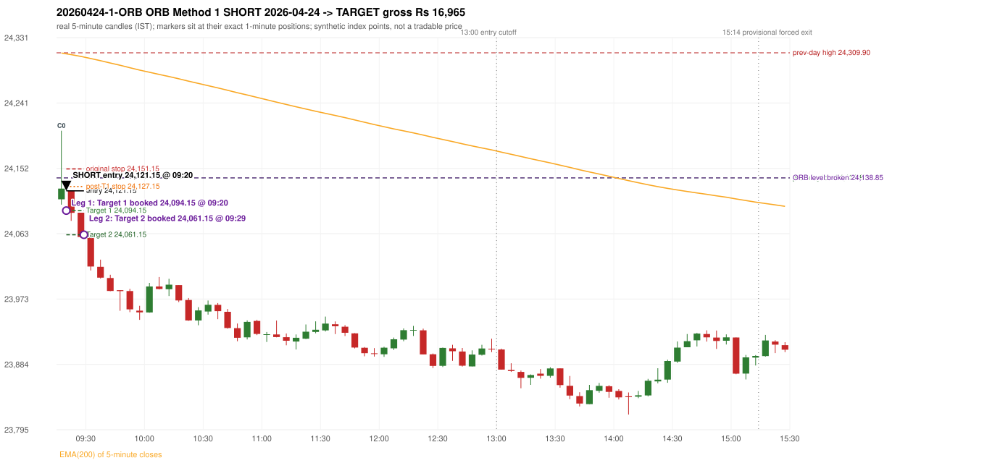

# Trading journal - 2026-04-24 (Friday)

> Automated, read-only reconstruction of the Phase 3.0 baseline. Synthetic NIFTY 50 index-point P&L (the index is not tradable). The owner's review status is intentionally blank.

## A. Trading day overview

| item | value |
|---|---|
| Date / weekday | 2026-04-24 / Friday |
| Session type | USABLE_WITH_FLAGS / VALID |
| Original session open (first 1-minute open) | 24,109.55 |
| Previous session | 2026-04-23 |
| Previous-day high / low | 24,309.90 / 24,138.85 |
| Previous-day official close / last 5-minute close | 24,173.05 / 24,156.05 |
| Raw engine records / confirmed signals / fully valid signals | 4 / 1 / 1 |
| Setups that did not complete (invalidated / incomplete) | 3 |
| Executed trades | 1 20260424-1-ORB |
| Gross P&L (Rs, synthetic) | 16,965.00 |
| Illustrative net P&L (Rs; Rs 500/trade + 0.5 pt/fill) | 16,075.00 |
| Day-end portfolio status | DAY_FINISHED |
| Manual journal trades (matched / unmatched) | 0 (0 / 0) |
| Extra automated trades | 1 |

## B. Daily strategy signal timeline (confirmed signals, chronological)

| time | strategy | method | dir | entry-rule status | valid for execution | <= 13:00 | portfolio state | accepted / ignored | specific reason | competing (same minute) |
|---|---|---|---|---|---|---|---|---|---|---|
| 09:20 | ORB | Method 1 | SHORT | PROPOSAL_DEPENDENT | True | True | FIRST_TRADE_ACTIVE | ACCEPTED -> 20260424-1-ORB | first eligible signal of the day; trade 1: TARGET |  |

Engine setups that did not complete (3); the complete list with failed rule ids is in `rejected_signals.csv`:

| candle | strategy | method | dir | status | precise reason | failed rules |
|---|---|---|---|---|---|---|
| 09:15 | ORB | Method 2 | SHORT | INVALIDATED | TRENDLINE_NOT_SUPPORTIVE | ORB-M2-SHORT-001 |
| 09:15 | PDS | Method 1/2/3 | SHORT | INCOMPLETE_AT_EOD | NO_QUALIFYING_ENTRY_BEFORE_SESSION_END |  |
| 09:20 | RF | RF | LONG | INCOMPLETE_AT_EOD | NO_RETURN_INSIDE_BEFORE_SESSION_END |  |

## C. Detailed trade journals

### 20260424-1-ORB: ORB Method 1 SHORT (FIRST trade)

Chart: 

**Rule configuration:** CFG-baseline-be1db2a09d - signal verification status **PROPOSAL_DEPENDENT** (never VERIFIED while a rule rests on a proposal).

#### 1. Setup identification

ORB Method 1 SHORT: the first completed 5-minute candle (09:15-09:20) closed at 24,124.20, 14.65 points below the previous-day low 24,138.85; its body occupied 14.49% of its range and its lower wick 7.22% (thresholds 60% / 20%): the strong-candle test FAILED; the candle was admitted through the conditional PIN-BAR alternative instead (the upper wick 79.15 points is 5.40 x the body, required 2x; the close is 21.71% of the range from the low, allowed 30%). Note: the candle is bullish, i.e. against the trade direction; the pin route accepts it because the level break and close beyond it carry the direction; the EMA-only trend filter passed. Entry decision at 09:20.

#### 2. Candle and indicator calculations

| role | session | candle | O | H | L | C | range | body % | upper wick % | lower wick % | direction | EMA(200) | strong bull / bear | pin bull / bear | small (body<=30%) | used for |
|---|---|---|---|---|---|---|---|---|---|---|---|---|---|---|---|---|
| first_candle | TODAY | 09:15-09:20 | 24,109.55 | 24,203.35 | 24,102.25 | 24,124.20 | 101.10 | 14.49 | 78.29 | 7.22 | BULLISH | 24,309.62 | False / False | False / True | True | the 09:15 first five-minute candle - the ORB decision candle |
| prev_day_extreme_candle | PREVIOUS | 09:15-09:20 | 24,208.15 | 24,225.00 | 24,138.85 | 24,201.35 | 86.15 | 7.89 | 19.56 | 72.55 | BEARISH | 24,421.74 | False / False | True / False | True | candle that made the previous session's high/low used as the level |
| prev_session_last_candle | PREVIOUS | 15:25-15:30 | 24,162.15 | 24,169.20 | 24,149.80 | 24,156.05 | 19.40 | 31.44 | 36.34 | 32.22 | BEARISH | 24,311.48 | False / False | False / False | False | trend: previous session's last 5-minute close vs its EMA(200) |

Every condition, with the rule, the calculation, the observed values and the result:

| # | group | rule | result | status / numeric definition | calculation | observed | required | available at | why it matters |
|---|---|---|---|---|---|---|---|---|---|
| 1 | SELECTION | SEL-FIRST-001 | PASS | USER_APPROVED / USER_APPROVED | earliest CONFIRMED signal of the day across IRF/ORB/PDR/PDS/RF that passed the controller's checks | 0 confirmed signal(s) earlier today; 1 confirmed signals in the day in total, this one at 09:20 | no earlier executable signal | 2026-04-24 09:20 | the shared controller trades only the first valid signal; the five strategies are not independent positions |
| 2 | SELECTION | SEL-TIE-001 | PASS | USER_APPROVED / USER_APPROVED | other CONFIRMED signals with exactly the same confirmation timestamp | none | no different-strategy / opposite-direction signal in the same minute (otherwise an unresolved conflict, no trade) | 2026-04-24 09:20 | an unresolved same-minute collision would have produced no trade at all |
| 3 | SELECTION | ENTRY-CUTOFF-001 | PASS | USER_APPROVED / USER_APPROVED | fill timestamp vs 13:00:00 IST | signal confirmed 09:20; fill 09:20 | fill at or before 13:00:00 IST | 2026-04-24 09:20 | no new position may be entered with a fill after 13:00 IST |
| 4 | SELECTION | EXE-FILL-001 | PASS | PROPOSED_FOR_REVIEW / PROPOSED_FOR_REVIEW | fill = open of the 1-minute bar that starts at the signal candle's end | bar 09:20 O 24,121.15 H 24,121.75 L 24,087.70 C 24,087.70; executable=True; entry 24,121.15 | fill bar exists, starts exactly at the signal end, is fillable; entry = its open | 2026-04-24 09:20 | a 5-minute signal is known only when its candle closes; the first price that can be traded is the next minute's open |
| 5 | SELECTION | DAY-MAX-001 | PASS | USER_APPROVED / USER_APPROVED | number of entries today | trade 1 of at most 2 | <= 2 entries per day | 2026-04-24 09:20 | daily trade cap |
| 6 | SETUP | ORB-GLOBAL-001 | PASS | SOURCE_VERIFIED / EXPLICIT_IN_SOURCE | decision is taken once the first 5-minute candle (09:15-09:20) has closed | candle 09:15-09:20; signal confirmed 09:20 | decision at 09:20, never before the close | 2026-04-24 09:20 | the close of the first candle is unknown before 09:20 |
| 7 | SETUP | ORB-GLOBAL-002 | PASS | SOURCE_VERIFIED / EXPLICIT_IN_SOURCE | direction | SHORT | same rules in both directions | 2026-04-24 09:20 | ORB trades the side of the break |
| 8 | SETUP | ORB-GLOBAL-004 | PASS | SOURCE_VERIFIED / QUALITATIVE_SOURCE_NUMERIC_DEFINITION_PROPOSED_FOR_REVIEW | entry at 09:20, after the first-candle close | signal confirmed 09:20; fill 09:20 at the open of that minute | 09:20 entry | 2026-04-24 09:20 | the guide enters at 9:20; the fill price convention (next minute open) is a proposal |
| 9 | SETUP | ORB-M1-SHORT-001 | PASS | SOURCE_VERIFIED / QUALITATIVE_SOURCE_NUMERIC_DEFINITION_PROPOSED_FOR_REVIEW | prev_day_low = the lowest low of all 5-minute candles of the previous session 2026-04-23 | previous-day low 24,138.85 (set by the 09:15 candle; previous session range 24,138.85 - 24,309.90; engine recorded 24,138.85) | previous-day resistance (long) / support (short) | 2026-04-23 09:20 | a mechanical proxy for the guide's hand-drawn previous-day level; the source charts show multi-session boxes (documented difference) |
| 10 | SETUP | ORB-M1-SHORT-002 | PASS | SOURCE_VERIFIED / EXPLICIT_IN_SOURCE | the first candle breaks and closes beyond the level | high 24,203.35 / low 24,102.25, close 24,124.20: 14.65 points beyond 24,138.85 | low and close < level | 2026-04-24 09:20 | a wick alone is not a breakout; the close decides |
| 11 | TREND | ORB-TREND-001 | PASS | SOURCE_VERIFIED / QUALITATIVE_SOURCE_NUMERIC_DEFINITION_PROPOSED_FOR_REVIEW | previous session's final completed 5-minute candle: close vs its EMA(200 of 5-minute closes) | previous session 2026-04-23 last candle 15:25-15:30 close 24,156.05 vs EMA(200) 24,311.48: 155.43 points below the EMA -> trend bearish (EMA_PREV_SESSION_CLOSE; research variant A, EMA-only) | close < EMA(200) | 2026-04-23 15:30 | the opening gap can never create the trend: only information that existed before today's open is used |
| 12 | TREND | ORB-TREND-002 | PASS | SOURCE_VERIFIED / QUALITATIVE_SOURCE_NUMERIC_DEFINITION_PROPOSED_FOR_REVIEW | price location versus the 200 EMA is the basic confirmation; structure is only 'supporting' | 155.43 points below the EMA(200) on the previous session's last 5-minute close; swing structure not used in variant A | price on the trend side of the 200 EMA | 2026-04-23 15:30 | the rulebook calls EMA position 'a basic confirmation, supported by bullish structure'; the structure part has no numeric definition |
| 13 | TREND | TREND-SWING-001 | NOT_APPLICABLE | PROPOSED_FOR_REVIEW / PROPOSED_FOR_REVIEW | confirmed swing structure | not required by the active trend variant (variant A is the EMA price location only) | n/a | 2026-04-23 15:30 | variant B would additionally require higher-high/higher-low swings; it is a separate labelled scenario |
| 14 | CONFIRMATION | ORB-M1-SHORT-003 | PASS | SOURCE_VERIFIED / QUALITATIVE_SOURCE_NUMERIC_DEFINITION_PROPOSED_FOR_REVIEW | candle quality: strong body and limited opposite wick (or the conditional pin bar) | 09:15-09:20 O 24,109.55 H 24,203.35 L 24,102.25 C 24,124.20; range 101.10, body 14.65 (14.49%), upper wick 79.15 (78.29%), lower wick 7.30 (7.22%), bullish. Strong-bearish test: bearish close, body >= 60% (observed 14.49%), lower wick <= 20% (observed 7.22%) -> not met; pin-bar alternative: wick >= 2 x body and close within the favourable 30% -> met | strong candle (research thresholds) or pin bar | 2026-04-24 09:20 | the guide asks for a 'strong body, small wick' but gives no numbers; the thresholds are proposals |
| 15 | EXECUTION | ORB-GLOBAL-003 | PASS | SOURCE_VERIFIED / EXPLICIT_IN_SOURCE | initial stop = entry + 30 points | entry 24,121.15 -> stop 24,151.15 | stop 30 index points (BASELINE) | 2026-04-24 09:20 | defines the loss if the setup fails before Target 1 |
| 16 | EXECUTION | EXE-T1-001 | PASS | SOURCE_VERIFIED / EXPLICIT_IN_SOURCE | Target 1 = entry +/- 27 points | T1 24,094.15 | 27 points | 2026-04-24 09:20 | Leg 1 (3 lots) is booked at Target 1 |
| 17 | EXECUTION | ORB-GLOBAL-003 | PASS | SOURCE_VERIFIED / EXPLICIT_IN_SOURCE | Target 2 = entry +/- 60 points | T2 24,061.15 | 60 points | 2026-04-24 09:20 | Leg 2 (3 lots) is booked at Target 2 |
| 18 | EXECUTION | POST-T1-STOP-006 | PASS | USER_APPROVED / USER_APPROVED | after T1 the Leg-2 stop = entry + 6 (no trailing) | post-T1 stop 24,127.15 | entry -6 (LONG) / +6 (SHORT) | 2026-04-24 09:20 | protects the remaining three lots once the first three are booked |
| 19 | EXECUTION | SIZE-LOT-001 | PASS | USER_APPROVED / USER_APPROVED | 6 lots x 65 = 390, Leg 1 = 3 lots = 195, Leg 2 = 195 | 6 lots, lot size 65, legs 3+3 | 6 lots in two equal legs | 2026-04-24 09:20 | position size for the synthetic P&L |
| 20 | NOTE | ORB-MA-001 | UNRESOLVED | CONFLICTING / CONFLICTING | which moving average the code uses | EMA(200) of 5-minute closes (the guide says '200 DMA' in some places and '200 EMA' in others); active ma_mode EMA200_5M | the source terminology conflicts | 2026-04-24 09:20 | a daily 200 DMA would give different values |
| 21 | NOTE | NOTE-UNRESOLVED-DEPENDENCIES | UNRESOLVED | NOT_A_RULE / NOT_A_REGISTRY_RULE | rules the signal depends on that the sources leave unresolved | engine-recorded unresolved rule ids: ORB-MA-001; verification status PROPOSAL_DEPENDENT | n/a (disclosure) | 2026-04-24 09:20 | the entry is only as verified as the rules it rests on |

#### 3. Entry decision and explanation

ORB Method 1 SHORT: the first completed 5-minute candle (09:15-09:20) closed at 24,124.20, 14.65 points below the previous-day low 24,138.85; its body occupied 14.49% of its range and its lower wick 7.22% (thresholds 60% / 20%): the strong-candle test FAILED; the candle was admitted through the conditional PIN-BAR alternative instead (the upper wick 79.15 points is 5.40 x the body, required 2x; the close is 21.71% of the range from the low, allowed 30%). Note: the candle is bullish, i.e. against the trade direction; the pin route accepts it because the level break and close beyond it carry the direction; the EMA-only trend filter passed. Entry decision at 09:20.

**Why this trade ahead of the other strategies:** This ORB Method 1 signal was the earliest executable signal of the day: 0 confirmed signal(s) earlier, 0 other in the same minute. No later signal was generated. State of the other four engines at that moment: [IRF: no setup record before this time (a base condition was not met, or nothing triggered)] [PDR: no setup record before this time (a base condition was not met, or nothing triggered)] [PDS: no setup record before this time (a base condition was not met, or nothing triggered)] [RF: no setup record before this time (a base condition was not met, or nothing triggered)]

#### 4. Actual entry execution

| item | value |
|---|---|
| Signal candle | 09:15-09:20 |
| Signal confirmed | 2026-04-24 09:20 |
| Fill timestamp | 2026-04-24 09:20 |
| Entry price | 24,121.15 |
| Source partition / 1-minute bar | data/processed/nifty50/year=2026/month=04/candles.parquet / 2026-04-24 09:20 |
| Source bar O / H / L / C | 24,121.15 / 24,121.75 / 24,087.70 / 24,087.70 |
| Fill assumption | open of the 1-minute bar starting at the signal candle's end (EXE-FILL-001, PROPOSED causal convention) |
| Initial stop / T1 / T2 / post-T1 stop | 24,151.15 / 24,094.15 / 24,061.15 / 24,127.15 |
| Position | 6 lots x 65 = 390 units (Leg 1 195, Leg 2 195) |

#### 5-8. Trade progress, Target 1, post-T1 stop and final exit

Between the 09:20 entry bar and the final exit (10 one-minute bars) the best excursion in favour was 64.35 points at 09:29 and the worst against was 0.60 points at 09:20. At 09:20 price reached Target 1 24,094.15 and three lots exited. At 09:20 the remaining three lots' protective stop was set to 24,127.15 (entry + 6; no trailing, no further change); the engine applies it from the Target-1 bar onward and tests it within that same bar. At 09:29 price reached Target 2 24,061.15 and the remaining three lots exited. No further trade that day (DAY-T2-001).

| leg | qty | exit time | exit price | reason | source 1-minute bar | O / H / L / C | gross points | gross Rs | slippage pts | flags |
|---|---|---|---|---|---|---|---|---|---|---|
| 1 | 195 | 09:20 | 24,094.15 | TARGET_1 | 09:20 | 24,121.15 / 24,121.75 / 24,087.70 / 24,087.70 | 27.00 | 5,265.00 | 0.00 |  |
| 2 | 195 | 09:29 | 24,061.15 | TARGET_2 | 09:29 | 24,064.15 / 24,064.90 / 24,056.80 / 24,058.10 | 60.00 | 11,700.00 | 0.00 |  |

Exit evidence per leg:

* Leg 1: 1-minute bar 09:20 O 24,121.15 H 24,121.75 L 24,087.70 C 24,087.70: low 24,087.70 reached Target 1 24,094.15; Leg 1 booked at the target level
* Leg 2: 1-minute bar 09:29 O 24,064.15 H 24,064.90 L 24,056.80 C 24,058.10: low 24,056.80 reached Target 2 24,061.15; Leg 2 booked at the target level

#### 9. Gross and illustrative net P&L

| item | value (Rs) |
|---|---|
| Leg 1 gross | 5,265.00 |
| Leg 2 gross | 11,700.00 |
| Trade gross (= Leg 1 + Leg 2) | 16,965.00 |
| Illustrative fixed cost | -500.00 |
| Illustrative slippage (0.5 pt on every fill, entry + exits, all units) | -390.00 |
| Illustrative net | 16,075.00 |

#### 10. Manual journal comparison

EXTRA_AUTOMATED_TRADE: the automated system took ORB Method 1 SHORT at 09:20 (no manual trade that day). The setup rests on: ORB-MA-001: 200 DMA versus 200 EMA terminology conflict | NOTE-UNRESOLVED-DEPENDENCIES: Disclosure of unresolved source rules behind this signal. The journal shows no corresponding entry.

## D. Manual journal comparison

| comparison | journal row | journal strategy | manual time | manual direction | manual outcome | match class | trade | auto entry | auto outcome | explanation |
|---|---|---|---|---|---|---|---|---|---|---|
| E088 |  |  |  |  |  | EXTRA_AUTOMATED_TRADE | 20260424-1-ORB | 09:20 @ 24,121.15 | TARGET | EXTRA_AUTOMATED_TRADE: the automated system took ORB Method 1 SHORT at 09:20 (no manual trade that day). The setup rests on: ORB-MA-001: 200 DMA versus 200 EMA terminology conflict \| NOTE-UNRESOLVED-DEPENDENCIES: Disclosure of unresolved source rules behind this signal. The journal shows no corresponding entry. |

The journal records no entry price and no exit price (NOT_RECORDED); matching uses date, strategy and candle start only - never P&L.

## E. Daily conclusion

* **Traded:** 20260424-1-ORB - ORB Method 1 SHORT at 09:20 (entry 24,121.15), outcome TARGET, gross Rs 16,965.00, illustrative net Rs 16,075.00. **Why:** This ORB Method 1 signal was the earliest executable signal of the day: 0 confirmed signal(s) earlier, 0 other in the same minute. No later signal was generated. State of the other four engines at that moment: [IRF: no setup record before this time (a base condition was not met, or nothing triggered)] [PDR: no setup record before this time (a base condition was not met, or nothing triggered)] [PDS: no setup record before this time (a base condition was not met, or nothing triggered)] [RF: no setup record before this time (a base condition was not met, or nothing triggered)] **How it ended:** At 09:20 price reached Target 1 24,094.15 and three lots exited. At 09:20 the remaining three lots' protective stop was set to 24,127.15 (entry + 6; no trailing, no further change); the engine applies it from the Target-1 bar onward and tests it within that same bar. At 09:29 price reached Target 2 24,061.15 and the remaining three lots exited. No further trade that day (DAY-T2-001).
* **Extra automated trade 20260424-1-ORB:** EXTRA_AUTOMATED_TRADE: the automated system took ORB Method 1 SHORT at 09:20 (no manual trade that day). The setup rests on: ORB-MA-001: 200 DMA versus 200 EMA terminology conflict | NOTE-UNRESOLVED-DEPENDENCIES: Disclosure of unresolved source rules behind this signal. The journal shows no corresponding entry.
* **Open strategy-definition issues that affected this day:** NOTE-UNRESOLVED-DEPENDENCIES, ORB-MA-001 (Terminology conflict: '200 DMA / EMA' (p.2), '200 EMA' (pp.3,5,7), '200 DMA' (pp.1,8,9,12) for what the charts show as one curved line on a 5-minute chart)
* **Automated triage (not an approval; the owner's review status stays blank):** REVIEW: EXTRA_AUTOMATED
