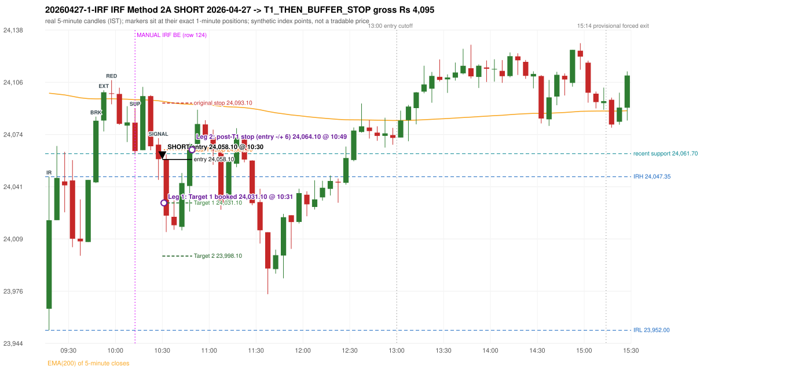

# Trading journal - 2026-04-27 (Monday)

> Automated, read-only reconstruction of the Phase 3.0 baseline. Synthetic NIFTY 50 index-point P&L (the index is not tradable). The owner's review status is intentionally blank.

## A. Trading day overview

| item | value |
|---|---|
| Date / weekday | 2026-04-27 / Monday |
| Session type | USABLE_WITH_FLAGS / VALID |
| Original session open (first 1-minute open) | 23,965.35 |
| Previous session | 2026-04-24 |
| Previous-day high / low | 24,203.35 / 23,815.35 |
| Previous-day official close / last 5-minute close | 23,897.95 / 23,903.95 |
| Raw engine records / confirmed signals / fully valid signals | 10 / 8 / 8 |
| Setups that did not complete (invalidated / incomplete) | 2 |
| Executed trades | 1 20260427-1-IRF |
| Gross P&L (Rs, synthetic) | 4,095.00 |
| Illustrative net P&L (Rs; Rs 500/trade + 0.5 pt/fill) | 3,205.00 |
| Day-end portfolio status | DAY_FINISHED |
| Manual journal trades (matched / unmatched) | 1 (1 / 0) |
| Extra automated trades | 0 |

## B. Daily strategy signal timeline (confirmed signals, chronological)

| time | strategy | method | dir | entry-rule status | valid for execution | <= 13:00 | portfolio state | accepted / ignored | specific reason | competing (same minute) |
|---|---|---|---|---|---|---|---|---|---|---|
| 10:30 | IRF | Method 2A | SHORT | PROPOSAL_DEPENDENT | True | True | FIRST_TRADE_ACTIVE | ACCEPTED -> 20260427-1-IRF | first eligible signal of the day; trade 1: T1_THEN_BUFFER_STOP |  |
| 10:35 | IRF | Method 1 | SHORT | PROPOSAL_DEPENDENT | True | True | FIRST_TRADE_ACTIVE | IGNORED | POSITION_ACTIVE (signal kept for diagnostics only; never reused) [blocked by IRF#1] |  |
| 11:10 | IRF | Method 1 | SHORT | PROPOSAL_DEPENDENT | True | True | DAY_FINISHED | IGNORED | DAY_FINISHED [blocked by IRF#1] |  |
| 11:30 | IRF | Method 1 | SHORT | PROPOSAL_DEPENDENT | True | True | DAY_FINISHED | IGNORED | DAY_FINISHED [blocked by IRF#1] |  |
| 11:35 | IRF | Method 2A | SHORT | PROPOSAL_DEPENDENT | True | True | DAY_FINISHED | IGNORED | DAY_FINISHED [blocked by IRF#1] |  |
| 14:35 | IRF | Method 2A | SHORT | PROPOSAL_DEPENDENT | True | False | DAY_FINISHED | IGNORED | DAY_FINISHED [blocked by IRF#1] | IRF Method 2B SHORT |
| 14:35 | IRF | Method 2B | SHORT | PROPOSAL_DEPENDENT | True | False | DAY_FINISHED | IGNORED | DAY_FINISHED [blocked by IRF#1] | IRF Method 2A SHORT |
| 15:05 | IRF | Method 2B | SHORT | PROPOSAL_DEPENDENT | True | False | DAY_FINISHED | IGNORED | DAY_FINISHED [blocked by IRF#1] |  |

Engine setups that did not complete (2); the complete list with failed rule ids is in `rejected_signals.csv`:

| candle | strategy | method | dir | status | precise reason | failed rules |
|---|---|---|---|---|---|---|
| 15:00 | IRF | Method 1/2 | SHORT | INCOMPLETE_AT_EOD | SESSION_ENDED_BEFORE_CONFIRMATION |  |
| 09:15 | ORB | Method 2 | LONG | INVALIDATED | TREND:EMA_PREV_SESSION_CLOSE wrong side | ORB-TREND-001;ORB-TREND-002 |

## C. Detailed trade journals

### 20260427-1-IRF: IRF Method 2A SHORT (FIRST trade)

Chart: 

**Rule configuration:** CFG-baseline-be1db2a09d - signal verification status **PROPOSAL_DEPENDENT** (never VERIFIED while a rule rests on a proposal).

#### 1. Setup identification

IRF Method 2A SHORT: the 09:45-09:50 candle closed at 24,082.15, above IRH 24,047.35, and the next candle did not close back inside the range, so the setup is Method 2 and price stayed above it until the trigger. Extension candle 09:50-09:55, red candle 09:55-10:00. The trigger came 8 candles after the breakout candle: a completed candle closed below the recent pullback-low support (10:25-10:30); confirmed at 10:30 with close 24,058.30. Entry reference close 24,058.30 is 10.95 points above IRH 24,047.35.

#### 2. Candle and indicator calculations

| role | session | candle | O | H | L | C | range | body % | upper wick % | lower wick % | direction | EMA(200) | strong bull / bear | pin bull / bear | small (body<=30%) | used for |
|---|---|---|---|---|---|---|---|---|---|---|---|---|---|---|---|---|
| initial_range_candle | TODAY | 09:15-09:20 | 23,965.35 | 24,047.35 | 23,952.00 | 24,020.35 | 95.35 | 57.68 | 28.32 | 14.00 | BULLISH | 24,099.23 | False / False | False / False | False | initial range = high/low of the 09:15 candle |
| signal_candle | TODAY | 10:25-10:30 | 24,067.30 | 24,071.35 | 24,045.40 | 24,058.30 | 25.95 | 34.68 | 15.61 | 49.71 | BEARISH | 24,094.54 | False / False | False / False | False | candle whose close completed the trigger |
| breakout_candle | TODAY | 09:45-09:50 | 24,043.90 | 24,084.70 | 24,043.45 | 24,082.15 | 41.25 | 92.73 | 6.18 | 1.09 | BULLISH | 24,095.72 | True / False | False / False | False | breakout candle: a completed candle closing above IRH |
| extension_candle | TODAY | 09:50-09:55 | 24,082.25 | 24,101.05 | 24,075.45 | 24,099.80 | 25.60 | 68.55 | 4.88 | 26.56 | BULLISH | 24,095.76 | True / False | False / False | False | extension: first later candle trading above the breakout candle's high |
| red_candle | TODAY | 09:55-10:00 | 24,099.15 | 24,107.35 | 24,092.35 | 24,099.05 | 15.00 | 0.67 | 54.67 | 44.67 | BEARISH | 24,095.79 | False / False | False / False | True | first red candle during the extension |
| support_pivot | TODAY | 10:10-10:15 | 24,080.95 | 24,090.00 | 24,061.70 | 24,063.30 | 28.30 | 62.37 | 31.98 | 5.65 | BEARISH | 24,095.17 | False / True | False / False | False | recent support: latest 3-candle fractal low formed after the breakout |

Every condition, with the rule, the calculation, the observed values and the result:

| # | group | rule | result | status / numeric definition | calculation | observed | required | available at | why it matters |
|---|---|---|---|---|---|---|---|---|---|
| 1 | SELECTION | SEL-FIRST-001 | PASS | USER_APPROVED / USER_APPROVED | earliest CONFIRMED signal of the day across IRF/ORB/PDR/PDS/RF that passed the controller's checks | 0 confirmed signal(s) earlier today; 8 confirmed signals in the day in total, this one at 10:30 | no earlier executable signal | 2026-04-27 10:30 | the shared controller trades only the first valid signal; the five strategies are not independent positions |
| 2 | SELECTION | SEL-TIE-001 | PASS | USER_APPROVED / USER_APPROVED | other CONFIRMED signals with exactly the same confirmation timestamp | none | no different-strategy / opposite-direction signal in the same minute (otherwise an unresolved conflict, no trade) | 2026-04-27 10:30 | an unresolved same-minute collision would have produced no trade at all |
| 3 | SELECTION | ENTRY-CUTOFF-001 | PASS | USER_APPROVED / USER_APPROVED | fill timestamp vs 13:00:00 IST | signal confirmed 10:30; fill 10:30 | fill at or before 13:00:00 IST | 2026-04-27 10:30 | no new position may be entered with a fill after 13:00 IST |
| 4 | SELECTION | EXE-FILL-001 | PASS | PROPOSED_FOR_REVIEW / PROPOSED_FOR_REVIEW | fill = open of the 1-minute bar that starts at the signal candle's end | bar 10:30 O 24,058.10 H 24,061.20 L 24,041.85 C 24,042.35; executable=True; entry 24,058.10 | fill bar exists, starts exactly at the signal end, is fillable; entry = its open | 2026-04-27 10:30 | a 5-minute signal is known only when its candle closes; the first price that can be traded is the next minute's open |
| 5 | SELECTION | DAY-MAX-001 | PASS | USER_APPROVED / USER_APPROVED | number of entries today | trade 1 of at most 2 | <= 2 entries per day | 2026-04-27 10:30 | daily trade cap |
| 6 | SETUP | IRF-GLOBAL-001 | PASS | SOURCE_VERIFIED / EXPLICIT_IN_SOURCE | initial range = high and low (wicks included) of the first completed 5-minute candle | 09:15-09:20 IRH 24,047.35, IRL 23,952.00 (range 95.35; engine recorded IRH 24,047.35, IRL 23,952.00) | high/low of the 09:15-09:20 candle | 2026-04-27 09:20 | all three IRF methods measure price against this range |
| 7 | SETUP | IRF-GLOBAL-003 | PASS | SOURCE_VERIFIED / EXPLICIT_IN_SOURCE | closes confirm, wicks do not: every trigger is evaluated on a completed 5-minute candle | trigger candle 10:25-10:30 was complete when the signal was stamped 10:30; decision uses its close 24,058.30 | completed candle close, not an intra-candle wick | 2026-04-27 10:30 | an intra-candle wick can reverse before the candle closes |
| 8 | SETUP | IRF-GLOBAL-002 | PASS | SOURCE_VERIFIED / EXPLICIT_IN_SOURCE | direction | SHORT (IRF trades short only) | short only | 2026-04-27 10:30 | IRF fades failed upside breakouts |
| 9 | SETUP | IRF-M2-001 | PASS | SOURCE_VERIFIED / EXPLICIT_IN_SOURCE | breakout candle close vs IRH | 09:45-09:50 O 24,043.90 H 24,084.70 L 24,043.45 C 24,082.15; range 41.25, body 38.25 (92.73%), upper wick 2.55 (6.18%), lower wick 0.45 (1.09%), bullish; close 24,082.15 is 34.80 points above IRH 24,047.35 | close > IRH (a wick above IRH is not a breakout) | 2026-04-27 09:50 | starts every IRF setup |
| 10 | SETUP | IRF-M2-004 | PASS | SOURCE_VERIFIED / EXPLICIT_IN_SOURCE | the candle after the breakout must NOT close back inside the range (else the setup is Method 1) | 09:50 close 24,099.80 vs [23,952.00, 24,047.35) | not (IRL <= close < IRH) | 2026-04-27 09:55 | separates Method 2 (price holds above) from Method 1 (immediate failure) |
| 11 | SETUP | IRF-M2-002 | PASS | SOURCE_VERIFIED / QUALITATIVE_SOURCE_NUMERIC_DEFINITION_PROPOSED_FOR_REVIEW | extension = a later candle whose high exceeds the breakout candle's high (research definition E1) | 09:50 high 24,101.05 vs breakout candle high 24,084.70 (+16.35) | high > breakout candle high | 2026-04-27 09:55 | the guide says price 'extends further upward'; the numeric test is a proposal |
| 12 | SETUP | IRF-M2-003 | PASS | SOURCE_VERIFIED / QUALITATIVE_SOURCE_NUMERIC_DEFINITION_PROPOSED_FOR_REVIEW | a red candle (close < open) forms after the extension | 09:55-10:00 O 24,099.15 H 24,107.35 L 24,092.35 C 24,099.05; range 15.00, body 0.10 (0.67%), upper wick 8.20 (54.67%), lower wick 6.70 (44.67%), bearish | close < open, at or after the candle following the extension | 2026-04-27 10:00 | the red candle shows the first pause/reversal inside the extension |
| 13 | CONFIRMATION | IRF-M2A-001 | PASS | SOURCE_VERIFIED / QUALITATIVE_SOURCE_NUMERIC_DEFINITION_PROPOSED_FOR_REVIEW | recent support = latest 3-candle fractal low (k=1) among candles b+1 ... i-2 | 10:10 low 24,061.70; neighbours' lows 24,068.90 (10:05) and 24,063.90 (10:15) are not lower; engine recorded support 24,061.70 | pivot low known before the trigger candle | 2026-04-27 10:20 | the support is the level whose break completes Method 2A (the exact 'pullback low' definition is a proposal) |
| 14 | CONFIRMATION | IRF-M2A-002 | PASS | SOURCE_VERIFIED / EXPLICIT_WORDING_DETAIL_PROPOSED_FOR_REVIEW | trigger candle closes below recent support | 10:25 close 24,058.30 vs support 24,061.70: 3.40 points below | close < support (close, not wick) | 2026-04-27 10:30 | completes Method 2A |
| 15 | CONFIRMATION | IRF-M2-005 | PASS | SOURCE_VERIFIED / EXPLICIT_IN_SOURCE | chronology: the red candle precedes the break candle | red candle 09:55, break candle 10:25 | red candle index < break candle index (m2a_break_may_be_red_candle = False) | 2026-04-27 10:30 | a red candle alone is not confirmation; a level break is required |
| 16 | EXECUTION | EXE-STOP-001 | PASS | USER_APPROVED / USER_APPROVED | initial stop = entry + 35 points | entry 24,058.10 -> stop 24,093.10 | stop 35 index points (BASELINE) | 2026-04-27 10:30 | defines the loss if the setup fails before Target 1 |
| 17 | EXECUTION | EXE-T1-001 | PASS | SOURCE_VERIFIED / EXPLICIT_IN_SOURCE | Target 1 = entry +/- 27 points | T1 24,031.10 | 27 points | 2026-04-27 10:30 | Leg 1 (3 lots) is booked at Target 1 |
| 18 | EXECUTION | IRF-TGT-001 | PASS | SOURCE_VERIFIED / EXPLICIT_IN_SOURCE | Target 2 = entry +/- 60 points | T2 23,998.10 | 60 points | 2026-04-27 10:30 | Leg 2 (3 lots) is booked at Target 2 |
| 19 | EXECUTION | POST-T1-STOP-006 | PASS | USER_APPROVED / USER_APPROVED | after T1 the Leg-2 stop = entry + 6 (no trailing) | post-T1 stop 24,064.10 | entry -6 (LONG) / +6 (SHORT) | 2026-04-27 10:30 | protects the remaining three lots once the first three are booked |
| 20 | EXECUTION | SIZE-LOT-001 | PASS | USER_APPROVED / USER_APPROVED | 6 lots x 65 = 390, Leg 1 = 3 lots = 195, Leg 2 = 195 | 6 lots, lot size 65, legs 3+3 | 6 lots in two equal legs | 2026-04-27 10:30 | position size for the synthetic P&L |
| 21 | NOTE | IRF-M2-006 | UNRESOLVED | UNRESOLVED / UNRESOLVED | delay between the breakout candle and this trigger; expiry rule | 8 candles after the breakout; expiry none configured | the source states no expiry | 2026-04-27 10:30 | an old breakout can still trigger hours later |
| 22 | NOTE | IRF-M2-006 | UNRESOLVED | UNRESOLVED / UNRESOLVED | did price stay above IRH between the breakout and the trigger? | 0 closes at or below IRH between 09:50 and 10:25; trigger close 24,058.30 above IRH 24,047.35 | the engine does not require price to stay above IRH | 2026-04-27 10:30 | the guide describes price 'holding above IRH and keeping rising'; the code only needs the level break |
| 23 | NOTE | IRF-GLOBAL-004 | UNRESOLVED | UNRESOLVED / UNRESOLVED | which close above IRH of the session produced this attempt; repeat setups | this breakout is upward crossing no. 1 of the session (a close above IRH after a close at/below it) | the source states no first-breakout-only, re-arming, expiry or trades-per-day rule | 2026-04-27 10:30 | IRF re-arms on every later breakout in the code, producing many raw setups; the controller keeps only the first |
| 24 | NOTE | NOTE-IRF-REPEATED-SETUPS | NOT_APPLICABLE | NOT_A_RULE / NOT_A_REGISTRY_RULE | other IRF signals later in the session (not traded) | 7 further confirmed IRF signal(s): Method 1@10:35, Method 1@11:10, Method 1@11:30, Method 2A@11:35, Method 2A@14:35, Method 2B@14:35, Method 2B@15:05 | disclosure of repeated raw setups | 2026-04-27 10:30 | repeated raw IRF setups are not hidden; they are logged as ignored |
| 25 | NOTE | IRF-SL-001 | NOT_APPLICABLE | SOURCE_VERIFIED / QUALITATIVE_SOURCE_NUMERIC_DEFINITION_PROPOSED_FOR_REVIEW | the guide's 35-or-40 rule: 35 if the most recent green candle's high is within 35 points of entry, else 40 | most recent green candle high 24,103.15 is 45.05 points from the entry 24,058.10: the guide's rule would select 40 points; the baseline applies a fixed 35 (USER_APPROVED research baseline; the 35-vs-40 selection and the 40-point variant are separate labelled scenarios) | source selection rule | 2026-04-27 10:30 | the stop distance is a modelling choice and changes losses, not entries |
| 26 | NOTE | NOTE-UNRESOLVED-DEPENDENCIES | UNRESOLVED | NOT_A_RULE / NOT_A_REGISTRY_RULE | rules the signal depends on that the sources leave unresolved | engine-recorded unresolved rule ids: IRF-GLOBAL-004; verification status PROPOSAL_DEPENDENT | n/a (disclosure) | 2026-04-27 10:30 | the entry is only as verified as the rules it rests on |

#### 3. Entry decision and explanation

IRF Method 2A SHORT: the 09:45-09:50 candle closed at 24,082.15, above IRH 24,047.35, and the next candle did not close back inside the range, so the setup is Method 2 and price stayed above it until the trigger. Extension candle 09:50-09:55, red candle 09:55-10:00. The trigger came 8 candles after the breakout candle: a completed candle closed below the recent pullback-low support (10:25-10:30); confirmed at 10:30 with close 24,058.30. Entry reference close 24,058.30 is 10.95 points above IRH 24,047.35.

**Why this trade ahead of the other strategies:** This IRF Method 2A signal was the earliest executable signal of the day: 0 confirmed signal(s) earlier, 0 other in the same minute. 7 later confirmed signal(s) (IRF x7) are logged as ignored or rejected. State of the other four engines at that moment: [ORB: Method 2 invalidated at 09:15: TREND:EMA_PREV_SESSION_CLOSE wrong side] [PDR: no setup record before this time (a base condition was not met, or nothing triggered)] [PDS: no setup record before this time (a base condition was not met, or nothing triggered)] [RF: no setup record before this time (a base condition was not met, or nothing triggered)]

#### 4. Actual entry execution

| item | value |
|---|---|
| Signal candle | 10:25-10:30 |
| Signal confirmed | 2026-04-27 10:30 |
| Fill timestamp | 2026-04-27 10:30 |
| Entry price | 24,058.10 |
| Source partition / 1-minute bar | data/processed/nifty50/year=2026/month=04/candles.parquet / 2026-04-27 10:30 |
| Source bar O / H / L / C | 24,058.10 / 24,061.20 / 24,041.85 / 24,042.35 |
| Fill assumption | open of the 1-minute bar starting at the signal candle's end (EXE-FILL-001, PROPOSED causal convention) |
| Initial stop / T1 / T2 / post-T1 stop | 24,093.10 / 24,031.10 / 23,998.10 / 24,064.10 |
| Position | 6 lots x 65 = 390 units (Leg 1 195, Leg 2 195) |

#### 5-8. Trade progress, Target 1, post-T1 stop and final exit

Between the 10:30 entry bar and the final exit (20 one-minute bars) the best excursion in favour was 45.10 points at 10:33 and the worst against was 10.25 points at 10:49. At 10:31 price reached Target 1 24,031.10 and three lots exited. At 10:31 the remaining three lots' protective stop was set to 24,064.10 (entry + 6; no trailing, no further change); the engine applies it from the Target-1 bar onward and tests it within that same bar. At 10:49 the remaining three lots stopped out at 24,064.10. T1_THEN_BUFFER_STOP: no second trade that day (DAY-BUF-001).

| leg | qty | exit time | exit price | reason | source 1-minute bar | O / H / L / C | gross points | gross Rs | slippage pts | flags |
|---|---|---|---|---|---|---|---|---|---|---|
| 1 | 195 | 10:31 | 24,031.10 | TARGET_1 | 10:31 | 24,041.40 / 24,044.50 / 24,024.05 / 24,028.40 | 27.00 | 5,265.00 | 0.00 |  |
| 2 | 195 | 10:49 | 24,064.10 | POST_T1_STOP_ENTRY_MINUS_PLUS_6 | 10:49 | 24,061.70 / 24,068.35 / 24,061.30 / 24,067.60 | -6.00 | -1,170.00 | 0.00 |  |

Exit evidence per leg:

* Leg 1: 1-minute bar 10:31 O 24,041.40 H 24,044.50 L 24,024.05 C 24,028.40: low 24,024.05 reached Target 1 24,031.10; Leg 1 booked at the target level
* Leg 2: 1-minute bar 10:49 O 24,061.70 H 24,068.35 L 24,061.30 C 24,067.60: high 24,068.35 reached the post-T1 stop 24,064.10; Leg 2 exits at 24,064.10 at the stop level

#### 9. Gross and illustrative net P&L

| item | value (Rs) |
|---|---|
| Leg 1 gross | 5,265.00 |
| Leg 2 gross | -1,170.00 |
| Trade gross (= Leg 1 + Leg 2) | 4,095.00 |
| Illustrative fixed cost | -500.00 |
| Illustrative slippage (0.5 pt on every fill, entry + exits, all units) | -390.00 |
| Illustrative net | 3,205.00 |

#### 10. Manual journal comparison

TIME_SHIFTED_MATCH: manual IRF labelled 10:10 (candle start) vs automated IRF Method 2A SHORT candle 10:25, filled 10:30 at 24,058.10; time difference 15 minutes. Journal outcome BE vs automated T1_THEN_BUFFER_STOP (same outcome class). The journal records no entry or exit price.

## D. Manual journal comparison

| comparison | journal row | journal strategy | manual time | manual direction | manual outcome | match class | trade | auto entry | auto outcome | explanation |
|---|---|---|---|---|---|---|---|---|---|---|
| M124 | 124 | IRF | 10:10 | SHORT | BE | TIME_SHIFTED_MATCH | 20260427-1-IRF | 10:30 @ 24,058.10 | T1_THEN_BUFFER_STOP | TIME_SHIFTED_MATCH: manual IRF labelled 10:10 (candle start) vs automated IRF Method 2A SHORT candle 10:25, filled 10:30 at 24,058.10; time difference 15 minutes. Journal outcome BE vs automated T1_THEN_BUFFER_STOP (same outcome class). The journal records no entry or exit price. |

The journal records no entry price and no exit price (NOT_RECORDED); matching uses date, strategy and candle start only - never P&L.

## E. Daily conclusion

* **Traded:** 20260427-1-IRF - IRF Method 2A SHORT at 10:30 (entry 24,058.10), outcome T1_THEN_BUFFER_STOP, gross Rs 4,095.00, illustrative net Rs 3,205.00. **Why:** This IRF Method 2A signal was the earliest executable signal of the day: 0 confirmed signal(s) earlier, 0 other in the same minute. 7 later confirmed signal(s) (IRF x7) are logged as ignored or rejected. State of the other four engines at that moment: [ORB: Method 2 invalidated at 09:15: TREND:EMA_PREV_SESSION_CLOSE wrong side] [PDR: no setup record before this time (a base condition was not met, or nothing triggered)] [PDS: no setup record before this time (a base condition was not met, or nothing triggered)] [RF: no setup record before this time (a base condition was not met, or nothing triggered)] **How it ended:** At 10:31 price reached Target 1 24,031.10 and three lots exited. At 10:31 the remaining three lots' protective stop was set to 24,064.10 (entry + 6; no trailing, no further change); the engine applies it from the Target-1 bar onward and tests it within that same bar. At 10:49 the remaining three lots stopped out at 24,064.10. T1_THEN_BUFFER_STOP: no second trade that day (DAY-BUF-001).
* **Ignored / rejected signals:** IRF IGNORED DAY_FINISHED x6; IRF IGNORED POSITION_ACTIVE x1
* **Open strategy-definition issues that affected this day:** IRF-GLOBAL-004 (NOT STATED: how many IRF trades per day, a latest entry time, and whether a new breakout may re-arm a setup after a signal), IRF-M2-006 (How long a Method 2 setup stays valid (expiry / invalidation before a level breaks) is not stated), NOTE-UNRESOLVED-DEPENDENCIES
* **Automated triage (not an approval; the owner's review status stays blank):** REVIEW: TIME_SHIFTED
