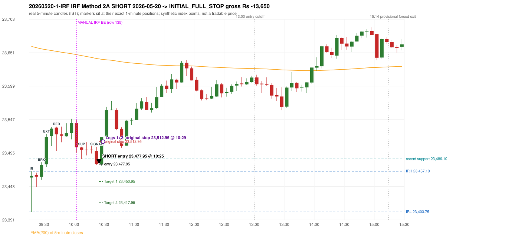
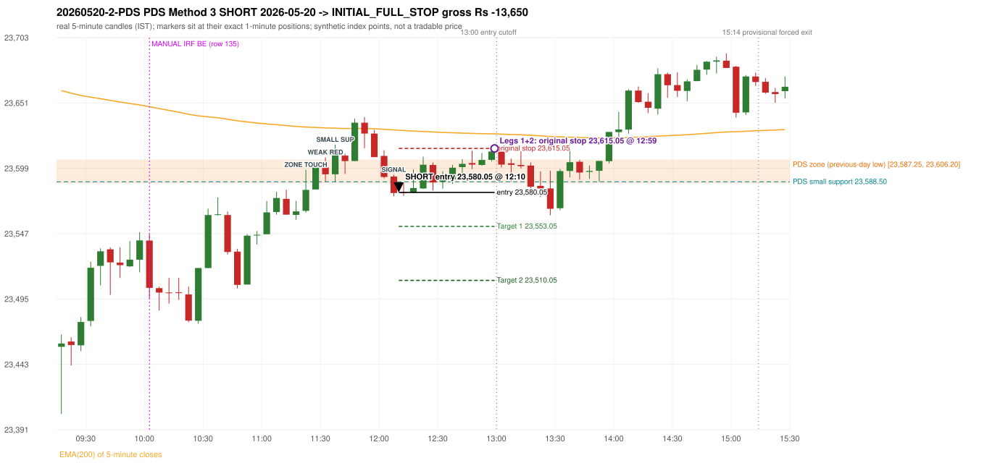

# Trading journal - 2026-05-20 (Wednesday)

> Automated, read-only reconstruction of the Phase 3.0 baseline. Synthetic NIFTY 50 index-point P&L (the index is not tradable). The owner's review status is intentionally blank.

## A. Trading day overview

| item | value |
|---|---|
| Date / weekday | 2026-05-20 / Wednesday |
| Session type | USABLE / VALID |
| Original session open (first 1-minute open) | 23,457.25 |
| Previous session | 2026-05-19 |
| Previous-day high / low | 23,782.20 / 23,587.25 |
| Previous-day official close / last 5-minute close | 23,618.00 / 23,606.20 |
| Raw engine records / confirmed signals / fully valid signals | 17 / 13 / 13 |
| Setups that did not complete (invalidated / incomplete) | 4 |
| Executed trades | 2 20260520-1-IRF;20260520-2-PDS |
| Gross P&L (Rs, synthetic) | -27,300.00 |
| Illustrative net P&L (Rs; Rs 500/trade + 0.5 pt/fill) | -29,080.00 |
| Day-end portfolio status | DAY_FINISHED |
| Manual journal trades (matched / unmatched) | 1 (0 / 1) |
| Extra automated trades | 2 |

## B. Daily strategy signal timeline (confirmed signals, chronological)

| time | strategy | method | dir | entry-rule status | valid for execution | <= 13:00 | portfolio state | accepted / ignored | specific reason | competing (same minute) |
|---|---|---|---|---|---|---|---|---|---|---|
| 10:25 | IRF | Method 2A | SHORT | PROPOSAL_DEPENDENT | True | True | FIRST_TRADE_ACTIVE | ACCEPTED -> 20260520-1-IRF | first eligible signal of the day; trade 1: INITIAL_FULL_STOP |  |
| 11:15 | IRF | Method 2B | SHORT | PROPOSAL_DEPENDENT | True | True | SECOND_TRADE_ELIGIBLE | REJECTED | SECOND_TRADE_RESTRICTED_TO_PDR_PDS [blocked by IRF#1] |  |
| 12:10 | IRF | Method 2A | SHORT | PROPOSAL_DEPENDENT | True | True | SECOND_TRADE_ACTIVE | REJECTED | SECOND_TRADE_RESTRICTED_TO_PDR_PDS [blocked by IRF#1] | IRF Method 2B SHORT; PDS Method 3 SHORT |
| 12:10 | IRF | Method 2B | SHORT | PROPOSAL_DEPENDENT | True | True | SECOND_TRADE_ACTIVE | REJECTED | SECOND_TRADE_RESTRICTED_TO_PDR_PDS [blocked by IRF#1] | IRF Method 2A SHORT; PDS Method 3 SHORT |
| 12:10 | PDS | Method 3 | SHORT | PROPOSAL_DEPENDENT | True | True | SECOND_TRADE_ACTIVE | ACCEPTED -> 20260520-2-PDS | permitted second trade: newly confirmed PDR/PDS after the original full stop; trade 2: INITIAL_FULL_STOP | IRF Method 2A SHORT; IRF Method 2B SHORT |
| 12:15 | PDS | Method 2 | SHORT | PROPOSAL_DEPENDENT | True | True | SECOND_TRADE_ACTIVE | IGNORED | POSITION_ACTIVE (signal kept for diagnostics only; never reused) [blocked by PDS#2] |  |
| 12:50 | IRF | Method 2B | SHORT | PROPOSAL_DEPENDENT | True | True | SECOND_TRADE_ACTIVE | IGNORED | POSITION_ACTIVE (signal kept for diagnostics only; never reused) [blocked by PDS#2] |  |
| 13:05 | IRF | Method 2B | SHORT | PROPOSAL_DEPENDENT | True | False | DAY_FINISHED | IGNORED | DAY_FINISHED [blocked by PDS#2] |  |
| 13:20 | PDS | Method 3 | SHORT | PROPOSAL_DEPENDENT | True | False | DAY_FINISHED | IGNORED | DAY_FINISHED [blocked by PDS#2] |  |
| 13:45 | IRF | Method 2B | SHORT | PROPOSAL_DEPENDENT | True | False | DAY_FINISHED | IGNORED | DAY_FINISHED [blocked by PDS#2] |  |
| 14:35 | IRF | Method 2B | SHORT | PROPOSAL_DEPENDENT | True | False | DAY_FINISHED | IGNORED | DAY_FINISHED [blocked by PDS#2] |  |
| 15:05 | IRF | Method 2A | SHORT | PROPOSAL_DEPENDENT | True | False | DAY_FINISHED | IGNORED | DAY_FINISHED [blocked by PDS#2] | IRF Method 2B SHORT |
| 15:05 | IRF | Method 2B | SHORT | PROPOSAL_DEPENDENT | True | False | DAY_FINISHED | IGNORED | DAY_FINISHED [blocked by PDS#2] | IRF Method 2A SHORT |

Engine setups that did not complete (4); the complete list with failed rule ids is in `rejected_signals.csv`:

| candle | strategy | method | dir | status | precise reason | failed rules |
|---|---|---|---|---|---|---|
| 15:00 | IRF | Method 1/2 | SHORT | INCOMPLETE_AT_EOD | SESSION_ENDED_BEFORE_CONFIRMATION |  |
| 09:15 | ORB | Method 1 | SHORT | INVALIDATED | CANDLE_QUALITY(not a strong body / wick too large) | ORB-M1-SHORT-003 |
| 09:15 | ORB | Method 2 | SHORT | INVALIDATED | CANDLE_QUALITY | ORB-M2-SHORT-003 |
| 13:20 | PDS | Method 1/2/3 | SHORT | INCOMPLETE_AT_EOD | NO_QUALIFYING_ENTRY_BEFORE_SESSION_END |  |

## C. Detailed trade journals

### 20260520-1-IRF: IRF Method 2A SHORT (FIRST trade)

Chart: 

**Rule configuration:** CFG-baseline-be1db2a09d - signal verification status **PROPOSAL_DEPENDENT** (never VERIFIED while a rule rests on a proposal).

#### 1. Setup identification

IRF Method 2A SHORT: the 09:25-09:30 candle closed at 23,476.95, above IRH 23,467.10, and the next candle did not close back inside the range, so the setup is Method 2 and price stayed above it until the trigger. Extension candle 09:30-09:35, red candle 09:40-09:45. The trigger came 11 candles after the breakout candle: a completed candle closed below the recent pullback-low support (10:20-10:25); confirmed at 10:25 with close 23,478.05. Entry reference close 23,478.05 is 10.95 points above IRH 23,467.10.

#### 2. Candle and indicator calculations

| role | session | candle | O | H | L | C | range | body % | upper wick % | lower wick % | direction | EMA(200) | strong bull / bear | pin bull / bear | small (body<=30%) | used for |
|---|---|---|---|---|---|---|---|---|---|---|---|---|---|---|---|---|
| initial_range_candle | TODAY | 09:15-09:20 | 23,457.25 | 23,467.10 | 23,403.75 | 23,459.90 | 63.35 | 4.18 | 11.37 | 84.45 | BULLISH | 23,661.03 | False / False | True / False | True | initial range = high/low of the 09:15 candle |
| signal_candle | TODAY | 10:20-10:25 | 23,498.90 | 23,505.10 | 23,476.75 | 23,478.05 | 28.35 | 73.55 | 21.87 | 4.59 | BEARISH | 23,642.21 | False / True | False / False | False | candle whose close completed the trigger |
| breakout_candle | TODAY | 09:25-09:30 | 23,458.40 | 23,480.90 | 23,453.75 | 23,476.95 | 27.15 | 68.32 | 14.55 | 17.13 | BULLISH | 23,657.20 | True / False | False / False | False | breakout candle: a completed candle closing above IRH |
| extension_candle | TODAY | 09:30-09:35 | 23,477.85 | 23,524.90 | 23,473.50 | 23,520.15 | 51.40 | 82.30 | 9.24 | 8.46 | BULLISH | 23,655.84 | True / False | False / False | False | extension: first later candle trading above the breakout candle's high |
| red_candle | TODAY | 09:40-09:45 | 23,534.80 | 23,536.40 | 23,498.55 | 23,524.40 | 37.85 | 27.48 | 4.23 | 68.30 | BEARISH | 23,653.32 | False / False | False / False | True | first red candle during the extension |
| support_pivot | TODAY | 10:05-10:10 | 23,503.90 | 23,505.20 | 23,486.10 | 23,500.40 | 19.10 | 18.32 | 6.81 | 74.87 | BEARISH | 23,646.77 | False / False | True / False | True | recent support: latest 3-candle fractal low formed after the breakout |

Every condition, with the rule, the calculation, the observed values and the result:

| # | group | rule | result | status / numeric definition | calculation | observed | required | available at | why it matters |
|---|---|---|---|---|---|---|---|---|---|
| 1 | SELECTION | SEL-FIRST-001 | PASS | USER_APPROVED / USER_APPROVED | earliest CONFIRMED signal of the day across IRF/ORB/PDR/PDS/RF that passed the controller's checks | 0 confirmed signal(s) earlier today; 13 confirmed signals in the day in total, this one at 10:25 | no earlier executable signal | 2026-05-20 10:25 | the shared controller trades only the first valid signal; the five strategies are not independent positions |
| 2 | SELECTION | SEL-TIE-001 | PASS | USER_APPROVED / USER_APPROVED | other CONFIRMED signals with exactly the same confirmation timestamp | none | no different-strategy / opposite-direction signal in the same minute (otherwise an unresolved conflict, no trade) | 2026-05-20 10:25 | an unresolved same-minute collision would have produced no trade at all |
| 3 | SELECTION | ENTRY-CUTOFF-001 | PASS | USER_APPROVED / USER_APPROVED | fill timestamp vs 13:00:00 IST | signal confirmed 10:25; fill 10:25 | fill at or before 13:00:00 IST | 2026-05-20 10:25 | no new position may be entered with a fill after 13:00 IST |
| 4 | SELECTION | EXE-FILL-001 | PASS | PROPOSED_FOR_REVIEW / PROPOSED_FOR_REVIEW | fill = open of the 1-minute bar that starts at the signal candle's end | bar 10:25 O 23,477.95 H 23,484.20 L 23,475.65 C 23,481.90; executable=True; entry 23,477.95 | fill bar exists, starts exactly at the signal end, is fillable; entry = its open | 2026-05-20 10:25 | a 5-minute signal is known only when its candle closes; the first price that can be traded is the next minute's open |
| 5 | SELECTION | DAY-MAX-001 | PASS | USER_APPROVED / USER_APPROVED | number of entries today | trade 1 of at most 2 | <= 2 entries per day | 2026-05-20 10:25 | daily trade cap |
| 6 | SETUP | IRF-GLOBAL-001 | PASS | SOURCE_VERIFIED / EXPLICIT_IN_SOURCE | initial range = high and low (wicks included) of the first completed 5-minute candle | 09:15-09:20 IRH 23,467.10, IRL 23,403.75 (range 63.35; engine recorded IRH 23,467.10, IRL 23,403.75) | high/low of the 09:15-09:20 candle | 2026-05-20 09:20 | all three IRF methods measure price against this range |
| 7 | SETUP | IRF-GLOBAL-003 | PASS | SOURCE_VERIFIED / EXPLICIT_IN_SOURCE | closes confirm, wicks do not: every trigger is evaluated on a completed 5-minute candle | trigger candle 10:20-10:25 was complete when the signal was stamped 10:25; decision uses its close 23,478.05 | completed candle close, not an intra-candle wick | 2026-05-20 10:25 | an intra-candle wick can reverse before the candle closes |
| 8 | SETUP | IRF-GLOBAL-002 | PASS | SOURCE_VERIFIED / EXPLICIT_IN_SOURCE | direction | SHORT (IRF trades short only) | short only | 2026-05-20 10:25 | IRF fades failed upside breakouts |
| 9 | SETUP | IRF-M2-001 | PASS | SOURCE_VERIFIED / EXPLICIT_IN_SOURCE | breakout candle close vs IRH | 09:25-09:30 O 23,458.40 H 23,480.90 L 23,453.75 C 23,476.95; range 27.15, body 18.55 (68.32%), upper wick 3.95 (14.55%), lower wick 4.65 (17.13%), bullish; close 23,476.95 is 9.85 points above IRH 23,467.10 | close > IRH (a wick above IRH is not a breakout) | 2026-05-20 09:30 | starts every IRF setup |
| 10 | SETUP | IRF-M2-004 | PASS | SOURCE_VERIFIED / EXPLICIT_IN_SOURCE | the candle after the breakout must NOT close back inside the range (else the setup is Method 1) | 09:30 close 23,520.15 vs [23,403.75, 23,467.10) | not (IRL <= close < IRH) | 2026-05-20 09:35 | separates Method 2 (price holds above) from Method 1 (immediate failure) |
| 11 | SETUP | IRF-M2-002 | PASS | SOURCE_VERIFIED / QUALITATIVE_SOURCE_NUMERIC_DEFINITION_PROPOSED_FOR_REVIEW | extension = a later candle whose high exceeds the breakout candle's high (research definition E1) | 09:30 high 23,524.90 vs breakout candle high 23,480.90 (+44.00) | high > breakout candle high | 2026-05-20 09:35 | the guide says price 'extends further upward'; the numeric test is a proposal |
| 12 | SETUP | IRF-M2-003 | PASS | SOURCE_VERIFIED / QUALITATIVE_SOURCE_NUMERIC_DEFINITION_PROPOSED_FOR_REVIEW | a red candle (close < open) forms after the extension | 09:40-09:45 O 23,534.80 H 23,536.40 L 23,498.55 C 23,524.40; range 37.85, body 10.40 (27.48%), upper wick 1.60 (4.23%), lower wick 25.85 (68.30%), bearish | close < open, at or after the candle following the extension | 2026-05-20 09:45 | the red candle shows the first pause/reversal inside the extension |
| 13 | CONFIRMATION | IRF-M2A-001 | PASS | SOURCE_VERIFIED / QUALITATIVE_SOURCE_NUMERIC_DEFINITION_PROPOSED_FOR_REVIEW | recent support = latest 3-candle fractal low (k=1) among candles b+1 ... i-2 | 10:05 low 23,486.10; neighbours' lows 23,495.75 (10:00) and 23,491.65 (10:10) are not lower; engine recorded support 23,486.10 | pivot low known before the trigger candle | 2026-05-20 10:15 | the support is the level whose break completes Method 2A (the exact 'pullback low' definition is a proposal) |
| 14 | CONFIRMATION | IRF-M2A-002 | PASS | SOURCE_VERIFIED / EXPLICIT_WORDING_DETAIL_PROPOSED_FOR_REVIEW | trigger candle closes below recent support | 10:20 close 23,478.05 vs support 23,486.10: 8.05 points below | close < support (close, not wick) | 2026-05-20 10:25 | completes Method 2A |
| 15 | CONFIRMATION | IRF-M2-005 | PASS | SOURCE_VERIFIED / EXPLICIT_IN_SOURCE | chronology: the red candle precedes the break candle | red candle 09:40, break candle 10:20 | red candle index < break candle index (m2a_break_may_be_red_candle = False) | 2026-05-20 10:25 | a red candle alone is not confirmation; a level break is required |
| 16 | EXECUTION | EXE-STOP-001 | PASS | USER_APPROVED / USER_APPROVED | initial stop = entry + 35 points | entry 23,477.95 -> stop 23,512.95 | stop 35 index points (BASELINE) | 2026-05-20 10:25 | defines the loss if the setup fails before Target 1 |
| 17 | EXECUTION | EXE-T1-001 | PASS | SOURCE_VERIFIED / EXPLICIT_IN_SOURCE | Target 1 = entry +/- 27 points | T1 23,450.95 | 27 points | 2026-05-20 10:25 | Leg 1 (3 lots) is booked at Target 1 |
| 18 | EXECUTION | IRF-TGT-001 | PASS | SOURCE_VERIFIED / EXPLICIT_IN_SOURCE | Target 2 = entry +/- 60 points | T2 23,417.95 | 60 points | 2026-05-20 10:25 | Leg 2 (3 lots) is booked at Target 2 |
| 19 | EXECUTION | POST-T1-STOP-006 | PASS | USER_APPROVED / USER_APPROVED | after T1 the Leg-2 stop = entry + 6 (no trailing) | post-T1 stop 23,483.95 | entry -6 (LONG) / +6 (SHORT) | 2026-05-20 10:25 | protects the remaining three lots once the first three are booked |
| 20 | EXECUTION | SIZE-LOT-001 | PASS | USER_APPROVED / USER_APPROVED | 6 lots x 65 = 390, Leg 1 = 3 lots = 195, Leg 2 = 195 | 6 lots, lot size 65, legs 3+3 | 6 lots in two equal legs | 2026-05-20 10:25 | position size for the synthetic P&L |
| 21 | NOTE | IRF-M2-006 | UNRESOLVED | UNRESOLVED / UNRESOLVED | delay between the breakout candle and this trigger; expiry rule | 11 candles after the breakout; expiry none configured | the source states no expiry | 2026-05-20 10:25 | an old breakout can still trigger hours later |
| 22 | NOTE | IRF-M2-006 | UNRESOLVED | UNRESOLVED / UNRESOLVED | did price stay above IRH between the breakout and the trigger? | 0 closes at or below IRH between 09:30 and 10:20; trigger close 23,478.05 above IRH 23,467.10 | the engine does not require price to stay above IRH | 2026-05-20 10:25 | the guide describes price 'holding above IRH and keeping rising'; the code only needs the level break |
| 23 | NOTE | IRF-GLOBAL-004 | UNRESOLVED | UNRESOLVED / UNRESOLVED | which close above IRH of the session produced this attempt; repeat setups | this breakout is upward crossing no. 1 of the session (a close above IRH after a close at/below it) | the source states no first-breakout-only, re-arming, expiry or trades-per-day rule | 2026-05-20 10:25 | IRF re-arms on every later breakout in the code, producing many raw setups; the controller keeps only the first |
| 24 | NOTE | NOTE-IRF-REPEATED-SETUPS | NOT_APPLICABLE | NOT_A_RULE / NOT_A_REGISTRY_RULE | other IRF signals later in the session (not traded) | 9 further confirmed IRF signal(s): Method 2B@11:15, Method 2A@12:10, Method 2B@12:10, Method 2B@12:50, Method 2B@13:05, Method 2B@13:45, Method 2B@14:35, Method 2A@15:05 ... | disclosure of repeated raw setups | 2026-05-20 10:25 | repeated raw IRF setups are not hidden; they are logged as ignored |
| 25 | NOTE | IRF-SL-001 | NOT_APPLICABLE | SOURCE_VERIFIED / QUALITATIVE_SOURCE_NUMERIC_DEFINITION_PROPOSED_FOR_REVIEW | the guide's 35-or-40 rule: 35 if the most recent green candle's high is within 35 points of entry, else 40 | most recent green candle high 23,548.50 is 70.55 points from the entry 23,477.95: the guide's rule would select 40 points; the baseline applies a fixed 35 (USER_APPROVED research baseline; the 35-vs-40 selection and the 40-point variant are separate labelled scenarios) | source selection rule | 2026-05-20 10:25 | the stop distance is a modelling choice and changes losses, not entries |
| 26 | NOTE | NOTE-UNRESOLVED-DEPENDENCIES | UNRESOLVED | NOT_A_RULE / NOT_A_REGISTRY_RULE | rules the signal depends on that the sources leave unresolved | engine-recorded unresolved rule ids: IRF-GLOBAL-004; verification status PROPOSAL_DEPENDENT | n/a (disclosure) | 2026-05-20 10:25 | the entry is only as verified as the rules it rests on |

#### 3. Entry decision and explanation

IRF Method 2A SHORT: the 09:25-09:30 candle closed at 23,476.95, above IRH 23,467.10, and the next candle did not close back inside the range, so the setup is Method 2 and price stayed above it until the trigger. Extension candle 09:30-09:35, red candle 09:40-09:45. The trigger came 11 candles after the breakout candle: a completed candle closed below the recent pullback-low support (10:20-10:25); confirmed at 10:25 with close 23,478.05. Entry reference close 23,478.05 is 10.95 points above IRH 23,467.10.

**Why this trade ahead of the other strategies:** This IRF Method 2A signal was the earliest executable signal of the day: 0 confirmed signal(s) earlier, 0 other in the same minute. 12 later confirmed signal(s) (IRF x9, PDS x3) are logged as ignored or rejected. State of the other four engines at that moment: [ORB: Method 1 invalidated at 09:15: CANDLE_QUALITY(not a strong body / wick too large); Method 2 invalidated at 09:15: CANDLE_QUALITY] [PDR: no setup record before this time (a base condition was not met, or nothing triggered)] [PDS: no setup record before this time (a base condition was not met, or nothing triggered)] [RF: no setup record before this time (a base condition was not met, or nothing triggered)]

#### 4. Actual entry execution

| item | value |
|---|---|
| Signal candle | 10:20-10:25 |
| Signal confirmed | 2026-05-20 10:25 |
| Fill timestamp | 2026-05-20 10:25 |
| Entry price | 23,477.95 |
| Source partition / 1-minute bar | data/processed/nifty50/year=2026/month=05/candles.parquet / 2026-05-20 10:25 |
| Source bar O / H / L / C | 23,477.95 / 23,484.20 / 23,475.65 / 23,481.90 |
| Fill assumption | open of the 1-minute bar starting at the signal candle's end (EXE-FILL-001, PROPOSED causal convention) |
| Initial stop / T1 / T2 / post-T1 stop | 23,512.95 / 23,450.95 / 23,417.95 / 23,483.95 |
| Position | 6 lots x 65 = 390 units (Leg 1 195, Leg 2 195) |

#### 5-8. Trade progress, Target 1, post-T1 stop and final exit

Between the 10:25 entry bar and the final exit (5 one-minute bars) the best excursion in favour was 2.30 points at 10:25 and the worst against was 41.95 points at 10:29. At 10:29 price reached the original stop 23,512.95 before Target 1 23,450.95, so all six lots exited together at 23,512.95. This is an INITIAL_FULL_STOP: one more trade is allowed that day, only a newly confirmed PDR/PDS signal.

| leg | qty | exit time | exit price | reason | source 1-minute bar | O / H / L / C | gross points | gross Rs | slippage pts | flags |
|---|---|---|---|---|---|---|---|---|---|---|
| 1 | 195 | 10:29 | 23,512.95 | ORIGINAL_STOP_BEFORE_T1 | 10:29 | 23,508.20 / 23,519.90 / 23,508.20 / 23,519.90 | -35.00 | -6,825.00 | 0.00 |  |
| 2 | 195 | 10:29 | 23,512.95 | ORIGINAL_STOP_BEFORE_T1 | 10:29 | 23,508.20 / 23,519.90 / 23,508.20 / 23,519.90 | -35.00 | -6,825.00 | 0.00 |  |

Exit evidence per leg:

* Leg 1: 1-minute bar 10:29 O 23,508.20 H 23,519.90 L 23,508.20 C 23,519.90: high 23,519.90 reached the original stop 23,512.95 before Target 1 23,450.95 was touched; both legs exit at the stop level 23,512.95
* Leg 2: 1-minute bar 10:29 O 23,508.20 H 23,519.90 L 23,508.20 C 23,519.90: high 23,519.90 reached the original stop 23,512.95 before Target 1 23,450.95 was touched; both legs exit at the stop level 23,512.95

#### 9. Gross and illustrative net P&L

| item | value (Rs) |
|---|---|
| Leg 1 gross | -6,825.00 |
| Leg 2 gross | -6,825.00 |
| Trade gross (= Leg 1 + Leg 2) | -13,650.00 |
| Illustrative fixed cost | -500.00 |
| Illustrative slippage (0.5 pt on every fill, entry + exits, all units) | -390.00 |
| Illustrative net | -14,540.00 |

#### 10. Manual journal comparison

EXTRA_AUTOMATED_TRADE: the automated system took IRF Method 2A SHORT at 10:25 (same strategy manual trade at another time: IRF 10:00 BE). The setup rests on: IRF-M2-006: No expiry / validity window for a Method 2 attempt | IRF-M2-006: Engine does not test that price held above IRH | IRF-GLOBAL-004: IRF trades per day / time window / re-arming are not stated in the guide | NOTE-UNRESOLVED-DEPENDENCIES: Disclosure of unresolved source rules behind this signal. The journal shows no corresponding entry.

### 20260520-2-PDS: PDS Method 3 SHORT (SECOND trade)

Chart: 

**Rule configuration:** CFG-baseline-be1db2a09d - signal verification status **PROPOSAL_DEPENDENT** (never VERIFIED while a rule rests on a proposal).

#### 1. Setup identification

PDS Method 3 SHORT: the session opened 130.00 points below the previous-day-low zone [23,587.25, 23,606.20]; the first red candle at the zone (11:30) was weak (body 28.09%), so the engine waited for a small support; the 11:35 candle's low 23,588.50 (-1.25 points below the zone floor) was broken by the close of the 12:05 candle (23,579.60); confirmed 12:10.

#### 2. Candle and indicator calculations

| role | session | candle | O | H | L | C | range | body % | upper wick % | lower wick % | direction | EMA(200) | strong bull / bear | pin bull / bear | small (body<=30%) | used for |
|---|---|---|---|---|---|---|---|---|---|---|---|---|---|---|---|---|
| zone_source_candle | PREVIOUS | 15:25-15:30 | 23,597.00 | 23,607.15 | 23,587.25 | 23,606.20 | 19.90 | 46.23 | 4.77 | 48.99 | BULLISH | 23,663.05 | False / False | False / False | False | previous-day low candle that defines the zone (A_LOWEST_LOW) |
| zone_retest_candle | TODAY | 11:20-11:25 | 23,565.40 | 23,598.10 | 23,564.00 | 23,582.05 | 34.10 | 48.83 | 47.07 | 4.11 | BULLISH | 23,632.07 | False / False | False / False | False | first candle whose range reaches the zone from below |
| signal_candle | TODAY | 12:05-12:10 | 23,592.65 | 23,594.10 | 23,577.00 | 23,579.60 | 17.10 | 76.32 | 8.48 | 15.20 | BEARISH | 23,629.80 | False / True | False / False | False | trigger candle |
| weak_first_red_candle | TODAY | 11:30-11:35 | 23,599.95 | 23,607.95 | 23,588.55 | 23,594.50 | 19.40 | 28.09 | 41.24 | 30.67 | BEARISH | 23,631.38 | False / False | False / False | True | first red candle at the zone that failed the quality rule |
| small_support_pivot | TODAY | 11:35-11:40 | 23,594.50 | 23,618.05 | 23,588.50 | 23,609.75 | 29.55 | 51.61 | 28.09 | 20.30 | BULLISH | 23,631.17 | False / False | False / False | False | small support: latest 3-candle fractal low after the weak candle |

Every condition, with the rule, the calculation, the observed values and the result:

| # | group | rule | result | status / numeric definition | calculation | observed | required | available at | why it matters |
|---|---|---|---|---|---|---|---|---|---|
| 1 | SELECTION | DAY-SL-001 | PASS | USER_APPROVED / USER_APPROVED | first trade outcome, strategy of this signal, position-close time vs this signal's timestamp | first trade IRF Method 2A closed as INITIAL_FULL_STOP at 10:29; position free from 10:30; this PDS signal confirmed 12:10 | first trade INITIAL_FULL_STOP before Target 1, and a NEWLY confirmed PDR/PDS signal after the first position closed | 2026-05-20 12:10 | the only way a second trade is allowed |
| 2 | SELECTION | DAY-NOREUSE-001 | PASS | USER_APPROVED / USER_APPROVED | signals confirmed while the first position was open | 1 signal(s) were ignored during the first trade (never reused): IRF Method 2A SHORT @10:25 | this trade comes from a signal confirmed after the first exit, not from an ignored one | 2026-05-20 12:10 | an ignored signal can never become the second trade |
| 3 | SELECTION | ENTRY-CUTOFF-001 | PASS | USER_APPROVED / USER_APPROVED | fill timestamp vs 13:00:00 IST | signal confirmed 12:10; fill 12:10 | fill at or before 13:00:00 IST | 2026-05-20 12:10 | no new position may be entered with a fill after 13:00 IST |
| 4 | SELECTION | EXE-FILL-001 | PASS | PROPOSED_FOR_REVIEW / PROPOSED_FOR_REVIEW | fill = open of the 1-minute bar that starts at the signal candle's end | bar 12:10 O 23,580.05 H 23,585.55 L 23,579.95 C 23,583.45; executable=True; entry 23,580.05 | fill bar exists, starts exactly at the signal end, is fillable; entry = its open | 2026-05-20 12:10 | a 5-minute signal is known only when its candle closes; the first price that can be traded is the next minute's open |
| 5 | SELECTION | DAY-MAX-001 | PASS | USER_APPROVED / USER_APPROVED | number of entries today | trade 2 of at most 2 | <= 2 entries per day | 2026-05-20 12:10 | daily trade cap |
| 6 | SETUP | PDS-003 | PASS | SOURCE_VERIFIED / EXPLICIT_WORDING_DETAIL_PROPOSED_FOR_REVIEW | gap = first 1-minute open of today - previous session's OFFICIAL close | today's open 23,457.25 (first 1-minute bar 09:15) - previous close 23,618.00 (DAILY_VENDOR, 2026-05-19) = -160.75 points -> gap DOWN | gap DOWN (more than 0 points) | 2026-05-20 09:15 | approved convention: the original first-minute open, never the vendor daily open |
| 7 | SETUP | PDS-006 | PASS | SOURCE_VERIFIED / QUALITATIVE_SOURCE_NUMERIC_DEFINITION_PROPOSED_FOR_REVIEW | gap-down open below the zone | today's open 23,457.25 vs zone low 23,587.25: 130.00 points below | open < zone low | 2026-05-20 09:15 | the guide: 'price is trading below the previous day's support zone' after the gap; a PROPOSED strict reading |
| 8 | SETUP | PDS-004 | PASS | SOURCE_VERIFIED / EXPLICIT_IN_SOURCE | PDS is not a breakdown strategy: the zone must be tested from below first | open 23,457.25 below the zone floor 23,587.25; the first candle to reach the zone is 11:20 | price rises to the zone before any short | 2026-05-20 09:15 | a short below the level without a retest is not this strategy |
| 9 | SETUP | PDS-005 | PASS | SOURCE_VERIFIED / QUALITATIVE_SOURCE_NUMERIC_DEFINITION_PROPOSED_FOR_REVIEW | price comes up to the zone: first candle whose [low, high] intersects it (+/- proximity) | 11:20-11:25 O 23,565.40 H 23,598.10 L 23,564.00 C 23,582.05; range 34.10, body 16.65 (48.83%), upper wick 16.05 (47.07%), lower wick 1.40 (4.11%), bullish; high 23,598.10 vs zone low 23,587.25 | range intersects the zone | 2026-05-20 11:25 | PDS is not a breakdown strategy: the zone must be tested from below first |
| 10 | ZONE | PDS-001 | PASS | SOURCE_VERIFIED / EXPLICIT_IN_SOURCE | direction | SHORT (PDS is short only) | short-only | 2026-05-20 12:10 | PDS sells a retest of previous-day support from below |
| 11 | ZONE | PDS-002 | PASS | SOURCE_VERIFIED / QUALITATIVE_SOURCE_NUMERIC_DEFINITION_PROPOSED_FOR_REVIEW | zone = [lowest low, body top] of the previous session's absolute-low candle (method A_LOWEST_LOW; the lower wick is part of the zone) | zone [23,587.25, 23,606.20] from the 15:25 candle of 2026-05-19 (15:25-15:30 O 23,597.00 H 23,607.15 L 23,587.25 C 23,606.20; range 19.90, body 9.20 (46.23%), upper wick 0.95 (4.77%), lower wick 9.75 (48.99%), bullish); engine recorded [23,587.25, 23,606.20] | previous trading day's low where price took support (body + lower wick) | 2026-05-19 15:30 | the reference level of the strategy; the exact candle(s) are a research choice (PDS-ZONE-002) |
| 12 | CONFIRMATION | PDS-M-001 | PASS | SOURCE_VERIFIED / QUALITATIVE_SOURCE_NUMERIC_DEFINITION_PROPOSED_FOR_REVIEW | Method 3 is used when the first red candle at the zone is not satisfying | first red candle at the zone: 11:30-11:35 O 23,599.95 H 23,607.95 L 23,588.55 C 23,594.50; range 19.40, body 5.45 (28.09%), upper wick 8.00 (41.24%), lower wick 5.95 (30.67%), bearish; strong-bearish test body >= 60%, lower wick <= 20% -> not met; pin bar -> not met | first red candle is neither strong nor a pin bar | 2026-05-20 11:35 | the quality rule keeps weak candles out; Method 3 waits for a support break instead |
| 13 | CONFIRMATION | PDS-M3-001 | PASS | SOURCE_VERIFIED / QUALITATIVE_SOURCE_NUMERIC_DEFINITION_PROPOSED_FOR_REVIEW | small support = latest 3-candle fractal low (k=1) formed at/after the weak candle with low <= zone high (23,606.20); definition SWING_K1_NEAR_ZONE | support 23,588.50 from the 11:35 candle; engine recorded 23,588.50; distance below the zone floor -1.25 points (negative: the support lies ABOVE the floor) (zone floor 23,587.25); the guide says 'near the zone' but defines no distance - the code has no lower bound | a small support near the zone | 2026-05-20 11:45 | 'near' and the size of the small support are undefined in the guide |
| 14 | CONFIRMATION | PDS-M3-001 | PASS | SOURCE_VERIFIED / QUALITATIVE_SOURCE_NUMERIC_DEFINITION_PROPOSED_FOR_REVIEW | trigger: candle closes below the small support (break basis CLOSE) | 12:05 close 23,579.60 vs support 23,588.50: 8.90 points below | close < support | 2026-05-20 12:10 | the guide does not say close or touch; the close is used |
| 15 | EXECUTION | EXE-STOP-001 | PASS | USER_APPROVED / USER_APPROVED | initial stop = entry + 35 points | entry 23,580.05 -> stop 23,615.05 | stop 35 index points (BASELINE) | 2026-05-20 12:10 | defines the loss if the setup fails before Target 1 |
| 16 | EXECUTION | EXE-T1-001 | PASS | SOURCE_VERIFIED / EXPLICIT_IN_SOURCE | Target 1 = entry +/- 27 points | T1 23,553.05 | 27 points | 2026-05-20 12:10 | Leg 1 (3 lots) is booked at Target 1 |
| 17 | EXECUTION | PDS-TGT-001 | PASS | SOURCE_VERIFIED / EXPLICIT_IN_SOURCE | Target 2 = entry +/- 70 points | T2 23,510.05 (the guide says 70; the report suggests 60 - CONFLICTING) | 70 points | 2026-05-20 12:10 | Leg 2 (3 lots) is booked at Target 2 |
| 18 | EXECUTION | POST-T1-STOP-006 | PASS | USER_APPROVED / USER_APPROVED | after T1 the Leg-2 stop = entry + 6 (no trailing) | post-T1 stop 23,586.05 | entry -6 (LONG) / +6 (SHORT) | 2026-05-20 12:10 | protects the remaining three lots once the first three are booked |
| 19 | EXECUTION | SIZE-LOT-001 | PASS | USER_APPROVED / USER_APPROVED | 6 lots x 65 = 390, Leg 1 = 3 lots = 195, Leg 2 = 195 | 6 lots, lot size 65, legs 3+3 | 6 lots in two equal legs | 2026-05-20 12:10 | position size for the synthetic P&L |
| 20 | NOTE | PDS-007 | NOT_APPLICABLE | PROPOSED_FOR_REVIEW / PROPOSED_FOR_REVIEW | repeated PDS signals today | 3 confirmed PDS signal(s) in the session | n/a (disclosure) | 2026-05-20 12:10 | the per-session cap is lifted for the controller runs; the controller trades only the first (or the permitted second) trade |
| 21 | NOTE | PDS-MISSING-001 | UNRESOLVED | UNRESOLVED / UNRESOLVED | entry timing | signal on the candle close; fill at the next minute's open | the guide does not say whether entry is intra-candle or after the close | 2026-05-20 12:10 | causal convention: nothing is entered before the trigger candle has closed |
| 22 | NOTE | PDS-SL-001 | NOT_APPLICABLE | SOURCE_VERIFIED / QUALITATIVE_SOURCE_NUMERIC_DEFINITION_PROPOSED_FOR_REVIEW | the guide's 35-or-40 rule: 35 if the most recent green candle's high is within 35 points of entry, else 40 | most recent green candle high 23,638.70 is 58.65 points from the entry 23,580.05: the guide's rule would select 40 points; the baseline applies a fixed 35 (USER_APPROVED research baseline; the 35-vs-40 selection and the 40-point variant are separate labelled scenarios) | source selection rule | 2026-05-20 12:10 | the stop distance is a modelling choice and changes losses, not entries |
| 23 | NOTE | NOTE-UNRESOLVED-DEPENDENCIES | NOT_APPLICABLE | NOT_A_RULE / NOT_A_REGISTRY_RULE | rules the signal depends on that the sources leave unresolved | engine-recorded unresolved rule ids: none; verification status PROPOSAL_DEPENDENT | n/a (disclosure) | 2026-05-20 12:10 | the entry is only as verified as the rules it rests on |

#### 3. Entry decision and explanation

PDS Method 3 SHORT: the session opened 130.00 points below the previous-day-low zone [23,587.25, 23,606.20]; the first red candle at the zone (11:30) was weak (body 28.09%), so the engine waited for a small support; the 11:35 candle's low 23,588.50 (-1.25 points below the zone floor) was broken by the close of the 12:05 candle (23,579.60); confirmed 12:10.

**Why this trade ahead of the other strategies:** The first trade (IRF Method 2A) was stopped out before Target 1 at 10:29; this newly confirmed PDS signal at 12:10 is the first PDR/PDS signal after that exit, so it is the day's permitted second trade. State of the other engines at that moment: [IRF: 4 confirmed signal(s) up to this time (Method 2A@10:25, Method 2B@11:15, Method 2A@12:10, Method 2B@12:10)] [ORB: Method 1 invalidated at 09:15: CANDLE_QUALITY(not a strong body / wick too large); Method 2 invalidated at 09:15: CANDLE_QUALITY] [PDR: no setup record before this time (a base condition was not met, or nothing triggered)] [RF: no setup record before this time (a base condition was not met, or nothing triggered)]

#### 4. Actual entry execution

| item | value |
|---|---|
| Signal candle | 12:05-12:10 |
| Signal confirmed | 2026-05-20 12:10 |
| Fill timestamp | 2026-05-20 12:10 |
| Entry price | 23,580.05 |
| Source partition / 1-minute bar | data/processed/nifty50/year=2026/month=05/candles.parquet / 2026-05-20 12:10 |
| Source bar O / H / L / C | 23,580.05 / 23,585.55 / 23,579.95 / 23,583.45 |
| Fill assumption | open of the 1-minute bar starting at the signal candle's end (EXE-FILL-001, PROPOSED causal convention) |
| Initial stop / T1 / T2 / post-T1 stop | 23,615.05 / 23,553.05 / 23,510.05 / 23,586.05 |
| Position | 6 lots x 65 = 390 units (Leg 1 195, Leg 2 195) |

#### 5-8. Trade progress, Target 1, post-T1 stop and final exit

Between the 12:10 entry bar and the final exit (50 one-minute bars) the best excursion in favour was 2.75 points at 12:14 and the worst against was 35.35 points at 12:59. At 12:59 price reached the original stop 23,615.05 before Target 1 23,553.05, so all six lots exited together at 23,615.05. This is an INITIAL_FULL_STOP: one more trade is allowed that day, only a newly confirmed PDR/PDS signal.

| leg | qty | exit time | exit price | reason | source 1-minute bar | O / H / L / C | gross points | gross Rs | slippage pts | flags |
|---|---|---|---|---|---|---|---|---|---|---|
| 1 | 195 | 12:59 | 23,615.05 | ORIGINAL_STOP_BEFORE_T1 | 12:59 | 23,607.85 / 23,615.40 / 23,606.30 / 23,612.65 | -35.00 | -6,825.00 | 0.00 |  |
| 2 | 195 | 12:59 | 23,615.05 | ORIGINAL_STOP_BEFORE_T1 | 12:59 | 23,607.85 / 23,615.40 / 23,606.30 / 23,612.65 | -35.00 | -6,825.00 | 0.00 |  |

Exit evidence per leg:

* Leg 1: 1-minute bar 12:59 O 23,607.85 H 23,615.40 L 23,606.30 C 23,612.65: high 23,615.40 reached the original stop 23,615.05 before Target 1 23,553.05 was touched; both legs exit at the stop level 23,615.05
* Leg 2: 1-minute bar 12:59 O 23,607.85 H 23,615.40 L 23,606.30 C 23,612.65: high 23,615.40 reached the original stop 23,615.05 before Target 1 23,553.05 was touched; both legs exit at the stop level 23,615.05

#### 9. Gross and illustrative net P&L

| item | value (Rs) |
|---|---|
| Leg 1 gross | -6,825.00 |
| Leg 2 gross | -6,825.00 |
| Trade gross (= Leg 1 + Leg 2) | -13,650.00 |
| Illustrative fixed cost | -500.00 |
| Illustrative slippage (0.5 pt on every fill, entry + exits, all units) | -390.00 |
| Illustrative net | -14,540.00 |

#### 10. Manual journal comparison

EXTRA_AUTOMATED_TRADE: the automated system took PDS Method 3 SHORT at 12:10 (manual traded only other strategies: IRF 10:00 BE). The setup rests on: PDS-MISSING-001: PDS entry timing is not specified in the guide. The journal shows no corresponding entry.

## D. Manual journal comparison

| comparison | journal row | journal strategy | manual time | manual direction | manual outcome | match class | trade | auto entry | auto outcome | explanation |
|---|---|---|---|---|---|---|---|---|---|---|
| M135 | 135 | IRF | 10:00 | SHORT | BE | MISSING_AUTOMATED_SIGNAL |  |  |  | MISSING_AUTOMATED_SIGNAL: NO_CONFIRMED_SIGNAL_WITHIN_TOLERANCE_AND_NO_ANCHORED_SETUP_RECORD; NEAREST_CONFIRMED_Method 2A_10:25; SETUP_PENDING_NEVER_CONFIRMED_AT_15:05 - BREAKOUT_EXISTS. Heuristic primary cause: UNKNOWN (the evidence does not decide - UNKNOWN); blocked by: n/a |
| E097 |  |  |  |  |  | EXTRA_AUTOMATED_TRADE | 20260520-1-IRF | 10:25 @ 23,477.95 | INITIAL_FULL_STOP | EXTRA_AUTOMATED_TRADE: the automated system took IRF Method 2A SHORT at 10:25 (same strategy manual trade at another time: IRF 10:00 BE). The setup rests on: IRF-M2-006: No expiry / validity window for a Method 2 attempt \| IRF-M2-006: Engine does not test that price held above IRH \| IRF-GLOBAL-004: IRF trades per day / time window / re-arming are not stated in the guide \| NOTE-UNRESOLVED-DEPENDENCIES: Disclosure of unresolved source rules behind this signal. The journal shows no corresponding entry. |
| E098 |  |  |  |  |  | EXTRA_AUTOMATED_TRADE | 20260520-2-PDS | 12:10 @ 23,580.05 | INITIAL_FULL_STOP | EXTRA_AUTOMATED_TRADE: the automated system took PDS Method 3 SHORT at 12:10 (manual traded only other strategies: IRF 10:00 BE). The setup rests on: PDS-MISSING-001: PDS entry timing is not specified in the guide. The journal shows no corresponding entry. |

The journal records no entry price and no exit price (NOT_RECORDED); matching uses date, strategy and candle start only - never P&L.

## E. Daily conclusion

* **Traded:** 20260520-1-IRF - IRF Method 2A SHORT at 10:25 (entry 23,477.95), outcome INITIAL_FULL_STOP, gross Rs -13,650.00, illustrative net Rs -14,540.00. **Why:** This IRF Method 2A signal was the earliest executable signal of the day: 0 confirmed signal(s) earlier, 0 other in the same minute. 12 later confirmed signal(s) (IRF x9, PDS x3) are logged as ignored or rejected. State of the other four engines at that moment: [ORB: Method 1 invalidated at 09:15: CANDLE_QUALITY(not a strong body / wick too large); Method 2 invalidated at 09:15: CANDLE_QUALITY] [PDR: no setup record before this time (a base condition was not met, or nothing triggered)] [PDS: no setup record before this time (a base condition was not met, or nothing triggered)] [RF: no setup record before this time (a base condition was not met, or nothing triggered)] **How it ended:** At 10:29 price reached the original stop 23,512.95 before Target 1 23,450.95, so all six lots exited together at 23,512.95. This is an INITIAL_FULL_STOP: one more trade is allowed that day, only a newly confirmed PDR/PDS signal.
* **Traded:** 20260520-2-PDS - PDS Method 3 SHORT at 12:10 (entry 23,580.05), outcome INITIAL_FULL_STOP, gross Rs -13,650.00, illustrative net Rs -14,540.00. **Why:** The first trade (IRF Method 2A) was stopped out before Target 1 at 10:29; this newly confirmed PDS signal at 12:10 is the first PDR/PDS signal after that exit, so it is the day's permitted second trade. State of the other engines at that moment: [IRF: 4 confirmed signal(s) up to this time (Method 2A@10:25, Method 2B@11:15, Method 2A@12:10, Method 2B@12:10)] [ORB: Method 1 invalidated at 09:15: CANDLE_QUALITY(not a strong body / wick too large); Method 2 invalidated at 09:15: CANDLE_QUALITY] [PDR: no setup record before this time (a base condition was not met, or nothing triggered)] [RF: no setup record before this time (a base condition was not met, or nothing triggered)] **How it ended:** At 12:59 price reached the original stop 23,615.05 before Target 1 23,553.05, so all six lots exited together at 23,615.05. This is an INITIAL_FULL_STOP: one more trade is allowed that day, only a newly confirmed PDR/PDS signal.
* **Ignored / rejected signals:** IRF IGNORED DAY_FINISHED x5; IRF REJECTED SECOND_TRADE_RESTRICTED_TO_PDR_PDS x3; PDS IGNORED POSITION_ACTIVE x1; IRF IGNORED POSITION_ACTIVE x1; PDS IGNORED DAY_FINISHED x1
* **Unmatched manual trade (row 135, IRF 10:00 BE):** MISSING_AUTOMATED_SIGNAL: NO_CONFIRMED_SIGNAL_WITHIN_TOLERANCE_AND_NO_ANCHORED_SETUP_RECORD; NEAREST_CONFIRMED_Method 2A_10:25; SETUP_PENDING_NEVER_CONFIRMED_AT_15:05 - BREAKOUT_EXISTS. Heuristic primary cause: UNKNOWN (the evidence does not decide - UNKNOWN); blocked by: n/a
* **Extra automated trade 20260520-1-IRF:** EXTRA_AUTOMATED_TRADE: the automated system took IRF Method 2A SHORT at 10:25 (same strategy manual trade at another time: IRF 10:00 BE). The setup rests on: IRF-M2-006: No expiry / validity window for a Method 2 attempt | IRF-M2-006: Engine does not test that price held above IRH | IRF-GLOBAL-004: IRF trades per day / time window / re-arming are not stated in the guide | NOTE-UNRESOLVED-DEPENDENCIES: Disclosure of unresolved source rules behind this signal. The journal shows no corresponding entry.
* **Extra automated trade 20260520-2-PDS:** EXTRA_AUTOMATED_TRADE: the automated system took PDS Method 3 SHORT at 12:10 (manual traded only other strategies: IRF 10:00 BE). The setup rests on: PDS-MISSING-001: PDS entry timing is not specified in the guide. The journal shows no corresponding entry.
* **Open strategy-definition issues that affected this day:** IRF-GLOBAL-004 (NOT STATED: how many IRF trades per day, a latest entry time, and whether a new breakout may re-arm a setup after a signal), IRF-M2-006 (How long a Method 2 setup stays valid (expiry / invalidation before a level breaks) is not stated), NOTE-UNRESOLVED-DEPENDENCIES, PDS-MISSING-001 (Entry timing (during the candle or after it closes) is not specified)
* **Automated triage (not an approval; the owner's review status stays blank):** REVIEW: UNMATCHED_MANUAL+EXTRA_AUTOMATED
