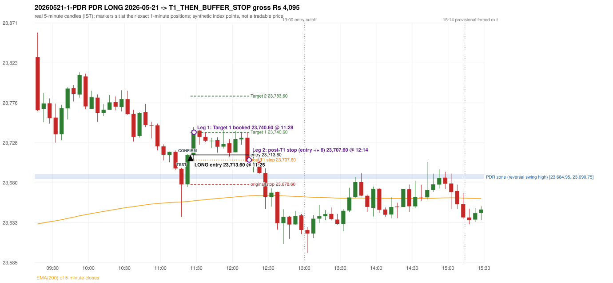

# Trading journal - 2026-05-21 (Thursday)

> Automated, read-only reconstruction of the Phase 3.0 baseline. Synthetic NIFTY 50 index-point P&L (the index is not tradable). The owner's review status is intentionally blank.

## A. Trading day overview

| item | value |
|---|---|
| Date / weekday | 2026-05-21 / Thursday |
| Session type | USABLE_WITH_FLAGS / VALID |
| Original session open (first 1-minute open) | 23,830.05 |
| Previous session | 2026-05-20 |
| Previous-day high / low | 23,690.75 / 23,403.75 |
| Previous-day official close / last 5-minute close | 23,659.00 / 23,664.15 |
| Raw engine records / confirmed signals / fully valid signals | 8 / 5 / 5 |
| Setups that did not complete (invalidated / incomplete) | 3 |
| Executed trades | 1 20260521-1-PDR |
| Gross P&L (Rs, synthetic) | 4,095.00 |
| Illustrative net P&L (Rs; Rs 500/trade + 0.5 pt/fill) | 3,205.00 |
| Day-end portfolio status | DAY_FINISHED |
| Manual journal trades (matched / unmatched) | 0 (0 / 0) |
| Extra automated trades | 1 |

## B. Daily strategy signal timeline (confirmed signals, chronological)

| time | strategy | method | dir | entry-rule status | valid for execution | <= 13:00 | portfolio state | accepted / ignored | specific reason | competing (same minute) |
|---|---|---|---|---|---|---|---|---|---|---|
| 11:25 | PDR | PDR | LONG | PROPOSAL_DEPENDENT | True | True | FIRST_TRADE_ACTIVE | ACCEPTED -> 20260521-1-PDR | first eligible signal of the day; trade 1: T1_THEN_BUFFER_STOP |  |
| 12:35 | PDR | PDR | LONG | PROPOSAL_DEPENDENT | True | True | DAY_FINISHED | IGNORED | DAY_FINISHED [blocked by PDR#1] |  |
| 14:00 | PDR | PDR | LONG | PROPOSAL_DEPENDENT | True | False | DAY_FINISHED | IGNORED | DAY_FINISHED [blocked by PDR#1] |  |
| 14:50 | PDR | PDR | LONG | PROPOSAL_DEPENDENT | True | False | DAY_FINISHED | IGNORED | DAY_FINISHED [blocked by PDR#1] |  |
| 15:25 | PDR | PDR | LONG | PROPOSAL_DEPENDENT | True | False | DAY_FINISHED | IGNORED | DAY_FINISHED [blocked by PDR#1] |  |

Engine setups that did not complete (3); the complete list with failed rule ids is in `rejected_signals.csv`:

| candle | strategy | method | dir | status | precise reason | failed rules |
|---|---|---|---|---|---|---|
| 09:15 | ORB | Method 1 | LONG | INVALIDATED | CANDLE_QUALITY(not a strong body / wick too large) | ORB-M1-LONG-003 |
| 09:15 | ORB | Method 2 | LONG | INVALIDATED | TRENDLINE_NOT_SUPPORTIVE | ORB-M2-LONG-001 |
| 09:35 | RF | RF | LONG | INVALIDATED | GAP_UP_OUTSIDE_YESTERDAYS_RANGE | RF-004 |

## C. Detailed trade journals

### 20260521-1-PDR: PDR LONG (FIRST trade)

Chart: 

**Rule configuration:** CFG-baseline-be1db2a09d - signal verification status **PROPOSAL_DEPENDENT** (never VERIFIED while a rule rests on a proposal).

#### 1. Setup identification

PDR LONG: the session opened 171.05 points above the previous close and 139.30 points above the resistance zone [23,684.95, 23,690.75] taken from the 14:55 swing-high candle of 2026-05-20. The 11:15 candle (23,640.05 - 23,698.20) traded through the zone and closed at 23,678.45, 6.50 points BELOW its floor, and the 11:20 candle closed green at 23,713.80, confirming the entry at 11:25. The engine does not check that the zone held (confirmation close inside/above the zone floor).

#### 2. Candle and indicator calculations

| role | session | candle | O | H | L | C | range | body % | upper wick % | lower wick % | direction | EMA(200) | strong bull / bear | pin bull / bear | small (body<=30%) | used for |
|---|---|---|---|---|---|---|---|---|---|---|---|---|---|---|---|---|
| zone_source_candle | PREVIOUS | 14:55-15:00 | 23,684.95 | 23,690.75 | 23,679.10 | 23,679.15 | 11.65 | 49.79 | 49.79 | 0.43 | BEARISH | 23,628.18 | False / False | False / False | False | swing-high candle that defines the zone (B_SWING_HIGH_REVERSAL) |
| prev_day_high_candle | PREVIOUS | 14:55-15:00 | 23,684.95 | 23,690.75 | 23,679.10 | 23,679.15 | 11.65 | 49.79 | 49.79 | 0.43 | BEARISH | 23,628.18 | False / False | False / False | False | candle of the previous session's absolute high (for comparison) |
| interaction_candle | TODAY | 11:15-11:20 | 23,697.05 | 23,698.20 | 23,640.05 | 23,678.45 | 58.15 | 31.99 | 1.98 | 66.04 | BEARISH | 23,657.56 | False / False | False / False | False | first candle whose range intersects the zone |
| confirmation_candle | TODAY | 11:20-11:25 | 23,678.65 | 23,714.90 | 23,675.60 | 23,713.80 | 39.30 | 89.44 | 2.80 | 7.76 | BULLISH | 23,658.12 | True / False | False / False | False | first green candle after the interaction candle |

Every condition, with the rule, the calculation, the observed values and the result:

| # | group | rule | result | status / numeric definition | calculation | observed | required | available at | why it matters |
|---|---|---|---|---|---|---|---|---|---|
| 1 | SELECTION | SEL-FIRST-001 | PASS | USER_APPROVED / USER_APPROVED | earliest CONFIRMED signal of the day across IRF/ORB/PDR/PDS/RF that passed the controller's checks | 0 confirmed signal(s) earlier today; 5 confirmed signals in the day in total, this one at 11:25 | no earlier executable signal | 2026-05-21 11:25 | the shared controller trades only the first valid signal; the five strategies are not independent positions |
| 2 | SELECTION | SEL-TIE-001 | PASS | USER_APPROVED / USER_APPROVED | other CONFIRMED signals with exactly the same confirmation timestamp | none | no different-strategy / opposite-direction signal in the same minute (otherwise an unresolved conflict, no trade) | 2026-05-21 11:25 | an unresolved same-minute collision would have produced no trade at all |
| 3 | SELECTION | ENTRY-CUTOFF-001 | PASS | USER_APPROVED / USER_APPROVED | fill timestamp vs 13:00:00 IST | signal confirmed 11:25; fill 11:25 | fill at or before 13:00:00 IST | 2026-05-21 11:25 | no new position may be entered with a fill after 13:00 IST |
| 4 | SELECTION | EXE-FILL-001 | PASS | PROPOSED_FOR_REVIEW / PROPOSED_FOR_REVIEW | fill = open of the 1-minute bar that starts at the signal candle's end | bar 11:25 O 23,713.60 H 23,718.15 L 23,706.75 C 23,716.90; executable=True; entry 23,713.60 | fill bar exists, starts exactly at the signal end, is fillable; entry = its open | 2026-05-21 11:25 | a 5-minute signal is known only when its candle closes; the first price that can be traded is the next minute's open |
| 5 | SELECTION | DAY-MAX-001 | PASS | USER_APPROVED / USER_APPROVED | number of entries today | trade 1 of at most 2 | <= 2 entries per day | 2026-05-21 11:25 | daily trade cap |
| 6 | SETUP | PDR-004 | PASS | SOURCE_VERIFIED / EXPLICIT_WORDING_DETAIL_PROPOSED_FOR_REVIEW | gap = first 1-minute open of today - previous session's OFFICIAL close | today's open 23,830.05 (first 1-minute bar 09:15) - previous close 23,659.00 (DAILY_VENDOR, 2026-05-20) = +171.05 points -> gap UP | gap UP (more than 0 points) | 2026-05-21 09:15 | approved convention: the original first-minute open, never the vendor daily open |
| 7 | SETUP | PDR-011 | PASS | SOURCE_VERIFIED / QUALITATIVE_SOURCE_NUMERIC_DEFINITION_PROPOSED_FOR_REVIEW | open relative to the zone (ABOVE_ZONE) | today's open 23,830.05 vs zone high 23,690.75: 139.30 points above | open > zone high | 2026-05-21 09:15 | the guide has price 'pull back into the zone', so the gap-up open is above it; this exclusion is a proposal |
| 8 | ZONE | PDR-001 | PASS | SOURCE_VERIFIED / EXPLICIT_IN_SOURCE | direction | LONG (PDR is long only) | long-only | 2026-05-21 11:25 | PDR buys a retest of previous-day resistance after a gap up |
| 9 | ZONE | PDR-002 | PASS | SOURCE_VERIFIED / QUALITATIVE_SOURCE_NUMERIC_DEFINITION_PROPOSED_FOR_REVIEW | zone = [body top, wick high] of the latest confirmed swing high (k=2) that has a red candle among the peak and the next 2 candles (method B_SWING_HIGH_REVERSAL) | zone [23,684.95, 23,690.75] from the 14:55 candle of 2026-05-20 (body top 23,684.95, wick high 23,690.75; 14:55-15:00 O 23,684.95 H 23,690.75 L 23,679.10 C 23,679.15; range 11.65, body 5.80 (49.79%), upper wick 5.80 (49.79%), lower wick 0.05 (0.43%), bearish); engine recorded [23,684.95, 23,690.75]. Previous session's absolute high 23,690.75 (candle 14:55) - the zone coincides with the day high (distance 0.00 points). Swing confirmed once candle 15:05 closed. | previous-day high where price peaked and reversed | 2026-05-20 15:10 | the source says 'previous day's high/reversal'; which candle marks the zone is an owner-approved research candidate, not a source rule |
| 10 | ZONE | PDR-003 | PASS | SOURCE_VERIFIED / EXPLICIT_IN_SOURCE | the zone is an area, not a single price | zone height 5.80 points [23,684.95, 23,690.75] | a rectangle with positive height | 2026-05-20 15:10 | price may touch any part of the area |
| 11 | ZONE | PDR-010 | UNRESOLVED | SOURCE_VERIFIED / QUALITATIVE_SOURCE_NUMERIC_DEFINITION_PROPOSED_FOR_REVIEW | reversal-quality filter ('clear high and reversal identified') | filter setting OFF | checklist item: a clear previous-day high and reversal | 2026-05-20 | the engine does not test reversal depth in the baseline (filter OFF) |
| 12 | CONFIRMATION | PDR-006 | PASS | SOURCE_VERIFIED / QUALITATIVE_SOURCE_NUMERIC_DEFINITION_PROPOSED_FOR_REVIEW | the first candle whose [low, high] intersects the zone (+/- proximity) | 11:15-11:20 O 23,697.05 H 23,698.20 L 23,640.05 C 23,678.45; range 58.15, body 18.60 (31.99%), upper wick 1.15 (1.98%), lower wick 38.40 (66.04%), bearish; low 23,640.05 vs zone high 23,690.75 (50.70 points inside/below the zone top), high 23,698.20 vs zone low 23,684.95; proximity 0 | range intersects the zone | 2026-05-21 11:20 | the retest of the previous-day resistance |
| 13 | CONFIRMATION | PDR-007 | PASS | SOURCE_VERIFIED / QUALITATIVE_SOURCE_NUMERIC_DEFINITION_PROPOSED_FOR_REVIEW | the first GREEN candle after the interaction candle | 11:20-11:25 O 23,678.65 H 23,714.90 L 23,675.60 C 23,713.80; range 39.30, body 35.15 (89.44%), upper wick 1.10 (2.80%), lower wick 3.05 (7.76%), bullish; interaction candle 11:15, confirmation candle 11:20 | close > open, strictly after the interaction candle | 2026-05-21 11:25 | the guide asks for 'a green candle' after the test; it gives no size or position test |
| 14 | CONFIRMATION | PDR-005 | PASS | SOURCE_VERIFIED / EXPLICIT_IN_SOURCE | no entry at the open: price must first come back toward the zone | interaction candle 11:15 (candle no. 25 of the session) precedes the entry candle 11:20; fill 11:25 | interaction before the entry; fill after 09:20 | 2026-05-21 11:25 | if price keeps rising without returning to the zone there is no setup |
| 15 | EXECUTION | EXE-STOP-001 | PASS | USER_APPROVED / USER_APPROVED | initial stop = entry - 35 points | entry 23,713.60 -> stop 23,678.60 | stop 35 index points (BASELINE) | 2026-05-21 11:25 | defines the loss if the setup fails before Target 1 |
| 16 | EXECUTION | EXE-T1-001 | PASS | SOURCE_VERIFIED / EXPLICIT_IN_SOURCE | Target 1 = entry +/- 27 points | T1 23,740.60 | 27 points | 2026-05-21 11:25 | Leg 1 (3 lots) is booked at Target 1 |
| 17 | EXECUTION | PDR-008 | PASS | SOURCE_VERIFIED / EXPLICIT_IN_SOURCE | Target 2 = entry +/- 70 points | T2 23,783.60 (the guide says 70; the performance report's winners suggest 60 - CONFLICTING, recorded) | 70 points | 2026-05-21 11:25 | Leg 2 (3 lots) is booked at Target 2 |
| 18 | EXECUTION | POST-T1-STOP-006 | PASS | USER_APPROVED / USER_APPROVED | after T1 the Leg-2 stop = entry - 6 (no trailing) | post-T1 stop 23,707.60 | entry -6 (LONG) / +6 (SHORT) | 2026-05-21 11:25 | protects the remaining three lots once the first three are booked |
| 19 | EXECUTION | SIZE-LOT-001 | PASS | USER_APPROVED / USER_APPROVED | 6 lots x 65 = 390, Leg 1 = 3 lots = 195, Leg 2 = 195 | 6 lots, lot size 65, legs 3+3 | 6 lots in two equal legs | 2026-05-21 11:25 | position size for the synthetic P&L |
| 20 | NOTE | PDR-007 | UNRESOLVED | SOURCE_VERIFIED / QUALITATIVE_SOURCE_NUMERIC_DEFINITION_PROPOSED_FOR_REVIEW | did the zone hold? (is the confirmation candle's close back at/above the zone floor?) | confirmation close 23,713.80 vs zone floor 23,684.95 / top 23,690.75: above the zone top; interaction low 23,640.05 | the engine does NOT test that resistance-turned-support held | 2026-05-21 11:25 | a later green candle is accepted even after price traded through the zone; a human would normally check the hold |
| 21 | NOTE | PDR-012 | NOT_APPLICABLE | PROPOSED_FOR_REVIEW / PROPOSED_FOR_REVIEW | repeated PDR signals today | 5 confirmed PDR signal(s) in the session | n/a (disclosure) | 2026-05-21 11:25 | the per-session cap is lifted for the controller runs; the controller trades only the first |
| 22 | NOTE | PDR-009 | UNRESOLVED | UNRESOLVED / UNRESOLVED | stop 35 or 40 'depending on the situation' | the guide gives no selection rule; baseline fixed 35 points | unresolved in the source | 2026-05-21 11:25 | PDR stop selection is left to the owner |
| 23 | NOTE | NOTE-UNRESOLVED-DEPENDENCIES | UNRESOLVED | NOT_A_RULE / NOT_A_REGISTRY_RULE | rules the signal depends on that the sources leave unresolved | engine-recorded unresolved rule ids: PDR-010; verification status PROPOSAL_DEPENDENT | n/a (disclosure) | 2026-05-21 11:25 | the entry is only as verified as the rules it rests on |

#### 3. Entry decision and explanation

PDR LONG: the session opened 171.05 points above the previous close and 139.30 points above the resistance zone [23,684.95, 23,690.75] taken from the 14:55 swing-high candle of 2026-05-20. The 11:15 candle (23,640.05 - 23,698.20) traded through the zone and closed at 23,678.45, 6.50 points BELOW its floor, and the 11:20 candle closed green at 23,713.80, confirming the entry at 11:25. The engine does not check that the zone held (confirmation close inside/above the zone floor).

**Why this trade ahead of the other strategies:** This PDR signal was the earliest executable signal of the day: 0 confirmed signal(s) earlier, 0 other in the same minute. 4 later confirmed signal(s) (PDR x4) are logged as ignored or rejected. State of the other four engines at that moment: [IRF: no setup record before this time (a base condition was not met, or nothing triggered)] [ORB: Method 1 invalidated at 09:15: CANDLE_QUALITY(not a strong body / wick too large); Method 2 invalidated at 09:15: TRENDLINE_NOT_SUPPORTIVE] [PDS: no setup record before this time (a base condition was not met, or nothing triggered)] [RF: RF invalidated at 09:35: GAP_UP_OUTSIDE_YESTERDAYS_RANGE]

#### 4. Actual entry execution

| item | value |
|---|---|
| Signal candle | 11:20-11:25 |
| Signal confirmed | 2026-05-21 11:25 |
| Fill timestamp | 2026-05-21 11:25 |
| Entry price | 23,713.60 |
| Source partition / 1-minute bar | data/processed/nifty50/year=2026/month=05/candles.parquet / 2026-05-21 11:25 |
| Source bar O / H / L / C | 23,713.60 / 23,718.15 / 23,706.75 / 23,716.90 |
| Fill assumption | open of the 1-minute bar starting at the signal candle's end (EXE-FILL-001, PROPOSED causal convention) |
| Initial stop / T1 / T2 / post-T1 stop | 23,678.60 / 23,740.60 / 23,783.60 / 23,707.60 |
| Position | 6 lots x 65 = 390 units (Leg 1 195, Leg 2 195) |

#### 5-8. Trade progress, Target 1, post-T1 stop and final exit

Between the 11:25 entry bar and the final exit (50 one-minute bars) the best excursion in favour was 32.85 points at 11:29 and the worst against was 8.80 points at 12:14. At 11:28 price reached Target 1 23,740.60 and three lots exited. At 11:28 the remaining three lots' protective stop was set to 23,707.60 (entry - 6; no trailing, no further change); the engine applies it from the Target-1 bar onward and tests it within that same bar. At 12:14 the remaining three lots stopped out at 23,707.60. T1_THEN_BUFFER_STOP: no second trade that day (DAY-BUF-001).

| leg | qty | exit time | exit price | reason | source 1-minute bar | O / H / L / C | gross points | gross Rs | slippage pts | flags |
|---|---|---|---|---|---|---|---|---|---|---|
| 1 | 195 | 11:28 | 23,740.60 | TARGET_1 | 11:28 | 23,731.05 / 23,746.00 / 23,730.15 / 23,745.25 | 27.00 | 5,265.00 | 0.00 |  |
| 2 | 195 | 12:14 | 23,707.60 | POST_T1_STOP_ENTRY_MINUS_PLUS_6 | 12:14 | 23,715.05 / 23,715.80 / 23,704.80 / 23,705.70 | -6.00 | -1,170.00 | 0.00 |  |

Exit evidence per leg:

* Leg 1: 1-minute bar 11:28 O 23,731.05 H 23,746.00 L 23,730.15 C 23,745.25: high 23,746.00 reached Target 1 23,740.60; Leg 1 booked at the target level
* Leg 2: 1-minute bar 12:14 O 23,715.05 H 23,715.80 L 23,704.80 C 23,705.70: low 23,704.80 reached the post-T1 stop 23,707.60; Leg 2 exits at 23,707.60 at the stop level

#### 9. Gross and illustrative net P&L

| item | value (Rs) |
|---|---|
| Leg 1 gross | 5,265.00 |
| Leg 2 gross | -1,170.00 |
| Trade gross (= Leg 1 + Leg 2) | 4,095.00 |
| Illustrative fixed cost | -500.00 |
| Illustrative slippage (0.5 pt on every fill, entry + exits, all units) | -390.00 |
| Illustrative net | 3,205.00 |

#### 10. Manual journal comparison

EXTRA_AUTOMATED_TRADE: the automated system took PDR PDR LONG at 11:25 (no manual trade that day). The setup rests on: PDR-010: Reversal-quality filter is OFF in the baseline | PDR-007: Engine does not test whether the zone held | PDR-009: PDR stop selection rule is not defined | NOTE-UNRESOLVED-DEPENDENCIES: Disclosure of unresolved source rules behind this signal. The journal shows no corresponding entry.

## D. Manual journal comparison

| comparison | journal row | journal strategy | manual time | manual direction | manual outcome | match class | trade | auto entry | auto outcome | explanation |
|---|---|---|---|---|---|---|---|---|---|---|
| E099 |  |  |  |  |  | EXTRA_AUTOMATED_TRADE | 20260521-1-PDR | 11:25 @ 23,713.60 | T1_THEN_BUFFER_STOP | EXTRA_AUTOMATED_TRADE: the automated system took PDR PDR LONG at 11:25 (no manual trade that day). The setup rests on: PDR-010: Reversal-quality filter is OFF in the baseline \| PDR-007: Engine does not test whether the zone held \| PDR-009: PDR stop selection rule is not defined \| NOTE-UNRESOLVED-DEPENDENCIES: Disclosure of unresolved source rules behind this signal. The journal shows no corresponding entry. |

The journal records no entry price and no exit price (NOT_RECORDED); matching uses date, strategy and candle start only - never P&L.

## E. Daily conclusion

* **Traded:** 20260521-1-PDR - PDR PDR LONG at 11:25 (entry 23,713.60), outcome T1_THEN_BUFFER_STOP, gross Rs 4,095.00, illustrative net Rs 3,205.00. **Why:** This PDR signal was the earliest executable signal of the day: 0 confirmed signal(s) earlier, 0 other in the same minute. 4 later confirmed signal(s) (PDR x4) are logged as ignored or rejected. State of the other four engines at that moment: [IRF: no setup record before this time (a base condition was not met, or nothing triggered)] [ORB: Method 1 invalidated at 09:15: CANDLE_QUALITY(not a strong body / wick too large); Method 2 invalidated at 09:15: TRENDLINE_NOT_SUPPORTIVE] [PDS: no setup record before this time (a base condition was not met, or nothing triggered)] [RF: RF invalidated at 09:35: GAP_UP_OUTSIDE_YESTERDAYS_RANGE] **How it ended:** At 11:28 price reached Target 1 23,740.60 and three lots exited. At 11:28 the remaining three lots' protective stop was set to 23,707.60 (entry - 6; no trailing, no further change); the engine applies it from the Target-1 bar onward and tests it within that same bar. At 12:14 the remaining three lots stopped out at 23,707.60. T1_THEN_BUFFER_STOP: no second trade that day (DAY-BUF-001).
* **Ignored / rejected signals:** PDR IGNORED DAY_FINISHED x4
* **Extra automated trade 20260521-1-PDR:** EXTRA_AUTOMATED_TRADE: the automated system took PDR PDR LONG at 11:25 (no manual trade that day). The setup rests on: PDR-010: Reversal-quality filter is OFF in the baseline | PDR-007: Engine does not test whether the zone held | PDR-009: PDR stop selection rule is not defined | NOTE-UNRESOLVED-DEPENDENCIES: Disclosure of unresolved source rules behind this signal. The journal shows no corresponding entry.
* **Open strategy-definition issues that affected this day:** NOTE-UNRESOLVED-DEPENDENCIES, PDR-007 (After the zone has been tested, wait for a green candle and take the long on that confirmation), PDR-009 (Stop-loss 35 or 40 'depending on the situation'; choose before entering, do not move after entry), PDR-010 (Checklist: a clear previous-day high and reversal must be identified)
* **Automated triage (not an approval; the owner's review status stays blank):** REVIEW: EXTRA_AUTOMATED
