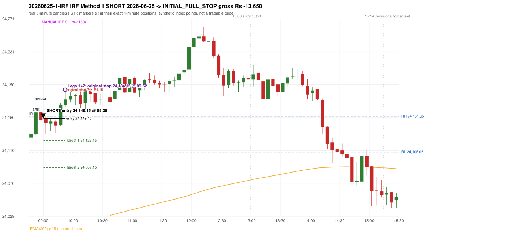

# Trading journal - 2026-06-25 (Thursday)

> Automated, read-only reconstruction of the Phase 3.0 baseline. Synthetic NIFTY 50 index-point P&L (the index is not tradable). The owner's review status is intentionally blank.

## A. Trading day overview

| item | value |
|---|---|
| Date / weekday | 2026-06-25 / Thursday |
| Session type | USABLE_WITH_FLAGS / VALID |
| Original session open (first 1-minute open) | 24,125.85 |
| Previous session | 2026-06-24 |
| Previous-day high / low | 24,089.75 / 23,790.25 |
| Previous-day official close / last 5-minute close | 24,021.65 / 24,013.15 |
| Raw engine records / confirmed signals / fully valid signals | 14 / 10 / 10 |
| Setups that did not complete (invalidated / incomplete) | 4 |
| Executed trades | 1 20260625-1-IRF |
| Gross P&L (Rs, synthetic) | -13,650.00 |
| Illustrative net P&L (Rs; Rs 500/trade + 0.5 pt/fill) | -14,540.00 |
| Day-end portfolio status | SECOND_TRADE_ELIGIBLE |
| Manual journal trades (matched / unmatched) | 1 (1 / 0) |
| Extra automated trades | 0 |

## B. Daily strategy signal timeline (confirmed signals, chronological)

| time | strategy | method | dir | entry-rule status | valid for execution | <= 13:00 | portfolio state | accepted / ignored | specific reason | competing (same minute) |
|---|---|---|---|---|---|---|---|---|---|---|
| 09:30 | IRF | Method 1 | SHORT | PROPOSAL_DEPENDENT | True | True | FIRST_TRADE_ACTIVE | ACCEPTED -> 20260625-1-IRF | first eligible signal of the day; trade 1: INITIAL_FULL_STOP |  |
| 10:20 | IRF | Method 2B | SHORT | PROPOSAL_DEPENDENT | True | True | SECOND_TRADE_ELIGIBLE | REJECTED | SECOND_TRADE_RESTRICTED_TO_PDR_PDS [blocked by IRF#1] |  |
| 10:55 | IRF | Method 2B | SHORT | PROPOSAL_DEPENDENT | True | True | SECOND_TRADE_ELIGIBLE | REJECTED | SECOND_TRADE_RESTRICTED_TO_PDR_PDS [blocked by IRF#1] |  |
| 11:20 | IRF | Method 2B | SHORT | PROPOSAL_DEPENDENT | True | True | SECOND_TRADE_ELIGIBLE | REJECTED | SECOND_TRADE_RESTRICTED_TO_PDR_PDS [blocked by IRF#1] |  |
| 12:30 | IRF | Method 2B | SHORT | PROPOSAL_DEPENDENT | True | True | SECOND_TRADE_ELIGIBLE | REJECTED | SECOND_TRADE_RESTRICTED_TO_PDR_PDS [blocked by IRF#1] |  |
| 13:10 | IRF | Method 2B | SHORT | PROPOSAL_DEPENDENT | True | False | SECOND_TRADE_ELIGIBLE | REJECTED | SECOND_TRADE_RESTRICTED_TO_PDR_PDS [blocked by IRF#1] |  |
| 13:55 | IRF | Method 2B | SHORT | PROPOSAL_DEPENDENT | True | False | SECOND_TRADE_ELIGIBLE | REJECTED | SECOND_TRADE_RESTRICTED_TO_PDR_PDS [blocked by IRF#1] |  |
| 14:15 | IRF | Method 1 | SHORT | PROPOSAL_DEPENDENT | True | False | SECOND_TRADE_ELIGIBLE | REJECTED | SECOND_TRADE_RESTRICTED_TO_PDR_PDS [blocked by IRF#1] |  |
| 14:55 | PDR | PDR | LONG | PROPOSAL_DEPENDENT | True | False | SECOND_TRADE_ELIGIBLE | REJECTED | ENTRY_CUTOFF_EXCEEDED(fill 14:55 IST > 13:00) [blocked by CUTOFF_13_00] |  |
| 15:20 | PDR | PDR | LONG | PROPOSAL_DEPENDENT | True | False | SECOND_TRADE_ELIGIBLE | REJECTED | ENTRY_CUTOFF_EXCEEDED(fill 15:20 IST > 13:00) [blocked by CUTOFF_13_00] |  |

Engine setups that did not complete (4); the complete list with failed rule ids is in `rejected_signals.csv`:

| candle | strategy | method | dir | status | precise reason | failed rules |
|---|---|---|---|---|---|---|
| 13:50 | IRF | Method 1/2 | SHORT | INCOMPLETE_AT_EOD | SESSION_ENDED_BEFORE_CONFIRMATION |  |
| 09:15 | ORB | Method 1 | LONG | INVALIDATED | CANDLE_QUALITY(not a strong body / wick too large) | ORB-M1-LONG-003 |
| 09:15 | ORB | Method 2 | LONG | INVALIDATED | TRENDLINE_NOT_SUPPORTIVE | ORB-M2-LONG-001 |
| 14:30 | RF | RF | LONG | INCOMPLETE_AT_EOD | NO_RETURN_INSIDE_BEFORE_SESSION_END |  |

## C. Detailed trade journals

### 20260625-1-IRF: IRF Method 1 SHORT (FIRST trade)

Chart: 

**Rule configuration:** CFG-baseline-be1db2a09d - signal verification status **PROPOSAL_DEPENDENT** (never VERIFIED while a rule rests on a proposal).

#### 1. Setup identification

IRF Method 1 SHORT: the completed 09:20 candle closed at 24,156.35, 4.70 points above the initial range high 24,151.65 (range [24,108.05, 24,151.65] from the 09:15 candle); the immediately following completed 09:25 candle closed at 24,147.15, back inside the range. The short signal was confirmed at 09:30 on that close. Entry reference close 24,147.15 is 4.50 points below IRH 24,151.65.

#### 2. Candle and indicator calculations

| role | session | candle | O | H | L | C | range | body % | upper wick % | lower wick % | direction | EMA(200) | strong bull / bear | pin bull / bear | small (body<=30%) | used for |
|---|---|---|---|---|---|---|---|---|---|---|---|---|---|---|---|---|
| initial_range_candle | TODAY | 09:15-09:20 | 24,125.85 | 24,151.65 | 24,108.05 | 24,129.95 | 43.60 | 9.40 | 49.77 | 40.83 | BULLISH | 24,007.21 | False / False | False / False | True | initial range = high/low of the 09:15 candle |
| signal_candle | TODAY | 09:25-09:30 | 24,157.10 | 24,169.40 | 24,144.20 | 24,147.15 | 25.20 | 39.48 | 48.81 | 11.71 | BEARISH | 24,010.07 | False / False | False / False | False | candle whose close completed the trigger |
| breakout_candle | TODAY | 09:20-09:25 | 24,129.85 | 24,156.70 | 24,128.30 | 24,156.35 | 28.40 | 93.31 | 1.23 | 5.46 | BULLISH | 24,008.69 | True / False | False / False | False | breakout candle: a completed candle closing above IRH |

Every condition, with the rule, the calculation, the observed values and the result:

| # | group | rule | result | status / numeric definition | calculation | observed | required | available at | why it matters |
|---|---|---|---|---|---|---|---|---|---|
| 1 | SELECTION | SEL-FIRST-001 | PASS | USER_APPROVED / USER_APPROVED | earliest CONFIRMED signal of the day across IRF/ORB/PDR/PDS/RF that passed the controller's checks | 0 confirmed signal(s) earlier today; 10 confirmed signals in the day in total, this one at 09:30 | no earlier executable signal | 2026-06-25 09:30 | the shared controller trades only the first valid signal; the five strategies are not independent positions |
| 2 | SELECTION | SEL-TIE-001 | PASS | USER_APPROVED / USER_APPROVED | other CONFIRMED signals with exactly the same confirmation timestamp | none | no different-strategy / opposite-direction signal in the same minute (otherwise an unresolved conflict, no trade) | 2026-06-25 09:30 | an unresolved same-minute collision would have produced no trade at all |
| 3 | SELECTION | ENTRY-CUTOFF-001 | PASS | USER_APPROVED / USER_APPROVED | fill timestamp vs 13:00:00 IST | signal confirmed 09:30; fill 09:30 | fill at or before 13:00:00 IST | 2026-06-25 09:30 | no new position may be entered with a fill after 13:00 IST |
| 4 | SELECTION | EXE-FILL-001 | PASS | PROPOSED_FOR_REVIEW / PROPOSED_FOR_REVIEW | fill = open of the 1-minute bar that starts at the signal candle's end | bar 09:30 O 24,149.15 H 24,152.15 L 24,140.70 C 24,146.90; executable=True; entry 24,149.15 | fill bar exists, starts exactly at the signal end, is fillable; entry = its open | 2026-06-25 09:30 | a 5-minute signal is known only when its candle closes; the first price that can be traded is the next minute's open |
| 5 | SELECTION | DAY-MAX-001 | PASS | USER_APPROVED / USER_APPROVED | number of entries today | trade 1 of at most 2 | <= 2 entries per day | 2026-06-25 09:30 | daily trade cap |
| 6 | SETUP | IRF-GLOBAL-001 | PASS | SOURCE_VERIFIED / EXPLICIT_IN_SOURCE | initial range = high and low (wicks included) of the first completed 5-minute candle | 09:15-09:20 IRH 24,151.65, IRL 24,108.05 (range 43.60; engine recorded IRH 24,151.65, IRL 24,108.05) | high/low of the 09:15-09:20 candle | 2026-06-25 09:20 | all three IRF methods measure price against this range |
| 7 | SETUP | IRF-GLOBAL-003 | PASS | SOURCE_VERIFIED / EXPLICIT_IN_SOURCE | closes confirm, wicks do not: every trigger is evaluated on a completed 5-minute candle | trigger candle 09:25-09:30 was complete when the signal was stamped 09:30; decision uses its close 24,147.15 | completed candle close, not an intra-candle wick | 2026-06-25 09:30 | an intra-candle wick can reverse before the candle closes |
| 8 | SETUP | IRF-GLOBAL-002 | PASS | SOURCE_VERIFIED / EXPLICIT_IN_SOURCE | direction | SHORT (IRF trades short only) | short only | 2026-06-25 09:30 | IRF fades failed upside breakouts |
| 9 | SETUP | IRF-M1-001 | PASS | SOURCE_VERIFIED / EXPLICIT_IN_SOURCE | breakout candle close vs IRH | 09:20-09:25 O 24,129.85 H 24,156.70 L 24,128.30 C 24,156.35; range 28.40, body 26.50 (93.31%), upper wick 0.35 (1.23%), lower wick 1.55 (5.46%), bullish; close 24,156.35 is 4.70 points above IRH 24,151.65 | close > IRH (a wick above IRH is not a breakout) | 2026-06-25 09:25 | starts every IRF setup |
| 10 | CONFIRMATION | IRF-M1-002 | PASS | SOURCE_VERIFIED / EXPLICIT_IN_SOURCE | candle after the breakout closes back inside [IRL, IRH) | 09:25-09:30 O 24,157.10 H 24,169.40 L 24,144.20 C 24,147.15; range 25.20, body 9.95 (39.48%), upper wick 12.30 (48.81%), lower wick 2.95 (11.71%), bearish; close 24,147.15 vs range [24,108.05, 24,151.65) | IRL <= close < IRH | 2026-06-25 09:30 | the failed breakout: price could not hold above the opening range |
| 11 | CONFIRMATION | IRF-M1-004 | PASS | SOURCE_VERIFIED / EXPLICIT_IN_SOURCE | failure candle is the candle immediately after the breakout (k = 1) | breakout 09:20, failure candle 09:25: k = 1 | k = 1 (pp.5, 6, 13); the p.14 'next or following' reading (IRF-M1-C001) is CONFLICTING and not used in the baseline | 2026-06-25 09:30 | the guide's worked example enters at the close of the very next candle; no support/resistance break is required |
| 12 | EXECUTION | EXE-STOP-001 | PASS | USER_APPROVED / USER_APPROVED | initial stop = entry + 35 points | entry 24,149.15 -> stop 24,184.15 | stop 35 index points (BASELINE) | 2026-06-25 09:30 | defines the loss if the setup fails before Target 1 |
| 13 | EXECUTION | EXE-T1-001 | PASS | SOURCE_VERIFIED / EXPLICIT_IN_SOURCE | Target 1 = entry +/- 27 points | T1 24,122.15 | 27 points | 2026-06-25 09:30 | Leg 1 (3 lots) is booked at Target 1 |
| 14 | EXECUTION | IRF-TGT-001 | PASS | SOURCE_VERIFIED / EXPLICIT_IN_SOURCE | Target 2 = entry +/- 60 points | T2 24,089.15 | 60 points | 2026-06-25 09:30 | Leg 2 (3 lots) is booked at Target 2 |
| 15 | EXECUTION | POST-T1-STOP-006 | PASS | USER_APPROVED / USER_APPROVED | after T1 the Leg-2 stop = entry + 6 (no trailing) | post-T1 stop 24,155.15 | entry -6 (LONG) / +6 (SHORT) | 2026-06-25 09:30 | protects the remaining three lots once the first three are booked |
| 16 | EXECUTION | SIZE-LOT-001 | PASS | USER_APPROVED / USER_APPROVED | 6 lots x 65 = 390, Leg 1 = 3 lots = 195, Leg 2 = 195 | 6 lots, lot size 65, legs 3+3 | 6 lots in two equal legs | 2026-06-25 09:30 | position size for the synthetic P&L |
| 17 | NOTE | IRF-GLOBAL-004 | UNRESOLVED | UNRESOLVED / UNRESOLVED | which close above IRH of the session produced this attempt; repeat setups | this breakout is upward crossing no. 1 of the session (a close above IRH after a close at/below it) | the source states no first-breakout-only, re-arming, expiry or trades-per-day rule | 2026-06-25 09:30 | IRF re-arms on every later breakout in the code, producing many raw setups; the controller keeps only the first |
| 18 | NOTE | NOTE-IRF-REPEATED-SETUPS | NOT_APPLICABLE | NOT_A_RULE / NOT_A_REGISTRY_RULE | other IRF signals later in the session (not traded) | 7 further confirmed IRF signal(s): Method 2B@10:20, Method 2B@10:55, Method 2B@11:20, Method 2B@12:30, Method 2B@13:10, Method 2B@13:55, Method 1@14:15 | disclosure of repeated raw setups | 2026-06-25 09:30 | repeated raw IRF setups are not hidden; they are logged as ignored |
| 19 | NOTE | IRF-SL-001 | NOT_APPLICABLE | SOURCE_VERIFIED / QUALITATIVE_SOURCE_NUMERIC_DEFINITION_PROPOSED_FOR_REVIEW | the guide's 35-or-40 rule: 35 if the most recent green candle's high is within 35 points of entry, else 40 | most recent green candle high 24,156.70 is 7.55 points from the entry 24,149.15: the guide's rule would select 35 points; the baseline applies a fixed 35 (USER_APPROVED research baseline; the 35-vs-40 selection and the 40-point variant are separate labelled scenarios) | source selection rule | 2026-06-25 09:30 | the stop distance is a modelling choice and changes losses, not entries |
| 20 | NOTE | NOTE-UNRESOLVED-DEPENDENCIES | UNRESOLVED | NOT_A_RULE / NOT_A_REGISTRY_RULE | rules the signal depends on that the sources leave unresolved | engine-recorded unresolved rule ids: IRF-GLOBAL-004; verification status PROPOSAL_DEPENDENT | n/a (disclosure) | 2026-06-25 09:30 | the entry is only as verified as the rules it rests on |

#### 3. Entry decision and explanation

IRF Method 1 SHORT: the completed 09:20 candle closed at 24,156.35, 4.70 points above the initial range high 24,151.65 (range [24,108.05, 24,151.65] from the 09:15 candle); the immediately following completed 09:25 candle closed at 24,147.15, back inside the range. The short signal was confirmed at 09:30 on that close. Entry reference close 24,147.15 is 4.50 points below IRH 24,151.65.

**Why this trade ahead of the other strategies:** This IRF Method 1 signal was the earliest executable signal of the day: 0 confirmed signal(s) earlier, 0 other in the same minute. 9 later confirmed signal(s) (IRF x7, PDR x2) are logged as ignored or rejected. State of the other four engines at that moment: [ORB: Method 1 invalidated at 09:15: CANDLE_QUALITY(not a strong body / wick too large); Method 2 invalidated at 09:15: TRENDLINE_NOT_SUPPORTIVE] [PDR: no setup record before this time (a base condition was not met, or nothing triggered)] [PDS: no setup record before this time (a base condition was not met, or nothing triggered)] [RF: no setup record before this time (a base condition was not met, or nothing triggered)]

#### 4. Actual entry execution

| item | value |
|---|---|
| Signal candle | 09:25-09:30 |
| Signal confirmed | 2026-06-25 09:30 |
| Fill timestamp | 2026-06-25 09:30 |
| Entry price | 24,149.15 |
| Source partition / 1-minute bar | data/processed/nifty50/year=2026/month=06/candles.parquet / 2026-06-25 09:30 |
| Source bar O / H / L / C | 24,149.15 / 24,152.15 / 24,140.70 / 24,146.90 |
| Fill assumption | open of the 1-minute bar starting at the signal candle's end (EXE-FILL-001, PROPOSED causal convention) |
| Initial stop / T1 / T2 / post-T1 stop | 24,184.15 / 24,122.15 / 24,089.15 / 24,155.15 |
| Position | 6 lots x 65 = 390 units (Leg 1 195, Leg 2 195) |

#### 5-8. Trade progress, Target 1, post-T1 stop and final exit

Between the 09:30 entry bar and the final exit (23 one-minute bars) the best excursion in favour was 18.65 points at 09:32 and the worst against was 35.85 points at 09:52. At 09:52 price reached the original stop 24,184.15 before Target 1 24,122.15, so all six lots exited together at 24,184.15. This is an INITIAL_FULL_STOP: one more trade is allowed that day, only a newly confirmed PDR/PDS signal.

| leg | qty | exit time | exit price | reason | source 1-minute bar | O / H / L / C | gross points | gross Rs | slippage pts | flags |
|---|---|---|---|---|---|---|---|---|---|---|
| 1 | 195 | 09:52 | 24,184.15 | ORIGINAL_STOP_BEFORE_T1 | 09:52 | 24,174.45 / 24,185.00 / 24,172.20 / 24,183.60 | -35.00 | -6,825.00 | 0.00 |  |
| 2 | 195 | 09:52 | 24,184.15 | ORIGINAL_STOP_BEFORE_T1 | 09:52 | 24,174.45 / 24,185.00 / 24,172.20 / 24,183.60 | -35.00 | -6,825.00 | 0.00 |  |

Exit evidence per leg:

* Leg 1: 1-minute bar 09:52 O 24,174.45 H 24,185.00 L 24,172.20 C 24,183.60: high 24,185.00 reached the original stop 24,184.15 before Target 1 24,122.15 was touched; both legs exit at the stop level 24,184.15
* Leg 2: 1-minute bar 09:52 O 24,174.45 H 24,185.00 L 24,172.20 C 24,183.60: high 24,185.00 reached the original stop 24,184.15 before Target 1 24,122.15 was touched; both legs exit at the stop level 24,184.15

#### 9. Gross and illustrative net P&L

| item | value (Rs) |
|---|---|
| Leg 1 gross | -6,825.00 |
| Leg 2 gross | -6,825.00 |
| Trade gross (= Leg 1 + Leg 2) | -13,650.00 |
| Illustrative fixed cost | -500.00 |
| Illustrative slippage (0.5 pt on every fill, entry + exits, all units) | -390.00 |
| Illustrative net | -14,540.00 |

#### 10. Manual journal comparison

EXACT_MATCH: manual IRF labelled 09:25 (candle start) vs automated IRF Method 1 SHORT candle 09:25, filled 09:30 at 24,149.15; time difference 0 minutes. Journal outcome SL vs automated INITIAL_FULL_STOP (same outcome class). The journal records no entry or exit price.

## D. Manual journal comparison

| comparison | journal row | journal strategy | manual time | manual direction | manual outcome | match class | trade | auto entry | auto outcome | explanation |
|---|---|---|---|---|---|---|---|---|---|---|
| M160 | 160 | IRF | 09:25 | SHORT | SL | EXACT_MATCH | 20260625-1-IRF | 09:30 @ 24,149.15 | INITIAL_FULL_STOP | EXACT_MATCH: manual IRF labelled 09:25 (candle start) vs automated IRF Method 1 SHORT candle 09:25, filled 09:30 at 24,149.15; time difference 0 minutes. Journal outcome SL vs automated INITIAL_FULL_STOP (same outcome class). The journal records no entry or exit price. |

The journal records no entry price and no exit price (NOT_RECORDED); matching uses date, strategy and candle start only - never P&L.

## E. Daily conclusion

* **Traded:** 20260625-1-IRF - IRF Method 1 SHORT at 09:30 (entry 24,149.15), outcome INITIAL_FULL_STOP, gross Rs -13,650.00, illustrative net Rs -14,540.00. **Why:** This IRF Method 1 signal was the earliest executable signal of the day: 0 confirmed signal(s) earlier, 0 other in the same minute. 9 later confirmed signal(s) (IRF x7, PDR x2) are logged as ignored or rejected. State of the other four engines at that moment: [ORB: Method 1 invalidated at 09:15: CANDLE_QUALITY(not a strong body / wick too large); Method 2 invalidated at 09:15: TRENDLINE_NOT_SUPPORTIVE] [PDR: no setup record before this time (a base condition was not met, or nothing triggered)] [PDS: no setup record before this time (a base condition was not met, or nothing triggered)] [RF: no setup record before this time (a base condition was not met, or nothing triggered)] **How it ended:** At 09:52 price reached the original stop 24,184.15 before Target 1 24,122.15, so all six lots exited together at 24,184.15. This is an INITIAL_FULL_STOP: one more trade is allowed that day, only a newly confirmed PDR/PDS signal.
* **Ignored / rejected signals:** IRF REJECTED SECOND_TRADE_RESTRICTED_TO_PDR_PDS x7; PDR REJECTED ENTRY_CUTOFF_EXCEEDED x2
* **Open strategy-definition issues that affected this day:** IRF-GLOBAL-004 (NOT STATED: how many IRF trades per day, a latest entry time, and whether a new breakout may re-arm a setup after a signal), NOTE-UNRESOLVED-DEPENDENCIES
* **Automated triage (not an approval; the owner's review status stays blank):** MATCHED_EXACT_NO_FLAGS
