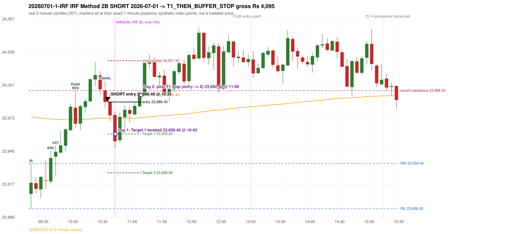

# Trading journal - 2026-07-01 (Wednesday)

> Automated, read-only reconstruction of the Phase 3.0 baseline. Synthetic NIFTY 50 index-point P&L (the index is not tradable). The owner's review status is intentionally blank.

## A. Trading day overview

| item | value |
|---|---|
| Date / weekday | 2026-07-01 / Wednesday |
| Session type | USABLE_WITH_FLAGS / VALID |
| Original session open (first 1-minute open) | 23,908.55 |
| Previous session | 2026-06-30 |
| Previous-day high / low | 24,031.60 / 23,830.20 |
| Previous-day official close / last 5-minute close | 23,865.75 / 23,917.75 |
| Raw engine records / confirmed signals / fully valid signals | 9 / 6 / 6 |
| Setups that did not complete (invalidated / incomplete) | 3 |
| Executed trades | 1 20260701-1-IRF |
| Gross P&L (Rs, synthetic) | 4,095.00 |
| Illustrative net P&L (Rs; Rs 500/trade + 0.5 pt/fill) | 3,205.00 |
| Day-end portfolio status | DAY_FINISHED |
| Manual journal trades (matched / unmatched) | 1 (1 / 0) |
| Extra automated trades | 0 |

## B. Daily strategy signal timeline (confirmed signals, chronological)

| time | strategy | method | dir | entry-rule status | valid for execution | <= 13:00 | portfolio state | accepted / ignored | specific reason | competing (same minute) |
|---|---|---|---|---|---|---|---|---|---|---|
| 10:35 | IRF | Method 2B | SHORT | PROPOSAL_DEPENDENT | True | True | FIRST_TRADE_ACTIVE | ACCEPTED -> 20260701-1-IRF | first eligible signal of the day; trade 1: T1_THEN_BUFFER_STOP |  |
| 12:30 | IRF | Method 2A | SHORT | PROPOSAL_DEPENDENT | True | True | DAY_FINISHED | IGNORED | DAY_FINISHED [blocked by IRF#1] |  |
| 13:05 | IRF | Method 2A | SHORT | PROPOSAL_DEPENDENT | True | False | DAY_FINISHED | IGNORED | DAY_FINISHED [blocked by IRF#1] |  |
| 13:25 | IRF | Method 2B | SHORT | PROPOSAL_DEPENDENT | True | False | DAY_FINISHED | IGNORED | DAY_FINISHED [blocked by IRF#1] |  |
| 14:30 | IRF | Method 2A | SHORT | PROPOSAL_DEPENDENT | True | False | DAY_FINISHED | IGNORED | DAY_FINISHED [blocked by IRF#1] |  |
| 15:05 | IRF | Method 2B | SHORT | PROPOSAL_DEPENDENT | True | False | DAY_FINISHED | IGNORED | DAY_FINISHED [blocked by IRF#1] |  |

Engine setups that did not complete (3); the complete list with failed rule ids is in `rejected_signals.csv`:

| candle | strategy | method | dir | status | precise reason | failed rules |
|---|---|---|---|---|---|---|
| 09:30 | IRF | Method 3 | SHORT | INVALIDATED | WICK_SHARE_OUT_OF_BAND | IRF-M3-003 |
| 15:00 | IRF | Method 1/2 | SHORT | INCOMPLETE_AT_EOD | SESSION_ENDED_BEFORE_CONFIRMATION |  |
| 09:15 | PDR | PDR | LONG | INVALIDATED | GAP_UP_OPEN_NOT_ABOVE_ZONE | PDR-011 |

## C. Detailed trade journals

### 20260701-1-IRF: IRF Method 2B SHORT (FIRST trade)

Chart: 

**Rule configuration:** CFG-baseline-be1db2a09d - signal verification status **PROPOSAL_DEPENDENT** (never VERIFIED while a rule rests on a proposal).

#### 1. Setup identification

IRF Method 2B SHORT: the 09:35-09:40 candle closed at 23,938.95, above IRH 23,934.40, and the next candle did not close back inside the range, so the setup is Method 2 and price stayed above it until the trigger. Extension candle 09:40-09:45, red candle 10:00-10:05. The trigger came 11 candles after the breakout candle: a red candle closed back below the first-push resistance after price had traded above it (10:30-10:35); confirmed at 10:35 with close 23,986.50. Entry reference close 23,986.50 is 52.10 points above IRH 23,934.40.

#### 2. Candle and indicator calculations

| role | session | candle | O | H | L | C | range | body % | upper wick % | lower wick % | direction | EMA(200) | strong bull / bear | pin bull / bear | small (body<=30%) | used for |
|---|---|---|---|---|---|---|---|---|---|---|---|---|---|---|---|---|
| initial_range_candle | TODAY | 09:15-09:20 | 23,908.55 | 23,934.40 | 23,896.00 | 23,918.00 | 38.40 | 24.61 | 42.71 | 32.68 | BULLISH | 23,973.92 | False / False | False / False | True | initial range = high/low of the 09:15 candle |
| signal_candle | TODAY | 10:30-10:35 | 23,996.25 | 24,004.30 | 23,981.70 | 23,986.50 | 22.60 | 43.14 | 35.62 | 21.24 | BEARISH | 23,972.81 | False / False | False / False | False | candle whose close completed the trigger |
| breakout_candle | TODAY | 09:35-09:40 | 23,919.10 | 23,945.25 | 23,917.40 | 23,938.95 | 27.85 | 71.27 | 22.62 | 6.10 | BULLISH | 23,971.95 | False / False | False / False | False | breakout candle: a completed candle closing above IRH |
| extension_candle | TODAY | 09:40-09:45 | 23,940.05 | 23,949.65 | 23,923.85 | 23,944.20 | 25.80 | 16.09 | 21.12 | 62.79 | BULLISH | 23,971.67 | False / False | True / False | True | extension: first later candle trading above the breakout candle's high |
| red_candle | TODAY | 10:00-10:05 | 23,981.65 | 23,996.05 | 23,964.35 | 23,968.05 | 31.70 | 42.90 | 45.43 | 11.67 | BEARISH | 23,971.45 | False / False | False / False | False | first red candle during the extension |
| first_push_top | TODAY | 10:00-10:05 | 23,981.65 | 23,996.05 | 23,964.35 | 23,968.05 | 31.70 | 42.90 | 45.43 | 11.67 | BEARISH | 23,971.45 | False / False | False / False | False | recent resistance = top of the first push after the breakout |

Every condition, with the rule, the calculation, the observed values and the result:

| # | group | rule | result | status / numeric definition | calculation | observed | required | available at | why it matters |
|---|---|---|---|---|---|---|---|---|---|
| 1 | SELECTION | SEL-FIRST-001 | PASS | USER_APPROVED / USER_APPROVED | earliest CONFIRMED signal of the day across IRF/ORB/PDR/PDS/RF that passed the controller's checks | 0 confirmed signal(s) earlier today; 6 confirmed signals in the day in total, this one at 10:35 | no earlier executable signal | 2026-07-01 10:35 | the shared controller trades only the first valid signal; the five strategies are not independent positions |
| 2 | SELECTION | SEL-TIE-001 | PASS | USER_APPROVED / USER_APPROVED | other CONFIRMED signals with exactly the same confirmation timestamp | none | no different-strategy / opposite-direction signal in the same minute (otherwise an unresolved conflict, no trade) | 2026-07-01 10:35 | an unresolved same-minute collision would have produced no trade at all |
| 3 | SELECTION | ENTRY-CUTOFF-001 | PASS | USER_APPROVED / USER_APPROVED | fill timestamp vs 13:00:00 IST | signal confirmed 10:35; fill 10:35 | fill at or before 13:00:00 IST | 2026-07-01 10:35 | no new position may be entered with a fill after 13:00 IST |
| 4 | SELECTION | EXE-FILL-001 | PASS | PROPOSED_FOR_REVIEW / PROPOSED_FOR_REVIEW | fill = open of the 1-minute bar that starts at the signal candle's end | bar 10:35 O 23,986.40 H 23,992.45 L 23,984.00 C 23,991.60; executable=True; entry 23,986.40 | fill bar exists, starts exactly at the signal end, is fillable; entry = its open | 2026-07-01 10:35 | a 5-minute signal is known only when its candle closes; the first price that can be traded is the next minute's open |
| 5 | SELECTION | DAY-MAX-001 | PASS | USER_APPROVED / USER_APPROVED | number of entries today | trade 1 of at most 2 | <= 2 entries per day | 2026-07-01 10:35 | daily trade cap |
| 6 | SETUP | IRF-GLOBAL-001 | PASS | SOURCE_VERIFIED / EXPLICIT_IN_SOURCE | initial range = high and low (wicks included) of the first completed 5-minute candle | 09:15-09:20 IRH 23,934.40, IRL 23,896.00 (range 38.40; engine recorded IRH 23,934.40, IRL 23,896.00) | high/low of the 09:15-09:20 candle | 2026-07-01 09:20 | all three IRF methods measure price against this range |
| 7 | SETUP | IRF-GLOBAL-003 | PASS | SOURCE_VERIFIED / EXPLICIT_IN_SOURCE | closes confirm, wicks do not: every trigger is evaluated on a completed 5-minute candle | trigger candle 10:30-10:35 was complete when the signal was stamped 10:35; decision uses its close 23,986.50 | completed candle close, not an intra-candle wick | 2026-07-01 10:35 | an intra-candle wick can reverse before the candle closes |
| 8 | SETUP | IRF-GLOBAL-002 | PASS | SOURCE_VERIFIED / EXPLICIT_IN_SOURCE | direction | SHORT (IRF trades short only) | short only | 2026-07-01 10:35 | IRF fades failed upside breakouts |
| 9 | SETUP | IRF-M2-001 | PASS | SOURCE_VERIFIED / EXPLICIT_IN_SOURCE | breakout candle close vs IRH | 09:35-09:40 O 23,919.10 H 23,945.25 L 23,917.40 C 23,938.95; range 27.85, body 19.85 (71.27%), upper wick 6.30 (22.62%), lower wick 1.70 (6.10%), bullish; close 23,938.95 is 4.55 points above IRH 23,934.40 | close > IRH (a wick above IRH is not a breakout) | 2026-07-01 09:40 | starts every IRF setup |
| 10 | SETUP | IRF-M2-004 | PASS | SOURCE_VERIFIED / EXPLICIT_IN_SOURCE | the candle after the breakout must NOT close back inside the range (else the setup is Method 1) | 09:40 close 23,944.20 vs [23,896.00, 23,934.40) | not (IRL <= close < IRH) | 2026-07-01 09:45 | separates Method 2 (price holds above) from Method 1 (immediate failure) |
| 11 | SETUP | IRF-M2-002 | PASS | SOURCE_VERIFIED / QUALITATIVE_SOURCE_NUMERIC_DEFINITION_PROPOSED_FOR_REVIEW | extension = a later candle whose high exceeds the breakout candle's high (research definition E1) | 09:40 high 23,949.65 vs breakout candle high 23,945.25 (+4.40) | high > breakout candle high | 2026-07-01 09:45 | the guide says price 'extends further upward'; the numeric test is a proposal |
| 12 | SETUP | IRF-M2-003 | PASS | SOURCE_VERIFIED / QUALITATIVE_SOURCE_NUMERIC_DEFINITION_PROPOSED_FOR_REVIEW | a red candle (close < open) forms after the extension | 10:00-10:05 O 23,981.65 H 23,996.05 L 23,964.35 C 23,968.05; range 31.70, body 13.60 (42.90%), upper wick 14.40 (45.43%), lower wick 3.70 (11.67%), bearish | close < open, at or after the candle following the extension | 2026-07-01 10:05 | the red candle shows the first pause/reversal inside the extension |
| 13 | CONFIRMATION | IRF-M2-005 | PASS | SOURCE_VERIFIED / EXPLICIT_IN_SOURCE | a red candle alone is not confirmation: a level break is required | red trigger candle 10:30 also closes below the resistance (see IRF-M2B-003) | a red candle plus a closing break of the level | 2026-07-01 10:35 | a red candle with no level break does not qualify |
| 14 | CONFIRMATION | IRF-M2B-001 | PASS | SOURCE_VERIFIED / QUALITATIVE_SOURCE_NUMERIC_DEFINITION_PROPOSED_FOR_REVIEW | recent resistance = first 3-candle fractal high (k=1) at/after the breakout candle (FIRST_PUSH_TOP) | 10:00 high 23,996.05; engine recorded 23,996.05 | first push top | 2026-07-01 10:10 | the level whose retake-and-fail completes Method 2B (definition is a proposal) |
| 15 | CONFIRMATION | IRF-M2B-002 | PASS | SOURCE_VERIFIED / QUALITATIVE_SOURCE_NUMERIC_DEFINITION_PROPOSED_FOR_REVIEW | price trades back above the resistance after the first push | first candle with high above 23,996.05: 10:15 high 24,005.75 | some candle after the first push has high > resistance (the push may be the trigger candle: m2b_push_must_precede_red_candle = False) | 2026-07-01 10:35 | the guide's figure shows three separate candles; the engine also accepts a single candle |
| 16 | CONFIRMATION | IRF-M2B-003 | PASS | SOURCE_VERIFIED / EXPLICIT_IN_SOURCE | trigger = a red candle closing back below the resistance | 10:30-10:35 O 23,996.25 H 24,004.30 L 23,981.70 C 23,986.50; range 22.60, body 9.75 (43.14%), upper wick 8.05 (35.62%), lower wick 4.80 (21.24%), bearish; close 23,986.50 vs resistance 23,996.05 | red candle and close < resistance | 2026-07-01 10:35 | completes Method 2B |
| 17 | EXECUTION | EXE-STOP-001 | PASS | USER_APPROVED / USER_APPROVED | initial stop = entry + 35 points | entry 23,986.40 -> stop 24,021.40 | stop 35 index points (BASELINE) | 2026-07-01 10:35 | defines the loss if the setup fails before Target 1 |
| 18 | EXECUTION | EXE-T1-001 | PASS | SOURCE_VERIFIED / EXPLICIT_IN_SOURCE | Target 1 = entry +/- 27 points | T1 23,959.40 | 27 points | 2026-07-01 10:35 | Leg 1 (3 lots) is booked at Target 1 |
| 19 | EXECUTION | IRF-TGT-001 | PASS | SOURCE_VERIFIED / EXPLICIT_IN_SOURCE | Target 2 = entry +/- 60 points | T2 23,926.40 | 60 points | 2026-07-01 10:35 | Leg 2 (3 lots) is booked at Target 2 |
| 20 | EXECUTION | POST-T1-STOP-006 | PASS | USER_APPROVED / USER_APPROVED | after T1 the Leg-2 stop = entry + 6 (no trailing) | post-T1 stop 23,992.40 | entry -6 (LONG) / +6 (SHORT) | 2026-07-01 10:35 | protects the remaining three lots once the first three are booked |
| 21 | EXECUTION | SIZE-LOT-001 | PASS | USER_APPROVED / USER_APPROVED | 6 lots x 65 = 390, Leg 1 = 3 lots = 195, Leg 2 = 195 | 6 lots, lot size 65, legs 3+3 | 6 lots in two equal legs | 2026-07-01 10:35 | position size for the synthetic P&L |
| 22 | NOTE | IRF-M2-006 | UNRESOLVED | UNRESOLVED / UNRESOLVED | delay between the breakout candle and this trigger; expiry rule | 11 candles after the breakout; expiry none configured | the source states no expiry | 2026-07-01 10:35 | an old breakout can still trigger hours later |
| 23 | NOTE | IRF-M2-006 | UNRESOLVED | UNRESOLVED / UNRESOLVED | did price stay above IRH between the breakout and the trigger? | 0 closes at or below IRH between 09:40 and 10:30; trigger close 23,986.50 above IRH 23,934.40 | the engine does not require price to stay above IRH | 2026-07-01 10:35 | the guide describes price 'holding above IRH and keeping rising'; the code only needs the level break |
| 24 | NOTE | IRF-GLOBAL-004 | UNRESOLVED | UNRESOLVED / UNRESOLVED | which close above IRH of the session produced this attempt; repeat setups | this breakout is upward crossing no. 1 of the session (a close above IRH after a close at/below it) | the source states no first-breakout-only, re-arming, expiry or trades-per-day rule | 2026-07-01 10:35 | IRF re-arms on every later breakout in the code, producing many raw setups; the controller keeps only the first |
| 25 | NOTE | NOTE-IRF-REPEATED-SETUPS | NOT_APPLICABLE | NOT_A_RULE / NOT_A_REGISTRY_RULE | other IRF signals later in the session (not traded) | 5 further confirmed IRF signal(s): Method 2A@12:30, Method 2A@13:05, Method 2B@13:25, Method 2A@14:30, Method 2B@15:05 | disclosure of repeated raw setups | 2026-07-01 10:35 | repeated raw IRF setups are not hidden; they are logged as ignored |
| 26 | NOTE | IRF-SL-001 | NOT_APPLICABLE | SOURCE_VERIFIED / QUALITATIVE_SOURCE_NUMERIC_DEFINITION_PROPOSED_FOR_REVIEW | the guide's 35-or-40 rule: 35 if the most recent green candle's high is within 35 points of entry, else 40 | most recent green candle high 24,020.25 is 33.85 points from the entry 23,986.40: the guide's rule would select 35 points; the baseline applies a fixed 35 (USER_APPROVED research baseline; the 35-vs-40 selection and the 40-point variant are separate labelled scenarios) | source selection rule | 2026-07-01 10:35 | the stop distance is a modelling choice and changes losses, not entries |
| 27 | NOTE | NOTE-UNRESOLVED-DEPENDENCIES | UNRESOLVED | NOT_A_RULE / NOT_A_REGISTRY_RULE | rules the signal depends on that the sources leave unresolved | engine-recorded unresolved rule ids: IRF-GLOBAL-004; verification status PROPOSAL_DEPENDENT | n/a (disclosure) | 2026-07-01 10:35 | the entry is only as verified as the rules it rests on |

#### 3. Entry decision and explanation

IRF Method 2B SHORT: the 09:35-09:40 candle closed at 23,938.95, above IRH 23,934.40, and the next candle did not close back inside the range, so the setup is Method 2 and price stayed above it until the trigger. Extension candle 09:40-09:45, red candle 10:00-10:05. The trigger came 11 candles after the breakout candle: a red candle closed back below the first-push resistance after price had traded above it (10:30-10:35); confirmed at 10:35 with close 23,986.50. Entry reference close 23,986.50 is 52.10 points above IRH 23,934.40.

**Why this trade ahead of the other strategies:** This IRF Method 2B signal was the earliest executable signal of the day: 0 confirmed signal(s) earlier, 0 other in the same minute. 5 later confirmed signal(s) (IRF x5) are logged as ignored or rejected. State of the other four engines at that moment: [ORB: no setup record before this time (a base condition was not met, or nothing triggered)] [PDR: PDR invalidated at 09:15: GAP_UP_OPEN_NOT_ABOVE_ZONE] [PDS: no setup record before this time (a base condition was not met, or nothing triggered)] [RF: no setup record before this time (a base condition was not met, or nothing triggered)]

#### 4. Actual entry execution

| item | value |
|---|---|
| Signal candle | 10:30-10:35 |
| Signal confirmed | 2026-07-01 10:35 |
| Fill timestamp | 2026-07-01 10:35 |
| Entry price | 23,986.40 |
| Source partition / 1-minute bar | data/processed/nifty50/year=2026/month=07/candles.parquet / 2026-07-01 10:35 |
| Source bar O / H / L / C | 23,986.40 / 23,992.45 / 23,984.00 / 23,991.60 |
| Fill assumption | open of the 1-minute bar starting at the signal candle's end (EXE-FILL-001, PROPOSED causal convention) |
| Initial stop / T1 / T2 / post-T1 stop | 24,021.40 / 23,959.40 / 23,926.40 / 23,992.40 |
| Position | 6 lots x 65 = 390 units (Leg 1 195, Leg 2 195) |

#### 5-8. Trade progress, Target 1, post-T1 stop and final exit

Between the 10:35 entry bar and the final exit (35 one-minute bars) the best excursion in favour was 39.05 points at 10:43 and the worst against was 7.90 points at 11:09. At 10:43 price reached Target 1 23,959.40 and three lots exited. At 10:43 the remaining three lots' protective stop was set to 23,992.40 (entry + 6; no trailing, no further change); the engine applies it from the Target-1 bar onward and tests it within that same bar. At 11:09 the remaining three lots stopped out at 23,992.40. T1_THEN_BUFFER_STOP: no second trade that day (DAY-BUF-001).

| leg | qty | exit time | exit price | reason | source 1-minute bar | O / H / L / C | gross points | gross Rs | slippage pts | flags |
|---|---|---|---|---|---|---|---|---|---|---|
| 1 | 195 | 10:43 | 23,959.40 | TARGET_1 | 10:43 | 23,965.20 / 23,967.45 / 23,947.35 / 23,948.30 | 27.00 | 5,265.00 | 0.00 |  |
| 2 | 195 | 11:09 | 23,992.40 | POST_T1_STOP_ENTRY_MINUS_PLUS_6 | 11:09 | 23,985.60 / 23,994.30 / 23,984.05 / 23,993.90 | -6.00 | -1,170.00 | 0.00 |  |

Exit evidence per leg:

* Leg 1: 1-minute bar 10:43 O 23,965.20 H 23,967.45 L 23,947.35 C 23,948.30: low 23,947.35 reached Target 1 23,959.40; Leg 1 booked at the target level
* Leg 2: 1-minute bar 11:09 O 23,985.60 H 23,994.30 L 23,984.05 C 23,993.90: high 23,994.30 reached the post-T1 stop 23,992.40; Leg 2 exits at 23,992.40 at the stop level

#### 9. Gross and illustrative net P&L

| item | value (Rs) |
|---|---|
| Leg 1 gross | 5,265.00 |
| Leg 2 gross | -1,170.00 |
| Trade gross (= Leg 1 + Leg 2) | 4,095.00 |
| Illustrative fixed cost | -500.00 |
| Illustrative slippage (0.5 pt on every fill, entry + exits, all units) | -390.00 |
| Illustrative net | 3,205.00 |

#### 10. Manual journal comparison

TIME_SHIFTED_MATCH: manual IRF labelled 10:40 (candle start) vs automated IRF Method 2B SHORT candle 10:30, filled 10:35 at 23,986.40; time difference -10 minutes. Journal outcome SL vs automated T1_THEN_BUFFER_STOP (different outcome class - the stop rules may differ). The journal records no entry or exit price.

## D. Manual journal comparison

| comparison | journal row | journal strategy | manual time | manual direction | manual outcome | match class | trade | auto entry | auto outcome | explanation |
|---|---|---|---|---|---|---|---|---|---|---|
| M164 | 164 | IRF | 10:40 | SHORT | SL | TIME_SHIFTED_MATCH | 20260701-1-IRF | 10:35 @ 23,986.40 | T1_THEN_BUFFER_STOP | TIME_SHIFTED_MATCH: manual IRF labelled 10:40 (candle start) vs automated IRF Method 2B SHORT candle 10:30, filled 10:35 at 23,986.40; time difference -10 minutes. Journal outcome SL vs automated T1_THEN_BUFFER_STOP (different outcome class - the stop rules may differ). The journal records no entry or exit price. |

The journal records no entry price and no exit price (NOT_RECORDED); matching uses date, strategy and candle start only - never P&L.

## E. Daily conclusion

* **Traded:** 20260701-1-IRF - IRF Method 2B SHORT at 10:35 (entry 23,986.40), outcome T1_THEN_BUFFER_STOP, gross Rs 4,095.00, illustrative net Rs 3,205.00. **Why:** This IRF Method 2B signal was the earliest executable signal of the day: 0 confirmed signal(s) earlier, 0 other in the same minute. 5 later confirmed signal(s) (IRF x5) are logged as ignored or rejected. State of the other four engines at that moment: [ORB: no setup record before this time (a base condition was not met, or nothing triggered)] [PDR: PDR invalidated at 09:15: GAP_UP_OPEN_NOT_ABOVE_ZONE] [PDS: no setup record before this time (a base condition was not met, or nothing triggered)] [RF: no setup record before this time (a base condition was not met, or nothing triggered)] **How it ended:** At 10:43 price reached Target 1 23,959.40 and three lots exited. At 10:43 the remaining three lots' protective stop was set to 23,992.40 (entry + 6; no trailing, no further change); the engine applies it from the Target-1 bar onward and tests it within that same bar. At 11:09 the remaining three lots stopped out at 23,992.40. T1_THEN_BUFFER_STOP: no second trade that day (DAY-BUF-001).
* **Ignored / rejected signals:** IRF IGNORED DAY_FINISHED x5
* **Open strategy-definition issues that affected this day:** IRF-GLOBAL-004 (NOT STATED: how many IRF trades per day, a latest entry time, and whether a new breakout may re-arm a setup after a signal), IRF-M2-006 (How long a Method 2 setup stays valid (expiry / invalidation before a level breaks) is not stated), NOTE-UNRESOLVED-DEPENDENCIES
* **Automated triage (not an approval; the owner's review status stays blank):** REVIEW: TIME_SHIFTED
