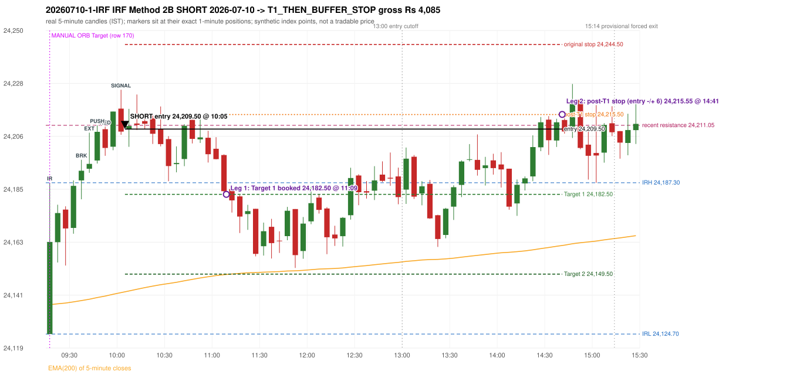

# Trading journal - 2026-07-10 (Friday)

> Automated, read-only reconstruction of the Phase 3.0 baseline. Synthetic NIFTY 50 index-point P&L (the index is not tradable). The owner's review status is intentionally blank.

## A. Trading day overview

| item | value |
|---|---|
| Date / weekday | 2026-07-10 / Friday |
| Session type | USABLE_WITH_FLAGS / VALID |
| Original session open (first 1-minute open) | 24,124.70 |
| Previous session | 2026-07-09 |
| Previous-day high / low | 24,133.35 / 23,926.60 |
| Previous-day official close / last 5-minute close | 23,962.80 / 23,981.90 |
| Raw engine records / confirmed signals / fully valid signals | 10 / 7 / 7 |
| Setups that did not complete (invalidated / incomplete) | 3 |
| Executed trades | 1 20260710-1-IRF |
| Gross P&L (Rs, synthetic) | 4,085.25 |
| Illustrative net P&L (Rs; Rs 500/trade + 0.5 pt/fill) | 3,195.25 |
| Day-end portfolio status | DAY_FINISHED |
| Manual journal trades (matched / unmatched) | 1 (0 / 1) |
| Extra automated trades | 1 |

## B. Daily strategy signal timeline (confirmed signals, chronological)

| time | strategy | method | dir | entry-rule status | valid for execution | <= 13:00 | portfolio state | accepted / ignored | specific reason | competing (same minute) |
|---|---|---|---|---|---|---|---|---|---|---|
| 10:05 | IRF | Method 2B | SHORT | PROPOSAL_DEPENDENT | True | True | FIRST_TRADE_ACTIVE | ACCEPTED -> 20260710-1-IRF | first eligible signal of the day; trade 1: T1_THEN_BUFFER_STOP |  |
| 11:10 | IRF | Method 1 | SHORT | PROPOSAL_DEPENDENT | True | True | FIRST_TRADE_ACTIVE | IGNORED | POSITION_ACTIVE (signal kept for diagnostics only; never reused) [blocked by IRF#1] |  |
| 12:35 | IRF | Method 1 | SHORT | PROPOSAL_DEPENDENT | True | True | FIRST_TRADE_ACTIVE | IGNORED | POSITION_ACTIVE (signal kept for diagnostics only; never reused) [blocked by IRF#1] |  |
| 13:00 | IRF | Method 1 | SHORT | PROPOSAL_DEPENDENT | True | True | FIRST_TRADE_ACTIVE | IGNORED | POSITION_ACTIVE (signal kept for diagnostics only; never reused) [blocked by IRF#1] |  |
| 13:10 | IRF | Method 1 | SHORT | PROPOSAL_DEPENDENT | True | False | FIRST_TRADE_ACTIVE | IGNORED | POSITION_ACTIVE (signal kept for diagnostics only; never reused) [blocked by IRF#1] |  |
| 14:10 | IRF | Method 1 | SHORT | PROPOSAL_DEPENDENT | True | False | FIRST_TRADE_ACTIVE | IGNORED | POSITION_ACTIVE (signal kept for diagnostics only; never reused) [blocked by IRF#1] |  |
| 14:55 | IRF | Method 2B | SHORT | PROPOSAL_DEPENDENT | True | False | DAY_FINISHED | IGNORED | DAY_FINISHED [blocked by IRF#1] |  |

Engine setups that did not complete (3); the complete list with failed rule ids is in `rejected_signals.csv`:

| candle | strategy | method | dir | status | precise reason | failed rules |
|---|---|---|---|---|---|---|
| 14:50 | IRF | Method 1/2 | SHORT | INCOMPLETE_AT_EOD | SESSION_ENDED_BEFORE_CONFIRMATION |  |
| 09:15 | ORB | Method 1 | LONG | INVALIDATED | TREND:EMA_PREV_SESSION_CLOSE wrong side | ORB-TREND-001;ORB-TREND-002 |
| 09:15 | ORB | Method 2 | LONG | INVALIDATED | TREND:EMA_PREV_SESSION_CLOSE wrong side | ORB-TREND-001;ORB-TREND-002 |

## C. Detailed trade journals

### 20260710-1-IRF: IRF Method 2B SHORT (FIRST trade)

Chart: 

**Rule configuration:** CFG-baseline-be1db2a09d - signal verification status **PROPOSAL_DEPENDENT** (never VERIFIED while a rule rests on a proposal).

#### 1. Setup identification

IRF Method 2B SHORT: the 09:35-09:40 candle closed at 24,192.25, above IRH 24,187.30, and the next candle did not close back inside the range, so the setup is Method 2 and price stayed above it until the trigger. Extension candle 09:40-09:45, red candle 09:50-09:55. The trigger came 5 candles after the breakout candle: a red candle closed back below the first-push resistance after price had traded above it (10:00-10:05); confirmed at 10:05 with close 24,208.45. Entry reference close 24,208.45 is 21.15 points above IRH 24,187.30.

#### 2. Candle and indicator calculations

| role | session | candle | O | H | L | C | range | body % | upper wick % | lower wick % | direction | EMA(200) | strong bull / bear | pin bull / bear | small (body<=30%) | used for |
|---|---|---|---|---|---|---|---|---|---|---|---|---|---|---|---|---|
| initial_range_candle | TODAY | 09:15-09:20 | 24,124.70 | 24,187.30 | 24,124.70 | 24,162.80 | 62.60 | 60.86 | 39.14 | 0.00 | BULLISH | 24,136.83 | False / False | False / False | False | initial range = high/low of the 09:15 candle |
| signal_candle | TODAY | 10:00-10:05 | 24,217.95 | 24,225.75 | 24,207.15 | 24,208.45 | 18.60 | 51.08 | 41.94 | 6.99 | BEARISH | 24,141.84 | False / False | False / False | False | candle whose close completed the trigger |
| breakout_candle | TODAY | 09:35-09:40 | 24,188.25 | 24,196.80 | 24,180.45 | 24,192.25 | 16.35 | 24.46 | 27.83 | 47.71 | BULLISH | 24,138.54 | False / False | False / False | True | breakout candle: a completed candle closing above IRH |
| extension_candle | TODAY | 09:40-09:45 | 24,193.10 | 24,208.00 | 24,191.40 | 24,195.10 | 16.60 | 12.05 | 77.71 | 10.24 | BULLISH | 24,139.11 | False / False | False / True | True | extension: first later candle trading above the breakout candle's high |
| red_candle | TODAY | 09:50-09:55 | 24,209.45 | 24,210.45 | 24,198.45 | 24,201.70 | 12.00 | 64.58 | 8.33 | 27.08 | BEARISH | 24,140.41 | False / False | False / False | False | first red candle during the extension |
| first_push_top | TODAY | 09:45-09:50 | 24,196.50 | 24,211.05 | 24,195.25 | 24,208.35 | 15.80 | 75.00 | 17.09 | 7.91 | BULLISH | 24,139.80 | True / False | False / False | False | recent resistance = top of the first push after the breakout |

Every condition, with the rule, the calculation, the observed values and the result:

| # | group | rule | result | status / numeric definition | calculation | observed | required | available at | why it matters |
|---|---|---|---|---|---|---|---|---|---|
| 1 | SELECTION | SEL-FIRST-001 | PASS | USER_APPROVED / USER_APPROVED | earliest CONFIRMED signal of the day across IRF/ORB/PDR/PDS/RF that passed the controller's checks | 0 confirmed signal(s) earlier today; 7 confirmed signals in the day in total, this one at 10:05 | no earlier executable signal | 2026-07-10 10:05 | the shared controller trades only the first valid signal; the five strategies are not independent positions |
| 2 | SELECTION | SEL-TIE-001 | PASS | USER_APPROVED / USER_APPROVED | other CONFIRMED signals with exactly the same confirmation timestamp | none | no different-strategy / opposite-direction signal in the same minute (otherwise an unresolved conflict, no trade) | 2026-07-10 10:05 | an unresolved same-minute collision would have produced no trade at all |
| 3 | SELECTION | ENTRY-CUTOFF-001 | PASS | USER_APPROVED / USER_APPROVED | fill timestamp vs 13:00:00 IST | signal confirmed 10:05; fill 10:05 | fill at or before 13:00:00 IST | 2026-07-10 10:05 | no new position may be entered with a fill after 13:00 IST |
| 4 | SELECTION | EXE-FILL-001 | PASS | PROPOSED_FOR_REVIEW / PROPOSED_FOR_REVIEW | fill = open of the 1-minute bar that starts at the signal candle's end | bar 10:05 O 24,209.50 H 24,214.50 L 24,206.60 C 24,212.85; executable=True; entry 24,209.50 | fill bar exists, starts exactly at the signal end, is fillable; entry = its open | 2026-07-10 10:05 | a 5-minute signal is known only when its candle closes; the first price that can be traded is the next minute's open |
| 5 | SELECTION | DAY-MAX-001 | PASS | USER_APPROVED / USER_APPROVED | number of entries today | trade 1 of at most 2 | <= 2 entries per day | 2026-07-10 10:05 | daily trade cap |
| 6 | SETUP | IRF-GLOBAL-001 | PASS | SOURCE_VERIFIED / EXPLICIT_IN_SOURCE | initial range = high and low (wicks included) of the first completed 5-minute candle | 09:15-09:20 IRH 24,187.30, IRL 24,124.70 (range 62.60; engine recorded IRH 24,187.30, IRL 24,124.70) | high/low of the 09:15-09:20 candle | 2026-07-10 09:20 | all three IRF methods measure price against this range |
| 7 | SETUP | IRF-GLOBAL-003 | PASS | SOURCE_VERIFIED / EXPLICIT_IN_SOURCE | closes confirm, wicks do not: every trigger is evaluated on a completed 5-minute candle | trigger candle 10:00-10:05 was complete when the signal was stamped 10:05; decision uses its close 24,208.45 | completed candle close, not an intra-candle wick | 2026-07-10 10:05 | an intra-candle wick can reverse before the candle closes |
| 8 | SETUP | IRF-GLOBAL-002 | PASS | SOURCE_VERIFIED / EXPLICIT_IN_SOURCE | direction | SHORT (IRF trades short only) | short only | 2026-07-10 10:05 | IRF fades failed upside breakouts |
| 9 | SETUP | IRF-M2-001 | PASS | SOURCE_VERIFIED / EXPLICIT_IN_SOURCE | breakout candle close vs IRH | 09:35-09:40 O 24,188.25 H 24,196.80 L 24,180.45 C 24,192.25; range 16.35, body 4.00 (24.46%), upper wick 4.55 (27.83%), lower wick 7.80 (47.71%), bullish; close 24,192.25 is 4.95 points above IRH 24,187.30 | close > IRH (a wick above IRH is not a breakout) | 2026-07-10 09:40 | starts every IRF setup |
| 10 | SETUP | IRF-M2-004 | PASS | SOURCE_VERIFIED / EXPLICIT_IN_SOURCE | the candle after the breakout must NOT close back inside the range (else the setup is Method 1) | 09:40 close 24,195.10 vs [24,124.70, 24,187.30) | not (IRL <= close < IRH) | 2026-07-10 09:45 | separates Method 2 (price holds above) from Method 1 (immediate failure) |
| 11 | SETUP | IRF-M2-002 | PASS | SOURCE_VERIFIED / QUALITATIVE_SOURCE_NUMERIC_DEFINITION_PROPOSED_FOR_REVIEW | extension = a later candle whose high exceeds the breakout candle's high (research definition E1) | 09:40 high 24,208.00 vs breakout candle high 24,196.80 (+11.20) | high > breakout candle high | 2026-07-10 09:45 | the guide says price 'extends further upward'; the numeric test is a proposal |
| 12 | SETUP | IRF-M2-003 | PASS | SOURCE_VERIFIED / QUALITATIVE_SOURCE_NUMERIC_DEFINITION_PROPOSED_FOR_REVIEW | a red candle (close < open) forms after the extension | 09:50-09:55 O 24,209.45 H 24,210.45 L 24,198.45 C 24,201.70; range 12.00, body 7.75 (64.58%), upper wick 1.00 (8.33%), lower wick 3.25 (27.08%), bearish | close < open, at or after the candle following the extension | 2026-07-10 09:55 | the red candle shows the first pause/reversal inside the extension |
| 13 | CONFIRMATION | IRF-M2-005 | PASS | SOURCE_VERIFIED / EXPLICIT_IN_SOURCE | a red candle alone is not confirmation: a level break is required | red trigger candle 10:00 also closes below the resistance (see IRF-M2B-003) | a red candle plus a closing break of the level | 2026-07-10 10:05 | a red candle with no level break does not qualify |
| 14 | CONFIRMATION | IRF-M2B-001 | PASS | SOURCE_VERIFIED / QUALITATIVE_SOURCE_NUMERIC_DEFINITION_PROPOSED_FOR_REVIEW | recent resistance = first 3-candle fractal high (k=1) at/after the breakout candle (FIRST_PUSH_TOP) | 09:45 high 24,211.05; engine recorded 24,211.05 | first push top | 2026-07-10 09:55 | the level whose retake-and-fail completes Method 2B (definition is a proposal) |
| 15 | CONFIRMATION | IRF-M2B-002 | PASS | SOURCE_VERIFIED / QUALITATIVE_SOURCE_NUMERIC_DEFINITION_PROPOSED_FOR_REVIEW | price trades back above the resistance after the first push | first candle with high above 24,211.05: 09:55 high 24,216.75 | some candle after the first push has high > resistance (the push may be the trigger candle: m2b_push_must_precede_red_candle = False) | 2026-07-10 10:05 | the guide's figure shows three separate candles; the engine also accepts a single candle |
| 16 | CONFIRMATION | IRF-M2B-003 | PASS | SOURCE_VERIFIED / EXPLICIT_IN_SOURCE | trigger = a red candle closing back below the resistance | 10:00-10:05 O 24,217.95 H 24,225.75 L 24,207.15 C 24,208.45; range 18.60, body 9.50 (51.08%), upper wick 7.80 (41.94%), lower wick 1.30 (6.99%), bearish; close 24,208.45 vs resistance 24,211.05 | red candle and close < resistance | 2026-07-10 10:05 | completes Method 2B |
| 17 | EXECUTION | EXE-STOP-001 | PASS | USER_APPROVED / USER_APPROVED | initial stop = entry + 35 points | entry 24,209.50 -> stop 24,244.50 | stop 35 index points (BASELINE) | 2026-07-10 10:05 | defines the loss if the setup fails before Target 1 |
| 18 | EXECUTION | EXE-T1-001 | PASS | SOURCE_VERIFIED / EXPLICIT_IN_SOURCE | Target 1 = entry +/- 27 points | T1 24,182.50 | 27 points | 2026-07-10 10:05 | Leg 1 (3 lots) is booked at Target 1 |
| 19 | EXECUTION | IRF-TGT-001 | PASS | SOURCE_VERIFIED / EXPLICIT_IN_SOURCE | Target 2 = entry +/- 60 points | T2 24,149.50 | 60 points | 2026-07-10 10:05 | Leg 2 (3 lots) is booked at Target 2 |
| 20 | EXECUTION | POST-T1-STOP-006 | PASS | USER_APPROVED / USER_APPROVED | after T1 the Leg-2 stop = entry + 6 (no trailing) | post-T1 stop 24,215.50 | entry -6 (LONG) / +6 (SHORT) | 2026-07-10 10:05 | protects the remaining three lots once the first three are booked |
| 21 | EXECUTION | SIZE-LOT-001 | PASS | USER_APPROVED / USER_APPROVED | 6 lots x 65 = 390, Leg 1 = 3 lots = 195, Leg 2 = 195 | 6 lots, lot size 65, legs 3+3 | 6 lots in two equal legs | 2026-07-10 10:05 | position size for the synthetic P&L |
| 22 | NOTE | IRF-M2-006 | UNRESOLVED | UNRESOLVED / UNRESOLVED | delay between the breakout candle and this trigger; expiry rule | 5 candles after the breakout; expiry none configured | the source states no expiry | 2026-07-10 10:05 | an old breakout can still trigger hours later |
| 23 | NOTE | IRF-M2-006 | UNRESOLVED | UNRESOLVED / UNRESOLVED | did price stay above IRH between the breakout and the trigger? | 0 closes at or below IRH between 09:40 and 10:00; trigger close 24,208.45 above IRH 24,187.30 | the engine does not require price to stay above IRH | 2026-07-10 10:05 | the guide describes price 'holding above IRH and keeping rising'; the code only needs the level break |
| 24 | NOTE | IRF-GLOBAL-004 | UNRESOLVED | UNRESOLVED / UNRESOLVED | which close above IRH of the session produced this attempt; repeat setups | this breakout is upward crossing no. 1 of the session (a close above IRH after a close at/below it) | the source states no first-breakout-only, re-arming, expiry or trades-per-day rule | 2026-07-10 10:05 | IRF re-arms on every later breakout in the code, producing many raw setups; the controller keeps only the first |
| 25 | NOTE | NOTE-IRF-REPEATED-SETUPS | NOT_APPLICABLE | NOT_A_RULE / NOT_A_REGISTRY_RULE | other IRF signals later in the session (not traded) | 6 further confirmed IRF signal(s): Method 1@11:10, Method 1@12:35, Method 1@13:00, Method 1@13:10, Method 1@14:10, Method 2B@14:55 | disclosure of repeated raw setups | 2026-07-10 10:05 | repeated raw IRF setups are not hidden; they are logged as ignored |
| 26 | NOTE | IRF-SL-001 | NOT_APPLICABLE | SOURCE_VERIFIED / QUALITATIVE_SOURCE_NUMERIC_DEFINITION_PROPOSED_FOR_REVIEW | the guide's 35-or-40 rule: 35 if the most recent green candle's high is within 35 points of entry, else 40 | most recent green candle high 24,216.75 is 7.25 points from the entry 24,209.50: the guide's rule would select 35 points; the baseline applies a fixed 35 (USER_APPROVED research baseline; the 35-vs-40 selection and the 40-point variant are separate labelled scenarios) | source selection rule | 2026-07-10 10:05 | the stop distance is a modelling choice and changes losses, not entries |
| 27 | NOTE | NOTE-UNRESOLVED-DEPENDENCIES | UNRESOLVED | NOT_A_RULE / NOT_A_REGISTRY_RULE | rules the signal depends on that the sources leave unresolved | engine-recorded unresolved rule ids: IRF-GLOBAL-004; verification status PROPOSAL_DEPENDENT | n/a (disclosure) | 2026-07-10 10:05 | the entry is only as verified as the rules it rests on |

#### 3. Entry decision and explanation

IRF Method 2B SHORT: the 09:35-09:40 candle closed at 24,192.25, above IRH 24,187.30, and the next candle did not close back inside the range, so the setup is Method 2 and price stayed above it until the trigger. Extension candle 09:40-09:45, red candle 09:50-09:55. The trigger came 5 candles after the breakout candle: a red candle closed back below the first-push resistance after price had traded above it (10:00-10:05); confirmed at 10:05 with close 24,208.45. Entry reference close 24,208.45 is 21.15 points above IRH 24,187.30.

**Why this trade ahead of the other strategies:** This IRF Method 2B signal was the earliest executable signal of the day: 0 confirmed signal(s) earlier, 0 other in the same minute. 6 later confirmed signal(s) (IRF x6) are logged as ignored or rejected. State of the other four engines at that moment: [ORB: Method 1 invalidated at 09:15: TREND:EMA_PREV_SESSION_CLOSE wrong side; Method 2 invalidated at 09:15: TREND:EMA_PREV_SESSION_CLOSE wrong side] [PDR: no setup record before this time (a base condition was not met, or nothing triggered)] [PDS: no setup record before this time (a base condition was not met, or nothing triggered)] [RF: no setup record before this time (a base condition was not met, or nothing triggered)]

#### 4. Actual entry execution

| item | value |
|---|---|
| Signal candle | 10:00-10:05 |
| Signal confirmed | 2026-07-10 10:05 |
| Fill timestamp | 2026-07-10 10:05 |
| Entry price | 24,209.50 |
| Source partition / 1-minute bar | data/processed/nifty50/year=2026/month=07/candles.parquet / 2026-07-10 10:05 |
| Source bar O / H / L / C | 24,209.50 / 24,214.50 / 24,206.60 / 24,212.85 |
| Fill assumption | open of the 1-minute bar starting at the signal candle's end (EXE-FILL-001, PROPOSED causal convention) |
| Initial stop / T1 / T2 / post-T1 stop | 24,244.50 / 24,182.50 / 24,149.50 / 24,215.50 |
| Position | 6 lots x 65 = 390 units (Leg 1 195, Leg 2 195) |

#### 5-8. Trade progress, Target 1, post-T1 stop and final exit

Between the 10:05 entry bar and the final exit (277 one-minute bars) the best excursion in favour was 57.45 points at 11:53 and the worst against was 14.30 points at 10:10. At 11:09 price reached Target 1 24,182.50 and three lots exited. At 11:09 the remaining three lots' protective stop was set to 24,215.50 (entry + 6; no trailing, no further change); the engine applies it from the Target-1 bar onward and tests it within that same bar. At 14:41 the remaining three lots stopped out at 24,215.55 (slippage 0.05 points). T1_THEN_BUFFER_STOP: no second trade that day (DAY-BUF-001).

| leg | qty | exit time | exit price | reason | source 1-minute bar | O / H / L / C | gross points | gross Rs | slippage pts | flags |
|---|---|---|---|---|---|---|---|---|---|---|
| 1 | 195 | 11:09 | 24,182.50 | TARGET_1 | 11:09 | 24,188.25 / 24,188.25 / 24,182.00 / 24,183.80 | 27.00 | 5,265.00 | 0.00 |  |
| 2 | 195 | 14:41 | 24,215.55 | POST_T1_STOP_ENTRY_MINUS_PLUS_6 | 14:41 | 24,215.55 / 24,216.65 / 24,211.80 / 24,214.15 | -6.05 | -1,179.75 | 0.05 |  |

Exit evidence per leg:

* Leg 1: 1-minute bar 11:09 O 24,188.25 H 24,188.25 L 24,182.00 C 24,183.80: low 24,182.00 reached Target 1 24,182.50; Leg 1 booked at the target level
* Leg 2: 1-minute bar 14:41 O 24,215.55 H 24,216.65 L 24,211.80 C 24,214.15: high 24,216.65 reached the post-T1 stop 24,215.50; Leg 2 exits at 24,215.55 (adverse slippage 0.05 points: the bar opened beyond the stop)

#### 9. Gross and illustrative net P&L

| item | value (Rs) |
|---|---|
| Leg 1 gross | 5,265.00 |
| Leg 2 gross | -1,179.75 |
| Trade gross (= Leg 1 + Leg 2) | 4,085.25 |
| Illustrative fixed cost | -500.00 |
| Illustrative slippage (0.5 pt on every fill, entry + exits, all units) | -390.00 |
| Illustrative net | 3,195.25 |

#### 10. Manual journal comparison

EXTRA_AUTOMATED_TRADE: the automated system took IRF Method 2B SHORT at 10:05 (manual traded only other strategies: ORB 09:15 Target). The setup rests on: IRF-M2-006: No expiry / validity window for a Method 2 attempt | IRF-M2-006: Engine does not test that price held above IRH | IRF-GLOBAL-004: IRF trades per day / time window / re-arming are not stated in the guide | NOTE-UNRESOLVED-DEPENDENCIES: Disclosure of unresolved source rules behind this signal. The journal shows no corresponding entry.

## D. Manual journal comparison

| comparison | journal row | journal strategy | manual time | manual direction | manual outcome | match class | trade | auto entry | auto outcome | explanation |
|---|---|---|---|---|---|---|---|---|---|---|
| M170 | 170 | ORB | 09:15 | UNKNOWN | Target | SIGNAL_REJECTED_BY_ENTRY_RULE |  |  |  | SIGNAL_REJECTED_BY_ENTRY_RULE: SETUP_INVALIDATED Method 1 - TREND:EMA_PREV_SESSION_CLOSE wrong side; failed=ORB-TREND-001;ORB-TREND-002. Heuristic primary cause: TREND_FILTER; blocked by: n/a |
| E117 |  |  |  |  |  | EXTRA_AUTOMATED_TRADE | 20260710-1-IRF | 10:05 @ 24,209.50 | T1_THEN_BUFFER_STOP | EXTRA_AUTOMATED_TRADE: the automated system took IRF Method 2B SHORT at 10:05 (manual traded only other strategies: ORB 09:15 Target). The setup rests on: IRF-M2-006: No expiry / validity window for a Method 2 attempt \| IRF-M2-006: Engine does not test that price held above IRH \| IRF-GLOBAL-004: IRF trades per day / time window / re-arming are not stated in the guide \| NOTE-UNRESOLVED-DEPENDENCIES: Disclosure of unresolved source rules behind this signal. The journal shows no corresponding entry. |

The journal records no entry price and no exit price (NOT_RECORDED); matching uses date, strategy and candle start only - never P&L.

## E. Daily conclusion

* **Traded:** 20260710-1-IRF - IRF Method 2B SHORT at 10:05 (entry 24,209.50), outcome T1_THEN_BUFFER_STOP, gross Rs 4,085.25, illustrative net Rs 3,195.25. **Why:** This IRF Method 2B signal was the earliest executable signal of the day: 0 confirmed signal(s) earlier, 0 other in the same minute. 6 later confirmed signal(s) (IRF x6) are logged as ignored or rejected. State of the other four engines at that moment: [ORB: Method 1 invalidated at 09:15: TREND:EMA_PREV_SESSION_CLOSE wrong side; Method 2 invalidated at 09:15: TREND:EMA_PREV_SESSION_CLOSE wrong side] [PDR: no setup record before this time (a base condition was not met, or nothing triggered)] [PDS: no setup record before this time (a base condition was not met, or nothing triggered)] [RF: no setup record before this time (a base condition was not met, or nothing triggered)] **How it ended:** At 11:09 price reached Target 1 24,182.50 and three lots exited. At 11:09 the remaining three lots' protective stop was set to 24,215.50 (entry + 6; no trailing, no further change); the engine applies it from the Target-1 bar onward and tests it within that same bar. At 14:41 the remaining three lots stopped out at 24,215.55 (slippage 0.05 points). T1_THEN_BUFFER_STOP: no second trade that day (DA
* **Ignored / rejected signals:** IRF IGNORED POSITION_ACTIVE x5; IRF IGNORED DAY_FINISHED x1
* **Unmatched manual trade (row 170, ORB 09:15 Target):** SIGNAL_REJECTED_BY_ENTRY_RULE: SETUP_INVALIDATED Method 1 - TREND:EMA_PREV_SESSION_CLOSE wrong side; failed=ORB-TREND-001;ORB-TREND-002. Heuristic primary cause: TREND_FILTER; blocked by: n/a
* **Extra automated trade 20260710-1-IRF:** EXTRA_AUTOMATED_TRADE: the automated system took IRF Method 2B SHORT at 10:05 (manual traded only other strategies: ORB 09:15 Target). The setup rests on: IRF-M2-006: No expiry / validity window for a Method 2 attempt | IRF-M2-006: Engine does not test that price held above IRH | IRF-GLOBAL-004: IRF trades per day / time window / re-arming are not stated in the guide | NOTE-UNRESOLVED-DEPENDENCIES: Disclosure of unresolved source rules behind this signal. The journal shows no corresponding entry.
* **Open strategy-definition issues that affected this day:** IRF-GLOBAL-004 (NOT STATED: how many IRF trades per day, a latest entry time, and whether a new breakout may re-arm a setup after a signal), IRF-M2-006 (How long a Method 2 setup stays valid (expiry / invalidation before a level breaks) is not stated), NOTE-UNRESOLVED-DEPENDENCIES
* **Automated triage (not an approval; the owner's review status stays blank):** REVIEW: UNMATCHED_MANUAL+EXTRA_AUTOMATED
