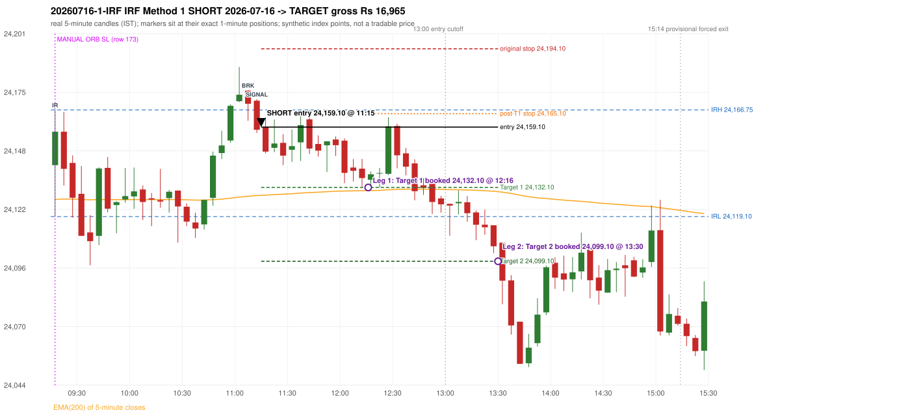

# Trading journal - 2026-07-16 (Thursday)

> Automated, read-only reconstruction of the Phase 3.0 baseline. Synthetic NIFTY 50 index-point P&L (the index is not tradable). The owner's review status is intentionally blank.

## A. Trading day overview

| item | value |
|---|---|
| Date / weekday | 2026-07-16 / Thursday |
| Session type | USABLE_WITH_FLAGS / VALID |
| Original session open (first 1-minute open) | 24,142.10 |
| Previous session | 2026-07-15 |
| Previous-day high / low | 24,220.05 / 24,010.95 |
| Previous-day official close / last 5-minute close | 24,078.50 / 24,073.45 |
| Raw engine records / confirmed signals / fully valid signals | 13 / 9 / 8 |
| Setups that did not complete (invalidated / incomplete) | 4 |
| Executed trades | 1 20260716-1-IRF |
| Gross P&L (Rs, synthetic) | 16,965.00 |
| Illustrative net P&L (Rs; Rs 500/trade + 0.5 pt/fill) | 16,075.00 |
| Day-end portfolio status | DAY_FINISHED |
| Manual journal trades (matched / unmatched) | 1 (0 / 1) |
| Extra automated trades | 1 |

## B. Daily strategy signal timeline (confirmed signals, chronological)

| time | strategy | method | dir | entry-rule status | valid for execution | <= 13:00 | portfolio state | accepted / ignored | specific reason | competing (same minute) |
|---|---|---|---|---|---|---|---|---|---|---|
| 11:15 | IRF | Method 1 | SHORT | PROPOSAL_DEPENDENT | True | True | FIRST_TRADE_ACTIVE | ACCEPTED -> 20260716-1-IRF | first eligible signal of the day; trade 1: TARGET |  |
| 11:30 | IRF | Method 2A | SHORT | PROPOSAL_DEPENDENT | True | True | FIRST_TRADE_ACTIVE | IGNORED | POSITION_ACTIVE (signal kept for diagnostics only; never reused) [blocked by IRF#1] |  |
| 13:50 | PDR | PDR | LONG | PROPOSAL_DEPENDENT | True | False | DAY_FINISHED | IGNORED | DAY_FINISHED [blocked by IRF#1] |  |
| 14:00 | PDR | PDR | LONG | PROPOSAL_DEPENDENT | True | False | DAY_FINISHED | IGNORED | DAY_FINISHED [blocked by IRF#1] |  |
| 14:15 | PDR | PDR | LONG | PROPOSAL_DEPENDENT | True | False | DAY_FINISHED | IGNORED | DAY_FINISHED [blocked by IRF#1] |  |
| 14:35 | PDR | PDR | LONG | PROPOSAL_DEPENDENT | True | False | DAY_FINISHED | IGNORED | DAY_FINISHED [blocked by IRF#1] |  |
| 14:55 | PDR | PDR | LONG | PROPOSAL_DEPENDENT | True | False | DAY_FINISHED | IGNORED | DAY_FINISHED [blocked by IRF#1] |  |
| 15:10 | PDR | PDR | LONG | PROPOSAL_DEPENDENT | True | False | DAY_FINISHED | IGNORED | DAY_FINISHED [blocked by IRF#1] |  |
| 15:30 | PDR | PDR | LONG | PROPOSAL_DEPENDENT | False | False | DAY_FINISHED | IGNORED | DAY_FINISHED [blocked by IRF#1] |  |

Engine setups that did not complete (4); the complete list with failed rule ids is in `rejected_signals.csv`:

| candle | strategy | method | dir | status | precise reason | failed rules |
|---|---|---|---|---|---|---|
| 11:40 | IRF | Method 3 | SHORT | INVALIDATED | WICK_SHARE_OUT_OF_BAND | IRF-M3-003 |
| 09:15 | ORB | Method 2 | LONG | INVALIDATED | TREND:EMA_PREV_SESSION_CLOSE wrong side | ORB-TREND-001;ORB-TREND-002 |
| 09:15 | ORB | Gap/200DMA | LONG | INVALIDATED | CANDLE_QUALITY_OR_REJECTION_WICK | ORB-GAP-LONG-004 |
| 09:40 | RF | RF | LONG | INVALIDATED | TREND:EMA_PREV_SESSION_CLOSE wrong side | RF-001;RF-008 |

## C. Detailed trade journals

### 20260716-1-IRF: IRF Method 1 SHORT (FIRST trade)

Chart: 

**Rule configuration:** CFG-baseline-be1db2a09d - signal verification status **PROPOSAL_DEPENDENT** (never VERIFIED while a rule rests on a proposal).

#### 1. Setup identification

IRF Method 1 SHORT: the completed 11:05 candle closed at 24,169.55, 2.80 points above the initial range high 24,166.75 (range [24,119.10, 24,166.75] from the 09:15 candle); the immediately following completed 11:10 candle closed at 24,157.90, back inside the range. The short signal was confirmed at 11:15 on that close. Entry reference close 24,157.90 is 8.85 points below IRH 24,166.75.

#### 2. Candle and indicator calculations

| role | session | candle | O | H | L | C | range | body % | upper wick % | lower wick % | direction | EMA(200) | strong bull / bear | pin bull / bear | small (body<=30%) | used for |
|---|---|---|---|---|---|---|---|---|---|---|---|---|---|---|---|---|
| initial_range_candle | TODAY | 09:15-09:20 | 24,142.10 | 24,166.75 | 24,119.10 | 24,157.05 | 47.65 | 31.37 | 20.36 | 48.27 | BULLISH | 24,126.77 | False / False | False / False | False | initial range = high/low of the 09:15 candle |
| signal_candle | TODAY | 11:10-11:15 | 24,170.90 | 24,171.60 | 24,156.45 | 24,157.90 | 15.15 | 85.81 | 4.62 | 9.57 | BEARISH | 24,128.48 | False / True | False / False | False | candle whose close completed the trigger |
| breakout_candle | TODAY | 11:05-11:10 | 24,175.40 | 24,175.55 | 24,161.90 | 24,169.55 | 13.65 | 42.86 | 1.10 | 56.04 | BEARISH | 24,128.19 | False / False | False / False | False | breakout candle: a completed candle closing above IRH |

Every condition, with the rule, the calculation, the observed values and the result:

| # | group | rule | result | status / numeric definition | calculation | observed | required | available at | why it matters |
|---|---|---|---|---|---|---|---|---|---|
| 1 | SELECTION | SEL-FIRST-001 | PASS | USER_APPROVED / USER_APPROVED | earliest CONFIRMED signal of the day across IRF/ORB/PDR/PDS/RF that passed the controller's checks | 0 confirmed signal(s) earlier today; 9 confirmed signals in the day in total, this one at 11:15 | no earlier executable signal | 2026-07-16 11:15 | the shared controller trades only the first valid signal; the five strategies are not independent positions |
| 2 | SELECTION | SEL-TIE-001 | PASS | USER_APPROVED / USER_APPROVED | other CONFIRMED signals with exactly the same confirmation timestamp | none | no different-strategy / opposite-direction signal in the same minute (otherwise an unresolved conflict, no trade) | 2026-07-16 11:15 | an unresolved same-minute collision would have produced no trade at all |
| 3 | SELECTION | ENTRY-CUTOFF-001 | PASS | USER_APPROVED / USER_APPROVED | fill timestamp vs 13:00:00 IST | signal confirmed 11:15; fill 11:15 | fill at or before 13:00:00 IST | 2026-07-16 11:15 | no new position may be entered with a fill after 13:00 IST |
| 4 | SELECTION | EXE-FILL-001 | PASS | PROPOSED_FOR_REVIEW / PROPOSED_FOR_REVIEW | fill = open of the 1-minute bar that starts at the signal candle's end | bar 11:15 O 24,159.10 H 24,162.45 L 24,156.95 C 24,160.25; executable=True; entry 24,159.10 | fill bar exists, starts exactly at the signal end, is fillable; entry = its open | 2026-07-16 11:15 | a 5-minute signal is known only when its candle closes; the first price that can be traded is the next minute's open |
| 5 | SELECTION | DAY-MAX-001 | PASS | USER_APPROVED / USER_APPROVED | number of entries today | trade 1 of at most 2 | <= 2 entries per day | 2026-07-16 11:15 | daily trade cap |
| 6 | SETUP | IRF-GLOBAL-001 | PASS | SOURCE_VERIFIED / EXPLICIT_IN_SOURCE | initial range = high and low (wicks included) of the first completed 5-minute candle | 09:15-09:20 IRH 24,166.75, IRL 24,119.10 (range 47.65; engine recorded IRH 24,166.75, IRL 24,119.10) | high/low of the 09:15-09:20 candle | 2026-07-16 09:20 | all three IRF methods measure price against this range |
| 7 | SETUP | IRF-GLOBAL-003 | PASS | SOURCE_VERIFIED / EXPLICIT_IN_SOURCE | closes confirm, wicks do not: every trigger is evaluated on a completed 5-minute candle | trigger candle 11:10-11:15 was complete when the signal was stamped 11:15; decision uses its close 24,157.90 | completed candle close, not an intra-candle wick | 2026-07-16 11:15 | an intra-candle wick can reverse before the candle closes |
| 8 | SETUP | IRF-GLOBAL-002 | PASS | SOURCE_VERIFIED / EXPLICIT_IN_SOURCE | direction | SHORT (IRF trades short only) | short only | 2026-07-16 11:15 | IRF fades failed upside breakouts |
| 9 | SETUP | IRF-M1-001 | PASS | SOURCE_VERIFIED / EXPLICIT_IN_SOURCE | breakout candle close vs IRH | 11:05-11:10 O 24,175.40 H 24,175.55 L 24,161.90 C 24,169.55; range 13.65, body 5.85 (42.86%), upper wick 0.15 (1.10%), lower wick 7.65 (56.04%), bearish; close 24,169.55 is 2.80 points above IRH 24,166.75 | close > IRH (a wick above IRH is not a breakout) | 2026-07-16 11:10 | starts every IRF setup |
| 10 | CONFIRMATION | IRF-M1-002 | PASS | SOURCE_VERIFIED / EXPLICIT_IN_SOURCE | candle after the breakout closes back inside [IRL, IRH) | 11:10-11:15 O 24,170.90 H 24,171.60 L 24,156.45 C 24,157.90; range 15.15, body 13.00 (85.81%), upper wick 0.70 (4.62%), lower wick 1.45 (9.57%), bearish; close 24,157.90 vs range [24,119.10, 24,166.75) | IRL <= close < IRH | 2026-07-16 11:15 | the failed breakout: price could not hold above the opening range |
| 11 | CONFIRMATION | IRF-M1-004 | PASS | SOURCE_VERIFIED / EXPLICIT_IN_SOURCE | failure candle is the candle immediately after the breakout (k = 1) | breakout 11:05, failure candle 11:10: k = 1 | k = 1 (pp.5, 6, 13); the p.14 'next or following' reading (IRF-M1-C001) is CONFLICTING and not used in the baseline | 2026-07-16 11:15 | the guide's worked example enters at the close of the very next candle; no support/resistance break is required |
| 12 | EXECUTION | EXE-STOP-001 | PASS | USER_APPROVED / USER_APPROVED | initial stop = entry + 35 points | entry 24,159.10 -> stop 24,194.10 | stop 35 index points (BASELINE) | 2026-07-16 11:15 | defines the loss if the setup fails before Target 1 |
| 13 | EXECUTION | EXE-T1-001 | PASS | SOURCE_VERIFIED / EXPLICIT_IN_SOURCE | Target 1 = entry +/- 27 points | T1 24,132.10 | 27 points | 2026-07-16 11:15 | Leg 1 (3 lots) is booked at Target 1 |
| 14 | EXECUTION | IRF-TGT-001 | PASS | SOURCE_VERIFIED / EXPLICIT_IN_SOURCE | Target 2 = entry +/- 60 points | T2 24,099.10 | 60 points | 2026-07-16 11:15 | Leg 2 (3 lots) is booked at Target 2 |
| 15 | EXECUTION | POST-T1-STOP-006 | PASS | USER_APPROVED / USER_APPROVED | after T1 the Leg-2 stop = entry + 6 (no trailing) | post-T1 stop 24,165.10 | entry -6 (LONG) / +6 (SHORT) | 2026-07-16 11:15 | protects the remaining three lots once the first three are booked |
| 16 | EXECUTION | SIZE-LOT-001 | PASS | USER_APPROVED / USER_APPROVED | 6 lots x 65 = 390, Leg 1 = 3 lots = 195, Leg 2 = 195 | 6 lots, lot size 65, legs 3+3 | 6 lots in two equal legs | 2026-07-16 11:15 | position size for the synthetic P&L |
| 17 | NOTE | IRF-GLOBAL-004 | UNRESOLVED | UNRESOLVED / UNRESOLVED | which close above IRH of the session produced this attempt; repeat setups | this breakout is upward crossing no. 1 of the session (a close above IRH after a close at/below it) | the source states no first-breakout-only, re-arming, expiry or trades-per-day rule | 2026-07-16 11:15 | IRF re-arms on every later breakout in the code, producing many raw setups; the controller keeps only the first |
| 18 | NOTE | NOTE-IRF-REPEATED-SETUPS | NOT_APPLICABLE | NOT_A_RULE / NOT_A_REGISTRY_RULE | other IRF signals later in the session (not traded) | 1 further confirmed IRF signal(s): Method 2A@11:30 | disclosure of repeated raw setups | 2026-07-16 11:15 | repeated raw IRF setups are not hidden; they are logged as ignored |
| 19 | NOTE | IRF-SL-001 | NOT_APPLICABLE | SOURCE_VERIFIED / QUALITATIVE_SOURCE_NUMERIC_DEFINITION_PROPOSED_FOR_REVIEW | the guide's 35-or-40 rule: 35 if the most recent green candle's high is within 35 points of entry, else 40 | most recent green candle high 24,186.00 is 26.90 points from the entry 24,159.10: the guide's rule would select 35 points; the baseline applies a fixed 35 (USER_APPROVED research baseline; the 35-vs-40 selection and the 40-point variant are separate labelled scenarios) | source selection rule | 2026-07-16 11:15 | the stop distance is a modelling choice and changes losses, not entries |
| 20 | NOTE | NOTE-UNRESOLVED-DEPENDENCIES | UNRESOLVED | NOT_A_RULE / NOT_A_REGISTRY_RULE | rules the signal depends on that the sources leave unresolved | engine-recorded unresolved rule ids: IRF-GLOBAL-004; verification status PROPOSAL_DEPENDENT | n/a (disclosure) | 2026-07-16 11:15 | the entry is only as verified as the rules it rests on |

#### 3. Entry decision and explanation

IRF Method 1 SHORT: the completed 11:05 candle closed at 24,169.55, 2.80 points above the initial range high 24,166.75 (range [24,119.10, 24,166.75] from the 09:15 candle); the immediately following completed 11:10 candle closed at 24,157.90, back inside the range. The short signal was confirmed at 11:15 on that close. Entry reference close 24,157.90 is 8.85 points below IRH 24,166.75.

**Why this trade ahead of the other strategies:** This IRF Method 1 signal was the earliest executable signal of the day: 0 confirmed signal(s) earlier, 0 other in the same minute. 8 later confirmed signal(s) (IRF x1, PDR x7) are logged as ignored or rejected. State of the other four engines at that moment: [ORB: Method 2 invalidated at 09:15: TREND:EMA_PREV_SESSION_CLOSE wrong side; Gap/200DMA invalidated at 09:15: CANDLE_QUALITY_OR_REJECTION_WICK] [PDR: no setup record before this time (a base condition was not met, or nothing triggered)] [PDS: no setup record before this time (a base condition was not met, or nothing triggered)] [RF: RF invalidated at 09:40: TREND:EMA_PREV_SESSION_CLOSE wrong side]

#### 4. Actual entry execution

| item | value |
|---|---|
| Signal candle | 11:10-11:15 |
| Signal confirmed | 2026-07-16 11:15 |
| Fill timestamp | 2026-07-16 11:15 |
| Entry price | 24,159.10 |
| Source partition / 1-minute bar | data/processed/nifty50/year=2026/month=07/candles.parquet / 2026-07-16 11:15 |
| Source bar O / H / L / C | 24,159.10 / 24,162.45 / 24,156.95 / 24,160.25 |
| Fill assumption | open of the 1-minute bar starting at the signal candle's end (EXE-FILL-001, PROPOSED causal convention) |
| Initial stop / T1 / T2 / post-T1 stop | 24,194.10 / 24,132.10 / 24,099.10 / 24,165.10 |
| Position | 6 lots x 65 = 390 units (Leg 1 195, Leg 2 195) |

#### 5-8. Trade progress, Target 1, post-T1 stop and final exit

Between the 11:15 entry bar and the final exit (136 one-minute bars) the best excursion in favour was 75.45 points at 13:30 and the worst against was 7.70 points at 11:41. At 12:16 price reached Target 1 24,132.10 and three lots exited. At 12:16 the remaining three lots' protective stop was set to 24,165.10 (entry + 6; no trailing, no further change); the engine applies it from the Target-1 bar onward and tests it within that same bar. At 13:30 price reached Target 2 24,099.10 and the remaining three lots exited. No further trade that day (DAY-T2-001).

| leg | qty | exit time | exit price | reason | source 1-minute bar | O / H / L / C | gross points | gross Rs | slippage pts | flags |
|---|---|---|---|---|---|---|---|---|---|---|
| 1 | 195 | 12:16 | 24,132.10 | TARGET_1 | 12:16 | 24,136.70 / 24,136.70 / 24,132.00 / 24,135.80 | 27.00 | 5,265.00 | 0.00 |  |
| 2 | 195 | 13:30 | 24,099.10 | TARGET_2 | 13:30 | 24,107.40 / 24,107.40 / 24,083.65 / 24,091.55 | 60.00 | 11,700.00 | 0.00 |  |

Exit evidence per leg:

* Leg 1: 1-minute bar 12:16 O 24,136.70 H 24,136.70 L 24,132.00 C 24,135.80: low 24,132.00 reached Target 1 24,132.10; Leg 1 booked at the target level
* Leg 2: 1-minute bar 13:30 O 24,107.40 H 24,107.40 L 24,083.65 C 24,091.55: low 24,083.65 reached Target 2 24,099.10; Leg 2 booked at the target level

#### 9. Gross and illustrative net P&L

| item | value (Rs) |
|---|---|
| Leg 1 gross | 5,265.00 |
| Leg 2 gross | 11,700.00 |
| Trade gross (= Leg 1 + Leg 2) | 16,965.00 |
| Illustrative fixed cost | -500.00 |
| Illustrative slippage (0.5 pt on every fill, entry + exits, all units) | -390.00 |
| Illustrative net | 16,075.00 |

#### 10. Manual journal comparison

EXTRA_AUTOMATED_TRADE: the automated system took IRF Method 1 SHORT at 11:15 (manual traded only other strategies: ORB 09:15 SL). The setup rests on: IRF-GLOBAL-004: IRF trades per day / time window / re-arming are not stated in the guide | NOTE-UNRESOLVED-DEPENDENCIES: Disclosure of unresolved source rules behind this signal. The journal shows no corresponding entry.

## D. Manual journal comparison

| comparison | journal row | journal strategy | manual time | manual direction | manual outcome | match class | trade | auto entry | auto outcome | explanation |
|---|---|---|---|---|---|---|---|---|---|---|
| M173 | 173 | ORB | 09:15 | UNKNOWN | SL | SIGNAL_REJECTED_BY_ENTRY_RULE |  |  |  | SIGNAL_REJECTED_BY_ENTRY_RULE: SETUP_INVALIDATED Gap/200DMA - CANDLE_QUALITY_OR_REJECTION_WICK; failed=ORB-GAP-LONG-004. Heuristic primary cause: PROPOSED_NUMERICAL_THRESHOLD; blocked by: n/a |
| E119 |  |  |  |  |  | EXTRA_AUTOMATED_TRADE | 20260716-1-IRF | 11:15 @ 24,159.10 | TARGET | EXTRA_AUTOMATED_TRADE: the automated system took IRF Method 1 SHORT at 11:15 (manual traded only other strategies: ORB 09:15 SL). The setup rests on: IRF-GLOBAL-004: IRF trades per day / time window / re-arming are not stated in the guide \| NOTE-UNRESOLVED-DEPENDENCIES: Disclosure of unresolved source rules behind this signal. The journal shows no corresponding entry. |

The journal records no entry price and no exit price (NOT_RECORDED); matching uses date, strategy and candle start only - never P&L.

## E. Daily conclusion

* **Traded:** 20260716-1-IRF - IRF Method 1 SHORT at 11:15 (entry 24,159.10), outcome TARGET, gross Rs 16,965.00, illustrative net Rs 16,075.00. **Why:** This IRF Method 1 signal was the earliest executable signal of the day: 0 confirmed signal(s) earlier, 0 other in the same minute. 8 later confirmed signal(s) (IRF x1, PDR x7) are logged as ignored or rejected. State of the other four engines at that moment: [ORB: Method 2 invalidated at 09:15: TREND:EMA_PREV_SESSION_CLOSE wrong side; Gap/200DMA invalidated at 09:15: CANDLE_QUALITY_OR_REJECTION_WICK] [PDR: no setup record before this time (a base condition was not met, or nothing triggered)] [PDS: no setup record before this time (a base condition was not met, or nothing triggered)] [RF: RF invalidated at 09:40: TREND:EMA_PREV_SESSION_CLOSE wrong side] **How it ended:** At 12:16 price reached Target 1 24,132.10 and three lots exited. At 12:16 the remaining three lots' protective stop was set to 24,165.10 (entry + 6; no trailing, no further change); the engine applies it from the Target-1 bar onward and tests it within that same bar. At 13:30 price reached Target 2 24,099.10 and the remaining three lots exited. No further trade that day (DAY-T2-001).
* **Ignored / rejected signals:** PDR IGNORED DAY_FINISHED x7; IRF IGNORED POSITION_ACTIVE x1
* **Unmatched manual trade (row 173, ORB 09:15 SL):** SIGNAL_REJECTED_BY_ENTRY_RULE: SETUP_INVALIDATED Gap/200DMA - CANDLE_QUALITY_OR_REJECTION_WICK; failed=ORB-GAP-LONG-004. Heuristic primary cause: PROPOSED_NUMERICAL_THRESHOLD; blocked by: n/a
* **Extra automated trade 20260716-1-IRF:** EXTRA_AUTOMATED_TRADE: the automated system took IRF Method 1 SHORT at 11:15 (manual traded only other strategies: ORB 09:15 SL). The setup rests on: IRF-GLOBAL-004: IRF trades per day / time window / re-arming are not stated in the guide | NOTE-UNRESOLVED-DEPENDENCIES: Disclosure of unresolved source rules behind this signal. The journal shows no corresponding entry.
* **Open strategy-definition issues that affected this day:** IRF-GLOBAL-004 (NOT STATED: how many IRF trades per day, a latest entry time, and whether a new breakout may re-arm a setup after a signal), NOTE-UNRESOLVED-DEPENDENCIES
* **Automated triage (not an approval; the owner's review status stays blank):** REVIEW: UNMATCHED_MANUAL+EXTRA_AUTOMATED
