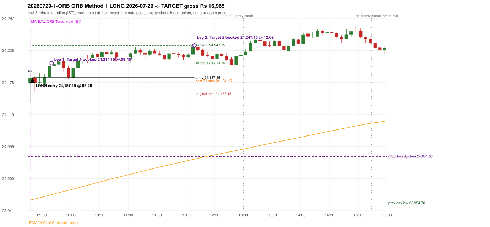

# Trading journal - 2026-07-29 (Wednesday)

> Automated, read-only reconstruction of the Phase 3.0 baseline. Synthetic NIFTY 50 index-point P&L (the index is not tradable). The owner's review status is intentionally blank.

## A. Trading day overview

| item | value |
|---|---|
| Date / weekday | 2026-07-29 / Wednesday |
| Session type | USABLE_WITH_FLAGS / VALID |
| Original session open (first 1-minute open) | 24,176.65 |
| Previous session | 2026-07-28 |
| Previous-day high / low | 24,041.00 / 23,954.70 |
| Previous-day official close / last 5-minute close | 23,985.35 / 23,983.95 |
| Raw engine records / confirmed signals / fully valid signals | 11 / 9 / 9 |
| Setups that did not complete (invalidated / incomplete) | 2 |
| Executed trades | 1 20260729-1-ORB |
| Gross P&L (Rs, synthetic) | 16,965.00 |
| Illustrative net P&L (Rs; Rs 500/trade + 0.5 pt/fill) | 16,075.00 |
| Day-end portfolio status | DAY_FINISHED |
| Manual journal trades (matched / unmatched) | 1 (1 / 0) |
| Extra automated trades | 0 |

## B. Daily strategy signal timeline (confirmed signals, chronological)

| time | strategy | method | dir | entry-rule status | valid for execution | <= 13:00 | portfolio state | accepted / ignored | specific reason | competing (same minute) |
|---|---|---|---|---|---|---|---|---|---|---|
| 09:20 | ORB | Method 1 | LONG | PROPOSAL_DEPENDENT | True | True | FIRST_TRADE_ACTIVE | ACCEPTED -> 20260729-1-ORB | first eligible signal of the day; trade 1: TARGET |  |
| 10:00 | IRF | Method 1 | SHORT | PROPOSAL_DEPENDENT | True | True | FIRST_TRADE_ACTIVE | IGNORED | POSITION_ACTIVE (signal kept for diagnostics only; never reused) [blocked by ORB#1] |  |
| 10:20 | IRF | Method 2B | SHORT | PROPOSAL_DEPENDENT | True | True | FIRST_TRADE_ACTIVE | IGNORED | POSITION_ACTIVE (signal kept for diagnostics only; never reused) [blocked by ORB#1] |  |
| 10:50 | IRF | Method 2A | SHORT | PROPOSAL_DEPENDENT | True | True | FIRST_TRADE_ACTIVE | IGNORED | POSITION_ACTIVE (signal kept for diagnostics only; never reused) [blocked by ORB#1] |  |
| 11:40 | IRF | Method 2A | SHORT | PROPOSAL_DEPENDENT | True | True | FIRST_TRADE_ACTIVE | IGNORED | POSITION_ACTIVE (signal kept for diagnostics only; never reused) [blocked by ORB#1] |  |
| 12:15 | IRF | Method 2B | SHORT | PROPOSAL_DEPENDENT | True | True | DAY_FINISHED | IGNORED | DAY_FINISHED [blocked by ORB#1] |  |
| 13:45 | IRF | Method 2A | SHORT | PROPOSAL_DEPENDENT | True | False | DAY_FINISHED | IGNORED | DAY_FINISHED [blocked by ORB#1] |  |
| 14:40 | IRF | Method 2A | SHORT | PROPOSAL_DEPENDENT | True | False | DAY_FINISHED | IGNORED | DAY_FINISHED [blocked by ORB#1] |  |
| 15:00 | IRF | Method 2B | SHORT | PROPOSAL_DEPENDENT | True | False | DAY_FINISHED | IGNORED | DAY_FINISHED [blocked by ORB#1] |  |

Engine setups that did not complete (2); the complete list with failed rule ids is in `rejected_signals.csv`:

| candle | strategy | method | dir | status | precise reason | failed rules |
|---|---|---|---|---|---|---|
| 14:55 | IRF | Method 1/2 | SHORT | INCOMPLETE_AT_EOD | SESSION_ENDED_BEFORE_CONFIRMATION |  |
| 09:15 | ORB | Method 2 | LONG | INVALIDATED | TRENDLINE_NOT_SUPPORTIVE | ORB-M2-LONG-001 |

## C. Detailed trade journals

### 20260729-1-ORB: ORB Method 1 LONG (FIRST trade)

Chart: 

**Rule configuration:** CFG-baseline-be1db2a09d - signal verification status **PROPOSAL_DEPENDENT** (never VERIFIED while a rule rests on a proposal).

#### 1. Setup identification

ORB Method 1 LONG: the first completed 5-minute candle (09:15-09:20) closed at 24,187.10, 146.10 points above the previous-day high 24,041.00; its body occupied 19.44% of its range and its upper wick 15.63% (thresholds 60% / 20%): the strong-candle test FAILED; the candle was admitted through the conditional PIN-BAR alternative instead (the lower wick 34.90 points is 3.34 x the body, required 2x; the close is 15.63% of the range from the high, allowed 30%); the EMA-only trend filter passed. Entry decision at 09:20.

#### 2. Candle and indicator calculations

| role | session | candle | O | H | L | C | range | body % | upper wick % | lower wick % | direction | EMA(200) | strong bull / bear | pin bull / bear | small (body<=30%) | used for |
|---|---|---|---|---|---|---|---|---|---|---|---|---|---|---|---|---|
| first_candle | TODAY | 09:15-09:20 | 24,176.65 | 24,195.50 | 24,141.75 | 24,187.10 | 53.75 | 19.44 | 15.63 | 64.93 | BULLISH | 23,960.23 | False / False | True / False | True | the 09:15 first five-minute candle - the ORB decision candle |
| prev_day_extreme_candle | PREVIOUS | 10:55-11:00 | 24,036.40 | 24,041.00 | 24,032.70 | 24,036.20 | 8.30 | 2.41 | 55.42 | 42.17 | BEARISH | 23,928.92 | False / False | False / False | True | candle that made the previous session's high/low used as the level |
| prev_session_last_candle | PREVIOUS | 15:25-15:30 | 23,991.75 | 23,995.65 | 23,976.40 | 23,983.95 | 19.25 | 40.52 | 20.26 | 39.22 | BEARISH | 23,957.95 | False / False | False / False | False | trend: previous session's last 5-minute close vs its EMA(200) |

Every condition, with the rule, the calculation, the observed values and the result:

| # | group | rule | result | status / numeric definition | calculation | observed | required | available at | why it matters |
|---|---|---|---|---|---|---|---|---|---|
| 1 | SELECTION | SEL-FIRST-001 | PASS | USER_APPROVED / USER_APPROVED | earliest CONFIRMED signal of the day across IRF/ORB/PDR/PDS/RF that passed the controller's checks | 0 confirmed signal(s) earlier today; 9 confirmed signals in the day in total, this one at 09:20 | no earlier executable signal | 2026-07-29 09:20 | the shared controller trades only the first valid signal; the five strategies are not independent positions |
| 2 | SELECTION | SEL-TIE-001 | PASS | USER_APPROVED / USER_APPROVED | other CONFIRMED signals with exactly the same confirmation timestamp | none | no different-strategy / opposite-direction signal in the same minute (otherwise an unresolved conflict, no trade) | 2026-07-29 09:20 | an unresolved same-minute collision would have produced no trade at all |
| 3 | SELECTION | ENTRY-CUTOFF-001 | PASS | USER_APPROVED / USER_APPROVED | fill timestamp vs 13:00:00 IST | signal confirmed 09:20; fill 09:20 | fill at or before 13:00:00 IST | 2026-07-29 09:20 | no new position may be entered with a fill after 13:00 IST |
| 4 | SELECTION | EXE-FILL-001 | PASS | PROPOSED_FOR_REVIEW / PROPOSED_FOR_REVIEW | fill = open of the 1-minute bar that starts at the signal candle's end | bar 09:20 O 24,187.15 H 24,191.55 L 24,178.60 C 24,178.60; executable=True; entry 24,187.15 | fill bar exists, starts exactly at the signal end, is fillable; entry = its open | 2026-07-29 09:20 | a 5-minute signal is known only when its candle closes; the first price that can be traded is the next minute's open |
| 5 | SELECTION | DAY-MAX-001 | PASS | USER_APPROVED / USER_APPROVED | number of entries today | trade 1 of at most 2 | <= 2 entries per day | 2026-07-29 09:20 | daily trade cap |
| 6 | SETUP | ORB-GLOBAL-001 | PASS | SOURCE_VERIFIED / EXPLICIT_IN_SOURCE | decision is taken once the first 5-minute candle (09:15-09:20) has closed | candle 09:15-09:20; signal confirmed 09:20 | decision at 09:20, never before the close | 2026-07-29 09:20 | the close of the first candle is unknown before 09:20 |
| 7 | SETUP | ORB-GLOBAL-002 | PASS | SOURCE_VERIFIED / EXPLICIT_IN_SOURCE | direction | LONG | same rules in both directions | 2026-07-29 09:20 | ORB trades the side of the break |
| 8 | SETUP | ORB-GLOBAL-004 | PASS | SOURCE_VERIFIED / QUALITATIVE_SOURCE_NUMERIC_DEFINITION_PROPOSED_FOR_REVIEW | entry at 09:20, after the first-candle close | signal confirmed 09:20; fill 09:20 at the open of that minute | 09:20 entry | 2026-07-29 09:20 | the guide enters at 9:20; the fill price convention (next minute open) is a proposal |
| 9 | SETUP | ORB-M1-LONG-001 | PASS | SOURCE_VERIFIED / QUALITATIVE_SOURCE_NUMERIC_DEFINITION_PROPOSED_FOR_REVIEW | prev_day_high = the highest high of all 5-minute candles of the previous session 2026-07-28 | previous-day high 24,041.00 (set by the 10:55 candle; previous session range 23,954.70 - 24,041.00; engine recorded 24,041.00) | previous-day resistance (long) / support (short) | 2026-07-28 11:00 | a mechanical proxy for the guide's hand-drawn previous-day level; the source charts show multi-session boxes (documented difference) |
| 10 | SETUP | ORB-M1-LONG-002 | PASS | SOURCE_VERIFIED / EXPLICIT_IN_SOURCE | the first candle breaks and closes beyond the level | high 24,195.50 / low 24,141.75, close 24,187.10: 146.10 points beyond 24,041.00 | high and close > level | 2026-07-29 09:20 | a wick alone is not a breakout; the close decides |
| 11 | TREND | ORB-TREND-001 | PASS | SOURCE_VERIFIED / QUALITATIVE_SOURCE_NUMERIC_DEFINITION_PROPOSED_FOR_REVIEW | previous session's final completed 5-minute candle: close vs its EMA(200 of 5-minute closes) | previous session 2026-07-28 last candle 15:25-15:30 close 23,983.95 vs EMA(200) 23,957.95: 26.00 points above the EMA -> trend bullish (EMA_PREV_SESSION_CLOSE; research variant A, EMA-only) | close > EMA(200) | 2026-07-28 15:30 | the opening gap can never create the trend: only information that existed before today's open is used |
| 12 | TREND | ORB-TREND-002 | PASS | SOURCE_VERIFIED / QUALITATIVE_SOURCE_NUMERIC_DEFINITION_PROPOSED_FOR_REVIEW | price location versus the 200 EMA is the basic confirmation; structure is only 'supporting' | 26.00 points above the EMA(200) on the previous session's last 5-minute close; swing structure not used in variant A | price on the trend side of the 200 EMA | 2026-07-28 15:30 | the rulebook calls EMA position 'a basic confirmation, supported by bullish structure'; the structure part has no numeric definition |
| 13 | TREND | TREND-SWING-001 | NOT_APPLICABLE | PROPOSED_FOR_REVIEW / PROPOSED_FOR_REVIEW | confirmed swing structure | not required by the active trend variant (variant A is the EMA price location only) | n/a | 2026-07-28 15:30 | variant B would additionally require higher-high/higher-low swings; it is a separate labelled scenario |
| 14 | CONFIRMATION | ORB-M1-LONG-003 | PASS | SOURCE_VERIFIED / QUALITATIVE_SOURCE_NUMERIC_DEFINITION_PROPOSED_FOR_REVIEW | candle quality: strong body and limited opposite wick (or the conditional pin bar) | 09:15-09:20 O 24,176.65 H 24,195.50 L 24,141.75 C 24,187.10; range 53.75, body 10.45 (19.44%), upper wick 8.40 (15.63%), lower wick 34.90 (64.93%), bullish. Strong-bullish test: bullish close, body >= 60% (observed 19.44%), upper wick <= 20% (observed 15.63%) -> not met; pin-bar alternative: wick >= 2 x body and close within the favourable 30% -> met | strong candle (research thresholds) or pin bar | 2026-07-29 09:20 | the guide asks for a 'strong body, small wick' but gives no numbers; the thresholds are proposals |
| 15 | EXECUTION | ORB-GLOBAL-003 | PASS | SOURCE_VERIFIED / EXPLICIT_IN_SOURCE | initial stop = entry - 30 points | entry 24,187.15 -> stop 24,157.15 | stop 30 index points (BASELINE) | 2026-07-29 09:20 | defines the loss if the setup fails before Target 1 |
| 16 | EXECUTION | EXE-T1-001 | PASS | SOURCE_VERIFIED / EXPLICIT_IN_SOURCE | Target 1 = entry +/- 27 points | T1 24,214.15 | 27 points | 2026-07-29 09:20 | Leg 1 (3 lots) is booked at Target 1 |
| 17 | EXECUTION | ORB-GLOBAL-003 | PASS | SOURCE_VERIFIED / EXPLICIT_IN_SOURCE | Target 2 = entry +/- 60 points | T2 24,247.15 | 60 points | 2026-07-29 09:20 | Leg 2 (3 lots) is booked at Target 2 |
| 18 | EXECUTION | POST-T1-STOP-006 | PASS | USER_APPROVED / USER_APPROVED | after T1 the Leg-2 stop = entry - 6 (no trailing) | post-T1 stop 24,181.15 | entry -6 (LONG) / +6 (SHORT) | 2026-07-29 09:20 | protects the remaining three lots once the first three are booked |
| 19 | EXECUTION | SIZE-LOT-001 | PASS | USER_APPROVED / USER_APPROVED | 6 lots x 65 = 390, Leg 1 = 3 lots = 195, Leg 2 = 195 | 6 lots, lot size 65, legs 3+3 | 6 lots in two equal legs | 2026-07-29 09:20 | position size for the synthetic P&L |
| 20 | NOTE | ORB-MA-001 | UNRESOLVED | CONFLICTING / CONFLICTING | which moving average the code uses | EMA(200) of 5-minute closes (the guide says '200 DMA' in some places and '200 EMA' in others); active ma_mode EMA200_5M | the source terminology conflicts | 2026-07-29 09:20 | a daily 200 DMA would give different values |
| 21 | NOTE | NOTE-UNRESOLVED-DEPENDENCIES | UNRESOLVED | NOT_A_RULE / NOT_A_REGISTRY_RULE | rules the signal depends on that the sources leave unresolved | engine-recorded unresolved rule ids: ORB-MA-001; verification status PROPOSAL_DEPENDENT | n/a (disclosure) | 2026-07-29 09:20 | the entry is only as verified as the rules it rests on |

#### 3. Entry decision and explanation

ORB Method 1 LONG: the first completed 5-minute candle (09:15-09:20) closed at 24,187.10, 146.10 points above the previous-day high 24,041.00; its body occupied 19.44% of its range and its upper wick 15.63% (thresholds 60% / 20%): the strong-candle test FAILED; the candle was admitted through the conditional PIN-BAR alternative instead (the lower wick 34.90 points is 3.34 x the body, required 2x; the close is 15.63% of the range from the high, allowed 30%); the EMA-only trend filter passed. Entry decision at 09:20.

**Why this trade ahead of the other strategies:** This ORB Method 1 signal was the earliest executable signal of the day: 0 confirmed signal(s) earlier, 0 other in the same minute. 8 later confirmed signal(s) (IRF x8) are logged as ignored or rejected. State of the other four engines at that moment: [IRF: no setup record before this time (a base condition was not met, or nothing triggered)] [PDR: no setup record before this time (a base condition was not met, or nothing triggered)] [PDS: no setup record before this time (a base condition was not met, or nothing triggered)] [RF: no setup record before this time (a base condition was not met, or nothing triggered)]

#### 4. Actual entry execution

| item | value |
|---|---|
| Signal candle | 09:15-09:20 |
| Signal confirmed | 2026-07-29 09:20 |
| Fill timestamp | 2026-07-29 09:20 |
| Entry price | 24,187.15 |
| Source partition / 1-minute bar | data/processed/nifty50/year=2026/month=07/candles.parquet / 2026-07-29 09:20 |
| Source bar O / H / L / C | 24,187.15 / 24,191.55 / 24,178.60 / 24,178.60 |
| Fill assumption | open of the 1-minute bar starting at the signal candle's end (EXE-FILL-001, PROPOSED causal convention) |
| Initial stop / T1 / T2 / post-T1 stop | 24,157.15 / 24,214.15 / 24,247.15 / 24,181.15 |
| Position | 6 lots x 65 = 390 units (Leg 1 195, Leg 2 195) |

#### 5-8. Trade progress, Target 1, post-T1 stop and final exit

Between the 09:20 entry bar and the final exit (170 one-minute bars) the best excursion in favour was 60.30 points at 12:09 and the worst against was 25.15 points at 09:23. At 09:40 price reached Target 1 24,214.15 and three lots exited. At 09:40 the remaining three lots' protective stop was set to 24,181.15 (entry - 6; no trailing, no further change); the engine applies it from the Target-1 bar onward and tests it within that same bar. At 12:09 price reached Target 2 24,247.15 and the remaining three lots exited. No further trade that day (DAY-T2-001).

| leg | qty | exit time | exit price | reason | source 1-minute bar | O / H / L / C | gross points | gross Rs | slippage pts | flags |
|---|---|---|---|---|---|---|---|---|---|---|
| 1 | 195 | 09:40 | 24,214.15 | TARGET_1 | 09:40 | 24,208.50 / 24,217.65 / 24,208.50 / 24,215.30 | 27.00 | 5,265.00 | 0.00 |  |
| 2 | 195 | 12:09 | 24,247.15 | TARGET_2 | 12:09 | 24,237.90 / 24,247.45 / 24,237.05 / 24,244.70 | 60.00 | 11,700.00 | 0.00 |  |

Exit evidence per leg:

* Leg 1: 1-minute bar 09:40 O 24,208.50 H 24,217.65 L 24,208.50 C 24,215.30: high 24,217.65 reached Target 1 24,214.15; Leg 1 booked at the target level
* Leg 2: 1-minute bar 12:09 O 24,237.90 H 24,247.45 L 24,237.05 C 24,244.70: high 24,247.45 reached Target 2 24,247.15; Leg 2 booked at the target level

#### 9. Gross and illustrative net P&L

| item | value (Rs) |
|---|---|
| Leg 1 gross | 5,265.00 |
| Leg 2 gross | 11,700.00 |
| Trade gross (= Leg 1 + Leg 2) | 16,965.00 |
| Illustrative fixed cost | -500.00 |
| Illustrative slippage (0.5 pt on every fill, entry + exits, all units) | -390.00 |
| Illustrative net | 16,075.00 |

#### 10. Manual journal comparison

EXACT_MATCH: manual ORB labelled 09:15 (candle start) vs automated ORB Method 1 LONG candle 09:15, filled 09:20 at 24,187.15; time difference 0 minutes. Journal outcome Target vs automated TARGET (same outcome class). The journal records no entry or exit price.

## D. Manual journal comparison

| comparison | journal row | journal strategy | manual time | manual direction | manual outcome | match class | trade | auto entry | auto outcome | explanation |
|---|---|---|---|---|---|---|---|---|---|---|
| M181 | 181 | ORB | 09:15 | UNKNOWN | Target | EXACT_MATCH | 20260729-1-ORB | 09:20 @ 24,187.15 | TARGET | EXACT_MATCH: manual ORB labelled 09:15 (candle start) vs automated ORB Method 1 LONG candle 09:15, filled 09:20 at 24,187.15; time difference 0 minutes. Journal outcome Target vs automated TARGET (same outcome class). The journal records no entry or exit price. |

The journal records no entry price and no exit price (NOT_RECORDED); matching uses date, strategy and candle start only - never P&L.

## E. Daily conclusion

* **Traded:** 20260729-1-ORB - ORB Method 1 LONG at 09:20 (entry 24,187.15), outcome TARGET, gross Rs 16,965.00, illustrative net Rs 16,075.00. **Why:** This ORB Method 1 signal was the earliest executable signal of the day: 0 confirmed signal(s) earlier, 0 other in the same minute. 8 later confirmed signal(s) (IRF x8) are logged as ignored or rejected. State of the other four engines at that moment: [IRF: no setup record before this time (a base condition was not met, or nothing triggered)] [PDR: no setup record before this time (a base condition was not met, or nothing triggered)] [PDS: no setup record before this time (a base condition was not met, or nothing triggered)] [RF: no setup record before this time (a base condition was not met, or nothing triggered)] **How it ended:** At 09:40 price reached Target 1 24,214.15 and three lots exited. At 09:40 the remaining three lots' protective stop was set to 24,181.15 (entry - 6; no trailing, no further change); the engine applies it from the Target-1 bar onward and tests it within that same bar. At 12:09 price reached Target 2 24,247.15 and the remaining three lots exited. No further trade that day (DAY-T2-001).
* **Ignored / rejected signals:** IRF IGNORED POSITION_ACTIVE x4; IRF IGNORED DAY_FINISHED x4
* **Open strategy-definition issues that affected this day:** NOTE-UNRESOLVED-DEPENDENCIES, ORB-MA-001 (Terminology conflict: '200 DMA / EMA' (p.2), '200 EMA' (pp.3,5,7), '200 DMA' (pp.1,8,9,12) for what the charts show as one curved line on a 5-minute chart)
* **Automated triage (not an approval; the owner's review status stays blank):** MATCHED_EXACT_NO_FLAGS
