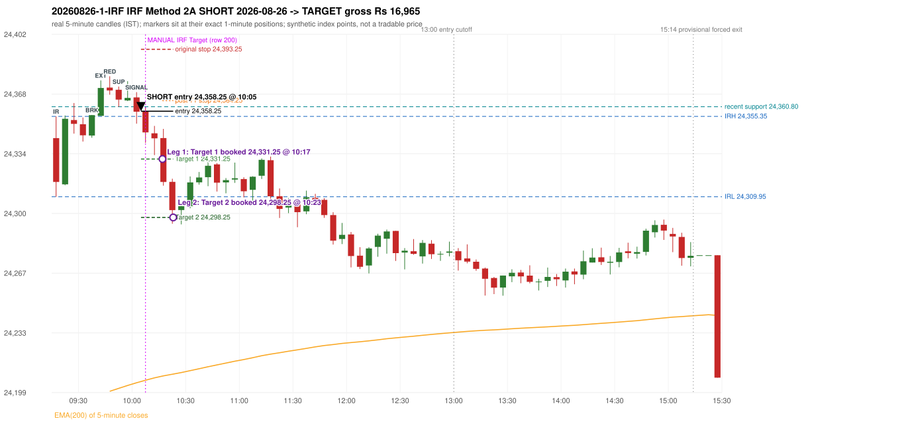

# Trading journal - 2026-08-26 (Wednesday)

> Automated, read-only reconstruction of the Phase 3.0 baseline. Synthetic NIFTY 50 index-point P&L (the index is not tradable). The owner's review status is intentionally blank.

## A. Trading day overview

| item | value |
|---|---|
| Date / weekday | 2026-08-26 / Wednesday |
| Session type | USABLE_WITH_FLAGS / VALID / CLOSING_AUCTION_REGIME |
| Original session open (first 1-minute open) | 24,343.05 |
| Previous session | 2026-08-25 |
| Previous-day high / low | 24,334.55 / 24,115.55 |
| Previous-day official close / last 5-minute close | 24,334.55 / 24,334.55 |
| Raw engine records / confirmed signals / fully valid signals | 6 / 3 / 3 |
| Setups that did not complete (invalidated / incomplete) | 3 |
| Executed trades | 1 20260826-1-IRF |
| Gross P&L (Rs, synthetic) | 16,965.00 |
| Illustrative net P&L (Rs; Rs 500/trade + 0.5 pt/fill) | 16,075.00 |
| Day-end portfolio status | DAY_FINISHED |
| Manual journal trades (matched / unmatched) | 1 (1 / 0) |
| Extra automated trades | 0 |

## B. Daily strategy signal timeline (confirmed signals, chronological)

| time | strategy | method | dir | entry-rule status | valid for execution | <= 13:00 | portfolio state | accepted / ignored | specific reason | competing (same minute) |
|---|---|---|---|---|---|---|---|---|---|---|
| 10:05 | IRF | Method 2A | SHORT | PROPOSAL_DEPENDENT | True | True | FIRST_TRADE_ACTIVE | ACCEPTED -> 20260826-1-IRF | first eligible signal of the day; trade 1: TARGET |  |
| 10:10 | IRF | Method 1 | SHORT | PROPOSAL_DEPENDENT | True | True | FIRST_TRADE_ACTIVE | IGNORED | POSITION_ACTIVE (signal kept for diagnostics only; never reused) [blocked by IRF#1] |  |
| 13:30 | PDR | PDR | LONG | PROPOSAL_DEPENDENT | True | False | DAY_FINISHED | IGNORED | DAY_FINISHED [blocked by IRF#1] |  |

Engine setups that did not complete (3); the complete list with failed rule ids is in `rejected_signals.csv`:

| candle | strategy | method | dir | status | precise reason | failed rules |
|---|---|---|---|---|---|---|
| 09:15 | ORB | Method 2 | LONG | INVALIDATED | CANDLE_QUALITY | ORB-M2-LONG-003 |
| 15:25 | PDR | PDR | LONG | INCOMPLETE_AT_EOD | NO_GREEN_CANDLE_AFTER_ZONE_TEST_BEFORE_SESSION_END |  |
| 10:30 | RF | RF | LONG | INVALIDATED | GAP_UP_OUTSIDE_YESTERDAYS_RANGE | RF-004 |

## C. Detailed trade journals

### 20260826-1-IRF: IRF Method 2A SHORT (FIRST trade)

Chart: 

**Rule configuration:** CFG-baseline-be1db2a09d - signal verification status **PROPOSAL_DEPENDENT** (never VERIFIED while a rule rests on a proposal).

#### 1. Setup identification

IRF Method 2A SHORT: the 09:35-09:40 candle closed at 24,356.05, above IRH 24,355.35, and the next candle did not close back inside the range, so the setup is Method 2 and price stayed above it until the trigger. Extension candle 09:40-09:45, red candle 09:45-09:50. The trigger came 5 candles after the breakout candle: a completed candle closed below the recent pullback-low support (10:00-10:05); confirmed at 10:05 with close 24,358.00. Entry reference close 24,358.00 is 2.65 points above IRH 24,355.35.

#### 2. Candle and indicator calculations

| role | session | candle | O | H | L | C | range | body % | upper wick % | lower wick % | direction | EMA(200) | strong bull / bear | pin bull / bear | small (body<=30%) | used for |
|---|---|---|---|---|---|---|---|---|---|---|---|---|---|---|---|---|
| initial_range_candle | TODAY | 09:15-09:20 | 24,343.05 | 24,355.35 | 24,309.95 | 24,318.30 | 45.40 | 54.52 | 27.09 | 18.39 | BEARISH | 24,190.32 | False / False | False / False | False | initial range = high/low of the 09:15 candle |
| signal_candle | TODAY | 10:00-10:05 | 24,366.05 | 24,369.05 | 24,351.25 | 24,358.00 | 17.80 | 45.22 | 16.85 | 37.92 | BEARISH | 24,204.90 | False / False | False / False | False | candle whose close completed the trigger |
| breakout_candle | TODAY | 09:35-09:40 | 24,344.50 | 24,356.15 | 24,343.30 | 24,356.05 | 12.85 | 89.88 | 0.78 | 9.34 | BULLISH | 24,196.64 | True / False | False / False | False | breakout candle: a completed candle closing above IRH |
| extension_candle | TODAY | 09:40-09:45 | 24,355.65 | 24,375.70 | 24,355.65 | 24,371.40 | 20.05 | 78.55 | 21.45 | 0.00 | BULLISH | 24,198.38 | False / False | False / False | False | extension: first later candle trading above the breakout candle's high |
| red_candle | TODAY | 09:45-09:50 | 24,371.60 | 24,378.00 | 24,367.60 | 24,370.00 | 10.40 | 15.38 | 61.54 | 23.08 | BEARISH | 24,200.09 | False / False | False / True | True | first red candle during the extension |
| support_pivot | TODAY | 09:50-09:55 | 24,370.40 | 24,372.20 | 24,360.80 | 24,364.85 | 11.40 | 48.68 | 15.79 | 35.53 | BEARISH | 24,201.73 | False / False | False / False | False | recent support: latest 3-candle fractal low formed after the breakout |

Every condition, with the rule, the calculation, the observed values and the result:

| # | group | rule | result | status / numeric definition | calculation | observed | required | available at | why it matters |
|---|---|---|---|---|---|---|---|---|---|
| 1 | SELECTION | SEL-FIRST-001 | PASS | USER_APPROVED / USER_APPROVED | earliest CONFIRMED signal of the day across IRF/ORB/PDR/PDS/RF that passed the controller's checks | 0 confirmed signal(s) earlier today; 3 confirmed signals in the day in total, this one at 10:05 | no earlier executable signal | 2026-08-26 10:05 | the shared controller trades only the first valid signal; the five strategies are not independent positions |
| 2 | SELECTION | SEL-TIE-001 | PASS | USER_APPROVED / USER_APPROVED | other CONFIRMED signals with exactly the same confirmation timestamp | none | no different-strategy / opposite-direction signal in the same minute (otherwise an unresolved conflict, no trade) | 2026-08-26 10:05 | an unresolved same-minute collision would have produced no trade at all |
| 3 | SELECTION | ENTRY-CUTOFF-001 | PASS | USER_APPROVED / USER_APPROVED | fill timestamp vs 13:00:00 IST | signal confirmed 10:05; fill 10:05 | fill at or before 13:00:00 IST | 2026-08-26 10:05 | no new position may be entered with a fill after 13:00 IST |
| 4 | SELECTION | EXE-FILL-001 | PASS | PROPOSED_FOR_REVIEW / PROPOSED_FOR_REVIEW | fill = open of the 1-minute bar that starts at the signal candle's end | bar 10:05 O 24,358.25 H 24,360.60 L 24,353.15 C 24,355.40; executable=True; entry 24,358.25 | fill bar exists, starts exactly at the signal end, is fillable; entry = its open | 2026-08-26 10:05 | a 5-minute signal is known only when its candle closes; the first price that can be traded is the next minute's open |
| 5 | SELECTION | DAY-MAX-001 | PASS | USER_APPROVED / USER_APPROVED | number of entries today | trade 1 of at most 2 | <= 2 entries per day | 2026-08-26 10:05 | daily trade cap |
| 6 | SETUP | IRF-GLOBAL-001 | PASS | SOURCE_VERIFIED / EXPLICIT_IN_SOURCE | initial range = high and low (wicks included) of the first completed 5-minute candle | 09:15-09:20 IRH 24,355.35, IRL 24,309.95 (range 45.40; engine recorded IRH 24,355.35, IRL 24,309.95) | high/low of the 09:15-09:20 candle | 2026-08-26 09:20 | all three IRF methods measure price against this range |
| 7 | SETUP | IRF-GLOBAL-003 | PASS | SOURCE_VERIFIED / EXPLICIT_IN_SOURCE | closes confirm, wicks do not: every trigger is evaluated on a completed 5-minute candle | trigger candle 10:00-10:05 was complete when the signal was stamped 10:05; decision uses its close 24,358.00 | completed candle close, not an intra-candle wick | 2026-08-26 10:05 | an intra-candle wick can reverse before the candle closes |
| 8 | SETUP | IRF-GLOBAL-002 | PASS | SOURCE_VERIFIED / EXPLICIT_IN_SOURCE | direction | SHORT (IRF trades short only) | short only | 2026-08-26 10:05 | IRF fades failed upside breakouts |
| 9 | SETUP | IRF-M2-001 | PASS | SOURCE_VERIFIED / EXPLICIT_IN_SOURCE | breakout candle close vs IRH | 09:35-09:40 O 24,344.50 H 24,356.15 L 24,343.30 C 24,356.05; range 12.85, body 11.55 (89.88%), upper wick 0.10 (0.78%), lower wick 1.20 (9.34%), bullish; close 24,356.05 is 0.70 points above IRH 24,355.35 | close > IRH (a wick above IRH is not a breakout) | 2026-08-26 09:40 | starts every IRF setup |
| 10 | SETUP | IRF-M2-004 | PASS | SOURCE_VERIFIED / EXPLICIT_IN_SOURCE | the candle after the breakout must NOT close back inside the range (else the setup is Method 1) | 09:40 close 24,371.40 vs [24,309.95, 24,355.35) | not (IRL <= close < IRH) | 2026-08-26 09:45 | separates Method 2 (price holds above) from Method 1 (immediate failure) |
| 11 | SETUP | IRF-M2-002 | PASS | SOURCE_VERIFIED / QUALITATIVE_SOURCE_NUMERIC_DEFINITION_PROPOSED_FOR_REVIEW | extension = a later candle whose high exceeds the breakout candle's high (research definition E1) | 09:40 high 24,375.70 vs breakout candle high 24,356.15 (+19.55) | high > breakout candle high | 2026-08-26 09:45 | the guide says price 'extends further upward'; the numeric test is a proposal |
| 12 | SETUP | IRF-M2-003 | PASS | SOURCE_VERIFIED / QUALITATIVE_SOURCE_NUMERIC_DEFINITION_PROPOSED_FOR_REVIEW | a red candle (close < open) forms after the extension | 09:45-09:50 O 24,371.60 H 24,378.00 L 24,367.60 C 24,370.00; range 10.40, body 1.60 (15.38%), upper wick 6.40 (61.54%), lower wick 2.40 (23.08%), bearish | close < open, at or after the candle following the extension | 2026-08-26 09:50 | the red candle shows the first pause/reversal inside the extension |
| 13 | CONFIRMATION | IRF-M2A-001 | PASS | SOURCE_VERIFIED / QUALITATIVE_SOURCE_NUMERIC_DEFINITION_PROPOSED_FOR_REVIEW | recent support = latest 3-candle fractal low (k=1) among candles b+1 ... i-2 | 09:50 low 24,360.80; neighbours' lows 24,367.60 (09:45) and 24,363.95 (09:55) are not lower; engine recorded support 24,360.80 | pivot low known before the trigger candle | 2026-08-26 10:00 | the support is the level whose break completes Method 2A (the exact 'pullback low' definition is a proposal) |
| 14 | CONFIRMATION | IRF-M2A-002 | PASS | SOURCE_VERIFIED / EXPLICIT_WORDING_DETAIL_PROPOSED_FOR_REVIEW | trigger candle closes below recent support | 10:00 close 24,358.00 vs support 24,360.80: 2.80 points below | close < support (close, not wick) | 2026-08-26 10:05 | completes Method 2A |
| 15 | CONFIRMATION | IRF-M2-005 | PASS | SOURCE_VERIFIED / EXPLICIT_IN_SOURCE | chronology: the red candle precedes the break candle | red candle 09:45, break candle 10:00 | red candle index < break candle index (m2a_break_may_be_red_candle = False) | 2026-08-26 10:05 | a red candle alone is not confirmation; a level break is required |
| 16 | EXECUTION | EXE-STOP-001 | PASS | USER_APPROVED / USER_APPROVED | initial stop = entry + 35 points | entry 24,358.25 -> stop 24,393.25 | stop 35 index points (BASELINE) | 2026-08-26 10:05 | defines the loss if the setup fails before Target 1 |
| 17 | EXECUTION | EXE-T1-001 | PASS | SOURCE_VERIFIED / EXPLICIT_IN_SOURCE | Target 1 = entry +/- 27 points | T1 24,331.25 | 27 points | 2026-08-26 10:05 | Leg 1 (3 lots) is booked at Target 1 |
| 18 | EXECUTION | IRF-TGT-001 | PASS | SOURCE_VERIFIED / EXPLICIT_IN_SOURCE | Target 2 = entry +/- 60 points | T2 24,298.25 | 60 points | 2026-08-26 10:05 | Leg 2 (3 lots) is booked at Target 2 |
| 19 | EXECUTION | POST-T1-STOP-006 | PASS | USER_APPROVED / USER_APPROVED | after T1 the Leg-2 stop = entry + 6 (no trailing) | post-T1 stop 24,364.25 | entry -6 (LONG) / +6 (SHORT) | 2026-08-26 10:05 | protects the remaining three lots once the first three are booked |
| 20 | EXECUTION | SIZE-LOT-001 | PASS | USER_APPROVED / USER_APPROVED | 6 lots x 65 = 390, Leg 1 = 3 lots = 195, Leg 2 = 195 | 6 lots, lot size 65, legs 3+3 | 6 lots in two equal legs | 2026-08-26 10:05 | position size for the synthetic P&L |
| 21 | NOTE | IRF-M2-006 | UNRESOLVED | UNRESOLVED / UNRESOLVED | delay between the breakout candle and this trigger; expiry rule | 5 candles after the breakout; expiry none configured | the source states no expiry | 2026-08-26 10:05 | an old breakout can still trigger hours later |
| 22 | NOTE | IRF-M2-006 | UNRESOLVED | UNRESOLVED / UNRESOLVED | did price stay above IRH between the breakout and the trigger? | 0 closes at or below IRH between 09:40 and 10:00; trigger close 24,358.00 above IRH 24,355.35 | the engine does not require price to stay above IRH | 2026-08-26 10:05 | the guide describes price 'holding above IRH and keeping rising'; the code only needs the level break |
| 23 | NOTE | IRF-GLOBAL-004 | UNRESOLVED | UNRESOLVED / UNRESOLVED | which close above IRH of the session produced this attempt; repeat setups | this breakout is upward crossing no. 1 of the session (a close above IRH after a close at/below it) | the source states no first-breakout-only, re-arming, expiry or trades-per-day rule | 2026-08-26 10:05 | IRF re-arms on every later breakout in the code, producing many raw setups; the controller keeps only the first |
| 24 | NOTE | NOTE-IRF-REPEATED-SETUPS | NOT_APPLICABLE | NOT_A_RULE / NOT_A_REGISTRY_RULE | other IRF signals later in the session (not traded) | 1 further confirmed IRF signal(s): Method 1@10:10 | disclosure of repeated raw setups | 2026-08-26 10:05 | repeated raw IRF setups are not hidden; they are logged as ignored |
| 25 | NOTE | IRF-SL-001 | NOT_APPLICABLE | SOURCE_VERIFIED / QUALITATIVE_SOURCE_NUMERIC_DEFINITION_PROPOSED_FOR_REVIEW | the guide's 35-or-40 rule: 35 if the most recent green candle's high is within 35 points of entry, else 40 | most recent green candle high 24,375.25 is 17.00 points from the entry 24,358.25: the guide's rule would select 35 points; the baseline applies a fixed 35 (USER_APPROVED research baseline; the 35-vs-40 selection and the 40-point variant are separate labelled scenarios) | source selection rule | 2026-08-26 10:05 | the stop distance is a modelling choice and changes losses, not entries |
| 26 | NOTE | NOTE-UNRESOLVED-DEPENDENCIES | UNRESOLVED | NOT_A_RULE / NOT_A_REGISTRY_RULE | rules the signal depends on that the sources leave unresolved | engine-recorded unresolved rule ids: IRF-GLOBAL-004; verification status PROPOSAL_DEPENDENT | n/a (disclosure) | 2026-08-26 10:05 | the entry is only as verified as the rules it rests on |

#### 3. Entry decision and explanation

IRF Method 2A SHORT: the 09:35-09:40 candle closed at 24,356.05, above IRH 24,355.35, and the next candle did not close back inside the range, so the setup is Method 2 and price stayed above it until the trigger. Extension candle 09:40-09:45, red candle 09:45-09:50. The trigger came 5 candles after the breakout candle: a completed candle closed below the recent pullback-low support (10:00-10:05); confirmed at 10:05 with close 24,358.00. Entry reference close 24,358.00 is 2.65 points above IRH 24,355.35.

**Why this trade ahead of the other strategies:** This IRF Method 2A signal was the earliest executable signal of the day: 0 confirmed signal(s) earlier, 0 other in the same minute. 2 later confirmed signal(s) (IRF x1, PDR x1) are logged as ignored or rejected. State of the other four engines at that moment: [ORB: Method 2 invalidated at 09:15: CANDLE_QUALITY] [PDR: no setup record before this time (a base condition was not met, or nothing triggered)] [PDS: no setup record before this time (a base condition was not met, or nothing triggered)] [RF: no setup record before this time (a base condition was not met, or nothing triggered)]

#### 4. Actual entry execution

| item | value |
|---|---|
| Signal candle | 10:00-10:05 |
| Signal confirmed | 2026-08-26 10:05 |
| Fill timestamp | 2026-08-26 10:05 |
| Entry price | 24,358.25 |
| Source partition / 1-minute bar | data/processed/nifty50/year=2026/month=08/candles.parquet / 2026-08-26 10:05 |
| Source bar O / H / L / C | 24,358.25 / 24,360.60 / 24,353.15 / 24,355.40 |
| Fill assumption | open of the 1-minute bar starting at the signal candle's end (EXE-FILL-001, PROPOSED causal convention) |
| Initial stop / T1 / T2 / post-T1 stop | 24,393.25 / 24,331.25 / 24,298.25 / 24,364.25 |
| Position | 6 lots x 65 = 390 units (Leg 1 195, Leg 2 195) |

#### 5-8. Trade progress, Target 1, post-T1 stop and final exit

Between the 10:05 entry bar and the final exit (19 one-minute bars) the best excursion in favour was 61.90 points at 10:23 and the worst against was 2.35 points at 10:05. At 10:17 price reached Target 1 24,331.25 and three lots exited. At 10:17 the remaining three lots' protective stop was set to 24,364.25 (entry + 6; no trailing, no further change); the engine applies it from the Target-1 bar onward and tests it within that same bar. At 10:23 price reached Target 2 24,298.25 and the remaining three lots exited. No further trade that day (DAY-T2-001).

| leg | qty | exit time | exit price | reason | source 1-minute bar | O / H / L / C | gross points | gross Rs | slippage pts | flags |
|---|---|---|---|---|---|---|---|---|---|---|
| 1 | 195 | 10:17 | 24,331.25 | TARGET_1 | 10:17 | 24,336.40 / 24,336.95 / 24,323.60 / 24,323.75 | 27.00 | 5,265.00 | 0.00 |  |
| 2 | 195 | 10:23 | 24,298.25 | TARGET_2 | 10:23 | 24,309.15 / 24,311.95 / 24,296.35 / 24,297.25 | 60.00 | 11,700.00 | 0.00 |  |

Exit evidence per leg:

* Leg 1: 1-minute bar 10:17 O 24,336.40 H 24,336.95 L 24,323.60 C 24,323.75: low 24,323.60 reached Target 1 24,331.25; Leg 1 booked at the target level
* Leg 2: 1-minute bar 10:23 O 24,309.15 H 24,311.95 L 24,296.35 C 24,297.25: low 24,296.35 reached Target 2 24,298.25; Leg 2 booked at the target level

#### 9. Gross and illustrative net P&L

| item | value (Rs) |
|---|---|
| Leg 1 gross | 5,265.00 |
| Leg 2 gross | 11,700.00 |
| Trade gross (= Leg 1 + Leg 2) | 16,965.00 |
| Illustrative fixed cost | -500.00 |
| Illustrative slippage (0.5 pt on every fill, entry + exits, all units) | -390.00 |
| Illustrative net | 16,075.00 |

#### 10. Manual journal comparison

TIME_SHIFTED_MATCH: manual IRF labelled 10:05 (candle start) vs automated IRF Method 2A SHORT candle 10:00, filled 10:05 at 24,358.25; time difference -5 minutes. Journal outcome Target vs automated TARGET (same outcome class). The journal records no entry or exit price.

## D. Manual journal comparison

| comparison | journal row | journal strategy | manual time | manual direction | manual outcome | match class | trade | auto entry | auto outcome | explanation |
|---|---|---|---|---|---|---|---|---|---|---|
| M200 | 200 | IRF | 10:05 | SHORT | Target | TIME_SHIFTED_MATCH | 20260826-1-IRF | 10:05 @ 24,358.25 | TARGET | TIME_SHIFTED_MATCH: manual IRF labelled 10:05 (candle start) vs automated IRF Method 2A SHORT candle 10:00, filled 10:05 at 24,358.25; time difference -5 minutes. Journal outcome Target vs automated TARGET (same outcome class). The journal records no entry or exit price. |

The journal records no entry price and no exit price (NOT_RECORDED); matching uses date, strategy and candle start only - never P&L.

## E. Daily conclusion

* **Traded:** 20260826-1-IRF - IRF Method 2A SHORT at 10:05 (entry 24,358.25), outcome TARGET, gross Rs 16,965.00, illustrative net Rs 16,075.00. **Why:** This IRF Method 2A signal was the earliest executable signal of the day: 0 confirmed signal(s) earlier, 0 other in the same minute. 2 later confirmed signal(s) (IRF x1, PDR x1) are logged as ignored or rejected. State of the other four engines at that moment: [ORB: Method 2 invalidated at 09:15: CANDLE_QUALITY] [PDR: no setup record before this time (a base condition was not met, or nothing triggered)] [PDS: no setup record before this time (a base condition was not met, or nothing triggered)] [RF: no setup record before this time (a base condition was not met, or nothing triggered)] **How it ended:** At 10:17 price reached Target 1 24,331.25 and three lots exited. At 10:17 the remaining three lots' protective stop was set to 24,364.25 (entry + 6; no trailing, no further change); the engine applies it from the Target-1 bar onward and tests it within that same bar. At 10:23 price reached Target 2 24,298.25 and the remaining three lots exited. No further trade that day (DAY-T2-001).
* **Ignored / rejected signals:** IRF IGNORED POSITION_ACTIVE x1; PDR IGNORED DAY_FINISHED x1
* **Open strategy-definition issues that affected this day:** IRF-GLOBAL-004 (NOT STATED: how many IRF trades per day, a latest entry time, and whether a new breakout may re-arm a setup after a signal), IRF-M2-006 (How long a Method 2 setup stays valid (expiry / invalidation before a level breaks) is not stated), NOTE-UNRESOLVED-DEPENDENCIES
* **Automated triage (not an approval; the owner's review status stays blank):** REVIEW: TIME_SHIFTED
