# PDR trade-by-trade audit - the 27 entries whose confirmation candle closed below the zone floor

**Written for:** the strategy owner, who will look at each trade's chart (`charts/<trade_id>.svg`). Prices are index points from the raw one-minute data (5-minute candles rebuilt causally; a candle labelled 09:15 covers 09:15-09:19 and is usable at 09:20). Everything after the entry is labelled POST_ENTRY and is context only. No outcome or P&L is used for any classification.

## 20250903-2-PDR - 2025-09-03 (Wednesday), second trade of the day

**Classification: SOURCE_AMBIGUOUS** (MEDIUM confidence). Basis: all written conditions hold (gap-up, not at the open, zone interaction, green candle after it) but the guide never says whether the green candle must close at/above the zone; no alternative source-plausible zone changes the result. Owner clarification: yes - is a zone-hold (close at/above the floor) required. Chart: 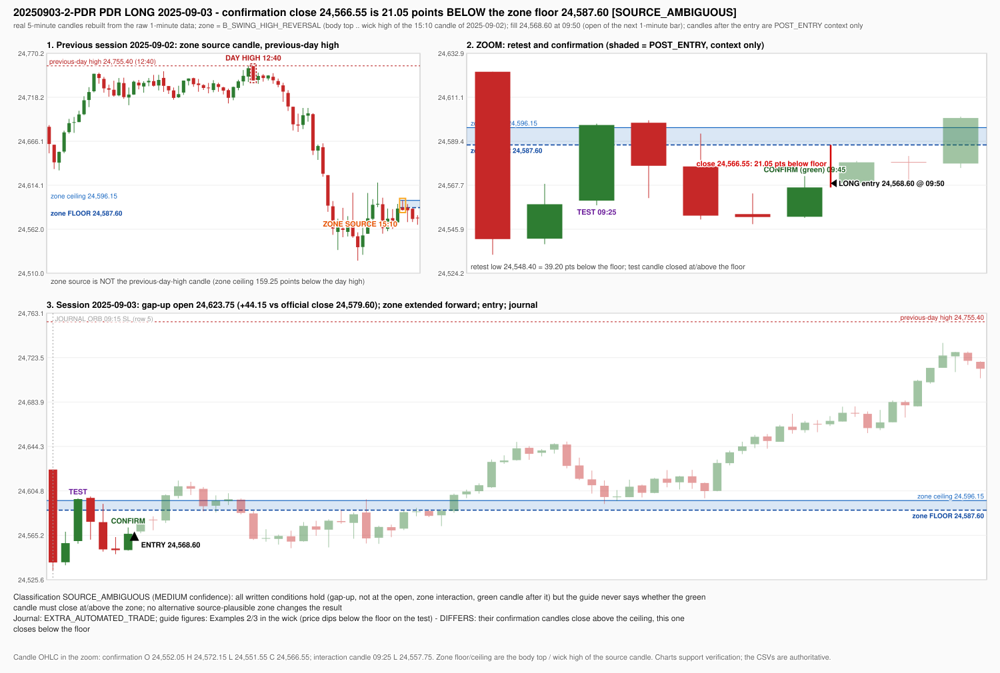

| item | value |
|---|---|
| Previous-day candle used for the zone | 2025-09-02 15:10 O 24,587.60 H 24,596.15 L 24,584.10 C 24,584.80 |
| Zone (method B_SWING_HIGH_REVERSAL, body top .. wick high) | floor 24,587.60 / ceiling 24,596.15 (height 8.55) |
| Previous-day high | 24,755.40 at 12:40 - the zone is NOT that candle (zone ceiling 159.25 points lower) |
| Open / official previous close / gap | 24,623.75 / 24,579.60 / +44.15; open 27.60 points above the zone ceiling |
| Interaction (test) candle | 09:25 O 24,560.05 H 24,598.10 L 24,557.75 C 24,597.45 - closed at/above the floor |
| Lowest price of the retest (5-min lows, test..confirmation) | 24,548.40 = 39.20 points below the floor (1-minute low 24,548.40) |
| Green confirmation candle | 2025-09-03 09:45 O 24,552.05 H 24,572.15 L 24,551.55 C 24,566.55; body 70.4%, upper wick 5.60 (27.2%), lower wick 0.50 (2.4%) |
| Close relative to the zone | 21.05 points BELOW the floor (-29.60 vs the ceiling) |
| Signal confirmed / earliest fill / entry price | 2025-09-03 09:50 / 2025-09-03 09:50 (open of the next 1-minute bar) / 24,568.60 |
| POST_ENTRY context | next candle 09:50 low 24567.0 close 24579.0; it did not move back into the zone |
| Alternative zones, same sequence rule | A previous-day-high candle [24755.00, 24755.40] (fires on this candle: False); C repeated shelf [24741.15, 24749.05] (fires: False) |
| Nearest figure in the guide | Examples 2/3 in the wick (price dips below the floor on the test) - DIFFERS: their confirmation candles close above the ceiling, this one closes below the floor |
| Manual journal | EXTRA_AUTOMATED_TRADE: no PDR row in the journal that day; the journal shows other strategy(ies): ORB 09:15 SL |
| Source-rule status | green candle after the interaction: SOURCE_VERIFIED (qualitative, PDR-007); close-location / zone-hold: not a source rule and not tested by the engine (UNRESOLVED) |

## 20250915-1-PDR - 2025-09-15 (Monday), first trade of the day

**Classification: SOURCE_AMBIGUOUS** (MEDIUM confidence). Basis: all written conditions hold (gap-up, not at the open, zone interaction, green candle after it) but the guide never says whether the green candle must close at/above the zone; no alternative source-plausible zone changes the result. Owner clarification: yes - is a zone-hold (close at/above the floor) required. Chart: 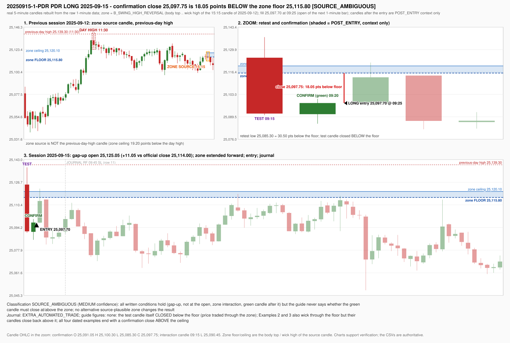

| item | value |
|---|---|
| Previous-day candle used for the zone | 2025-09-12 15:15 O 25,115.80 H 25,120.10 L 25,112.85 C 25,115.60 |
| Zone (method B_SWING_HIGH_REVERSAL, body top .. wick high) | floor 25,115.80 / ceiling 25,120.10 (height 4.30) |
| Previous-day high | 25,139.30 at 11:30 - the zone is NOT that candle (zone ceiling 19.20 points lower) |
| Open / official previous close / gap | 25,125.05 / 25,114.00 / +11.05; open 4.95 points above the zone ceiling |
| Interaction (test) candle | 09:15 O 25,125.05 H 25,137.45 L 25,090.45 C 25,091.40 - closed BELOW the floor |
| Lowest price of the retest (5-min lows, test..confirmation) | 25,085.30 = 30.50 points below the floor (1-minute low 25,085.30) |
| Green confirmation candle | 2025-09-15 09:20 O 25,091.05 H 25,100.30 L 25,085.30 C 25,097.75; body 44.7%, upper wick 2.55 (17.0%), lower wick 5.75 (38.3%) |
| Close relative to the zone | 18.05 points BELOW the floor (-22.35 vs the ceiling) |
| Signal confirmed / earliest fill / entry price | 2025-09-15 09:25 / 2025-09-15 09:25 (open of the next 1-minute bar) / 25,097.70 |
| POST_ENTRY context | next candle 09:25 low 25097.25 close 25113.25; it did move back into the zone |
| Alternative zones, same sequence rule | A previous-day-high candle [25132.85, 25139.30] (fires on this candle: False); C repeated shelf [25122.65, 25129.65] (fires: False) |
| Nearest figure in the guide | none: the test candle itself CLOSED below the floor (price traded through the zone); Examples 2 and 3 also wick through the floor but their candles close back above it; all four dated examples end with a confirmation close ABOVE the ceiling |
| Manual journal | EXTRA_AUTOMATED_TRADE: no PDR row in the journal that day; the journal shows other strategy(ies): RF 09:45 SL |
| Source-rule status | green candle after the interaction: SOURCE_VERIFIED (qualitative, PDR-007); close-location / zone-hold: not a source rule and not tested by the engine (UNRESOLVED) |

## 20251014-1-PDR - 2025-10-14 (Tuesday), first trade of the day

**Classification: SOURCE_AMBIGUOUS** (MEDIUM confidence). Basis: all written conditions hold (gap-up, not at the open, zone interaction, green candle after it) but the guide never says whether the green candle must close at/above the zone; no alternative source-plausible zone changes the result. Owner clarification: yes - is a zone-hold (close at/above the floor) required. Chart: 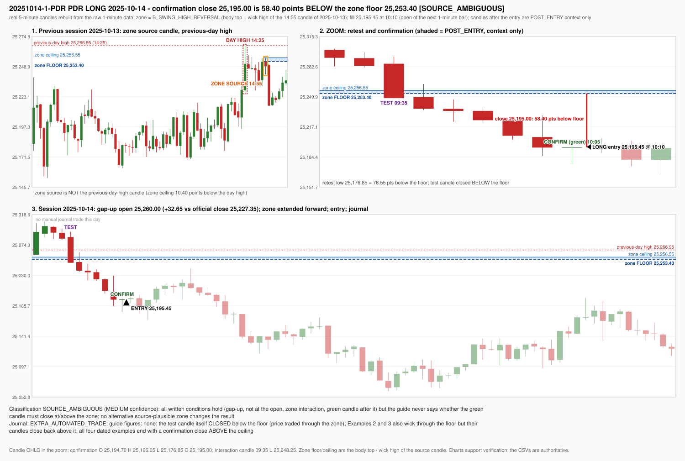

| item | value |
|---|---|
| Previous-day candle used for the zone | 2025-10-13 14:55 O 25,253.40 H 25,256.55 L 25,242.30 C 25,249.20 |
| Zone (method B_SWING_HIGH_REVERSAL, body top .. wick high) | floor 25,253.40 / ceiling 25,256.55 (height 3.15) |
| Previous-day high | 25,266.95 at 14:25 - the zone is NOT that candle (zone ceiling 10.40 points lower) |
| Open / official previous close / gap | 25,260.00 / 25,227.35 / +32.65; open 3.45 points above the zone ceiling |
| Interaction (test) candle | 09:35 O 25,285.75 H 25,293.50 L 25,248.25 C 25,248.35 - closed BELOW the floor |
| Lowest price of the retest (5-min lows, test..confirmation) | 25,176.85 = 76.55 points below the floor (1-minute low 25,176.85) |
| Green confirmation candle | 2025-10-14 10:05 O 25,194.70 H 25,196.05 L 25,176.85 C 25,195.00; body 1.6%, upper wick 1.05 (5.5%), lower wick 17.85 (93.0%) |
| Close relative to the zone | 58.40 points BELOW the floor (-61.55 vs the ceiling) |
| Signal confirmed / earliest fill / entry price | 2025-10-14 10:10 / 2025-10-14 10:10 (open of the next 1-minute bar) / 25,195.45 |
| POST_ENTRY context | next candle 10:10 low 25188.9 close 25196.7; it did not move back into the zone |
| Alternative zones, same sequence rule | A previous-day-high candle [25251.40, 25266.95] (fires on this candle: False); C repeated shelf [25212.60, 25232.45] (fires: True) |
| Nearest figure in the guide | none: the test candle itself CLOSED below the floor (price traded through the zone); Examples 2 and 3 also wick through the floor but their candles close back above it; all four dated examples end with a confirmation close ABOVE the ceiling |
| Manual journal | EXTRA_AUTOMATED_TRADE: no journal trade of any strategy that day |
| Source-rule status | green candle after the interaction: SOURCE_VERIFIED (qualitative, PDR-007); close-location / zone-hold: not a source rule and not tested by the engine (UNRESOLVED) |

## 20251113-1-PDR - 2025-11-13 (Thursday), first trade of the day

**Classification: SOURCE_AMBIGUOUS** (MEDIUM confidence). Basis: all written conditions hold (gap-up, not at the open, zone interaction, green candle after it) but the guide never says whether the green candle must close at/above the zone; no alternative source-plausible zone changes the result. Owner clarification: yes - is a zone-hold (close at/above the floor) required. Chart: 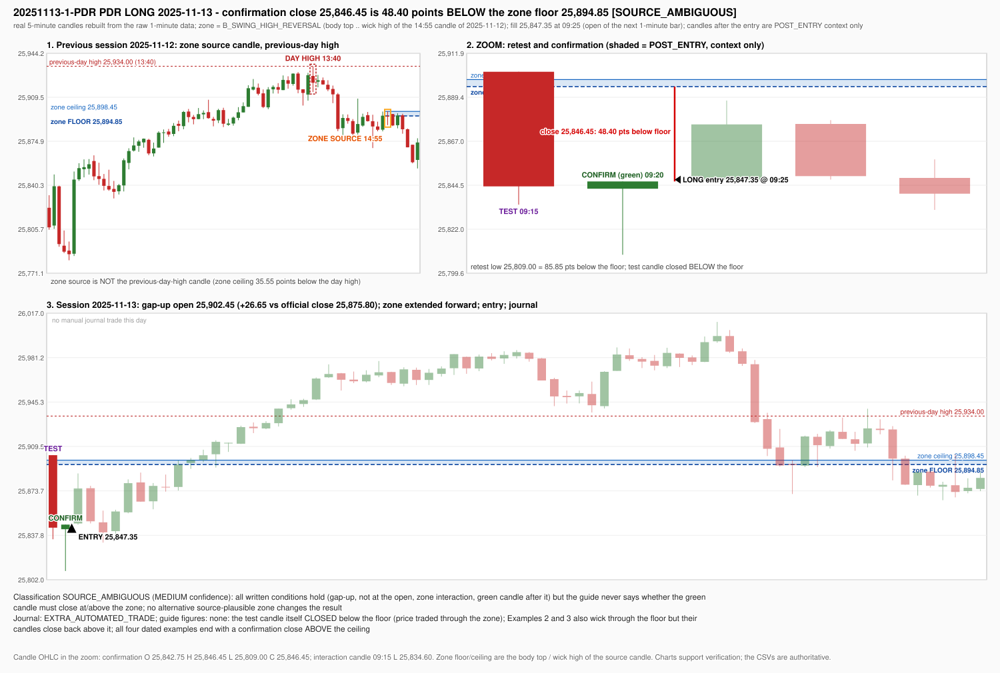

| item | value |
|---|---|
| Previous-day candle used for the zone | 2025-11-12 14:55 O 25,894.85 H 25,898.45 L 25,887.65 C 25,894.55 |
| Zone (method B_SWING_HIGH_REVERSAL, body top .. wick high) | floor 25,894.85 / ceiling 25,898.45 (height 3.60) |
| Previous-day high | 25,934.00 at 13:40 - the zone is NOT that candle (zone ceiling 35.55 points lower) |
| Open / official previous close / gap | 25,902.45 / 25,875.80 / +26.65; open 4.00 points above the zone ceiling |
| Interaction (test) candle | 09:15 O 25,902.45 H 25,902.45 L 25,834.60 C 25,843.95 - closed BELOW the floor |
| Lowest price of the retest (5-min lows, test..confirmation) | 25,809.00 = 85.85 points below the floor (1-minute low 25,809.00) |
| Green confirmation candle | 2025-11-13 09:20 O 25,842.75 H 25,846.45 L 25,809.00 C 25,846.45; body 9.9%, upper wick 0.00 (0.0%), lower wick 33.75 (90.1%) |
| Close relative to the zone | 48.40 points BELOW the floor (-52.00 vs the ceiling) |
| Signal confirmed / earliest fill / entry price | 2025-11-13 09:25 / 2025-11-13 09:25 (open of the next 1-minute bar) / 25,847.35 |
| POST_ENTRY context | next candle 09:25 low 25846.4 close 25875.55; it did not move back into the zone |
| Alternative zones, same sequence rule | A previous-day-high candle [25926.35, 25934.00] (fires on this candle: False); C repeated shelf [25926.35, 25934.00] (fires: False) |
| Nearest figure in the guide | none: the test candle itself CLOSED below the floor (price traded through the zone); Examples 2 and 3 also wick through the floor but their candles close back above it; all four dated examples end with a confirmation close ABOVE the ceiling |
| Manual journal | EXTRA_AUTOMATED_TRADE: no journal trade of any strategy that day |
| Source-rule status | green candle after the interaction: SOURCE_VERIFIED (qualitative, PDR-007); close-location / zone-hold: not a source rule and not tested by the engine (UNRESOLVED) |

## 20251118-1-PDR - 2025-11-18 (Tuesday), first trade of the day

**Classification: SOURCE_AMBIGUOUS** (MEDIUM confidence). Basis: all written conditions hold (gap-up, not at the open, zone interaction, green candle after it) but the guide never says whether the green candle must close at/above the zone; no alternative source-plausible zone changes the result. Owner clarification: yes - is a zone-hold (close at/above the floor) required. Chart: 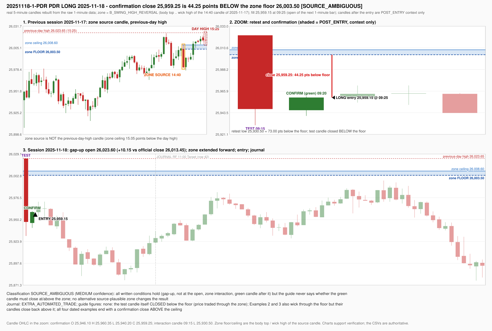

| item | value |
|---|---|
| Previous-day candle used for the zone | 2025-11-17 14:40 O 26,003.50 H 26,008.60 L 25,980.00 C 25,981.15 |
| Zone (method B_SWING_HIGH_REVERSAL, body top .. wick high) | floor 26,003.50 / ceiling 26,008.60 (height 5.10) |
| Previous-day high | 26,023.65 at 15:25 - the zone is NOT that candle (zone ceiling 15.05 points lower) |
| Open / official previous close / gap | 26,023.60 / 26,013.45 / +10.15; open 15.00 points above the zone ceiling |
| Interaction (test) candle | 09:15 O 26,023.60 H 26,023.60 L 25,930.50 C 25,947.35 - closed BELOW the floor |
| Lowest price of the retest (5-min lows, test..confirmation) | 25,930.50 = 73.00 points below the floor (1-minute low 25,930.50) |
| Green confirmation candle | 2025-11-18 09:20 O 25,946.10 H 25,960.35 L 25,940.20 C 25,959.25; body 65.3%, upper wick 1.10 (5.5%), lower wick 5.90 (29.3%) |
| Close relative to the zone | 44.25 points BELOW the floor (-49.35 vs the ceiling) |
| Signal confirmed / earliest fill / entry price | 2025-11-18 09:25 / 2025-11-18 09:25 (open of the next 1-minute bar) / 25,959.15 |
| POST_ENTRY context | next candle 09:25 low 25954.0 close 25963.0; it did not move back into the zone |
| Alternative zones, same sequence rule | A previous-day-high candle [26014.85, 26023.65] (fires on this candle: False); C repeated shelf [25965.40, 25979.50] (fires: True) |
| Nearest figure in the guide | none: the test candle itself CLOSED below the floor (price traded through the zone); Examples 2 and 3 also wick through the floor but their candles close back above it; all four dated examples end with a confirmation close ABOVE the ceiling |
| Manual journal | EXTRA_AUTOMATED_TRADE: no PDR row in the journal that day; the journal shows other strategy(ies): RF 11:00 Target |
| Source-rule status | green candle after the interaction: SOURCE_VERIFIED (qualitative, PDR-007); close-location / zone-hold: not a source rule and not tested by the engine (UNRESOLVED) |

## 20251201-1-PDR - 2025-12-01 (Monday), first trade of the day

**Classification: SOURCE_AMBIGUOUS** (MEDIUM confidence). Basis: all written conditions hold (gap-up, not at the open, zone interaction, green candle after it) but the guide never says whether the green candle must close at/above the zone; no alternative source-plausible zone changes the result. Owner clarification: yes - is a zone-hold (close at/above the floor) required. Chart: 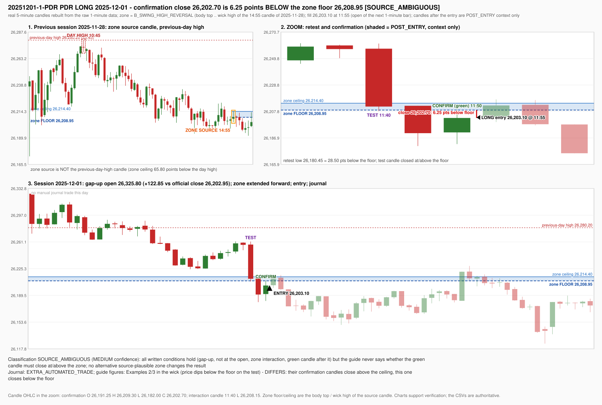

| item | value |
|---|---|
| Previous-day candle used for the zone | 2025-11-28 14:55 O 26,207.60 H 26,214.40 L 26,204.50 C 26,208.95 |
| Zone (method B_SWING_HIGH_REVERSAL, body top .. wick high) | floor 26,208.95 / ceiling 26,214.40 (height 5.45) |
| Previous-day high | 26,280.20 at 10:45 - the zone is NOT that candle (zone ceiling 65.80 points lower) |
| Open / official previous close / gap | 26,325.80 / 26,202.95 / +122.85; open 111.40 points above the zone ceiling |
| Interaction (test) candle | 11:40 O 26,257.60 H 26,261.65 L 26,208.15 C 26,211.75 - closed at/above the floor |
| Lowest price of the retest (5-min lows, test..confirmation) | 26,180.45 = 28.50 points below the floor (1-minute low 26,180.45) |
| Green confirmation candle | 2025-12-01 11:50 O 26,191.25 H 26,209.30 L 26,182.00 C 26,202.70; body 41.9%, upper wick 6.60 (24.2%), lower wick 9.25 (33.9%) |
| Close relative to the zone | 6.25 points BELOW the floor (-11.70 vs the ceiling) |
| Signal confirmed / earliest fill / entry price | 2025-12-01 11:55 / 2025-12-01 11:55 (open of the next 1-minute bar) / 26,203.10 |
| POST_ENTRY context | next candle 11:55 low 26199.5 close 26212.6; it did move back into the zone |
| Alternative zones, same sequence rule | A previous-day-high candle [26273.95, 26280.20] (fires on this candle: False); C repeated shelf [26252.45, 26257.10] (fires: True) |
| Nearest figure in the guide | Examples 2/3 in the wick (price dips below the floor on the test) - DIFFERS: their confirmation candles close above the ceiling, this one closes below the floor |
| Manual journal | EXTRA_AUTOMATED_TRADE: no journal trade of any strategy that day |
| Source-rule status | green candle after the interaction: SOURCE_VERIFIED (qualitative, PDR-007); close-location / zone-hold: not a source rule and not tested by the engine (UNRESOLVED) |

## 20251201-2-PDR - 2025-12-01 (Monday), second trade of the day

**Classification: SOURCE_AMBIGUOUS** (MEDIUM confidence). Basis: all written conditions hold (gap-up, not at the open, zone interaction, green candle after it) but the guide never says whether the green candle must close at/above the zone; no alternative source-plausible zone changes the result. Owner clarification: yes - is a zone-hold (close at/above the floor) required. Chart: 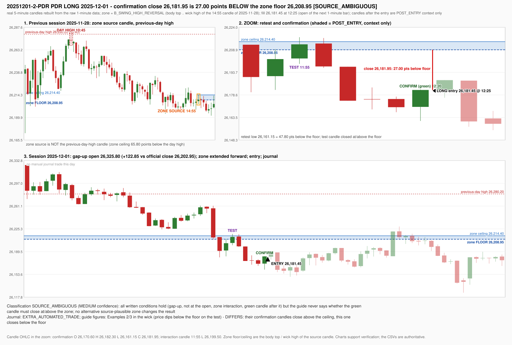

| item | value |
|---|---|
| Previous-day candle used for the zone | 2025-11-28 14:55 O 26,207.60 H 26,214.40 L 26,204.50 C 26,208.95 |
| Zone (method B_SWING_HIGH_REVERSAL, body top .. wick high) | floor 26,208.95 / ceiling 26,214.40 (height 5.45) |
| Previous-day high | 26,280.20 at 10:45 - the zone is NOT that candle (zone ceiling 65.80 points lower) |
| Open / official previous close / gap | 26,325.80 / 26,202.95 / +122.85; open 111.40 points above the zone ceiling |
| Interaction (test) candle | 11:55 O 26,203.10 H 26,217.40 L 26,199.50 C 26,212.60 - closed at/above the floor |
| Lowest price of the retest (5-min lows, test..confirmation) | 26,161.15 = 47.80 points below the floor (1-minute low 26,161.15) |
| Green confirmation candle | 2025-12-01 12:20 O 26,170.60 H 26,182.30 L 26,161.15 C 26,181.95; body 53.7%, upper wick 0.35 (1.7%), lower wick 9.45 (44.7%) |
| Close relative to the zone | 27.00 points BELOW the floor (-32.45 vs the ceiling) |
| Signal confirmed / earliest fill / entry price | 2025-12-01 12:25 / 2025-12-01 12:25 (open of the next 1-minute bar) / 26,181.45 |
| POST_ENTRY context | next candle 12:25 low 26176.75 close 26188.55; it did not move back into the zone |
| Alternative zones, same sequence rule | A previous-day-high candle [26273.95, 26280.20] (fires on this candle: False); C repeated shelf [26252.45, 26257.10] (fires: False) |
| Nearest figure in the guide | Examples 2/3 in the wick (price dips below the floor on the test) - DIFFERS: their confirmation candles close above the ceiling, this one closes below the floor |
| Manual journal | EXTRA_AUTOMATED_TRADE: no journal trade of any strategy that day |
| Source-rule status | green candle after the interaction: SOURCE_VERIFIED (qualitative, PDR-007); close-location / zone-hold: not a source rule and not tested by the engine (UNRESOLVED) |

## 20251217-2-PDR - 2025-12-17 (Wednesday), second trade of the day

**Classification: SOURCE_AMBIGUOUS** (MEDIUM confidence). Basis: all written conditions hold (gap-up, not at the open, zone interaction, green candle after it) but the guide never says whether the green candle must close at/above the zone; no alternative source-plausible zone changes the result. Owner clarification: yes - is a zone-hold (close at/above the floor) required. Chart: 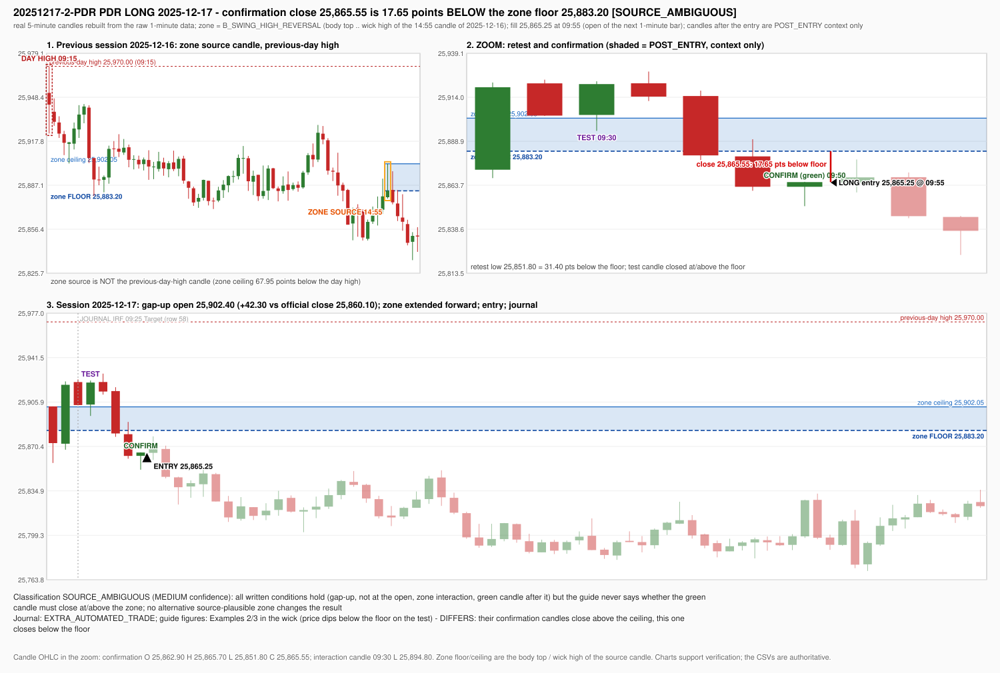

| item | value |
|---|---|
| Previous-day candle used for the zone | 2025-12-16 14:55 O 25,878.75 H 25,902.05 L 25,877.80 C 25,883.20 |
| Zone (method B_SWING_HIGH_REVERSAL, body top .. wick high) | floor 25,883.20 / ceiling 25,902.05 (height 18.85) |
| Previous-day high | 25,970.00 at 09:15 - the zone is NOT that candle (zone ceiling 67.95 points lower) |
| Open / official previous close / gap | 25,902.40 / 25,860.10 / +42.30; open 0.35 points above the zone ceiling |
| Interaction (test) candle | 09:30 O 25,903.90 H 25,923.10 L 25,894.80 C 25,921.50 - closed at/above the floor |
| Lowest price of the retest (5-min lows, test..confirmation) | 25,851.80 = 31.40 points below the floor (1-minute low 25,851.80) |
| Green confirmation candle | 2025-12-17 09:50 O 25,862.90 H 25,865.70 L 25,851.80 C 25,865.55; body 19.1%, upper wick 0.15 (1.1%), lower wick 11.10 (79.9%) |
| Close relative to the zone | 17.65 points BELOW the floor (-36.50 vs the ceiling) |
| Signal confirmed / earliest fill / entry price | 2025-12-17 09:55 / 2025-12-17 09:55 (open of the next 1-minute bar) / 25,865.25 |
| POST_ENTRY context | next candle 09:55 low 25859.65 close 25868.25; it did not move back into the zone |
| Alternative zones, same sequence rule | A previous-day-high candle [25951.50, 25970.00] (fires on this candle: False); C repeated shelf [25903.05, 25914.45] (fires: False) |
| Nearest figure in the guide | Examples 2/3 in the wick (price dips below the floor on the test) - DIFFERS: their confirmation candles close above the ceiling, this one closes below the floor |
| Manual journal | EXTRA_AUTOMATED_TRADE: no PDR row in the journal that day; the journal shows other strategy(ies): IRF 09:25 Target |
| Source-rule status | green candle after the interaction: SOURCE_VERIFIED (qualitative, PDR-007); close-location / zone-hold: not a source rule and not tested by the engine (UNRESOLVED) |

## 20251223-1-PDR - 2025-12-23 (Tuesday), first trade of the day

**Classification: SOURCE_AMBIGUOUS** (MEDIUM confidence). Basis: all written conditions hold (gap-up, not at the open, zone interaction, green candle after it) but the guide never says whether the green candle must close at/above the zone; no alternative source-plausible zone changes the result. Owner clarification: yes - is a zone-hold (close at/above the floor) required. Chart: 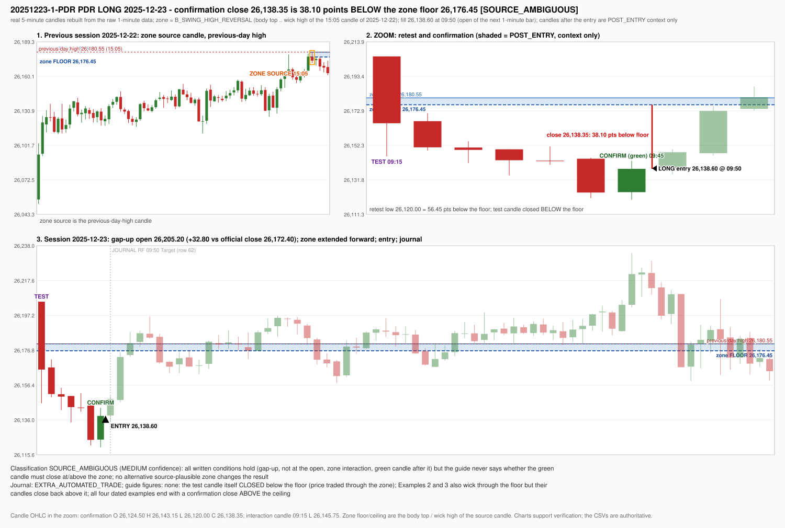

| item | value |
|---|---|
| Previous-day candle used for the zone | 2025-12-22 15:05 O 26,176.45 H 26,180.55 L 26,171.35 C 26,173.40 |
| Zone (method B_SWING_HIGH_REVERSAL, body top .. wick high) | floor 26,176.45 / ceiling 26,180.55 (height 4.10) |
| Previous-day high | 26,180.55 at 15:05 - the zone IS that candle |
| Open / official previous close / gap | 26,205.20 / 26,172.40 / +32.80; open 24.65 points above the zone ceiling |
| Interaction (test) candle | 09:15 O 26,205.20 H 26,205.20 L 26,145.75 C 26,165.50 - closed BELOW the floor |
| Lowest price of the retest (5-min lows, test..confirmation) | 26,120.00 = 56.45 points below the floor (1-minute low 26,120.00) |
| Green confirmation candle | 2025-12-23 09:45 O 26,124.50 H 26,143.15 L 26,120.00 C 26,138.35; body 59.8%, upper wick 4.80 (20.7%), lower wick 4.50 (19.4%) |
| Close relative to the zone | 38.10 points BELOW the floor (-42.20 vs the ceiling) |
| Signal confirmed / earliest fill / entry price | 2025-12-23 09:50 / 2025-12-23 09:50 (open of the next 1-minute bar) / 26,138.60 |
| POST_ENTRY context | next candle 09:50 low 26135.1 close 26148.25; it did not move back into the zone |
| Alternative zones, same sequence rule | A previous-day-high candle [26176.45, 26180.55] (fires on this candle: True); C repeated shelf [26165.90, 26180.55] (fires: True) |
| Nearest figure in the guide | none: the test candle itself CLOSED below the floor (price traded through the zone); Examples 2 and 3 also wick through the floor but their candles close back above it; all four dated examples end with a confirmation close ABOVE the ceiling |
| Manual journal | EXTRA_AUTOMATED_TRADE: no PDR row in the journal that day; the journal shows other strategy(ies): RF 09:50 Target |
| Source-rule status | green candle after the interaction: SOURCE_VERIFIED (qualitative, PDR-007); close-location / zone-hold: not a source rule and not tested by the engine (UNRESOLVED) |

## 20260105-2-PDR - 2026-01-05 (Monday), second trade of the day

**Classification: SOURCE_AMBIGUOUS** (MEDIUM confidence). Basis: all written conditions hold (gap-up, not at the open, zone interaction, green candle after it) but the guide never says whether the green candle must close at/above the zone; no alternative source-plausible zone changes the result. Owner clarification: yes - is a zone-hold (close at/above the floor) required. Chart: 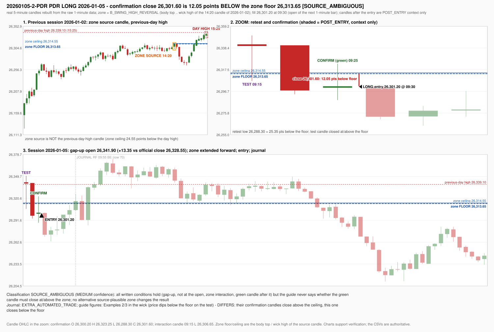

| item | value |
|---|---|
| Previous-day candle used for the zone | 2026-01-02 14:20 O 26,307.60 H 26,314.55 L 26,302.30 C 26,313.65 |
| Zone (method B_SWING_HIGH_REVERSAL, body top .. wick high) | floor 26,313.65 / ceiling 26,314.55 (height 0.90) |
| Previous-day high | 26,339.10 at 15:25 - the zone is NOT that candle (zone ceiling 24.55 points lower) |
| Open / official previous close / gap | 26,341.90 / 26,328.55 / +13.35; open 27.35 points above the zone ceiling |
| Interaction (test) candle | 09:15 O 26,341.90 H 26,350.40 L 26,306.65 C 26,340.25 - closed at/above the floor |
| Lowest price of the retest (5-min lows, test..confirmation) | 26,288.30 = 25.35 points below the floor (1-minute low 26,288.30) |
| Green confirmation candle | 2026-01-05 09:25 O 26,300.20 H 26,323.25 L 26,288.30 C 26,301.60; body 4.0%, upper wick 21.65 (61.9%), lower wick 11.90 (34.0%) |
| Close relative to the zone | 12.05 points BELOW the floor (-12.95 vs the ceiling) |
| Signal confirmed / earliest fill / entry price | 2026-01-05 09:30 / 2026-01-05 09:30 (open of the next 1-minute bar) / 26,301.20 |
| POST_ENTRY context | next candle 09:30 low 26269.75 close 26272.35; it did not move back into the zone |
| Alternative zones, same sequence rule | A previous-day-high candle [26335.70, 26339.10] (fires on this candle: True); C repeated shelf [26305.35, 26314.55] (fires: True) |
| Nearest figure in the guide | Examples 2/3 in the wick (price dips below the floor on the test) - DIFFERS: their confirmation candles close above the ceiling, this one closes below the floor |
| Manual journal | EXTRA_AUTOMATED_TRADE: no PDR row in the journal that day; the journal shows other strategy(ies): RF 09:55 BE |
| Source-rule status | green candle after the interaction: SOURCE_VERIFIED (qualitative, PDR-007); close-location / zone-hold: not a source rule and not tested by the engine (UNRESOLVED) |

## 20260113-1-PDR - 2026-01-13 (Tuesday), first trade of the day

**Classification: SOURCE_AMBIGUOUS** (MEDIUM confidence). Basis: all written conditions hold (gap-up, not at the open, zone interaction, green candle after it) but the guide never says whether the green candle must close at/above the zone; no alternative source-plausible zone changes the result. Owner clarification: yes - is a zone-hold (close at/above the floor) required. Chart: 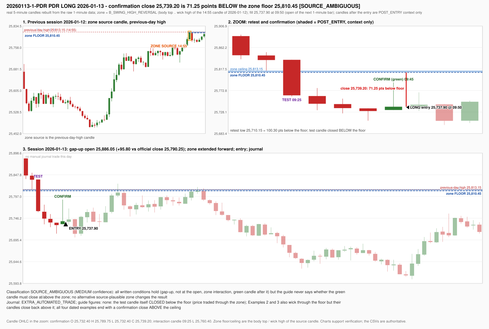

| item | value |
|---|---|
| Previous-day candle used for the zone | 2026-01-12 14:55 O 25,787.20 H 25,813.15 L 25,786.85 C 25,810.45 |
| Zone (method B_SWING_HIGH_REVERSAL, body top .. wick high) | floor 25,810.45 / ceiling 25,813.15 (height 2.70) |
| Previous-day high | 25,813.15 at 14:55 - the zone IS that candle |
| Open / official previous close / gap | 25,886.05 / 25,790.25 / +95.80; open 72.90 points above the zone ceiling |
| Interaction (test) candle | 09:25 O 25,836.75 H 25,836.75 L 25,760.40 C 25,762.85 - closed BELOW the floor |
| Lowest price of the retest (5-min lows, test..confirmation) | 25,710.15 = 100.30 points below the floor (1-minute low 25,710.15) |
| Green confirmation candle | 2026-01-13 09:45 O 25,732.40 H 25,789.75 L 25,732.40 C 25,739.20; body 11.9%, upper wick 50.55 (88.1%), lower wick 0.00 (0.0%) |
| Close relative to the zone | 71.25 points BELOW the floor (-73.95 vs the ceiling) |
| Signal confirmed / earliest fill / entry price | 2026-01-13 09:50 / 2026-01-13 09:50 (open of the next 1-minute bar) / 25,737.90 |
| POST_ENTRY context | next candle 09:50 low 25730.55 close 25743.4; it did not move back into the zone |
| Alternative zones, same sequence rule | A previous-day-high candle [25810.45, 25813.15] (fires on this candle: True); C repeated shelf [25583.85, 25598.20] (fires: False) |
| Nearest figure in the guide | none: the test candle itself CLOSED below the floor (price traded through the zone); Examples 2 and 3 also wick through the floor but their candles close back above it; all four dated examples end with a confirmation close ABOVE the ceiling |
| Manual journal | EXTRA_AUTOMATED_TRADE: no journal trade of any strategy that day |
| Source-rule status | green candle after the interaction: SOURCE_VERIFIED (qualitative, PDR-007); close-location / zone-hold: not a source rule and not tested by the engine (UNRESOLVED) |

## 20260129-1-PDR - 2026-01-29 (Thursday), first trade of the day

**Classification: SOURCE_AMBIGUOUS** (MEDIUM confidence). Basis: all written conditions hold (gap-up, not at the open, zone interaction, green candle after it) but the guide never says whether the green candle must close at/above the zone; no alternative source-plausible zone changes the result. Owner clarification: yes - is a zone-hold (close at/above the floor) required. Chart: 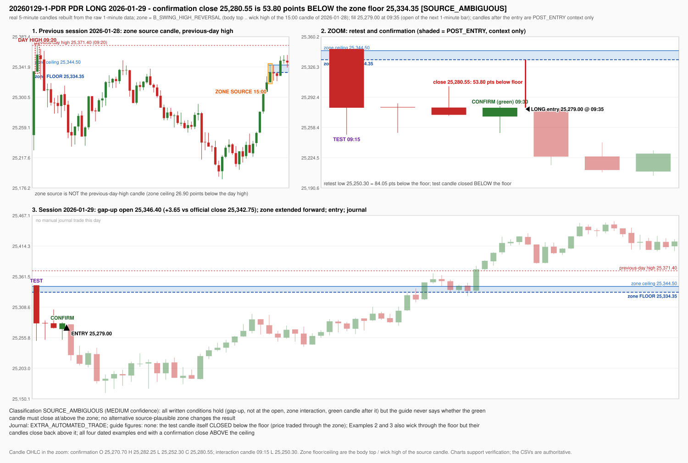

| item | value |
|---|---|
| Previous-day candle used for the zone | 2026-01-28 15:00 O 25,320.80 H 25,344.50 L 25,320.80 C 25,334.35 |
| Zone (method B_SWING_HIGH_REVERSAL, body top .. wick high) | floor 25,334.35 / ceiling 25,344.50 (height 10.15) |
| Previous-day high | 25,371.40 at 09:20 - the zone is NOT that candle (zone ceiling 26.90 points lower) |
| Open / official previous close / gap | 25,346.40 / 25,342.75 / +3.65; open 1.90 points above the zone ceiling |
| Interaction (test) candle | 09:15 O 25,346.40 H 25,346.40 L 25,250.30 C 25,280.55 - closed BELOW the floor |
| Lowest price of the retest (5-min lows, test..confirmation) | 25,250.30 = 84.05 points below the floor (1-minute low 25,250.30) |
| Green confirmation candle | 2026-01-29 09:30 O 25,270.70 H 25,282.25 L 25,252.30 C 25,280.55; body 32.9%, upper wick 1.70 (5.7%), lower wick 18.40 (61.4%) |
| Close relative to the zone | 53.80 points BELOW the floor (-63.95 vs the ceiling) |
| Signal confirmed / earliest fill / entry price | 2026-01-29 09:35 / 2026-01-29 09:35 (open of the next 1-minute bar) / 25,279.00 |
| POST_ENTRY context | next candle 09:35 low 25216.1 close 25225.7; it did not move back into the zone |
| Alternative zones, same sequence rule | A previous-day-high candle [25358.75, 25371.40] (fires on this candle: False); C repeated shelf [25329.15, 25344.50] (fires: True) |
| Nearest figure in the guide | none: the test candle itself CLOSED below the floor (price traded through the zone); Examples 2 and 3 also wick through the floor but their candles close back above it; all four dated examples end with a confirmation close ABOVE the ceiling |
| Manual journal | EXTRA_AUTOMATED_TRADE: no journal trade of any strategy that day |
| Source-rule status | green candle after the interaction: SOURCE_VERIFIED (qualitative, PDR-007); close-location / zone-hold: not a source rule and not tested by the engine (UNRESOLVED) |

## 20260211-1-PDR - 2026-02-11 (Wednesday), first trade of the day

**Classification: SOURCE_AMBIGUOUS** (MEDIUM confidence). Basis: all written conditions hold (gap-up, not at the open, zone interaction, green candle after it) but the guide never says whether the green candle must close at/above the zone; no alternative source-plausible zone changes the result. Owner clarification: yes - is a zone-hold (close at/above the floor) required. Chart: 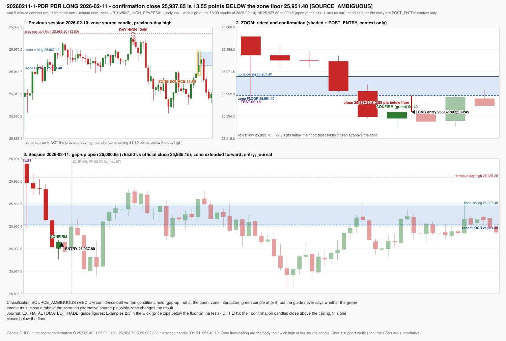

| item | value |
|---|---|
| Previous-day candle used for the zone | 2026-02-10 15:00 O 25,943.00 H 25,967.40 L 25,939.95 C 25,951.40 |
| Zone (method B_SWING_HIGH_REVERSAL, body top .. wick high) | floor 25,951.40 / ceiling 25,967.40 (height 16.00) |
| Previous-day high | 25,989.20 at 12:50 - the zone is NOT that candle (zone ceiling 21.80 points lower) |
| Open / official previous close / gap | 26,000.65 / 25,935.15 / +65.50; open 33.25 points above the zone ceiling |
| Interaction (test) candle | 09:15 O 26,000.65 H 26,000.65 L 25,949.10 C 25,985.00 - closed at/above the floor |
| Lowest price of the retest (5-min lows, test..confirmation) | 25,923.70 = 27.70 points below the floor (1-minute low 25,923.70) |
| Green confirmation candle | 2026-02-11 09:40 O 25,932.40 H 25,939.40 L 25,923.70 C 25,937.85; body 34.7%, upper wick 1.55 (9.9%), lower wick 8.70 (55.4%) |
| Close relative to the zone | 13.55 points BELOW the floor (-29.55 vs the ceiling) |
| Signal confirmed / earliest fill / entry price | 2026-02-11 09:45 / 2026-02-11 09:45 (open of the next 1-minute bar) / 25,937.80 |
| POST_ENTRY context | next candle 09:45 low 25929.85 close 25929.85; it did not move back into the zone |
| Alternative zones, same sequence rule | A previous-day-high candle [25983.15, 25989.20] (fires on this candle: True); C repeated shelf [25976.75, 25982.25] (fires: True) |
| Nearest figure in the guide | Examples 2/3 in the wick (price dips below the floor on the test) - DIFFERS: their confirmation candles close above the ceiling, this one closes below the floor |
| Manual journal | EXTRA_AUTOMATED_TRADE: no PDR row in the journal that day; the journal shows other strategy(ies): RF 09:50 SL |
| Source-rule status | green candle after the interaction: SOURCE_VERIFIED (qualitative, PDR-007); close-location / zone-hold: not a source rule and not tested by the engine (UNRESOLVED) |

## 20260219-1-PDR - 2026-02-19 (Thursday), first trade of the day

**Classification: SOURCE_AMBIGUOUS** (MEDIUM confidence). Basis: all written conditions hold (gap-up, not at the open, zone interaction, green candle after it) but the guide never says whether the green candle must close at/above the zone; no alternative source-plausible zone changes the result. Owner clarification: yes - is a zone-hold (close at/above the floor) required. Chart: 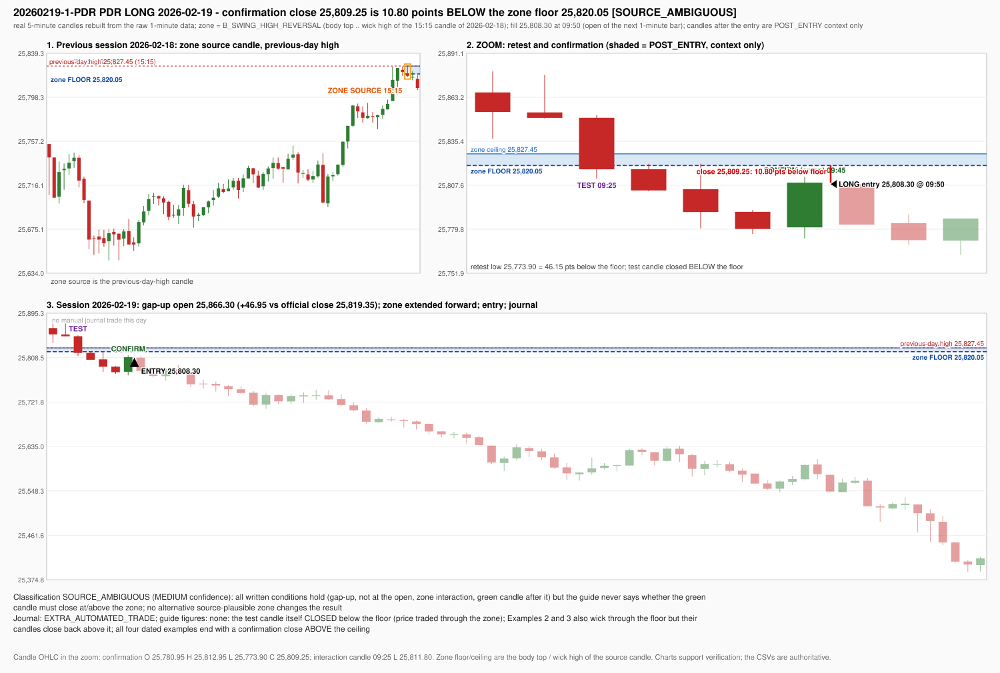

| item | value |
|---|---|
| Previous-day candle used for the zone | 2026-02-18 15:15 O 25,820.05 H 25,827.45 L 25,817.10 C 25,818.30 |
| Zone (method B_SWING_HIGH_REVERSAL, body top .. wick high) | floor 25,820.05 / ceiling 25,827.45 (height 7.40) |
| Previous-day high | 25,827.45 at 15:15 - the zone IS that candle |
| Open / official previous close / gap | 25,866.30 / 25,819.35 / +46.95; open 38.85 points above the zone ceiling |
| Interaction (test) candle | 09:25 O 25,850.25 H 25,851.90 L 25,811.80 C 25,817.65 - closed BELOW the floor |
| Lowest price of the retest (5-min lows, test..confirmation) | 25,773.90 = 46.15 points below the floor (1-minute low 25,773.90) |
| Green confirmation candle | 2026-02-19 09:45 O 25,780.95 H 25,812.95 L 25,773.90 C 25,809.25; body 72.5%, upper wick 3.70 (9.5%), lower wick 7.05 (18.1%) |
| Close relative to the zone | 10.80 points BELOW the floor (-18.20 vs the ceiling) |
| Signal confirmed / earliest fill / entry price | 2026-02-19 09:50 / 2026-02-19 09:50 (open of the next 1-minute bar) / 25,808.30 |
| POST_ENTRY context | next candle 09:50 low 25782.65 close 25782.65; it did not move back into the zone |
| Alternative zones, same sequence rule | A previous-day-high candle [25820.05, 25827.45] (fires on this candle: True); C repeated shelf [25735.15, 25746.65] (fires: False) |
| Nearest figure in the guide | none: the test candle itself CLOSED below the floor (price traded through the zone); Examples 2 and 3 also wick through the floor but their candles close back above it; all four dated examples end with a confirmation close ABOVE the ceiling |
| Manual journal | EXTRA_AUTOMATED_TRADE: no journal trade of any strategy that day |
| Source-rule status | green candle after the interaction: SOURCE_VERIFIED (qualitative, PDR-007); close-location / zone-hold: not a source rule and not tested by the engine (UNRESOLVED) |

## 20260317-1-PDR - 2026-03-17 (Tuesday), first trade of the day

**Classification: SOURCE_AMBIGUOUS** (MEDIUM confidence). Basis: all written conditions hold (gap-up, not at the open, zone interaction, green candle after it) but the guide never says whether the green candle must close at/above the zone; no alternative source-plausible zone changes the result. Owner clarification: yes - is a zone-hold (close at/above the floor) required. Chart: 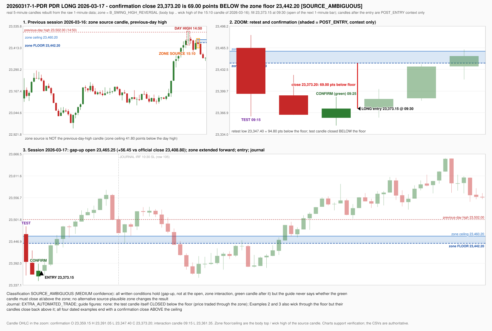

| item | value |
|---|---|
| Previous-day candle used for the zone | 2026-03-16 15:10 O 23,442.20 H 23,460.20 L 23,418.25 C 23,435.25 |
| Zone (method B_SWING_HIGH_REVERSAL, body top .. wick high) | floor 23,442.20 / ceiling 23,460.20 (height 18.00) |
| Previous-day high | 23,502.00 at 14:50 - the zone is NOT that candle (zone ceiling 41.80 points lower) |
| Open / official previous close / gap | 23,465.25 / 23,408.80 / +56.45; open 5.05 points above the zone ceiling |
| Interaction (test) candle | 09:15 O 23,465.25 H 23,484.80 L 23,361.35 C 23,395.55 - closed BELOW the floor |
| Lowest price of the retest (5-min lows, test..confirmation) | 23,347.40 = 94.80 points below the floor (1-minute low 23,347.40) |
| Green confirmation candle | 2026-03-17 09:25 O 23,359.15 H 23,391.05 L 23,347.40 C 23,373.20; body 32.2%, upper wick 17.85 (40.9%), lower wick 11.75 (26.9%) |
| Close relative to the zone | 69.00 points BELOW the floor (-87.00 vs the ceiling) |
| Signal confirmed / earliest fill / entry price | 2026-03-17 09:30 / 2026-03-17 09:30 (open of the next 1-minute bar) / 23,373.15 |
| POST_ENTRY context | next candle 09:30 low 23359.5 close 23387.8; it did not move back into the zone |
| Alternative zones, same sequence rule | A previous-day-high candle [23458.15, 23502.00] (fires on this candle: False); C repeated shelf [23132.75, 23172.60] (fires: False) |
| Nearest figure in the guide | none: the test candle itself CLOSED below the floor (price traded through the zone); Examples 2 and 3 also wick through the floor but their candles close back above it; all four dated examples end with a confirmation close ABOVE the ceiling |
| Manual journal | EXTRA_AUTOMATED_TRADE: no PDR row in the journal that day; the journal shows other strategy(ies): IRF 10:30 SL |
| Source-rule status | green candle after the interaction: SOURCE_VERIFIED (qualitative, PDR-007); close-location / zone-hold: not a source rule and not tested by the engine (UNRESOLVED) |

## 20260406-1-PDR - 2026-04-06 (Monday), first trade of the day

**Classification: SOURCE_AMBIGUOUS** (MEDIUM confidence). Basis: all written conditions hold (gap-up, not at the open, zone interaction, green candle after it) but the guide never says whether the green candle must close at/above the zone; no alternative source-plausible zone changes the result. Owner clarification: yes - is a zone-hold (close at/above the floor) required. Chart: 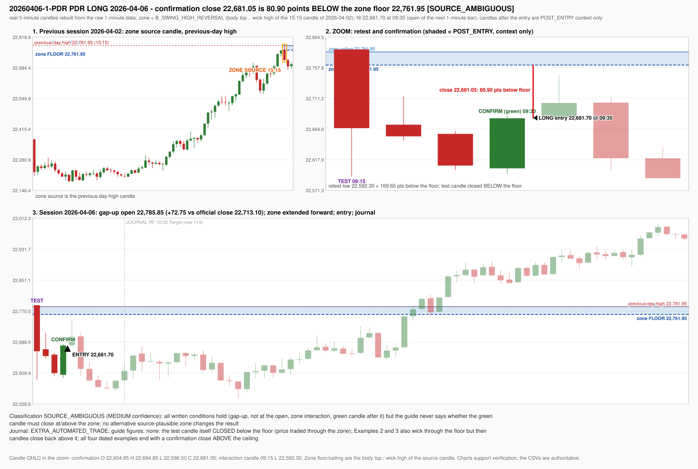

| item | value |
|---|---|
| Previous-day candle used for the zone | 2026-04-02 15:15 O 22,761.95 H 22,781.95 L 22,715.60 C 22,717.65 |
| Zone (method B_SWING_HIGH_REVERSAL, body top .. wick high) | floor 22,761.95 / ceiling 22,781.95 (height 20.00) |
| Previous-day high | 22,781.95 at 15:15 - the zone IS that candle |
| Open / official previous close / gap | 22,785.85 / 22,713.10 / +72.75; open 3.90 points above the zone ceiling |
| Interaction (test) candle | 09:15 O 22,785.85 H 22,785.85 L 22,592.30 C 22,666.05 - closed BELOW the floor |
| Lowest price of the retest (5-min lows, test..confirmation) | 22,592.30 = 169.65 points below the floor (1-minute low 22,592.30) |
| Green confirmation candle | 2026-04-06 09:30 O 22,604.85 H 22,684.85 L 22,596.50 C 22,681.05; body 86.2%, upper wick 3.80 (4.3%), lower wick 8.35 (9.5%) |
| Close relative to the zone | 80.90 points BELOW the floor (-100.90 vs the ceiling) |
| Signal confirmed / earliest fill / entry price | 2026-04-06 09:35 / 2026-04-06 09:35 (open of the next 1-minute bar) / 22,681.70 |
| POST_ENTRY context | next candle 09:35 low 22678.2 close 22704.35; it did not move back into the zone |
| Alternative zones, same sequence rule | A previous-day-high candle [22761.95, 22781.95] (fires on this candle: True); C repeated shelf none (fires: ) |
| Nearest figure in the guide | none: the test candle itself CLOSED below the floor (price traded through the zone); Examples 2 and 3 also wick through the floor but their candles close back above it; all four dated examples end with a confirmation close ABOVE the ceiling |
| Manual journal | EXTRA_AUTOMATED_TRADE: no PDR row in the journal that day; the journal shows other strategy(ies): RF 10:05 Target |
| Source-rule status | green candle after the interaction: SOURCE_VERIFIED (qualitative, PDR-007); close-location / zone-hold: not a source rule and not tested by the engine (UNRESOLVED) |

## 20260416-2-PDR - 2026-04-16 (Thursday), second trade of the day

**Classification: SOURCE_AMBIGUOUS** (MEDIUM confidence). Basis: all written conditions hold (gap-up, not at the open, zone interaction, green candle after it) but the guide never says whether the green candle must close at/above the zone; no alternative source-plausible zone changes the result. Owner clarification: yes - is a zone-hold (close at/above the floor) required. Chart: 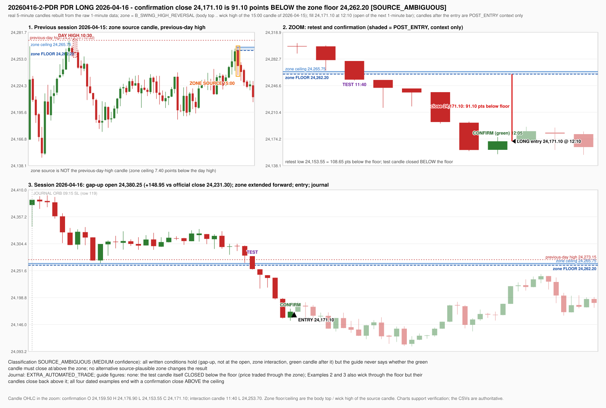

| item | value |
|---|---|
| Previous-day candle used for the zone | 2026-04-15 15:00 O 24,262.20 H 24,265.75 L 24,235.65 C 24,245.45 |
| Zone (method B_SWING_HIGH_REVERSAL, body top .. wick high) | floor 24,262.20 / ceiling 24,265.75 (height 3.55) |
| Previous-day high | 24,273.15 at 10:30 - the zone is NOT that candle (zone ceiling 7.40 points lower) |
| Open / official previous close / gap | 24,380.25 / 24,231.30 / +148.95; open 114.50 points above the zone ceiling |
| Interaction (test) candle | 11:40 O 24,280.00 H 24,280.00 L 24,253.70 C 24,254.70 - closed BELOW the floor |
| Lowest price of the retest (5-min lows, test..confirmation) | 24,153.55 = 108.65 points below the floor (1-minute low 24,153.55) |
| Green confirmation candle | 2026-04-16 12:05 O 24,159.50 H 24,176.90 L 24,153.55 C 24,171.10; body 49.7%, upper wick 5.80 (24.8%), lower wick 5.95 (25.5%) |
| Close relative to the zone | 91.10 points BELOW the floor (-94.65 vs the ceiling) |
| Signal confirmed / earliest fill / entry price | 2026-04-16 12:10 / 2026-04-16 12:10 (open of the next 1-minute bar) / 24,171.10 |
| POST_ENTRY context | next candle 12:10 low 24170.5 close 24184.8; it did not move back into the zone |
| Alternative zones, same sequence rule | A previous-day-high candle [24260.40, 24273.15] (fires on this candle: True); C repeated shelf [24226.75, 24242.25] (fires: True) |
| Nearest figure in the guide | none: the test candle itself CLOSED below the floor (price traded through the zone); Examples 2 and 3 also wick through the floor but their candles close back above it; all four dated examples end with a confirmation close ABOVE the ceiling |
| Manual journal | EXTRA_AUTOMATED_TRADE: no PDR row in the journal that day; the journal shows other strategy(ies): ORB 09:15 SL |
| Source-rule status | green candle after the interaction: SOURCE_VERIFIED (qualitative, PDR-007); close-location / zone-hold: not a source rule and not tested by the engine (UNRESOLVED) |

## 20260506-1-PDR - 2026-05-06 (Wednesday), first trade of the day

**Classification: ZONE_SELECTION_DISPUTED** (MEDIUM confidence). Basis: the same confirmation candle also fires under C_repeated_shelf with its close at/above that zone's floor: the entry would be acceptable under another source-plausible zone IF a close at/above the floor is the test (reading B, which is itself not written in the guide). Owner clarification: yes - which previous-day candle marks the zone. Chart: 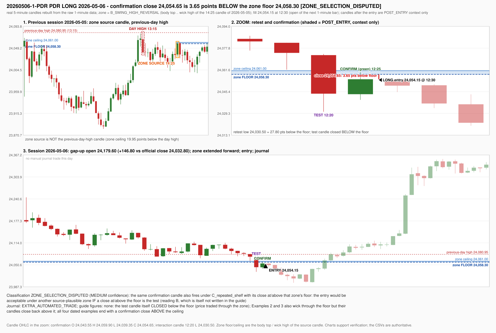

| item | value |
|---|---|
| Previous-day candle used for the zone | 2026-05-05 14:25 O 24,036.10 H 24,061.00 L 24,031.75 C 24,058.30 |
| Zone (method B_SWING_HIGH_REVERSAL, body top .. wick high) | floor 24,058.30 / ceiling 24,061.00 (height 2.70) |
| Previous-day high | 24,080.95 at 13:15 - the zone is NOT that candle (zone ceiling 19.95 points lower) |
| Open / official previous close / gap | 24,179.60 / 24,032.80 / +146.80; open 118.60 points above the zone ceiling |
| Interaction (test) candle | 12:20 O 24,072.60 H 24,073.45 L 24,030.50 C 24,043.95 - closed BELOW the floor |
| Lowest price of the retest (5-min lows, test..confirmation) | 24,030.50 = 27.80 points below the floor (1-minute low 24,030.50) |
| Green confirmation candle | 2026-05-06 12:25 O 24,043.55 H 24,059.90 L 24,039.35 C 24,054.65; body 54.0%, upper wick 5.25 (25.5%), lower wick 4.20 (20.4%) |
| Close relative to the zone | 3.65 points BELOW the floor (-6.35 vs the ceiling) |
| Signal confirmed / earliest fill / entry price | 2026-05-06 12:30 / 2026-05-06 12:30 (open of the next 1-minute bar) / 24,054.15 |
| POST_ENTRY context | next candle 12:30 low 24045.15 close 24049.9; it did not move back into the zone |
| Alternative zones, same sequence rule | A previous-day-high candle [24067.35, 24080.95] (fires on this candle: True); C repeated shelf [24042.05, 24062.15] (fires: True) |
| Nearest figure in the guide | none: the test candle itself CLOSED below the floor (price traded through the zone); Examples 2 and 3 also wick through the floor but their candles close back above it; all four dated examples end with a confirmation close ABOVE the ceiling |
| Manual journal | EXTRA_AUTOMATED_TRADE: no journal trade of any strategy that day |
| Source-rule status | green candle after the interaction: SOURCE_VERIFIED (qualitative, PDR-007); close-location / zone-hold: not a source rule and not tested by the engine (UNRESOLVED) |

## 20260507-1-PDR - 2026-05-07 (Thursday), first trade of the day

**Classification: SOURCE_AMBIGUOUS** (MEDIUM confidence). Basis: all written conditions hold (gap-up, not at the open, zone interaction, green candle after it) but the guide never says whether the green candle must close at/above the zone; no alternative source-plausible zone changes the result. Owner clarification: yes - is a zone-hold (close at/above the floor) required. Chart: 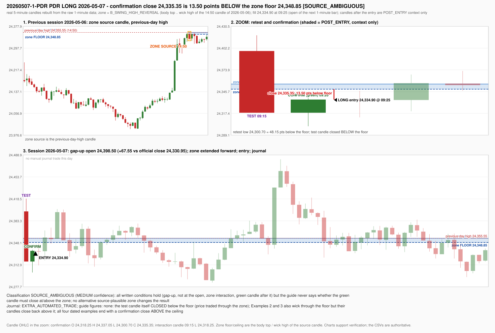

| item | value |
|---|---|
| Previous-day candle used for the zone | 2026-05-06 14:50 O 24,348.85 H 24,355.55 L 24,328.75 C 24,332.10 |
| Zone (method B_SWING_HIGH_REVERSAL, body top .. wick high) | floor 24,348.85 / ceiling 24,355.55 (height 6.70) |
| Previous-day high | 24,355.55 at 14:50 - the zone IS that candle |
| Open / official previous close / gap | 24,398.50 / 24,330.95 / +67.55; open 42.95 points above the zone ceiling |
| Interaction (test) candle | 09:15 O 24,398.50 H 24,418.90 L 24,318.25 C 24,318.25 - closed BELOW the floor |
| Lowest price of the retest (5-min lows, test..confirmation) | 24,300.70 = 48.15 points below the floor (1-minute low 24,300.70) |
| Green confirmation candle | 2026-05-07 09:20 O 24,318.25 H 24,337.05 L 24,300.70 C 24,335.35; body 47.0%, upper wick 1.70 (4.7%), lower wick 17.55 (48.3%) |
| Close relative to the zone | 13.50 points BELOW the floor (-20.20 vs the ceiling) |
| Signal confirmed / earliest fill / entry price | 2026-05-07 09:25 / 2026-05-07 09:25 (open of the next 1-minute bar) / 24,334.90 |
| POST_ENTRY context | next candle 09:25 low 24312.2 close 24334.15; it did not move back into the zone |
| Alternative zones, same sequence rule | A previous-day-high candle [24348.85, 24355.55] (fires on this candle: True); C repeated shelf [24111.95, 24120.25] (fires: False) |
| Nearest figure in the guide | none: the test candle itself CLOSED below the floor (price traded through the zone); Examples 2 and 3 also wick through the floor but their candles close back above it; all four dated examples end with a confirmation close ABOVE the ceiling |
| Manual journal | EXTRA_AUTOMATED_TRADE: no journal trade of any strategy that day |
| Source-rule status | green candle after the interaction: SOURCE_VERIFIED (qualitative, PDR-007); close-location / zone-hold: not a source rule and not tested by the engine (UNRESOLVED) |

## 20260514-2-PDR - 2026-05-14 (Thursday), second trade of the day

**Classification: SOURCE_AMBIGUOUS** (MEDIUM confidence). Basis: all written conditions hold (gap-up, not at the open, zone interaction, green candle after it) but the guide never says whether the green candle must close at/above the zone; no alternative source-plausible zone changes the result. Owner clarification: yes - is a zone-hold (close at/above the floor) required. Chart: 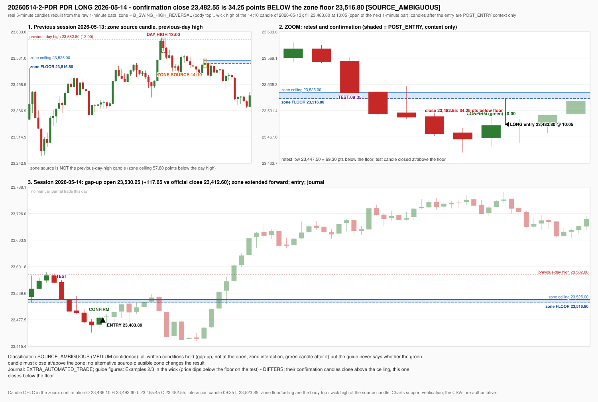

| item | value |
|---|---|
| Previous-day candle used for the zone | 2026-05-13 14:10 O 23,512.90 H 23,525.00 L 23,507.65 C 23,516.80 |
| Zone (method B_SWING_HIGH_REVERSAL, body top .. wick high) | floor 23,516.80 / ceiling 23,525.00 (height 8.20) |
| Previous-day high | 23,582.80 at 13:00 - the zone is NOT that candle (zone ceiling 57.80 points lower) |
| Open / official previous close / gap | 23,530.25 / 23,412.60 / +117.65; open 5.25 points above the zone ceiling |
| Interaction (test) candle | 09:35 O 23,565.50 H 23,569.95 L 23,523.85 C 23,524.50 - closed at/above the floor |
| Lowest price of the retest (5-min lows, test..confirmation) | 23,447.50 = 69.30 points below the floor (1-minute low 23,447.50) |
| Green confirmation candle | 2026-05-14 10:00 O 23,466.10 H 23,492.60 L 23,455.45 C 23,482.55; body 44.3%, upper wick 10.05 (27.1%), lower wick 10.65 (28.7%) |
| Close relative to the zone | 34.25 points BELOW the floor (-42.45 vs the ceiling) |
| Signal confirmed / earliest fill / entry price | 2026-05-14 10:05 / 2026-05-14 10:05 (open of the next 1-minute bar) / 23,483.80 |
| POST_ENTRY context | next candle 10:05 low 23459.65 close 23484.95; it did not move back into the zone |
| Alternative zones, same sequence rule | A previous-day-high candle [23578.10, 23582.80] (fires on this candle: False); C repeated shelf none (fires: ) |
| Nearest figure in the guide | Examples 2/3 in the wick (price dips below the floor on the test) - DIFFERS: their confirmation candles close above the ceiling, this one closes below the floor |
| Manual journal | EXTRA_AUTOMATED_TRADE: no journal trade of any strategy that day |
| Source-rule status | green candle after the interaction: SOURCE_VERIFIED (qualitative, PDR-007); close-location / zone-hold: not a source rule and not tested by the engine (UNRESOLVED) |

## 20260529-1-PDR - 2026-05-29 (Friday), first trade of the day

**Classification: SOURCE_AMBIGUOUS** (MEDIUM confidence). Basis: all written conditions hold (gap-up, not at the open, zone interaction, green candle after it) but the guide never says whether the green candle must close at/above the zone; no alternative source-plausible zone changes the result. Owner clarification: yes - is a zone-hold (close at/above the floor) required. Chart: 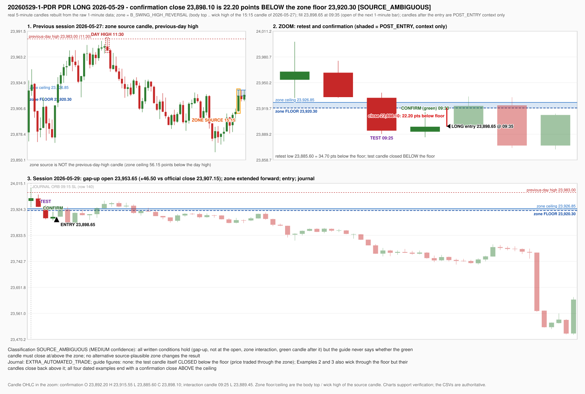

| item | value |
|---|---|
| Previous-day candle used for the zone | 2026-05-27 15:15 O 23,903.80 H 23,926.85 L 23,902.50 C 23,920.30 |
| Zone (method B_SWING_HIGH_REVERSAL, body top .. wick high) | floor 23,920.30 / ceiling 23,926.85 (height 6.55) |
| Previous-day high | 23,983.00 at 11:30 - the zone is NOT that candle (zone ceiling 56.15 points lower) |
| Open / official previous close / gap | 23,953.65 / 23,907.15 / +46.50; open 26.80 points above the zone ceiling |
| Interaction (test) candle | 09:25 O 23,932.30 H 23,938.35 L 23,889.45 C 23,893.40 - closed BELOW the floor |
| Lowest price of the retest (5-min lows, test..confirmation) | 23,885.60 = 34.70 points below the floor (1-minute low 23,885.60) |
| Green confirmation candle | 2026-05-29 09:30 O 23,892.20 H 23,915.55 L 23,885.60 C 23,898.10; body 19.7%, upper wick 17.45 (58.3%), lower wick 6.60 (22.0%) |
| Close relative to the zone | 22.20 points BELOW the floor (-28.75 vs the ceiling) |
| Signal confirmed / earliest fill / entry price | 2026-05-29 09:35 / 2026-05-29 09:35 (open of the next 1-minute bar) / 23,898.65 |
| POST_ENTRY context | next candle 09:35 low 23898.3 close 23922.65; it did move back into the zone |
| Alternative zones, same sequence rule | A previous-day-high candle [23974.65, 23983.00] (fires on this candle: False); C repeated shelf [23936.30, 23940.85] (fires: True) |
| Nearest figure in the guide | none: the test candle itself CLOSED below the floor (price traded through the zone); Examples 2 and 3 also wick through the floor but their candles close back above it; all four dated examples end with a confirmation close ABOVE the ceiling |
| Manual journal | EXTRA_AUTOMATED_TRADE: no PDR row in the journal that day; the journal shows other strategy(ies): ORB 09:15 SL |
| Source-rule status | green candle after the interaction: SOURCE_VERIFIED (qualitative, PDR-007); close-location / zone-hold: not a source rule and not tested by the engine (UNRESOLVED) |

## 20260609-2-PDR - 2026-06-09 (Tuesday), second trade of the day

**Classification: SOURCE_AMBIGUOUS** (MEDIUM confidence). Basis: all written conditions hold (gap-up, not at the open, zone interaction, green candle after it) but the guide never says whether the green candle must close at/above the zone; no alternative source-plausible zone changes the result. Owner clarification: yes - is a zone-hold (close at/above the floor) required. Chart: 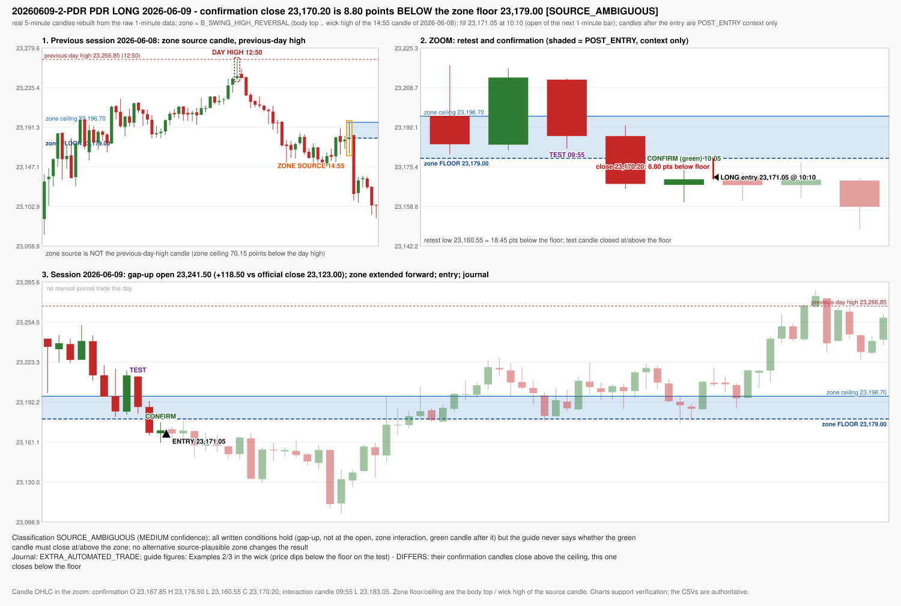

| item | value |
|---|---|
| Previous-day candle used for the zone | 2026-06-08 14:55 O 23,178.20 H 23,196.70 L 23,161.65 C 23,179.00 |
| Zone (method B_SWING_HIGH_REVERSAL, body top .. wick high) | floor 23,179.00 / ceiling 23,196.70 (height 17.70) |
| Previous-day high | 23,266.85 at 12:50 - the zone is NOT that candle (zone ceiling 70.15 points lower) |
| Open / official previous close / gap | 23,241.50 / 23,123.00 / +118.50; open 44.80 points above the zone ceiling |
| Interaction (test) candle | 09:55 O 23,212.05 H 23,212.50 L 23,183.05 C 23,188.35 - closed at/above the floor |
| Lowest price of the retest (5-min lows, test..confirmation) | 23,160.55 = 18.45 points below the floor (1-minute low 23,160.55) |
| Green confirmation candle | 2026-06-09 10:05 O 23,167.85 H 23,176.50 L 23,160.55 C 23,170.20; body 14.7%, upper wick 6.30 (39.5%), lower wick 7.30 (45.8%) |
| Close relative to the zone | 8.80 points BELOW the floor (-26.50 vs the ceiling) |
| Signal confirmed / earliest fill / entry price | 2026-06-09 10:10 / 2026-06-09 10:10 (open of the next 1-minute bar) / 23,171.05 |
| POST_ENTRY context | next candle 10:10 low 23161.25 close 23167.75; it did not move back into the zone |
| Alternative zones, same sequence rule | A previous-day-high candle [23248.30, 23266.85] (fires on this candle: False); C repeated shelf [23208.35, 23223.20] (fires: True) |
| Nearest figure in the guide | Examples 2/3 in the wick (price dips below the floor on the test) - DIFFERS: their confirmation candles close above the ceiling, this one closes below the floor |
| Manual journal | EXTRA_AUTOMATED_TRADE: no journal trade of any strategy that day |
| Source-rule status | green candle after the interaction: SOURCE_VERIFIED (qualitative, PDR-007); close-location / zone-hold: not a source rule and not tested by the engine (UNRESOLVED) |

## 20260630-1-PDR - 2026-06-30 (Tuesday), first trade of the day

**Classification: SOURCE_AMBIGUOUS** (MEDIUM confidence). Basis: all written conditions hold (gap-up, not at the open, zone interaction, green candle after it) but the guide never says whether the green candle must close at/above the zone; no alternative source-plausible zone changes the result. Owner clarification: yes - is a zone-hold (close at/above the floor) required. Chart: 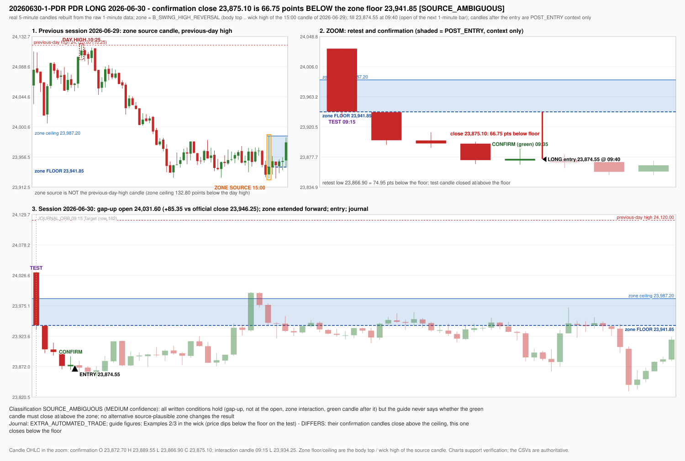

| item | value |
|---|---|
| Previous-day candle used for the zone | 2026-06-29 15:00 O 23,931.05 H 23,987.20 L 23,925.20 C 23,941.85 |
| Zone (method B_SWING_HIGH_REVERSAL, body top .. wick high) | floor 23,941.85 / ceiling 23,987.20 (height 45.35) |
| Previous-day high | 24,120.00 at 10:25 - the zone is NOT that candle (zone ceiling 132.80 points lower) |
| Open / official previous close / gap | 24,031.60 / 23,946.25 / +85.35; open 44.40 points above the zone ceiling |
| Interaction (test) candle | 09:15 O 24,031.60 H 24,031.60 L 23,934.25 C 23,942.20 - closed at/above the floor |
| Lowest price of the retest (5-min lows, test..confirmation) | 23,866.90 = 74.95 points below the floor (1-minute low 23,866.90) |
| Green confirmation candle | 2026-06-30 09:35 O 23,872.70 H 23,889.55 L 23,866.90 C 23,875.10; body 10.6%, upper wick 14.45 (63.8%), lower wick 5.80 (25.6%) |
| Close relative to the zone | 66.75 points BELOW the floor (-112.10 vs the ceiling) |
| Signal confirmed / earliest fill / entry price | 2026-06-30 09:40 / 2026-06-30 09:40 (open of the next 1-minute bar) / 23,874.55 |
| POST_ENTRY context | next candle 09:40 low 23862.05 close 23870.35; it did not move back into the zone |
| Alternative zones, same sequence rule | A previous-day-high candle [24112.15, 24120.00] (fires on this candle: False); C repeated shelf [24085.50, 24095.25] (fires: False) |
| Nearest figure in the guide | Examples 2/3 in the wick (price dips below the floor on the test) - DIFFERS: their confirmation candles close above the ceiling, this one closes below the floor |
| Manual journal | EXTRA_AUTOMATED_TRADE: no PDR row in the journal that day; the journal shows other strategy(ies): ORB 09:15 Target |
| Source-rule status | green candle after the interaction: SOURCE_VERIFIED (qualitative, PDR-007); close-location / zone-hold: not a source rule and not tested by the engine (UNRESOLVED) |

## 20260707-1-PDR - 2026-07-07 (Tuesday), first trade of the day

**Classification: SOURCE_AMBIGUOUS** (MEDIUM confidence). Basis: all written conditions hold (gap-up, not at the open, zone interaction, green candle after it) but the guide never says whether the green candle must close at/above the zone; no alternative source-plausible zone changes the result. Owner clarification: yes - is a zone-hold (close at/above the floor) required. Chart: 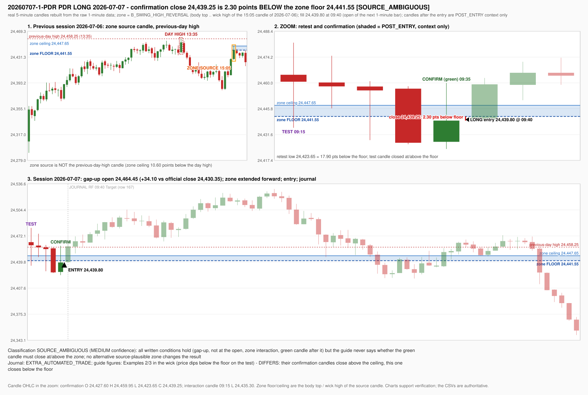

| item | value |
|---|---|
| Previous-day candle used for the zone | 2026-07-06 15:05 O 24,428.45 H 24,447.65 L 24,426.90 C 24,441.55 |
| Zone (method B_SWING_HIGH_REVERSAL, body top .. wick high) | floor 24,441.55 / ceiling 24,447.65 (height 6.10) |
| Previous-day high | 24,458.25 at 13:35 - the zone is NOT that candle (zone ceiling 10.60 points lower) |
| Open / official previous close / gap | 24,464.45 / 24,430.35 / +34.10; open 16.80 points above the zone ceiling |
| Interaction (test) candle | 09:15 O 24,464.45 H 24,482.10 L 24,435.30 C 24,460.65 - closed at/above the floor |
| Lowest price of the retest (5-min lows, test..confirmation) | 24,423.65 = 17.90 points below the floor (1-minute low 24,423.65) |
| Green confirmation candle | 2026-07-07 09:35 O 24,427.60 H 24,459.95 L 24,423.65 C 24,439.25; body 32.1%, upper wick 20.70 (57.0%), lower wick 3.95 (10.9%) |
| Close relative to the zone | 2.30 points BELOW the floor (-8.40 vs the ceiling) |
| Signal confirmed / earliest fill / entry price | 2026-07-07 09:40 / 2026-07-07 09:40 (open of the next 1-minute bar) / 24,439.80 |
| POST_ENTRY context | next candle 09:40 low 24439.75 close 24459.2; it did move back into the zone |
| Alternative zones, same sequence rule | A previous-day-high candle [24452.95, 24458.25] (fires on this candle: True); C repeated shelf [24449.25, 24458.25] (fires: True) |
| Nearest figure in the guide | Examples 2/3 in the wick (price dips below the floor on the test) - DIFFERS: their confirmation candles close above the ceiling, this one closes below the floor |
| Manual journal | EXTRA_AUTOMATED_TRADE: no PDR row in the journal that day; the journal shows other strategy(ies): RF 09:40 Target |
| Source-rule status | green candle after the interaction: SOURCE_VERIFIED (qualitative, PDR-007); close-location / zone-hold: not a source rule and not tested by the engine (UNRESOLVED) |

## 20260810-1-PDR - 2026-08-10 (Monday), first trade of the day

**Classification: SOURCE_AMBIGUOUS** (MEDIUM confidence). Basis: all written conditions hold (gap-up, not at the open, zone interaction, green candle after it) but the guide never says whether the green candle must close at/above the zone; no alternative source-plausible zone changes the result. Owner clarification: yes - is a zone-hold (close at/above the floor) required. Chart: 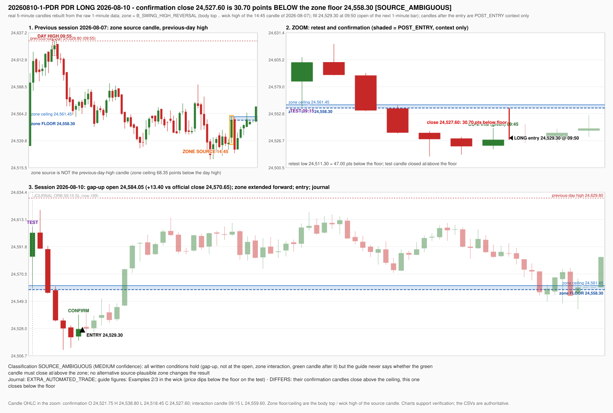

| item | value |
|---|---|
| Previous-day candle used for the zone | 2026-08-07 14:45 O 24,542.50 H 24,561.45 L 24,537.50 C 24,558.30 |
| Zone (method B_SWING_HIGH_REVERSAL, body top .. wick high) | floor 24,558.30 / ceiling 24,561.45 (height 3.15) |
| Previous-day high | 24,629.80 at 09:55 - the zone is NOT that candle (zone ceiling 68.35 points lower) |
| Open / official previous close / gap | 24,584.05 / 24,570.65 / +13.40; open 22.60 points above the zone ceiling |
| Interaction (test) candle | 09:15 O 24,584.05 H 24,607.70 L 24,559.60 C 24,602.70 - closed at/above the floor |
| Lowest price of the retest (5-min lows, test..confirmation) | 24,511.30 = 47.00 points below the floor (1-minute low 24,511.30) |
| Green confirmation candle | 2026-08-10 09:45 O 24,521.75 H 24,538.80 L 24,518.45 C 24,527.60; body 28.7%, upper wick 11.20 (55.0%), lower wick 3.30 (16.2%) |
| Close relative to the zone | 30.70 points BELOW the floor (-33.85 vs the ceiling) |
| Signal confirmed / earliest fill / entry price | 2026-08-10 09:50 / 2026-08-10 09:50 (open of the next 1-minute bar) / 24,529.30 |
| POST_ENTRY context | next candle 09:50 low 24524.55 close 24527.9; it did not move back into the zone |
| Alternative zones, same sequence rule | A previous-day-high candle [24625.80, 24629.80] (fires on this candle: False); C repeated shelf [24573.45, 24591.60] (fires: False) |
| Nearest figure in the guide | Examples 2/3 in the wick (price dips below the floor on the test) - DIFFERS: their confirmation candles close above the ceiling, this one closes below the floor |
| Manual journal | EXTRA_AUTOMATED_TRADE: no PDR row in the journal that day; the journal shows other strategy(ies): ORB 09:15 SL |
| Source-rule status | green candle after the interaction: SOURCE_VERIFIED (qualitative, PDR-007); close-location / zone-hold: not a source rule and not tested by the engine (UNRESOLVED) |

## 20260821-1-PDR - 2026-08-21 (Friday), first trade of the day

**Classification: SOURCE_AMBIGUOUS** (MEDIUM confidence). Basis: all written conditions hold (gap-up, not at the open, zone interaction, green candle after it) but the guide never says whether the green candle must close at/above the zone; no alternative source-plausible zone changes the result. Owner clarification: yes - is a zone-hold (close at/above the floor) required. Chart: 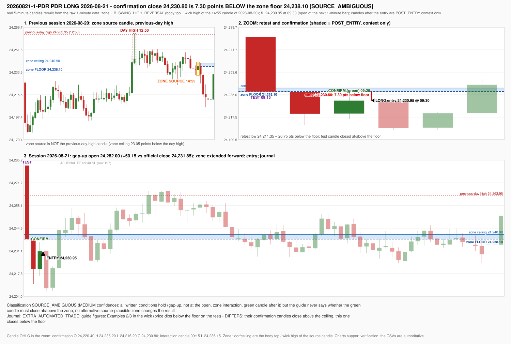

| item | value |
|---|---|
| Previous-day candle used for the zone | 2026-08-20 14:55 O 24,235.40 H 24,240.90 L 24,231.95 C 24,238.10 |
| Zone (method B_SWING_HIGH_REVERSAL, body top .. wick high) | floor 24,238.10 / ceiling 24,240.90 (height 2.80) |
| Previous-day high | 24,263.95 at 12:50 - the zone is NOT that candle (zone ceiling 23.05 points lower) |
| Open / official previous close / gap | 24,282.00 / 24,231.85 / +50.15; open 41.10 points above the zone ceiling |
| Interaction (test) candle | 09:15 O 24,282.00 H 24,282.00 L 24,236.15 C 24,238.10 - closed at/above the floor |
| Lowest price of the retest (5-min lows, test..confirmation) | 24,211.35 = 26.75 points below the floor (1-minute low 24,211.35) |
| Green confirmation candle | 2026-08-21 09:25 O 24,220.40 H 24,236.20 L 24,216.20 C 24,230.80; body 52.0%, upper wick 5.40 (27.0%), lower wick 4.20 (21.0%) |
| Close relative to the zone | 7.30 points BELOW the floor (-10.10 vs the ceiling) |
| Signal confirmed / earliest fill / entry price | 2026-08-21 09:30 / 2026-08-21 09:30 (open of the next 1-minute bar) / 24,230.95 |
| POST_ENTRY context | next candle 09:30 low 24207.2 close 24208.8; it did not move back into the zone |
| Alternative zones, same sequence rule | A previous-day-high candle [24244.30, 24263.95] (fires on this candle: True); C repeated shelf [24244.85, 24252.15] (fires: True) |
| Nearest figure in the guide | Examples 2/3 in the wick (price dips below the floor on the test) - DIFFERS: their confirmation candles close above the ceiling, this one closes below the floor |
| Manual journal | EXTRA_AUTOMATED_TRADE: no PDR row in the journal that day; the journal shows other strategy(ies): RF 09:40 SL |
| Source-rule status | green candle after the interaction: SOURCE_VERIFIED (qualitative, PDR-007); close-location / zone-hold: not a source rule and not tested by the engine (UNRESOLVED) |

## 20260824-1-PDR - 2026-08-24 (Monday), first trade of the day

**Classification: SOURCE_AMBIGUOUS** (MEDIUM confidence). Basis: all written conditions hold (gap-up, not at the open, zone interaction, green candle after it) but the guide never says whether the green candle must close at/above the zone; no alternative source-plausible zone changes the result. Owner clarification: yes - is a zone-hold (close at/above the floor) required. Chart: 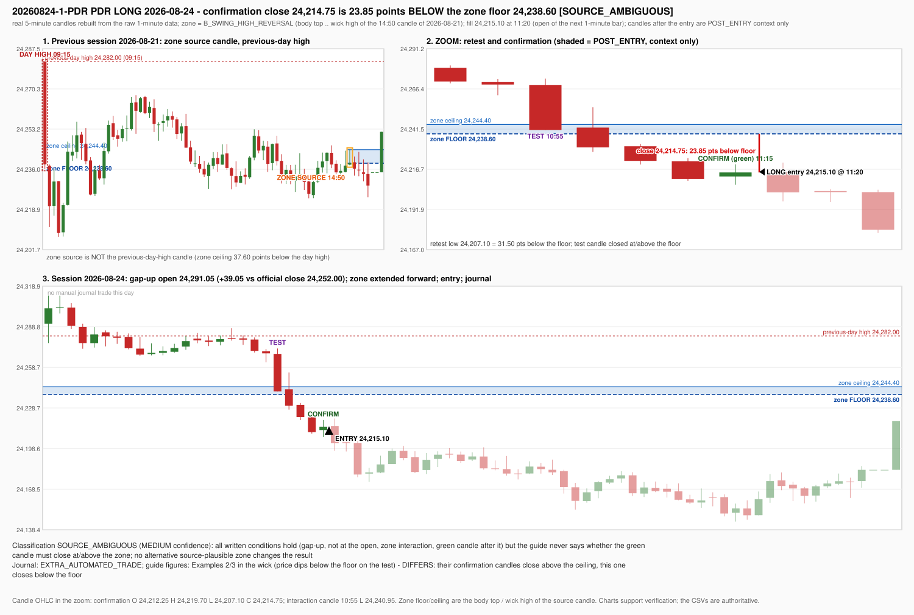

| item | value |
|---|---|
| Previous-day candle used for the zone | 2026-08-21 14:50 O 24,238.00 H 24,244.40 L 24,237.70 C 24,238.60 |
| Zone (method B_SWING_HIGH_REVERSAL, body top .. wick high) | floor 24,238.60 / ceiling 24,244.40 (height 5.80) |
| Previous-day high | 24,282.00 at 09:15 - the zone is NOT that candle (zone ceiling 37.60 points lower) |
| Open / official previous close / gap | 24,291.05 / 24,252.00 / +39.05; open 46.65 points above the zone ceiling |
| Interaction (test) candle | 10:55 O 24,268.70 H 24,272.75 L 24,240.95 C 24,240.95 - closed at/above the floor |
| Lowest price of the retest (5-min lows, test..confirmation) | 24,207.10 = 31.50 points below the floor (1-minute low 24,207.10) |
| Green confirmation candle | 2026-08-24 11:15 O 24,212.25 H 24,219.70 L 24,207.10 C 24,214.75; body 19.8%, upper wick 4.95 (39.3%), lower wick 5.15 (40.9%) |
| Close relative to the zone | 23.85 points BELOW the floor (-29.65 vs the ceiling) |
| Signal confirmed / earliest fill / entry price | 2026-08-24 11:20 / 2026-08-24 11:20 (open of the next 1-minute bar) / 24,215.10 |
| POST_ENTRY context | next candle 11:20 low 24196.9 close 24202.45; it did not move back into the zone |
| Alternative zones, same sequence rule | A previous-day-high candle [24282.00, 24282.00] (fires on this candle: True); C repeated shelf [24254.45, 24261.75] (fires: True) |
| Nearest figure in the guide | Examples 2/3 in the wick (price dips below the floor on the test) - DIFFERS: their confirmation candles close above the ceiling, this one closes below the floor |
| Manual journal | EXTRA_AUTOMATED_TRADE: no journal trade of any strategy that day |
| Source-rule status | green candle after the interaction: SOURCE_VERIFIED (qualitative, PDR-007); close-location / zone-hold: not a source rule and not tested by the engine (UNRESOLVED) |
