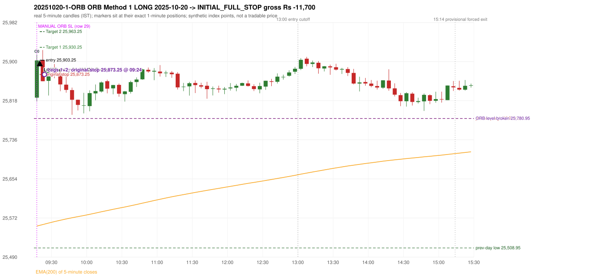

# Trading journal - 2025-10-20 (Monday)

> Automated reconstruction of the Phase 3.5 combined backtest: the Phase 3.0 controller, stops, targets and sizing with PDR = the Phase 3.4 revised engine (provisional pattern thresholds and open-above-zone assumption, NOT approved by the strategy author). Synthetic NIFTY 50 index-point P&L (the index is not tradable). The owner's review status is intentionally blank.

## A. Trading day overview

| item | value |
|---|---|
| Date / weekday | 2025-10-20 / Monday |
| Session type | USABLE_WITH_FLAGS / VALID |
| Original session open (first 1-minute open) | 25,824.60 |
| Previous session | 2025-10-17 |
| Previous-day high / low | 25,780.95 / 25,508.95 |
| Previous-day official close / last 5-minute close | 25,709.85 / 25,704.70 |
| Raw engine records / confirmed signals / fully valid signals | 3 / 1 / 1 |
| Setups that did not complete (invalidated / incomplete) | 2 |
| Executed trades | 1 20251020-1-ORB |
| Gross P&L (Rs, synthetic) | -11,700.00 |
| Illustrative net P&L (Rs; Rs 500/trade + 0.5 pt/fill) | -12,590.00 |
| Day-end portfolio status | SECOND_TRADE_ELIGIBLE |
| Manual journal trades (matched / unmatched) | 1 (1 / 0) |
| Extra automated trades | 0 |

## B. Daily strategy signal timeline (confirmed signals, chronological)

| time | strategy | method | dir | entry-rule status | valid for execution | <= 13:00 | portfolio state | accepted / ignored | specific reason | competing (same minute) |
|---|---|---|---|---|---|---|---|---|---|---|
| 09:20 | ORB | Method 1 | LONG | PROPOSAL_DEPENDENT | True | True | FIRST_TRADE_ACTIVE | ACCEPTED -> 20251020-1-ORB | first eligible signal of the day; trade 1: INITIAL_FULL_STOP |  |

Engine setups that did not complete (2); the complete list with failed rule ids is in `rejected_signals.csv`:

| candle | strategy | method | dir | status | precise reason | failed rules |
|---|---|---|---|---|---|---|
| 09:15 | ORB | Method 2 | LONG | INVALIDATED | TRENDLINE_NOT_SUPPORTIVE | ORB-M2-LONG-001 |
| 10:00 | RF | RF | LONG | INVALIDATED | GAP_UP_OUTSIDE_YESTERDAYS_RANGE | RF-004 |

## C. Detailed trade journals

### 20251020-1-ORB: ORB Method 1 LONG (FIRST trade)

Chart: 

**Rule configuration:** CFG-phase35_combined-1a0f4fca27 - signal verification status **PROPOSAL_DEPENDENT** (never VERIFIED while a rule rests on a proposal).

#### 1. Setup identification

ORB Method 1 LONG: the first completed 5-minute candle (09:15-09:20) closed at 25,902.80, 121.85 points above the previous-day high 25,780.95; its body occupied 78.95% of its range and its upper wick 12.72% (thresholds 60% / 20%): the strong-bullish candle test passed; the EMA-only trend filter passed. Entry decision at 09:20.

#### 2. Candle and indicator calculations

| role | session | candle | O | H | L | C | range | body % | upper wick % | lower wick % | direction | EMA(200) | strong bull / bear | pin bull / bear | small (body<=30%) | used for |
|---|---|---|---|---|---|---|---|---|---|---|---|---|---|---|---|---|
| first_candle | TODAY | 09:15-09:20 | 25,824.60 | 25,915.40 | 25,816.35 | 25,902.80 | 99.05 | 78.95 | 12.72 | 8.33 | BULLISH | 25,554.98 | True / False | False / False | False | the 09:15 first five-minute candle - the ORB decision candle |
| prev_day_extreme_candle | PREVIOUS | 12:25-12:30 | 25,775.45 | 25,780.95 | 25,769.25 | 25,776.75 | 11.70 | 11.11 | 35.90 | 52.99 | BULLISH | 25,487.86 | False / False | False / False | True | candle that made the previous session's high/low used as the level |
| prev_session_last_candle | PREVIOUS | 15:25-15:30 | 25,703.40 | 25,707.60 | 25,696.00 | 25,704.70 | 11.60 | 11.21 | 25.00 | 63.79 | BULLISH | 25,551.48 | False / False | True / False | True | trend: previous session's last 5-minute close vs its EMA(200) |

Every condition, with the rule, the calculation, the observed values and the result:

| # | group | rule | result | status / numeric definition | calculation | observed | required | available at | why it matters |
|---|---|---|---|---|---|---|---|---|---|
| 1 | SELECTION | SEL-FIRST-001 | PASS | USER_APPROVED / USER_APPROVED | earliest CONFIRMED signal of the day across IRF/ORB/PDR/PDS/RF that passed the controller's checks | 0 confirmed signal(s) earlier today; 1 confirmed signals in the day in total, this one at 09:20 | no earlier executable signal | 2025-10-20 09:20 | the shared controller trades only the first valid signal; the five strategies are not independent positions |
| 2 | SELECTION | SEL-TIE-001 | PASS | USER_APPROVED / USER_APPROVED | other CONFIRMED signals with exactly the same confirmation timestamp | none | no different-strategy / opposite-direction signal in the same minute (otherwise an unresolved conflict, no trade) | 2025-10-20 09:20 | an unresolved same-minute collision would have produced no trade at all |
| 3 | SELECTION | ENTRY-CUTOFF-001 | PASS | USER_APPROVED / USER_APPROVED | fill timestamp vs 13:00:00 IST | signal confirmed 09:20; fill 09:20 | fill at or before 13:00:00 IST | 2025-10-20 09:20 | no new position may be entered with a fill after 13:00 IST |
| 4 | SELECTION | EXE-FILL-001 | PASS | PROPOSED_FOR_REVIEW / PROPOSED_FOR_REVIEW | fill = open of the 1-minute bar that starts at the signal candle's end | bar 09:20 O 25,903.25 H 25,918.95 L 25,903.25 C 25,913.45; executable=True; entry 25,903.25 | fill bar exists, starts exactly at the signal end, is fillable; entry = its open | 2025-10-20 09:20 | a 5-minute signal is known only when its candle closes; the first price that can be traded is the next minute's open |
| 5 | SELECTION | DAY-MAX-001 | PASS | USER_APPROVED / USER_APPROVED | number of entries today | trade 1 of at most 2 | <= 2 entries per day | 2025-10-20 09:20 | daily trade cap |
| 6 | SETUP | ORB-GLOBAL-001 | PASS | SOURCE_VERIFIED / EXPLICIT_IN_SOURCE | decision is taken once the first 5-minute candle (09:15-09:20) has closed | candle 09:15-09:20; signal confirmed 09:20 | decision at 09:20, never before the close | 2025-10-20 09:20 | the close of the first candle is unknown before 09:20 |
| 7 | SETUP | ORB-GLOBAL-002 | PASS | SOURCE_VERIFIED / EXPLICIT_IN_SOURCE | direction | LONG | same rules in both directions | 2025-10-20 09:20 | ORB trades the side of the break |
| 8 | SETUP | ORB-GLOBAL-004 | PASS | SOURCE_VERIFIED / QUALITATIVE_SOURCE_NUMERIC_DEFINITION_PROPOSED_FOR_REVIEW | entry at 09:20, after the first-candle close | signal confirmed 09:20; fill 09:20 at the open of that minute | 09:20 entry | 2025-10-20 09:20 | the guide enters at 9:20; the fill price convention (next minute open) is a proposal |
| 9 | SETUP | ORB-M1-LONG-001 | PASS | SOURCE_VERIFIED / QUALITATIVE_SOURCE_NUMERIC_DEFINITION_PROPOSED_FOR_REVIEW | prev_day_high = the highest high of all 5-minute candles of the previous session 2025-10-17 | previous-day high 25,780.95 (set by the 12:25 candle; previous session range 25,508.95 - 25,780.95; engine recorded 25,780.95) | previous-day resistance (long) / support (short) | 2025-10-17 12:30 | a mechanical proxy for the guide's hand-drawn previous-day level; the source charts show multi-session boxes (documented difference) |
| 10 | SETUP | ORB-M1-LONG-002 | PASS | SOURCE_VERIFIED / EXPLICIT_IN_SOURCE | the first candle breaks and closes beyond the level | high 25,915.40 / low 25,816.35, close 25,902.80: 121.85 points beyond 25,780.95 | high and close > level | 2025-10-20 09:20 | a wick alone is not a breakout; the close decides |
| 11 | TREND | ORB-TREND-001 | PASS | SOURCE_VERIFIED / QUALITATIVE_SOURCE_NUMERIC_DEFINITION_PROPOSED_FOR_REVIEW | previous session's final completed 5-minute candle: close vs its EMA(200 of 5-minute closes) | previous session 2025-10-17 last candle 15:25-15:30 close 25,704.70 vs EMA(200) 25,551.48: 153.22 points above the EMA -> trend bullish (EMA_PREV_SESSION_CLOSE; research variant A, EMA-only) | close > EMA(200) | 2025-10-17 15:30 | the opening gap can never create the trend: only information that existed before today's open is used |
| 12 | TREND | ORB-TREND-002 | PASS | SOURCE_VERIFIED / QUALITATIVE_SOURCE_NUMERIC_DEFINITION_PROPOSED_FOR_REVIEW | price location versus the 200 EMA is the basic confirmation; structure is only 'supporting' | 153.22 points above the EMA(200) on the previous session's last 5-minute close; swing structure not used in variant A | price on the trend side of the 200 EMA | 2025-10-17 15:30 | the rulebook calls EMA position 'a basic confirmation, supported by bullish structure'; the structure part has no numeric definition |
| 13 | TREND | TREND-SWING-001 | NOT_APPLICABLE | PROPOSED_FOR_REVIEW / PROPOSED_FOR_REVIEW | confirmed swing structure | not required by the active trend variant (variant A is the EMA price location only) | n/a | 2025-10-17 15:30 | variant B would additionally require higher-high/higher-low swings; it is a separate labelled scenario |
| 14 | CONFIRMATION | ORB-M1-LONG-003 | PASS | SOURCE_VERIFIED / QUALITATIVE_SOURCE_NUMERIC_DEFINITION_PROPOSED_FOR_REVIEW | candle quality: strong body and limited opposite wick (or the conditional pin bar) | 09:15-09:20 O 25,824.60 H 25,915.40 L 25,816.35 C 25,902.80; range 99.05, body 78.20 (78.95%), upper wick 12.60 (12.72%), lower wick 8.25 (8.33%), bullish. Strong-bullish test: bullish close, body >= 60% (observed 78.95%), upper wick <= 20% (observed 12.72%) -> PASS | strong candle (research thresholds) or pin bar | 2025-10-20 09:20 | the guide asks for a 'strong body, small wick' but gives no numbers; the thresholds are proposals |
| 15 | EXECUTION | ORB-GLOBAL-003 | PASS | SOURCE_VERIFIED / EXPLICIT_IN_SOURCE | initial stop = entry - 30 points | entry 25,903.25 -> stop 25,873.25 | stop 30 index points (BASELINE) | 2025-10-20 09:20 | defines the loss if the setup fails before Target 1 |
| 16 | EXECUTION | EXE-T1-001 | PASS | SOURCE_VERIFIED / EXPLICIT_IN_SOURCE | Target 1 = entry +/- 27 points | T1 25,930.25 | 27 points | 2025-10-20 09:20 | Leg 1 (3 lots) is booked at Target 1 |
| 17 | EXECUTION | ORB-GLOBAL-003 | PASS | SOURCE_VERIFIED / EXPLICIT_IN_SOURCE | Target 2 = entry +/- 60 points | T2 25,963.25 | 60 points | 2025-10-20 09:20 | Leg 2 (3 lots) is booked at Target 2 |
| 18 | EXECUTION | POST-T1-STOP-006 | PASS | USER_APPROVED / USER_APPROVED | after T1 the Leg-2 stop = entry - 6 (no trailing) | post-T1 stop 25,897.25 | entry -6 (LONG) / +6 (SHORT) | 2025-10-20 09:20 | protects the remaining three lots once the first three are booked |
| 19 | EXECUTION | SIZE-LOT-001 | PASS | USER_APPROVED / USER_APPROVED | 6 lots x 65 = 390, Leg 1 = 3 lots = 195, Leg 2 = 195 | 6 lots, lot size 65, legs 3+3 | 6 lots in two equal legs | 2025-10-20 09:20 | position size for the synthetic P&L |
| 20 | NOTE | ORB-MA-001 | UNRESOLVED | CONFLICTING / CONFLICTING | which moving average the code uses | EMA(200) of 5-minute closes (the guide says '200 DMA' in some places and '200 EMA' in others); active ma_mode EMA200_5M | the source terminology conflicts | 2025-10-20 09:20 | a daily 200 DMA would give different values |
| 21 | NOTE | NOTE-UNRESOLVED-DEPENDENCIES | UNRESOLVED | NOT_A_RULE / NOT_A_REGISTRY_RULE | rules the signal depends on that the sources leave unresolved | engine-recorded unresolved rule ids: ORB-MA-001; verification status PROPOSAL_DEPENDENT | n/a (disclosure) | 2025-10-20 09:20 | the entry is only as verified as the rules it rests on |

#### 3. Entry decision and explanation

ORB Method 1 LONG: the first completed 5-minute candle (09:15-09:20) closed at 25,902.80, 121.85 points above the previous-day high 25,780.95; its body occupied 78.95% of its range and its upper wick 12.72% (thresholds 60% / 20%): the strong-bullish candle test passed; the EMA-only trend filter passed. Entry decision at 09:20.

**Why this trade ahead of the other strategies:** This ORB Method 1 signal was the earliest executable signal of the day: 0 confirmed signal(s) earlier, 0 other in the same minute. No later signal was generated. State of the other four engines at that moment: [IRF: no setup record before this time (a base condition was not met, or nothing triggered)] [PDR: no setup record before this time (a base condition was not met, or nothing triggered)] [PDS: no setup record before this time (a base condition was not met, or nothing triggered)] [RF: no setup record before this time (a base condition was not met, or nothing triggered)]

#### 4. Actual entry execution

| item | value |
|---|---|
| Signal candle | 09:15-09:20 |
| Signal confirmed | 2025-10-20 09:20 |
| Fill timestamp | 2025-10-20 09:20 |
| Entry price | 25,903.25 |
| Source partition / 1-minute bar | data/processed/nifty50/year=2025/month=10/candles.parquet / 2025-10-20 09:20 |
| Source bar O / H / L / C | 25,903.25 / 25,918.95 / 25,903.25 / 25,913.45 |
| Fill assumption | open of the 1-minute bar starting at the signal candle's end (EXE-FILL-001, PROPOSED causal convention) |
| Initial stop / T1 / T2 / post-T1 stop | 25,873.25 / 25,930.25 / 25,963.25 / 25,897.25 |
| Position | 6 lots x 65 = 390 units (Leg 1 195, Leg 2 195) |

#### 5-8. Trade progress, Target 1, post-T1 stop and final exit

Between the 09:20 entry bar and the final exit (5 one-minute bars) the best excursion in favour was 21.40 points at 09:21 and the worst against was 44.10 points at 09:24. At 09:24 price reached the original stop 25,873.25 before Target 1 25,930.25, so all six lots exited together at 25,873.25. This is an INITIAL_FULL_STOP: one more trade is allowed that day, only a newly confirmed PDR/PDS signal.

| leg | qty | exit time | exit price | reason | source 1-minute bar | O / H / L / C | gross points | gross Rs | slippage pts | flags |
|---|---|---|---|---|---|---|---|---|---|---|
| 1 | 195 | 09:24 | 25,873.25 | ORIGINAL_STOP_BEFORE_T1 | 09:24 | 25,887.15 / 25,887.15 / 25,859.15 / 25,859.15 | -30.00 | -5,850.00 | 0.00 |  |
| 2 | 195 | 09:24 | 25,873.25 | ORIGINAL_STOP_BEFORE_T1 | 09:24 | 25,887.15 / 25,887.15 / 25,859.15 / 25,859.15 | -30.00 | -5,850.00 | 0.00 |  |

Exit evidence per leg:

* Leg 1: 1-minute bar 09:24 O 25,887.15 H 25,887.15 L 25,859.15 C 25,859.15: low 25,859.15 reached the original stop 25,873.25 before Target 1 25,930.25 was touched; both legs exit at the stop level 25,873.25
* Leg 2: 1-minute bar 09:24 O 25,887.15 H 25,887.15 L 25,859.15 C 25,859.15: low 25,859.15 reached the original stop 25,873.25 before Target 1 25,930.25 was touched; both legs exit at the stop level 25,873.25

#### 9. Gross and illustrative net P&L

| item | value (Rs) |
|---|---|
| Leg 1 gross | -5,850.00 |
| Leg 2 gross | -5,850.00 |
| Trade gross (= Leg 1 + Leg 2) | -11,700.00 |
| Illustrative fixed cost | -500.00 |
| Illustrative slippage (0.5 pt on every fill, entry + exits, all units) | -390.00 |
| Illustrative net | -12,590.00 |

#### 10. Manual journal comparison

EXACT_MATCH: manual ORB labelled 09:15 (candle start) vs automated ORB Method 1 LONG candle 09:15, filled 09:20 at 25,903.25; time difference 0 minutes. Journal outcome SL vs automated INITIAL_FULL_STOP (same outcome class). The journal records no entry or exit price.

## D. Manual journal comparison

| comparison | journal row | journal strategy | manual time | manual direction | manual outcome | match class | trade | auto entry | auto outcome | explanation |
|---|---|---|---|---|---|---|---|---|---|---|
| M029 | 29 | ORB | 09:15 | UNKNOWN | SL | EXACT_MATCH | 20251020-1-ORB | 09:20 @ 25,903.25 | INITIAL_FULL_STOP | EXACT_MATCH: manual ORB labelled 09:15 (candle start) vs automated ORB Method 1 LONG candle 09:15, filled 09:20 at 25,903.25; time difference 0 minutes. Journal outcome SL vs automated INITIAL_FULL_STOP (same outcome class). The journal records no entry or exit price. |

The journal records no entry price and no exit price (NOT_RECORDED); matching uses date, strategy and candle start only - never P&L.

## E. Daily conclusion

* **Traded:** 20251020-1-ORB - ORB Method 1 LONG at 09:20 (entry 25,903.25), outcome INITIAL_FULL_STOP, gross Rs -11,700.00, illustrative net Rs -12,590.00. **Why:** This ORB Method 1 signal was the earliest executable signal of the day: 0 confirmed signal(s) earlier, 0 other in the same minute. No later signal was generated. State of the other four engines at that moment: [IRF: no setup record before this time (a base condition was not met, or nothing triggered)] [PDR: no setup record before this time (a base condition was not met, or nothing triggered)] [PDS: no setup record before this time (a base condition was not met, or nothing triggered)] [RF: no setup record before this time (a base condition was not met, or nothing triggered)] **How it ended:** At 09:24 price reached the original stop 25,873.25 before Target 1 25,930.25, so all six lots exited together at 25,873.25. This is an INITIAL_FULL_STOP: one more trade is allowed that day, only a newly confirmed PDR/PDS signal.
* **Open strategy-definition issues that affected this day:** NOTE-UNRESOLVED-DEPENDENCIES, ORB-MA-001 (Terminology conflict: '200 DMA / EMA' (p.2), '200 EMA' (pp.3,5,7), '200 DMA' (pp.1,8,9,12) for what the charts show as one curved line on a 5-minute chart)
* **Automated triage (not an approval; the owner's review status stays blank):** MATCHED_EXACT_NO_FLAGS
