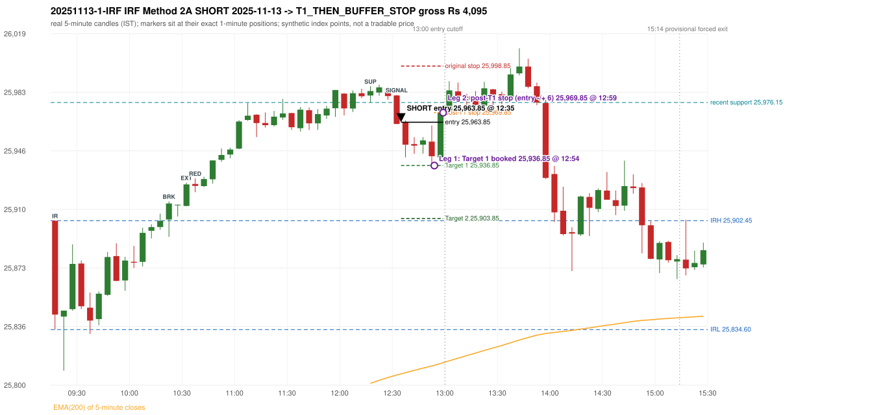

# Trading journal - 2025-11-13 (Thursday)

> Automated reconstruction of the Phase 3.5 combined backtest: the Phase 3.0 controller, stops, targets and sizing with PDR = the Phase 3.4 revised engine (provisional pattern thresholds and open-above-zone assumption, NOT approved by the strategy author). Synthetic NIFTY 50 index-point P&L (the index is not tradable). The owner's review status is intentionally blank.

## A. Trading day overview

| item | value |
|---|---|
| Date / weekday | 2025-11-13 / Thursday |
| Session type | USABLE / VALID |
| Original session open (first 1-minute open) | 25,902.45 |
| Previous session | 2025-11-12 |
| Previous-day high / low | 25,934.00 / 25,781.25 |
| Previous-day official close / last 5-minute close | 25,875.80 / 25,874.00 |
| Raw engine records / confirmed signals / fully valid signals | 8 / 5 / 5 |
| Setups that did not complete (invalidated / incomplete) | 3 |
| Executed trades | 1 20251113-1-IRF |
| Gross P&L (Rs, synthetic) | 4,095.00 |
| Illustrative net P&L (Rs; Rs 500/trade + 0.5 pt/fill) | 3,205.00 |
| Day-end portfolio status | DAY_FINISHED |
| Manual journal trades (matched / unmatched) | 0 (0 / 0) |
| Extra automated trades | 1 |

## B. Daily strategy signal timeline (confirmed signals, chronological)

| time | strategy | method | dir | entry-rule status | valid for execution | <= 13:00 | portfolio state | accepted / ignored | specific reason | competing (same minute) |
|---|---|---|---|---|---|---|---|---|---|---|
| 12:35 | IRF | Method 2A | SHORT | PROPOSAL_DEPENDENT | True | True | FIRST_TRADE_ACTIVE | ACCEPTED -> 20251113-1-IRF | first eligible signal of the day; trade 1: T1_THEN_BUFFER_STOP |  |
| 13:50 | IRF | Method 2B | SHORT | PROPOSAL_DEPENDENT | True | False | DAY_FINISHED | IGNORED | DAY_FINISHED [blocked by IRF#1] |  |
| 14:10 | IRF | Method 1 | SHORT | PROPOSAL_DEPENDENT | True | False | DAY_FINISHED | IGNORED | DAY_FINISHED [blocked by IRF#1] |  |
| 14:50 | IRF | Method 2B | SHORT | PROPOSAL_DEPENDENT | True | False | DAY_FINISHED | IGNORED | DAY_FINISHED [blocked by IRF#1] |  |
| 14:55 | IRF | Method 1 | SHORT | PROPOSAL_DEPENDENT | True | False | DAY_FINISHED | IGNORED | DAY_FINISHED [blocked by IRF#1] |  |

Engine setups that did not complete (3); the complete list with failed rule ids is in `rejected_signals.csv`:

| candle | strategy | method | dir | status | precise reason | failed rules |
|---|---|---|---|---|---|---|
| 15:15 | IRF | Method 3 | SHORT | INVALIDATED | WICK_SHARE_OUT_OF_BAND | IRF-M3-003 |
| 09:15 | ORB | Method 2 | SHORT | INVALIDATED | TREND:EMA_PREV_SESSION_CLOSE wrong side | ORB-TREND-001;ORB-TREND-002 |
| 09:15 | PDR | PDR | LONG | INVALIDATED | GAP_UP_OPEN_NOT_ABOVE_ZONE |  |

## C. Detailed trade journals

### 20251113-1-IRF: IRF Method 2A SHORT (FIRST trade)

Chart: 

**Rule configuration:** CFG-phase35_combined-1a0f4fca27 - signal verification status **PROPOSAL_DEPENDENT** (never VERIFIED while a rule rests on a proposal).

#### 1. Setup identification

IRF Method 2A SHORT: the 10:20-10:25 candle closed at 25,913.20, above IRH 25,902.45, and the next candle did not close back inside the range, so the setup is Method 2 and price stayed above it until the trigger. Extension candle 10:30-10:35, red candle 10:35-10:40. The trigger came 26 candles after the breakout candle: a completed candle closed below the recent pullback-low support (12:30-12:35); confirmed at 12:35 with close 25,962.75. Entry reference close 25,962.75 is 60.30 points above IRH 25,902.45.

#### 2. Candle and indicator calculations

| role | session | candle | O | H | L | C | range | body % | upper wick % | lower wick % | direction | EMA(200) | strong bull / bear | pin bull / bear | small (body<=30%) | used for |
|---|---|---|---|---|---|---|---|---|---|---|---|---|---|---|---|---|
| initial_range_candle | TODAY | 09:15-09:20 | 25,902.45 | 25,902.45 | 25,834.60 | 25,843.95 | 67.85 | 86.22 | 0.00 | 13.78 | BEARISH | 25,743.97 | False / True | False / False | False | initial range = high/low of the 09:15 candle |
| signal_candle | TODAY | 12:30-12:35 | 25,980.55 | 25,980.90 | 25,962.75 | 25,962.75 | 18.15 | 98.07 | 1.93 | 0.00 | BEARISH | 25,806.31 | False / True | False / False | False | candle whose close completed the trigger |
| breakout_candle | TODAY | 10:20-10:25 | 25,903.20 | 25,914.50 | 25,892.45 | 25,913.20 | 22.05 | 45.35 | 5.90 | 48.75 | BULLISH | 25,760.04 | False / False | False / False | False | breakout candle: a completed candle closing above IRH |
| extension_candle | TODAY | 10:30-10:35 | 25,911.70 | 25,926.20 | 25,911.50 | 25,925.10 | 14.70 | 91.16 | 7.48 | 1.36 | BULLISH | 25,763.18 | True / False | False / False | False | extension: first later candle trading above the breakout candle's high |
| red_candle | TODAY | 10:35-10:40 | 25,925.40 | 25,928.85 | 25,920.25 | 25,924.20 | 8.60 | 13.95 | 40.12 | 45.93 | BEARISH | 25,764.78 | False / False | False / False | True | first red candle during the extension |
| support_pivot | TODAY | 12:15-12:20 | 25,980.50 | 25,986.25 | 25,976.15 | 25,983.30 | 10.10 | 27.72 | 29.21 | 43.07 | BULLISH | 25,801.14 | False / False | False / False | True | recent support: latest 3-candle fractal low formed after the breakout |

Every condition, with the rule, the calculation, the observed values and the result:

| # | group | rule | result | status / numeric definition | calculation | observed | required | available at | why it matters |
|---|---|---|---|---|---|---|---|---|---|
| 1 | SELECTION | SEL-FIRST-001 | PASS | USER_APPROVED / USER_APPROVED | earliest CONFIRMED signal of the day across IRF/ORB/PDR/PDS/RF that passed the controller's checks | 0 confirmed signal(s) earlier today; 5 confirmed signals in the day in total, this one at 12:35 | no earlier executable signal | 2025-11-13 12:35 | the shared controller trades only the first valid signal; the five strategies are not independent positions |
| 2 | SELECTION | SEL-TIE-001 | PASS | USER_APPROVED / USER_APPROVED | other CONFIRMED signals with exactly the same confirmation timestamp | none | no different-strategy / opposite-direction signal in the same minute (otherwise an unresolved conflict, no trade) | 2025-11-13 12:35 | an unresolved same-minute collision would have produced no trade at all |
| 3 | SELECTION | ENTRY-CUTOFF-001 | PASS | USER_APPROVED / USER_APPROVED | fill timestamp vs 13:00:00 IST | signal confirmed 12:35; fill 12:35 | fill at or before 13:00:00 IST | 2025-11-13 12:35 | no new position may be entered with a fill after 13:00 IST |
| 4 | SELECTION | EXE-FILL-001 | PASS | PROPOSED_FOR_REVIEW / PROPOSED_FOR_REVIEW | fill = open of the 1-minute bar that starts at the signal candle's end | bar 12:35 O 25,963.85 H 25,964.90 L 25,960.75 C 25,961.45; executable=True; entry 25,963.85 | fill bar exists, starts exactly at the signal end, is fillable; entry = its open | 2025-11-13 12:35 | a 5-minute signal is known only when its candle closes; the first price that can be traded is the next minute's open |
| 5 | SELECTION | DAY-MAX-001 | PASS | USER_APPROVED / USER_APPROVED | number of entries today | trade 1 of at most 2 | <= 2 entries per day | 2025-11-13 12:35 | daily trade cap |
| 6 | SETUP | IRF-GLOBAL-001 | PASS | SOURCE_VERIFIED / EXPLICIT_IN_SOURCE | initial range = high and low (wicks included) of the first completed 5-minute candle | 09:15-09:20 IRH 25,902.45, IRL 25,834.60 (range 67.85; engine recorded IRH 25,902.45, IRL 25,834.60) | high/low of the 09:15-09:20 candle | 2025-11-13 09:20 | all three IRF methods measure price against this range |
| 7 | SETUP | IRF-GLOBAL-003 | PASS | SOURCE_VERIFIED / EXPLICIT_IN_SOURCE | closes confirm, wicks do not: every trigger is evaluated on a completed 5-minute candle | trigger candle 12:30-12:35 was complete when the signal was stamped 12:35; decision uses its close 25,962.75 | completed candle close, not an intra-candle wick | 2025-11-13 12:35 | an intra-candle wick can reverse before the candle closes |
| 8 | SETUP | IRF-GLOBAL-002 | PASS | SOURCE_VERIFIED / EXPLICIT_IN_SOURCE | direction | SHORT (IRF trades short only) | short only | 2025-11-13 12:35 | IRF fades failed upside breakouts |
| 9 | SETUP | IRF-M2-001 | PASS | SOURCE_VERIFIED / EXPLICIT_IN_SOURCE | breakout candle close vs IRH | 10:20-10:25 O 25,903.20 H 25,914.50 L 25,892.45 C 25,913.20; range 22.05, body 10.00 (45.35%), upper wick 1.30 (5.90%), lower wick 10.75 (48.75%), bullish; close 25,913.20 is 10.75 points above IRH 25,902.45 | close > IRH (a wick above IRH is not a breakout) | 2025-11-13 10:25 | starts every IRF setup |
| 10 | SETUP | IRF-M2-004 | PASS | SOURCE_VERIFIED / EXPLICIT_IN_SOURCE | the candle after the breakout must NOT close back inside the range (else the setup is Method 1) | 10:25 close 25,912.45 vs [25,834.60, 25,902.45) | not (IRL <= close < IRH) | 2025-11-13 10:30 | separates Method 2 (price holds above) from Method 1 (immediate failure) |
| 11 | SETUP | IRF-M2-002 | PASS | SOURCE_VERIFIED / QUALITATIVE_SOURCE_NUMERIC_DEFINITION_PROPOSED_FOR_REVIEW | extension = a later candle whose high exceeds the breakout candle's high (research definition E1) | 10:30 high 25,926.20 vs breakout candle high 25,914.50 (+11.70) | high > breakout candle high | 2025-11-13 10:35 | the guide says price 'extends further upward'; the numeric test is a proposal |
| 12 | SETUP | IRF-M2-003 | PASS | SOURCE_VERIFIED / QUALITATIVE_SOURCE_NUMERIC_DEFINITION_PROPOSED_FOR_REVIEW | a red candle (close < open) forms after the extension | 10:35-10:40 O 25,925.40 H 25,928.85 L 25,920.25 C 25,924.20; range 8.60, body 1.20 (13.95%), upper wick 3.45 (40.12%), lower wick 3.95 (45.93%), bearish | close < open, at or after the candle following the extension | 2025-11-13 10:40 | the red candle shows the first pause/reversal inside the extension |
| 13 | CONFIRMATION | IRF-M2A-001 | PASS | SOURCE_VERIFIED / QUALITATIVE_SOURCE_NUMERIC_DEFINITION_PROPOSED_FOR_REVIEW | recent support = latest 3-candle fractal low (k=1) among candles b+1 ... i-2 | 12:15 low 25,976.15; neighbours' lows 25,978.90 (12:10) and 25,980.40 (12:20) are not lower; engine recorded support 25,976.15 | pivot low known before the trigger candle | 2025-11-13 12:25 | the support is the level whose break completes Method 2A (the exact 'pullback low' definition is a proposal) |
| 14 | CONFIRMATION | IRF-M2A-002 | PASS | SOURCE_VERIFIED / EXPLICIT_WORDING_DETAIL_PROPOSED_FOR_REVIEW | trigger candle closes below recent support | 12:30 close 25,962.75 vs support 25,976.15: 13.40 points below | close < support (close, not wick) | 2025-11-13 12:35 | completes Method 2A |
| 15 | CONFIRMATION | IRF-M2-005 | PASS | SOURCE_VERIFIED / EXPLICIT_IN_SOURCE | chronology: the red candle precedes the break candle | red candle 10:35, break candle 12:30 | red candle index < break candle index (m2a_break_may_be_red_candle = False) | 2025-11-13 12:35 | a red candle alone is not confirmation; a level break is required |
| 16 | EXECUTION | EXE-STOP-001 | PASS | USER_APPROVED / USER_APPROVED | initial stop = entry + 35 points | entry 25,963.85 -> stop 25,998.85 | stop 35 index points (BASELINE) | 2025-11-13 12:35 | defines the loss if the setup fails before Target 1 |
| 17 | EXECUTION | EXE-T1-001 | PASS | SOURCE_VERIFIED / EXPLICIT_IN_SOURCE | Target 1 = entry +/- 27 points | T1 25,936.85 | 27 points | 2025-11-13 12:35 | Leg 1 (3 lots) is booked at Target 1 |
| 18 | EXECUTION | IRF-TGT-001 | PASS | SOURCE_VERIFIED / EXPLICIT_IN_SOURCE | Target 2 = entry +/- 60 points | T2 25,903.85 | 60 points | 2025-11-13 12:35 | Leg 2 (3 lots) is booked at Target 2 |
| 19 | EXECUTION | POST-T1-STOP-006 | PASS | USER_APPROVED / USER_APPROVED | after T1 the Leg-2 stop = entry + 6 (no trailing) | post-T1 stop 25,969.85 | entry -6 (LONG) / +6 (SHORT) | 2025-11-13 12:35 | protects the remaining three lots once the first three are booked |
| 20 | EXECUTION | SIZE-LOT-001 | PASS | USER_APPROVED / USER_APPROVED | 6 lots x 65 = 390, Leg 1 = 3 lots = 195, Leg 2 = 195 | 6 lots, lot size 65, legs 3+3 | 6 lots in two equal legs | 2025-11-13 12:35 | position size for the synthetic P&L |
| 21 | NOTE | IRF-M2-006 | UNRESOLVED | UNRESOLVED / UNRESOLVED | delay between the breakout candle and this trigger; expiry rule | 26 candles after the breakout; expiry none configured | the source states no expiry | 2025-11-13 12:35 | an old breakout can still trigger hours later |
| 22 | NOTE | IRF-M2-006 | UNRESOLVED | UNRESOLVED / UNRESOLVED | did price stay above IRH between the breakout and the trigger? | 0 closes at or below IRH between 10:25 and 12:30; trigger close 25,962.75 above IRH 25,902.45 | the engine does not require price to stay above IRH | 2025-11-13 12:35 | the guide describes price 'holding above IRH and keeping rising'; the code only needs the level break |
| 23 | NOTE | IRF-GLOBAL-004 | UNRESOLVED | UNRESOLVED / UNRESOLVED | which close above IRH of the session produced this attempt; repeat setups | this breakout is upward crossing no. 1 of the session (a close above IRH after a close at/below it) | the source states no first-breakout-only, re-arming, expiry or trades-per-day rule | 2025-11-13 12:35 | IRF re-arms on every later breakout in the code, producing many raw setups; the controller keeps only the first |
| 24 | NOTE | NOTE-IRF-REPEATED-SETUPS | NOT_APPLICABLE | NOT_A_RULE / NOT_A_REGISTRY_RULE | other IRF signals later in the session (not traded) | 4 further confirmed IRF signal(s): Method 2B@13:50, Method 1@14:10, Method 2B@14:50, Method 1@14:55 | disclosure of repeated raw setups | 2025-11-13 12:35 | repeated raw IRF setups are not hidden; they are logged as ignored |
| 25 | NOTE | IRF-SL-001 | NOT_APPLICABLE | SOURCE_VERIFIED / QUALITATIVE_SOURCE_NUMERIC_DEFINITION_PROPOSED_FOR_REVIEW | the guide's 35-or-40 rule: 35 if the most recent green candle's high is within 35 points of entry, else 40 | most recent green candle high 25,987.25 is 23.40 points from the entry 25,963.85: the guide's rule would select 35 points; the baseline applies a fixed 35 (USER_APPROVED research baseline; the 35-vs-40 selection and the 40-point variant are separate labelled scenarios) | source selection rule | 2025-11-13 12:35 | the stop distance is a modelling choice and changes losses, not entries |
| 26 | NOTE | NOTE-UNRESOLVED-DEPENDENCIES | UNRESOLVED | NOT_A_RULE / NOT_A_REGISTRY_RULE | rules the signal depends on that the sources leave unresolved | engine-recorded unresolved rule ids: IRF-GLOBAL-004; verification status PROPOSAL_DEPENDENT | n/a (disclosure) | 2025-11-13 12:35 | the entry is only as verified as the rules it rests on |

#### 3. Entry decision and explanation

IRF Method 2A SHORT: the 10:20-10:25 candle closed at 25,913.20, above IRH 25,902.45, and the next candle did not close back inside the range, so the setup is Method 2 and price stayed above it until the trigger. Extension candle 10:30-10:35, red candle 10:35-10:40. The trigger came 26 candles after the breakout candle: a completed candle closed below the recent pullback-low support (12:30-12:35); confirmed at 12:35 with close 25,962.75. Entry reference close 25,962.75 is 60.30 points above IRH 25,902.45.

**Why this trade ahead of the other strategies:** This IRF Method 2A signal was the earliest executable signal of the day: 0 confirmed signal(s) earlier, 0 other in the same minute. 4 later confirmed signal(s) (IRF x4) are logged as ignored or rejected. State of the other four engines at that moment: [ORB: Method 2 invalidated at 09:15: TREND:EMA_PREV_SESSION_CLOSE wrong side] [PDR: PDR invalidated at 09:15: GAP_UP_OPEN_NOT_ABOVE_ZONE] [PDS: no setup record before this time (a base condition was not met, or nothing triggered)] [RF: no setup record before this time (a base condition was not met, or nothing triggered)]

#### 4. Actual entry execution

| item | value |
|---|---|
| Signal candle | 12:30-12:35 |
| Signal confirmed | 2025-11-13 12:35 |
| Fill timestamp | 2025-11-13 12:35 |
| Entry price | 25,963.85 |
| Source partition / 1-minute bar | data/processed/nifty50/year=2025/month=11/candles.parquet / 2025-11-13 12:35 |
| Source bar O / H / L / C | 25,963.85 / 25,964.90 / 25,960.75 / 25,961.45 |
| Fill assumption | open of the 1-minute bar starting at the signal candle's end (EXE-FILL-001, PROPOSED causal convention) |
| Initial stop / T1 / T2 / post-T1 stop | 25,998.85 / 25,936.85 / 25,903.85 / 25,969.85 |
| Position | 6 lots x 65 = 390 units (Leg 1 195, Leg 2 195) |

#### 5-8. Trade progress, Target 1, post-T1 stop and final exit

Between the 12:35 entry bar and the final exit (25 one-minute bars) the best excursion in favour was 27.00 points at 12:54 and the worst against was 6.35 points at 12:59. At 12:54 price reached Target 1 25,936.85 and three lots exited. At 12:54 the remaining three lots' protective stop was set to 25,969.85 (entry + 6; no trailing, no further change); the engine applies it from the Target-1 bar onward and tests it within that same bar. At 12:59 the remaining three lots stopped out at 25,969.85. T1_THEN_BUFFER_STOP: no second trade that day (DAY-BUF-001).

| leg | qty | exit time | exit price | reason | source 1-minute bar | O / H / L / C | gross points | gross Rs | slippage pts | flags |
|---|---|---|---|---|---|---|---|---|---|---|
| 1 | 195 | 12:54 | 25,936.85 | TARGET_1 | 12:54 | 25,939.35 / 25,943.60 / 25,936.85 / 25,942.70 | 27.00 | 5,265.00 | 0.00 |  |
| 2 | 195 | 12:59 | 25,969.85 | POST_T1_STOP_ENTRY_MINUS_PLUS_6 | 12:59 | 25,965.00 / 25,970.20 / 25,964.35 / 25,969.70 | -6.00 | -1,170.00 | 0.00 |  |

Exit evidence per leg:

* Leg 1: 1-minute bar 12:54 O 25,939.35 H 25,943.60 L 25,936.85 C 25,942.70: low 25,936.85 reached Target 1 25,936.85; Leg 1 booked at the target level
* Leg 2: 1-minute bar 12:59 O 25,965.00 H 25,970.20 L 25,964.35 C 25,969.70: high 25,970.20 reached the post-T1 stop 25,969.85; Leg 2 exits at 25,969.85 at the stop level

#### 9. Gross and illustrative net P&L

| item | value (Rs) |
|---|---|
| Leg 1 gross | 5,265.00 |
| Leg 2 gross | -1,170.00 |
| Trade gross (= Leg 1 + Leg 2) | 4,095.00 |
| Illustrative fixed cost | -500.00 |
| Illustrative slippage (0.5 pt on every fill, entry + exits, all units) | -390.00 |
| Illustrative net | 3,205.00 |

#### 10. Manual journal comparison

EXTRA_AUTOMATED_TRADE: the automated system took IRF Method 2A SHORT at 12:35 (no manual trade that day). The setup rests on: IRF-M2-006: No expiry / validity window for a Method 2 attempt | IRF-M2-006: Engine does not test that price held above IRH | IRF-GLOBAL-004: IRF trades per day / time window / re-arming are not stated in the guide | NOTE-UNRESOLVED-DEPENDENCIES: Disclosure of unresolved source rules behind this signal. The journal shows no corresponding entry.

## D. Manual journal comparison

| comparison | journal row | journal strategy | manual time | manual direction | manual outcome | match class | trade | auto entry | auto outcome | explanation |
|---|---|---|---|---|---|---|---|---|---|---|
| E021 |  |  |  |  |  | EXTRA_AUTOMATED_TRADE | 20251113-1-IRF | 12:35 @ 25,963.85 | T1_THEN_BUFFER_STOP | EXTRA_AUTOMATED_TRADE: the automated system took IRF Method 2A SHORT at 12:35 (no manual trade that day). The setup rests on: IRF-M2-006: No expiry / validity window for a Method 2 attempt \| IRF-M2-006: Engine does not test that price held above IRH \| IRF-GLOBAL-004: IRF trades per day / time window / re-arming are not stated in the guide \| NOTE-UNRESOLVED-DEPENDENCIES: Disclosure of unresolved source rules behind this signal. The journal shows no corresponding entry. |

The journal records no entry price and no exit price (NOT_RECORDED); matching uses date, strategy and candle start only - never P&L.

## E. Daily conclusion

* **Traded:** 20251113-1-IRF - IRF Method 2A SHORT at 12:35 (entry 25,963.85), outcome T1_THEN_BUFFER_STOP, gross Rs 4,095.00, illustrative net Rs 3,205.00. **Why:** This IRF Method 2A signal was the earliest executable signal of the day: 0 confirmed signal(s) earlier, 0 other in the same minute. 4 later confirmed signal(s) (IRF x4) are logged as ignored or rejected. State of the other four engines at that moment: [ORB: Method 2 invalidated at 09:15: TREND:EMA_PREV_SESSION_CLOSE wrong side] [PDR: PDR invalidated at 09:15: GAP_UP_OPEN_NOT_ABOVE_ZONE] [PDS: no setup record before this time (a base condition was not met, or nothing triggered)] [RF: no setup record before this time (a base condition was not met, or nothing triggered)] **How it ended:** At 12:54 price reached Target 1 25,936.85 and three lots exited. At 12:54 the remaining three lots' protective stop was set to 25,969.85 (entry + 6; no trailing, no further change); the engine applies it from the Target-1 bar onward and tests it within that same bar. At 12:59 the remaining three lots stopped out at 25,969.85. T1_THEN_BUFFER_STOP: no second trade that day (DAY-BUF-001).
* **Ignored / rejected signals:** IRF IGNORED DAY_FINISHED x4
* **Extra automated trade 20251113-1-IRF:** EXTRA_AUTOMATED_TRADE: the automated system took IRF Method 2A SHORT at 12:35 (no manual trade that day). The setup rests on: IRF-M2-006: No expiry / validity window for a Method 2 attempt | IRF-M2-006: Engine does not test that price held above IRH | IRF-GLOBAL-004: IRF trades per day / time window / re-arming are not stated in the guide | NOTE-UNRESOLVED-DEPENDENCIES: Disclosure of unresolved source rules behind this signal. The journal shows no corresponding entry.
* **Open strategy-definition issues that affected this day:** IRF-GLOBAL-004 (NOT STATED: how many IRF trades per day, a latest entry time, and whether a new breakout may re-arm a setup after a signal), IRF-M2-006 (How long a Method 2 setup stays valid (expiry / invalidation before a level breaks) is not stated), NOTE-UNRESOLVED-DEPENDENCIES
* **Automated triage (not an approval; the owner's review status stays blank):** REVIEW: EXTRA_AUTOMATED
