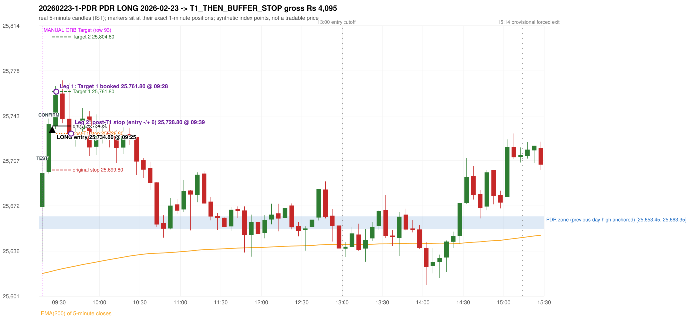

# Trading journal - 2026-02-23 (Monday)

> Automated reconstruction of the Phase 3.5 combined backtest: the Phase 3.0 controller, stops, targets and sizing with PDR = the Phase 3.4 revised engine (provisional pattern thresholds and open-above-zone assumption, NOT approved by the strategy author). Synthetic NIFTY 50 index-point P&L (the index is not tradable). The owner's review status is intentionally blank.

## A. Trading day overview

| item | value |
|---|---|
| Date / weekday | 2026-02-23 / Monday |
| Session type | USABLE_WITH_FLAGS / VALID |
| Original session open (first 1-minute open) | 25,670.85 |
| Previous session | 2026-02-20 |
| Previous-day high / low | 25,663.35 / 25,380.35 |
| Previous-day official close / last 5-minute close | 25,571.25 / 25,565.90 |
| Raw engine records / confirmed signals / fully valid signals | 15 / 10 / 9 |
| Setups that did not complete (invalidated / incomplete) | 5 |
| Executed trades | 1 20260223-1-PDR |
| Gross P&L (Rs, synthetic) | 4,095.00 |
| Illustrative net P&L (Rs; Rs 500/trade + 0.5 pt/fill) | 3,205.00 |
| Day-end portfolio status | DAY_FINISHED |
| Manual journal trades (matched / unmatched) | 1 (1 / 0) |
| Extra automated trades | 0 |

## B. Daily strategy signal timeline (confirmed signals, chronological)

| time | strategy | method | dir | entry-rule status | valid for execution | <= 13:00 | portfolio state | accepted / ignored | specific reason | competing (same minute) |
|---|---|---|---|---|---|---|---|---|---|---|
| 09:25 | PDR | PDR | LONG | RESEARCH_VARIANT | True | True | FIRST_TRADE_ACTIVE | ACCEPTED -> 20260223-1-PDR | first eligible signal of the day; trade 1: T1_THEN_BUFFER_STOP |  |
| 09:55 | IRF | Method 2A | SHORT | PROPOSAL_DEPENDENT | True | True | DAY_FINISHED | IGNORED | DAY_FINISHED [blocked by PDR#1] |  |
| 10:30 | IRF | Method 1 | SHORT | PROPOSAL_DEPENDENT | True | True | DAY_FINISHED | IGNORED | DAY_FINISHED [blocked by PDR#1] |  |
| 11:10 | PDR | PDR | LONG | RESEARCH_VARIANT | True | True | DAY_FINISHED | IGNORED | DAY_FINISHED [blocked by PDR#1] |  |
| 11:40 | PDR | PDR | LONG | RESEARCH_VARIANT | True | True | DAY_FINISHED | IGNORED | DAY_FINISHED [blocked by PDR#1] |  |
| 12:45 | PDR | PDR | LONG | RESEARCH_VARIANT | True | True | DAY_FINISHED | IGNORED | DAY_FINISHED [blocked by PDR#1] |  |
| 13:30 | PDR | PDR | LONG | RESEARCH_VARIANT | True | False | DAY_FINISHED | IGNORED | DAY_FINISHED [blocked by PDR#1] |  |
| 14:30 | PDR | PDR | LONG | RESEARCH_VARIANT | True | False | DAY_FINISHED | IGNORED | DAY_FINISHED [blocked by PDR#1] |  |
| 14:50 | PDR | PDR | LONG | RESEARCH_VARIANT | True | False | DAY_FINISHED | IGNORED | DAY_FINISHED [blocked by PDR#1] |  |
| 15:30 | IRF | Method 1 | SHORT | PROPOSAL_DEPENDENT | False | False | DAY_FINISHED | IGNORED | DAY_FINISHED [blocked by PDR#1] |  |

Engine setups that did not complete (5); the complete list with failed rule ids is in `rejected_signals.csv`:

| candle | strategy | method | dir | status | precise reason | failed rules |
|---|---|---|---|---|---|---|
| 09:50 | IRF | Method 1/2 | SHORT | INCOMPLETE_AT_EOD | SESSION_ENDED_BEFORE_CONFIRMATION |  |
| 09:15 | ORB | Method 1 | LONG | INVALIDATED | TREND:EMA_PREV_SESSION_CLOSE wrong side | ORB-TREND-001;ORB-TREND-002 |
| 09:15 | ORB | Method 2 | LONG | INVALIDATED | TREND:EMA_PREV_SESSION_CLOSE wrong side | ORB-TREND-001;ORB-TREND-002 |
| 09:15 | ORB | Gap/200DMA | LONG | INVALIDATED | CANDLE_QUALITY_OR_REJECTION_WICK | ORB-GAP-LONG-004 |
| 14:05 | RF | RF | LONG | INVALIDATED | TREND:EMA_PREV_SESSION_CLOSE wrong side | RF-001;RF-008 |

## C. Detailed trade journals

### 20260223-1-PDR: PDR LONG (FIRST trade)

Chart: 

**Rule configuration:** CFG-phase35_combined-1a0f4fca27 - signal verification status **RESEARCH_VARIANT** (never VERIFIED while a rule rests on a proposal).

#### 1. Setup identification

PDR LONG (revised engine, A_DAY_HIGH_ANCHORED, provisional thresholds): the session opened 99.60 points above the previous close and 7.50 points above the previous-day high 25,663.35 (zone [25,653.45, 25,663.35] from the 12:25 candle of 2026-02-20). The 09:15 candle (25,627.15 - 25,706.65) tested the zone; the 09:20 candle (green, O 25,698.15 H 25,740.65 L 25,697.05 C 25,736.30) passed GOOD_GREEN_BODY and closed 72.95 points above the zone ceiling, confirming the entry at 09:25. The pattern thresholds and the open-above-zone requirement are provisional research assumptions, not approved by the strategy author.

#### 2. Candle and indicator calculations

| role | session | candle | O | H | L | C | range | body % | upper wick % | lower wick % | direction | EMA(200) | strong bull / bear | pin bull / bear | small (body<=30%) | used for |
|---|---|---|---|---|---|---|---|---|---|---|---|---|---|---|---|---|
| zone_source_candle | PREVIOUS | 12:25-12:30 | 25,648.05 | 25,663.35 | 25,646.65 | 25,653.45 | 16.70 | 32.34 | 59.28 | 8.38 | BULLISH | 25,628.20 | False / False | False / False | False | previous-day-high candle that anchors the zone (A_DAY_HIGH_ANCHORED) |
| interaction_candle | TODAY | 09:15-09:20 | 25,670.85 | 25,706.65 | 25,627.15 | 25,697.40 | 79.50 | 33.40 | 11.64 | 54.97 | BULLISH | 25,618.43 | False / False | False / False | False | first candle whose range overlaps the zone (the test) |
| confirmation_candle | TODAY | 09:20-09:25 | 25,698.15 | 25,740.65 | 25,697.05 | 25,736.30 | 43.60 | 87.50 | 9.98 | 2.52 | BULLISH | 25,619.61 | True / False | False / False | False | candle that satisfies one of the three patterns and closes above the zone ceiling |

Every condition, with the rule, the calculation, the observed values and the result:

| # | group | rule | result | status / numeric definition | calculation | observed | required | available at | why it matters |
|---|---|---|---|---|---|---|---|---|---|
| 1 | SELECTION | SEL-FIRST-001 | PASS | USER_APPROVED / USER_APPROVED | earliest CONFIRMED signal of the day across IRF/ORB/PDR/PDS/RF that passed the controller's checks | 0 confirmed signal(s) earlier today; 10 confirmed signals in the day in total, this one at 09:25 | no earlier executable signal | 2026-02-23 09:25 | the shared controller trades only the first valid signal; the five strategies are not independent positions |
| 2 | SELECTION | SEL-TIE-001 | PASS | USER_APPROVED / USER_APPROVED | other CONFIRMED signals with exactly the same confirmation timestamp | none | no different-strategy / opposite-direction signal in the same minute (otherwise an unresolved conflict, no trade) | 2026-02-23 09:25 | an unresolved same-minute collision would have produced no trade at all |
| 3 | SELECTION | ENTRY-CUTOFF-001 | PASS | USER_APPROVED / USER_APPROVED | fill timestamp vs 13:00:00 IST | signal confirmed 09:25; fill 09:25 | fill at or before 13:00:00 IST | 2026-02-23 09:25 | no new position may be entered with a fill after 13:00 IST |
| 4 | SELECTION | EXE-FILL-001 | PASS | PROPOSED_FOR_REVIEW / PROPOSED_FOR_REVIEW | fill = open of the 1-minute bar that starts at the signal candle's end | bar 09:25 O 25,734.80 H 25,743.05 L 25,732.55 C 25,739.35; executable=True; entry 25,734.80 | fill bar exists, starts exactly at the signal end, is fillable; entry = its open | 2026-02-23 09:25 | a 5-minute signal is known only when its candle closes; the first price that can be traded is the next minute's open |
| 5 | SELECTION | DAY-MAX-001 | PASS | USER_APPROVED / USER_APPROVED | number of entries today | trade 1 of at most 2 | <= 2 entries per day | 2026-02-23 09:25 | daily trade cap |
| 6 | SETUP | PDR-004 | PASS | SOURCE_VERIFIED / EXPLICIT_WORDING_DETAIL_PROPOSED_FOR_REVIEW | gap = first 1-minute open of today - previous session's OFFICIAL close | today's open 25,670.85 (first 1-minute bar 09:15) - previous close 25,571.25 (DAILY_VENDOR, 2026-02-20) = +99.60 points -> gap UP | gap UP (more than 0 points) | 2026-02-23 09:15 | approved convention: the original first-minute open, never the vendor daily open |
| 7 | SETUP | PDR-A03a | PASS | PROPOSED_FOR_REVIEW / NUMERIC_DEFINITION_PROPOSED_FOR_REVIEW | open relative to the zone ceiling (preserved legacy PDR-011, a research assumption) | today's open 25,670.85 vs zone ceiling 25,663.35: 7.50 points above | open > zone ceiling | 2026-02-23 09:15 | the guide has price pull back into the zone after a gap up; requiring the open above the previous-day high is NOT an author rule |
| 8 | ZONE | PDR-001 | PASS | SOURCE_VERIFIED / EXPLICIT_IN_SOURCE | direction | LONG (PDR is long only) | long-only | 2026-02-23 09:25 | PDR buys a retest of previous-day resistance after a gap up |
| 9 | ZONE | PDR-A01 | PASS | AUTHOR_APPROVED / AUTHOR_STATEMENT_NUMERIC_DETAILS_ARE_SEPARATE_PROPOSED_ROWS | zone ceiling = the previous session's highest high; the zone is drawn from the body top to the wick high of that candle | previous session 2026-02-20: highest high 25,663.35 made by the 12:25 candle (O 25,648.05 H 25,663.35 L 25,646.65 C 25,653.45); zone [25,653.45 (body top), 25,663.35 (wick high)]; engine recorded [25,653.45, 25,663.35] | ceiling = previous-day high (author: the day's high should be considered and a zone drawn) | 2026-02-20 15:30 | the zone is anchored on the previous day's high, never on a lower swing high |
| 10 | ZONE | PDR-A02 | UNRESOLVED | AUTHOR_APPROVED / AUTHOR_STATEMENT_NUMERIC_DETAILS_ARE_SEPARATE_PROPOSED_ROWS | multiple highs connected into one zone (author principle; candidate B) | candidate A (used): [25,653.45, 25,663.35] from the day-high candle only. Candidate B (multiple-high cluster, tolerance 5 points) would be [25,653.45, 25,663.35] (ISOLATED_DAY_HIGH, 1 touch(es)); ceiling difference 0.00 points | a zone that connects all relevant highs (numbers not given by the author) | 2026-02-20 15:30 | candidate B has the same ceiling by construction, so this signal is unaffected by the choice; the lower boundary is a research parameter |
| 11 | ZONE | PDR-003 | PASS | SOURCE_VERIFIED / EXPLICIT_IN_SOURCE | the zone is an area, not a single price | zone height 9.90 points [25,653.45, 25,663.35] | a rectangle with positive height (the author gave no rule for a zero-height zone) | 2026-02-20 15:30 | price may touch any part of the area; a line zone is touched when a candle's range includes that price |
| 12 | CONFIRMATION | PDR-A03 | PASS | PRESERVED_FROM_PHASE2 / PRESERVED_FROM_PHASE2 | the first candle whose [low, high] overlaps the zone (+/- proximity) is the test; the confirmation must come strictly after it | 09:15-09:20 O 25,670.85 H 25,706.65 L 25,627.15 C 25,697.40; range 79.50, body 26.55 (33.40%), upper wick 9.25 (11.64%), lower wick 43.70 (54.97%), bullish; low 25,627.15 vs zone ceiling 25,663.35, high 25,706.65 vs zone floor 25,653.45; proximity 0; confirmation candle 09:20 is candle no. 2, the test candle no. 1 | range overlaps the zone; confirmation after the test | 2026-02-23 09:20 | the retest of the previous-day resistance |
| 13 | CONFIRMATION | PDR-A04a | PASS | PROPOSED_FOR_REVIEW / NUMERIC_DEFINITION_PROPOSED_FOR_REVIEW | Pattern 1: good green body on the 09:20-09:25 candle (O 25,698.15 H 25,740.65 L 25,697.05 C 25,736.30); thresholds are PROVISIONAL (RESEARCH_DEFAULT) | colour green; body 87.50%; upper wick 9.98% -> PASSES | green, body >= 60% and upper wick <= 20% of the range | 2026-02-23 09:25 | one of the three patterns is enough (author: one good green body OR lower price rejection OR hammer); a pattern that does not pass is not an error |
| 14 | CONFIRMATION | PDR-A04b | NOT_APPLICABLE | PROPOSED_FOR_REVIEW / NUMERIC_DEFINITION_PROPOSED_FOR_REVIEW | Pattern 2: lower-price rejection candle on the 09:20-09:25 candle (O 25,698.15 H 25,740.65 L 25,697.05 C 25,736.30); thresholds are PROVISIONAL (RESEARCH_DEFAULT) | lower wick 1.10 = 0.03 x body 38.15; close 9.98% below the high; low 25,697.05; low did NOT reach the zone ceiling 25,663.35 -> does not pass | lower wick >= 2 x body, close within the top 30% of the range, low <= zone ceiling (colour not required) | 2026-02-23 09:25 | one of the three patterns is enough (author: one good green body OR lower price rejection OR hammer); a pattern that does not pass is not an error |
| 15 | CONFIRMATION | PDR-A04c | NOT_APPLICABLE | PROPOSED_FOR_REVIEW / NUMERIC_DEFINITION_PROPOSED_FOR_REVIEW | Pattern 3: hammer candle on the 09:20-09:25 candle (O 25,698.15 H 25,740.65 L 25,697.05 C 25,736.30); thresholds are PROVISIONAL (RESEARCH_DEFAULT) | lower wick 1.10 = 0.03 x body; upper wick 9.98%; body bottom at 2.52% of the range -> does not pass | lower wick >= 2 x body, upper wick <= 10%, body bottom >= 60% of the range (colour not required) | 2026-02-23 09:25 | one of the three patterns is enough (author: one good green body OR lower price rejection OR hammer); a pattern that does not pass is not an error |
| 16 | CONFIRMATION | PDR-A04 | PASS | AUTHOR_APPROVED / AUTHOR_STATEMENT_NUMERIC_DETAILS_ARE_SEPARATE_PROPOSED_ROWS | at least one of the three patterns passes (OR logic; every passing pattern is recorded) | patterns passed: GOOD_GREEN_BODY (engine recorded: GOOD_GREEN_BODY) | at least one pattern | 2026-02-23 09:25 | the author's entry candle requirement |
| 17 | CONFIRMATION | PDR-A05 | PASS | AUTHOR_APPROVED / AUTHOR_STATEMENT_NUMERIC_DETAILS_ARE_SEPARATE_PROPOSED_ROWS | the confirmation candle must close above the zone | close 25,736.30 vs zone ceiling 25,663.35: +72.95 points (floor 25,653.45; low 25,697.05 stayed above the zone) | close > zone ceiling, strictly (lower wick may penetrate the zone) | 2026-02-23 09:25 | no pattern overrides the close rule |
| 18 | CONFIRMATION | PDR-A06 | PASS | USER_APPROVED / USER_APPROVED | no entry at the open and no look-ahead: the order is placed only after the confirmation candle has completed | test candle 09:15 (no. 1) precedes the confirmation candle 09:20-09:25; signal stamped 09:25; fill 09:25 at the open of that 1-minute bar = 25,734.80 | interaction before the confirmation; fill after the confirmation candle's end | 2026-02-23 09:25 | existing causal fill convention (EXE-FILL-001) |
| 19 | EXECUTION | EXE-STOP-001 | PASS | USER_APPROVED / USER_APPROVED | initial stop = entry - 35 points | entry 25,734.80 -> stop 25,699.80 | stop 35 index points (BASELINE) | 2026-02-23 09:25 | defines the loss if the setup fails before Target 1 |
| 20 | EXECUTION | EXE-T1-001 | PASS | SOURCE_VERIFIED / EXPLICIT_IN_SOURCE | Target 1 = entry +/- 27 points | T1 25,761.80 | 27 points | 2026-02-23 09:25 | Leg 1 (3 lots) is booked at Target 1 |
| 21 | EXECUTION | PDR-008 | PASS | SOURCE_VERIFIED / EXPLICIT_IN_SOURCE | Target 2 = entry +/- 70 points | T2 25,804.80 (the guide says 70; the performance report's winners suggest 60 - CONFLICTING, recorded) | 70 points | 2026-02-23 09:25 | Leg 2 (3 lots) is booked at Target 2 |
| 22 | EXECUTION | POST-T1-STOP-006 | PASS | USER_APPROVED / USER_APPROVED | after T1 the Leg-2 stop = entry - 6 (no trailing) | post-T1 stop 25,728.80 | entry -6 (LONG) / +6 (SHORT) | 2026-02-23 09:25 | protects the remaining three lots once the first three are booked |
| 23 | EXECUTION | SIZE-LOT-001 | PASS | USER_APPROVED / USER_APPROVED | 6 lots x 65 = 390, Leg 1 = 3 lots = 195, Leg 2 = 195 | 6 lots, lot size 65, legs 3+3 | 6 lots in two equal legs | 2026-02-23 09:25 | position size for the synthetic P&L |
| 24 | NOTE | PDR-A04x | UNRESOLVED | PROPOSED_FOR_REVIEW / NUMERIC_DEFINITION_PROPOSED_FOR_REVIEW | provisional parameters this signal rests on | pattern thresholds RESEARCH_DEFAULT: {'green_body_min': 0.6, 'green_upper_wick_max': 0.2, 'reject_wick_to_body_min': 2.0, 'reject_close_fraction_max': 0.3, 'hammer_wick_to_body_min': 2.0, 'hammer_upper_wick_max': 0.1, 'hammer_body_position_min': 0.6}; open-above-zone rule ABOVE_ZONE; test-candle confirmation allowed: False; wait policy WAIT_FOR_QUALIFYING_CANDLE | n/a (disclosure) | 2026-02-23 09:25 | the strategy author has NOT approved these numbers or the open-above-zone assumption; the signal is a RESEARCH_VARIANT, never VERIFIED |
| 25 | NOTE | PDR-012 | NOT_APPLICABLE | PROPOSED_FOR_REVIEW / PROPOSED_FOR_REVIEW | repeated PDR signals today | 7 confirmed PDR signal(s) in the session | n/a (disclosure) | 2026-02-23 09:25 | the per-session cap is lifted for the controller runs; the controller trades only the first (and a PDR/PDS second trade after an initial full stop) |
| 26 | NOTE | PDR-009 | UNRESOLVED | UNRESOLVED / UNRESOLVED | stop 35 or 40 'depending on the situation' | the guide gives no selection rule; baseline fixed 35 points | unresolved in the source | 2026-02-23 09:25 | PDR stop selection is left to the owner |
| 27 | NOTE | NOTE-UNRESOLVED-DEPENDENCIES | UNRESOLVED | NOT_A_RULE / NOT_A_REGISTRY_RULE | rules the signal depends on that the sources leave unresolved | engine-recorded unresolved rule ids: PDR-A01a, PDR-A02a, PDR-A02b, PDR-A02c, PDR-A02d, PDR-A02e, PDR-A02f, PDR-A02g, PDR-A02h, PDR-A02i, PDR-A03a, PDR-A03b, PDR-A04z, PDR-A04a, PDR-A04b, PDR-A04c, PDR-A05a, PDR-A05b, PDR-A07; verification status RESEARCH_VARIANT | n/a (disclosure) | 2026-02-23 09:25 | the entry is only as verified as the rules it rests on |

#### 3. Entry decision and explanation

PDR LONG (revised engine, A_DAY_HIGH_ANCHORED, provisional thresholds): the session opened 99.60 points above the previous close and 7.50 points above the previous-day high 25,663.35 (zone [25,653.45, 25,663.35] from the 12:25 candle of 2026-02-20). The 09:15 candle (25,627.15 - 25,706.65) tested the zone; the 09:20 candle (green, O 25,698.15 H 25,740.65 L 25,697.05 C 25,736.30) passed GOOD_GREEN_BODY and closed 72.95 points above the zone ceiling, confirming the entry at 09:25. The pattern thresholds and the open-above-zone requirement are provisional research assumptions, not approved by the strategy author.

**Why this trade ahead of the other strategies:** This PDR signal was the earliest executable signal of the day: 0 confirmed signal(s) earlier, 0 other in the same minute. 9 later confirmed signal(s) (IRF x3, PDR x6) are logged as ignored or rejected. State of the other four engines at that moment: [IRF: no setup record before this time (a base condition was not met, or nothing triggered)] [ORB: Method 1 invalidated at 09:15: TREND:EMA_PREV_SESSION_CLOSE wrong side; Method 2 invalidated at 09:15: TREND:EMA_PREV_SESSION_CLOSE wrong side] [PDS: no setup record before this time (a base condition was not met, or nothing triggered)] [RF: no setup record before this time (a base condition was not met, or nothing triggered)]

#### 4. Actual entry execution

| item | value |
|---|---|
| Signal candle | 09:20-09:25 |
| Signal confirmed | 2026-02-23 09:25 |
| Fill timestamp | 2026-02-23 09:25 |
| Entry price | 25,734.80 |
| Source partition / 1-minute bar | data/processed/nifty50/year=2026/month=02/candles.parquet / 2026-02-23 09:25 |
| Source bar O / H / L / C | 25,734.80 / 25,743.05 / 25,732.55 / 25,739.35 |
| Fill assumption | open of the 1-minute bar starting at the signal candle's end (EXE-FILL-001, PROPOSED causal convention) |
| Initial stop / T1 / T2 / post-T1 stop | 25,699.80 / 25,761.80 / 25,804.80 / 25,728.80 |
| Position | 6 lots x 65 = 390 units (Leg 1 195, Leg 2 195) |

#### 5-8. Trade progress, Target 1, post-T1 stop and final exit

Between the 09:25 entry bar and the final exit (15 one-minute bars) the best excursion in favour was 35.90 points at 09:30 and the worst against was 6.30 points at 09:39. At 09:28 price reached Target 1 25,761.80 and three lots exited. At 09:28 the remaining three lots' protective stop was set to 25,728.80 (entry - 6; no trailing, no further change); the engine applies it from the Target-1 bar onward and tests it within that same bar. At 09:39 the remaining three lots stopped out at 25,728.80. T1_THEN_BUFFER_STOP: no second trade that day (DAY-BUF-001).

| leg | qty | exit time | exit price | reason | source 1-minute bar | O / H / L / C | gross points | gross Rs | slippage pts | flags |
|---|---|---|---|---|---|---|---|---|---|---|
| 1 | 195 | 09:28 | 25,761.80 | TARGET_1 | 09:28 | 25,760.20 / 25,766.45 / 25,753.35 / 25,753.35 | 27.00 | 5,265.00 | 0.00 |  |
| 2 | 195 | 09:39 | 25,728.80 | POST_T1_STOP_ENTRY_MINUS_PLUS_6 | 09:39 | 25,747.85 / 25,747.85 / 25,728.50 / 25,728.70 | -6.00 | -1,170.00 | 0.00 |  |

Exit evidence per leg:

* Leg 1: 1-minute bar 09:28 O 25,760.20 H 25,766.45 L 25,753.35 C 25,753.35: high 25,766.45 reached Target 1 25,761.80; Leg 1 booked at the target level
* Leg 2: 1-minute bar 09:39 O 25,747.85 H 25,747.85 L 25,728.50 C 25,728.70: low 25,728.50 reached the post-T1 stop 25,728.80; Leg 2 exits at 25,728.80 at the stop level

#### 9. Gross and illustrative net P&L

| item | value (Rs) |
|---|---|
| Leg 1 gross | 5,265.00 |
| Leg 2 gross | -1,170.00 |
| Trade gross (= Leg 1 + Leg 2) | 4,095.00 |
| Illustrative fixed cost | -500.00 |
| Illustrative slippage (0.5 pt on every fill, entry + exits, all units) | -390.00 |
| Illustrative net | 3,205.00 |

#### 10. Manual journal comparison

TIME_SHIFTED_MATCH: manual ORB labelled 09:15 (candle start) vs automated PDR PDR LONG candle 09:20, filled 09:25 at 25,734.80; time difference 5 minutes; matched under the alternate (Phase 2.1 attribution) strategy label. Journal outcome Target vs automated T1_THEN_BUFFER_STOP (different outcome class - the stop rules may differ). The journal records no entry or exit price.

## D. Manual journal comparison

| comparison | journal row | journal strategy | manual time | manual direction | manual outcome | match class | trade | auto entry | auto outcome | explanation |
|---|---|---|---|---|---|---|---|---|---|---|
| M093 | 93 | ORB | 09:15 | UNKNOWN | Target | TIME_SHIFTED_MATCH | 20260223-1-PDR | 09:25 @ 25,734.80 | T1_THEN_BUFFER_STOP | TIME_SHIFTED_MATCH: manual ORB labelled 09:15 (candle start) vs automated PDR PDR LONG candle 09:20, filled 09:25 at 25,734.80; time difference 5 minutes; matched under the alternate (Phase 2.1 attribution) strategy label. Journal outcome Target vs automated T1_THEN_BUFFER_STOP (different outcome class - the stop rules may differ). The journal records no entry or exit price. |

The journal records no entry price and no exit price (NOT_RECORDED); matching uses date, strategy and candle start only - never P&L.

## E. Daily conclusion

* **Traded:** 20260223-1-PDR - PDR PDR LONG at 09:25 (entry 25,734.80), outcome T1_THEN_BUFFER_STOP, gross Rs 4,095.00, illustrative net Rs 3,205.00. **Why:** This PDR signal was the earliest executable signal of the day: 0 confirmed signal(s) earlier, 0 other in the same minute. 9 later confirmed signal(s) (IRF x3, PDR x6) are logged as ignored or rejected. State of the other four engines at that moment: [IRF: no setup record before this time (a base condition was not met, or nothing triggered)] [ORB: Method 1 invalidated at 09:15: TREND:EMA_PREV_SESSION_CLOSE wrong side; Method 2 invalidated at 09:15: TREND:EMA_PREV_SESSION_CLOSE wrong side] [PDS: no setup record before this time (a base condition was not met, or nothing triggered)] [RF: no setup record before this time (a base condition was not met, or nothing triggered)] **How it ended:** At 09:28 price reached Target 1 25,761.80 and three lots exited. At 09:28 the remaining three lots' protective stop was set to 25,728.80 (entry - 6; no trailing, no further change); the engine applies it from the Target-1 bar onward and tests it within that same bar. At 09:39 the remaining three lots stopped out at 25,728.80. T1_THEN_BUFFER_STOP: no second trade that day (DAY-BUF-001).
* **Ignored / rejected signals:** PDR IGNORED DAY_FINISHED x6; IRF IGNORED DAY_FINISHED x3
* **Open strategy-definition issues that affected this day:** NOTE-UNRESOLVED-DEPENDENCIES, PDR-009 (Stop-loss 35 or 40 'depending on the situation'; choose before entering, do not move after entry), PDR-A02, PDR-A04x
* **Automated triage (not an approval; the owner's review status stays blank):** REVIEW: TIME_SHIFTED
