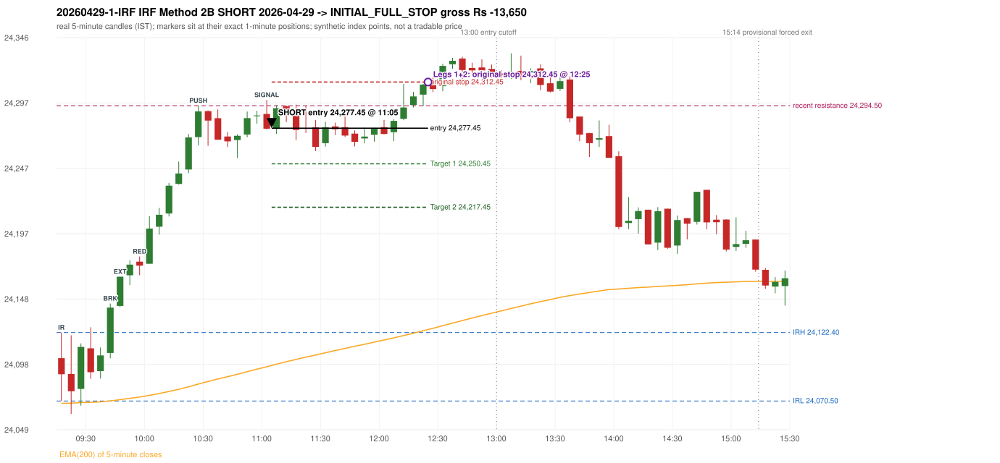

# Trading journal - 2026-04-29 (Wednesday)

> Automated reconstruction of the Phase 3.5 combined backtest: the Phase 3.0 controller, stops, targets and sizing with PDR = the Phase 3.4 revised engine (provisional pattern thresholds and open-above-zone assumption, NOT approved by the strategy author). Synthetic NIFTY 50 index-point P&L (the index is not tradable). The owner's review status is intentionally blank.

## A. Trading day overview

| item | value |
|---|---|
| Date / weekday | 2026-04-29 / Wednesday |
| Session type | USABLE_WITH_FLAGS / VALID |
| Original session open (first 1-minute open) | 24,103.00 |
| Previous session | 2026-04-28 |
| Previous-day high / low | 24,181.75 / 23,958.05 |
| Previous-day official close / last 5-minute close | 23,995.70 / 24,016.50 |
| Raw engine records / confirmed signals / fully valid signals | 6 / 2 / 2 |
| Setups that did not complete (invalidated / incomplete) | 4 |
| Executed trades | 1 20260429-1-IRF |
| Gross P&L (Rs, synthetic) | -13,650.00 |
| Illustrative net P&L (Rs; Rs 500/trade + 0.5 pt/fill) | -14,540.00 |
| Day-end portfolio status | SECOND_TRADE_ELIGIBLE |
| Manual journal trades (matched / unmatched) | 0 (0 / 0) |
| Extra automated trades | 1 |

## B. Daily strategy signal timeline (confirmed signals, chronological)

| time | strategy | method | dir | entry-rule status | valid for execution | <= 13:00 | portfolio state | accepted / ignored | specific reason | competing (same minute) |
|---|---|---|---|---|---|---|---|---|---|---|
| 11:05 | IRF | Method 2B | SHORT | PROPOSAL_DEPENDENT | True | True | FIRST_TRADE_ACTIVE | ACCEPTED -> 20260429-1-IRF | first eligible signal of the day; trade 1: INITIAL_FULL_STOP |  |
| 13:25 | IRF | Method 2A | SHORT | PROPOSAL_DEPENDENT | True | False | SECOND_TRADE_ELIGIBLE | REJECTED | SECOND_TRADE_RESTRICTED_TO_PDR_PDS [blocked by IRF#1] |  |

Engine setups that did not complete (4); the complete list with failed rule ids is in `rejected_signals.csv`:

| candle | strategy | method | dir | status | precise reason | failed rules |
|---|---|---|---|---|---|---|
| 13:20 | IRF | Method 1/2 | SHORT | INCOMPLETE_AT_EOD | SESSION_ENDED_BEFORE_CONFIRMATION |  |
| 09:15 | ORB | Method 2 | LONG | INVALIDATED | TREND:EMA_PREV_SESSION_CLOSE wrong side | ORB-TREND-001;ORB-TREND-002 |
| 09:15 | ORB | Gap/200DMA | LONG | INVALIDATED | CANDLE_QUALITY_OR_REJECTION_WICK | ORB-GAP-LONG-004 |
| 09:15 | PDR | PDR | LONG | INVALIDATED | GAP_UP_OPEN_NOT_ABOVE_ZONE |  |

## C. Detailed trade journals

### 20260429-1-IRF: IRF Method 2B SHORT (FIRST trade)

Chart: 

**Rule configuration:** CFG-phase35_combined-1a0f4fca27 - signal verification status **PROPOSAL_DEPENDENT** (never VERIFIED while a rule rests on a proposal).

#### 1. Setup identification

IRF Method 2B SHORT: the 09:40-09:45 candle closed at 24,141.35, above IRH 24,122.40, and the next candle did not close back inside the range, so the setup is Method 2 and price stayed above it until the trigger. Extension candle 09:45-09:50, red candle 09:55-10:00. The trigger came 16 candles after the breakout candle: a red candle closed back below the first-push resistance after price had traded above it (11:00-11:05); confirmed at 11:05 with close 24,277.05. Entry reference close 24,277.05 is 154.65 points above IRH 24,122.40.

#### 2. Candle and indicator calculations

| role | session | candle | O | H | L | C | range | body % | upper wick % | lower wick % | direction | EMA(200) | strong bull / bear | pin bull / bear | small (body<=30%) | used for |
|---|---|---|---|---|---|---|---|---|---|---|---|---|---|---|---|---|
| initial_range_candle | TODAY | 09:15-09:20 | 24,103.00 | 24,122.40 | 24,070.50 | 24,090.80 | 51.90 | 23.51 | 37.38 | 39.11 | BEARISH | 24,068.75 | False / False | False / False | True | initial range = high/low of the 09:15 candle |
| signal_candle | TODAY | 11:00-11:05 | 24,288.25 | 24,298.85 | 24,276.45 | 24,277.05 | 22.40 | 50.00 | 47.32 | 2.68 | BEARISH | 24,096.45 | False / False | False / False | False | candle whose close completed the trigger |
| breakout_candle | TODAY | 09:40-09:45 | 24,106.95 | 24,144.40 | 24,102.80 | 24,141.35 | 41.60 | 82.69 | 7.33 | 9.98 | BULLISH | 24,070.56 | True / False | False / False | False | breakout candle: a completed candle closing above IRH |
| extension_candle | TODAY | 09:45-09:50 | 24,142.65 | 24,164.80 | 24,141.80 | 24,164.80 | 23.00 | 96.30 | 0.00 | 3.70 | BULLISH | 24,071.49 | True / False | False / False | False | extension: first later candle trading above the breakout candle's high |
| red_candle | TODAY | 09:55-10:00 | 24,176.20 | 24,180.10 | 24,165.90 | 24,173.20 | 14.20 | 21.13 | 27.46 | 51.41 | BEARISH | 24,073.52 | False / False | False / False | True | first red candle during the extension |
| first_push_top | TODAY | 10:25-10:30 | 24,270.65 | 24,294.50 | 24,264.30 | 24,290.15 | 30.20 | 64.57 | 14.40 | 21.03 | BULLISH | 24,083.34 | True / False | False / False | False | recent resistance = top of the first push after the breakout |

Every condition, with the rule, the calculation, the observed values and the result:

| # | group | rule | result | status / numeric definition | calculation | observed | required | available at | why it matters |
|---|---|---|---|---|---|---|---|---|---|
| 1 | SELECTION | SEL-FIRST-001 | PASS | USER_APPROVED / USER_APPROVED | earliest CONFIRMED signal of the day across IRF/ORB/PDR/PDS/RF that passed the controller's checks | 0 confirmed signal(s) earlier today; 2 confirmed signals in the day in total, this one at 11:05 | no earlier executable signal | 2026-04-29 11:05 | the shared controller trades only the first valid signal; the five strategies are not independent positions |
| 2 | SELECTION | SEL-TIE-001 | PASS | USER_APPROVED / USER_APPROVED | other CONFIRMED signals with exactly the same confirmation timestamp | none | no different-strategy / opposite-direction signal in the same minute (otherwise an unresolved conflict, no trade) | 2026-04-29 11:05 | an unresolved same-minute collision would have produced no trade at all |
| 3 | SELECTION | ENTRY-CUTOFF-001 | PASS | USER_APPROVED / USER_APPROVED | fill timestamp vs 13:00:00 IST | signal confirmed 11:05; fill 11:05 | fill at or before 13:00:00 IST | 2026-04-29 11:05 | no new position may be entered with a fill after 13:00 IST |
| 4 | SELECTION | EXE-FILL-001 | PASS | PROPOSED_FOR_REVIEW / PROPOSED_FOR_REVIEW | fill = open of the 1-minute bar that starts at the signal candle's end | bar 11:05 O 24,277.45 H 24,281.65 L 24,273.10 C 24,280.20; executable=True; entry 24,277.45 | fill bar exists, starts exactly at the signal end, is fillable; entry = its open | 2026-04-29 11:05 | a 5-minute signal is known only when its candle closes; the first price that can be traded is the next minute's open |
| 5 | SELECTION | DAY-MAX-001 | PASS | USER_APPROVED / USER_APPROVED | number of entries today | trade 1 of at most 2 | <= 2 entries per day | 2026-04-29 11:05 | daily trade cap |
| 6 | SETUP | IRF-GLOBAL-001 | PASS | SOURCE_VERIFIED / EXPLICIT_IN_SOURCE | initial range = high and low (wicks included) of the first completed 5-minute candle | 09:15-09:20 IRH 24,122.40, IRL 24,070.50 (range 51.90; engine recorded IRH 24,122.40, IRL 24,070.50) | high/low of the 09:15-09:20 candle | 2026-04-29 09:20 | all three IRF methods measure price against this range |
| 7 | SETUP | IRF-GLOBAL-003 | PASS | SOURCE_VERIFIED / EXPLICIT_IN_SOURCE | closes confirm, wicks do not: every trigger is evaluated on a completed 5-minute candle | trigger candle 11:00-11:05 was complete when the signal was stamped 11:05; decision uses its close 24,277.05 | completed candle close, not an intra-candle wick | 2026-04-29 11:05 | an intra-candle wick can reverse before the candle closes |
| 8 | SETUP | IRF-GLOBAL-002 | PASS | SOURCE_VERIFIED / EXPLICIT_IN_SOURCE | direction | SHORT (IRF trades short only) | short only | 2026-04-29 11:05 | IRF fades failed upside breakouts |
| 9 | SETUP | IRF-M2-001 | PASS | SOURCE_VERIFIED / EXPLICIT_IN_SOURCE | breakout candle close vs IRH | 09:40-09:45 O 24,106.95 H 24,144.40 L 24,102.80 C 24,141.35; range 41.60, body 34.40 (82.69%), upper wick 3.05 (7.33%), lower wick 4.15 (9.98%), bullish; close 24,141.35 is 18.95 points above IRH 24,122.40 | close > IRH (a wick above IRH is not a breakout) | 2026-04-29 09:45 | starts every IRF setup |
| 10 | SETUP | IRF-M2-004 | PASS | SOURCE_VERIFIED / EXPLICIT_IN_SOURCE | the candle after the breakout must NOT close back inside the range (else the setup is Method 1) | 09:45 close 24,164.80 vs [24,070.50, 24,122.40) | not (IRL <= close < IRH) | 2026-04-29 09:50 | separates Method 2 (price holds above) from Method 1 (immediate failure) |
| 11 | SETUP | IRF-M2-002 | PASS | SOURCE_VERIFIED / QUALITATIVE_SOURCE_NUMERIC_DEFINITION_PROPOSED_FOR_REVIEW | extension = a later candle whose high exceeds the breakout candle's high (research definition E1) | 09:45 high 24,164.80 vs breakout candle high 24,144.40 (+20.40) | high > breakout candle high | 2026-04-29 09:50 | the guide says price 'extends further upward'; the numeric test is a proposal |
| 12 | SETUP | IRF-M2-003 | PASS | SOURCE_VERIFIED / QUALITATIVE_SOURCE_NUMERIC_DEFINITION_PROPOSED_FOR_REVIEW | a red candle (close < open) forms after the extension | 09:55-10:00 O 24,176.20 H 24,180.10 L 24,165.90 C 24,173.20; range 14.20, body 3.00 (21.13%), upper wick 3.90 (27.46%), lower wick 7.30 (51.41%), bearish | close < open, at or after the candle following the extension | 2026-04-29 10:00 | the red candle shows the first pause/reversal inside the extension |
| 13 | CONFIRMATION | IRF-M2-005 | PASS | SOURCE_VERIFIED / EXPLICIT_IN_SOURCE | a red candle alone is not confirmation: a level break is required | red trigger candle 11:00 also closes below the resistance (see IRF-M2B-003) | a red candle plus a closing break of the level | 2026-04-29 11:05 | a red candle with no level break does not qualify |
| 14 | CONFIRMATION | IRF-M2B-001 | PASS | SOURCE_VERIFIED / QUALITATIVE_SOURCE_NUMERIC_DEFINITION_PROPOSED_FOR_REVIEW | recent resistance = first 3-candle fractal high (k=1) at/after the breakout candle (FIRST_PUSH_TOP) | 10:25 high 24,294.50; engine recorded 24,294.50 | first push top | 2026-04-29 10:35 | the level whose retake-and-fail completes Method 2B (definition is a proposal) |
| 15 | CONFIRMATION | IRF-M2B-002 | PASS | SOURCE_VERIFIED / QUALITATIVE_SOURCE_NUMERIC_DEFINITION_PROPOSED_FOR_REVIEW | price trades back above the resistance after the first push | first candle with high above 24,294.50: 11:00 high 24,298.85 - this IS the trigger candle itself (the push and the red close back below happen on the same candle) | some candle after the first push has high > resistance (the push may be the trigger candle: m2b_push_must_precede_red_candle = False) | 2026-04-29 11:05 | the guide's figure shows three separate candles; the engine also accepts a single candle |
| 16 | CONFIRMATION | IRF-M2B-003 | PASS | SOURCE_VERIFIED / EXPLICIT_IN_SOURCE | trigger = a red candle closing back below the resistance | 11:00-11:05 O 24,288.25 H 24,298.85 L 24,276.45 C 24,277.05; range 22.40, body 11.20 (50.00%), upper wick 10.60 (47.32%), lower wick 0.60 (2.68%), bearish; close 24,277.05 vs resistance 24,294.50 | red candle and close < resistance | 2026-04-29 11:05 | completes Method 2B |
| 17 | EXECUTION | EXE-STOP-001 | PASS | USER_APPROVED / USER_APPROVED | initial stop = entry + 35 points | entry 24,277.45 -> stop 24,312.45 | stop 35 index points (BASELINE) | 2026-04-29 11:05 | defines the loss if the setup fails before Target 1 |
| 18 | EXECUTION | EXE-T1-001 | PASS | SOURCE_VERIFIED / EXPLICIT_IN_SOURCE | Target 1 = entry +/- 27 points | T1 24,250.45 | 27 points | 2026-04-29 11:05 | Leg 1 (3 lots) is booked at Target 1 |
| 19 | EXECUTION | IRF-TGT-001 | PASS | SOURCE_VERIFIED / EXPLICIT_IN_SOURCE | Target 2 = entry +/- 60 points | T2 24,217.45 | 60 points | 2026-04-29 11:05 | Leg 2 (3 lots) is booked at Target 2 |
| 20 | EXECUTION | POST-T1-STOP-006 | PASS | USER_APPROVED / USER_APPROVED | after T1 the Leg-2 stop = entry + 6 (no trailing) | post-T1 stop 24,283.45 | entry -6 (LONG) / +6 (SHORT) | 2026-04-29 11:05 | protects the remaining three lots once the first three are booked |
| 21 | EXECUTION | SIZE-LOT-001 | PASS | USER_APPROVED / USER_APPROVED | 6 lots x 65 = 390, Leg 1 = 3 lots = 195, Leg 2 = 195 | 6 lots, lot size 65, legs 3+3 | 6 lots in two equal legs | 2026-04-29 11:05 | position size for the synthetic P&L |
| 22 | NOTE | IRF-M2-006 | UNRESOLVED | UNRESOLVED / UNRESOLVED | delay between the breakout candle and this trigger; expiry rule | 16 candles after the breakout; expiry none configured | the source states no expiry | 2026-04-29 11:05 | an old breakout can still trigger hours later |
| 23 | NOTE | IRF-M2-006 | UNRESOLVED | UNRESOLVED / UNRESOLVED | did price stay above IRH between the breakout and the trigger? | 0 closes at or below IRH between 09:45 and 11:00; trigger close 24,277.05 above IRH 24,122.40 | the engine does not require price to stay above IRH | 2026-04-29 11:05 | the guide describes price 'holding above IRH and keeping rising'; the code only needs the level break |
| 24 | NOTE | IRF-GLOBAL-004 | UNRESOLVED | UNRESOLVED / UNRESOLVED | which close above IRH of the session produced this attempt; repeat setups | this breakout is upward crossing no. 1 of the session (a close above IRH after a close at/below it) | the source states no first-breakout-only, re-arming, expiry or trades-per-day rule | 2026-04-29 11:05 | IRF re-arms on every later breakout in the code, producing many raw setups; the controller keeps only the first |
| 25 | NOTE | NOTE-IRF-REPEATED-SETUPS | NOT_APPLICABLE | NOT_A_RULE / NOT_A_REGISTRY_RULE | other IRF signals later in the session (not traded) | 1 further confirmed IRF signal(s): Method 2A@13:25 | disclosure of repeated raw setups | 2026-04-29 11:05 | repeated raw IRF setups are not hidden; they are logged as ignored |
| 26 | NOTE | IRF-SL-001 | NOT_APPLICABLE | SOURCE_VERIFIED / QUALITATIVE_SOURCE_NUMERIC_DEFINITION_PROPOSED_FOR_REVIEW | the guide's 35-or-40 rule: 35 if the most recent green candle's high is within 35 points of entry, else 40 | most recent green candle high 24,290.65 is 13.20 points from the entry 24,277.45: the guide's rule would select 35 points; the baseline applies a fixed 35 (USER_APPROVED research baseline; the 35-vs-40 selection and the 40-point variant are separate labelled scenarios) | source selection rule | 2026-04-29 11:05 | the stop distance is a modelling choice and changes losses, not entries |
| 27 | NOTE | NOTE-UNRESOLVED-DEPENDENCIES | UNRESOLVED | NOT_A_RULE / NOT_A_REGISTRY_RULE | rules the signal depends on that the sources leave unresolved | engine-recorded unresolved rule ids: IRF-GLOBAL-004; verification status PROPOSAL_DEPENDENT | n/a (disclosure) | 2026-04-29 11:05 | the entry is only as verified as the rules it rests on |

#### 3. Entry decision and explanation

IRF Method 2B SHORT: the 09:40-09:45 candle closed at 24,141.35, above IRH 24,122.40, and the next candle did not close back inside the range, so the setup is Method 2 and price stayed above it until the trigger. Extension candle 09:45-09:50, red candle 09:55-10:00. The trigger came 16 candles after the breakout candle: a red candle closed back below the first-push resistance after price had traded above it (11:00-11:05); confirmed at 11:05 with close 24,277.05. Entry reference close 24,277.05 is 154.65 points above IRH 24,122.40.

**Why this trade ahead of the other strategies:** This IRF Method 2B signal was the earliest executable signal of the day: 0 confirmed signal(s) earlier, 0 other in the same minute. 1 later confirmed signal(s) (IRF x1) are logged as ignored or rejected. State of the other four engines at that moment: [ORB: Method 2 invalidated at 09:15: TREND:EMA_PREV_SESSION_CLOSE wrong side; Gap/200DMA invalidated at 09:15: CANDLE_QUALITY_OR_REJECTION_WICK] [PDR: PDR invalidated at 09:15: GAP_UP_OPEN_NOT_ABOVE_ZONE] [PDS: no setup record before this time (a base condition was not met, or nothing triggered)] [RF: no setup record before this time (a base condition was not met, or nothing triggered)]

#### 4. Actual entry execution

| item | value |
|---|---|
| Signal candle | 11:00-11:05 |
| Signal confirmed | 2026-04-29 11:05 |
| Fill timestamp | 2026-04-29 11:05 |
| Entry price | 24,277.45 |
| Source partition / 1-minute bar | data/processed/nifty50/year=2026/month=04/candles.parquet / 2026-04-29 11:05 |
| Source bar O / H / L / C | 24,277.45 / 24,281.65 / 24,273.10 / 24,280.20 |
| Fill assumption | open of the 1-minute bar starting at the signal candle's end (EXE-FILL-001, PROPOSED causal convention) |
| Initial stop / T1 / T2 / post-T1 stop | 24,312.45 / 24,250.45 / 24,217.45 / 24,283.45 |
| Position | 6 lots x 65 = 390 units (Leg 1 195, Leg 2 195) |

#### 5-8. Trade progress, Target 1, post-T1 stop and final exit

Between the 11:05 entry bar and the final exit (81 one-minute bars) the best excursion in favour was 17.45 points at 11:29 and the worst against was 36.65 points at 12:25. At 12:25 price reached the original stop 24,312.45 before Target 1 24,250.45, so all six lots exited together at 24,312.45. This is an INITIAL_FULL_STOP: one more trade is allowed that day, only a newly confirmed PDR/PDS signal.

| leg | qty | exit time | exit price | reason | source 1-minute bar | O / H / L / C | gross points | gross Rs | slippage pts | flags |
|---|---|---|---|---|---|---|---|---|---|---|
| 1 | 195 | 12:25 | 24,312.45 | ORIGINAL_STOP_BEFORE_T1 | 12:25 | 24,311.45 / 24,314.10 / 24,308.45 / 24,313.10 | -35.00 | -6,825.00 | 0.00 |  |
| 2 | 195 | 12:25 | 24,312.45 | ORIGINAL_STOP_BEFORE_T1 | 12:25 | 24,311.45 / 24,314.10 / 24,308.45 / 24,313.10 | -35.00 | -6,825.00 | 0.00 |  |

Exit evidence per leg:

* Leg 1: 1-minute bar 12:25 O 24,311.45 H 24,314.10 L 24,308.45 C 24,313.10: high 24,314.10 reached the original stop 24,312.45 before Target 1 24,250.45 was touched; both legs exit at the stop level 24,312.45
* Leg 2: 1-minute bar 12:25 O 24,311.45 H 24,314.10 L 24,308.45 C 24,313.10: high 24,314.10 reached the original stop 24,312.45 before Target 1 24,250.45 was touched; both legs exit at the stop level 24,312.45

#### 9. Gross and illustrative net P&L

| item | value (Rs) |
|---|---|
| Leg 1 gross | -6,825.00 |
| Leg 2 gross | -6,825.00 |
| Trade gross (= Leg 1 + Leg 2) | -13,650.00 |
| Illustrative fixed cost | -500.00 |
| Illustrative slippage (0.5 pt on every fill, entry + exits, all units) | -390.00 |
| Illustrative net | -14,540.00 |

#### 10. Manual journal comparison

EXTRA_AUTOMATED_TRADE: the automated system took IRF Method 2B SHORT at 11:05 (no manual trade that day). The setup rests on: IRF-M2-006: No expiry / validity window for a Method 2 attempt | IRF-M2-006: Engine does not test that price held above IRH | IRF-GLOBAL-004: IRF trades per day / time window / re-arming are not stated in the guide | NOTE-UNRESOLVED-DEPENDENCIES: Disclosure of unresolved source rules behind this signal. The journal shows no corresponding entry.

## D. Manual journal comparison

| comparison | journal row | journal strategy | manual time | manual direction | manual outcome | match class | trade | auto entry | auto outcome | explanation |
|---|---|---|---|---|---|---|---|---|---|---|
| E075 |  |  |  |  |  | EXTRA_AUTOMATED_TRADE | 20260429-1-IRF | 11:05 @ 24,277.45 | INITIAL_FULL_STOP | EXTRA_AUTOMATED_TRADE: the automated system took IRF Method 2B SHORT at 11:05 (no manual trade that day). The setup rests on: IRF-M2-006: No expiry / validity window for a Method 2 attempt \| IRF-M2-006: Engine does not test that price held above IRH \| IRF-GLOBAL-004: IRF trades per day / time window / re-arming are not stated in the guide \| NOTE-UNRESOLVED-DEPENDENCIES: Disclosure of unresolved source rules behind this signal. The journal shows no corresponding entry. |

The journal records no entry price and no exit price (NOT_RECORDED); matching uses date, strategy and candle start only - never P&L.

## E. Daily conclusion

* **Traded:** 20260429-1-IRF - IRF Method 2B SHORT at 11:05 (entry 24,277.45), outcome INITIAL_FULL_STOP, gross Rs -13,650.00, illustrative net Rs -14,540.00. **Why:** This IRF Method 2B signal was the earliest executable signal of the day: 0 confirmed signal(s) earlier, 0 other in the same minute. 1 later confirmed signal(s) (IRF x1) are logged as ignored or rejected. State of the other four engines at that moment: [ORB: Method 2 invalidated at 09:15: TREND:EMA_PREV_SESSION_CLOSE wrong side; Gap/200DMA invalidated at 09:15: CANDLE_QUALITY_OR_REJECTION_WICK] [PDR: PDR invalidated at 09:15: GAP_UP_OPEN_NOT_ABOVE_ZONE] [PDS: no setup record before this time (a base condition was not met, or nothing triggered)] [RF: no setup record before this time (a base condition was not met, or nothing triggered)] **How it ended:** At 12:25 price reached the original stop 24,312.45 before Target 1 24,250.45, so all six lots exited together at 24,312.45. This is an INITIAL_FULL_STOP: one more trade is allowed that day, only a newly confirmed PDR/PDS signal.
* **Ignored / rejected signals:** IRF REJECTED SECOND_TRADE_RESTRICTED_TO_PDR_PDS x1
* **Extra automated trade 20260429-1-IRF:** EXTRA_AUTOMATED_TRADE: the automated system took IRF Method 2B SHORT at 11:05 (no manual trade that day). The setup rests on: IRF-M2-006: No expiry / validity window for a Method 2 attempt | IRF-M2-006: Engine does not test that price held above IRH | IRF-GLOBAL-004: IRF trades per day / time window / re-arming are not stated in the guide | NOTE-UNRESOLVED-DEPENDENCIES: Disclosure of unresolved source rules behind this signal. The journal shows no corresponding entry.
* **Open strategy-definition issues that affected this day:** IRF-GLOBAL-004 (NOT STATED: how many IRF trades per day, a latest entry time, and whether a new breakout may re-arm a setup after a signal), IRF-M2-006 (How long a Method 2 setup stays valid (expiry / invalidation before a level breaks) is not stated), NOTE-UNRESOLVED-DEPENDENCIES
* **Automated triage (not an approval; the owner's review status stays blank):** REVIEW: EXTRA_AUTOMATED
