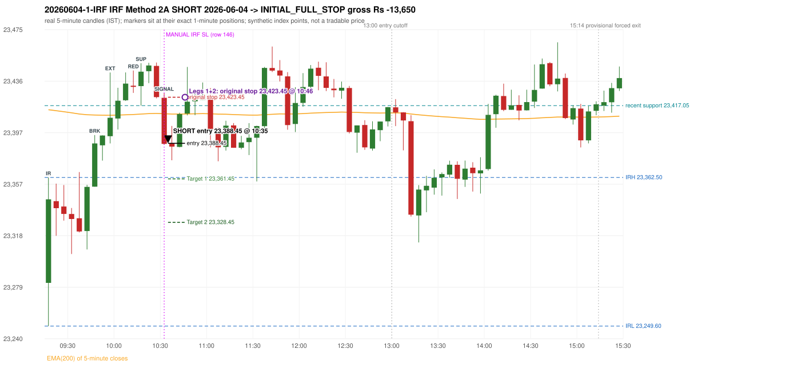

# Trading journal - 2026-06-04 (Thursday)

> Automated reconstruction of the Phase 3.5 combined backtest: the Phase 3.0 controller, stops, targets and sizing with PDR = the Phase 3.4 revised engine (provisional pattern thresholds and open-above-zone assumption, NOT approved by the strategy author). Synthetic NIFTY 50 index-point P&L (the index is not tradable). The owner's review status is intentionally blank.

## A. Trading day overview

| item | value |
|---|---|
| Date / weekday | 2026-06-04 / Thursday |
| Session type | USABLE_WITH_FLAGS / VALID |
| Original session open (first 1-minute open) | 23,282.45 |
| Previous session | 2026-06-03 |
| Previous-day high / low | 23,459.35 / 23,152.15 |
| Previous-day official close / last 5-minute close | 23,405.60 / 23,396.95 |
| Raw engine records / confirmed signals / fully valid signals | 10 / 6 / 6 |
| Setups that did not complete (invalidated / incomplete) | 4 |
| Executed trades | 1 20260604-1-IRF |
| Gross P&L (Rs, synthetic) | -13,650.00 |
| Illustrative net P&L (Rs; Rs 500/trade + 0.5 pt/fill) | -14,540.00 |
| Day-end portfolio status | SECOND_TRADE_ELIGIBLE |
| Manual journal trades (matched / unmatched) | 1 (1 / 0) |
| Extra automated trades | 0 |

## B. Daily strategy signal timeline (confirmed signals, chronological)

| time | strategy | method | dir | entry-rule status | valid for execution | <= 13:00 | portfolio state | accepted / ignored | specific reason | competing (same minute) |
|---|---|---|---|---|---|---|---|---|---|---|
| 10:35 | IRF | Method 2A | SHORT | PROPOSAL_DEPENDENT | True | True | FIRST_TRADE_ACTIVE | ACCEPTED -> 20260604-1-IRF | first eligible signal of the day; trade 1: INITIAL_FULL_STOP | IRF Method 2B SHORT |
| 10:35 | IRF | Method 2B | SHORT | PROPOSAL_DEPENDENT | True | True | FIRST_TRADE_ACTIVE | MERGED_SAME_STRATEGY_METHOD | traded as another method of the same strategy/direction in the same minute | IRF Method 2A SHORT |
| 11:45 | IRF | Method 2B | SHORT | PROPOSAL_DEPENDENT | True | True | SECOND_TRADE_ELIGIBLE | REJECTED | SECOND_TRADE_RESTRICTED_TO_PDR_PDS [blocked by IRF#1] |  |
| 13:15 | IRF | Method 1 | SHORT | PROPOSAL_DEPENDENT | True | False | SECOND_TRADE_ELIGIBLE | REJECTED | SECOND_TRADE_RESTRICTED_TO_PDR_PDS [blocked by IRF#1] |  |
| 13:45 | IRF | Method 1 | SHORT | PROPOSAL_DEPENDENT | True | False | SECOND_TRADE_ELIGIBLE | REJECTED | SECOND_TRADE_RESTRICTED_TO_PDR_PDS [blocked by IRF#1] |  |
| 14:55 | IRF | Method 2B | SHORT | PROPOSAL_DEPENDENT | True | False | SECOND_TRADE_ELIGIBLE | REJECTED | SECOND_TRADE_RESTRICTED_TO_PDR_PDS [blocked by IRF#1] |  |

Engine setups that did not complete (4); the complete list with failed rule ids is in `rejected_signals.csv`:

| candle | strategy | method | dir | status | precise reason | failed rules |
|---|---|---|---|---|---|---|
| 09:35 | IRF | Method 3 | SHORT | INVALIDATED | WICK_SHARE_OUT_OF_BAND | IRF-M3-003 |
| 14:50 | IRF | Method 1/2 | SHORT | INCOMPLETE_AT_EOD | SESSION_ENDED_BEFORE_CONFIRMATION |  |
| 09:15 | ORB | Method 2 | SHORT | INVALIDATED | TRENDLINE_NOT_SUPPORTIVE | ORB-M2-SHORT-001 |
| 09:15 | PDS | Method 1/2/3 | SHORT | INVALIDATED | GAP_DOWN_OPEN_NOT_BELOW_ZONE | PDS-006 |

## C. Detailed trade journals

### 20260604-1-IRF: IRF Method 2A SHORT (FIRST trade)

Chart: 

**Rule configuration:** CFG-phase35_combined-1a0f4fca27 - signal verification status **PROPOSAL_DEPENDENT** (never VERIFIED while a rule rests on a proposal).

#### 1. Setup identification

IRF Method 2A SHORT: the 09:45-09:50 candle closed at 23,388.35, above IRH 23,362.50, and the next candle did not close back inside the range, so the setup is Method 2 and price stayed above it until the trigger. Extension candle 09:55-10:00, red candle 10:10-10:15. The trigger came 9 candles after the breakout candle: a completed candle closed below the recent pullback-low support (10:30-10:35); confirmed at 10:35 with close 23,388.00. Entry reference close 23,388.00 is 25.50 points above IRH 23,362.50.

#### 2. Candle and indicator calculations

| role | session | candle | O | H | L | C | range | body % | upper wick % | lower wick % | direction | EMA(200) | strong bull / bear | pin bull / bear | small (body<=30%) | used for |
|---|---|---|---|---|---|---|---|---|---|---|---|---|---|---|---|---|
| initial_range_candle | TODAY | 09:15-09:20 | 23,282.45 | 23,362.50 | 23,249.60 | 23,345.90 | 112.90 | 56.20 | 14.70 | 29.10 | BULLISH | 23,413.94 | False / False | False / False | False | initial range = high/low of the 09:15 candle |
| signal_candle | TODAY | 10:30-10:35 | 23,423.00 | 23,426.60 | 23,387.40 | 23,388.00 | 39.20 | 89.29 | 9.18 | 1.53 | BEARISH | 23,410.91 | False / True | False / False | False | candle whose close completed the trigger |
| breakout_candle | TODAY | 09:45-09:50 | 23,355.50 | 23,394.70 | 23,355.50 | 23,388.35 | 39.20 | 83.80 | 16.20 | 0.00 | BULLISH | 23,409.94 | True / False | False / False | False | breakout candle: a completed candle closing above IRH |
| extension_candle | TODAY | 09:55-10:00 | 23,393.85 | 23,442.25 | 23,388.35 | 23,407.85 | 53.90 | 25.97 | 63.82 | 10.20 | BULLISH | 23,409.76 | False / False | False / False | True | extension: first later candle trading above the breakout candle's high |
| red_candle | TODAY | 10:10-10:15 | 23,432.20 | 23,443.70 | 23,426.75 | 23,431.35 | 16.95 | 5.01 | 67.85 | 27.14 | BEARISH | 23,410.32 | False / False | False / True | True | first red candle during the extension |
| support_pivot | TODAY | 10:15-10:20 | 23,431.90 | 23,449.30 | 23,417.05 | 23,442.85 | 32.25 | 33.95 | 20.00 | 46.05 | BULLISH | 23,410.65 | False / False | False / False | False | recent support: latest 3-candle fractal low formed after the breakout |

Every condition, with the rule, the calculation, the observed values and the result:

| # | group | rule | result | status / numeric definition | calculation | observed | required | available at | why it matters |
|---|---|---|---|---|---|---|---|---|---|
| 1 | SELECTION | SEL-FIRST-001 | PASS | USER_APPROVED / USER_APPROVED | earliest CONFIRMED signal of the day across IRF/ORB/PDR/PDS/RF that passed the controller's checks | 0 confirmed signal(s) earlier today; 6 confirmed signals in the day in total, this one at 10:35 | no earlier executable signal | 2026-06-04 10:35 | the shared controller trades only the first valid signal; the five strategies are not independent positions |
| 2 | SELECTION | SEL-TIE-001 | PASS | USER_APPROVED / USER_APPROVED | other CONFIRMED signals with exactly the same confirmation timestamp | IRF Method 2B SHORT @10:35 [NOTE: SAME_STRATEGY_CONCURRENT_METHOD]; merged same-strategy methods: Method 2B | no different-strategy / opposite-direction signal in the same minute (otherwise an unresolved conflict, no trade) | 2026-06-04 10:35 | an unresolved same-minute collision would have produced no trade at all |
| 3 | SELECTION | ENTRY-CUTOFF-001 | PASS | USER_APPROVED / USER_APPROVED | fill timestamp vs 13:00:00 IST | signal confirmed 10:35; fill 10:35 | fill at or before 13:00:00 IST | 2026-06-04 10:35 | no new position may be entered with a fill after 13:00 IST |
| 4 | SELECTION | EXE-FILL-001 | PASS | PROPOSED_FOR_REVIEW / PROPOSED_FOR_REVIEW | fill = open of the 1-minute bar that starts at the signal candle's end | bar 10:35 O 23,388.45 H 23,391.70 L 23,385.55 C 23,391.30; executable=True; entry 23,388.45 | fill bar exists, starts exactly at the signal end, is fillable; entry = its open | 2026-06-04 10:35 | a 5-minute signal is known only when its candle closes; the first price that can be traded is the next minute's open |
| 5 | SELECTION | DAY-MAX-001 | PASS | USER_APPROVED / USER_APPROVED | number of entries today | trade 1 of at most 2 | <= 2 entries per day | 2026-06-04 10:35 | daily trade cap |
| 6 | SETUP | IRF-GLOBAL-001 | PASS | SOURCE_VERIFIED / EXPLICIT_IN_SOURCE | initial range = high and low (wicks included) of the first completed 5-minute candle | 09:15-09:20 IRH 23,362.50, IRL 23,249.60 (range 112.90; engine recorded IRH 23,362.50, IRL 23,249.60) | high/low of the 09:15-09:20 candle | 2026-06-04 09:20 | all three IRF methods measure price against this range |
| 7 | SETUP | IRF-GLOBAL-003 | PASS | SOURCE_VERIFIED / EXPLICIT_IN_SOURCE | closes confirm, wicks do not: every trigger is evaluated on a completed 5-minute candle | trigger candle 10:30-10:35 was complete when the signal was stamped 10:35; decision uses its close 23,388.00 | completed candle close, not an intra-candle wick | 2026-06-04 10:35 | an intra-candle wick can reverse before the candle closes |
| 8 | SETUP | IRF-GLOBAL-002 | PASS | SOURCE_VERIFIED / EXPLICIT_IN_SOURCE | direction | SHORT (IRF trades short only) | short only | 2026-06-04 10:35 | IRF fades failed upside breakouts |
| 9 | SETUP | IRF-M2-001 | PASS | SOURCE_VERIFIED / EXPLICIT_IN_SOURCE | breakout candle close vs IRH | 09:45-09:50 O 23,355.50 H 23,394.70 L 23,355.50 C 23,388.35; range 39.20, body 32.85 (83.80%), upper wick 6.35 (16.20%), lower wick 0.00 (0.00%), bullish; close 23,388.35 is 25.85 points above IRH 23,362.50 | close > IRH (a wick above IRH is not a breakout) | 2026-06-04 09:50 | starts every IRF setup |
| 10 | SETUP | IRF-M2-004 | PASS | SOURCE_VERIFIED / EXPLICIT_IN_SOURCE | the candle after the breakout must NOT close back inside the range (else the setup is Method 1) | 09:50 close 23,394.35 vs [23,249.60, 23,362.50) | not (IRL <= close < IRH) | 2026-06-04 09:55 | separates Method 2 (price holds above) from Method 1 (immediate failure) |
| 11 | SETUP | IRF-M2-002 | PASS | SOURCE_VERIFIED / QUALITATIVE_SOURCE_NUMERIC_DEFINITION_PROPOSED_FOR_REVIEW | extension = a later candle whose high exceeds the breakout candle's high (research definition E1) | 09:55 high 23,442.25 vs breakout candle high 23,394.70 (+47.55) | high > breakout candle high | 2026-06-04 10:00 | the guide says price 'extends further upward'; the numeric test is a proposal |
| 12 | SETUP | IRF-M2-003 | PASS | SOURCE_VERIFIED / QUALITATIVE_SOURCE_NUMERIC_DEFINITION_PROPOSED_FOR_REVIEW | a red candle (close < open) forms after the extension | 10:10-10:15 O 23,432.20 H 23,443.70 L 23,426.75 C 23,431.35; range 16.95, body 0.85 (5.01%), upper wick 11.50 (67.85%), lower wick 4.60 (27.14%), bearish | close < open, at or after the candle following the extension | 2026-06-04 10:15 | the red candle shows the first pause/reversal inside the extension |
| 13 | CONFIRMATION | IRF-M2A-001 | PASS | SOURCE_VERIFIED / QUALITATIVE_SOURCE_NUMERIC_DEFINITION_PROPOSED_FOR_REVIEW | recent support = latest 3-candle fractal low (k=1) among candles b+1 ... i-2 | 10:15 low 23,417.05; neighbours' lows 23,426.75 (10:10) and 23,434.15 (10:20) are not lower; engine recorded support 23,417.05 | pivot low known before the trigger candle | 2026-06-04 10:25 | the support is the level whose break completes Method 2A (the exact 'pullback low' definition is a proposal) |
| 14 | CONFIRMATION | IRF-M2A-002 | PASS | SOURCE_VERIFIED / EXPLICIT_WORDING_DETAIL_PROPOSED_FOR_REVIEW | trigger candle closes below recent support | 10:30 close 23,388.00 vs support 23,417.05: 29.05 points below | close < support (close, not wick) | 2026-06-04 10:35 | completes Method 2A |
| 15 | CONFIRMATION | IRF-M2-005 | PASS | SOURCE_VERIFIED / EXPLICIT_IN_SOURCE | chronology: the red candle precedes the break candle | red candle 10:10, break candle 10:30 | red candle index < break candle index (m2a_break_may_be_red_candle = False) | 2026-06-04 10:35 | a red candle alone is not confirmation; a level break is required |
| 16 | EXECUTION | EXE-STOP-001 | PASS | USER_APPROVED / USER_APPROVED | initial stop = entry + 35 points | entry 23,388.45 -> stop 23,423.45 | stop 35 index points (BASELINE) | 2026-06-04 10:35 | defines the loss if the setup fails before Target 1 |
| 17 | EXECUTION | EXE-T1-001 | PASS | SOURCE_VERIFIED / EXPLICIT_IN_SOURCE | Target 1 = entry +/- 27 points | T1 23,361.45 | 27 points | 2026-06-04 10:35 | Leg 1 (3 lots) is booked at Target 1 |
| 18 | EXECUTION | IRF-TGT-001 | PASS | SOURCE_VERIFIED / EXPLICIT_IN_SOURCE | Target 2 = entry +/- 60 points | T2 23,328.45 | 60 points | 2026-06-04 10:35 | Leg 2 (3 lots) is booked at Target 2 |
| 19 | EXECUTION | POST-T1-STOP-006 | PASS | USER_APPROVED / USER_APPROVED | after T1 the Leg-2 stop = entry + 6 (no trailing) | post-T1 stop 23,394.45 | entry -6 (LONG) / +6 (SHORT) | 2026-06-04 10:35 | protects the remaining three lots once the first three are booked |
| 20 | EXECUTION | SIZE-LOT-001 | PASS | USER_APPROVED / USER_APPROVED | 6 lots x 65 = 390, Leg 1 = 3 lots = 195, Leg 2 = 195 | 6 lots, lot size 65, legs 3+3 | 6 lots in two equal legs | 2026-06-04 10:35 | position size for the synthetic P&L |
| 21 | NOTE | IRF-M2-006 | UNRESOLVED | UNRESOLVED / UNRESOLVED | delay between the breakout candle and this trigger; expiry rule | 9 candles after the breakout; expiry none configured | the source states no expiry | 2026-06-04 10:35 | an old breakout can still trigger hours later |
| 22 | NOTE | IRF-M2-006 | UNRESOLVED | UNRESOLVED / UNRESOLVED | did price stay above IRH between the breakout and the trigger? | 0 closes at or below IRH between 09:50 and 10:30; trigger close 23,388.00 above IRH 23,362.50 | the engine does not require price to stay above IRH | 2026-06-04 10:35 | the guide describes price 'holding above IRH and keeping rising'; the code only needs the level break |
| 23 | NOTE | IRF-GLOBAL-004 | UNRESOLVED | UNRESOLVED / UNRESOLVED | which close above IRH of the session produced this attempt; repeat setups | this breakout is upward crossing no. 1 of the session (a close above IRH after a close at/below it) | the source states no first-breakout-only, re-arming, expiry or trades-per-day rule | 2026-06-04 10:35 | IRF re-arms on every later breakout in the code, producing many raw setups; the controller keeps only the first |
| 24 | NOTE | NOTE-IRF-REPEATED-SETUPS | NOT_APPLICABLE | NOT_A_RULE / NOT_A_REGISTRY_RULE | other IRF signals later in the session (not traded) | 4 further confirmed IRF signal(s): Method 2B@11:45, Method 1@13:15, Method 1@13:45, Method 2B@14:55; concurrent methods merged in this minute: Method 2B | disclosure of repeated raw setups | 2026-06-04 10:35 | repeated raw IRF setups are not hidden; they are logged as ignored |
| 25 | NOTE | IRF-SL-001 | NOT_APPLICABLE | SOURCE_VERIFIED / QUALITATIVE_SOURCE_NUMERIC_DEFINITION_PROPOSED_FOR_REVIEW | the guide's 35-or-40 rule: 35 if the most recent green candle's high is within 35 points of entry, else 40 | most recent green candle high 23,449.60 is 61.15 points from the entry 23,388.45: the guide's rule would select 40 points; the baseline applies a fixed 35 (USER_APPROVED research baseline; the 35-vs-40 selection and the 40-point variant are separate labelled scenarios) | source selection rule | 2026-06-04 10:35 | the stop distance is a modelling choice and changes losses, not entries |
| 26 | NOTE | NOTE-UNRESOLVED-DEPENDENCIES | UNRESOLVED | NOT_A_RULE / NOT_A_REGISTRY_RULE | rules the signal depends on that the sources leave unresolved | engine-recorded unresolved rule ids: IRF-GLOBAL-004; verification status PROPOSAL_DEPENDENT | n/a (disclosure) | 2026-06-04 10:35 | the entry is only as verified as the rules it rests on |

#### 3. Entry decision and explanation

IRF Method 2A SHORT: the 09:45-09:50 candle closed at 23,388.35, above IRH 23,362.50, and the next candle did not close back inside the range, so the setup is Method 2 and price stayed above it until the trigger. Extension candle 09:55-10:00, red candle 10:10-10:15. The trigger came 9 candles after the breakout candle: a completed candle closed below the recent pullback-low support (10:30-10:35); confirmed at 10:35 with close 23,388.00. Entry reference close 23,388.00 is 25.50 points above IRH 23,362.50.

**Why this trade ahead of the other strategies:** This IRF Method 2A signal was the earliest executable signal of the day: 0 confirmed signal(s) earlier, 1 other in the same minute. 4 later confirmed signal(s) (IRF x4) are logged as ignored or rejected. State of the other four engines at that moment: [ORB: Method 2 invalidated at 09:15: TRENDLINE_NOT_SUPPORTIVE] [PDR: no setup record before this time (a base condition was not met, or nothing triggered)] [PDS: Method 1/2/3 invalidated at 09:15: GAP_DOWN_OPEN_NOT_BELOW_ZONE] [RF: no setup record before this time (a base condition was not met, or nothing triggered)]

#### 4. Actual entry execution

| item | value |
|---|---|
| Signal candle | 10:30-10:35 |
| Signal confirmed | 2026-06-04 10:35 |
| Fill timestamp | 2026-06-04 10:35 |
| Entry price | 23,388.45 |
| Source partition / 1-minute bar | data/processed/nifty50/year=2026/month=06/candles.parquet / 2026-06-04 10:35 |
| Source bar O / H / L / C | 23,388.45 / 23,391.70 / 23,385.55 / 23,391.30 |
| Fill assumption | open of the 1-minute bar starting at the signal candle's end (EXE-FILL-001, PROPOSED causal convention) |
| Initial stop / T1 / T2 / post-T1 stop | 23,423.45 / 23,361.45 / 23,328.45 / 23,394.45 |
| Position | 6 lots x 65 = 390 units (Leg 1 195, Leg 2 195) |

#### 5-8. Trade progress, Target 1, post-T1 stop and final exit

Between the 10:35 entry bar and the final exit (12 one-minute bars) the best excursion in favour was 12.90 points at 10:37 and the worst against was 56.50 points at 10:46. At 10:46 price reached the original stop 23,423.45 before Target 1 23,361.45, so all six lots exited together at 23,423.45. This is an INITIAL_FULL_STOP: one more trade is allowed that day, only a newly confirmed PDR/PDS signal.

| leg | qty | exit time | exit price | reason | source 1-minute bar | O / H / L / C | gross points | gross Rs | slippage pts | flags |
|---|---|---|---|---|---|---|---|---|---|---|
| 1 | 195 | 10:46 | 23,423.45 | ORIGINAL_STOP_BEFORE_T1 | 10:46 | 23,422.75 / 23,444.95 / 23,421.80 / 23,442.70 | -35.00 | -6,825.00 | 0.00 |  |
| 2 | 195 | 10:46 | 23,423.45 | ORIGINAL_STOP_BEFORE_T1 | 10:46 | 23,422.75 / 23,444.95 / 23,421.80 / 23,442.70 | -35.00 | -6,825.00 | 0.00 |  |

Exit evidence per leg:

* Leg 1: 1-minute bar 10:46 O 23,422.75 H 23,444.95 L 23,421.80 C 23,442.70: high 23,444.95 reached the original stop 23,423.45 before Target 1 23,361.45 was touched; both legs exit at the stop level 23,423.45
* Leg 2: 1-minute bar 10:46 O 23,422.75 H 23,444.95 L 23,421.80 C 23,442.70: high 23,444.95 reached the original stop 23,423.45 before Target 1 23,361.45 was touched; both legs exit at the stop level 23,423.45

#### 9. Gross and illustrative net P&L

| item | value (Rs) |
|---|---|
| Leg 1 gross | -6,825.00 |
| Leg 2 gross | -6,825.00 |
| Trade gross (= Leg 1 + Leg 2) | -13,650.00 |
| Illustrative fixed cost | -500.00 |
| Illustrative slippage (0.5 pt on every fill, entry + exits, all units) | -390.00 |
| Illustrative net | -14,540.00 |

#### 10. Manual journal comparison

EXACT_MATCH: manual IRF labelled 10:30 (candle start) vs automated IRF Method 2A SHORT candle 10:30, filled 10:35 at 23,388.45; time difference 0 minutes. Journal outcome SL vs automated INITIAL_FULL_STOP (same outcome class). The journal records no entry or exit price.

## D. Manual journal comparison

| comparison | journal row | journal strategy | manual time | manual direction | manual outcome | match class | trade | auto entry | auto outcome | explanation |
|---|---|---|---|---|---|---|---|---|---|---|
| M146 | 146 | IRF | 10:30 | SHORT | SL | EXACT_MATCH | 20260604-1-IRF | 10:35 @ 23,388.45 | INITIAL_FULL_STOP | EXACT_MATCH: manual IRF labelled 10:30 (candle start) vs automated IRF Method 2A SHORT candle 10:30, filled 10:35 at 23,388.45; time difference 0 minutes. Journal outcome SL vs automated INITIAL_FULL_STOP (same outcome class). The journal records no entry or exit price. |

The journal records no entry price and no exit price (NOT_RECORDED); matching uses date, strategy and candle start only - never P&L.

## E. Daily conclusion

* **Traded:** 20260604-1-IRF - IRF Method 2A SHORT at 10:35 (entry 23,388.45), outcome INITIAL_FULL_STOP, gross Rs -13,650.00, illustrative net Rs -14,540.00. **Why:** This IRF Method 2A signal was the earliest executable signal of the day: 0 confirmed signal(s) earlier, 1 other in the same minute. 4 later confirmed signal(s) (IRF x4) are logged as ignored or rejected. State of the other four engines at that moment: [ORB: Method 2 invalidated at 09:15: TRENDLINE_NOT_SUPPORTIVE] [PDR: no setup record before this time (a base condition was not met, or nothing triggered)] [PDS: Method 1/2/3 invalidated at 09:15: GAP_DOWN_OPEN_NOT_BELOW_ZONE] [RF: no setup record before this time (a base condition was not met, or nothing triggered)] **How it ended:** At 10:46 price reached the original stop 23,423.45 before Target 1 23,361.45, so all six lots exited together at 23,423.45. This is an INITIAL_FULL_STOP: one more trade is allowed that day, only a newly confirmed PDR/PDS signal.
* **Ignored / rejected signals:** IRF REJECTED SECOND_TRADE_RESTRICTED_TO_PDR_PDS x4; IRF MERGED_SAME_STRATEGY_METHOD traded as another method of the same strategy/direction in the same minute x1
* **Open strategy-definition issues that affected this day:** IRF-GLOBAL-004 (NOT STATED: how many IRF trades per day, a latest entry time, and whether a new breakout may re-arm a setup after a signal), IRF-M2-006 (How long a Method 2 setup stays valid (expiry / invalidation before a level breaks) is not stated), NOTE-UNRESOLVED-DEPENDENCIES
* **Automated triage (not an approval; the owner's review status stays blank):** MATCHED_EXACT_NO_FLAGS
