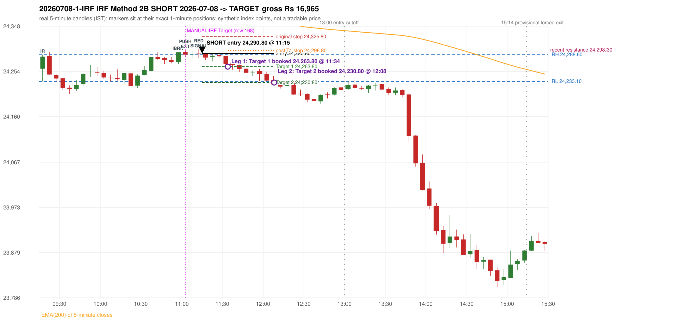

# Trading journal - 2026-07-08 (Wednesday)

> Automated reconstruction of the Phase 3.5 combined backtest: the Phase 3.0 controller, stops, targets and sizing with PDR = the Phase 3.4 revised engine (provisional pattern thresholds and open-above-zone assumption, NOT approved by the strategy author). Synthetic NIFTY 50 index-point P&L (the index is not tradable). The owner's review status is intentionally blank.

## A. Trading day overview

| item | value |
|---|---|
| Date / weekday | 2026-07-08 / Wednesday |
| Session type | USABLE_WITH_FLAGS / VALID |
| Original session open (first 1-minute open) | 24,259.55 |
| Previous session | 2026-07-07 |
| Previous-day high / low | 24,530.20 / 24,349.50 |
| Previous-day official close / last 5-minute close | 24,398.70 / 24,355.10 |
| Raw engine records / confirmed signals / fully valid signals | 7 / 2 / 2 |
| Setups that did not complete (invalidated / incomplete) | 5 |
| Executed trades | 1 20260708-1-IRF |
| Gross P&L (Rs, synthetic) | 16,965.00 |
| Illustrative net P&L (Rs; Rs 500/trade + 0.5 pt/fill) | 16,075.00 |
| Day-end portfolio status | DAY_FINISHED |
| Manual journal trades (matched / unmatched) | 1 (1 / 0) |
| Extra automated trades | 0 |

## B. Daily strategy signal timeline (confirmed signals, chronological)

| time | strategy | method | dir | entry-rule status | valid for execution | <= 13:00 | portfolio state | accepted / ignored | specific reason | competing (same minute) |
|---|---|---|---|---|---|---|---|---|---|---|
| 11:15 | IRF | Method 2B | SHORT | PROPOSAL_DEPENDENT | True | True | FIRST_TRADE_ACTIVE | ACCEPTED -> 20260708-1-IRF | first eligible signal of the day; trade 1: TARGET |  |
| 11:20 | IRF | Method 1 | SHORT | PROPOSAL_DEPENDENT | True | True | FIRST_TRADE_ACTIVE | IGNORED | POSITION_ACTIVE (signal kept for diagnostics only; never reused) [blocked by IRF#1] |  |

Engine setups that did not complete (5); the complete list with failed rule ids is in `rejected_signals.csv`:

| candle | strategy | method | dir | status | precise reason | failed rules |
|---|---|---|---|---|---|---|
| 10:40 | IRF | Method 3 | SHORT | INVALIDATED | WICK_SHARE_OUT_OF_BAND | IRF-M3-003 |
| 09:15 | ORB | Method 1 | SHORT | INVALIDATED | CANDLE_QUALITY(not a strong body / wick too large) | ORB-M1-SHORT-003 |
| 09:15 | ORB | Method 2 | SHORT | INVALIDATED | CANDLE_QUALITY | ORB-M2-SHORT-003 |
| 09:15 | ORB | Gap/200DMA | SHORT | INVALIDATED | CANDLE_QUALITY_OR_REJECTION_WICK | ORB-GAP-SHORT-003 |
| 09:45 | RF | RF | LONG | INVALIDATED | TREND:EMA_PREV_SESSION_CLOSE wrong side | RF-001;RF-008 |

## C. Detailed trade journals

### 20260708-1-IRF: IRF Method 2B SHORT (FIRST trade)

Chart: 

**Rule configuration:** CFG-phase35_combined-1a0f4fca27 - signal verification status **PROPOSAL_DEPENDENT** (never VERIFIED while a rule rests on a proposal).

#### 1. Setup identification

IRF Method 2B SHORT: the 10:55-11:00 candle closed at 24,293.50, above IRH 24,288.60, and the next candle did not close back inside the range, so the setup is Method 2 and price stayed above it until the trigger. Extension candle 11:00-11:05, red candle 11:10-11:15. The trigger came 3 candles after the breakout candle: a red candle closed back below the first-push resistance after price had traded above it (11:10-11:15); confirmed at 11:15 with close 24,290.55. Entry reference close 24,290.55 is 1.95 points above IRH 24,288.60.

#### 2. Candle and indicator calculations

| role | session | candle | O | H | L | C | range | body % | upper wick % | lower wick % | direction | EMA(200) | strong bull / bear | pin bull / bear | small (body<=30%) | used for |
|---|---|---|---|---|---|---|---|---|---|---|---|---|---|---|---|---|
| initial_range_candle | TODAY | 09:15-09:20 | 24,259.55 | 24,288.60 | 24,233.10 | 24,284.45 | 55.50 | 44.86 | 7.48 | 47.66 | BULLISH | 24,390.86 | False / False | False / False | False | initial range = high/low of the 09:15 candle |
| signal_candle | TODAY | 11:10-11:15 | 24,290.95 | 24,299.75 | 24,281.15 | 24,290.55 | 18.60 | 2.15 | 47.31 | 50.54 | BEARISH | 24,363.30 | False / False | False / False | True | candle whose close completed the trigger |
| breakout_candle | TODAY | 10:55-11:00 | 24,273.85 | 24,294.30 | 24,269.20 | 24,293.50 | 25.10 | 78.29 | 3.19 | 18.53 | BULLISH | 24,365.53 | True / False | False / False | False | breakout candle: a completed candle closing above IRH |
| extension_candle | TODAY | 11:00-11:05 | 24,294.55 | 24,298.30 | 24,284.55 | 24,288.75 | 13.75 | 42.18 | 27.27 | 30.55 | BEARISH | 24,364.77 | False / False | False / False | False | extension: first later candle trading above the breakout candle's high |
| red_candle | TODAY | 11:10-11:15 | 24,290.95 | 24,299.75 | 24,281.15 | 24,290.55 | 18.60 | 2.15 | 47.31 | 50.54 | BEARISH | 24,363.30 | False / False | False / False | True | first red candle during the extension |
| first_push_top | TODAY | 11:00-11:05 | 24,294.55 | 24,298.30 | 24,284.55 | 24,288.75 | 13.75 | 42.18 | 27.27 | 30.55 | BEARISH | 24,364.77 | False / False | False / False | False | recent resistance = top of the first push after the breakout |

Every condition, with the rule, the calculation, the observed values and the result:

| # | group | rule | result | status / numeric definition | calculation | observed | required | available at | why it matters |
|---|---|---|---|---|---|---|---|---|---|
| 1 | SELECTION | SEL-FIRST-001 | PASS | USER_APPROVED / USER_APPROVED | earliest CONFIRMED signal of the day across IRF/ORB/PDR/PDS/RF that passed the controller's checks | 0 confirmed signal(s) earlier today; 2 confirmed signals in the day in total, this one at 11:15 | no earlier executable signal | 2026-07-08 11:15 | the shared controller trades only the first valid signal; the five strategies are not independent positions |
| 2 | SELECTION | SEL-TIE-001 | PASS | USER_APPROVED / USER_APPROVED | other CONFIRMED signals with exactly the same confirmation timestamp | none | no different-strategy / opposite-direction signal in the same minute (otherwise an unresolved conflict, no trade) | 2026-07-08 11:15 | an unresolved same-minute collision would have produced no trade at all |
| 3 | SELECTION | ENTRY-CUTOFF-001 | PASS | USER_APPROVED / USER_APPROVED | fill timestamp vs 13:00:00 IST | signal confirmed 11:15; fill 11:15 | fill at or before 13:00:00 IST | 2026-07-08 11:15 | no new position may be entered with a fill after 13:00 IST |
| 4 | SELECTION | EXE-FILL-001 | PASS | PROPOSED_FOR_REVIEW / PROPOSED_FOR_REVIEW | fill = open of the 1-minute bar that starts at the signal candle's end | bar 11:15 O 24,290.80 H 24,291.00 L 24,283.85 C 24,285.45; executable=True; entry 24,290.80 | fill bar exists, starts exactly at the signal end, is fillable; entry = its open | 2026-07-08 11:15 | a 5-minute signal is known only when its candle closes; the first price that can be traded is the next minute's open |
| 5 | SELECTION | DAY-MAX-001 | PASS | USER_APPROVED / USER_APPROVED | number of entries today | trade 1 of at most 2 | <= 2 entries per day | 2026-07-08 11:15 | daily trade cap |
| 6 | SETUP | IRF-GLOBAL-001 | PASS | SOURCE_VERIFIED / EXPLICIT_IN_SOURCE | initial range = high and low (wicks included) of the first completed 5-minute candle | 09:15-09:20 IRH 24,288.60, IRL 24,233.10 (range 55.50; engine recorded IRH 24,288.60, IRL 24,233.10) | high/low of the 09:15-09:20 candle | 2026-07-08 09:20 | all three IRF methods measure price against this range |
| 7 | SETUP | IRF-GLOBAL-003 | PASS | SOURCE_VERIFIED / EXPLICIT_IN_SOURCE | closes confirm, wicks do not: every trigger is evaluated on a completed 5-minute candle | trigger candle 11:10-11:15 was complete when the signal was stamped 11:15; decision uses its close 24,290.55 | completed candle close, not an intra-candle wick | 2026-07-08 11:15 | an intra-candle wick can reverse before the candle closes |
| 8 | SETUP | IRF-GLOBAL-002 | PASS | SOURCE_VERIFIED / EXPLICIT_IN_SOURCE | direction | SHORT (IRF trades short only) | short only | 2026-07-08 11:15 | IRF fades failed upside breakouts |
| 9 | SETUP | IRF-M2-001 | PASS | SOURCE_VERIFIED / EXPLICIT_IN_SOURCE | breakout candle close vs IRH | 10:55-11:00 O 24,273.85 H 24,294.30 L 24,269.20 C 24,293.50; range 25.10, body 19.65 (78.29%), upper wick 0.80 (3.19%), lower wick 4.65 (18.53%), bullish; close 24,293.50 is 4.90 points above IRH 24,288.60 | close > IRH (a wick above IRH is not a breakout) | 2026-07-08 11:00 | starts every IRF setup |
| 10 | SETUP | IRF-M2-004 | PASS | SOURCE_VERIFIED / EXPLICIT_IN_SOURCE | the candle after the breakout must NOT close back inside the range (else the setup is Method 1) | 11:00 close 24,288.75 vs [24,233.10, 24,288.60) | not (IRL <= close < IRH) | 2026-07-08 11:05 | separates Method 2 (price holds above) from Method 1 (immediate failure) |
| 11 | SETUP | IRF-M2-002 | PASS | SOURCE_VERIFIED / QUALITATIVE_SOURCE_NUMERIC_DEFINITION_PROPOSED_FOR_REVIEW | extension = a later candle whose high exceeds the breakout candle's high (research definition E1) | 11:00 high 24,298.30 vs breakout candle high 24,294.30 (+4.00) | high > breakout candle high | 2026-07-08 11:05 | the guide says price 'extends further upward'; the numeric test is a proposal |
| 12 | SETUP | IRF-M2-003 | PASS | SOURCE_VERIFIED / QUALITATIVE_SOURCE_NUMERIC_DEFINITION_PROPOSED_FOR_REVIEW | a red candle (close < open) forms after the extension | 11:10-11:15 O 24,290.95 H 24,299.75 L 24,281.15 C 24,290.55; range 18.60, body 0.40 (2.15%), upper wick 8.80 (47.31%), lower wick 9.40 (50.54%), bearish | close < open, at or after the candle following the extension | 2026-07-08 11:15 | the red candle shows the first pause/reversal inside the extension |
| 13 | CONFIRMATION | IRF-M2-005 | PASS | SOURCE_VERIFIED / EXPLICIT_IN_SOURCE | a red candle alone is not confirmation: a level break is required | red trigger candle 11:10 also closes below the resistance (see IRF-M2B-003) | a red candle plus a closing break of the level | 2026-07-08 11:15 | a red candle with no level break does not qualify |
| 14 | CONFIRMATION | IRF-M2B-001 | PASS | SOURCE_VERIFIED / QUALITATIVE_SOURCE_NUMERIC_DEFINITION_PROPOSED_FOR_REVIEW | recent resistance = first 3-candle fractal high (k=1) at/after the breakout candle (FIRST_PUSH_TOP) | 11:00 high 24,298.30; engine recorded 24,298.30 | first push top | 2026-07-08 11:10 | the level whose retake-and-fail completes Method 2B (definition is a proposal) |
| 15 | CONFIRMATION | IRF-M2B-002 | PASS | SOURCE_VERIFIED / QUALITATIVE_SOURCE_NUMERIC_DEFINITION_PROPOSED_FOR_REVIEW | price trades back above the resistance after the first push | first candle with high above 24,298.30: 11:10 high 24,299.75 - this IS the trigger candle itself (the push and the red close back below happen on the same candle) | some candle after the first push has high > resistance (the push may be the trigger candle: m2b_push_must_precede_red_candle = False) | 2026-07-08 11:15 | the guide's figure shows three separate candles; the engine also accepts a single candle |
| 16 | CONFIRMATION | IRF-M2B-003 | PASS | SOURCE_VERIFIED / EXPLICIT_IN_SOURCE | trigger = a red candle closing back below the resistance | 11:10-11:15 O 24,290.95 H 24,299.75 L 24,281.15 C 24,290.55; range 18.60, body 0.40 (2.15%), upper wick 8.80 (47.31%), lower wick 9.40 (50.54%), bearish; close 24,290.55 vs resistance 24,298.30 | red candle and close < resistance | 2026-07-08 11:15 | completes Method 2B |
| 17 | EXECUTION | EXE-STOP-001 | PASS | USER_APPROVED / USER_APPROVED | initial stop = entry + 35 points | entry 24,290.80 -> stop 24,325.80 | stop 35 index points (BASELINE) | 2026-07-08 11:15 | defines the loss if the setup fails before Target 1 |
| 18 | EXECUTION | EXE-T1-001 | PASS | SOURCE_VERIFIED / EXPLICIT_IN_SOURCE | Target 1 = entry +/- 27 points | T1 24,263.80 | 27 points | 2026-07-08 11:15 | Leg 1 (3 lots) is booked at Target 1 |
| 19 | EXECUTION | IRF-TGT-001 | PASS | SOURCE_VERIFIED / EXPLICIT_IN_SOURCE | Target 2 = entry +/- 60 points | T2 24,230.80 | 60 points | 2026-07-08 11:15 | Leg 2 (3 lots) is booked at Target 2 |
| 20 | EXECUTION | POST-T1-STOP-006 | PASS | USER_APPROVED / USER_APPROVED | after T1 the Leg-2 stop = entry + 6 (no trailing) | post-T1 stop 24,296.80 | entry -6 (LONG) / +6 (SHORT) | 2026-07-08 11:15 | protects the remaining three lots once the first three are booked |
| 21 | EXECUTION | SIZE-LOT-001 | PASS | USER_APPROVED / USER_APPROVED | 6 lots x 65 = 390, Leg 1 = 3 lots = 195, Leg 2 = 195 | 6 lots, lot size 65, legs 3+3 | 6 lots in two equal legs | 2026-07-08 11:15 | position size for the synthetic P&L |
| 22 | NOTE | IRF-M2-006 | UNRESOLVED | UNRESOLVED / UNRESOLVED | delay between the breakout candle and this trigger; expiry rule | 3 candles after the breakout; expiry none configured | the source states no expiry | 2026-07-08 11:15 | an old breakout can still trigger hours later |
| 23 | NOTE | IRF-M2-006 | UNRESOLVED | UNRESOLVED / UNRESOLVED | did price stay above IRH between the breakout and the trigger? | 0 closes at or below IRH between 11:00 and 11:10; trigger close 24,290.55 above IRH 24,288.60 | the engine does not require price to stay above IRH | 2026-07-08 11:15 | the guide describes price 'holding above IRH and keeping rising'; the code only needs the level break |
| 24 | NOTE | IRF-GLOBAL-004 | UNRESOLVED | UNRESOLVED / UNRESOLVED | which close above IRH of the session produced this attempt; repeat setups | this breakout is upward crossing no. 1 of the session (a close above IRH after a close at/below it) | the source states no first-breakout-only, re-arming, expiry or trades-per-day rule | 2026-07-08 11:15 | IRF re-arms on every later breakout in the code, producing many raw setups; the controller keeps only the first |
| 25 | NOTE | NOTE-IRF-REPEATED-SETUPS | NOT_APPLICABLE | NOT_A_RULE / NOT_A_REGISTRY_RULE | other IRF signals later in the session (not traded) | 1 further confirmed IRF signal(s): Method 1@11:20 | disclosure of repeated raw setups | 2026-07-08 11:15 | repeated raw IRF setups are not hidden; they are logged as ignored |
| 26 | NOTE | IRF-SL-001 | NOT_APPLICABLE | SOURCE_VERIFIED / QUALITATIVE_SOURCE_NUMERIC_DEFINITION_PROPOSED_FOR_REVIEW | the guide's 35-or-40 rule: 35 if the most recent green candle's high is within 35 points of entry, else 40 | most recent green candle high 24,295.70 is 4.90 points from the entry 24,290.80: the guide's rule would select 35 points; the baseline applies a fixed 35 (USER_APPROVED research baseline; the 35-vs-40 selection and the 40-point variant are separate labelled scenarios) | source selection rule | 2026-07-08 11:15 | the stop distance is a modelling choice and changes losses, not entries |
| 27 | NOTE | NOTE-UNRESOLVED-DEPENDENCIES | UNRESOLVED | NOT_A_RULE / NOT_A_REGISTRY_RULE | rules the signal depends on that the sources leave unresolved | engine-recorded unresolved rule ids: IRF-GLOBAL-004; verification status PROPOSAL_DEPENDENT | n/a (disclosure) | 2026-07-08 11:15 | the entry is only as verified as the rules it rests on |

#### 3. Entry decision and explanation

IRF Method 2B SHORT: the 10:55-11:00 candle closed at 24,293.50, above IRH 24,288.60, and the next candle did not close back inside the range, so the setup is Method 2 and price stayed above it until the trigger. Extension candle 11:00-11:05, red candle 11:10-11:15. The trigger came 3 candles after the breakout candle: a red candle closed back below the first-push resistance after price had traded above it (11:10-11:15); confirmed at 11:15 with close 24,290.55. Entry reference close 24,290.55 is 1.95 points above IRH 24,288.60.

**Why this trade ahead of the other strategies:** This IRF Method 2B signal was the earliest executable signal of the day: 0 confirmed signal(s) earlier, 0 other in the same minute. 1 later confirmed signal(s) (IRF x1) are logged as ignored or rejected. State of the other four engines at that moment: [ORB: Method 1 invalidated at 09:15: CANDLE_QUALITY(not a strong body / wick too large); Method 2 invalidated at 09:15: CANDLE_QUALITY] [PDR: no setup record before this time (a base condition was not met, or nothing triggered)] [PDS: no setup record before this time (a base condition was not met, or nothing triggered)] [RF: RF invalidated at 09:45: TREND:EMA_PREV_SESSION_CLOSE wrong side]

#### 4. Actual entry execution

| item | value |
|---|---|
| Signal candle | 11:10-11:15 |
| Signal confirmed | 2026-07-08 11:15 |
| Fill timestamp | 2026-07-08 11:15 |
| Entry price | 24,290.80 |
| Source partition / 1-minute bar | data/processed/nifty50/year=2026/month=07/candles.parquet / 2026-07-08 11:15 |
| Source bar O / H / L / C | 24,290.80 / 24,291.00 / 24,283.85 / 24,285.45 |
| Fill assumption | open of the 1-minute bar starting at the signal candle's end (EXE-FILL-001, PROPOSED causal convention) |
| Initial stop / T1 / T2 / post-T1 stop | 24,325.80 / 24,263.80 / 24,230.80 / 24,296.80 |
| Position | 6 lots x 65 = 390 units (Leg 1 195, Leg 2 195) |

#### 5-8. Trade progress, Target 1, post-T1 stop and final exit

Between the 11:15 entry bar and the final exit (54 one-minute bars) the best excursion in favour was 61.50 points at 12:08 and the worst against was 3.60 points at 11:25. At 11:34 price reached Target 1 24,263.80 and three lots exited. At 11:34 the remaining three lots' protective stop was set to 24,296.80 (entry + 6; no trailing, no further change); the engine applies it from the Target-1 bar onward and tests it within that same bar. At 12:08 price reached Target 2 24,230.80 and the remaining three lots exited. No further trade that day (DAY-T2-001).

| leg | qty | exit time | exit price | reason | source 1-minute bar | O / H / L / C | gross points | gross Rs | slippage pts | flags |
|---|---|---|---|---|---|---|---|---|---|---|
| 1 | 195 | 11:34 | 24,263.80 | TARGET_1 | 11:34 | 24,269.75 / 24,270.80 / 24,263.65 / 24,269.50 | 27.00 | 5,265.00 | 0.00 |  |
| 2 | 195 | 12:08 | 24,230.80 | TARGET_2 | 12:08 | 24,238.35 / 24,239.10 / 24,229.30 / 24,230.90 | 60.00 | 11,700.00 | 0.00 |  |

Exit evidence per leg:

* Leg 1: 1-minute bar 11:34 O 24,269.75 H 24,270.80 L 24,263.65 C 24,269.50: low 24,263.65 reached Target 1 24,263.80; Leg 1 booked at the target level
* Leg 2: 1-minute bar 12:08 O 24,238.35 H 24,239.10 L 24,229.30 C 24,230.90: low 24,229.30 reached Target 2 24,230.80; Leg 2 booked at the target level

#### 9. Gross and illustrative net P&L

| item | value (Rs) |
|---|---|
| Leg 1 gross | 5,265.00 |
| Leg 2 gross | 11,700.00 |
| Trade gross (= Leg 1 + Leg 2) | 16,965.00 |
| Illustrative fixed cost | -500.00 |
| Illustrative slippage (0.5 pt on every fill, entry + exits, all units) | -390.00 |
| Illustrative net | 16,075.00 |

#### 10. Manual journal comparison

TIME_SHIFTED_MATCH: manual IRF labelled 11:00 (candle start) vs automated IRF Method 2B SHORT candle 11:10, filled 11:15 at 24,290.80; time difference 10 minutes. Journal outcome Target vs automated TARGET (same outcome class). The journal records no entry or exit price.

## D. Manual journal comparison

| comparison | journal row | journal strategy | manual time | manual direction | manual outcome | match class | trade | auto entry | auto outcome | explanation |
|---|---|---|---|---|---|---|---|---|---|---|
| M168 | 168 | IRF | 11:00 | SHORT | Target | TIME_SHIFTED_MATCH | 20260708-1-IRF | 11:15 @ 24,290.80 | TARGET | TIME_SHIFTED_MATCH: manual IRF labelled 11:00 (candle start) vs automated IRF Method 2B SHORT candle 11:10, filled 11:15 at 24,290.80; time difference 10 minutes. Journal outcome Target vs automated TARGET (same outcome class). The journal records no entry or exit price. |

The journal records no entry price and no exit price (NOT_RECORDED); matching uses date, strategy and candle start only - never P&L.

## E. Daily conclusion

* **Traded:** 20260708-1-IRF - IRF Method 2B SHORT at 11:15 (entry 24,290.80), outcome TARGET, gross Rs 16,965.00, illustrative net Rs 16,075.00. **Why:** This IRF Method 2B signal was the earliest executable signal of the day: 0 confirmed signal(s) earlier, 0 other in the same minute. 1 later confirmed signal(s) (IRF x1) are logged as ignored or rejected. State of the other four engines at that moment: [ORB: Method 1 invalidated at 09:15: CANDLE_QUALITY(not a strong body / wick too large); Method 2 invalidated at 09:15: CANDLE_QUALITY] [PDR: no setup record before this time (a base condition was not met, or nothing triggered)] [PDS: no setup record before this time (a base condition was not met, or nothing triggered)] [RF: RF invalidated at 09:45: TREND:EMA_PREV_SESSION_CLOSE wrong side] **How it ended:** At 11:34 price reached Target 1 24,263.80 and three lots exited. At 11:34 the remaining three lots' protective stop was set to 24,296.80 (entry + 6; no trailing, no further change); the engine applies it from the Target-1 bar onward and tests it within that same bar. At 12:08 price reached Target 2 24,230.80 and the remaining three lots exited. No further trade that day (DAY-T2-001).
* **Ignored / rejected signals:** IRF IGNORED POSITION_ACTIVE x1
* **Open strategy-definition issues that affected this day:** IRF-GLOBAL-004 (NOT STATED: how many IRF trades per day, a latest entry time, and whether a new breakout may re-arm a setup after a signal), IRF-M2-006 (How long a Method 2 setup stays valid (expiry / invalidation before a level breaks) is not stated), NOTE-UNRESOLVED-DEPENDENCIES
* **Automated triage (not an approval; the owner's review status stays blank):** REVIEW: TIME_SHIFTED
