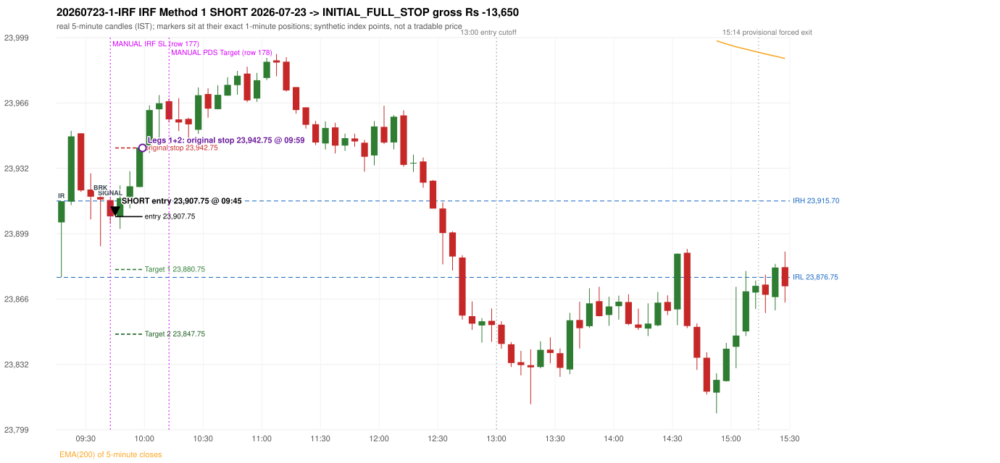
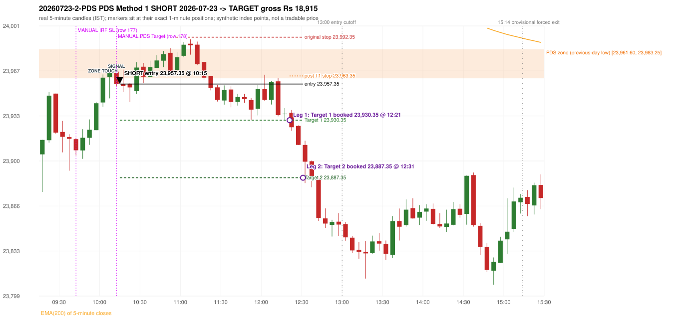

# Trading journal - 2026-07-23 (Thursday)

> Automated reconstruction of the Phase 3.5 combined backtest: the Phase 3.0 controller, stops, targets and sizing with PDR = the Phase 3.4 revised engine (provisional pattern thresholds and open-above-zone assumption, NOT approved by the strategy author). Synthetic NIFTY 50 index-point P&L (the index is not tradable). The owner's review status is intentionally blank.

## A. Trading day overview

| item | value |
|---|---|
| Date / weekday | 2026-07-23 / Thursday |
| Session type | USABLE_WITH_FLAGS / VALID |
| Original session open (first 1-minute open) | 23,904.80 |
| Previous session | 2026-07-22 |
| Previous-day high / low | 24,164.65 / 23,961.60 |
| Previous-day official close / last 5-minute close | 23,996.25 / 23,991.05 |
| Raw engine records / confirmed signals / fully valid signals | 13 / 9 / 9 |
| Setups that did not complete (invalidated / incomplete) | 4 |
| Executed trades | 2 20260723-1-IRF;20260723-2-PDS |
| Gross P&L (Rs, synthetic) | 5,265.00 |
| Illustrative net P&L (Rs; Rs 500/trade + 0.5 pt/fill) | 3,485.00 |
| Day-end portfolio status | DAY_FINISHED |
| Manual journal trades (matched / unmatched) | 2 (2 / 0) |
| Extra automated trades | 0 |

## B. Daily strategy signal timeline (confirmed signals, chronological)

| time | strategy | method | dir | entry-rule status | valid for execution | <= 13:00 | portfolio state | accepted / ignored | specific reason | competing (same minute) |
|---|---|---|---|---|---|---|---|---|---|---|
| 09:45 | IRF | Method 1 | SHORT | PROPOSAL_DEPENDENT | True | True | FIRST_TRADE_ACTIVE | ACCEPTED -> 20260723-1-IRF | first eligible signal of the day; trade 1: INITIAL_FULL_STOP |  |
| 10:15 | PDS | Method 1 | SHORT | PROPOSAL_DEPENDENT | True | True | SECOND_TRADE_ACTIVE | ACCEPTED -> 20260723-2-PDS | permitted second trade: newly confirmed PDR/PDS after the original full stop; trade 2: TARGET |  |
| 10:20 | PDS | Method 2 | SHORT | PROPOSAL_DEPENDENT | True | True | SECOND_TRADE_ACTIVE | IGNORED | POSITION_ACTIVE (signal kept for diagnostics only; never reused) [blocked by PDS#2] |  |
| 11:20 | IRF | Method 2A | SHORT | PROPOSAL_DEPENDENT | True | True | SECOND_TRADE_ACTIVE | IGNORED | POSITION_ACTIVE (signal kept for diagnostics only; never reused) [blocked by PDS#2] | PDS Method 3 SHORT |
| 11:20 | PDS | Method 3 | SHORT | PROPOSAL_DEPENDENT | True | True | SECOND_TRADE_ACTIVE | IGNORED | POSITION_ACTIVE (signal kept for diagnostics only; never reused) [blocked by PDS#2] | IRF Method 2A SHORT |
| 11:25 | PDS | Method 1 | SHORT | PROPOSAL_DEPENDENT | True | True | SECOND_TRADE_ACTIVE | IGNORED | POSITION_ACTIVE (signal kept for diagnostics only; never reused) [blocked by PDS#2] |  |
| 12:05 | IRF | Method 2B | SHORT | PROPOSAL_DEPENDENT | True | True | SECOND_TRADE_ACTIVE | IGNORED | POSITION_ACTIVE (signal kept for diagnostics only; never reused) [blocked by PDS#2] |  |
| 12:30 | IRF | Method 1 | SHORT | PROPOSAL_DEPENDENT | True | True | SECOND_TRADE_ACTIVE | IGNORED | POSITION_ACTIVE (signal kept for diagnostics only; never reused) [blocked by PDS#2] |  |
| 13:05 | PDS | Method 3 | SHORT | PROPOSAL_DEPENDENT | True | False | DAY_FINISHED | IGNORED | DAY_FINISHED [blocked by PDS#2] |  |

Engine setups that did not complete (4); the complete list with failed rule ids is in `rejected_signals.csv`:

| candle | strategy | method | dir | status | precise reason | failed rules |
|---|---|---|---|---|---|---|
| 12:00 | IRF | Method 1/2 | SHORT | INCOMPLETE_AT_EOD | SESSION_ENDED_BEFORE_CONFIRMATION |  |
| 09:15 | ORB | Method 1 | SHORT | INVALIDATED | CANDLE_QUALITY(not a strong body / wick too large) | ORB-M1-SHORT-003 |
| 09:15 | ORB | Method 2 | SHORT | INVALIDATED | TRENDLINE_NOT_SUPPORTIVE | ORB-M2-SHORT-001 |
| 14:30 | RF | RF | LONG | INVALIDATED | TREND:EMA_PREV_SESSION_CLOSE wrong side | RF-001;RF-008 |

## C. Detailed trade journals

### 20260723-1-IRF: IRF Method 1 SHORT (FIRST trade)

Chart: 

**Rule configuration:** CFG-phase35_combined-1a0f4fca27 - signal verification status **PROPOSAL_DEPENDENT** (never VERIFIED while a rule rests on a proposal).

#### 1. Setup identification

IRF Method 1 SHORT: the completed 09:35 candle closed at 23,916.45, 0.75 points above the initial range high 23,915.70 (range [23,876.75, 23,915.70] from the 09:15 candle); the immediately following completed 09:40 candle closed at 23,907.85, back inside the range. The short signal was confirmed at 09:45 on that close. Entry reference close 23,907.85 is 7.85 points below IRH 23,915.70.

#### 2. Candle and indicator calculations

| role | session | candle | O | H | L | C | range | body % | upper wick % | lower wick % | direction | EMA(200) | strong bull / bear | pin bull / bear | small (body<=30%) | used for |
|---|---|---|---|---|---|---|---|---|---|---|---|---|---|---|---|---|
| initial_range_candle | TODAY | 09:15-09:20 | 23,904.80 | 23,915.70 | 23,876.75 | 23,915.60 | 38.95 | 27.73 | 0.26 | 72.02 | BULLISH | 24,091.12 | False / False | True / False | True | initial range = high/low of the 09:15 candle |
| signal_candle | TODAY | 09:40-09:45 | 23,916.15 | 23,917.20 | 23,904.05 | 23,907.85 | 13.15 | 63.12 | 7.98 | 28.90 | BEARISH | 24,082.89 | False / False | False / False | False | candle whose close completed the trigger |
| breakout_candle | TODAY | 09:35-09:40 | 23,917.70 | 23,919.85 | 23,892.60 | 23,916.45 | 27.25 | 4.59 | 7.89 | 87.52 | BEARISH | 24,084.65 | False / False | True / False | True | breakout candle: a completed candle closing above IRH |

Every condition, with the rule, the calculation, the observed values and the result:

| # | group | rule | result | status / numeric definition | calculation | observed | required | available at | why it matters |
|---|---|---|---|---|---|---|---|---|---|
| 1 | SELECTION | SEL-FIRST-001 | PASS | USER_APPROVED / USER_APPROVED | earliest CONFIRMED signal of the day across IRF/ORB/PDR/PDS/RF that passed the controller's checks | 0 confirmed signal(s) earlier today; 9 confirmed signals in the day in total, this one at 09:45 | no earlier executable signal | 2026-07-23 09:45 | the shared controller trades only the first valid signal; the five strategies are not independent positions |
| 2 | SELECTION | SEL-TIE-001 | PASS | USER_APPROVED / USER_APPROVED | other CONFIRMED signals with exactly the same confirmation timestamp | none | no different-strategy / opposite-direction signal in the same minute (otherwise an unresolved conflict, no trade) | 2026-07-23 09:45 | an unresolved same-minute collision would have produced no trade at all |
| 3 | SELECTION | ENTRY-CUTOFF-001 | PASS | USER_APPROVED / USER_APPROVED | fill timestamp vs 13:00:00 IST | signal confirmed 09:45; fill 09:45 | fill at or before 13:00:00 IST | 2026-07-23 09:45 | no new position may be entered with a fill after 13:00 IST |
| 4 | SELECTION | EXE-FILL-001 | PASS | PROPOSED_FOR_REVIEW / PROPOSED_FOR_REVIEW | fill = open of the 1-minute bar that starts at the signal candle's end | bar 09:45 O 23,907.75 H 23,923.60 L 23,907.40 C 23,918.20; executable=True; entry 23,907.75 | fill bar exists, starts exactly at the signal end, is fillable; entry = its open | 2026-07-23 09:45 | a 5-minute signal is known only when its candle closes; the first price that can be traded is the next minute's open |
| 5 | SELECTION | DAY-MAX-001 | PASS | USER_APPROVED / USER_APPROVED | number of entries today | trade 1 of at most 2 | <= 2 entries per day | 2026-07-23 09:45 | daily trade cap |
| 6 | SETUP | IRF-GLOBAL-001 | PASS | SOURCE_VERIFIED / EXPLICIT_IN_SOURCE | initial range = high and low (wicks included) of the first completed 5-minute candle | 09:15-09:20 IRH 23,915.70, IRL 23,876.75 (range 38.95; engine recorded IRH 23,915.70, IRL 23,876.75) | high/low of the 09:15-09:20 candle | 2026-07-23 09:20 | all three IRF methods measure price against this range |
| 7 | SETUP | IRF-GLOBAL-003 | PASS | SOURCE_VERIFIED / EXPLICIT_IN_SOURCE | closes confirm, wicks do not: every trigger is evaluated on a completed 5-minute candle | trigger candle 09:40-09:45 was complete when the signal was stamped 09:45; decision uses its close 23,907.85 | completed candle close, not an intra-candle wick | 2026-07-23 09:45 | an intra-candle wick can reverse before the candle closes |
| 8 | SETUP | IRF-GLOBAL-002 | PASS | SOURCE_VERIFIED / EXPLICIT_IN_SOURCE | direction | SHORT (IRF trades short only) | short only | 2026-07-23 09:45 | IRF fades failed upside breakouts |
| 9 | SETUP | IRF-M1-001 | PASS | SOURCE_VERIFIED / EXPLICIT_IN_SOURCE | breakout candle close vs IRH | 09:35-09:40 O 23,917.70 H 23,919.85 L 23,892.60 C 23,916.45; range 27.25, body 1.25 (4.59%), upper wick 2.15 (7.89%), lower wick 23.85 (87.52%), bearish; close 23,916.45 is 0.75 points above IRH 23,915.70 | close > IRH (a wick above IRH is not a breakout) | 2026-07-23 09:40 | starts every IRF setup |
| 10 | CONFIRMATION | IRF-M1-002 | PASS | SOURCE_VERIFIED / EXPLICIT_IN_SOURCE | candle after the breakout closes back inside [IRL, IRH) | 09:40-09:45 O 23,916.15 H 23,917.20 L 23,904.05 C 23,907.85; range 13.15, body 8.30 (63.12%), upper wick 1.05 (7.98%), lower wick 3.80 (28.90%), bearish; close 23,907.85 vs range [23,876.75, 23,915.70) | IRL <= close < IRH | 2026-07-23 09:45 | the failed breakout: price could not hold above the opening range |
| 11 | CONFIRMATION | IRF-M1-004 | PASS | SOURCE_VERIFIED / EXPLICIT_IN_SOURCE | failure candle is the candle immediately after the breakout (k = 1) | breakout 09:35, failure candle 09:40: k = 1 | k = 1 (pp.5, 6, 13); the p.14 'next or following' reading (IRF-M1-C001) is CONFLICTING and not used in the baseline | 2026-07-23 09:45 | the guide's worked example enters at the close of the very next candle; no support/resistance break is required |
| 12 | EXECUTION | EXE-STOP-001 | PASS | USER_APPROVED / USER_APPROVED | initial stop = entry + 35 points | entry 23,907.75 -> stop 23,942.75 | stop 35 index points (BASELINE) | 2026-07-23 09:45 | defines the loss if the setup fails before Target 1 |
| 13 | EXECUTION | EXE-T1-001 | PASS | SOURCE_VERIFIED / EXPLICIT_IN_SOURCE | Target 1 = entry +/- 27 points | T1 23,880.75 | 27 points | 2026-07-23 09:45 | Leg 1 (3 lots) is booked at Target 1 |
| 14 | EXECUTION | IRF-TGT-001 | PASS | SOURCE_VERIFIED / EXPLICIT_IN_SOURCE | Target 2 = entry +/- 60 points | T2 23,847.75 | 60 points | 2026-07-23 09:45 | Leg 2 (3 lots) is booked at Target 2 |
| 15 | EXECUTION | POST-T1-STOP-006 | PASS | USER_APPROVED / USER_APPROVED | after T1 the Leg-2 stop = entry + 6 (no trailing) | post-T1 stop 23,913.75 | entry -6 (LONG) / +6 (SHORT) | 2026-07-23 09:45 | protects the remaining three lots once the first three are booked |
| 16 | EXECUTION | SIZE-LOT-001 | PASS | USER_APPROVED / USER_APPROVED | 6 lots x 65 = 390, Leg 1 = 3 lots = 195, Leg 2 = 195 | 6 lots, lot size 65, legs 3+3 | 6 lots in two equal legs | 2026-07-23 09:45 | position size for the synthetic P&L |
| 17 | NOTE | IRF-GLOBAL-004 | UNRESOLVED | UNRESOLVED / UNRESOLVED | which close above IRH of the session produced this attempt; repeat setups | this breakout is upward crossing no. 1 of the session (a close above IRH after a close at/below it) | the source states no first-breakout-only, re-arming, expiry or trades-per-day rule | 2026-07-23 09:45 | IRF re-arms on every later breakout in the code, producing many raw setups; the controller keeps only the first |
| 18 | NOTE | NOTE-IRF-REPEATED-SETUPS | NOT_APPLICABLE | NOT_A_RULE / NOT_A_REGISTRY_RULE | other IRF signals later in the session (not traded) | 3 further confirmed IRF signal(s): Method 2A@11:20, Method 2B@12:05, Method 1@12:30 | disclosure of repeated raw setups | 2026-07-23 09:45 | repeated raw IRF setups are not hidden; they are logged as ignored |
| 19 | NOTE | IRF-SL-001 | NOT_APPLICABLE | SOURCE_VERIFIED / QUALITATIVE_SOURCE_NUMERIC_DEFINITION_PROPOSED_FOR_REVIEW | the guide's 35-or-40 rule: 35 if the most recent green candle's high is within 35 points of entry, else 40 | most recent green candle high 23,951.50 is 43.75 points from the entry 23,907.75: the guide's rule would select 40 points; the baseline applies a fixed 35 (USER_APPROVED research baseline; the 35-vs-40 selection and the 40-point variant are separate labelled scenarios) | source selection rule | 2026-07-23 09:45 | the stop distance is a modelling choice and changes losses, not entries |
| 20 | NOTE | NOTE-UNRESOLVED-DEPENDENCIES | UNRESOLVED | NOT_A_RULE / NOT_A_REGISTRY_RULE | rules the signal depends on that the sources leave unresolved | engine-recorded unresolved rule ids: IRF-GLOBAL-004; verification status PROPOSAL_DEPENDENT | n/a (disclosure) | 2026-07-23 09:45 | the entry is only as verified as the rules it rests on |

#### 3. Entry decision and explanation

IRF Method 1 SHORT: the completed 09:35 candle closed at 23,916.45, 0.75 points above the initial range high 23,915.70 (range [23,876.75, 23,915.70] from the 09:15 candle); the immediately following completed 09:40 candle closed at 23,907.85, back inside the range. The short signal was confirmed at 09:45 on that close. Entry reference close 23,907.85 is 7.85 points below IRH 23,915.70.

**Why this trade ahead of the other strategies:** This IRF Method 1 signal was the earliest executable signal of the day: 0 confirmed signal(s) earlier, 0 other in the same minute. 8 later confirmed signal(s) (IRF x3, PDS x5) are logged as ignored or rejected. State of the other four engines at that moment: [ORB: Method 1 invalidated at 09:15: CANDLE_QUALITY(not a strong body / wick too large); Method 2 invalidated at 09:15: TRENDLINE_NOT_SUPPORTIVE] [PDR: no setup record before this time (a base condition was not met, or nothing triggered)] [PDS: no setup record before this time (a base condition was not met, or nothing triggered)] [RF: no setup record before this time (a base condition was not met, or nothing triggered)]

#### 4. Actual entry execution

| item | value |
|---|---|
| Signal candle | 09:40-09:45 |
| Signal confirmed | 2026-07-23 09:45 |
| Fill timestamp | 2026-07-23 09:45 |
| Entry price | 23,907.75 |
| Source partition / 1-minute bar | data/processed/nifty50/year=2026/month=07/candles.parquet / 2026-07-23 09:45 |
| Source bar O / H / L / C | 23,907.75 / 23,923.60 / 23,907.40 / 23,918.20 |
| Fill assumption | open of the 1-minute bar starting at the signal candle's end (EXE-FILL-001, PROPOSED causal convention) |
| Initial stop / T1 / T2 / post-T1 stop | 23,942.75 / 23,880.75 / 23,847.75 / 23,913.75 |
| Position | 6 lots x 65 = 390 units (Leg 1 195, Leg 2 195) |

#### 5-8. Trade progress, Target 1, post-T1 stop and final exit

Between the 09:45 entry bar and the final exit (15 one-minute bars) the best excursion in favour was 6.30 points at 09:48 and the worst against was 36.25 points at 09:59. At 09:59 price reached the original stop 23,942.75 before Target 1 23,880.75, so all six lots exited together at 23,942.75. This is an INITIAL_FULL_STOP: one more trade is allowed that day, only a newly confirmed PDR/PDS signal.

| leg | qty | exit time | exit price | reason | source 1-minute bar | O / H / L / C | gross points | gross Rs | slippage pts | flags |
|---|---|---|---|---|---|---|---|---|---|---|
| 1 | 195 | 09:59 | 23,942.75 | ORIGINAL_STOP_BEFORE_T1 | 09:59 | 23,937.55 / 23,944.00 / 23,935.70 / 23,942.95 | -35.00 | -6,825.00 | 0.00 |  |
| 2 | 195 | 09:59 | 23,942.75 | ORIGINAL_STOP_BEFORE_T1 | 09:59 | 23,937.55 / 23,944.00 / 23,935.70 / 23,942.95 | -35.00 | -6,825.00 | 0.00 |  |

Exit evidence per leg:

* Leg 1: 1-minute bar 09:59 O 23,937.55 H 23,944.00 L 23,935.70 C 23,942.95: high 23,944.00 reached the original stop 23,942.75 before Target 1 23,880.75 was touched; both legs exit at the stop level 23,942.75
* Leg 2: 1-minute bar 09:59 O 23,937.55 H 23,944.00 L 23,935.70 C 23,942.95: high 23,944.00 reached the original stop 23,942.75 before Target 1 23,880.75 was touched; both legs exit at the stop level 23,942.75

#### 9. Gross and illustrative net P&L

| item | value (Rs) |
|---|---|
| Leg 1 gross | -6,825.00 |
| Leg 2 gross | -6,825.00 |
| Trade gross (= Leg 1 + Leg 2) | -13,650.00 |
| Illustrative fixed cost | -500.00 |
| Illustrative slippage (0.5 pt on every fill, entry + exits, all units) | -390.00 |
| Illustrative net | -14,540.00 |

#### 10. Manual journal comparison

EXACT_MATCH: manual IRF labelled 09:40 (candle start) vs automated IRF Method 1 SHORT candle 09:40, filled 09:45 at 23,907.75; time difference 0 minutes. Journal outcome SL vs automated INITIAL_FULL_STOP (same outcome class). The journal records no entry or exit price.

### 20260723-2-PDS: PDS Method 1 SHORT (SECOND trade)

Chart: 

**Rule configuration:** CFG-phase35_combined-1a0f4fca27 - signal verification status **PROPOSAL_DEPENDENT** (never VERIFIED while a rule rests on a proposal).

#### 1. Setup identification

PDS Method 1 SHORT: the session opened 56.80 points below the previous-day-low zone [23,961.60, 23,983.25]; price rose to the zone at 10:00 and the first red candle at the zone (10:10, close 23,957.35) had a good body; confirmed 10:15.

#### 2. Candle and indicator calculations

| role | session | candle | O | H | L | C | range | body % | upper wick % | lower wick % | direction | EMA(200) | strong bull / bear | pin bull / bear | small (body<=30%) | used for |
|---|---|---|---|---|---|---|---|---|---|---|---|---|---|---|---|---|
| zone_source_candle | PREVIOUS | 12:40-12:45 | 23,965.95 | 23,983.40 | 23,961.60 | 23,983.25 | 21.80 | 79.36 | 0.69 | 19.95 | BULLISH | 24,134.06 | True / False | False / False | False | previous-day low candle that defines the zone (A_LOWEST_LOW) |
| zone_retest_candle | TODAY | 10:00-10:05 | 23,943.55 | 23,964.50 | 23,940.25 | 23,962.10 | 24.25 | 76.49 | 9.90 | 13.61 | BULLISH | 24,077.15 | True / False | False / False | False | first candle whose range reaches the zone from below |
| signal_candle | TODAY | 10:10-10:15 | 23,966.60 | 23,968.00 | 23,955.75 | 23,957.35 | 12.25 | 75.51 | 11.43 | 13.06 | BEARISH | 24,074.86 | False / True | False / False | False | trigger candle |

Every condition, with the rule, the calculation, the observed values and the result:

| # | group | rule | result | status / numeric definition | calculation | observed | required | available at | why it matters |
|---|---|---|---|---|---|---|---|---|---|
| 1 | SELECTION | DAY-SL-001 | PASS | USER_APPROVED / USER_APPROVED | first trade outcome, strategy of this signal, position-close time vs this signal's timestamp | first trade IRF Method 1 closed as INITIAL_FULL_STOP at 09:59; position free from 10:00; this PDS signal confirmed 10:15 | first trade INITIAL_FULL_STOP before Target 1, and a NEWLY confirmed PDR/PDS signal after the first position closed | 2026-07-23 10:15 | the only way a second trade is allowed |
| 2 | SELECTION | DAY-NOREUSE-001 | PASS | USER_APPROVED / USER_APPROVED | signals confirmed while the first position was open | 1 signal(s) were ignored during the first trade (never reused): IRF Method 1 SHORT @09:45 | this trade comes from a signal confirmed after the first exit, not from an ignored one | 2026-07-23 10:15 | an ignored signal can never become the second trade |
| 3 | SELECTION | ENTRY-CUTOFF-001 | PASS | USER_APPROVED / USER_APPROVED | fill timestamp vs 13:00:00 IST | signal confirmed 10:15; fill 10:15 | fill at or before 13:00:00 IST | 2026-07-23 10:15 | no new position may be entered with a fill after 13:00 IST |
| 4 | SELECTION | EXE-FILL-001 | PASS | PROPOSED_FOR_REVIEW / PROPOSED_FOR_REVIEW | fill = open of the 1-minute bar that starts at the signal candle's end | bar 10:15 O 23,957.35 H 23,958.25 L 23,951.30 C 23,955.55; executable=True; entry 23,957.35 | fill bar exists, starts exactly at the signal end, is fillable; entry = its open | 2026-07-23 10:15 | a 5-minute signal is known only when its candle closes; the first price that can be traded is the next minute's open |
| 5 | SELECTION | DAY-MAX-001 | PASS | USER_APPROVED / USER_APPROVED | number of entries today | trade 2 of at most 2 | <= 2 entries per day | 2026-07-23 10:15 | daily trade cap |
| 6 | SETUP | PDS-003 | PASS | SOURCE_VERIFIED / EXPLICIT_WORDING_DETAIL_PROPOSED_FOR_REVIEW | gap = first 1-minute open of today - previous session's OFFICIAL close | today's open 23,904.80 (first 1-minute bar 09:15) - previous close 23,996.25 (DAILY_VENDOR, 2026-07-22) = -91.45 points -> gap DOWN | gap DOWN (more than 0 points) | 2026-07-23 09:15 | approved convention: the original first-minute open, never the vendor daily open |
| 7 | SETUP | PDS-006 | PASS | SOURCE_VERIFIED / QUALITATIVE_SOURCE_NUMERIC_DEFINITION_PROPOSED_FOR_REVIEW | gap-down open below the zone | today's open 23,904.80 vs zone low 23,961.60: 56.80 points below | open < zone low | 2026-07-23 09:15 | the guide: 'price is trading below the previous day's support zone' after the gap; a PROPOSED strict reading |
| 8 | SETUP | PDS-004 | PASS | SOURCE_VERIFIED / EXPLICIT_IN_SOURCE | PDS is not a breakdown strategy: the zone must be tested from below first | open 23,904.80 below the zone floor 23,961.60; the first candle to reach the zone is 10:00 | price rises to the zone before any short | 2026-07-23 09:15 | a short below the level without a retest is not this strategy |
| 9 | SETUP | PDS-005 | PASS | SOURCE_VERIFIED / QUALITATIVE_SOURCE_NUMERIC_DEFINITION_PROPOSED_FOR_REVIEW | price comes up to the zone: first candle whose [low, high] intersects it (+/- proximity) | 10:00-10:05 O 23,943.55 H 23,964.50 L 23,940.25 C 23,962.10; range 24.25, body 18.55 (76.49%), upper wick 2.40 (9.90%), lower wick 3.30 (13.61%), bullish; high 23,964.50 vs zone low 23,961.60 | range intersects the zone | 2026-07-23 10:05 | PDS is not a breakdown strategy: the zone must be tested from below first |
| 10 | ZONE | PDS-001 | PASS | SOURCE_VERIFIED / EXPLICIT_IN_SOURCE | direction | SHORT (PDS is short only) | short-only | 2026-07-23 10:15 | PDS sells a retest of previous-day support from below |
| 11 | ZONE | PDS-002 | PASS | SOURCE_VERIFIED / QUALITATIVE_SOURCE_NUMERIC_DEFINITION_PROPOSED_FOR_REVIEW | zone = [lowest low, body top] of the previous session's absolute-low candle (method A_LOWEST_LOW; the lower wick is part of the zone) | zone [23,961.60, 23,983.25] from the 12:40 candle of 2026-07-22 (12:40-12:45 O 23,965.95 H 23,983.40 L 23,961.60 C 23,983.25; range 21.80, body 17.30 (79.36%), upper wick 0.15 (0.69%), lower wick 4.35 (19.95%), bullish); engine recorded [23,961.60, 23,983.25] | previous trading day's low where price took support (body + lower wick) | 2026-07-22 12:45 | the reference level of the strategy; the exact candle(s) are a research choice (PDS-ZONE-002) |
| 12 | CONFIRMATION | PDS-M-001 | PASS | SOURCE_VERIFIED / QUALITATIVE_SOURCE_NUMERIC_DEFINITION_PROPOSED_FOR_REVIEW | Methods 1/2 apply to the FIRST red candle at the zone | first red candle at the zone: 10:10; signal candle 10:10 | the trigger is the first red candle at the zone | 2026-07-23 10:15 | a later red candle would only qualify through Method 3 |
| 13 | CONFIRMATION | PDS-M1-001 | PASS | SOURCE_VERIFIED / QUALITATIVE_SOURCE_NUMERIC_DEFINITION_PROPOSED_FOR_REVIEW | good red candle: bearish close, body >= 60% of range, lower wick <= 20% of range | 10:10-10:15 O 23,966.60 H 23,968.00 L 23,955.75 C 23,957.35; range 12.25, body 9.25 (75.51%), upper wick 1.40 (11.43%), lower wick 1.60 (13.06%), bearish -> body 75.51% / lower wick 13.06% | strong bearish candle (research thresholds) | 2026-07-23 10:15 | the guide: 'a red candle with a good body' - body size is explicitly not numerically defined |
| 14 | EXECUTION | EXE-STOP-001 | PASS | USER_APPROVED / USER_APPROVED | initial stop = entry + 35 points | entry 23,957.35 -> stop 23,992.35 | stop 35 index points (BASELINE) | 2026-07-23 10:15 | defines the loss if the setup fails before Target 1 |
| 15 | EXECUTION | EXE-T1-001 | PASS | SOURCE_VERIFIED / EXPLICIT_IN_SOURCE | Target 1 = entry +/- 27 points | T1 23,930.35 | 27 points | 2026-07-23 10:15 | Leg 1 (3 lots) is booked at Target 1 |
| 16 | EXECUTION | PDS-TGT-001 | PASS | SOURCE_VERIFIED / EXPLICIT_IN_SOURCE | Target 2 = entry +/- 70 points | T2 23,887.35 (the guide says 70; the report suggests 60 - CONFLICTING) | 70 points | 2026-07-23 10:15 | Leg 2 (3 lots) is booked at Target 2 |
| 17 | EXECUTION | POST-T1-STOP-006 | PASS | USER_APPROVED / USER_APPROVED | after T1 the Leg-2 stop = entry + 6 (no trailing) | post-T1 stop 23,963.35 | entry -6 (LONG) / +6 (SHORT) | 2026-07-23 10:15 | protects the remaining three lots once the first three are booked |
| 18 | EXECUTION | SIZE-LOT-001 | PASS | USER_APPROVED / USER_APPROVED | 6 lots x 65 = 390, Leg 1 = 3 lots = 195, Leg 2 = 195 | 6 lots, lot size 65, legs 3+3 | 6 lots in two equal legs | 2026-07-23 10:15 | position size for the synthetic P&L |
| 19 | NOTE | PDS-007 | NOT_APPLICABLE | PROPOSED_FOR_REVIEW / PROPOSED_FOR_REVIEW | repeated PDS signals today | 5 confirmed PDS signal(s) in the session | n/a (disclosure) | 2026-07-23 10:15 | the per-session cap is lifted for the controller runs; the controller trades only the first (or the permitted second) trade |
| 20 | NOTE | PDS-SL-001 | NOT_APPLICABLE | SOURCE_VERIFIED / QUALITATIVE_SOURCE_NUMERIC_DEFINITION_PROPOSED_FOR_REVIEW | the guide's 35-or-40 rule: 35 if the most recent green candle's high is within 35 points of entry, else 40 | most recent green candle high 23,969.75 is 12.40 points from the entry 23,957.35: the guide's rule would select 35 points; the baseline applies a fixed 35 (USER_APPROVED research baseline; the 35-vs-40 selection and the 40-point variant are separate labelled scenarios) | source selection rule | 2026-07-23 10:15 | the stop distance is a modelling choice and changes losses, not entries |
| 21 | NOTE | NOTE-UNRESOLVED-DEPENDENCIES | NOT_APPLICABLE | NOT_A_RULE / NOT_A_REGISTRY_RULE | rules the signal depends on that the sources leave unresolved | engine-recorded unresolved rule ids: none; verification status PROPOSAL_DEPENDENT | n/a (disclosure) | 2026-07-23 10:15 | the entry is only as verified as the rules it rests on |

#### 3. Entry decision and explanation

PDS Method 1 SHORT: the session opened 56.80 points below the previous-day-low zone [23,961.60, 23,983.25]; price rose to the zone at 10:00 and the first red candle at the zone (10:10, close 23,957.35) had a good body; confirmed 10:15.

**Why this trade ahead of the other strategies:** The first trade (IRF Method 1) was stopped out before Target 1 at 09:59; this newly confirmed PDS signal at 10:15 is the first PDR/PDS signal after that exit, so it is the day's permitted second trade. State of the other engines at that moment: [IRF: 1 confirmed signal(s) up to this time (Method 1@09:45)] [ORB: Method 1 invalidated at 09:15: CANDLE_QUALITY(not a strong body / wick too large); Method 2 invalidated at 09:15: TRENDLINE_NOT_SUPPORTIVE] [PDR: no setup record before this time (a base condition was not met, or nothing triggered)] [RF: no setup record before this time (a base condition was not met, or nothing triggered)]

#### 4. Actual entry execution

| item | value |
|---|---|
| Signal candle | 10:10-10:15 |
| Signal confirmed | 2026-07-23 10:15 |
| Fill timestamp | 2026-07-23 10:15 |
| Entry price | 23,957.35 |
| Source partition / 1-minute bar | data/processed/nifty50/year=2026/month=07/candles.parquet / 2026-07-23 10:15 |
| Source bar O / H / L / C | 23,957.35 / 23,958.25 / 23,951.30 / 23,955.55 |
| Fill assumption | open of the 1-minute bar starting at the signal candle's end (EXE-FILL-001, PROPOSED causal convention) |
| Initial stop / T1 / T2 / post-T1 stop | 23,992.35 / 23,930.35 / 23,887.35 / 23,963.35 |
| Position | 6 lots x 65 = 390 units (Leg 1 195, Leg 2 195) |

#### 5-8. Trade progress, Target 1, post-T1 stop and final exit

Between the 10:15 entry bar and the final exit (137 one-minute bars) the best excursion in favour was 74.00 points at 12:31 and the worst against was 33.35 points at 11:05. At 12:21 price reached Target 1 23,930.35 and three lots exited. At 12:21 the remaining three lots' protective stop was set to 23,963.35 (entry + 6; no trailing, no further change); the engine applies it from the Target-1 bar onward and tests it within that same bar. At 12:31 price reached Target 2 23,887.35 and the remaining three lots exited. No further trade that day (DAY-T2-001).

| leg | qty | exit time | exit price | reason | source 1-minute bar | O / H / L / C | gross points | gross Rs | slippage pts | flags |
|---|---|---|---|---|---|---|---|---|---|---|
| 1 | 195 | 12:21 | 23,930.35 | TARGET_1 | 12:21 | 23,933.85 / 23,934.65 / 23,928.15 / 23,929.50 | 27.00 | 5,265.00 | 0.00 |  |
| 2 | 195 | 12:31 | 23,887.35 | TARGET_2 | 12:31 | 23,895.50 / 23,895.50 / 23,883.35 / 23,892.25 | 70.00 | 13,650.00 | 0.00 |  |

Exit evidence per leg:

* Leg 1: 1-minute bar 12:21 O 23,933.85 H 23,934.65 L 23,928.15 C 23,929.50: low 23,928.15 reached Target 1 23,930.35; Leg 1 booked at the target level
* Leg 2: 1-minute bar 12:31 O 23,895.50 H 23,895.50 L 23,883.35 C 23,892.25: low 23,883.35 reached Target 2 23,887.35; Leg 2 booked at the target level

#### 9. Gross and illustrative net P&L

| item | value (Rs) |
|---|---|
| Leg 1 gross | 5,265.00 |
| Leg 2 gross | 13,650.00 |
| Trade gross (= Leg 1 + Leg 2) | 18,915.00 |
| Illustrative fixed cost | -500.00 |
| Illustrative slippage (0.5 pt on every fill, entry + exits, all units) | -390.00 |
| Illustrative net | 18,025.00 |

#### 10. Manual journal comparison

EXACT_MATCH: manual PDS labelled 10:10 (candle start) vs automated PDS Method 1 SHORT candle 10:10, filled 10:15 at 23,957.35; time difference 0 minutes. Journal outcome Target vs automated TARGET (same outcome class). The journal records no entry or exit price.

## D. Manual journal comparison

| comparison | journal row | journal strategy | manual time | manual direction | manual outcome | match class | trade | auto entry | auto outcome | explanation |
|---|---|---|---|---|---|---|---|---|---|---|
| M177 | 177 | IRF | 09:40 | SHORT | SL | EXACT_MATCH | 20260723-1-IRF | 09:45 @ 23,907.75 | INITIAL_FULL_STOP | EXACT_MATCH: manual IRF labelled 09:40 (candle start) vs automated IRF Method 1 SHORT candle 09:40, filled 09:45 at 23,907.75; time difference 0 minutes. Journal outcome SL vs automated INITIAL_FULL_STOP (same outcome class). The journal records no entry or exit price. |
| M178 | 178 | PDS | 10:10 | SHORT | Target | EXACT_MATCH | 20260723-2-PDS | 10:15 @ 23,957.35 | TARGET | EXACT_MATCH: manual PDS labelled 10:10 (candle start) vs automated PDS Method 1 SHORT candle 10:10, filled 10:15 at 23,957.35; time difference 0 minutes. Journal outcome Target vs automated TARGET (same outcome class). The journal records no entry or exit price. |

The journal records no entry price and no exit price (NOT_RECORDED); matching uses date, strategy and candle start only - never P&L.

## E. Daily conclusion

* **Traded:** 20260723-1-IRF - IRF Method 1 SHORT at 09:45 (entry 23,907.75), outcome INITIAL_FULL_STOP, gross Rs -13,650.00, illustrative net Rs -14,540.00. **Why:** This IRF Method 1 signal was the earliest executable signal of the day: 0 confirmed signal(s) earlier, 0 other in the same minute. 8 later confirmed signal(s) (IRF x3, PDS x5) are logged as ignored or rejected. State of the other four engines at that moment: [ORB: Method 1 invalidated at 09:15: CANDLE_QUALITY(not a strong body / wick too large); Method 2 invalidated at 09:15: TRENDLINE_NOT_SUPPORTIVE] [PDR: no setup record before this time (a base condition was not met, or nothing triggered)] [PDS: no setup record before this time (a base condition was not met, or nothing triggered)] [RF: no setup record before this time (a base condition was not met, or nothing triggered)] **How it ended:** At 09:59 price reached the original stop 23,942.75 before Target 1 23,880.75, so all six lots exited together at 23,942.75. This is an INITIAL_FULL_STOP: one more trade is allowed that day, only a newly confirmed PDR/PDS signal.
* **Traded:** 20260723-2-PDS - PDS Method 1 SHORT at 10:15 (entry 23,957.35), outcome TARGET, gross Rs 18,915.00, illustrative net Rs 18,025.00. **Why:** The first trade (IRF Method 1) was stopped out before Target 1 at 09:59; this newly confirmed PDS signal at 10:15 is the first PDR/PDS signal after that exit, so it is the day's permitted second trade. State of the other engines at that moment: [IRF: 1 confirmed signal(s) up to this time (Method 1@09:45)] [ORB: Method 1 invalidated at 09:15: CANDLE_QUALITY(not a strong body / wick too large); Method 2 invalidated at 09:15: TRENDLINE_NOT_SUPPORTIVE] [PDR: no setup record before this time (a base condition was not met, or nothing triggered)] [RF: no setup record before this time (a base condition was not met, or nothing triggered)] **How it ended:** At 12:21 price reached Target 1 23,930.35 and three lots exited. At 12:21 the remaining three lots' protective stop was set to 23,963.35 (entry + 6; no trailing, no further change); the engine applies it from the Target-1 bar onward and tests it within that same bar. At 12:31 price reached Target 2 23,887.35 and the remaining three lots exited. No further trade that day (DAY-T2-001).
* **Ignored / rejected signals:** PDS IGNORED POSITION_ACTIVE x3; IRF IGNORED POSITION_ACTIVE x3; PDS IGNORED DAY_FINISHED x1
* **Open strategy-definition issues that affected this day:** IRF-GLOBAL-004 (NOT STATED: how many IRF trades per day, a latest entry time, and whether a new breakout may re-arm a setup after a signal), NOTE-UNRESOLVED-DEPENDENCIES
* **Automated triage (not an approval; the owner's review status stays blank):** MATCHED_EXACT_NO_FLAGS
