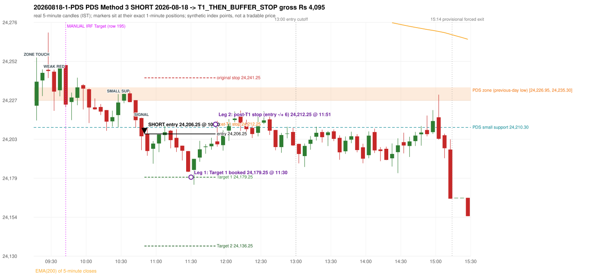

# Trading journal - 2026-08-18 (Tuesday)

> Automated reconstruction of the Phase 3.5 combined backtest: the Phase 3.0 controller, stops, targets and sizing with PDR = the Phase 3.4 revised engine (provisional pattern thresholds and open-above-zone assumption, NOT approved by the strategy author). Synthetic NIFTY 50 index-point P&L (the index is not tradable). The owner's review status is intentionally blank.

## A. Trading day overview

| item | value |
|---|---|
| Date / weekday | 2026-08-18 / Tuesday |
| Session type | USABLE_WITH_FLAGS / VALID / CLOSING_AUCTION_REGIME |
| Original session open (first 1-minute open) | 24,223.85 |
| Previous session | 2026-08-17 |
| Previous-day high / low | 24,359.90 / 24,226.95 |
| Previous-day official close / last 5-minute close | 24,287.65 / 24,287.65 |
| Raw engine records / confirmed signals / fully valid signals | 4 / 2 / 1 |
| Setups that did not complete (invalidated / incomplete) | 2 |
| Executed trades | 1 20260818-1-PDS |
| Gross P&L (Rs, synthetic) | 4,095.00 |
| Illustrative net P&L (Rs; Rs 500/trade + 0.5 pt/fill) | 3,205.00 |
| Day-end portfolio status | DAY_FINISHED |
| Manual journal trades (matched / unmatched) | 1 (0 / 1) |
| Extra automated trades | 1 |

## B. Daily strategy signal timeline (confirmed signals, chronological)

| time | strategy | method | dir | entry-rule status | valid for execution | <= 13:00 | portfolio state | accepted / ignored | specific reason | competing (same minute) |
|---|---|---|---|---|---|---|---|---|---|---|
| 10:50 | PDS | Method 3 | SHORT | PROPOSAL_DEPENDENT | True | True | FIRST_TRADE_ACTIVE | ACCEPTED -> 20260818-1-PDS | first eligible signal of the day; trade 1: T1_THEN_BUFFER_STOP |  |
| 15:30 | PDS | Method 3 | SHORT | PROPOSAL_DEPENDENT | False | False | DAY_FINISHED | IGNORED | DAY_FINISHED [blocked by PDS#1] |  |

Engine setups that did not complete (2); the complete list with failed rule ids is in `rejected_signals.csv`:

| candle | strategy | method | dir | status | precise reason | failed rules |
|---|---|---|---|---|---|---|
| 09:15 | ORB | Method 2 | SHORT | INVALIDATED | TRENDLINE_NOT_SUPPORTIVE | ORB-M2-SHORT-001 |
| 10:20 | RF | RF | LONG | INVALIDATED | TREND:EMA_PREV_SESSION_CLOSE wrong side | RF-001;RF-008 |

## C. Detailed trade journals

### 20260818-1-PDS: PDS Method 3 SHORT (FIRST trade)

Chart: 

**Rule configuration:** CFG-phase35_combined-1a0f4fca27 - signal verification status **PROPOSAL_DEPENDENT** (never VERIFIED while a rule rests on a proposal).

#### 1. Setup identification

PDS Method 3 SHORT: the session opened 3.10 points below the previous-day-low zone [24,226.95, 24,235.30]; the first red candle at the zone (09:30) was weak (body 48.35%), so the engine waited for a small support; the 10:25 candle's low 24,210.30 (16.65 points below the zone floor) was broken by the close of the 10:45 candle (24,204.75); confirmed 10:50.

#### 2. Candle and indicator calculations

| role | session | candle | O | H | L | C | range | body % | upper wick % | lower wick % | direction | EMA(200) | strong bull / bear | pin bull / bear | small (body<=30%) | used for |
|---|---|---|---|---|---|---|---|---|---|---|---|---|---|---|---|---|
| zone_source_candle | PREVIOUS | 11:20-11:25 | 24,235.30 | 24,237.80 | 24,226.95 | 24,230.40 | 10.85 | 45.16 | 23.04 | 31.80 | BEARISH | 24,343.21 | False / False | False / False | False | previous-day low candle that defines the zone (A_LOWEST_LOW) |
| zone_retest_candle | TODAY | 09:15-09:20 | 24,223.85 | 24,253.95 | 24,214.60 | 24,238.85 | 39.35 | 38.12 | 38.37 | 23.51 | BULLISH | 24,333.02 | False / False | False / False | False | first candle whose range reaches the zone from below |
| signal_candle | TODAY | 10:45-10:50 | 24,216.15 | 24,216.40 | 24,196.10 | 24,204.75 | 20.30 | 56.16 | 1.23 | 42.61 | BEARISH | 24,315.53 | False / False | False / False | False | trigger candle |
| weak_first_red_candle | TODAY | 09:30-09:35 | 24,245.10 | 24,246.40 | 24,220.65 | 24,232.65 | 25.75 | 48.35 | 5.05 | 46.60 | BEARISH | 24,330.30 | False / False | False / False | False | first red candle at the zone that failed the quality rule |
| small_support_pivot | TODAY | 10:25-10:30 | 24,218.00 | 24,231.05 | 24,210.30 | 24,225.85 | 20.75 | 37.83 | 25.06 | 37.11 | BULLISH | 24,319.46 | False / False | False / False | False | small support: latest 3-candle fractal low after the weak candle |

Every condition, with the rule, the calculation, the observed values and the result:

| # | group | rule | result | status / numeric definition | calculation | observed | required | available at | why it matters |
|---|---|---|---|---|---|---|---|---|---|
| 1 | SELECTION | SEL-FIRST-001 | PASS | USER_APPROVED / USER_APPROVED | earliest CONFIRMED signal of the day across IRF/ORB/PDR/PDS/RF that passed the controller's checks | 0 confirmed signal(s) earlier today; 2 confirmed signals in the day in total, this one at 10:50 | no earlier executable signal | 2026-08-18 10:50 | the shared controller trades only the first valid signal; the five strategies are not independent positions |
| 2 | SELECTION | SEL-TIE-001 | PASS | USER_APPROVED / USER_APPROVED | other CONFIRMED signals with exactly the same confirmation timestamp | none | no different-strategy / opposite-direction signal in the same minute (otherwise an unresolved conflict, no trade) | 2026-08-18 10:50 | an unresolved same-minute collision would have produced no trade at all |
| 3 | SELECTION | ENTRY-CUTOFF-001 | PASS | USER_APPROVED / USER_APPROVED | fill timestamp vs 13:00:00 IST | signal confirmed 10:50; fill 10:50 | fill at or before 13:00:00 IST | 2026-08-18 10:50 | no new position may be entered with a fill after 13:00 IST |
| 4 | SELECTION | EXE-FILL-001 | PASS | PROPOSED_FOR_REVIEW / PROPOSED_FOR_REVIEW | fill = open of the 1-minute bar that starts at the signal candle's end | bar 10:50 O 24,206.25 H 24,209.45 L 24,204.95 C 24,207.95; executable=True; entry 24,206.25 | fill bar exists, starts exactly at the signal end, is fillable; entry = its open | 2026-08-18 10:50 | a 5-minute signal is known only when its candle closes; the first price that can be traded is the next minute's open |
| 5 | SELECTION | DAY-MAX-001 | PASS | USER_APPROVED / USER_APPROVED | number of entries today | trade 1 of at most 2 | <= 2 entries per day | 2026-08-18 10:50 | daily trade cap |
| 6 | SETUP | PDS-003 | PASS | SOURCE_VERIFIED / EXPLICIT_WORDING_DETAIL_PROPOSED_FOR_REVIEW | gap = first 1-minute open of today - previous session's OFFICIAL close | today's open 24,223.85 (first 1-minute bar 09:15) - previous close 24,287.65 (DAILY_VENDOR, 2026-08-17) = -63.80 points -> gap DOWN | gap DOWN (more than 0 points) | 2026-08-18 09:15 | approved convention: the original first-minute open, never the vendor daily open |
| 7 | SETUP | PDS-006 | PASS | SOURCE_VERIFIED / QUALITATIVE_SOURCE_NUMERIC_DEFINITION_PROPOSED_FOR_REVIEW | gap-down open below the zone | today's open 24,223.85 vs zone low 24,226.95: 3.10 points below | open < zone low | 2026-08-18 09:15 | the guide: 'price is trading below the previous day's support zone' after the gap; a PROPOSED strict reading |
| 8 | SETUP | PDS-004 | PASS | SOURCE_VERIFIED / EXPLICIT_IN_SOURCE | PDS is not a breakdown strategy: the zone must be tested from below first | open 24,223.85 below the zone floor 24,226.95; the first candle to reach the zone is 09:15 | price rises to the zone before any short | 2026-08-18 09:15 | a short below the level without a retest is not this strategy |
| 9 | SETUP | PDS-005 | PASS | SOURCE_VERIFIED / QUALITATIVE_SOURCE_NUMERIC_DEFINITION_PROPOSED_FOR_REVIEW | price comes up to the zone: first candle whose [low, high] intersects it (+/- proximity) | 09:15-09:20 O 24,223.85 H 24,253.95 L 24,214.60 C 24,238.85; range 39.35, body 15.00 (38.12%), upper wick 15.10 (38.37%), lower wick 9.25 (23.51%), bullish; high 24,253.95 vs zone low 24,226.95 | range intersects the zone | 2026-08-18 09:20 | PDS is not a breakdown strategy: the zone must be tested from below first |
| 10 | ZONE | PDS-001 | PASS | SOURCE_VERIFIED / EXPLICIT_IN_SOURCE | direction | SHORT (PDS is short only) | short-only | 2026-08-18 10:50 | PDS sells a retest of previous-day support from below |
| 11 | ZONE | PDS-002 | PASS | SOURCE_VERIFIED / QUALITATIVE_SOURCE_NUMERIC_DEFINITION_PROPOSED_FOR_REVIEW | zone = [lowest low, body top] of the previous session's absolute-low candle (method A_LOWEST_LOW; the lower wick is part of the zone) | zone [24,226.95, 24,235.30] from the 11:20 candle of 2026-08-17 (11:20-11:25 O 24,235.30 H 24,237.80 L 24,226.95 C 24,230.40; range 10.85, body 4.90 (45.16%), upper wick 2.50 (23.04%), lower wick 3.45 (31.80%), bearish); engine recorded [24,226.95, 24,235.30] | previous trading day's low where price took support (body + lower wick) | 2026-08-17 11:25 | the reference level of the strategy; the exact candle(s) are a research choice (PDS-ZONE-002) |
| 12 | CONFIRMATION | PDS-M-001 | PASS | SOURCE_VERIFIED / QUALITATIVE_SOURCE_NUMERIC_DEFINITION_PROPOSED_FOR_REVIEW | Method 3 is used when the first red candle at the zone is not satisfying | first red candle at the zone: 09:30-09:35 O 24,245.10 H 24,246.40 L 24,220.65 C 24,232.65; range 25.75, body 12.45 (48.35%), upper wick 1.30 (5.05%), lower wick 12.00 (46.60%), bearish; strong-bearish test body >= 60%, lower wick <= 20% -> not met; pin bar -> not met | first red candle is neither strong nor a pin bar | 2026-08-18 09:35 | the quality rule keeps weak candles out; Method 3 waits for a support break instead |
| 13 | CONFIRMATION | PDS-M3-001 | PASS | SOURCE_VERIFIED / QUALITATIVE_SOURCE_NUMERIC_DEFINITION_PROPOSED_FOR_REVIEW | small support = latest 3-candle fractal low (k=1) formed at/after the weak candle with low <= zone high (24,235.30); definition SWING_K1_NEAR_ZONE | support 24,210.30 from the 10:25 candle; engine recorded 24,210.30; distance below the zone floor 16.65 points (zone floor 24,226.95); the guide says 'near the zone' but defines no distance - the code has no lower bound | a small support near the zone | 2026-08-18 10:35 | 'near' and the size of the small support are undefined in the guide |
| 14 | CONFIRMATION | PDS-M3-001 | PASS | SOURCE_VERIFIED / QUALITATIVE_SOURCE_NUMERIC_DEFINITION_PROPOSED_FOR_REVIEW | trigger: candle closes below the small support (break basis CLOSE) | 10:45 close 24,204.75 vs support 24,210.30: 5.55 points below | close < support | 2026-08-18 10:50 | the guide does not say close or touch; the close is used |
| 15 | EXECUTION | EXE-STOP-001 | PASS | USER_APPROVED / USER_APPROVED | initial stop = entry + 35 points | entry 24,206.25 -> stop 24,241.25 | stop 35 index points (BASELINE) | 2026-08-18 10:50 | defines the loss if the setup fails before Target 1 |
| 16 | EXECUTION | EXE-T1-001 | PASS | SOURCE_VERIFIED / EXPLICIT_IN_SOURCE | Target 1 = entry +/- 27 points | T1 24,179.25 | 27 points | 2026-08-18 10:50 | Leg 1 (3 lots) is booked at Target 1 |
| 17 | EXECUTION | PDS-TGT-001 | PASS | SOURCE_VERIFIED / EXPLICIT_IN_SOURCE | Target 2 = entry +/- 70 points | T2 24,136.25 (the guide says 70; the report suggests 60 - CONFLICTING) | 70 points | 2026-08-18 10:50 | Leg 2 (3 lots) is booked at Target 2 |
| 18 | EXECUTION | POST-T1-STOP-006 | PASS | USER_APPROVED / USER_APPROVED | after T1 the Leg-2 stop = entry + 6 (no trailing) | post-T1 stop 24,212.25 | entry -6 (LONG) / +6 (SHORT) | 2026-08-18 10:50 | protects the remaining three lots once the first three are booked |
| 19 | EXECUTION | SIZE-LOT-001 | PASS | USER_APPROVED / USER_APPROVED | 6 lots x 65 = 390, Leg 1 = 3 lots = 195, Leg 2 = 195 | 6 lots, lot size 65, legs 3+3 | 6 lots in two equal legs | 2026-08-18 10:50 | position size for the synthetic P&L |
| 20 | NOTE | PDS-007 | NOT_APPLICABLE | PROPOSED_FOR_REVIEW / PROPOSED_FOR_REVIEW | repeated PDS signals today | 2 confirmed PDS signal(s) in the session | n/a (disclosure) | 2026-08-18 10:50 | the per-session cap is lifted for the controller runs; the controller trades only the first (or the permitted second) trade |
| 21 | NOTE | PDS-MISSING-001 | UNRESOLVED | UNRESOLVED / UNRESOLVED | entry timing | signal on the candle close; fill at the next minute's open | the guide does not say whether entry is intra-candle or after the close | 2026-08-18 10:50 | causal convention: nothing is entered before the trigger candle has closed |
| 22 | NOTE | PDS-SL-001 | NOT_APPLICABLE | SOURCE_VERIFIED / QUALITATIVE_SOURCE_NUMERIC_DEFINITION_PROPOSED_FOR_REVIEW | the guide's 35-or-40 rule: 35 if the most recent green candle's high is within 35 points of entry, else 40 | most recent green candle high 24,231.30 is 25.05 points from the entry 24,206.25: the guide's rule would select 35 points; the baseline applies a fixed 35 (USER_APPROVED research baseline; the 35-vs-40 selection and the 40-point variant are separate labelled scenarios) | source selection rule | 2026-08-18 10:50 | the stop distance is a modelling choice and changes losses, not entries |
| 23 | NOTE | NOTE-UNRESOLVED-DEPENDENCIES | NOT_APPLICABLE | NOT_A_RULE / NOT_A_REGISTRY_RULE | rules the signal depends on that the sources leave unresolved | engine-recorded unresolved rule ids: none; verification status PROPOSAL_DEPENDENT | n/a (disclosure) | 2026-08-18 10:50 | the entry is only as verified as the rules it rests on |

#### 3. Entry decision and explanation

PDS Method 3 SHORT: the session opened 3.10 points below the previous-day-low zone [24,226.95, 24,235.30]; the first red candle at the zone (09:30) was weak (body 48.35%), so the engine waited for a small support; the 10:25 candle's low 24,210.30 (16.65 points below the zone floor) was broken by the close of the 10:45 candle (24,204.75); confirmed 10:50.

**Why this trade ahead of the other strategies:** This PDS Method 3 signal was the earliest executable signal of the day: 0 confirmed signal(s) earlier, 0 other in the same minute. 1 later confirmed signal(s) (PDS x1) are logged as ignored or rejected. State of the other four engines at that moment: [IRF: no setup record before this time (a base condition was not met, or nothing triggered)] [ORB: Method 2 invalidated at 09:15: TRENDLINE_NOT_SUPPORTIVE] [PDR: no setup record before this time (a base condition was not met, or nothing triggered)] [RF: RF invalidated at 10:20: TREND:EMA_PREV_SESSION_CLOSE wrong side]

#### 4. Actual entry execution

| item | value |
|---|---|
| Signal candle | 10:45-10:50 |
| Signal confirmed | 2026-08-18 10:50 |
| Fill timestamp | 2026-08-18 10:50 |
| Entry price | 24,206.25 |
| Source partition / 1-minute bar | data/processed/nifty50/year=2026/month=08/candles.parquet / 2026-08-18 10:50 |
| Source bar O / H / L / C | 24,206.25 / 24,209.45 / 24,204.95 / 24,207.95 |
| Fill assumption | open of the 1-minute bar starting at the signal candle's end (EXE-FILL-001, PROPOSED causal convention) |
| Initial stop / T1 / T2 / post-T1 stop | 24,241.25 / 24,179.25 / 24,136.25 / 24,212.25 |
| Position | 6 lots x 65 = 390 units (Leg 1 195, Leg 2 195) |

#### 5-8. Trade progress, Target 1, post-T1 stop and final exit

Between the 10:50 entry bar and the final exit (62 one-minute bars) the best excursion in favour was 31.75 points at 11:31 and the worst against was 8.15 points at 11:51. At 11:30 price reached Target 1 24,179.25 and three lots exited. At 11:30 the remaining three lots' protective stop was set to 24,212.25 (entry + 6; no trailing, no further change); the engine applies it from the Target-1 bar onward and tests it within that same bar. At 11:51 the remaining three lots stopped out at 24,212.25. T1_THEN_BUFFER_STOP: no second trade that day (DAY-BUF-001).

| leg | qty | exit time | exit price | reason | source 1-minute bar | O / H / L / C | gross points | gross Rs | slippage pts | flags |
|---|---|---|---|---|---|---|---|---|---|---|
| 1 | 195 | 11:30 | 24,179.25 | TARGET_1 | 11:30 | 24,183.75 / 24,183.75 / 24,175.00 / 24,175.00 | 27.00 | 5,265.00 | 0.00 |  |
| 2 | 195 | 11:51 | 24,212.25 | POST_T1_STOP_ENTRY_MINUS_PLUS_6 | 11:51 | 24,211.70 / 24,214.40 / 24,205.45 / 24,206.00 | -6.00 | -1,170.00 | 0.00 |  |

Exit evidence per leg:

* Leg 1: 1-minute bar 11:30 O 24,183.75 H 24,183.75 L 24,175.00 C 24,175.00: low 24,175.00 reached Target 1 24,179.25; Leg 1 booked at the target level
* Leg 2: 1-minute bar 11:51 O 24,211.70 H 24,214.40 L 24,205.45 C 24,206.00: high 24,214.40 reached the post-T1 stop 24,212.25; Leg 2 exits at 24,212.25 at the stop level

#### 9. Gross and illustrative net P&L

| item | value (Rs) |
|---|---|
| Leg 1 gross | 5,265.00 |
| Leg 2 gross | -1,170.00 |
| Trade gross (= Leg 1 + Leg 2) | 4,095.00 |
| Illustrative fixed cost | -500.00 |
| Illustrative slippage (0.5 pt on every fill, entry + exits, all units) | -390.00 |
| Illustrative net | 3,205.00 |

#### 10. Manual journal comparison

EXTRA_AUTOMATED_TRADE: the automated system took PDS Method 3 SHORT at 10:50 (manual traded only other strategies: IRF 09:40 Target). The setup rests on: PDS-MISSING-001: PDS entry timing is not specified in the guide. The journal shows no corresponding entry.

## D. Manual journal comparison

| comparison | journal row | journal strategy | manual time | manual direction | manual outcome | match class | trade | auto entry | auto outcome | explanation |
|---|---|---|---|---|---|---|---|---|---|---|
| M195 | 195 | IRF | 09:40 | SHORT | Target | MISSING_AUTOMATED_SIGNAL |  |  |  | MISSING_AUTOMATED_SIGNAL: NO_CONFIRMED_SIGNAL_WITHIN_TOLERANCE_AND_NO_ANCHORED_SETUP_RECORD - NO_CLOSE_ABOVE_IRH_BEFORE_13_00. Heuristic primary cause: TIME_ALIGNMENT; blocked by: n/a |
| E106 |  |  |  |  |  | EXTRA_AUTOMATED_TRADE | 20260818-1-PDS | 10:50 @ 24,206.25 | T1_THEN_BUFFER_STOP | EXTRA_AUTOMATED_TRADE: the automated system took PDS Method 3 SHORT at 10:50 (manual traded only other strategies: IRF 09:40 Target). The setup rests on: PDS-MISSING-001: PDS entry timing is not specified in the guide. The journal shows no corresponding entry. |

The journal records no entry price and no exit price (NOT_RECORDED); matching uses date, strategy and candle start only - never P&L.

## E. Daily conclusion

* **Traded:** 20260818-1-PDS - PDS Method 3 SHORT at 10:50 (entry 24,206.25), outcome T1_THEN_BUFFER_STOP, gross Rs 4,095.00, illustrative net Rs 3,205.00. **Why:** This PDS Method 3 signal was the earliest executable signal of the day: 0 confirmed signal(s) earlier, 0 other in the same minute. 1 later confirmed signal(s) (PDS x1) are logged as ignored or rejected. State of the other four engines at that moment: [IRF: no setup record before this time (a base condition was not met, or nothing triggered)] [ORB: Method 2 invalidated at 09:15: TRENDLINE_NOT_SUPPORTIVE] [PDR: no setup record before this time (a base condition was not met, or nothing triggered)] [RF: RF invalidated at 10:20: TREND:EMA_PREV_SESSION_CLOSE wrong side] **How it ended:** At 11:30 price reached Target 1 24,179.25 and three lots exited. At 11:30 the remaining three lots' protective stop was set to 24,212.25 (entry + 6; no trailing, no further change); the engine applies it from the Target-1 bar onward and tests it within that same bar. At 11:51 the remaining three lots stopped out at 24,212.25. T1_THEN_BUFFER_STOP: no second trade that day (DAY-BUF-001).
* **Ignored / rejected signals:** PDS IGNORED DAY_FINISHED x1
* **Unmatched manual trade (row 195, IRF 09:40 Target):** MISSING_AUTOMATED_SIGNAL: NO_CONFIRMED_SIGNAL_WITHIN_TOLERANCE_AND_NO_ANCHORED_SETUP_RECORD - NO_CLOSE_ABOVE_IRH_BEFORE_13_00. Heuristic primary cause: TIME_ALIGNMENT; blocked by: n/a
* **Extra automated trade 20260818-1-PDS:** EXTRA_AUTOMATED_TRADE: the automated system took PDS Method 3 SHORT at 10:50 (manual traded only other strategies: IRF 09:40 Target). The setup rests on: PDS-MISSING-001: PDS entry timing is not specified in the guide. The journal shows no corresponding entry.
* **Open strategy-definition issues that affected this day:** PDS-MISSING-001 (Entry timing (during the candle or after it closes) is not specified)
* **Automated triage (not an approval; the owner's review status stays blank):** REVIEW: UNMATCHED_MANUAL+EXTRA_AUTOMATED
