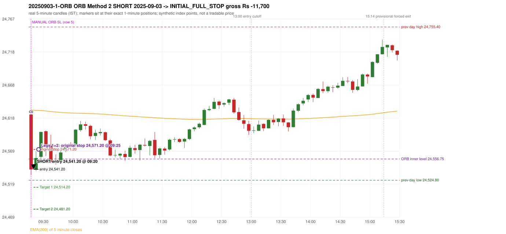
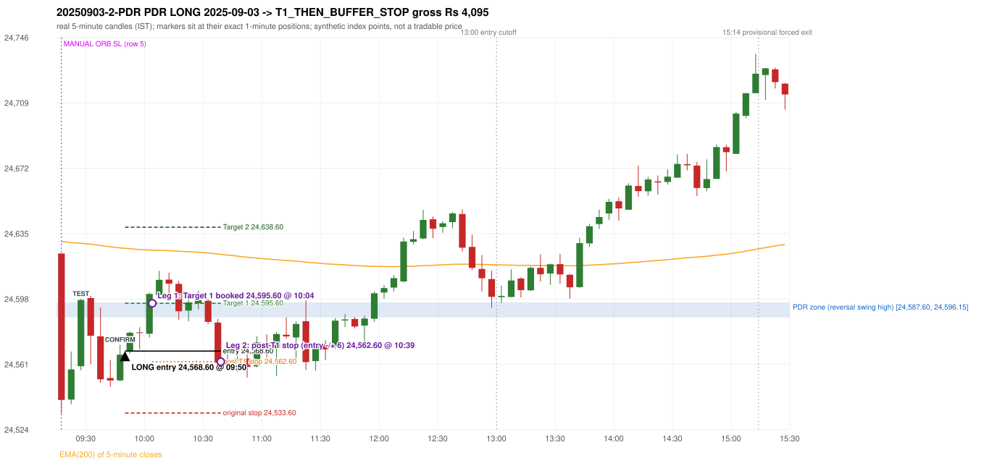

# Trading journal - 2025-09-03 (Wednesday)

> Automated, read-only reconstruction of the Phase 3.0 baseline. Synthetic NIFTY 50 index-point P&L (the index is not tradable). The owner's review status is intentionally blank.

## A. Trading day overview

| item | value |
|---|---|
| Date / weekday | 2025-09-03 / Wednesday |
| Session type | USABLE / VALID |
| Original session open (first 1-minute open) | 24,623.75 |
| Previous session | 2025-09-02 |
| Previous-day high / low | 24,755.40 / 24,524.80 |
| Previous-day official close / last 5-minute close | 24,579.60 / 24,575.00 |
| Raw engine records / confirmed signals / fully valid signals | 15 / 14 / 14 |
| Setups that did not complete (invalidated / incomplete) | 1 |
| Executed trades | 2 20250903-1-ORB;20250903-2-PDR |
| Gross P&L (Rs, synthetic) | -7,605.00 |
| Illustrative net P&L (Rs; Rs 500/trade + 0.5 pt/fill) | -9,385.00 |
| Day-end portfolio status | DAY_FINISHED |
| Manual journal trades (matched / unmatched) | 1 (1 / 0) |
| Extra automated trades | 1 |

## B. Daily strategy signal timeline (confirmed signals, chronological)

| time | strategy | method | dir | entry-rule status | valid for execution | <= 13:00 | portfolio state | accepted / ignored | specific reason | competing (same minute) |
|---|---|---|---|---|---|---|---|---|---|---|
| 09:20 | ORB | Method 2 | SHORT | RESEARCH_VARIANT | True | True | FIRST_TRADE_ACTIVE | ACCEPTED -> 20250903-1-ORB | first eligible signal of the day; trade 1: INITIAL_FULL_STOP |  |
| 09:25 | PDR | PDR | LONG | PROPOSAL_DEPENDENT | True | True | FIRST_TRADE_ACTIVE | IGNORED | POSITION_ACTIVE (signal kept for diagnostics only; never reused) [blocked by ORB#1] |  |
| 09:50 | PDR | PDR | LONG | PROPOSAL_DEPENDENT | True | True | SECOND_TRADE_ACTIVE | ACCEPTED -> 20250903-2-PDR | permitted second trade: newly confirmed PDR/PDS after the original full stop; trade 2: T1_THEN_BUFFER_STOP |  |
| 10:10 | PDR | PDR | LONG | PROPOSAL_DEPENDENT | True | True | SECOND_TRADE_ACTIVE | IGNORED | POSITION_ACTIVE (signal kept for diagnostics only; never reused) [blocked by PDR#2] |  |
| 10:25 | PDR | PDR | LONG | PROPOSAL_DEPENDENT | True | True | SECOND_TRADE_ACTIVE | IGNORED | POSITION_ACTIVE (signal kept for diagnostics only; never reused) [blocked by PDR#2] |  |
| 10:45 | PDR | PDR | LONG | PROPOSAL_DEPENDENT | True | True | DAY_FINISHED | IGNORED | DAY_FINISHED [blocked by PDR#2] |  |
| 11:20 | PDR | PDR | LONG | PROPOSAL_DEPENDENT | True | True | DAY_FINISHED | IGNORED | DAY_FINISHED [blocked by PDR#2] |  |
| 11:30 | PDR | PDR | LONG | PROPOSAL_DEPENDENT | True | True | DAY_FINISHED | IGNORED | DAY_FINISHED [blocked by PDR#2] |  |
| 11:55 | PDR | PDR | LONG | PROPOSAL_DEPENDENT | True | True | DAY_FINISHED | IGNORED | DAY_FINISHED [blocked by PDR#2] |  |
| 12:05 | PDR | PDR | LONG | PROPOSAL_DEPENDENT | True | True | DAY_FINISHED | IGNORED | DAY_FINISHED [blocked by PDR#2] |  |
| 12:45 | IRF | Method 2B | SHORT | PROPOSAL_DEPENDENT | True | True | DAY_FINISHED | IGNORED | DAY_FINISHED [blocked by PDR#2] |  |
| 12:50 | IRF | Method 1 | SHORT | PROPOSAL_DEPENDENT | True | True | DAY_FINISHED | IGNORED | DAY_FINISHED [blocked by PDR#2] |  |
| 13:05 | PDR | PDR | LONG | PROPOSAL_DEPENDENT | True | False | DAY_FINISHED | IGNORED | DAY_FINISHED [blocked by PDR#2] |  |
| 14:45 | IRF | Method 2B | SHORT | PROPOSAL_DEPENDENT | True | False | DAY_FINISHED | IGNORED | DAY_FINISHED [blocked by PDR#2] |  |

Engine setups that did not complete (1); the complete list with failed rule ids is in `rejected_signals.csv`:

| candle | strategy | method | dir | status | precise reason | failed rules |
|---|---|---|---|---|---|---|
| 14:40 | IRF | Method 1/2 | SHORT | INCOMPLETE_AT_EOD | SESSION_ENDED_BEFORE_CONFIRMATION |  |

## C. Detailed trade journals

### 20250903-1-ORB: ORB Method 2 SHORT (FIRST trade)

Chart: 

**Rule configuration:** CFG-phase35_legacy_check-be1db2a09d - signal verification status **RESEARCH_VARIANT** (never VERIFIED while a rule rests on a proposal).

#### 1. Setup identification

ORB Method 2 SHORT (research variant): the first candle closed at 24,541.00, beyond the inner support 24,556.75 built from the previous session's latest fractal (14:50), with a supportive trendline (24,579.27); its body occupied 91.49% of its range and its lower wick 8.51% (thresholds 60% / 20%): the strong-bearish candle test passed. The source gives no construction for the inner level or the trendline.

#### 2. Candle and indicator calculations

| role | session | candle | O | H | L | C | range | body % | upper wick % | lower wick % | direction | EMA(200) | strong bull / bear | pin bull / bear | small (body<=30%) | used for |
|---|---|---|---|---|---|---|---|---|---|---|---|---|---|---|---|---|
| first_candle | TODAY | 09:15-09:20 | 24,623.75 | 24,623.75 | 24,533.30 | 24,541.00 | 90.45 | 91.49 | 0.00 | 8.51 | BEARISH | 24,630.59 | False / True | False / False | False | the 09:15 first five-minute candle - the ORB decision candle |
| inner_level_candle | PREVIOUS | 14:50-14:55 | 24,591.60 | 24,599.35 | 24,556.75 | 24,563.35 | 42.60 | 66.31 | 18.19 | 15.49 | BEARISH | 24,635.34 | False / True | False / False | False | inner level: latest 5-candle fractal extreme of the previous session inside its range |
| prev_session_last_candle | PREVIOUS | 15:25-15:30 | 24,575.75 | 24,578.60 | 24,567.30 | 24,575.00 | 11.30 | 6.64 | 25.22 | 68.14 | BEARISH | 24,631.49 | False / False | False / False | True | trend: previous session's last 5-minute close vs its EMA(200) |
| trendline_point_1 | PREVIOUS | 14:45-14:50 | 24,591.20 | 24,617.25 | 24,588.15 | 24,592.10 | 29.10 | 3.09 | 86.43 | 10.48 | BULLISH | 24,636.06 | False / False | False / True | True | first fractal point of the trendline |
| trendline_point_2 | PREVIOUS | 15:10-15:15 | 24,587.60 | 24,596.15 | 24,584.10 | 24,584.80 | 12.05 | 23.24 | 70.95 | 5.81 | BEARISH | 24,633.13 | False / False | False / True | True | second fractal point of the trendline |

Every condition, with the rule, the calculation, the observed values and the result:

| # | group | rule | result | status / numeric definition | calculation | observed | required | available at | why it matters |
|---|---|---|---|---|---|---|---|---|---|
| 1 | SELECTION | SEL-FIRST-001 | PASS | USER_APPROVED / USER_APPROVED | earliest CONFIRMED signal of the day across IRF/ORB/PDR/PDS/RF that passed the controller's checks | 0 confirmed signal(s) earlier today; 14 confirmed signals in the day in total, this one at 09:20 | no earlier executable signal | 2025-09-03 09:20 | the shared controller trades only the first valid signal; the five strategies are not independent positions |
| 2 | SELECTION | SEL-TIE-001 | PASS | USER_APPROVED / USER_APPROVED | other CONFIRMED signals with exactly the same confirmation timestamp | none | no different-strategy / opposite-direction signal in the same minute (otherwise an unresolved conflict, no trade) | 2025-09-03 09:20 | an unresolved same-minute collision would have produced no trade at all |
| 3 | SELECTION | ENTRY-CUTOFF-001 | PASS | USER_APPROVED / USER_APPROVED | fill timestamp vs 13:00:00 IST | signal confirmed 09:20; fill 09:20 | fill at or before 13:00:00 IST | 2025-09-03 09:20 | no new position may be entered with a fill after 13:00 IST |
| 4 | SELECTION | EXE-FILL-001 | PASS | PROPOSED_FOR_REVIEW / PROPOSED_FOR_REVIEW | fill = open of the 1-minute bar that starts at the signal candle's end | bar 09:20 O 24,541.20 H 24,552.55 L 24,538.50 C 24,550.65; executable=True; entry 24,541.20 | fill bar exists, starts exactly at the signal end, is fillable; entry = its open | 2025-09-03 09:20 | a 5-minute signal is known only when its candle closes; the first price that can be traded is the next minute's open |
| 5 | SELECTION | DAY-MAX-001 | PASS | USER_APPROVED / USER_APPROVED | number of entries today | trade 1 of at most 2 | <= 2 entries per day | 2025-09-03 09:20 | daily trade cap |
| 6 | SETUP | ORB-GLOBAL-001 | PASS | SOURCE_VERIFIED / EXPLICIT_IN_SOURCE | decision is taken once the first 5-minute candle (09:15-09:20) has closed | candle 09:15-09:20; signal confirmed 09:20 | decision at 09:20, never before the close | 2025-09-03 09:20 | the close of the first candle is unknown before 09:20 |
| 7 | SETUP | ORB-GLOBAL-002 | PASS | SOURCE_VERIFIED / EXPLICIT_IN_SOURCE | direction | SHORT | same rules in both directions | 2025-09-03 09:20 | ORB trades the side of the break |
| 8 | SETUP | ORB-GLOBAL-004 | PASS | SOURCE_VERIFIED / QUALITATIVE_SOURCE_NUMERIC_DEFINITION_PROPOSED_FOR_REVIEW | entry at 09:20, after the first-candle close | signal confirmed 09:20; fill 09:20 at the open of that minute | 09:20 entry | 2025-09-03 09:20 | the guide enters at 9:20; the fill price convention (next minute open) is a proposal |
| 9 | SETUP | ORB-M2-SHORT-001 | PASS | UNRESOLVED / UNRESOLVED | inner level = latest fractal (k=2) extreme of the previous session below the day's high / above the day's low | inner support 24,556.75 from the 14:50 candle of 2025-09-02 (previous range 24,524.80 - 24,755.40; engine recorded 24,556.75) | an inner level inside yesterday's range | 2025-09-02 15:05 | the source gives NO objective construction for the inner level: this is a research variant |
| 10 | SETUP | ORB-M2-SHORT-002 | PASS | SOURCE_VERIFIED / EXPLICIT_IN_SOURCE | first candle breaks and closes beyond the inner level | close 24,541.00 vs inner level 24,556.75: 15.75 points beyond | high/low and close beyond the level | 2025-09-03 09:20 | the breakout itself |
| 11 | TREND | ORB-TREND-001 | PASS | SOURCE_VERIFIED / QUALITATIVE_SOURCE_NUMERIC_DEFINITION_PROPOSED_FOR_REVIEW | previous session's final completed 5-minute candle: close vs its EMA(200 of 5-minute closes) | previous session 2025-09-02 last candle 15:25-15:30 close 24,575.00 vs EMA(200) 24,631.49: 56.49 points below the EMA -> trend bearish (EMA_PREV_SESSION_CLOSE; research variant A, EMA-only) | close < EMA(200) | 2025-09-02 15:30 | the opening gap can never create the trend: only information that existed before today's open is used |
| 12 | TREND | ORB-TREND-002 | PASS | SOURCE_VERIFIED / QUALITATIVE_SOURCE_NUMERIC_DEFINITION_PROPOSED_FOR_REVIEW | price location versus the 200 EMA is the basic confirmation; structure is only 'supporting' | 56.49 points below the EMA(200) on the previous session's last 5-minute close; swing structure not used in variant A | price on the trend side of the 200 EMA | 2025-09-02 15:30 | the rulebook calls EMA position 'a basic confirmation, supported by bullish structure'; the structure part has no numeric definition |
| 13 | TREND | TREND-SWING-001 | NOT_APPLICABLE | PROPOSED_FOR_REVIEW / PROPOSED_FOR_REVIEW | confirmed swing structure | not required by the active trend variant (variant A is the EMA price location only) | n/a | 2025-09-02 15:30 | variant B would additionally require higher-high/higher-low swings; it is a separate labelled scenario |
| 14 | CONFIRMATION | ORB-M2-SHORT-001 | PASS | UNRESOLVED / UNRESOLVED | trendline through the last two fractal lows (long) / highs (short) of the previous session | points 14:45 24,617.25 and 15:10 24,596.15 (5 candles apart): slope -4.2200 per candle; line value at the 09:15 candle 24,579.27; first-candle close 24,541.00 is on the supportive side (engine recorded 24,579.27) | rising (long) / falling (short) line with price on the trend side | 2025-09-02 15:15 | the guide requires a trendline but defines no construction or 'near' distance: research variant |
| 15 | CONFIRMATION | ORB-M2-SHORT-003 | PASS | SOURCE_VERIFIED / QUALITATIVE_SOURCE_NUMERIC_DEFINITION_PROPOSED_FOR_REVIEW | candle quality: strong body and limited opposite wick (or pin bar) | 09:15-09:20 O 24,623.75 H 24,623.75 L 24,533.30 C 24,541.00; range 90.45, body 82.75 (91.49%), upper wick 0.00 (0.00%), lower wick 7.70 (8.51%), bearish. Strong-bearish test: bearish close, body >= 60% (observed 91.49%), lower wick <= 20% (observed 8.51%) -> PASS | strong candle or pin bar | 2025-09-03 09:20 | same proposed thresholds as Method 1 |
| 16 | CONFIRMATION | ORB-M2-SHORT-004 | PASS | SOURCE_VERIFIED / QUALITATIVE_SOURCE_NUMERIC_DEFINITION_PROPOSED_FOR_REVIEW | if the close is near the 5-minute EMA(200) a convincing close beyond it is needed | EMA(200) at the 09:15 candle 24,630.59; close 24,541.00 is 89.59 points below it; 'near' band 15 points -> not near, test not applicable | outside the 15-point band, or beyond the EMA by >= 5 | 2025-09-03 09:20 | ORB p.5: 'if the breakout is near the EMA, wait for a convincing close' |
| 17 | EXECUTION | ORB-GLOBAL-003 | PASS | SOURCE_VERIFIED / EXPLICIT_IN_SOURCE | initial stop = entry + 30 points | entry 24,541.20 -> stop 24,571.20 | stop 30 index points (BASELINE) | 2025-09-03 09:20 | defines the loss if the setup fails before Target 1 |
| 18 | EXECUTION | EXE-T1-001 | PASS | SOURCE_VERIFIED / EXPLICIT_IN_SOURCE | Target 1 = entry +/- 27 points | T1 24,514.20 | 27 points | 2025-09-03 09:20 | Leg 1 (3 lots) is booked at Target 1 |
| 19 | EXECUTION | ORB-GLOBAL-003 | PASS | SOURCE_VERIFIED / EXPLICIT_IN_SOURCE | Target 2 = entry +/- 60 points | T2 24,481.20 | 60 points | 2025-09-03 09:20 | Leg 2 (3 lots) is booked at Target 2 |
| 20 | EXECUTION | POST-T1-STOP-006 | PASS | USER_APPROVED / USER_APPROVED | after T1 the Leg-2 stop = entry + 6 (no trailing) | post-T1 stop 24,547.20 | entry -6 (LONG) / +6 (SHORT) | 2025-09-03 09:20 | protects the remaining three lots once the first three are booked |
| 21 | EXECUTION | SIZE-LOT-001 | PASS | USER_APPROVED / USER_APPROVED | 6 lots x 65 = 390, Leg 1 = 3 lots = 195, Leg 2 = 195 | 6 lots, lot size 65, legs 3+3 | 6 lots in two equal legs | 2025-09-03 09:20 | position size for the synthetic P&L |
| 22 | NOTE | ORB-MA-001 | UNRESOLVED | CONFLICTING / CONFLICTING | which moving average the code uses | EMA(200) of 5-minute closes (the guide says '200 DMA' in some places and '200 EMA' in others); active ma_mode EMA200_5M | the source terminology conflicts | 2025-09-03 09:20 | a daily 200 DMA would give different values |
| 23 | NOTE | NOTE-UNRESOLVED-DEPENDENCIES | UNRESOLVED | NOT_A_RULE / NOT_A_REGISTRY_RULE | rules the signal depends on that the sources leave unresolved | engine-recorded unresolved rule ids: ORB-M2-SHORT-001, ORB-MA-001; verification status RESEARCH_VARIANT | n/a (disclosure) | 2025-09-03 09:20 | the entry is only as verified as the rules it rests on |

#### 3. Entry decision and explanation

ORB Method 2 SHORT (research variant): the first candle closed at 24,541.00, beyond the inner support 24,556.75 built from the previous session's latest fractal (14:50), with a supportive trendline (24,579.27); its body occupied 91.49% of its range and its lower wick 8.51% (thresholds 60% / 20%): the strong-bearish candle test passed. The source gives no construction for the inner level or the trendline.

**Why this trade ahead of the other strategies:** This ORB Method 2 signal was the earliest executable signal of the day: 0 confirmed signal(s) earlier, 0 other in the same minute. 13 later confirmed signal(s) (IRF x3, PDR x10) are logged as ignored or rejected. State of the other four engines at that moment: [IRF: no setup record before this time (a base condition was not met, or nothing triggered)] [PDR: no setup record before this time (a base condition was not met, or nothing triggered)] [PDS: no setup record before this time (a base condition was not met, or nothing triggered)] [RF: no setup record before this time (a base condition was not met, or nothing triggered)]

#### 4. Actual entry execution

| item | value |
|---|---|
| Signal candle | 09:15-09:20 |
| Signal confirmed | 2025-09-03 09:20 |
| Fill timestamp | 2025-09-03 09:20 |
| Entry price | 24,541.20 |
| Source partition / 1-minute bar | data/processed/nifty50/year=2025/month=09/candles.parquet / 2025-09-03 09:20 |
| Source bar O / H / L / C | 24,541.20 / 24,552.55 / 24,538.50 / 24,550.65 |
| Fill assumption | open of the 1-minute bar starting at the signal candle's end (EXE-FILL-001, PROPOSED causal convention) |
| Initial stop / T1 / T2 / post-T1 stop | 24,571.20 / 24,514.20 / 24,481.20 / 24,547.20 |
| Position | 6 lots x 65 = 390 units (Leg 1 195, Leg 2 195) |

#### 5-8. Trade progress, Target 1, post-T1 stop and final exit

Between the 09:20 entry bar and the final exit (6 one-minute bars) the best excursion in favour was 2.70 points at 09:20 and the worst against was 35.20 points at 09:25. At 09:25 price reached the original stop 24,571.20 before Target 1 24,514.20, so all six lots exited together at 24,571.20. This is an INITIAL_FULL_STOP: one more trade is allowed that day, only a newly confirmed PDR/PDS signal.

| leg | qty | exit time | exit price | reason | source 1-minute bar | O / H / L / C | gross points | gross Rs | slippage pts | flags |
|---|---|---|---|---|---|---|---|---|---|---|
| 1 | 195 | 09:25 | 24,571.20 | ORIGINAL_STOP_BEFORE_T1 | 09:25 | 24,560.05 / 24,576.40 / 24,557.75 / 24,573.00 | -30.00 | -5,850.00 | 0.00 |  |
| 2 | 195 | 09:25 | 24,571.20 | ORIGINAL_STOP_BEFORE_T1 | 09:25 | 24,560.05 / 24,576.40 / 24,557.75 / 24,573.00 | -30.00 | -5,850.00 | 0.00 |  |

Exit evidence per leg:

* Leg 1: 1-minute bar 09:25 O 24,560.05 H 24,576.40 L 24,557.75 C 24,573.00: high 24,576.40 reached the original stop 24,571.20 before Target 1 24,514.20 was touched; both legs exit at the stop level 24,571.20
* Leg 2: 1-minute bar 09:25 O 24,560.05 H 24,576.40 L 24,557.75 C 24,573.00: high 24,576.40 reached the original stop 24,571.20 before Target 1 24,514.20 was touched; both legs exit at the stop level 24,571.20

#### 9. Gross and illustrative net P&L

| item | value (Rs) |
|---|---|
| Leg 1 gross | -5,850.00 |
| Leg 2 gross | -5,850.00 |
| Trade gross (= Leg 1 + Leg 2) | -11,700.00 |
| Illustrative fixed cost | -500.00 |
| Illustrative slippage (0.5 pt on every fill, entry + exits, all units) | -390.00 |
| Illustrative net | -12,590.00 |

#### 10. Manual journal comparison

EXACT_MATCH: manual ORB labelled 09:15 (candle start) vs automated ORB Method 2 SHORT candle 09:15, filled 09:20 at 24,541.20; time difference 0 minutes. Journal outcome SL vs automated INITIAL_FULL_STOP (same outcome class). The journal records no entry or exit price.

### 20250903-2-PDR: PDR LONG (SECOND trade)

Chart: 

**Rule configuration:** CFG-phase35_legacy_check-be1db2a09d - signal verification status **PROPOSAL_DEPENDENT** (never VERIFIED while a rule rests on a proposal).

#### 1. Setup identification

PDR LONG: the session opened 44.15 points above the previous close and 27.60 points above the resistance zone [24,587.60, 24,596.15] taken from the 15:10 swing-high candle of 2025-09-02. The 09:25 candle (24,557.75 - 24,598.10) retested the zone, and the 09:45 candle closed green at 24,566.55, confirming the entry at 09:50. The engine does not check that the zone held (confirmation close BELOW the zone floor).

#### 2. Candle and indicator calculations

| role | session | candle | O | H | L | C | range | body % | upper wick % | lower wick % | direction | EMA(200) | strong bull / bear | pin bull / bear | small (body<=30%) | used for |
|---|---|---|---|---|---|---|---|---|---|---|---|---|---|---|---|---|
| zone_source_candle | PREVIOUS | 15:10-15:15 | 24,587.60 | 24,596.15 | 24,584.10 | 24,584.80 | 12.05 | 23.24 | 70.95 | 5.81 | BEARISH | 24,633.13 | False / False | False / True | True | swing-high candle that defines the zone (B_SWING_HIGH_REVERSAL) |
| prev_day_high_candle | PREVIOUS | 12:40-12:45 | 24,755.00 | 24,755.40 | 24,737.80 | 24,738.10 | 17.60 | 96.02 | 2.27 | 1.70 | BEARISH | 24,635.20 | False / True | False / False | False | candle of the previous session's absolute high (for comparison) |
| interaction_candle | TODAY | 09:25-09:30 | 24,560.05 | 24,598.10 | 24,557.75 | 24,597.45 | 40.35 | 92.69 | 1.61 | 5.70 | BULLISH | 24,629.55 | True / False | False / False | False | first candle whose range intersects the zone |
| confirmation_candle | TODAY | 09:45-09:50 | 24,552.05 | 24,572.15 | 24,551.55 | 24,566.55 | 20.60 | 70.39 | 27.18 | 2.43 | BULLISH | 24,626.90 | False / False | False / False | False | first green candle after the interaction candle |

Every condition, with the rule, the calculation, the observed values and the result:

| # | group | rule | result | status / numeric definition | calculation | observed | required | available at | why it matters |
|---|---|---|---|---|---|---|---|---|---|
| 1 | SELECTION | DAY-SL-001 | PASS | USER_APPROVED / USER_APPROVED | first trade outcome, strategy of this signal, position-close time vs this signal's timestamp | first trade ORB Method 2 closed as INITIAL_FULL_STOP at 09:25; position free from 09:26; this PDR signal confirmed 09:50 | first trade INITIAL_FULL_STOP before Target 1, and a NEWLY confirmed PDR/PDS signal after the first position closed | 2025-09-03 09:50 | the only way a second trade is allowed |
| 2 | SELECTION | DAY-NOREUSE-001 | PASS | USER_APPROVED / USER_APPROVED | signals confirmed while the first position was open | 2 signal(s) were ignored during the first trade (never reused): ORB Method 2 SHORT @09:20; PDR PDR LONG @09:25 [IGNORED: POSITION_ACTIVE] | this trade comes from a signal confirmed after the first exit, not from an ignored one | 2025-09-03 09:50 | an ignored signal can never become the second trade |
| 3 | SELECTION | ENTRY-CUTOFF-001 | PASS | USER_APPROVED / USER_APPROVED | fill timestamp vs 13:00:00 IST | signal confirmed 09:50; fill 09:50 | fill at or before 13:00:00 IST | 2025-09-03 09:50 | no new position may be entered with a fill after 13:00 IST |
| 4 | SELECTION | EXE-FILL-001 | PASS | PROPOSED_FOR_REVIEW / PROPOSED_FOR_REVIEW | fill = open of the 1-minute bar that starts at the signal candle's end | bar 09:50 O 24,568.60 H 24,571.85 L 24,567.00 C 24,569.00; executable=True; entry 24,568.60 | fill bar exists, starts exactly at the signal end, is fillable; entry = its open | 2025-09-03 09:50 | a 5-minute signal is known only when its candle closes; the first price that can be traded is the next minute's open |
| 5 | SELECTION | DAY-MAX-001 | PASS | USER_APPROVED / USER_APPROVED | number of entries today | trade 2 of at most 2 | <= 2 entries per day | 2025-09-03 09:50 | daily trade cap |
| 6 | SETUP | PDR-004 | PASS | SOURCE_VERIFIED / EXPLICIT_WORDING_DETAIL_PROPOSED_FOR_REVIEW | gap = first 1-minute open of today - previous session's OFFICIAL close | today's open 24,623.75 (first 1-minute bar 09:15) - previous close 24,579.60 (DAILY_VENDOR, 2025-09-02) = +44.15 points -> gap UP | gap UP (more than 0 points) | 2025-09-03 09:15 | approved convention: the original first-minute open, never the vendor daily open |
| 7 | SETUP | PDR-011 | PASS | SOURCE_VERIFIED / QUALITATIVE_SOURCE_NUMERIC_DEFINITION_PROPOSED_FOR_REVIEW | open relative to the zone (ABOVE_ZONE) | today's open 24,623.75 vs zone high 24,596.15: 27.60 points above | open > zone high | 2025-09-03 09:15 | the guide has price 'pull back into the zone', so the gap-up open is above it; this exclusion is a proposal |
| 8 | ZONE | PDR-001 | PASS | SOURCE_VERIFIED / EXPLICIT_IN_SOURCE | direction | LONG (PDR is long only) | long-only | 2025-09-03 09:50 | PDR buys a retest of previous-day resistance after a gap up |
| 9 | ZONE | PDR-002 | PASS | SOURCE_VERIFIED / QUALITATIVE_SOURCE_NUMERIC_DEFINITION_PROPOSED_FOR_REVIEW | zone = [body top, wick high] of the latest confirmed swing high (k=2) that has a red candle among the peak and the next 2 candles (method B_SWING_HIGH_REVERSAL) | zone [24,587.60, 24,596.15] from the 15:10 candle of 2025-09-02 (body top 24,587.60, wick high 24,596.15; 15:10-15:15 O 24,587.60 H 24,596.15 L 24,584.10 C 24,584.80; range 12.05, body 2.80 (23.24%), upper wick 8.55 (70.95%), lower wick 0.70 (5.81%), bearish); engine recorded [24,587.60, 24,596.15]. Previous session's absolute high 24,755.40 (candle 12:40) - the zone is NOT the day high (distance 159.25 points). Swing confirmed once candle 15:20 closed. | previous-day high where price peaked and reversed | 2025-09-02 15:25 | the source says 'previous day's high/reversal'; which candle marks the zone is an owner-approved research candidate, not a source rule |
| 10 | ZONE | PDR-003 | PASS | SOURCE_VERIFIED / EXPLICIT_IN_SOURCE | the zone is an area, not a single price | zone height 8.55 points [24,587.60, 24,596.15] | a rectangle with positive height | 2025-09-02 15:25 | price may touch any part of the area |
| 11 | ZONE | PDR-010 | UNRESOLVED | SOURCE_VERIFIED / QUALITATIVE_SOURCE_NUMERIC_DEFINITION_PROPOSED_FOR_REVIEW | reversal-quality filter ('clear high and reversal identified') | filter setting OFF | checklist item: a clear previous-day high and reversal | 2025-09-02 | the engine does not test reversal depth in the baseline (filter OFF) |
| 12 | CONFIRMATION | PDR-006 | PASS | SOURCE_VERIFIED / QUALITATIVE_SOURCE_NUMERIC_DEFINITION_PROPOSED_FOR_REVIEW | the first candle whose [low, high] intersects the zone (+/- proximity) | 09:25-09:30 O 24,560.05 H 24,598.10 L 24,557.75 C 24,597.45; range 40.35, body 37.40 (92.69%), upper wick 0.65 (1.61%), lower wick 2.30 (5.70%), bullish; low 24,557.75 vs zone high 24,596.15 (38.40 points inside/below the zone top), high 24,598.10 vs zone low 24,587.60; proximity 0 | range intersects the zone | 2025-09-03 09:30 | the retest of the previous-day resistance (the engine re-arms after an earlier signal: scanning restarted after the 09:20 candle) |
| 13 | CONFIRMATION | PDR-007 | PASS | SOURCE_VERIFIED / QUALITATIVE_SOURCE_NUMERIC_DEFINITION_PROPOSED_FOR_REVIEW | the first GREEN candle after the interaction candle | 09:45-09:50 O 24,552.05 H 24,572.15 L 24,551.55 C 24,566.55; range 20.60, body 14.50 (70.39%), upper wick 5.60 (27.18%), lower wick 0.50 (2.43%), bullish; interaction candle 09:25, confirmation candle 09:45 | close > open, strictly after the interaction candle | 2025-09-03 09:50 | the guide asks for 'a green candle' after the test; it gives no size or position test |
| 14 | CONFIRMATION | PDR-005 | PASS | SOURCE_VERIFIED / EXPLICIT_IN_SOURCE | no entry at the open: price must first come back toward the zone | interaction candle 09:25 (candle no. 3 of the session) precedes the entry candle 09:45; fill 09:50 | interaction before the entry; fill after 09:20 | 2025-09-03 09:50 | if price keeps rising without returning to the zone there is no setup |
| 15 | EXECUTION | EXE-STOP-001 | PASS | USER_APPROVED / USER_APPROVED | initial stop = entry - 35 points | entry 24,568.60 -> stop 24,533.60 | stop 35 index points (BASELINE) | 2025-09-03 09:50 | defines the loss if the setup fails before Target 1 |
| 16 | EXECUTION | EXE-T1-001 | PASS | SOURCE_VERIFIED / EXPLICIT_IN_SOURCE | Target 1 = entry +/- 27 points | T1 24,595.60 | 27 points | 2025-09-03 09:50 | Leg 1 (3 lots) is booked at Target 1 |
| 17 | EXECUTION | PDR-008 | PASS | SOURCE_VERIFIED / EXPLICIT_IN_SOURCE | Target 2 = entry +/- 70 points | T2 24,638.60 (the guide says 70; the performance report's winners suggest 60 - CONFLICTING, recorded) | 70 points | 2025-09-03 09:50 | Leg 2 (3 lots) is booked at Target 2 |
| 18 | EXECUTION | POST-T1-STOP-006 | PASS | USER_APPROVED / USER_APPROVED | after T1 the Leg-2 stop = entry - 6 (no trailing) | post-T1 stop 24,562.60 | entry -6 (LONG) / +6 (SHORT) | 2025-09-03 09:50 | protects the remaining three lots once the first three are booked |
| 19 | EXECUTION | SIZE-LOT-001 | PASS | USER_APPROVED / USER_APPROVED | 6 lots x 65 = 390, Leg 1 = 3 lots = 195, Leg 2 = 195 | 6 lots, lot size 65, legs 3+3 | 6 lots in two equal legs | 2025-09-03 09:50 | position size for the synthetic P&L |
| 20 | NOTE | PDR-007 | UNRESOLVED | SOURCE_VERIFIED / QUALITATIVE_SOURCE_NUMERIC_DEFINITION_PROPOSED_FOR_REVIEW | did the zone hold? (is the confirmation candle's close back at/above the zone floor?) | confirmation close 24,566.55 vs zone floor 24,587.60 / top 24,596.15: BELOW the zone floor by 21.05; interaction low 24,557.75 | the engine does NOT test that resistance-turned-support held | 2025-09-03 09:50 | a later green candle is accepted even after price traded through the zone; a human would normally check the hold (here the close is below the zone floor) |
| 21 | NOTE | PDR-012 | NOT_APPLICABLE | PROPOSED_FOR_REVIEW / PROPOSED_FOR_REVIEW | repeated PDR signals today | 10 confirmed PDR signal(s) in the session | n/a (disclosure) | 2025-09-03 09:50 | the per-session cap is lifted for the controller runs; the controller trades only the first |
| 22 | NOTE | PDR-009 | UNRESOLVED | UNRESOLVED / UNRESOLVED | stop 35 or 40 'depending on the situation' | the guide gives no selection rule; baseline fixed 35 points | unresolved in the source | 2025-09-03 09:50 | PDR stop selection is left to the owner |
| 23 | NOTE | NOTE-UNRESOLVED-DEPENDENCIES | UNRESOLVED | NOT_A_RULE / NOT_A_REGISTRY_RULE | rules the signal depends on that the sources leave unresolved | engine-recorded unresolved rule ids: PDR-010; verification status PROPOSAL_DEPENDENT | n/a (disclosure) | 2025-09-03 09:50 | the entry is only as verified as the rules it rests on |

#### 3. Entry decision and explanation

PDR LONG: the session opened 44.15 points above the previous close and 27.60 points above the resistance zone [24,587.60, 24,596.15] taken from the 15:10 swing-high candle of 2025-09-02. The 09:25 candle (24,557.75 - 24,598.10) retested the zone, and the 09:45 candle closed green at 24,566.55, confirming the entry at 09:50. The engine does not check that the zone held (confirmation close BELOW the zone floor).

**Why this trade ahead of the other strategies:** The first trade (ORB Method 2) was stopped out before Target 1 at 09:25; this newly confirmed PDR signal at 09:50 is the first PDR/PDS signal after that exit, so it is the day's permitted second trade. State of the other engines at that moment: [IRF: no setup record before this time (a base condition was not met, or nothing triggered)] [ORB: 1 confirmed signal(s) up to this time (Method 2@09:20)] [PDS: no setup record before this time (a base condition was not met, or nothing triggered)] [RF: no setup record before this time (a base condition was not met, or nothing triggered)]

#### 4. Actual entry execution

| item | value |
|---|---|
| Signal candle | 09:45-09:50 |
| Signal confirmed | 2025-09-03 09:50 |
| Fill timestamp | 2025-09-03 09:50 |
| Entry price | 24,568.60 |
| Source partition / 1-minute bar | data/processed/nifty50/year=2025/month=09/candles.parquet / 2025-09-03 09:50 |
| Source bar O / H / L / C | 24,568.60 / 24,571.85 / 24,567.00 / 24,569.00 |
| Fill assumption | open of the 1-minute bar starting at the signal candle's end (EXE-FILL-001, PROPOSED causal convention) |
| Initial stop / T1 / T2 / post-T1 stop | 24,533.60 / 24,595.60 / 24,638.60 / 24,562.60 |
| Position | 6 lots x 65 = 390 units (Leg 1 195, Leg 2 195) |

#### 5-8. Trade progress, Target 1, post-T1 stop and final exit

Between the 09:50 entry bar and the final exit (50 one-minute bars) the best excursion in favour was 45.35 points at 10:09 and the worst against was 7.55 points at 10:39. At 10:04 price reached Target 1 24,595.60 and three lots exited. At 10:04 the remaining three lots' protective stop was set to 24,562.60 (entry - 6; no trailing, no further change); the engine applies it from the Target-1 bar onward and tests it within that same bar. At 10:39 the remaining three lots stopped out at 24,562.60. T1_THEN_BUFFER_STOP: no second trade that day (DAY-BUF-001).

| leg | qty | exit time | exit price | reason | source 1-minute bar | O / H / L / C | gross points | gross Rs | slippage pts | flags |
|---|---|---|---|---|---|---|---|---|---|---|
| 1 | 195 | 10:04 | 24,595.60 | TARGET_1 | 10:04 | 24,594.35 / 24,601.60 / 24,593.70 / 24,600.90 | 27.00 | 5,265.00 | 0.00 |  |
| 2 | 195 | 10:39 | 24,562.60 | POST_T1_STOP_ENTRY_MINUS_PLUS_6 | 10:39 | 24,567.20 / 24,567.65 / 24,561.05 / 24,562.05 | -6.00 | -1,170.00 | 0.00 |  |

Exit evidence per leg:

* Leg 1: 1-minute bar 10:04 O 24,594.35 H 24,601.60 L 24,593.70 C 24,600.90: high 24,601.60 reached Target 1 24,595.60; Leg 1 booked at the target level
* Leg 2: 1-minute bar 10:39 O 24,567.20 H 24,567.65 L 24,561.05 C 24,562.05: low 24,561.05 reached the post-T1 stop 24,562.60; Leg 2 exits at 24,562.60 at the stop level

#### 9. Gross and illustrative net P&L

| item | value (Rs) |
|---|---|
| Leg 1 gross | 5,265.00 |
| Leg 2 gross | -1,170.00 |
| Trade gross (= Leg 1 + Leg 2) | 4,095.00 |
| Illustrative fixed cost | -500.00 |
| Illustrative slippage (0.5 pt on every fill, entry + exits, all units) | -390.00 |
| Illustrative net | 3,205.00 |

#### 10. Manual journal comparison

EXTRA_AUTOMATED_TRADE: the automated system took PDR PDR LONG at 09:50 (manual traded only other strategies: ORB 09:15 SL). The setup rests on: PDR-010: Reversal-quality filter is OFF in the baseline | PDR-007: Engine does not test whether the zone held | PDR-009: PDR stop selection rule is not defined | NOTE-UNRESOLVED-DEPENDENCIES: Disclosure of unresolved source rules behind this signal. The journal shows no corresponding entry.

## D. Manual journal comparison

| comparison | journal row | journal strategy | manual time | manual direction | manual outcome | match class | trade | auto entry | auto outcome | explanation |
|---|---|---|---|---|---|---|---|---|---|---|
| M005 | 5 | ORB | 09:15 | UNKNOWN | SL | EXACT_MATCH | 20250903-1-ORB | 09:20 @ 24,541.20 | INITIAL_FULL_STOP | EXACT_MATCH: manual ORB labelled 09:15 (candle start) vs automated ORB Method 2 SHORT candle 09:15, filled 09:20 at 24,541.20; time difference 0 minutes. Journal outcome SL vs automated INITIAL_FULL_STOP (same outcome class). The journal records no entry or exit price. |
| E001 |  |  |  |  |  | EXTRA_AUTOMATED_TRADE | 20250903-2-PDR | 09:50 @ 24,568.60 | T1_THEN_BUFFER_STOP | EXTRA_AUTOMATED_TRADE: the automated system took PDR PDR LONG at 09:50 (manual traded only other strategies: ORB 09:15 SL). The setup rests on: PDR-010: Reversal-quality filter is OFF in the baseline \| PDR-007: Engine does not test whether the zone held \| PDR-009: PDR stop selection rule is not defined \| NOTE-UNRESOLVED-DEPENDENCIES: Disclosure of unresolved source rules behind this signal. The journal shows no corresponding entry. |

The journal records no entry price and no exit price (NOT_RECORDED); matching uses date, strategy and candle start only - never P&L.

## E. Daily conclusion

* **Traded:** 20250903-1-ORB - ORB Method 2 SHORT at 09:20 (entry 24,541.20), outcome INITIAL_FULL_STOP, gross Rs -11,700.00, illustrative net Rs -12,590.00. **Why:** This ORB Method 2 signal was the earliest executable signal of the day: 0 confirmed signal(s) earlier, 0 other in the same minute. 13 later confirmed signal(s) (IRF x3, PDR x10) are logged as ignored or rejected. State of the other four engines at that moment: [IRF: no setup record before this time (a base condition was not met, or nothing triggered)] [PDR: no setup record before this time (a base condition was not met, or nothing triggered)] [PDS: no setup record before this time (a base condition was not met, or nothing triggered)] [RF: no setup record before this time (a base condition was not met, or nothing triggered)] **How it ended:** At 09:25 price reached the original stop 24,571.20 before Target 1 24,514.20, so all six lots exited together at 24,571.20. This is an INITIAL_FULL_STOP: one more trade is allowed that day, only a newly confirmed PDR/PDS signal.
* **Traded:** 20250903-2-PDR - PDR PDR LONG at 09:50 (entry 24,568.60), outcome T1_THEN_BUFFER_STOP, gross Rs 4,095.00, illustrative net Rs 3,205.00. **Why:** The first trade (ORB Method 2) was stopped out before Target 1 at 09:25; this newly confirmed PDR signal at 09:50 is the first PDR/PDS signal after that exit, so it is the day's permitted second trade. State of the other engines at that moment: [IRF: no setup record before this time (a base condition was not met, or nothing triggered)] [ORB: 1 confirmed signal(s) up to this time (Method 2@09:20)] [PDS: no setup record before this time (a base condition was not met, or nothing triggered)] [RF: no setup record before this time (a base condition was not met, or nothing triggered)] **How it ended:** At 10:04 price reached Target 1 24,595.60 and three lots exited. At 10:04 the remaining three lots' protective stop was set to 24,562.60 (entry - 6; no trailing, no further change); the engine applies it from the Target-1 bar onward and tests it within that same bar. At 10:39 the remaining three lots stopped out at 24,562.60. T1_THEN_BUFFER_STOP: no second trade that day (DAY-BUF-001).
* **Ignored / rejected signals:** PDR IGNORED DAY_FINISHED x6; PDR IGNORED POSITION_ACTIVE x3; IRF IGNORED DAY_FINISHED x3
* **Extra automated trade 20250903-2-PDR:** EXTRA_AUTOMATED_TRADE: the automated system took PDR PDR LONG at 09:50 (manual traded only other strategies: ORB 09:15 SL). The setup rests on: PDR-010: Reversal-quality filter is OFF in the baseline | PDR-007: Engine does not test whether the zone held | PDR-009: PDR stop selection rule is not defined | NOTE-UNRESOLVED-DEPENDENCIES: Disclosure of unresolved source rules behind this signal. The journal shows no corresponding entry.
* **Open strategy-definition issues that affected this day:** NOTE-UNRESOLVED-DEPENDENCIES, ORB-MA-001 (Terminology conflict: '200 DMA / EMA' (p.2), '200 EMA' (pp.3,5,7), '200 DMA' (pp.1,8,9,12) for what the charts show as one curved line on a 5-minute chart), PDR-007 (After the zone has been tested, wait for a green candle and take the long on that confirmation), PDR-009 (Stop-loss 35 or 40 'depending on the situation'; choose before entering, do not move after entry), PDR-010 (Checklist: a clear previous-day high and reversal must be identified)
* **Automated triage (not an approval; the owner's review status stays blank):** REVIEW: EXTRA_AUTOMATED
