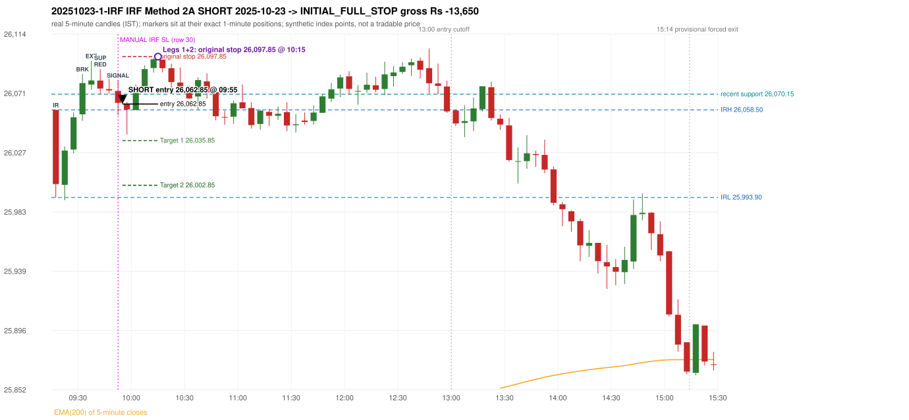

# Trading journal - 2025-10-23 (Thursday)

> Automated, read-only reconstruction of the Phase 3.0 baseline. Synthetic NIFTY 50 index-point P&L (the index is not tradable). The owner's review status is intentionally blank.

## A. Trading day overview

| item | value |
|---|---|
| Date / weekday | 2025-10-23 / Thursday |
| Session type | USABLE_WITH_FLAGS / VALID |
| Original session open (first 1-minute open) | 26,058.50 |
| Previous session | 2025-10-20 |
| Previous-day high / low | 25,924.65 / 25,788.55 |
| Previous-day official close / last 5-minute close | 25,843.15 / 25,850.70 |
| Raw engine records / confirmed signals / fully valid signals | 13 / 8 / 8 |
| Setups that did not complete (invalidated / incomplete) | 1 |
| Executed trades | 1 20251023-1-IRF |
| Gross P&L (Rs, synthetic) | -13,650.00 |
| Illustrative net P&L (Rs; Rs 500/trade + 0.5 pt/fill) | -14,540.00 |
| Day-end portfolio status | SECOND_TRADE_ELIGIBLE |
| Manual journal trades (matched / unmatched) | 1 (1 / 0) |
| Extra automated trades | 0 |

## B. Daily strategy signal timeline (confirmed signals, chronological)

| time | strategy | method | dir | entry-rule status | valid for execution | <= 13:00 | portfolio state | accepted / ignored | specific reason | competing (same minute) |
|---|---|---|---|---|---|---|---|---|---|---|
| 09:55 | IRF | Method 2A | SHORT | PROPOSAL_DEPENDENT | True | True | FIRST_TRADE_ACTIVE | ACCEPTED -> 20251023-1-IRF | first eligible signal of the day; trade 1: INITIAL_FULL_STOP |  |
| 10:50 | IRF | Method 1 | SHORT | PROPOSAL_DEPENDENT | True | True | SECOND_TRADE_ELIGIBLE | REJECTED | SECOND_TRADE_RESTRICTED_TO_PDR_PDS [blocked by IRF#1] | IRF Method 2A SHORT |
| 10:50 | IRF | Method 2A | SHORT | PROPOSAL_DEPENDENT | True | True | SECOND_TRADE_ELIGIBLE | REJECTED | SECOND_TRADE_RESTRICTED_TO_PDR_PDS [blocked by IRF#1] | IRF Method 1 SHORT |
| 11:10 | IRF | Method 1 | SHORT | PROPOSAL_DEPENDENT | True | True | SECOND_TRADE_ELIGIBLE | REJECTED | SECOND_TRADE_RESTRICTED_TO_PDR_PDS [blocked by IRF#1] |  |
| 12:05 | IRF | Method 2B | SHORT | PROPOSAL_DEPENDENT | True | True | SECOND_TRADE_ELIGIBLE | REJECTED | SECOND_TRADE_RESTRICTED_TO_PDR_PDS [blocked by IRF#1] |  |
| 12:50 | IRF | Method 2B | SHORT | PROPOSAL_DEPENDENT | True | True | SECOND_TRADE_ELIGIBLE | REJECTED | SECOND_TRADE_RESTRICTED_TO_PDR_PDS [blocked by IRF#1] |  |
| 13:00 | IRF | Method 1 | SHORT | PROPOSAL_DEPENDENT | True | True | SECOND_TRADE_ELIGIBLE | REJECTED | SECOND_TRADE_RESTRICTED_TO_PDR_PDS [blocked by IRF#1] |  |
| 13:25 | IRF | Method 1 | SHORT | PROPOSAL_DEPENDENT | True | False | SECOND_TRADE_ELIGIBLE | REJECTED | SECOND_TRADE_RESTRICTED_TO_PDR_PDS [blocked by IRF#1] |  |

Engine setups that did not complete (5); the complete list with failed rule ids is in `rejected_signals.csv`:

| candle | strategy | method | dir | status | precise reason | failed rules |
|---|---|---|---|---|---|---|
| 12:45 | IRF | Method 1/2 | SHORT | INCOMPLETE_AT_EOD | SESSION_ENDED_BEFORE_CONFIRMATION |  |
|  | ORB | ALL | BOTH | NOT_EVALUATED | PREV_SESSION_UNVERIFIED(PREV_SESSION_SKIPS_EXCLUDED_SESSION:2025-10-21; PREV_CLOSE_DAY_DIFFERS_FROM_PREV_SESSION(2025-10-20)) |  |
|  | PDR | ALL | LONG | NOT_EVALUATED | PREV_SESSION_UNVERIFIED(PREV_SESSION_SKIPS_EXCLUDED_SESSION:2025-10-21; PREV_CLOSE_DAY_DIFFERS_FROM_PREV_SESSION(2025-10-20)) |  |
|  | PDS | ALL | SHORT | NOT_EVALUATED | PREV_SESSION_UNVERIFIED(PREV_SESSION_SKIPS_EXCLUDED_SESSION:2025-10-21; PREV_CLOSE_DAY_DIFFERS_FROM_PREV_SESSION(2025-10-20)) |  |
|  | RF | ALL | LONG | NOT_EVALUATED | PREV_SESSION_UNVERIFIED(PREV_SESSION_SKIPS_EXCLUDED_SESSION:2025-10-21; PREV_CLOSE_DAY_DIFFERS_FROM_PREV_SESSION(2025-10-20)) |  |

## C. Detailed trade journals

### 20251023-1-IRF: IRF Method 2A SHORT (FIRST trade)

Chart: 

**Rule configuration:** CFG-phase35_legacy_check-be1db2a09d - signal verification status **PROPOSAL_DEPENDENT** (never VERIFIED while a rule rests on a proposal).

#### 1. Setup identification

IRF Method 2A SHORT: the 09:30-09:35 candle closed at 26,078.30, above IRH 26,058.50, and the next candle did not close back inside the range, so the setup is Method 2 and price stayed above it until the trigger. Extension candle 09:35-09:40, red candle 09:40-09:45. The trigger came 4 candles after the breakout candle: a completed candle closed below the recent pullback-low support (09:50-09:55); confirmed at 09:55 with close 26,063.75. Entry reference close 26,063.75 is 5.25 points above IRH 26,058.50.

#### 2. Candle and indicator calculations

| role | session | candle | O | H | L | C | range | body % | upper wick % | lower wick % | direction | EMA(200) | strong bull / bear | pin bull / bear | small (body<=30%) | used for |
|---|---|---|---|---|---|---|---|---|---|---|---|---|---|---|---|---|
| initial_range_candle | TODAY | 09:15-09:20 | 26,058.50 | 26,058.50 | 25,993.90 | 26,003.75 | 64.60 | 84.75 | 0.00 | 15.25 | BEARISH | 25,713.81 | False / True | False / False | False | initial range = high/low of the 09:15 candle |
| signal_candle | TODAY | 09:50-09:55 | 26,072.50 | 26,080.45 | 26,054.50 | 26,063.75 | 25.95 | 33.72 | 30.64 | 35.65 | BEARISH | 25,737.52 | False / False | False / False | False | candle whose close completed the trigger |
| breakout_candle | TODAY | 09:30-09:35 | 26,055.25 | 26,085.00 | 26,050.50 | 26,078.30 | 34.50 | 66.81 | 19.42 | 13.77 | BULLISH | 25,723.84 | True / False | False / False | False | breakout candle: a completed candle closing above IRH |
| extension_candle | TODAY | 09:35-09:40 | 26,077.20 | 26,094.75 | 26,073.40 | 26,080.25 | 21.35 | 14.29 | 67.92 | 17.80 | BULLISH | 25,727.39 | False / False | False / False | True | extension: first later candle trading above the breakout candle's high |
| red_candle | TODAY | 09:40-09:45 | 26,080.20 | 26,088.65 | 26,070.15 | 26,074.30 | 18.50 | 31.89 | 45.68 | 22.43 | BEARISH | 25,730.84 | False / False | False / False | False | first red candle during the extension |
| support_pivot | TODAY | 09:40-09:45 | 26,080.20 | 26,088.65 | 26,070.15 | 26,074.30 | 18.50 | 31.89 | 45.68 | 22.43 | BEARISH | 25,730.84 | False / False | False / False | False | recent support: latest 3-candle fractal low formed after the breakout |

Every condition, with the rule, the calculation, the observed values and the result:

| # | group | rule | result | status / numeric definition | calculation | observed | required | available at | why it matters |
|---|---|---|---|---|---|---|---|---|---|
| 1 | SELECTION | SEL-FIRST-001 | PASS | USER_APPROVED / USER_APPROVED | earliest CONFIRMED signal of the day across IRF/ORB/PDR/PDS/RF that passed the controller's checks | 0 confirmed signal(s) earlier today; 8 confirmed signals in the day in total, this one at 09:55 | no earlier executable signal | 2025-10-23 09:55 | the shared controller trades only the first valid signal; the five strategies are not independent positions |
| 2 | SELECTION | SEL-TIE-001 | PASS | USER_APPROVED / USER_APPROVED | other CONFIRMED signals with exactly the same confirmation timestamp | none | no different-strategy / opposite-direction signal in the same minute (otherwise an unresolved conflict, no trade) | 2025-10-23 09:55 | an unresolved same-minute collision would have produced no trade at all |
| 3 | SELECTION | ENTRY-CUTOFF-001 | PASS | USER_APPROVED / USER_APPROVED | fill timestamp vs 13:00:00 IST | signal confirmed 09:55; fill 09:55 | fill at or before 13:00:00 IST | 2025-10-23 09:55 | no new position may be entered with a fill after 13:00 IST |
| 4 | SELECTION | EXE-FILL-001 | PASS | PROPOSED_FOR_REVIEW / PROPOSED_FOR_REVIEW | fill = open of the 1-minute bar that starts at the signal candle's end | bar 09:55 O 26,062.85 H 26,064.50 L 26,057.60 C 26,061.95; executable=True; entry 26,062.85 | fill bar exists, starts exactly at the signal end, is fillable; entry = its open | 2025-10-23 09:55 | a 5-minute signal is known only when its candle closes; the first price that can be traded is the next minute's open |
| 5 | SELECTION | DAY-MAX-001 | PASS | USER_APPROVED / USER_APPROVED | number of entries today | trade 1 of at most 2 | <= 2 entries per day | 2025-10-23 09:55 | daily trade cap |
| 6 | SETUP | IRF-GLOBAL-001 | PASS | SOURCE_VERIFIED / EXPLICIT_IN_SOURCE | initial range = high and low (wicks included) of the first completed 5-minute candle | 09:15-09:20 IRH 26,058.50, IRL 25,993.90 (range 64.60; engine recorded IRH 26,058.50, IRL 25,993.90) | high/low of the 09:15-09:20 candle | 2025-10-23 09:20 | all three IRF methods measure price against this range |
| 7 | SETUP | IRF-GLOBAL-003 | PASS | SOURCE_VERIFIED / EXPLICIT_IN_SOURCE | closes confirm, wicks do not: every trigger is evaluated on a completed 5-minute candle | trigger candle 09:50-09:55 was complete when the signal was stamped 09:55; decision uses its close 26,063.75 | completed candle close, not an intra-candle wick | 2025-10-23 09:55 | an intra-candle wick can reverse before the candle closes |
| 8 | SETUP | IRF-GLOBAL-002 | PASS | SOURCE_VERIFIED / EXPLICIT_IN_SOURCE | direction | SHORT (IRF trades short only) | short only | 2025-10-23 09:55 | IRF fades failed upside breakouts |
| 9 | SETUP | IRF-M2-001 | PASS | SOURCE_VERIFIED / EXPLICIT_IN_SOURCE | breakout candle close vs IRH | 09:30-09:35 O 26,055.25 H 26,085.00 L 26,050.50 C 26,078.30; range 34.50, body 23.05 (66.81%), upper wick 6.70 (19.42%), lower wick 4.75 (13.77%), bullish; close 26,078.30 is 19.80 points above IRH 26,058.50 | close > IRH (a wick above IRH is not a breakout) | 2025-10-23 09:35 | starts every IRF setup |
| 10 | SETUP | IRF-M2-004 | PASS | SOURCE_VERIFIED / EXPLICIT_IN_SOURCE | the candle after the breakout must NOT close back inside the range (else the setup is Method 1) | 09:35 close 26,080.25 vs [25,993.90, 26,058.50) | not (IRL <= close < IRH) | 2025-10-23 09:40 | separates Method 2 (price holds above) from Method 1 (immediate failure) |
| 11 | SETUP | IRF-M2-002 | PASS | SOURCE_VERIFIED / QUALITATIVE_SOURCE_NUMERIC_DEFINITION_PROPOSED_FOR_REVIEW | extension = a later candle whose high exceeds the breakout candle's high (research definition E1) | 09:35 high 26,094.75 vs breakout candle high 26,085.00 (+9.75) | high > breakout candle high | 2025-10-23 09:40 | the guide says price 'extends further upward'; the numeric test is a proposal |
| 12 | SETUP | IRF-M2-003 | PASS | SOURCE_VERIFIED / QUALITATIVE_SOURCE_NUMERIC_DEFINITION_PROPOSED_FOR_REVIEW | a red candle (close < open) forms after the extension | 09:40-09:45 O 26,080.20 H 26,088.65 L 26,070.15 C 26,074.30; range 18.50, body 5.90 (31.89%), upper wick 8.45 (45.68%), lower wick 4.15 (22.43%), bearish | close < open, at or after the candle following the extension | 2025-10-23 09:45 | the red candle shows the first pause/reversal inside the extension |
| 13 | CONFIRMATION | IRF-M2A-001 | PASS | SOURCE_VERIFIED / QUALITATIVE_SOURCE_NUMERIC_DEFINITION_PROPOSED_FOR_REVIEW | recent support = latest 3-candle fractal low (k=1) among candles b+1 ... i-2 | 09:40 low 26,070.15; neighbours' lows 26,073.40 (09:35) and 26,070.55 (09:45) are not lower; engine recorded support 26,070.15 | pivot low known before the trigger candle | 2025-10-23 09:50 | the support is the level whose break completes Method 2A (the exact 'pullback low' definition is a proposal) |
| 14 | CONFIRMATION | IRF-M2A-002 | PASS | SOURCE_VERIFIED / EXPLICIT_WORDING_DETAIL_PROPOSED_FOR_REVIEW | trigger candle closes below recent support | 09:50 close 26,063.75 vs support 26,070.15: 6.40 points below | close < support (close, not wick) | 2025-10-23 09:55 | completes Method 2A |
| 15 | CONFIRMATION | IRF-M2-005 | PASS | SOURCE_VERIFIED / EXPLICIT_IN_SOURCE | chronology: the red candle precedes the break candle | red candle 09:40, break candle 09:50 | red candle index < break candle index (m2a_break_may_be_red_candle = False) | 2025-10-23 09:55 | a red candle alone is not confirmation; a level break is required |
| 16 | EXECUTION | EXE-STOP-001 | PASS | USER_APPROVED / USER_APPROVED | initial stop = entry + 35 points | entry 26,062.85 -> stop 26,097.85 | stop 35 index points (BASELINE) | 2025-10-23 09:55 | defines the loss if the setup fails before Target 1 |
| 17 | EXECUTION | EXE-T1-001 | PASS | SOURCE_VERIFIED / EXPLICIT_IN_SOURCE | Target 1 = entry +/- 27 points | T1 26,035.85 | 27 points | 2025-10-23 09:55 | Leg 1 (3 lots) is booked at Target 1 |
| 18 | EXECUTION | IRF-TGT-001 | PASS | SOURCE_VERIFIED / EXPLICIT_IN_SOURCE | Target 2 = entry +/- 60 points | T2 26,002.85 | 60 points | 2025-10-23 09:55 | Leg 2 (3 lots) is booked at Target 2 |
| 19 | EXECUTION | POST-T1-STOP-006 | PASS | USER_APPROVED / USER_APPROVED | after T1 the Leg-2 stop = entry + 6 (no trailing) | post-T1 stop 26,068.85 | entry -6 (LONG) / +6 (SHORT) | 2025-10-23 09:55 | protects the remaining three lots once the first three are booked |
| 20 | EXECUTION | SIZE-LOT-001 | PASS | USER_APPROVED / USER_APPROVED | 6 lots x 65 = 390, Leg 1 = 3 lots = 195, Leg 2 = 195 | 6 lots, lot size 65, legs 3+3 | 6 lots in two equal legs | 2025-10-23 09:55 | position size for the synthetic P&L |
| 21 | NOTE | IRF-M2-006 | UNRESOLVED | UNRESOLVED / UNRESOLVED | delay between the breakout candle and this trigger; expiry rule | 4 candles after the breakout; expiry none configured | the source states no expiry | 2025-10-23 09:55 | an old breakout can still trigger hours later |
| 22 | NOTE | IRF-M2-006 | UNRESOLVED | UNRESOLVED / UNRESOLVED | did price stay above IRH between the breakout and the trigger? | 0 closes at or below IRH between 09:35 and 09:50; trigger close 26,063.75 above IRH 26,058.50 | the engine does not require price to stay above IRH | 2025-10-23 09:55 | the guide describes price 'holding above IRH and keeping rising'; the code only needs the level break |
| 23 | NOTE | IRF-GLOBAL-004 | UNRESOLVED | UNRESOLVED / UNRESOLVED | which close above IRH of the session produced this attempt; repeat setups | this breakout is upward crossing no. 1 of the session (a close above IRH after a close at/below it) | the source states no first-breakout-only, re-arming, expiry or trades-per-day rule | 2025-10-23 09:55 | IRF re-arms on every later breakout in the code, producing many raw setups; the controller keeps only the first |
| 24 | NOTE | NOTE-IRF-REPEATED-SETUPS | NOT_APPLICABLE | NOT_A_RULE / NOT_A_REGISTRY_RULE | other IRF signals later in the session (not traded) | 7 further confirmed IRF signal(s): Method 1@10:50, Method 2A@10:50, Method 1@11:10, Method 2B@12:05, Method 2B@12:50, Method 1@13:00, Method 1@13:25 | disclosure of repeated raw setups | 2025-10-23 09:55 | repeated raw IRF setups are not hidden; they are logged as ignored |
| 25 | NOTE | IRF-SL-001 | NOT_APPLICABLE | SOURCE_VERIFIED / QUALITATIVE_SOURCE_NUMERIC_DEFINITION_PROPOSED_FOR_REVIEW | the guide's 35-or-40 rule: 35 if the most recent green candle's high is within 35 points of entry, else 40 | most recent green candle high 26,094.75 is 31.90 points from the entry 26,062.85: the guide's rule would select 35 points; the baseline applies a fixed 35 (USER_APPROVED research baseline; the 35-vs-40 selection and the 40-point variant are separate labelled scenarios) | source selection rule | 2025-10-23 09:55 | the stop distance is a modelling choice and changes losses, not entries |
| 26 | NOTE | NOTE-UNRESOLVED-DEPENDENCIES | UNRESOLVED | NOT_A_RULE / NOT_A_REGISTRY_RULE | rules the signal depends on that the sources leave unresolved | engine-recorded unresolved rule ids: IRF-GLOBAL-004; verification status PROPOSAL_DEPENDENT | n/a (disclosure) | 2025-10-23 09:55 | the entry is only as verified as the rules it rests on |

#### 3. Entry decision and explanation

IRF Method 2A SHORT: the 09:30-09:35 candle closed at 26,078.30, above IRH 26,058.50, and the next candle did not close back inside the range, so the setup is Method 2 and price stayed above it until the trigger. Extension candle 09:35-09:40, red candle 09:40-09:45. The trigger came 4 candles after the breakout candle: a completed candle closed below the recent pullback-low support (09:50-09:55); confirmed at 09:55 with close 26,063.75. Entry reference close 26,063.75 is 5.25 points above IRH 26,058.50.

**Why this trade ahead of the other strategies:** This IRF Method 2A signal was the earliest executable signal of the day: 0 confirmed signal(s) earlier, 0 other in the same minute. 7 later confirmed signal(s) (IRF x7) are logged as ignored or rejected. State of the other four engines at that moment: [ORB: no setup record before this time (a base condition was not met, or nothing triggered)] [PDR: no setup record before this time (a base condition was not met, or nothing triggered)] [PDS: no setup record before this time (a base condition was not met, or nothing triggered)] [RF: no setup record before this time (a base condition was not met, or nothing triggered)]

#### 4. Actual entry execution

| item | value |
|---|---|
| Signal candle | 09:50-09:55 |
| Signal confirmed | 2025-10-23 09:55 |
| Fill timestamp | 2025-10-23 09:55 |
| Entry price | 26,062.85 |
| Source partition / 1-minute bar | data/processed/nifty50/year=2025/month=10/candles.parquet / 2025-10-23 09:55 |
| Source bar O / H / L / C | 26,062.85 / 26,064.50 / 26,057.60 / 26,061.95 |
| Fill assumption | open of the 1-minute bar starting at the signal candle's end (EXE-FILL-001, PROPOSED causal convention) |
| Initial stop / T1 / T2 / post-T1 stop | 26,097.85 / 26,035.85 / 26,002.85 / 26,068.85 |
| Position | 6 lots x 65 = 390 units (Leg 1 195, Leg 2 195) |

#### 5-8. Trade progress, Target 1, post-T1 stop and final exit

Between the 09:55 entry bar and the final exit (21 one-minute bars) the best excursion in favour was 22.55 points at 09:57 and the worst against was 36.75 points at 10:15. At 10:15 price reached the original stop 26,097.85 before Target 1 26,035.85, so all six lots exited together at 26,097.85. This is an INITIAL_FULL_STOP: one more trade is allowed that day, only a newly confirmed PDR/PDS signal.

| leg | qty | exit time | exit price | reason | source 1-minute bar | O / H / L / C | gross points | gross Rs | slippage pts | flags |
|---|---|---|---|---|---|---|---|---|---|---|
| 1 | 195 | 10:15 | 26,097.85 | ORIGINAL_STOP_BEFORE_T1 | 10:15 | 26,095.90 / 26,099.60 / 26,091.60 / 26,094.65 | -35.00 | -6,825.00 | 0.00 |  |
| 2 | 195 | 10:15 | 26,097.85 | ORIGINAL_STOP_BEFORE_T1 | 10:15 | 26,095.90 / 26,099.60 / 26,091.60 / 26,094.65 | -35.00 | -6,825.00 | 0.00 |  |

Exit evidence per leg:

* Leg 1: 1-minute bar 10:15 O 26,095.90 H 26,099.60 L 26,091.60 C 26,094.65: high 26,099.60 reached the original stop 26,097.85 before Target 1 26,035.85 was touched; both legs exit at the stop level 26,097.85
* Leg 2: 1-minute bar 10:15 O 26,095.90 H 26,099.60 L 26,091.60 C 26,094.65: high 26,099.60 reached the original stop 26,097.85 before Target 1 26,035.85 was touched; both legs exit at the stop level 26,097.85

#### 9. Gross and illustrative net P&L

| item | value (Rs) |
|---|---|
| Leg 1 gross | -6,825.00 |
| Leg 2 gross | -6,825.00 |
| Trade gross (= Leg 1 + Leg 2) | -13,650.00 |
| Illustrative fixed cost | -500.00 |
| Illustrative slippage (0.5 pt on every fill, entry + exits, all units) | -390.00 |
| Illustrative net | -14,540.00 |

#### 10. Manual journal comparison

EXACT_MATCH: manual IRF labelled 09:50 (candle start) vs automated IRF Method 2A SHORT candle 09:50, filled 09:55 at 26,062.85; time difference 0 minutes. Journal outcome SL vs automated INITIAL_FULL_STOP (same outcome class). The journal records no entry or exit price.

## D. Manual journal comparison

| comparison | journal row | journal strategy | manual time | manual direction | manual outcome | match class | trade | auto entry | auto outcome | explanation |
|---|---|---|---|---|---|---|---|---|---|---|
| M030 | 30 | IRF | 09:50 | SHORT | SL | EXACT_MATCH | 20251023-1-IRF | 09:55 @ 26,062.85 | INITIAL_FULL_STOP | EXACT_MATCH: manual IRF labelled 09:50 (candle start) vs automated IRF Method 2A SHORT candle 09:50, filled 09:55 at 26,062.85; time difference 0 minutes. Journal outcome SL vs automated INITIAL_FULL_STOP (same outcome class). The journal records no entry or exit price. |

The journal records no entry price and no exit price (NOT_RECORDED); matching uses date, strategy and candle start only - never P&L.

## E. Daily conclusion

* **Traded:** 20251023-1-IRF - IRF Method 2A SHORT at 09:55 (entry 26,062.85), outcome INITIAL_FULL_STOP, gross Rs -13,650.00, illustrative net Rs -14,540.00. **Why:** This IRF Method 2A signal was the earliest executable signal of the day: 0 confirmed signal(s) earlier, 0 other in the same minute. 7 later confirmed signal(s) (IRF x7) are logged as ignored or rejected. State of the other four engines at that moment: [ORB: no setup record before this time (a base condition was not met, or nothing triggered)] [PDR: no setup record before this time (a base condition was not met, or nothing triggered)] [PDS: no setup record before this time (a base condition was not met, or nothing triggered)] [RF: no setup record before this time (a base condition was not met, or nothing triggered)] **How it ended:** At 10:15 price reached the original stop 26,097.85 before Target 1 26,035.85, so all six lots exited together at 26,097.85. This is an INITIAL_FULL_STOP: one more trade is allowed that day, only a newly confirmed PDR/PDS signal.
* **Ignored / rejected signals:** IRF REJECTED SECOND_TRADE_RESTRICTED_TO_PDR_PDS x7
* **Partial strategy coverage:** some engines could not be evaluated on this day (ORB: PREV_SESSION_UNVERIFIED(PREV_SESSION_SKIPS_EXCLUDED_SESSION:2025-10-21; PREV_CLOSE_DAY_DIFFERS_FROM_PREV_SESSION(2025-10-20)) | PDR: PREV_SESSION_UNVERIFIED(PREV_SESSION_SKIPS_EXCLUDED_SESSION:2025-10-21; PREV_CLOSE_DAY_DIFFERS_FROM_PREV_SESSION(2025-10-20)) | PDS: PREV_SESSION_UNVERIFIED(PREV_SESSION_SKIPS_EXCLUDED_SESSION:2025-10-21; PREV_CLOSE_DAY_DIFFERS_FROM_PREV_SESSION(2025-10-20)) | RF: PREV_SESSION_UNVERIFIED(PREV_SESSION_SKIPS_EXCLUDED_SESSION:2025-10-21; PREV_CLOSE_DAY_DIFFERS_FROM_PREV_SESSION(2025-10-20))); no signal from them can exist, so a missing signal is not evidence of a non-setup. The previous session is separated from this one by the excluded 2025-10-21 Diwali Muhurat session (a one-hour special session), so the previous-day levels of ORB/PDR/PDS/RF cannot be verified.
* **Open strategy-definition issues that affected this day:** IRF-GLOBAL-004 (NOT STATED: how many IRF trades per day, a latest entry time, and whether a new breakout may re-arm a setup after a signal), IRF-M2-006 (How long a Method 2 setup stays valid (expiry / invalidation before a level breaks) is not stated), NOTE-UNRESOLVED-DEPENDENCIES
* **Automated triage (not an approval; the owner's review status stays blank):** REVIEW: PARTIAL_STRATEGY_COVERAGE
