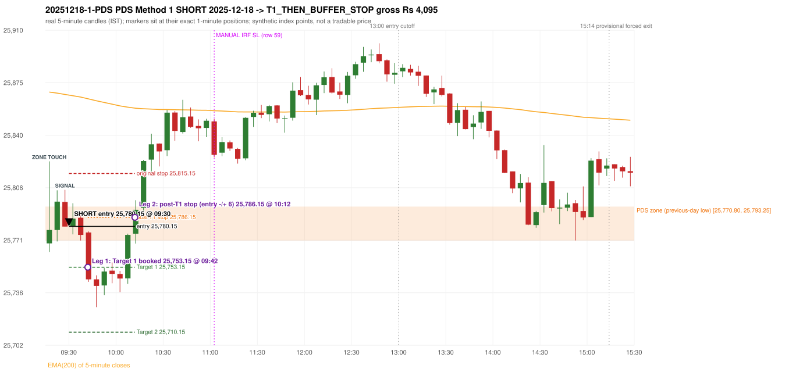

# Trading journal - 2025-12-18 (Thursday)

> Automated, read-only reconstruction of the Phase 3.0 baseline. Synthetic NIFTY 50 index-point P&L (the index is not tradable). The owner's review status is intentionally blank.

## A. Trading day overview

| item | value |
|---|---|
| Date / weekday | 2025-12-18 / Thursday |
| Session type | USABLE_WITH_FLAGS / VALID |
| Original session open (first 1-minute open) | 25,768.90 |
| Previous session | 2025-12-17 |
| Previous-day high / low | 25,928.65 / 25,770.80 |
| Previous-day official close / last 5-minute close | 25,818.55 / 25,822.65 |
| Raw engine records / confirmed signals / fully valid signals | 11 / 6 / 6 |
| Setups that did not complete (invalidated / incomplete) | 5 |
| Executed trades | 1 20251218-1-PDS |
| Gross P&L (Rs, synthetic) | 4,095.00 |
| Illustrative net P&L (Rs; Rs 500/trade + 0.5 pt/fill) | 3,205.00 |
| Day-end portfolio status | DAY_FINISHED |
| Manual journal trades (matched / unmatched) | 1 (0 / 1) |
| Extra automated trades | 1 |

## B. Daily strategy signal timeline (confirmed signals, chronological)

| time | strategy | method | dir | entry-rule status | valid for execution | <= 13:00 | portfolio state | accepted / ignored | specific reason | competing (same minute) |
|---|---|---|---|---|---|---|---|---|---|---|
| 09:30 | PDS | Method 1 | SHORT | PROPOSAL_DEPENDENT | True | True | FIRST_TRADE_ACTIVE | ACCEPTED -> 20251218-1-PDS | first eligible signal of the day; trade 1: T1_THEN_BUFFER_STOP |  |
| 11:05 | IRF | Method 2A | SHORT | PROPOSAL_DEPENDENT | True | True | DAY_FINISHED | IGNORED | DAY_FINISHED [blocked by PDS#1] | IRF Method 2B SHORT |
| 11:05 | IRF | Method 2B | SHORT | PROPOSAL_DEPENDENT | True | True | DAY_FINISHED | IGNORED | DAY_FINISHED [blocked by PDS#1] | IRF Method 2A SHORT |
| 13:20 | IRF | Method 2A | SHORT | PROPOSAL_DEPENDENT | True | False | DAY_FINISHED | IGNORED | DAY_FINISHED [blocked by PDS#1] |  |
| 14:10 | IRF | Method 1 | SHORT | PROPOSAL_DEPENDENT | True | False | DAY_FINISHED | IGNORED | DAY_FINISHED [blocked by PDS#1] |  |
| 15:10 | IRF | Method 1 | SHORT | PROPOSAL_DEPENDENT | True | False | DAY_FINISHED | IGNORED | DAY_FINISHED [blocked by PDS#1] |  |

Engine setups that did not complete (5); the complete list with failed rule ids is in `rejected_signals.csv`:

| candle | strategy | method | dir | status | precise reason | failed rules |
|---|---|---|---|---|---|---|
| 15:25 | IRF | Method 3 | SHORT | INVALIDATED | WICK_SHARE_OUT_OF_BAND | IRF-M3-003 |
| 13:15 | IRF | Method 1/2 | SHORT | INCOMPLETE_AT_EOD | SESSION_ENDED_BEFORE_CONFIRMATION |  |
| 09:15 | ORB | Method 2 | SHORT | INVALIDATED | TRENDLINE_NOT_SUPPORTIVE | ORB-M2-SHORT-001 |
| 09:30 | PDS | Method 1/2/3 | SHORT | INCOMPLETE_AT_EOD | NO_QUALIFYING_ENTRY_BEFORE_SESSION_END |  |
| 10:05 | RF | RF | LONG | INVALIDATED | TREND:EMA_PREV_SESSION_CLOSE wrong side | RF-001;RF-008 |

## C. Detailed trade journals

### 20251218-1-PDS: PDS Method 1 SHORT (FIRST trade)

Chart: 

**Rule configuration:** CFG-phase35_legacy_check-be1db2a09d - signal verification status **PROPOSAL_DEPENDENT** (never VERIFIED while a rule rests on a proposal).

#### 1. Setup identification

PDS Method 1 SHORT: the session opened 1.90 points below the previous-day-low zone [25,770.80, 25,793.25]; price rose to the zone at 09:15 and the first red candle at the zone (09:25, close 25,780.05) had a good body; confirmed 09:30.

#### 2. Candle and indicator calculations

| role | session | candle | O | H | L | C | range | body % | upper wick % | lower wick % | direction | EMA(200) | strong bull / bear | pin bull / bear | small (body<=30%) | used for |
|---|---|---|---|---|---|---|---|---|---|---|---|---|---|---|---|---|
| zone_source_candle | PREVIOUS | 14:40-14:45 | 25,776.15 | 25,794.35 | 25,770.80 | 25,793.25 | 23.55 | 72.61 | 4.67 | 22.72 | BULLISH | 25,874.93 | True / False | False / False | False | previous-day low candle that defines the zone (A_LOWEST_LOW) |
| zone_retest_candle | TODAY | 09:15-09:20 | 25,768.90 | 25,823.20 | 25,763.15 | 25,777.75 | 60.05 | 14.74 | 75.69 | 9.58 | BULLISH | 25,869.04 | False / False | False / True | True | first candle whose range reaches the zone from below |
| signal_candle | TODAY | 09:25-09:30 | 25,796.30 | 25,804.35 | 25,780.05 | 25,780.05 | 24.30 | 66.87 | 33.13 | 0.00 | BEARISH | 25,867.44 | False / True | False / False | False | trigger candle |

Every condition, with the rule, the calculation, the observed values and the result:

| # | group | rule | result | status / numeric definition | calculation | observed | required | available at | why it matters |
|---|---|---|---|---|---|---|---|---|---|
| 1 | SELECTION | SEL-FIRST-001 | PASS | USER_APPROVED / USER_APPROVED | earliest CONFIRMED signal of the day across IRF/ORB/PDR/PDS/RF that passed the controller's checks | 0 confirmed signal(s) earlier today; 6 confirmed signals in the day in total, this one at 09:30 | no earlier executable signal | 2025-12-18 09:30 | the shared controller trades only the first valid signal; the five strategies are not independent positions |
| 2 | SELECTION | SEL-TIE-001 | PASS | USER_APPROVED / USER_APPROVED | other CONFIRMED signals with exactly the same confirmation timestamp | none | no different-strategy / opposite-direction signal in the same minute (otherwise an unresolved conflict, no trade) | 2025-12-18 09:30 | an unresolved same-minute collision would have produced no trade at all |
| 3 | SELECTION | ENTRY-CUTOFF-001 | PASS | USER_APPROVED / USER_APPROVED | fill timestamp vs 13:00:00 IST | signal confirmed 09:30; fill 09:30 | fill at or before 13:00:00 IST | 2025-12-18 09:30 | no new position may be entered with a fill after 13:00 IST |
| 4 | SELECTION | EXE-FILL-001 | PASS | PROPOSED_FOR_REVIEW / PROPOSED_FOR_REVIEW | fill = open of the 1-minute bar that starts at the signal candle's end | bar 09:30 O 25,780.15 H 25,793.50 L 25,774.90 C 25,790.55; executable=True; entry 25,780.15 | fill bar exists, starts exactly at the signal end, is fillable; entry = its open | 2025-12-18 09:30 | a 5-minute signal is known only when its candle closes; the first price that can be traded is the next minute's open |
| 5 | SELECTION | DAY-MAX-001 | PASS | USER_APPROVED / USER_APPROVED | number of entries today | trade 1 of at most 2 | <= 2 entries per day | 2025-12-18 09:30 | daily trade cap |
| 6 | SETUP | PDS-003 | PASS | SOURCE_VERIFIED / EXPLICIT_WORDING_DETAIL_PROPOSED_FOR_REVIEW | gap = first 1-minute open of today - previous session's OFFICIAL close | today's open 25,768.90 (first 1-minute bar 09:15) - previous close 25,818.55 (DAILY_VENDOR, 2025-12-17) = -49.65 points -> gap DOWN | gap DOWN (more than 0 points) | 2025-12-18 09:15 | approved convention: the original first-minute open, never the vendor daily open |
| 7 | SETUP | PDS-006 | PASS | SOURCE_VERIFIED / QUALITATIVE_SOURCE_NUMERIC_DEFINITION_PROPOSED_FOR_REVIEW | gap-down open below the zone | today's open 25,768.90 vs zone low 25,770.80: 1.90 points below | open < zone low | 2025-12-18 09:15 | the guide: 'price is trading below the previous day's support zone' after the gap; a PROPOSED strict reading |
| 8 | SETUP | PDS-004 | PASS | SOURCE_VERIFIED / EXPLICIT_IN_SOURCE | PDS is not a breakdown strategy: the zone must be tested from below first | open 25,768.90 below the zone floor 25,770.80; the first candle to reach the zone is 09:15 | price rises to the zone before any short | 2025-12-18 09:15 | a short below the level without a retest is not this strategy |
| 9 | SETUP | PDS-005 | PASS | SOURCE_VERIFIED / QUALITATIVE_SOURCE_NUMERIC_DEFINITION_PROPOSED_FOR_REVIEW | price comes up to the zone: first candle whose [low, high] intersects it (+/- proximity) | 09:15-09:20 O 25,768.90 H 25,823.20 L 25,763.15 C 25,777.75; range 60.05, body 8.85 (14.74%), upper wick 45.45 (75.69%), lower wick 5.75 (9.58%), bullish; high 25,823.20 vs zone low 25,770.80 | range intersects the zone | 2025-12-18 09:20 | PDS is not a breakdown strategy: the zone must be tested from below first |
| 10 | ZONE | PDS-001 | PASS | SOURCE_VERIFIED / EXPLICIT_IN_SOURCE | direction | SHORT (PDS is short only) | short-only | 2025-12-18 09:30 | PDS sells a retest of previous-day support from below |
| 11 | ZONE | PDS-002 | PASS | SOURCE_VERIFIED / QUALITATIVE_SOURCE_NUMERIC_DEFINITION_PROPOSED_FOR_REVIEW | zone = [lowest low, body top] of the previous session's absolute-low candle (method A_LOWEST_LOW; the lower wick is part of the zone) | zone [25,770.80, 25,793.25] from the 14:40 candle of 2025-12-17 (14:40-14:45 O 25,776.15 H 25,794.35 L 25,770.80 C 25,793.25; range 23.55, body 17.10 (72.61%), upper wick 1.10 (4.67%), lower wick 5.35 (22.72%), bullish); engine recorded [25,770.80, 25,793.25] | previous trading day's low where price took support (body + lower wick) | 2025-12-17 14:45 | the reference level of the strategy; the exact candle(s) are a research choice (PDS-ZONE-002) |
| 12 | CONFIRMATION | PDS-M-001 | PASS | SOURCE_VERIFIED / QUALITATIVE_SOURCE_NUMERIC_DEFINITION_PROPOSED_FOR_REVIEW | Methods 1/2 apply to the FIRST red candle at the zone | first red candle at the zone: 09:25; signal candle 09:25 | the trigger is the first red candle at the zone | 2025-12-18 09:30 | a later red candle would only qualify through Method 3 |
| 13 | CONFIRMATION | PDS-M1-001 | PASS | SOURCE_VERIFIED / QUALITATIVE_SOURCE_NUMERIC_DEFINITION_PROPOSED_FOR_REVIEW | good red candle: bearish close, body >= 60% of range, lower wick <= 20% of range | 09:25-09:30 O 25,796.30 H 25,804.35 L 25,780.05 C 25,780.05; range 24.30, body 16.25 (66.87%), upper wick 8.05 (33.13%), lower wick 0.00 (0.00%), bearish -> body 66.87% / lower wick 0.00% | strong bearish candle (research thresholds) | 2025-12-18 09:30 | the guide: 'a red candle with a good body' - body size is explicitly not numerically defined |
| 14 | EXECUTION | EXE-STOP-001 | PASS | USER_APPROVED / USER_APPROVED | initial stop = entry + 35 points | entry 25,780.15 -> stop 25,815.15 | stop 35 index points (BASELINE) | 2025-12-18 09:30 | defines the loss if the setup fails before Target 1 |
| 15 | EXECUTION | EXE-T1-001 | PASS | SOURCE_VERIFIED / EXPLICIT_IN_SOURCE | Target 1 = entry +/- 27 points | T1 25,753.15 | 27 points | 2025-12-18 09:30 | Leg 1 (3 lots) is booked at Target 1 |
| 16 | EXECUTION | PDS-TGT-001 | PASS | SOURCE_VERIFIED / EXPLICIT_IN_SOURCE | Target 2 = entry +/- 70 points | T2 25,710.15 (the guide says 70; the report suggests 60 - CONFLICTING) | 70 points | 2025-12-18 09:30 | Leg 2 (3 lots) is booked at Target 2 |
| 17 | EXECUTION | POST-T1-STOP-006 | PASS | USER_APPROVED / USER_APPROVED | after T1 the Leg-2 stop = entry + 6 (no trailing) | post-T1 stop 25,786.15 | entry -6 (LONG) / +6 (SHORT) | 2025-12-18 09:30 | protects the remaining three lots once the first three are booked |
| 18 | EXECUTION | SIZE-LOT-001 | PASS | USER_APPROVED / USER_APPROVED | 6 lots x 65 = 390, Leg 1 = 3 lots = 195, Leg 2 = 195 | 6 lots, lot size 65, legs 3+3 | 6 lots in two equal legs | 2025-12-18 09:30 | position size for the synthetic P&L |
| 19 | NOTE | PDS-007 | NOT_APPLICABLE | PROPOSED_FOR_REVIEW / PROPOSED_FOR_REVIEW | repeated PDS signals today | 1 confirmed PDS signal(s) in the session | n/a (disclosure) | 2025-12-18 09:30 | the per-session cap is lifted for the controller runs; the controller trades only the first (or the permitted second) trade |
| 20 | NOTE | PDS-SL-001 | NOT_APPLICABLE | SOURCE_VERIFIED / QUALITATIVE_SOURCE_NUMERIC_DEFINITION_PROPOSED_FOR_REVIEW | the guide's 35-or-40 rule: 35 if the most recent green candle's high is within 35 points of entry, else 40 | most recent green candle high 25,804.05 is 23.90 points from the entry 25,780.15: the guide's rule would select 35 points; the baseline applies a fixed 35 (USER_APPROVED research baseline; the 35-vs-40 selection and the 40-point variant are separate labelled scenarios) | source selection rule | 2025-12-18 09:30 | the stop distance is a modelling choice and changes losses, not entries |
| 21 | NOTE | NOTE-UNRESOLVED-DEPENDENCIES | NOT_APPLICABLE | NOT_A_RULE / NOT_A_REGISTRY_RULE | rules the signal depends on that the sources leave unresolved | engine-recorded unresolved rule ids: none; verification status PROPOSAL_DEPENDENT | n/a (disclosure) | 2025-12-18 09:30 | the entry is only as verified as the rules it rests on |

#### 3. Entry decision and explanation

PDS Method 1 SHORT: the session opened 1.90 points below the previous-day-low zone [25,770.80, 25,793.25]; price rose to the zone at 09:15 and the first red candle at the zone (09:25, close 25,780.05) had a good body; confirmed 09:30.

**Why this trade ahead of the other strategies:** This PDS Method 1 signal was the earliest executable signal of the day: 0 confirmed signal(s) earlier, 0 other in the same minute. 5 later confirmed signal(s) (IRF x5) are logged as ignored or rejected. State of the other four engines at that moment: [IRF: no setup record before this time (a base condition was not met, or nothing triggered)] [ORB: Method 2 invalidated at 09:15: TRENDLINE_NOT_SUPPORTIVE] [PDR: no setup record before this time (a base condition was not met, or nothing triggered)] [RF: no setup record before this time (a base condition was not met, or nothing triggered)]

#### 4. Actual entry execution

| item | value |
|---|---|
| Signal candle | 09:25-09:30 |
| Signal confirmed | 2025-12-18 09:30 |
| Fill timestamp | 2025-12-18 09:30 |
| Entry price | 25,780.15 |
| Source partition / 1-minute bar | data/processed/nifty50/year=2025/month=12/candles.parquet / 2025-12-18 09:30 |
| Source bar O / H / L / C | 25,780.15 / 25,793.50 / 25,774.90 / 25,790.55 |
| Fill assumption | open of the 1-minute bar starting at the signal candle's end (EXE-FILL-001, PROPOSED causal convention) |
| Initial stop / T1 / T2 / post-T1 stop | 25,815.15 / 25,753.15 / 25,710.15 / 25,786.15 |
| Position | 6 lots x 65 = 390 units (Leg 1 195, Leg 2 195) |

#### 5-8. Trade progress, Target 1, post-T1 stop and final exit

Between the 09:30 entry bar and the final exit (43 one-minute bars) the best excursion in favour was 53.40 points at 09:47 and the worst against was 15.30 points at 09:32. At 09:42 price reached Target 1 25,753.15 and three lots exited. At 09:42 the remaining three lots' protective stop was set to 25,786.15 (entry + 6; no trailing, no further change); the engine applies it from the Target-1 bar onward and tests it within that same bar. At 10:12 the remaining three lots stopped out at 25,786.15. T1_THEN_BUFFER_STOP: no second trade that day (DAY-BUF-001).

| leg | qty | exit time | exit price | reason | source 1-minute bar | O / H / L / C | gross points | gross Rs | slippage pts | flags |
|---|---|---|---|---|---|---|---|---|---|---|
| 1 | 195 | 09:42 | 25,753.15 | TARGET_1 | 09:42 | 25,765.20 / 25,768.05 / 25,752.20 / 25,752.90 | 27.00 | 5,265.00 | 0.00 |  |
| 2 | 195 | 10:12 | 25,786.15 | POST_T1_STOP_ENTRY_MINUS_PLUS_6 | 10:12 | 25,782.75 / 25,792.45 / 25,780.95 / 25,792.00 | -6.00 | -1,170.00 | 0.00 |  |

Exit evidence per leg:

* Leg 1: 1-minute bar 09:42 O 25,765.20 H 25,768.05 L 25,752.20 C 25,752.90: low 25,752.20 reached Target 1 25,753.15; Leg 1 booked at the target level
* Leg 2: 1-minute bar 10:12 O 25,782.75 H 25,792.45 L 25,780.95 C 25,792.00: high 25,792.45 reached the post-T1 stop 25,786.15; Leg 2 exits at 25,786.15 at the stop level

#### 9. Gross and illustrative net P&L

| item | value (Rs) |
|---|---|
| Leg 1 gross | 5,265.00 |
| Leg 2 gross | -1,170.00 |
| Trade gross (= Leg 1 + Leg 2) | 4,095.00 |
| Illustrative fixed cost | -500.00 |
| Illustrative slippage (0.5 pt on every fill, entry + exits, all units) | -390.00 |
| Illustrative net | 3,205.00 |

#### 10. Manual journal comparison

EXTRA_AUTOMATED_TRADE: the automated system took PDS Method 1 SHORT at 09:30 (manual traded only other strategies: IRF 11:00 SL). The setup rests on: no unresolved rule. The journal shows no corresponding entry.

## D. Manual journal comparison

| comparison | journal row | journal strategy | manual time | manual direction | manual outcome | match class | trade | auto entry | auto outcome | explanation |
|---|---|---|---|---|---|---|---|---|---|---|
| M059 | 59 | IRF | 11:00 | SHORT | SL | SIGNAL_REJECTED_BY_PORTFOLIO_CONTROLLER |  |  |  | SIGNAL_REJECTED_BY_PORTFOLIO_CONTROLLER: RAW_CONFIRMED_SIGNAL Method 2A 11:05 -> IGNORED - DAY_FINISHED. Heuristic primary cause: PORTFOLIO_COMPETITION; blocked by: PDS#1 |
| E043 |  |  |  |  |  | EXTRA_AUTOMATED_TRADE | 20251218-1-PDS | 09:30 @ 25,780.15 | T1_THEN_BUFFER_STOP | EXTRA_AUTOMATED_TRADE: the automated system took PDS Method 1 SHORT at 09:30 (manual traded only other strategies: IRF 11:00 SL). The setup rests on: no unresolved rule. The journal shows no corresponding entry. |

The journal records no entry price and no exit price (NOT_RECORDED); matching uses date, strategy and candle start only - never P&L.

## E. Daily conclusion

* **Traded:** 20251218-1-PDS - PDS Method 1 SHORT at 09:30 (entry 25,780.15), outcome T1_THEN_BUFFER_STOP, gross Rs 4,095.00, illustrative net Rs 3,205.00. **Why:** This PDS Method 1 signal was the earliest executable signal of the day: 0 confirmed signal(s) earlier, 0 other in the same minute. 5 later confirmed signal(s) (IRF x5) are logged as ignored or rejected. State of the other four engines at that moment: [IRF: no setup record before this time (a base condition was not met, or nothing triggered)] [ORB: Method 2 invalidated at 09:15: TRENDLINE_NOT_SUPPORTIVE] [PDR: no setup record before this time (a base condition was not met, or nothing triggered)] [RF: no setup record before this time (a base condition was not met, or nothing triggered)] **How it ended:** At 09:42 price reached Target 1 25,753.15 and three lots exited. At 09:42 the remaining three lots' protective stop was set to 25,786.15 (entry + 6; no trailing, no further change); the engine applies it from the Target-1 bar onward and tests it within that same bar. At 10:12 the remaining three lots stopped out at 25,786.15. T1_THEN_BUFFER_STOP: no second trade that day (DAY-BUF-001).
* **Ignored / rejected signals:** IRF IGNORED DAY_FINISHED x5
* **Unmatched manual trade (row 59, IRF 11:00 SL):** SIGNAL_REJECTED_BY_PORTFOLIO_CONTROLLER: RAW_CONFIRMED_SIGNAL Method 2A 11:05 -> IGNORED - DAY_FINISHED. Heuristic primary cause: PORTFOLIO_COMPETITION; blocked by: PDS#1
* **Extra automated trade 20251218-1-PDS:** EXTRA_AUTOMATED_TRADE: the automated system took PDS Method 1 SHORT at 09:30 (manual traded only other strategies: IRF 11:00 SL). The setup rests on: no unresolved rule. The journal shows no corresponding entry.
* **Automated triage (not an approval; the owner's review status stays blank):** REVIEW: UNMATCHED_MANUAL+EXTRA_AUTOMATED
