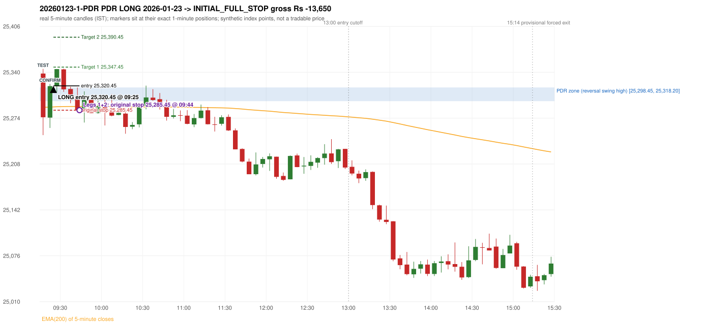
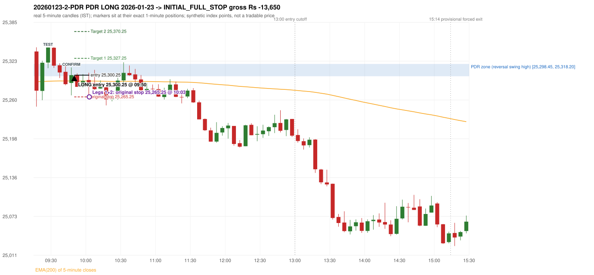

# Trading journal - 2026-01-23 (Friday)

> Automated, read-only reconstruction of the Phase 3.0 baseline. Synthetic NIFTY 50 index-point P&L (the index is not tradable). The owner's review status is intentionally blank.

## A. Trading day overview

| item | value |
|---|---|
| Date / weekday | 2026-01-23 / Friday |
| Session type | USABLE_WITH_FLAGS / VALID |
| Original session open (first 1-minute open) | 25,338.25 |
| Previous session | 2026-01-22 |
| Previous-day high / low | 25,434.85 / 25,168.50 |
| Previous-day official close / last 5-minute close | 25,289.90 / 25,320.45 |
| Raw engine records / confirmed signals / fully valid signals | 7 / 5 / 5 |
| Setups that did not complete (invalidated / incomplete) | 2 |
| Executed trades | 2 20260123-1-PDR;20260123-2-PDR |
| Gross P&L (Rs, synthetic) | -27,300.00 |
| Illustrative net P&L (Rs; Rs 500/trade + 0.5 pt/fill) | -29,080.00 |
| Day-end portfolio status | DAY_FINISHED |
| Manual journal trades (matched / unmatched) | 0 (0 / 0) |
| Extra automated trades | 2 |

## B. Daily strategy signal timeline (confirmed signals, chronological)

| time | strategy | method | dir | entry-rule status | valid for execution | <= 13:00 | portfolio state | accepted / ignored | specific reason | competing (same minute) |
|---|---|---|---|---|---|---|---|---|---|---|
| 09:25 | PDR | PDR | LONG | PROPOSAL_DEPENDENT | True | True | FIRST_TRADE_ACTIVE | ACCEPTED -> 20260123-1-PDR | first eligible signal of the day; trade 1: INITIAL_FULL_STOP |  |
| 09:50 | PDR | PDR | LONG | PROPOSAL_DEPENDENT | True | True | SECOND_TRADE_ACTIVE | ACCEPTED -> 20260123-2-PDR | permitted second trade: newly confirmed PDR/PDS after the original full stop; trade 2: INITIAL_FULL_STOP |  |
| 10:00 | PDR | PDR | LONG | PROPOSAL_DEPENDENT | True | True | SECOND_TRADE_ACTIVE | IGNORED | POSITION_ACTIVE (signal kept for diagnostics only; never reused) [blocked by PDR#2] |  |
| 10:15 | PDR | PDR | LONG | PROPOSAL_DEPENDENT | True | True | DAY_FINISHED | IGNORED | DAY_FINISHED [blocked by PDR#2] |  |
| 10:55 | PDR | PDR | LONG | PROPOSAL_DEPENDENT | True | True | DAY_FINISHED | IGNORED | DAY_FINISHED [blocked by PDR#2] |  |

Engine setups that did not complete (2); the complete list with failed rule ids is in `rejected_signals.csv`:

| candle | strategy | method | dir | status | precise reason | failed rules |
|---|---|---|---|---|---|---|
| 09:30 | IRF | Method 3 | SHORT | INVALIDATED | WICK_SHARE_OUT_OF_BAND | IRF-M3-003 |
| 11:35 | RF | RF | LONG | INCOMPLETE_AT_EOD | NO_RETURN_INSIDE_BEFORE_SESSION_END |  |

## C. Detailed trade journals

### 20260123-1-PDR: PDR LONG (FIRST trade)

Chart: 

**Rule configuration:** CFG-phase35_legacy_check-be1db2a09d - signal verification status **PROPOSAL_DEPENDENT** (never VERIFIED while a rule rests on a proposal).

#### 1. Setup identification

PDR LONG: the session opened 48.35 points above the previous close and 20.05 points above the resistance zone [25,298.45, 25,318.20] taken from the 14:45 swing-high candle of 2026-01-22. The 09:15 candle (25,249.55 - 25,344.90) traded through the zone and closed at 25,275.30, 23.15 points BELOW its floor, and the 09:20 candle closed green at 25,320.10, confirming the entry at 09:25. The engine does not check that the zone held (confirmation close inside/above the zone floor).

#### 2. Candle and indicator calculations

| role | session | candle | O | H | L | C | range | body % | upper wick % | lower wick % | direction | EMA(200) | strong bull / bear | pin bull / bear | small (body<=30%) | used for |
|---|---|---|---|---|---|---|---|---|---|---|---|---|---|---|---|---|
| zone_source_candle | PREVIOUS | 14:45-14:50 | 25,284.10 | 25,318.20 | 25,284.10 | 25,298.45 | 34.10 | 42.08 | 57.92 | 0.00 | BULLISH | 25,289.39 | False / False | False / False | False | swing-high candle that defines the zone (B_SWING_HIGH_REVERSAL) |
| prev_day_high_candle | PREVIOUS | 09:50-09:55 | 25,419.80 | 25,434.85 | 25,394.45 | 25,396.45 | 40.40 | 57.80 | 37.25 | 4.95 | BEARISH | 25,327.58 | False / False | False / False | False | candle of the previous session's absolute high (for comparison) |
| interaction_candle | TODAY | 09:15-09:20 | 25,338.25 | 25,344.90 | 25,249.55 | 25,275.30 | 95.35 | 66.02 | 6.97 | 27.01 | BEARISH | 25,289.60 | False / False | False / False | False | first candle whose range intersects the zone |
| confirmation_candle | TODAY | 09:20-09:25 | 25,274.80 | 25,323.30 | 25,259.90 | 25,320.10 | 63.40 | 71.45 | 5.05 | 23.50 | BULLISH | 25,289.90 | True / False | False / False | False | first green candle after the interaction candle |

Every condition, with the rule, the calculation, the observed values and the result:

| # | group | rule | result | status / numeric definition | calculation | observed | required | available at | why it matters |
|---|---|---|---|---|---|---|---|---|---|
| 1 | SELECTION | SEL-FIRST-001 | PASS | USER_APPROVED / USER_APPROVED | earliest CONFIRMED signal of the day across IRF/ORB/PDR/PDS/RF that passed the controller's checks | 0 confirmed signal(s) earlier today; 5 confirmed signals in the day in total, this one at 09:25 | no earlier executable signal | 2026-01-23 09:25 | the shared controller trades only the first valid signal; the five strategies are not independent positions |
| 2 | SELECTION | SEL-TIE-001 | PASS | USER_APPROVED / USER_APPROVED | other CONFIRMED signals with exactly the same confirmation timestamp | none | no different-strategy / opposite-direction signal in the same minute (otherwise an unresolved conflict, no trade) | 2026-01-23 09:25 | an unresolved same-minute collision would have produced no trade at all |
| 3 | SELECTION | ENTRY-CUTOFF-001 | PASS | USER_APPROVED / USER_APPROVED | fill timestamp vs 13:00:00 IST | signal confirmed 09:25; fill 09:25 | fill at or before 13:00:00 IST | 2026-01-23 09:25 | no new position may be entered with a fill after 13:00 IST |
| 4 | SELECTION | EXE-FILL-001 | PASS | PROPOSED_FOR_REVIEW / PROPOSED_FOR_REVIEW | fill = open of the 1-minute bar that starts at the signal candle's end | bar 09:25 O 25,320.45 H 25,337.15 L 25,312.80 C 25,330.85; executable=True; entry 25,320.45 | fill bar exists, starts exactly at the signal end, is fillable; entry = its open | 2026-01-23 09:25 | a 5-minute signal is known only when its candle closes; the first price that can be traded is the next minute's open |
| 5 | SELECTION | DAY-MAX-001 | PASS | USER_APPROVED / USER_APPROVED | number of entries today | trade 1 of at most 2 | <= 2 entries per day | 2026-01-23 09:25 | daily trade cap |
| 6 | SETUP | PDR-004 | PASS | SOURCE_VERIFIED / EXPLICIT_WORDING_DETAIL_PROPOSED_FOR_REVIEW | gap = first 1-minute open of today - previous session's OFFICIAL close | today's open 25,338.25 (first 1-minute bar 09:15) - previous close 25,289.90 (DAILY_VENDOR, 2026-01-22) = +48.35 points -> gap UP | gap UP (more than 0 points) | 2026-01-23 09:15 | approved convention: the original first-minute open, never the vendor daily open |
| 7 | SETUP | PDR-011 | PASS | SOURCE_VERIFIED / QUALITATIVE_SOURCE_NUMERIC_DEFINITION_PROPOSED_FOR_REVIEW | open relative to the zone (ABOVE_ZONE) | today's open 25,338.25 vs zone high 25,318.20: 20.05 points above | open > zone high | 2026-01-23 09:15 | the guide has price 'pull back into the zone', so the gap-up open is above it; this exclusion is a proposal |
| 8 | ZONE | PDR-001 | PASS | SOURCE_VERIFIED / EXPLICIT_IN_SOURCE | direction | LONG (PDR is long only) | long-only | 2026-01-23 09:25 | PDR buys a retest of previous-day resistance after a gap up |
| 9 | ZONE | PDR-002 | PASS | SOURCE_VERIFIED / QUALITATIVE_SOURCE_NUMERIC_DEFINITION_PROPOSED_FOR_REVIEW | zone = [body top, wick high] of the latest confirmed swing high (k=2) that has a red candle among the peak and the next 2 candles (method B_SWING_HIGH_REVERSAL) | zone [25,298.45, 25,318.20] from the 14:45 candle of 2026-01-22 (body top 25,298.45, wick high 25,318.20; 14:45-14:50 O 25,284.10 H 25,318.20 L 25,284.10 C 25,298.45; range 34.10, body 14.35 (42.08%), upper wick 19.75 (57.92%), lower wick 0.00 (0.00%), bullish); engine recorded [25,298.45, 25,318.20]. Previous session's absolute high 25,434.85 (candle 09:50) - the zone is NOT the day high (distance 116.65 points). Swing confirmed once candle 14:55 closed. | previous-day high where price peaked and reversed | 2026-01-22 15:00 | the source says 'previous day's high/reversal'; which candle marks the zone is an owner-approved research candidate, not a source rule |
| 10 | ZONE | PDR-003 | PASS | SOURCE_VERIFIED / EXPLICIT_IN_SOURCE | the zone is an area, not a single price | zone height 19.75 points [25,298.45, 25,318.20] | a rectangle with positive height | 2026-01-22 15:00 | price may touch any part of the area |
| 11 | ZONE | PDR-010 | UNRESOLVED | SOURCE_VERIFIED / QUALITATIVE_SOURCE_NUMERIC_DEFINITION_PROPOSED_FOR_REVIEW | reversal-quality filter ('clear high and reversal identified') | filter setting OFF | checklist item: a clear previous-day high and reversal | 2026-01-22 | the engine does not test reversal depth in the baseline (filter OFF) |
| 12 | CONFIRMATION | PDR-006 | PASS | SOURCE_VERIFIED / QUALITATIVE_SOURCE_NUMERIC_DEFINITION_PROPOSED_FOR_REVIEW | the first candle whose [low, high] intersects the zone (+/- proximity) | 09:15-09:20 O 25,338.25 H 25,344.90 L 25,249.55 C 25,275.30; range 95.35, body 62.95 (66.02%), upper wick 6.65 (6.97%), lower wick 25.75 (27.01%), bearish; low 25,249.55 vs zone high 25,318.20 (68.65 points inside/below the zone top), high 25,344.90 vs zone low 25,298.45; proximity 0 | range intersects the zone | 2026-01-23 09:20 | the retest of the previous-day resistance |
| 13 | CONFIRMATION | PDR-007 | PASS | SOURCE_VERIFIED / QUALITATIVE_SOURCE_NUMERIC_DEFINITION_PROPOSED_FOR_REVIEW | the first GREEN candle after the interaction candle | 09:20-09:25 O 25,274.80 H 25,323.30 L 25,259.90 C 25,320.10; range 63.40, body 45.30 (71.45%), upper wick 3.20 (5.05%), lower wick 14.90 (23.50%), bullish; interaction candle 09:15, confirmation candle 09:20 | close > open, strictly after the interaction candle | 2026-01-23 09:25 | the guide asks for 'a green candle' after the test; it gives no size or position test |
| 14 | CONFIRMATION | PDR-005 | PASS | SOURCE_VERIFIED / EXPLICIT_IN_SOURCE | no entry at the open: price must first come back toward the zone | interaction candle 09:15 (candle no. 1 of the session) precedes the entry candle 09:20; fill 09:25 | interaction before the entry; fill after 09:20 | 2026-01-23 09:25 | if price keeps rising without returning to the zone there is no setup |
| 15 | EXECUTION | EXE-STOP-001 | PASS | USER_APPROVED / USER_APPROVED | initial stop = entry - 35 points | entry 25,320.45 -> stop 25,285.45 | stop 35 index points (BASELINE) | 2026-01-23 09:25 | defines the loss if the setup fails before Target 1 |
| 16 | EXECUTION | EXE-T1-001 | PASS | SOURCE_VERIFIED / EXPLICIT_IN_SOURCE | Target 1 = entry +/- 27 points | T1 25,347.45 | 27 points | 2026-01-23 09:25 | Leg 1 (3 lots) is booked at Target 1 |
| 17 | EXECUTION | PDR-008 | PASS | SOURCE_VERIFIED / EXPLICIT_IN_SOURCE | Target 2 = entry +/- 70 points | T2 25,390.45 (the guide says 70; the performance report's winners suggest 60 - CONFLICTING, recorded) | 70 points | 2026-01-23 09:25 | Leg 2 (3 lots) is booked at Target 2 |
| 18 | EXECUTION | POST-T1-STOP-006 | PASS | USER_APPROVED / USER_APPROVED | after T1 the Leg-2 stop = entry - 6 (no trailing) | post-T1 stop 25,314.45 | entry -6 (LONG) / +6 (SHORT) | 2026-01-23 09:25 | protects the remaining three lots once the first three are booked |
| 19 | EXECUTION | SIZE-LOT-001 | PASS | USER_APPROVED / USER_APPROVED | 6 lots x 65 = 390, Leg 1 = 3 lots = 195, Leg 2 = 195 | 6 lots, lot size 65, legs 3+3 | 6 lots in two equal legs | 2026-01-23 09:25 | position size for the synthetic P&L |
| 20 | NOTE | PDR-007 | UNRESOLVED | SOURCE_VERIFIED / QUALITATIVE_SOURCE_NUMERIC_DEFINITION_PROPOSED_FOR_REVIEW | did the zone hold? (is the confirmation candle's close back at/above the zone floor?) | confirmation close 25,320.10 vs zone floor 25,298.45 / top 25,318.20: above the zone top; interaction low 25,249.55 | the engine does NOT test that resistance-turned-support held | 2026-01-23 09:25 | a later green candle is accepted even after price traded through the zone; a human would normally check the hold |
| 21 | NOTE | PDR-012 | NOT_APPLICABLE | PROPOSED_FOR_REVIEW / PROPOSED_FOR_REVIEW | repeated PDR signals today | 5 confirmed PDR signal(s) in the session | n/a (disclosure) | 2026-01-23 09:25 | the per-session cap is lifted for the controller runs; the controller trades only the first |
| 22 | NOTE | PDR-009 | UNRESOLVED | UNRESOLVED / UNRESOLVED | stop 35 or 40 'depending on the situation' | the guide gives no selection rule; baseline fixed 35 points | unresolved in the source | 2026-01-23 09:25 | PDR stop selection is left to the owner |
| 23 | NOTE | NOTE-UNRESOLVED-DEPENDENCIES | UNRESOLVED | NOT_A_RULE / NOT_A_REGISTRY_RULE | rules the signal depends on that the sources leave unresolved | engine-recorded unresolved rule ids: PDR-010; verification status PROPOSAL_DEPENDENT | n/a (disclosure) | 2026-01-23 09:25 | the entry is only as verified as the rules it rests on |

#### 3. Entry decision and explanation

PDR LONG: the session opened 48.35 points above the previous close and 20.05 points above the resistance zone [25,298.45, 25,318.20] taken from the 14:45 swing-high candle of 2026-01-22. The 09:15 candle (25,249.55 - 25,344.90) traded through the zone and closed at 25,275.30, 23.15 points BELOW its floor, and the 09:20 candle closed green at 25,320.10, confirming the entry at 09:25. The engine does not check that the zone held (confirmation close inside/above the zone floor).

**Why this trade ahead of the other strategies:** This PDR signal was the earliest executable signal of the day: 0 confirmed signal(s) earlier, 0 other in the same minute. 4 later confirmed signal(s) (PDR x4) are logged as ignored or rejected. State of the other four engines at that moment: [IRF: no setup record before this time (a base condition was not met, or nothing triggered)] [ORB: no setup record before this time (a base condition was not met, or nothing triggered)] [PDS: no setup record before this time (a base condition was not met, or nothing triggered)] [RF: no setup record before this time (a base condition was not met, or nothing triggered)]

#### 4. Actual entry execution

| item | value |
|---|---|
| Signal candle | 09:20-09:25 |
| Signal confirmed | 2026-01-23 09:25 |
| Fill timestamp | 2026-01-23 09:25 |
| Entry price | 25,320.45 |
| Source partition / 1-minute bar | data/processed/nifty50/year=2026/month=01/candles.parquet / 2026-01-23 09:25 |
| Source bar O / H / L / C | 25,320.45 / 25,337.15 / 25,312.80 / 25,330.85 |
| Fill assumption | open of the 1-minute bar starting at the signal candle's end (EXE-FILL-001, PROPOSED causal convention) |
| Initial stop / T1 / T2 / post-T1 stop | 25,285.45 / 25,347.45 / 25,390.45 / 25,314.45 |
| Position | 6 lots x 65 = 390 units (Leg 1 195, Leg 2 195) |

#### 5-8. Trade progress, Target 1, post-T1 stop and final exit

Between the 09:25 entry bar and the final exit (20 one-minute bars) the best excursion in favour was 24.90 points at 09:30 and the worst against was 36.50 points at 09:44. At 09:44 price reached the original stop 25,285.45 before Target 1 25,347.45, so all six lots exited together at 25,285.45. This is an INITIAL_FULL_STOP: one more trade is allowed that day, only a newly confirmed PDR/PDS signal.

| leg | qty | exit time | exit price | reason | source 1-minute bar | O / H / L / C | gross points | gross Rs | slippage pts | flags |
|---|---|---|---|---|---|---|---|---|---|---|
| 1 | 195 | 09:44 | 25,285.45 | ORIGINAL_STOP_BEFORE_T1 | 09:44 | 25,298.60 / 25,299.75 / 25,283.95 / 25,285.70 | -35.00 | -6,825.00 | 0.00 |  |
| 2 | 195 | 09:44 | 25,285.45 | ORIGINAL_STOP_BEFORE_T1 | 09:44 | 25,298.60 / 25,299.75 / 25,283.95 / 25,285.70 | -35.00 | -6,825.00 | 0.00 |  |

Exit evidence per leg:

* Leg 1: 1-minute bar 09:44 O 25,298.60 H 25,299.75 L 25,283.95 C 25,285.70: low 25,283.95 reached the original stop 25,285.45 before Target 1 25,347.45 was touched; both legs exit at the stop level 25,285.45
* Leg 2: 1-minute bar 09:44 O 25,298.60 H 25,299.75 L 25,283.95 C 25,285.70: low 25,283.95 reached the original stop 25,285.45 before Target 1 25,347.45 was touched; both legs exit at the stop level 25,285.45

#### 9. Gross and illustrative net P&L

| item | value (Rs) |
|---|---|
| Leg 1 gross | -6,825.00 |
| Leg 2 gross | -6,825.00 |
| Trade gross (= Leg 1 + Leg 2) | -13,650.00 |
| Illustrative fixed cost | -500.00 |
| Illustrative slippage (0.5 pt on every fill, entry + exits, all units) | -390.00 |
| Illustrative net | -14,540.00 |

#### 10. Manual journal comparison

EXTRA_AUTOMATED_TRADE: the automated system took PDR PDR LONG at 09:25 (no manual trade that day). The setup rests on: PDR-010: Reversal-quality filter is OFF in the baseline | PDR-007: Engine does not test whether the zone held | PDR-009: PDR stop selection rule is not defined | NOTE-UNRESOLVED-DEPENDENCIES: Disclosure of unresolved source rules behind this signal. The journal shows no corresponding entry.

### 20260123-2-PDR: PDR LONG (SECOND trade)

Chart: 

**Rule configuration:** CFG-phase35_legacy_check-be1db2a09d - signal verification status **PROPOSAL_DEPENDENT** (never VERIFIED while a rule rests on a proposal).

#### 1. Setup identification

PDR LONG: the session opened 48.35 points above the previous close and 20.05 points above the resistance zone [25,298.45, 25,318.20] taken from the 14:45 swing-high candle of 2026-01-22. The 09:25 candle (25,311.35 - 25,344.60) retested the zone, and the 09:45 candle closed green at 25,300.25, confirming the entry at 09:50. The engine does not check that the zone held (confirmation close inside/above the zone floor).

#### 2. Candle and indicator calculations

| role | session | candle | O | H | L | C | range | body % | upper wick % | lower wick % | direction | EMA(200) | strong bull / bear | pin bull / bear | small (body<=30%) | used for |
|---|---|---|---|---|---|---|---|---|---|---|---|---|---|---|---|---|
| zone_source_candle | PREVIOUS | 14:45-14:50 | 25,284.10 | 25,318.20 | 25,284.10 | 25,298.45 | 34.10 | 42.08 | 57.92 | 0.00 | BULLISH | 25,289.39 | False / False | False / False | False | swing-high candle that defines the zone (B_SWING_HIGH_REVERSAL) |
| prev_day_high_candle | PREVIOUS | 09:50-09:55 | 25,419.80 | 25,434.85 | 25,394.45 | 25,396.45 | 40.40 | 57.80 | 37.25 | 4.95 | BEARISH | 25,327.58 | False / False | False / False | False | candle of the previous session's absolute high (for comparison) |
| interaction_candle | TODAY | 09:25-09:30 | 25,320.45 | 25,344.60 | 25,311.35 | 25,344.60 | 33.25 | 72.63 | 0.00 | 27.37 | BULLISH | 25,290.45 | True / False | False / False | False | first candle whose range intersects the zone |
| confirmation_candle | TODAY | 09:45-09:50 | 25,287.60 | 25,312.55 | 25,267.70 | 25,300.25 | 44.85 | 28.21 | 27.42 | 44.37 | BULLISH | 25,290.88 | False / False | False / False | True | first green candle after the interaction candle |

Every condition, with the rule, the calculation, the observed values and the result:

| # | group | rule | result | status / numeric definition | calculation | observed | required | available at | why it matters |
|---|---|---|---|---|---|---|---|---|---|
| 1 | SELECTION | DAY-SL-001 | PASS | USER_APPROVED / USER_APPROVED | first trade outcome, strategy of this signal, position-close time vs this signal's timestamp | first trade PDR PDR closed as INITIAL_FULL_STOP at 09:44; position free from 09:45; this PDR signal confirmed 09:50 | first trade INITIAL_FULL_STOP before Target 1, and a NEWLY confirmed PDR/PDS signal after the first position closed | 2026-01-23 09:50 | the only way a second trade is allowed |
| 2 | SELECTION | DAY-NOREUSE-001 | PASS | USER_APPROVED / USER_APPROVED | signals confirmed while the first position was open | 1 signal(s) were ignored during the first trade (never reused): PDR PDR LONG @09:25 | this trade comes from a signal confirmed after the first exit, not from an ignored one | 2026-01-23 09:50 | an ignored signal can never become the second trade |
| 3 | SELECTION | ENTRY-CUTOFF-001 | PASS | USER_APPROVED / USER_APPROVED | fill timestamp vs 13:00:00 IST | signal confirmed 09:50; fill 09:50 | fill at or before 13:00:00 IST | 2026-01-23 09:50 | no new position may be entered with a fill after 13:00 IST |
| 4 | SELECTION | EXE-FILL-001 | PASS | PROPOSED_FOR_REVIEW / PROPOSED_FOR_REVIEW | fill = open of the 1-minute bar that starts at the signal candle's end | bar 09:50 O 25,300.25 H 25,301.70 L 25,295.40 C 25,300.70; executable=True; entry 25,300.25 | fill bar exists, starts exactly at the signal end, is fillable; entry = its open | 2026-01-23 09:50 | a 5-minute signal is known only when its candle closes; the first price that can be traded is the next minute's open |
| 5 | SELECTION | DAY-MAX-001 | PASS | USER_APPROVED / USER_APPROVED | number of entries today | trade 2 of at most 2 | <= 2 entries per day | 2026-01-23 09:50 | daily trade cap |
| 6 | SETUP | PDR-004 | PASS | SOURCE_VERIFIED / EXPLICIT_WORDING_DETAIL_PROPOSED_FOR_REVIEW | gap = first 1-minute open of today - previous session's OFFICIAL close | today's open 25,338.25 (first 1-minute bar 09:15) - previous close 25,289.90 (DAILY_VENDOR, 2026-01-22) = +48.35 points -> gap UP | gap UP (more than 0 points) | 2026-01-23 09:15 | approved convention: the original first-minute open, never the vendor daily open |
| 7 | SETUP | PDR-011 | PASS | SOURCE_VERIFIED / QUALITATIVE_SOURCE_NUMERIC_DEFINITION_PROPOSED_FOR_REVIEW | open relative to the zone (ABOVE_ZONE) | today's open 25,338.25 vs zone high 25,318.20: 20.05 points above | open > zone high | 2026-01-23 09:15 | the guide has price 'pull back into the zone', so the gap-up open is above it; this exclusion is a proposal |
| 8 | ZONE | PDR-001 | PASS | SOURCE_VERIFIED / EXPLICIT_IN_SOURCE | direction | LONG (PDR is long only) | long-only | 2026-01-23 09:50 | PDR buys a retest of previous-day resistance after a gap up |
| 9 | ZONE | PDR-002 | PASS | SOURCE_VERIFIED / QUALITATIVE_SOURCE_NUMERIC_DEFINITION_PROPOSED_FOR_REVIEW | zone = [body top, wick high] of the latest confirmed swing high (k=2) that has a red candle among the peak and the next 2 candles (method B_SWING_HIGH_REVERSAL) | zone [25,298.45, 25,318.20] from the 14:45 candle of 2026-01-22 (body top 25,298.45, wick high 25,318.20; 14:45-14:50 O 25,284.10 H 25,318.20 L 25,284.10 C 25,298.45; range 34.10, body 14.35 (42.08%), upper wick 19.75 (57.92%), lower wick 0.00 (0.00%), bullish); engine recorded [25,298.45, 25,318.20]. Previous session's absolute high 25,434.85 (candle 09:50) - the zone is NOT the day high (distance 116.65 points). Swing confirmed once candle 14:55 closed. | previous-day high where price peaked and reversed | 2026-01-22 15:00 | the source says 'previous day's high/reversal'; which candle marks the zone is an owner-approved research candidate, not a source rule |
| 10 | ZONE | PDR-003 | PASS | SOURCE_VERIFIED / EXPLICIT_IN_SOURCE | the zone is an area, not a single price | zone height 19.75 points [25,298.45, 25,318.20] | a rectangle with positive height | 2026-01-22 15:00 | price may touch any part of the area |
| 11 | ZONE | PDR-010 | UNRESOLVED | SOURCE_VERIFIED / QUALITATIVE_SOURCE_NUMERIC_DEFINITION_PROPOSED_FOR_REVIEW | reversal-quality filter ('clear high and reversal identified') | filter setting OFF | checklist item: a clear previous-day high and reversal | 2026-01-22 | the engine does not test reversal depth in the baseline (filter OFF) |
| 12 | CONFIRMATION | PDR-006 | PASS | SOURCE_VERIFIED / QUALITATIVE_SOURCE_NUMERIC_DEFINITION_PROPOSED_FOR_REVIEW | the first candle whose [low, high] intersects the zone (+/- proximity) | 09:25-09:30 O 25,320.45 H 25,344.60 L 25,311.35 C 25,344.60; range 33.25, body 24.15 (72.63%), upper wick 0.00 (0.00%), lower wick 9.10 (27.37%), bullish; low 25,311.35 vs zone high 25,318.20 (6.85 points inside/below the zone top), high 25,344.60 vs zone low 25,298.45; proximity 0 | range intersects the zone | 2026-01-23 09:30 | the retest of the previous-day resistance (the engine re-arms after an earlier signal: scanning restarted after the 09:20 candle) |
| 13 | CONFIRMATION | PDR-007 | PASS | SOURCE_VERIFIED / QUALITATIVE_SOURCE_NUMERIC_DEFINITION_PROPOSED_FOR_REVIEW | the first GREEN candle after the interaction candle | 09:45-09:50 O 25,287.60 H 25,312.55 L 25,267.70 C 25,300.25; range 44.85, body 12.65 (28.21%), upper wick 12.30 (27.42%), lower wick 19.90 (44.37%), bullish; interaction candle 09:25, confirmation candle 09:45 | close > open, strictly after the interaction candle | 2026-01-23 09:50 | the guide asks for 'a green candle' after the test; it gives no size or position test |
| 14 | CONFIRMATION | PDR-005 | PASS | SOURCE_VERIFIED / EXPLICIT_IN_SOURCE | no entry at the open: price must first come back toward the zone | interaction candle 09:25 (candle no. 3 of the session) precedes the entry candle 09:45; fill 09:50 | interaction before the entry; fill after 09:20 | 2026-01-23 09:50 | if price keeps rising without returning to the zone there is no setup |
| 15 | EXECUTION | EXE-STOP-001 | PASS | USER_APPROVED / USER_APPROVED | initial stop = entry - 35 points | entry 25,300.25 -> stop 25,265.25 | stop 35 index points (BASELINE) | 2026-01-23 09:50 | defines the loss if the setup fails before Target 1 |
| 16 | EXECUTION | EXE-T1-001 | PASS | SOURCE_VERIFIED / EXPLICIT_IN_SOURCE | Target 1 = entry +/- 27 points | T1 25,327.25 | 27 points | 2026-01-23 09:50 | Leg 1 (3 lots) is booked at Target 1 |
| 17 | EXECUTION | PDR-008 | PASS | SOURCE_VERIFIED / EXPLICIT_IN_SOURCE | Target 2 = entry +/- 70 points | T2 25,370.25 (the guide says 70; the performance report's winners suggest 60 - CONFLICTING, recorded) | 70 points | 2026-01-23 09:50 | Leg 2 (3 lots) is booked at Target 2 |
| 18 | EXECUTION | POST-T1-STOP-006 | PASS | USER_APPROVED / USER_APPROVED | after T1 the Leg-2 stop = entry - 6 (no trailing) | post-T1 stop 25,294.25 | entry -6 (LONG) / +6 (SHORT) | 2026-01-23 09:50 | protects the remaining three lots once the first three are booked |
| 19 | EXECUTION | SIZE-LOT-001 | PASS | USER_APPROVED / USER_APPROVED | 6 lots x 65 = 390, Leg 1 = 3 lots = 195, Leg 2 = 195 | 6 lots, lot size 65, legs 3+3 | 6 lots in two equal legs | 2026-01-23 09:50 | position size for the synthetic P&L |
| 20 | NOTE | PDR-007 | UNRESOLVED | SOURCE_VERIFIED / QUALITATIVE_SOURCE_NUMERIC_DEFINITION_PROPOSED_FOR_REVIEW | did the zone hold? (is the confirmation candle's close back at/above the zone floor?) | confirmation close 25,300.25 vs zone floor 25,298.45 / top 25,318.20: inside the zone; interaction low 25,311.35 | the engine does NOT test that resistance-turned-support held | 2026-01-23 09:50 | a later green candle is accepted even after price traded through the zone; a human would normally check the hold |
| 21 | NOTE | PDR-012 | NOT_APPLICABLE | PROPOSED_FOR_REVIEW / PROPOSED_FOR_REVIEW | repeated PDR signals today | 5 confirmed PDR signal(s) in the session | n/a (disclosure) | 2026-01-23 09:50 | the per-session cap is lifted for the controller runs; the controller trades only the first |
| 22 | NOTE | PDR-009 | UNRESOLVED | UNRESOLVED / UNRESOLVED | stop 35 or 40 'depending on the situation' | the guide gives no selection rule; baseline fixed 35 points | unresolved in the source | 2026-01-23 09:50 | PDR stop selection is left to the owner |
| 23 | NOTE | NOTE-UNRESOLVED-DEPENDENCIES | UNRESOLVED | NOT_A_RULE / NOT_A_REGISTRY_RULE | rules the signal depends on that the sources leave unresolved | engine-recorded unresolved rule ids: PDR-010; verification status PROPOSAL_DEPENDENT | n/a (disclosure) | 2026-01-23 09:50 | the entry is only as verified as the rules it rests on |

#### 3. Entry decision and explanation

PDR LONG: the session opened 48.35 points above the previous close and 20.05 points above the resistance zone [25,298.45, 25,318.20] taken from the 14:45 swing-high candle of 2026-01-22. The 09:25 candle (25,311.35 - 25,344.60) retested the zone, and the 09:45 candle closed green at 25,300.25, confirming the entry at 09:50. The engine does not check that the zone held (confirmation close inside/above the zone floor).

**Why this trade ahead of the other strategies:** The first trade (PDR PDR) was stopped out before Target 1 at 09:44; this newly confirmed PDR signal at 09:50 is the first PDR/PDS signal after that exit, so it is the day's permitted second trade. State of the other engines at that moment: [IRF: Method 3 invalidated at 09:30: WICK_SHARE_OUT_OF_BAND] [ORB: no setup record before this time (a base condition was not met, or nothing triggered)] [PDS: no setup record before this time (a base condition was not met, or nothing triggered)] [RF: no setup record before this time (a base condition was not met, or nothing triggered)]

#### 4. Actual entry execution

| item | value |
|---|---|
| Signal candle | 09:45-09:50 |
| Signal confirmed | 2026-01-23 09:50 |
| Fill timestamp | 2026-01-23 09:50 |
| Entry price | 25,300.25 |
| Source partition / 1-minute bar | data/processed/nifty50/year=2026/month=01/candles.parquet / 2026-01-23 09:50 |
| Source bar O / H / L / C | 25,300.25 / 25,301.70 / 25,295.40 / 25,300.70 |
| Fill assumption | open of the 1-minute bar starting at the signal candle's end (EXE-FILL-001, PROPOSED causal convention) |
| Initial stop / T1 / T2 / post-T1 stop | 25,265.25 / 25,327.25 / 25,370.25 / 25,294.25 |
| Position | 6 lots x 65 = 390 units (Leg 1 195, Leg 2 195) |

#### 5-8. Trade progress, Target 1, post-T1 stop and final exit

Between the 09:50 entry bar and the final exit (14 one-minute bars) the best excursion in favour was 3.80 points at 10:00 and the worst against was 36.75 points at 10:03. At 10:03 price reached the original stop 25,265.25 before Target 1 25,327.25, so all six lots exited together at 25,265.25. This is an INITIAL_FULL_STOP: one more trade is allowed that day, only a newly confirmed PDR/PDS signal.

| leg | qty | exit time | exit price | reason | source 1-minute bar | O / H / L / C | gross points | gross Rs | slippage pts | flags |
|---|---|---|---|---|---|---|---|---|---|---|
| 1 | 195 | 10:03 | 25,265.25 | ORIGINAL_STOP_BEFORE_T1 | 10:03 | 25,275.05 / 25,277.45 / 25,263.50 / 25,268.80 | -35.00 | -6,825.00 | 0.00 |  |
| 2 | 195 | 10:03 | 25,265.25 | ORIGINAL_STOP_BEFORE_T1 | 10:03 | 25,275.05 / 25,277.45 / 25,263.50 / 25,268.80 | -35.00 | -6,825.00 | 0.00 |  |

Exit evidence per leg:

* Leg 1: 1-minute bar 10:03 O 25,275.05 H 25,277.45 L 25,263.50 C 25,268.80: low 25,263.50 reached the original stop 25,265.25 before Target 1 25,327.25 was touched; both legs exit at the stop level 25,265.25
* Leg 2: 1-minute bar 10:03 O 25,275.05 H 25,277.45 L 25,263.50 C 25,268.80: low 25,263.50 reached the original stop 25,265.25 before Target 1 25,327.25 was touched; both legs exit at the stop level 25,265.25

#### 9. Gross and illustrative net P&L

| item | value (Rs) |
|---|---|
| Leg 1 gross | -6,825.00 |
| Leg 2 gross | -6,825.00 |
| Trade gross (= Leg 1 + Leg 2) | -13,650.00 |
| Illustrative fixed cost | -500.00 |
| Illustrative slippage (0.5 pt on every fill, entry + exits, all units) | -390.00 |
| Illustrative net | -14,540.00 |

#### 10. Manual journal comparison

EXTRA_AUTOMATED_TRADE: the automated system took PDR PDR LONG at 09:50 (no manual trade that day). The setup rests on: PDR-010: Reversal-quality filter is OFF in the baseline | PDR-007: Engine does not test whether the zone held | PDR-009: PDR stop selection rule is not defined | NOTE-UNRESOLVED-DEPENDENCIES: Disclosure of unresolved source rules behind this signal. The journal shows no corresponding entry.

## D. Manual journal comparison

| comparison | journal row | journal strategy | manual time | manual direction | manual outcome | match class | trade | auto entry | auto outcome | explanation |
|---|---|---|---|---|---|---|---|---|---|---|
| E058 |  |  |  |  |  | EXTRA_AUTOMATED_TRADE | 20260123-1-PDR | 09:25 @ 25,320.45 | INITIAL_FULL_STOP | EXTRA_AUTOMATED_TRADE: the automated system took PDR PDR LONG at 09:25 (no manual trade that day). The setup rests on: PDR-010: Reversal-quality filter is OFF in the baseline \| PDR-007: Engine does not test whether the zone held \| PDR-009: PDR stop selection rule is not defined \| NOTE-UNRESOLVED-DEPENDENCIES: Disclosure of unresolved source rules behind this signal. The journal shows no corresponding entry. |
| E059 |  |  |  |  |  | EXTRA_AUTOMATED_TRADE | 20260123-2-PDR | 09:50 @ 25,300.25 | INITIAL_FULL_STOP | EXTRA_AUTOMATED_TRADE: the automated system took PDR PDR LONG at 09:50 (no manual trade that day). The setup rests on: PDR-010: Reversal-quality filter is OFF in the baseline \| PDR-007: Engine does not test whether the zone held \| PDR-009: PDR stop selection rule is not defined \| NOTE-UNRESOLVED-DEPENDENCIES: Disclosure of unresolved source rules behind this signal. The journal shows no corresponding entry. |

The journal records no entry price and no exit price (NOT_RECORDED); matching uses date, strategy and candle start only - never P&L.

## E. Daily conclusion

* **Traded:** 20260123-1-PDR - PDR PDR LONG at 09:25 (entry 25,320.45), outcome INITIAL_FULL_STOP, gross Rs -13,650.00, illustrative net Rs -14,540.00. **Why:** This PDR signal was the earliest executable signal of the day: 0 confirmed signal(s) earlier, 0 other in the same minute. 4 later confirmed signal(s) (PDR x4) are logged as ignored or rejected. State of the other four engines at that moment: [IRF: no setup record before this time (a base condition was not met, or nothing triggered)] [ORB: no setup record before this time (a base condition was not met, or nothing triggered)] [PDS: no setup record before this time (a base condition was not met, or nothing triggered)] [RF: no setup record before this time (a base condition was not met, or nothing triggered)] **How it ended:** At 09:44 price reached the original stop 25,285.45 before Target 1 25,347.45, so all six lots exited together at 25,285.45. This is an INITIAL_FULL_STOP: one more trade is allowed that day, only a newly confirmed PDR/PDS signal.
* **Traded:** 20260123-2-PDR - PDR PDR LONG at 09:50 (entry 25,300.25), outcome INITIAL_FULL_STOP, gross Rs -13,650.00, illustrative net Rs -14,540.00. **Why:** The first trade (PDR PDR) was stopped out before Target 1 at 09:44; this newly confirmed PDR signal at 09:50 is the first PDR/PDS signal after that exit, so it is the day's permitted second trade. State of the other engines at that moment: [IRF: Method 3 invalidated at 09:30: WICK_SHARE_OUT_OF_BAND] [ORB: no setup record before this time (a base condition was not met, or nothing triggered)] [PDS: no setup record before this time (a base condition was not met, or nothing triggered)] [RF: no setup record before this time (a base condition was not met, or nothing triggered)] **How it ended:** At 10:03 price reached the original stop 25,265.25 before Target 1 25,327.25, so all six lots exited together at 25,265.25. This is an INITIAL_FULL_STOP: one more trade is allowed that day, only a newly confirmed PDR/PDS signal.
* **Ignored / rejected signals:** PDR IGNORED DAY_FINISHED x2; PDR IGNORED POSITION_ACTIVE x1
* **Extra automated trade 20260123-1-PDR:** EXTRA_AUTOMATED_TRADE: the automated system took PDR PDR LONG at 09:25 (no manual trade that day). The setup rests on: PDR-010: Reversal-quality filter is OFF in the baseline | PDR-007: Engine does not test whether the zone held | PDR-009: PDR stop selection rule is not defined | NOTE-UNRESOLVED-DEPENDENCIES: Disclosure of unresolved source rules behind this signal. The journal shows no corresponding entry.
* **Extra automated trade 20260123-2-PDR:** EXTRA_AUTOMATED_TRADE: the automated system took PDR PDR LONG at 09:50 (no manual trade that day). The setup rests on: PDR-010: Reversal-quality filter is OFF in the baseline | PDR-007: Engine does not test whether the zone held | PDR-009: PDR stop selection rule is not defined | NOTE-UNRESOLVED-DEPENDENCIES: Disclosure of unresolved source rules behind this signal. The journal shows no corresponding entry.
* **Open strategy-definition issues that affected this day:** NOTE-UNRESOLVED-DEPENDENCIES, PDR-007 (After the zone has been tested, wait for a green candle and take the long on that confirmation), PDR-009 (Stop-loss 35 or 40 'depending on the situation'; choose before entering, do not move after entry), PDR-010 (Checklist: a clear previous-day high and reversal must be identified)
* **Automated triage (not an approval; the owner's review status stays blank):** REVIEW: EXTRA_AUTOMATED
