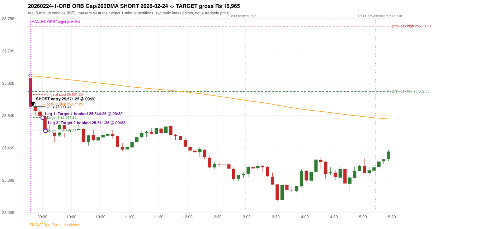

# Trading journal - 2026-02-24 (Tuesday)

> Automated, read-only reconstruction of the Phase 3.0 baseline. Synthetic NIFTY 50 index-point P&L (the index is not tradable). The owner's review status is intentionally blank.

## A. Trading day overview

| item | value |
|---|---|
| Date / weekday | 2026-02-24 / Tuesday |
| Session type | USABLE_WITH_FLAGS / VALID |
| Original session open (first 1-minute open) | 25,641.80 |
| Previous session | 2026-02-23 |
| Previous-day high / low | 25,770.70 / 25,609.35 |
| Previous-day official close / last 5-minute close | 25,713.00 / 25,704.00 |
| Raw engine records / confirmed signals / fully valid signals | 5 / 1 / 1 |
| Setups that did not complete (invalidated / incomplete) | 4 |
| Executed trades | 1 20260224-1-ORB |
| Gross P&L (Rs, synthetic) | 16,965.00 |
| Illustrative net P&L (Rs; Rs 500/trade + 0.5 pt/fill) | 16,075.00 |
| Day-end portfolio status | DAY_FINISHED |
| Manual journal trades (matched / unmatched) | 1 (1 / 0) |
| Extra automated trades | 0 |

## B. Daily strategy signal timeline (confirmed signals, chronological)

| time | strategy | method | dir | entry-rule status | valid for execution | <= 13:00 | portfolio state | accepted / ignored | specific reason | competing (same minute) |
|---|---|---|---|---|---|---|---|---|---|---|
| 09:20 | ORB | Gap/200DMA | SHORT | RESEARCH_VARIANT | True | True | FIRST_TRADE_ACTIVE | ACCEPTED -> 20260224-1-ORB | first eligible signal of the day; trade 1: TARGET |  |

Engine setups that did not complete (4); the complete list with failed rule ids is in `rejected_signals.csv`:

| candle | strategy | method | dir | status | precise reason | failed rules |
|---|---|---|---|---|---|---|
| 09:15 | ORB | Method 1 | SHORT | INVALIDATED | TREND:EMA_PREV_SESSION_CLOSE wrong side | ORB-TREND-001;ORB-TREND-002 |
| 09:15 | ORB | Method 2 | SHORT | INVALIDATED | TREND:EMA_PREV_SESSION_CLOSE wrong side | ORB-TREND-001;ORB-TREND-002 |
| 09:15 | PDS | Method 1/2/3 | SHORT | INVALIDATED | GAP_DOWN_OPEN_NOT_BELOW_ZONE | PDS-006 |
| 09:20 | RF | RF | LONG | INCOMPLETE_AT_EOD | NO_RETURN_INSIDE_BEFORE_SESSION_END |  |

## C. Detailed trade journals

### 20260224-1-ORB: ORB Gap/200DMA SHORT (FIRST trade)

Chart: 

**Rule configuration:** CFG-phase35_legacy_check-be1db2a09d - signal verification status **RESEARCH_VARIANT** (never VERIFIED while a rule rests on a proposal).

#### 1. Setup identification

ORB Gap/200 DMA SHORT: the open 25,641.80 gapped -71.20 points from the previous close 25,713.00, through the EMA(200) (25,648.50 -> 25,647.73); the first candle closed at 25,571.45, beyond the average; its body occupied 99.15% of its range and its lower wick 0.85% (thresholds 60% / 20%): the strong-bearish candle test passed. The 'excessively extended' filter has no numeric definition and was not applied.

#### 2. Candle and indicator calculations

| role | session | candle | O | H | L | C | range | body % | upper wick % | lower wick % | direction | EMA(200) | strong bull / bear | pin bull / bear | small (body<=30%) | used for |
|---|---|---|---|---|---|---|---|---|---|---|---|---|---|---|---|---|
| first_candle | TODAY | 09:15-09:20 | 25,641.80 | 25,641.80 | 25,570.85 | 25,571.45 | 70.95 | 99.15 | 0.00 | 0.85 | BEARISH | 25,647.73 | False / True | False / False | False | the 09:15 first five-minute candle - the ORB decision candle |
| prev_session_last_candle | PREVIOUS | 15:25-15:30 | 25,717.70 | 25,722.50 | 25,700.00 | 25,704.00 | 22.50 | 60.89 | 21.33 | 17.78 | BEARISH | 25,648.50 | False / True | False / False | False | previous session's last candle: the EMA(200) before the gap |

Every condition, with the rule, the calculation, the observed values and the result:

| # | group | rule | result | status / numeric definition | calculation | observed | required | available at | why it matters |
|---|---|---|---|---|---|---|---|---|---|
| 1 | SELECTION | SEL-FIRST-001 | PASS | USER_APPROVED / USER_APPROVED | earliest CONFIRMED signal of the day across IRF/ORB/PDR/PDS/RF that passed the controller's checks | 0 confirmed signal(s) earlier today; 1 confirmed signals in the day in total, this one at 09:20 | no earlier executable signal | 2026-02-24 09:20 | the shared controller trades only the first valid signal; the five strategies are not independent positions |
| 2 | SELECTION | SEL-TIE-001 | PASS | USER_APPROVED / USER_APPROVED | other CONFIRMED signals with exactly the same confirmation timestamp | none | no different-strategy / opposite-direction signal in the same minute (otherwise an unresolved conflict, no trade) | 2026-02-24 09:20 | an unresolved same-minute collision would have produced no trade at all |
| 3 | SELECTION | ENTRY-CUTOFF-001 | PASS | USER_APPROVED / USER_APPROVED | fill timestamp vs 13:00:00 IST | signal confirmed 09:20; fill 09:20 | fill at or before 13:00:00 IST | 2026-02-24 09:20 | no new position may be entered with a fill after 13:00 IST |
| 4 | SELECTION | EXE-FILL-001 | PASS | PROPOSED_FOR_REVIEW / PROPOSED_FOR_REVIEW | fill = open of the 1-minute bar that starts at the signal candle's end | bar 09:20 O 25,571.25 H 25,579.45 L 25,569.75 C 25,571.75; executable=True; entry 25,571.25 | fill bar exists, starts exactly at the signal end, is fillable; entry = its open | 2026-02-24 09:20 | a 5-minute signal is known only when its candle closes; the first price that can be traded is the next minute's open |
| 5 | SELECTION | DAY-MAX-001 | PASS | USER_APPROVED / USER_APPROVED | number of entries today | trade 1 of at most 2 | <= 2 entries per day | 2026-02-24 09:20 | daily trade cap |
| 6 | SETUP | ORB-GLOBAL-001 | PASS | SOURCE_VERIFIED / EXPLICIT_IN_SOURCE | decision is taken once the first 5-minute candle (09:15-09:20) has closed | candle 09:15-09:20; signal confirmed 09:20 | decision at 09:20, never before the close | 2026-02-24 09:20 | the close of the first candle is unknown before 09:20 |
| 7 | SETUP | ORB-GLOBAL-002 | PASS | SOURCE_VERIFIED / EXPLICIT_IN_SOURCE | direction | SHORT | same rules in both directions | 2026-02-24 09:20 | ORB trades the side of the break |
| 8 | SETUP | ORB-GLOBAL-004 | PASS | SOURCE_VERIFIED / QUALITATIVE_SOURCE_NUMERIC_DEFINITION_PROPOSED_FOR_REVIEW | entry at 09:20, after the first-candle close | signal confirmed 09:20; fill 09:20 at the open of that minute | 09:20 entry | 2026-02-24 09:20 | the guide enters at 9:20; the fill price convention (next minute open) is a proposal |
| 9 | SETUP | ORB-GAP-SHORT-001 | PASS | SOURCE_VERIFIED / EXPLICIT_WORDING_DETAIL_PROPOSED_FOR_REVIEW | gap = first 1-minute open of today - previous session's OFFICIAL close | today's open 25,641.80 (first 1-minute bar 09:15) - previous close 25,713.00 (DAILY_VENDOR, 2026-02-23) = -71.20 points -> gap DOWN | gap DOWN (more than 0 points) | 2026-02-24 09:15 | approved convention: the original first-minute open, never the vendor daily open |
| 10 | SETUP | ORB-GAP-SHORT-002 | PASS | SOURCE_VERIFIED / QUALITATIVE_SOURCE_NUMERIC_DEFINITION_PROPOSED_FOR_REVIEW | the gap carries the open through the moving average (EMA200_5M: EMA(200) of 5-minute closes) | previous close 25,713.00 > previous-session EMA 25,648.50; today's open 25,641.80 < today's first-candle EMA 25,647.73 (engine recorded 25,647.73 / 25,648.50) | previous close on one side, open on the other | 2026-02-24 09:20 | the Gap/200 DMA setup needs the gap to push price through the MA (the source text vs figures is a documented conflict: ORB-MA-001) |
| 11 | CONFIRMATION | ORB-GAP-SHORT-003 | PASS | SOURCE_VERIFIED / QUALITATIVE_SOURCE_NUMERIC_DEFINITION_PROPOSED_FOR_REVIEW | first candle closes beyond the moving average | close 25,571.45 vs EMA 25,647.73: 76.28 points below | close above (long) / below (short) the MA | 2026-02-24 09:20 | a candle that only crosses the line does not qualify |
| 12 | CONFIRMATION | ORB-GAP-SHORT-003 | PASS | SOURCE_VERIFIED / QUALITATIVE_SOURCE_NUMERIC_DEFINITION_PROPOSED_FOR_REVIEW | candle quality (strong body or pin bar) and no strong rejection wick | 09:15-09:20 O 25,641.80 H 25,641.80 L 25,570.85 C 25,571.45; range 70.95, body 70.35 (99.15%), upper wick 0.00 (0.00%), lower wick 0.60 (0.85%), bearish. Strong-bearish test: bearish close, body >= 60% (observed 99.15%), lower wick <= 20% (observed 0.85%) -> PASS; rejection wick 0.85% vs limit 33% | strong body or pin bar, and the rejection wick below the limit | 2026-02-24 09:20 | the thresholds are proposals |
| 13 | EXECUTION | ORB-GLOBAL-003 | PASS | SOURCE_VERIFIED / EXPLICIT_IN_SOURCE | initial stop = entry + 30 points | entry 25,571.25 -> stop 25,601.25 | stop 30 index points (BASELINE) | 2026-02-24 09:20 | defines the loss if the setup fails before Target 1 |
| 14 | EXECUTION | EXE-T1-001 | PASS | SOURCE_VERIFIED / EXPLICIT_IN_SOURCE | Target 1 = entry +/- 27 points | T1 25,544.25 | 27 points | 2026-02-24 09:20 | Leg 1 (3 lots) is booked at Target 1 |
| 15 | EXECUTION | ORB-GLOBAL-003 | PASS | SOURCE_VERIFIED / EXPLICIT_IN_SOURCE | Target 2 = entry +/- 60 points | T2 25,511.25 | 60 points | 2026-02-24 09:20 | Leg 2 (3 lots) is booked at Target 2 |
| 16 | EXECUTION | POST-T1-STOP-006 | PASS | USER_APPROVED / USER_APPROVED | after T1 the Leg-2 stop = entry + 6 (no trailing) | post-T1 stop 25,577.25 | entry -6 (LONG) / +6 (SHORT) | 2026-02-24 09:20 | protects the remaining three lots once the first three are booked |
| 17 | EXECUTION | SIZE-LOT-001 | PASS | USER_APPROVED / USER_APPROVED | 6 lots x 65 = 390, Leg 1 = 3 lots = 195, Leg 2 = 195 | 6 lots, lot size 65, legs 3+3 | 6 lots in two equal legs | 2026-02-24 09:20 | position size for the synthetic P&L |
| 18 | NOTE | ORB-MA-001 | UNRESOLVED | CONFLICTING / CONFLICTING | which moving average the code uses | EMA(200) of 5-minute closes (the guide says '200 DMA' in some places and '200 EMA' in others); active ma_mode EMA200_5M | the source terminology conflicts | 2026-02-24 09:20 | a daily 200 DMA would give different values |
| 19 | NOTE | ORB-GAP-SHORT-004 | UNRESOLVED | UNRESOLVED / UNRESOLVED | 'excessively extended' opening move | gap -71.20 points; maximum gap configured: None | the source gives no number, so no limit is applied | 2026-02-24 09:20 | a very large gap would be rejected by a human; the engine has no defined limit |
| 20 | NOTE | NOTE-UNRESOLVED-DEPENDENCIES | UNRESOLVED | NOT_A_RULE / NOT_A_REGISTRY_RULE | rules the signal depends on that the sources leave unresolved | engine-recorded unresolved rule ids: ORB-MA-001, ORB-GAP-SHORT-004; verification status RESEARCH_VARIANT | n/a (disclosure) | 2026-02-24 09:20 | the entry is only as verified as the rules it rests on |

#### 3. Entry decision and explanation

ORB Gap/200 DMA SHORT: the open 25,641.80 gapped -71.20 points from the previous close 25,713.00, through the EMA(200) (25,648.50 -> 25,647.73); the first candle closed at 25,571.45, beyond the average; its body occupied 99.15% of its range and its lower wick 0.85% (thresholds 60% / 20%): the strong-bearish candle test passed. The 'excessively extended' filter has no numeric definition and was not applied.

**Why this trade ahead of the other strategies:** This ORB Gap/200DMA signal was the earliest executable signal of the day: 0 confirmed signal(s) earlier, 0 other in the same minute. No later signal was generated. State of the other four engines at that moment: [IRF: no setup record before this time (a base condition was not met, or nothing triggered)] [PDR: no setup record before this time (a base condition was not met, or nothing triggered)] [PDS: Method 1/2/3 invalidated at 09:15: GAP_DOWN_OPEN_NOT_BELOW_ZONE] [RF: no setup record before this time (a base condition was not met, or nothing triggered)]

#### 4. Actual entry execution

| item | value |
|---|---|
| Signal candle | 09:15-09:20 |
| Signal confirmed | 2026-02-24 09:20 |
| Fill timestamp | 2026-02-24 09:20 |
| Entry price | 25,571.25 |
| Source partition / 1-minute bar | data/processed/nifty50/year=2026/month=02/candles.parquet / 2026-02-24 09:20 |
| Source bar O / H / L / C | 25,571.25 / 25,579.45 / 25,569.75 / 25,571.75 |
| Fill assumption | open of the 1-minute bar starting at the signal candle's end (EXE-FILL-001, PROPOSED causal convention) |
| Initial stop / T1 / T2 / post-T1 stop | 25,601.25 / 25,544.25 / 25,511.25 / 25,577.25 |
| Position | 6 lots x 65 = 390 units (Leg 1 195, Leg 2 195) |

#### 5-8. Trade progress, Target 1, post-T1 stop and final exit

Between the 09:20 entry bar and the final exit (14 one-minute bars) the best excursion in favour was 62.05 points at 09:33 and the worst against was 10.15 points at 09:21. At 09:30 price reached Target 1 25,544.25 and three lots exited. At 09:30 the remaining three lots' protective stop was set to 25,577.25 (entry + 6; no trailing, no further change); the engine applies it from the Target-1 bar onward and tests it within that same bar. At 09:33 price reached Target 2 25,511.25 and the remaining three lots exited. No further trade that day (DAY-T2-001).

| leg | qty | exit time | exit price | reason | source 1-minute bar | O / H / L / C | gross points | gross Rs | slippage pts | flags |
|---|---|---|---|---|---|---|---|---|---|---|
| 1 | 195 | 09:30 | 25,544.25 | TARGET_1 | 09:30 | 25,548.60 / 25,549.75 / 25,533.60 / 25,534.00 | 27.00 | 5,265.00 | 0.00 |  |
| 2 | 195 | 09:33 | 25,511.25 | TARGET_2 | 09:33 | 25,523.30 / 25,523.40 / 25,509.20 / 25,513.45 | 60.00 | 11,700.00 | 0.00 |  |

Exit evidence per leg:

* Leg 1: 1-minute bar 09:30 O 25,548.60 H 25,549.75 L 25,533.60 C 25,534.00: low 25,533.60 reached Target 1 25,544.25; Leg 1 booked at the target level
* Leg 2: 1-minute bar 09:33 O 25,523.30 H 25,523.40 L 25,509.20 C 25,513.45: low 25,509.20 reached Target 2 25,511.25; Leg 2 booked at the target level

#### 9. Gross and illustrative net P&L

| item | value (Rs) |
|---|---|
| Leg 1 gross | 5,265.00 |
| Leg 2 gross | 11,700.00 |
| Trade gross (= Leg 1 + Leg 2) | 16,965.00 |
| Illustrative fixed cost | -500.00 |
| Illustrative slippage (0.5 pt on every fill, entry + exits, all units) | -390.00 |
| Illustrative net | 16,075.00 |

#### 10. Manual journal comparison

EXACT_MATCH: manual ORB labelled 09:15 (candle start) vs automated ORB Gap/200DMA SHORT candle 09:15, filled 09:20 at 25,571.25; time difference 0 minutes. Journal outcome Target vs automated TARGET (same outcome class). The journal records no entry or exit price.

## D. Manual journal comparison

| comparison | journal row | journal strategy | manual time | manual direction | manual outcome | match class | trade | auto entry | auto outcome | explanation |
|---|---|---|---|---|---|---|---|---|---|---|
| M094 | 94 | ORB | 09:15 | UNKNOWN | Target | EXACT_MATCH | 20260224-1-ORB | 09:20 @ 25,571.25 | TARGET | EXACT_MATCH: manual ORB labelled 09:15 (candle start) vs automated ORB Gap/200DMA SHORT candle 09:15, filled 09:20 at 25,571.25; time difference 0 minutes. Journal outcome Target vs automated TARGET (same outcome class). The journal records no entry or exit price. |

The journal records no entry price and no exit price (NOT_RECORDED); matching uses date, strategy and candle start only - never P&L.

## E. Daily conclusion

* **Traded:** 20260224-1-ORB - ORB Gap/200DMA SHORT at 09:20 (entry 25,571.25), outcome TARGET, gross Rs 16,965.00, illustrative net Rs 16,075.00. **Why:** This ORB Gap/200DMA signal was the earliest executable signal of the day: 0 confirmed signal(s) earlier, 0 other in the same minute. No later signal was generated. State of the other four engines at that moment: [IRF: no setup record before this time (a base condition was not met, or nothing triggered)] [PDR: no setup record before this time (a base condition was not met, or nothing triggered)] [PDS: Method 1/2/3 invalidated at 09:15: GAP_DOWN_OPEN_NOT_BELOW_ZONE] [RF: no setup record before this time (a base condition was not met, or nothing triggered)] **How it ended:** At 09:30 price reached Target 1 25,544.25 and three lots exited. At 09:30 the remaining three lots' protective stop was set to 25,577.25 (entry + 6; no trailing, no further change); the engine applies it from the Target-1 bar onward and tests it within that same bar. At 09:33 price reached Target 2 25,511.25 and the remaining three lots exited. No further trade that day (DAY-T2-001).
* **Open strategy-definition issues that affected this day:** NOTE-UNRESOLVED-DEPENDENCIES, ORB-GAP-SHORT-004 (Reject excessively extended gap-down openings), ORB-MA-001 (Terminology conflict: '200 DMA / EMA' (p.2), '200 EMA' (pp.3,5,7), '200 DMA' (pp.1,8,9,12) for what the charts show as one curved line on a 5-minute chart)
* **Automated triage (not an approval; the owner's review status stays blank):** MATCHED_EXACT_NO_FLAGS
