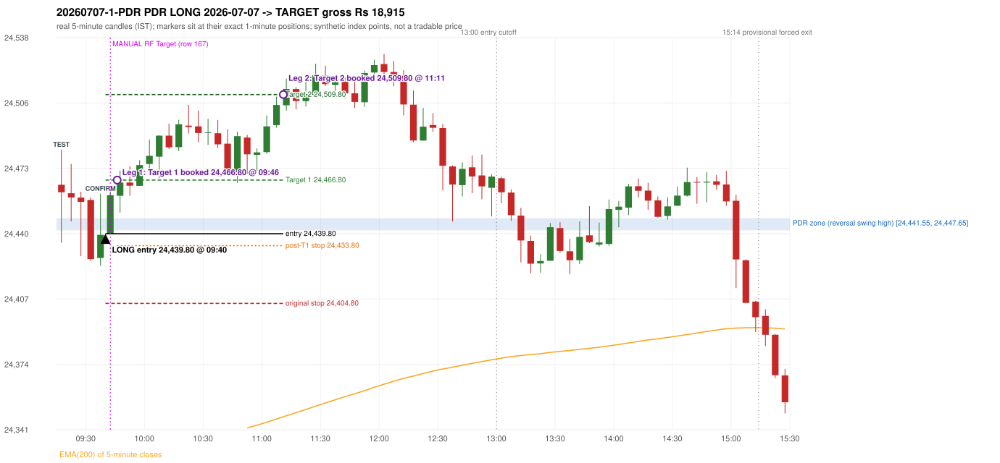

# Trading journal - 2026-07-07 (Tuesday)

> Automated, read-only reconstruction of the Phase 3.0 baseline. Synthetic NIFTY 50 index-point P&L (the index is not tradable). The owner's review status is intentionally blank.

## A. Trading day overview

| item | value |
|---|---|
| Date / weekday | 2026-07-07 / Tuesday |
| Session type | USABLE_WITH_FLAGS / VALID |
| Original session open (first 1-minute open) | 24,464.45 |
| Previous session | 2026-07-06 |
| Previous-day high / low | 24,458.25 / 24,290.05 |
| Previous-day official close / last 5-minute close | 24,430.35 / 24,423.75 |
| Raw engine records / confirmed signals / fully valid signals | 19 / 14 / 14 |
| Setups that did not complete (invalidated / incomplete) | 5 |
| Executed trades | 1 20260707-1-PDR |
| Gross P&L (Rs, synthetic) | 18,915.00 |
| Illustrative net P&L (Rs; Rs 500/trade + 0.5 pt/fill) | 18,025.00 |
| Day-end portfolio status | DAY_FINISHED |
| Manual journal trades (matched / unmatched) | 1 (0 / 1) |
| Extra automated trades | 1 |

## B. Daily strategy signal timeline (confirmed signals, chronological)

| time | strategy | method | dir | entry-rule status | valid for execution | <= 13:00 | portfolio state | accepted / ignored | specific reason | competing (same minute) |
|---|---|---|---|---|---|---|---|---|---|---|
| 09:40 | PDR | PDR | LONG | PROPOSAL_DEPENDENT | True | True | FIRST_TRADE_ACTIVE | ACCEPTED -> 20260707-1-PDR | first eligible signal of the day; trade 1: TARGET |  |
| 09:50 | PDR | PDR | LONG | PROPOSAL_DEPENDENT | True | True | FIRST_TRADE_ACTIVE | IGNORED | POSITION_ACTIVE (signal kept for diagnostics only; never reused) [blocked by PDR#1] |  |
| 10:45 | IRF | Method 1 | SHORT | PROPOSAL_DEPENDENT | True | True | FIRST_TRADE_ACTIVE | IGNORED | POSITION_ACTIVE (signal kept for diagnostics only; never reused) [blocked by PDR#1] | IRF Method 2A SHORT |
| 10:45 | IRF | Method 2A | SHORT | PROPOSAL_DEPENDENT | True | True | FIRST_TRADE_ACTIVE | IGNORED | POSITION_ACTIVE (signal kept for diagnostics only; never reused) [blocked by PDR#1] | IRF Method 1 SHORT |
| 10:55 | IRF | Method 1 | SHORT | PROPOSAL_DEPENDENT | True | True | FIRST_TRADE_ACTIVE | IGNORED | POSITION_ACTIVE (signal kept for diagnostics only; never reused) [blocked by PDR#1] |  |
| 11:35 | IRF | Method 2B | SHORT | PROPOSAL_DEPENDENT | True | True | DAY_FINISHED | IGNORED | DAY_FINISHED [blocked by PDR#1] |  |
| 12:20 | IRF | Method 2A | SHORT | PROPOSAL_DEPENDENT | True | True | DAY_FINISHED | IGNORED | DAY_FINISHED [blocked by PDR#1] |  |
| 12:35 | IRF | Method 1 | SHORT | PROPOSAL_DEPENDENT | True | True | DAY_FINISHED | IGNORED | DAY_FINISHED [blocked by PDR#1] |  |
| 12:45 | PDR | PDR | LONG | PROPOSAL_DEPENDENT | True | True | DAY_FINISHED | IGNORED | DAY_FINISHED [blocked by PDR#1] |  |
| 13:25 | PDR | PDR | LONG | PROPOSAL_DEPENDENT | True | False | DAY_FINISHED | IGNORED | DAY_FINISHED [blocked by PDR#1] |  |
| 13:45 | PDR | PDR | LONG | PROPOSAL_DEPENDENT | True | False | DAY_FINISHED | IGNORED | DAY_FINISHED [blocked by PDR#1] |  |
| 13:55 | PDR | PDR | LONG | PROPOSAL_DEPENDENT | True | False | DAY_FINISHED | IGNORED | DAY_FINISHED [blocked by PDR#1] |  |
| 14:05 | PDR | PDR | LONG | PROPOSAL_DEPENDENT | True | False | DAY_FINISHED | IGNORED | DAY_FINISHED [blocked by PDR#1] |  |
| 14:35 | PDR | PDR | LONG | PROPOSAL_DEPENDENT | True | False | DAY_FINISHED | IGNORED | DAY_FINISHED [blocked by PDR#1] |  |

Engine setups that did not complete (5); the complete list with failed rule ids is in `rejected_signals.csv`:

| candle | strategy | method | dir | status | precise reason | failed rules |
|---|---|---|---|---|---|---|
| 12:15 | IRF | Method 1/2 | SHORT | INCOMPLETE_AT_EOD | SESSION_ENDED_BEFORE_CONFIRMATION |  |
| 09:15 | ORB | Method 1 | LONG | INVALIDATED | CANDLE_QUALITY(not a strong body / wick too large) | ORB-M1-LONG-003 |
| 09:15 | ORB | Method 2 | LONG | INVALIDATED | TRENDLINE_NOT_SUPPORTIVE | ORB-M2-LONG-001 |
| 15:00 | PDR | PDR | LONG | INCOMPLETE_AT_EOD | NO_GREEN_CANDLE_AFTER_ZONE_TEST_BEFORE_SESSION_END |  |
| 09:35 | RF | RF | LONG | INVALIDATED | GAP_UP_OUTSIDE_YESTERDAYS_RANGE | RF-004 |

## C. Detailed trade journals

### 20260707-1-PDR: PDR LONG (FIRST trade)

Chart: 

**Rule configuration:** CFG-phase35_legacy_check-be1db2a09d - signal verification status **PROPOSAL_DEPENDENT** (never VERIFIED while a rule rests on a proposal).

#### 1. Setup identification

PDR LONG: the session opened 34.10 points above the previous close and 16.80 points above the resistance zone [24,441.55, 24,447.65] taken from the 15:05 swing-high candle of 2026-07-06. The 09:15 candle (24,435.30 - 24,482.10) retested the zone, and the 09:35 candle closed green at 24,439.25, confirming the entry at 09:40. The engine does not check that the zone held (confirmation close BELOW the zone floor).

#### 2. Candle and indicator calculations

| role | session | candle | O | H | L | C | range | body % | upper wick % | lower wick % | direction | EMA(200) | strong bull / bear | pin bull / bear | small (body<=30%) | used for |
|---|---|---|---|---|---|---|---|---|---|---|---|---|---|---|---|---|
| zone_source_candle | PREVIOUS | 15:05-15:10 | 24,428.45 | 24,447.65 | 24,426.90 | 24,441.55 | 20.75 | 63.13 | 29.40 | 7.47 | BULLISH | 24,308.28 | False / False | False / False | False | swing-high candle that defines the zone (B_SWING_HIGH_REVERSAL) |
| prev_day_high_candle | PREVIOUS | 13:35-13:40 | 24,438.50 | 24,458.25 | 24,437.30 | 24,452.95 | 20.95 | 68.97 | 25.30 | 5.73 | BULLISH | 24,287.78 | False / False | False / False | False | candle of the previous session's absolute high (for comparison) |
| interaction_candle | TODAY | 09:15-09:20 | 24,464.45 | 24,482.10 | 24,435.30 | 24,460.65 | 46.80 | 8.12 | 37.71 | 54.17 | BEARISH | 24,314.64 | False / False | False / False | True | first candle whose range intersects the zone |
| confirmation_candle | TODAY | 09:35-09:40 | 24,427.60 | 24,459.95 | 24,423.65 | 24,439.25 | 36.30 | 32.09 | 57.02 | 10.88 | BULLISH | 24,319.75 | False / False | False / False | False | first green candle after the interaction candle |

Every condition, with the rule, the calculation, the observed values and the result:

| # | group | rule | result | status / numeric definition | calculation | observed | required | available at | why it matters |
|---|---|---|---|---|---|---|---|---|---|
| 1 | SELECTION | SEL-FIRST-001 | PASS | USER_APPROVED / USER_APPROVED | earliest CONFIRMED signal of the day across IRF/ORB/PDR/PDS/RF that passed the controller's checks | 0 confirmed signal(s) earlier today; 14 confirmed signals in the day in total, this one at 09:40 | no earlier executable signal | 2026-07-07 09:40 | the shared controller trades only the first valid signal; the five strategies are not independent positions |
| 2 | SELECTION | SEL-TIE-001 | PASS | USER_APPROVED / USER_APPROVED | other CONFIRMED signals with exactly the same confirmation timestamp | none | no different-strategy / opposite-direction signal in the same minute (otherwise an unresolved conflict, no trade) | 2026-07-07 09:40 | an unresolved same-minute collision would have produced no trade at all |
| 3 | SELECTION | ENTRY-CUTOFF-001 | PASS | USER_APPROVED / USER_APPROVED | fill timestamp vs 13:00:00 IST | signal confirmed 09:40; fill 09:40 | fill at or before 13:00:00 IST | 2026-07-07 09:40 | no new position may be entered with a fill after 13:00 IST |
| 4 | SELECTION | EXE-FILL-001 | PASS | PROPOSED_FOR_REVIEW / PROPOSED_FOR_REVIEW | fill = open of the 1-minute bar that starts at the signal candle's end | bar 09:40 O 24,439.80 H 24,452.70 L 24,439.75 C 24,449.70; executable=True; entry 24,439.80 | fill bar exists, starts exactly at the signal end, is fillable; entry = its open | 2026-07-07 09:40 | a 5-minute signal is known only when its candle closes; the first price that can be traded is the next minute's open |
| 5 | SELECTION | DAY-MAX-001 | PASS | USER_APPROVED / USER_APPROVED | number of entries today | trade 1 of at most 2 | <= 2 entries per day | 2026-07-07 09:40 | daily trade cap |
| 6 | SETUP | PDR-004 | PASS | SOURCE_VERIFIED / EXPLICIT_WORDING_DETAIL_PROPOSED_FOR_REVIEW | gap = first 1-minute open of today - previous session's OFFICIAL close | today's open 24,464.45 (first 1-minute bar 09:15) - previous close 24,430.35 (DAILY_VENDOR, 2026-07-06) = +34.10 points -> gap UP | gap UP (more than 0 points) | 2026-07-07 09:15 | approved convention: the original first-minute open, never the vendor daily open |
| 7 | SETUP | PDR-011 | PASS | SOURCE_VERIFIED / QUALITATIVE_SOURCE_NUMERIC_DEFINITION_PROPOSED_FOR_REVIEW | open relative to the zone (ABOVE_ZONE) | today's open 24,464.45 vs zone high 24,447.65: 16.80 points above | open > zone high | 2026-07-07 09:15 | the guide has price 'pull back into the zone', so the gap-up open is above it; this exclusion is a proposal |
| 8 | ZONE | PDR-001 | PASS | SOURCE_VERIFIED / EXPLICIT_IN_SOURCE | direction | LONG (PDR is long only) | long-only | 2026-07-07 09:40 | PDR buys a retest of previous-day resistance after a gap up |
| 9 | ZONE | PDR-002 | PASS | SOURCE_VERIFIED / QUALITATIVE_SOURCE_NUMERIC_DEFINITION_PROPOSED_FOR_REVIEW | zone = [body top, wick high] of the latest confirmed swing high (k=2) that has a red candle among the peak and the next 2 candles (method B_SWING_HIGH_REVERSAL) | zone [24,441.55, 24,447.65] from the 15:05 candle of 2026-07-06 (body top 24,441.55, wick high 24,447.65; 15:05-15:10 O 24,428.45 H 24,447.65 L 24,426.90 C 24,441.55; range 20.75, body 13.10 (63.13%), upper wick 6.10 (29.40%), lower wick 1.55 (7.47%), bullish); engine recorded [24,441.55, 24,447.65]. Previous session's absolute high 24,458.25 (candle 13:35) - the zone is NOT the day high (distance 10.60 points). Swing confirmed once candle 15:15 closed. | previous-day high where price peaked and reversed | 2026-07-06 15:20 | the source says 'previous day's high/reversal'; which candle marks the zone is an owner-approved research candidate, not a source rule |
| 10 | ZONE | PDR-003 | PASS | SOURCE_VERIFIED / EXPLICIT_IN_SOURCE | the zone is an area, not a single price | zone height 6.10 points [24,441.55, 24,447.65] | a rectangle with positive height | 2026-07-06 15:20 | price may touch any part of the area |
| 11 | ZONE | PDR-010 | UNRESOLVED | SOURCE_VERIFIED / QUALITATIVE_SOURCE_NUMERIC_DEFINITION_PROPOSED_FOR_REVIEW | reversal-quality filter ('clear high and reversal identified') | filter setting OFF | checklist item: a clear previous-day high and reversal | 2026-07-06 | the engine does not test reversal depth in the baseline (filter OFF) |
| 12 | CONFIRMATION | PDR-006 | PASS | SOURCE_VERIFIED / QUALITATIVE_SOURCE_NUMERIC_DEFINITION_PROPOSED_FOR_REVIEW | the first candle whose [low, high] intersects the zone (+/- proximity) | 09:15-09:20 O 24,464.45 H 24,482.10 L 24,435.30 C 24,460.65; range 46.80, body 3.80 (8.12%), upper wick 17.65 (37.71%), lower wick 25.35 (54.17%), bearish; low 24,435.30 vs zone high 24,447.65 (12.35 points inside/below the zone top), high 24,482.10 vs zone low 24,441.55; proximity 0 | range intersects the zone | 2026-07-07 09:20 | the retest of the previous-day resistance |
| 13 | CONFIRMATION | PDR-007 | PASS | SOURCE_VERIFIED / QUALITATIVE_SOURCE_NUMERIC_DEFINITION_PROPOSED_FOR_REVIEW | the first GREEN candle after the interaction candle | 09:35-09:40 O 24,427.60 H 24,459.95 L 24,423.65 C 24,439.25; range 36.30, body 11.65 (32.09%), upper wick 20.70 (57.02%), lower wick 3.95 (10.88%), bullish; interaction candle 09:15, confirmation candle 09:35 | close > open, strictly after the interaction candle | 2026-07-07 09:40 | the guide asks for 'a green candle' after the test; it gives no size or position test |
| 14 | CONFIRMATION | PDR-005 | PASS | SOURCE_VERIFIED / EXPLICIT_IN_SOURCE | no entry at the open: price must first come back toward the zone | interaction candle 09:15 (candle no. 1 of the session) precedes the entry candle 09:35; fill 09:40 | interaction before the entry; fill after 09:20 | 2026-07-07 09:40 | if price keeps rising without returning to the zone there is no setup |
| 15 | EXECUTION | EXE-STOP-001 | PASS | USER_APPROVED / USER_APPROVED | initial stop = entry - 35 points | entry 24,439.80 -> stop 24,404.80 | stop 35 index points (BASELINE) | 2026-07-07 09:40 | defines the loss if the setup fails before Target 1 |
| 16 | EXECUTION | EXE-T1-001 | PASS | SOURCE_VERIFIED / EXPLICIT_IN_SOURCE | Target 1 = entry +/- 27 points | T1 24,466.80 | 27 points | 2026-07-07 09:40 | Leg 1 (3 lots) is booked at Target 1 |
| 17 | EXECUTION | PDR-008 | PASS | SOURCE_VERIFIED / EXPLICIT_IN_SOURCE | Target 2 = entry +/- 70 points | T2 24,509.80 (the guide says 70; the performance report's winners suggest 60 - CONFLICTING, recorded) | 70 points | 2026-07-07 09:40 | Leg 2 (3 lots) is booked at Target 2 |
| 18 | EXECUTION | POST-T1-STOP-006 | PASS | USER_APPROVED / USER_APPROVED | after T1 the Leg-2 stop = entry - 6 (no trailing) | post-T1 stop 24,433.80 | entry -6 (LONG) / +6 (SHORT) | 2026-07-07 09:40 | protects the remaining three lots once the first three are booked |
| 19 | EXECUTION | SIZE-LOT-001 | PASS | USER_APPROVED / USER_APPROVED | 6 lots x 65 = 390, Leg 1 = 3 lots = 195, Leg 2 = 195 | 6 lots, lot size 65, legs 3+3 | 6 lots in two equal legs | 2026-07-07 09:40 | position size for the synthetic P&L |
| 20 | NOTE | PDR-007 | UNRESOLVED | SOURCE_VERIFIED / QUALITATIVE_SOURCE_NUMERIC_DEFINITION_PROPOSED_FOR_REVIEW | did the zone hold? (is the confirmation candle's close back at/above the zone floor?) | confirmation close 24,439.25 vs zone floor 24,441.55 / top 24,447.65: BELOW the zone floor by 2.30; interaction low 24,435.30 | the engine does NOT test that resistance-turned-support held | 2026-07-07 09:40 | a later green candle is accepted even after price traded through the zone; a human would normally check the hold (here the close is below the zone floor) |
| 21 | NOTE | PDR-012 | NOT_APPLICABLE | PROPOSED_FOR_REVIEW / PROPOSED_FOR_REVIEW | repeated PDR signals today | 8 confirmed PDR signal(s) in the session | n/a (disclosure) | 2026-07-07 09:40 | the per-session cap is lifted for the controller runs; the controller trades only the first |
| 22 | NOTE | PDR-009 | UNRESOLVED | UNRESOLVED / UNRESOLVED | stop 35 or 40 'depending on the situation' | the guide gives no selection rule; baseline fixed 35 points | unresolved in the source | 2026-07-07 09:40 | PDR stop selection is left to the owner |
| 23 | NOTE | NOTE-UNRESOLVED-DEPENDENCIES | UNRESOLVED | NOT_A_RULE / NOT_A_REGISTRY_RULE | rules the signal depends on that the sources leave unresolved | engine-recorded unresolved rule ids: PDR-010; verification status PROPOSAL_DEPENDENT | n/a (disclosure) | 2026-07-07 09:40 | the entry is only as verified as the rules it rests on |

#### 3. Entry decision and explanation

PDR LONG: the session opened 34.10 points above the previous close and 16.80 points above the resistance zone [24,441.55, 24,447.65] taken from the 15:05 swing-high candle of 2026-07-06. The 09:15 candle (24,435.30 - 24,482.10) retested the zone, and the 09:35 candle closed green at 24,439.25, confirming the entry at 09:40. The engine does not check that the zone held (confirmation close BELOW the zone floor).

**Why this trade ahead of the other strategies:** This PDR signal was the earliest executable signal of the day: 0 confirmed signal(s) earlier, 0 other in the same minute. 13 later confirmed signal(s) (IRF x6, PDR x7) are logged as ignored or rejected. State of the other four engines at that moment: [IRF: no setup record before this time (a base condition was not met, or nothing triggered)] [ORB: Method 1 invalidated at 09:15: CANDLE_QUALITY(not a strong body / wick too large); Method 2 invalidated at 09:15: TRENDLINE_NOT_SUPPORTIVE] [PDS: no setup record before this time (a base condition was not met, or nothing triggered)] [RF: RF invalidated at 09:35: GAP_UP_OUTSIDE_YESTERDAYS_RANGE]

#### 4. Actual entry execution

| item | value |
|---|---|
| Signal candle | 09:35-09:40 |
| Signal confirmed | 2026-07-07 09:40 |
| Fill timestamp | 2026-07-07 09:40 |
| Entry price | 24,439.80 |
| Source partition / 1-minute bar | data/processed/nifty50/year=2026/month=07/candles.parquet / 2026-07-07 09:40 |
| Source bar O / H / L / C | 24,439.80 / 24,452.70 / 24,439.75 / 24,449.70 |
| Fill assumption | open of the 1-minute bar starting at the signal candle's end (EXE-FILL-001, PROPOSED causal convention) |
| Initial stop / T1 / T2 / post-T1 stop | 24,404.80 / 24,466.80 / 24,509.80 / 24,433.80 |
| Position | 6 lots x 65 = 390 units (Leg 1 195, Leg 2 195) |

#### 5-8. Trade progress, Target 1, post-T1 stop and final exit

Between the 09:40 entry bar and the final exit (92 one-minute bars) the best excursion in favour was 70.40 points at 11:11 and the worst against was 0.05 points at 09:40. At 09:46 price reached Target 1 24,466.80 and three lots exited. At 09:46 the remaining three lots' protective stop was set to 24,433.80 (entry - 6; no trailing, no further change); the engine applies it from the Target-1 bar onward and tests it within that same bar. At 11:11 price reached Target 2 24,509.80 and the remaining three lots exited. No further trade that day (DAY-T2-001).

| leg | qty | exit time | exit price | reason | source 1-minute bar | O / H / L / C | gross points | gross Rs | slippage pts | flags |
|---|---|---|---|---|---|---|---|---|---|---|
| 1 | 195 | 09:46 | 24,466.80 | TARGET_1 | 09:46 | 24,460.15 / 24,471.60 / 24,457.35 / 24,469.30 | 27.00 | 5,265.00 | 0.00 |  |
| 2 | 195 | 11:11 | 24,509.80 | TARGET_2 | 11:11 | 24,504.70 / 24,510.20 / 24,502.50 / 24,509.70 | 70.00 | 13,650.00 | 0.00 |  |

Exit evidence per leg:

* Leg 1: 1-minute bar 09:46 O 24,460.15 H 24,471.60 L 24,457.35 C 24,469.30: high 24,471.60 reached Target 1 24,466.80; Leg 1 booked at the target level
* Leg 2: 1-minute bar 11:11 O 24,504.70 H 24,510.20 L 24,502.50 C 24,509.70: high 24,510.20 reached Target 2 24,509.80; Leg 2 booked at the target level

#### 9. Gross and illustrative net P&L

| item | value (Rs) |
|---|---|
| Leg 1 gross | 5,265.00 |
| Leg 2 gross | 13,650.00 |
| Trade gross (= Leg 1 + Leg 2) | 18,915.00 |
| Illustrative fixed cost | -500.00 |
| Illustrative slippage (0.5 pt on every fill, entry + exits, all units) | -390.00 |
| Illustrative net | 18,025.00 |

#### 10. Manual journal comparison

EXTRA_AUTOMATED_TRADE: the automated system took PDR PDR LONG at 09:40 (manual traded only other strategies: RF 09:40 Target). The setup rests on: PDR-010: Reversal-quality filter is OFF in the baseline | PDR-007: Engine does not test whether the zone held | PDR-009: PDR stop selection rule is not defined | NOTE-UNRESOLVED-DEPENDENCIES: Disclosure of unresolved source rules behind this signal. The journal shows no corresponding entry.

## D. Manual journal comparison

| comparison | journal row | journal strategy | manual time | manual direction | manual outcome | match class | trade | auto entry | auto outcome | explanation |
|---|---|---|---|---|---|---|---|---|---|---|
| M167 | 167 | RF | 09:40 | LONG | Target | SIGNAL_REJECTED_BY_ENTRY_RULE |  |  |  | SIGNAL_REJECTED_BY_ENTRY_RULE: SETUP_INVALIDATED RF - GAP_UP_OUTSIDE_YESTERDAYS_RANGE; failed=RF-004. Heuristic primary cause: SOURCE_AMBIGUITY; blocked by: n/a |
| E115 |  |  |  |  |  | EXTRA_AUTOMATED_TRADE | 20260707-1-PDR | 09:40 @ 24,439.80 | TARGET | EXTRA_AUTOMATED_TRADE: the automated system took PDR PDR LONG at 09:40 (manual traded only other strategies: RF 09:40 Target). The setup rests on: PDR-010: Reversal-quality filter is OFF in the baseline \| PDR-007: Engine does not test whether the zone held \| PDR-009: PDR stop selection rule is not defined \| NOTE-UNRESOLVED-DEPENDENCIES: Disclosure of unresolved source rules behind this signal. The journal shows no corresponding entry. |

The journal records no entry price and no exit price (NOT_RECORDED); matching uses date, strategy and candle start only - never P&L.

## E. Daily conclusion

* **Traded:** 20260707-1-PDR - PDR PDR LONG at 09:40 (entry 24,439.80), outcome TARGET, gross Rs 18,915.00, illustrative net Rs 18,025.00. **Why:** This PDR signal was the earliest executable signal of the day: 0 confirmed signal(s) earlier, 0 other in the same minute. 13 later confirmed signal(s) (IRF x6, PDR x7) are logged as ignored or rejected. State of the other four engines at that moment: [IRF: no setup record before this time (a base condition was not met, or nothing triggered)] [ORB: Method 1 invalidated at 09:15: CANDLE_QUALITY(not a strong body / wick too large); Method 2 invalidated at 09:15: TRENDLINE_NOT_SUPPORTIVE] [PDS: no setup record before this time (a base condition was not met, or nothing triggered)] [RF: RF invalidated at 09:35: GAP_UP_OUTSIDE_YESTERDAYS_RANGE] **How it ended:** At 09:46 price reached Target 1 24,466.80 and three lots exited. At 09:46 the remaining three lots' protective stop was set to 24,433.80 (entry - 6; no trailing, no further change); the engine applies it from the Target-1 bar onward and tests it within that same bar. At 11:11 price reached Target 2 24,509.80 and the remaining three lots exited. No further trade that day (DAY-T2-001).
* **Ignored / rejected signals:** PDR IGNORED DAY_FINISHED x6; IRF IGNORED POSITION_ACTIVE x3; IRF IGNORED DAY_FINISHED x3; PDR IGNORED POSITION_ACTIVE x1
* **Unmatched manual trade (row 167, RF 09:40 Target):** SIGNAL_REJECTED_BY_ENTRY_RULE: SETUP_INVALIDATED RF - GAP_UP_OUTSIDE_YESTERDAYS_RANGE; failed=RF-004. Heuristic primary cause: SOURCE_AMBIGUITY; blocked by: n/a
* **Extra automated trade 20260707-1-PDR:** EXTRA_AUTOMATED_TRADE: the automated system took PDR PDR LONG at 09:40 (manual traded only other strategies: RF 09:40 Target). The setup rests on: PDR-010: Reversal-quality filter is OFF in the baseline | PDR-007: Engine does not test whether the zone held | PDR-009: PDR stop selection rule is not defined | NOTE-UNRESOLVED-DEPENDENCIES: Disclosure of unresolved source rules behind this signal. The journal shows no corresponding entry.
* **Open strategy-definition issues that affected this day:** NOTE-UNRESOLVED-DEPENDENCIES, PDR-007 (After the zone has been tested, wait for a green candle and take the long on that confirmation), PDR-009 (Stop-loss 35 or 40 'depending on the situation'; choose before entering, do not move after entry), PDR-010 (Checklist: a clear previous-day high and reversal must be identified)
* **Automated triage (not an approval; the owner's review status stays blank):** REVIEW: UNMATCHED_MANUAL+EXTRA_AUTOMATED
