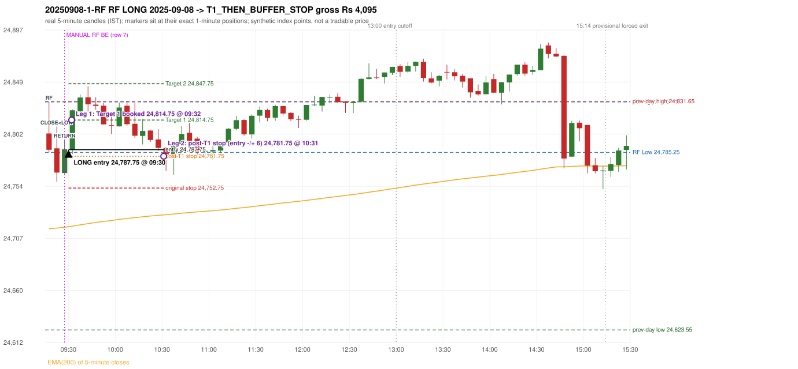

# Trading journal - 2025-09-08 (Monday)

> Automated reconstruction of the Phase 3.6 combined backtest: the Phase 3.0 controller, stops, targets and sizing with PDR = the body-based engine (wicks ignored; open strictly above the zone; numeric pattern thresholds and zone-lower-boundary conventions are provisional research assumptions, NOT approved by the strategy author). Synthetic NIFTY 50 index-point P&L (the index is not tradable). The owner's review status is intentionally blank.

## A. Trading day overview

| item | value |
|---|---|
| Date / weekday | 2025-09-08 / Monday |
| Session type | USABLE_WITH_FLAGS / VALID |
| Original session open (first 1-minute open) | 24,802.50 |
| Previous session | 2025-09-05 |
| Previous-day high / low (wicks included) | 24,831.65 / 24,623.55 |
| Previous-day highest BODY high (the body-based PDR ceiling; wicks ignored) | 24,827.50 |
| Previous-day official close / last 5-minute close | 24,741.00 / 24,743.95 |
| Raw engine records / confirmed signals / fully valid signals | 9 / 6 / 6 |
| Setups that did not complete (invalidated / incomplete) | 3 |
| Executed trades | 1 20250908-1-RF |
| Gross P&L (Rs, synthetic) | 4,095.00 |
| Illustrative net P&L (Rs; Rs 500/trade + 0.5 pt/fill) | 3,205.00 |
| Day-end portfolio status | DAY_FINISHED |
| Manual journal trades (matched / unmatched) | 1 (1 / 0) |
| Extra automated trades | 0 |

## B. Daily strategy signal timeline (confirmed signals, chronological)

| time | strategy | method | dir | entry-rule status | valid for execution | <= 13:00 | portfolio state | accepted / ignored | specific reason | competing (same minute) |
|---|---|---|---|---|---|---|---|---|---|---|
| 09:30 | RF | RF | LONG | PROPOSAL_DEPENDENT | True | True | FIRST_TRADE_ACTIVE | ACCEPTED -> 20250908-1-RF | first eligible signal of the day; trade 1: T1_THEN_BUFFER_STOP |  |
| 09:45 | IRF | Method 1 | SHORT | PROPOSAL_DEPENDENT | True | True | FIRST_TRADE_ACTIVE | IGNORED | POSITION_ACTIVE (signal kept for diagnostics only; never reused) [blocked by RF#1] |  |
| 12:25 | IRF | Method 1 | SHORT | PROPOSAL_DEPENDENT | True | True | DAY_FINISHED | IGNORED | DAY_FINISHED [blocked by RF#1] |  |
| 13:20 | IRF | Method 2A | SHORT | PROPOSAL_DEPENDENT | True | False | DAY_FINISHED | IGNORED | DAY_FINISHED [blocked by RF#1] |  |
| 14:50 | IRF | Method 2A | SHORT | PROPOSAL_DEPENDENT | True | False | DAY_FINISHED | IGNORED | DAY_FINISHED [blocked by RF#1] | IRF Method 2B SHORT |
| 14:50 | IRF | Method 2B | SHORT | PROPOSAL_DEPENDENT | True | False | DAY_FINISHED | IGNORED | DAY_FINISHED [blocked by RF#1] | IRF Method 2A SHORT |

Engine setups that did not complete (3); the complete list with failed rule ids is in `rejected_signals.csv`:

| candle | strategy | method | dir | status | precise reason | failed rules |
|---|---|---|---|---|---|---|
| 10:05 | IRF | Method 3 | SHORT | INVALIDATED | WICK_SHARE_OUT_OF_BAND | IRF-M3-003 |
| 09:15 | ORB | Method 2 | LONG | INVALIDATED | CANDLE_QUALITY | ORB-M2-LONG-003 |
| 09:15 | PDR | PDR | LONG | INVALIDATED | OPEN_NOT_STRICTLY_ABOVE_ZONE |  |

## C. Detailed trade journals

### 20250908-1-RF: RF LONG (FIRST trade)

Chart: 

**Rule configuration:** CFG-phase36_body_based-866f954e55 - signal verification status **PROPOSAL_DEPENDENT** (never VERIFIED while a rule rests on a proposal).

#### 1. Setup identification

RF LONG (research proposal for direction/target): the session gapped +61.50 points up inside yesterday's range [24,623.55, 24,831.65] after an EMA-only uptrend; the 09:20 candle closed at 24,766.90, 18.35 points below RF Low 24,785.25, and the 09:25 candle closed back inside the range at 24,788.05, activating the setup at 09:30.

#### 2. Candle and indicator calculations

| role | session | candle | O | H | L | C | range | body % | upper wick % | lower wick % | direction | EMA(200) | strong bull / bear | pin bull / bear | small (body<=30%) | used for |
|---|---|---|---|---|---|---|---|---|---|---|---|---|---|---|---|---|
| rf_range_candle | TODAY | 09:15-09:20 | 24,802.50 | 24,831.15 | 24,785.25 | 24,787.65 | 45.90 | 32.35 | 62.42 | 5.23 | BEARISH | 24,715.81 | False / False | False / False | False | first 5-minute candle: RF High / RF Low |
| prev_session_last_candle | PREVIOUS | 15:25-15:30 | 24,745.60 | 24,749.50 | 24,734.55 | 24,743.95 | 14.95 | 11.04 | 26.09 | 62.88 | BEARISH | 24,715.09 | False / False | False / False | True | trend: previous session's last 5-minute close vs its EMA(200) |
| close_below_candle | TODAY | 09:20-09:25 | 24,788.95 | 24,808.65 | 24,758.50 | 24,766.90 | 50.15 | 43.97 | 39.28 | 16.75 | BEARISH | 24,716.32 | False / False | False / False | False | first candle closing below RF Low |
| return_inside_candle | TODAY | 09:25-09:30 | 24,766.45 | 24,796.65 | 24,765.60 | 24,788.05 | 31.05 | 69.57 | 27.70 | 2.74 | BULLISH | 24,717.03 | False / False | False / False | False | first later candle closing back inside the first-candle range |

Every condition, with the rule, the calculation, the observed values and the result:

| # | group | rule | result | status / numeric definition | calculation | observed | required | available at | why it matters |
|---|---|---|---|---|---|---|---|---|---|
| 1 | SELECTION | SEL-FIRST-001 | PASS | USER_APPROVED / USER_APPROVED | earliest CONFIRMED signal of the day across IRF/ORB/PDR/PDS/RF that passed the controller's checks | 0 confirmed signal(s) earlier today; 6 confirmed signals in the day in total, this one at 09:30 | no earlier executable signal | 2025-09-08 09:30 | the shared controller trades only the first valid signal; the five strategies are not independent positions |
| 2 | SELECTION | SEL-TIE-001 | PASS | USER_APPROVED / USER_APPROVED | other CONFIRMED signals with exactly the same confirmation timestamp | none | no different-strategy / opposite-direction signal in the same minute (otherwise an unresolved conflict, no trade) | 2025-09-08 09:30 | an unresolved same-minute collision would have produced no trade at all |
| 3 | SELECTION | ENTRY-CUTOFF-001 | PASS | USER_APPROVED / USER_APPROVED | fill timestamp vs 13:00:00 IST | signal confirmed 09:30; fill 09:30 | fill at or before 13:00:00 IST | 2025-09-08 09:30 | no new position may be entered with a fill after 13:00 IST |
| 4 | SELECTION | EXE-FILL-001 | PASS | PROPOSED_FOR_REVIEW / PROPOSED_FOR_REVIEW | fill = open of the 1-minute bar that starts at the signal candle's end | bar 09:30 O 24,787.75 H 24,802.45 L 24,783.80 C 24,802.45; executable=True; entry 24,787.75 | fill bar exists, starts exactly at the signal end, is fillable; entry = its open | 2025-09-08 09:30 | a 5-minute signal is known only when its candle closes; the first price that can be traded is the next minute's open |
| 5 | SELECTION | DAY-MAX-001 | PASS | USER_APPROVED / USER_APPROVED | number of entries today | trade 1 of at most 2 | <= 2 entries per day | 2025-09-08 09:30 | daily trade cap |
| 6 | SETUP | RF-002 | PASS | SOURCE_VERIFIED / EXPLICIT_IN_SOURCE | RF High / Low = high / low (wicks included) of the first 5-minute candle | 09:15-09:20 RF High 24,831.15, RF Low 24,785.25 (engine recorded 24,831.15 / 24,785.25) | first-candle range | 2025-09-08 09:20 | the zone price must dip below and return into |
| 7 | SETUP | RF-003 | PASS | SOURCE_VERIFIED / EXPLICIT_WORDING_DETAIL_PROPOSED_FOR_REVIEW | gap = first 1-minute open of today - previous session's OFFICIAL close | today's open 24,802.50 (first 1-minute bar 09:15) - previous close 24,741.00 (DAILY_VENDOR, 2025-09-05) = +61.50 points -> gap UP | gap UP (more than 0 points) | 2025-09-08 09:15 | approved convention: the original first-minute open, never the vendor daily open |
| 8 | SETUP | RF-004 | PASS | SOURCE_VERIFIED / EXPLICIT_IN_SOURCE | gap-up open inside yesterday's trading range | open 24,802.50 vs previous session 2025-09-05 range [24,623.55, 24,831.65]: inside (previous close 24,741.00, gap +61.50) | previous low <= open <= previous high | 2025-09-08 09:15 | a huge gap beyond yesterday's range is rejected; the source gives no number, the test is the previous session's high/low |
| 9 | TREND | RF-001 | PASS | SOURCE_VERIFIED / QUALITATIVE_SOURCE_NUMERIC_DEFINITION_PROPOSED_FOR_REVIEW | previous session's final completed 5-minute candle: close vs its EMA(200 of 5-minute closes) | previous session 2025-09-05 last candle 15:25-15:30 close 24,743.95 vs EMA(200) 24,715.09: 28.86 points above the EMA -> trend bullish (EMA_PREV_SESSION_CLOSE; research variant A, EMA-only) | close > EMA(200) | 2025-09-05 15:30 | the opening gap can never create the trend: only information that existed before today's open is used |
| 10 | TREND | RF-008 | PASS | SOURCE_VERIFIED / QUALITATIVE_SOURCE_NUMERIC_DEFINITION_PROPOSED_FOR_REVIEW | the uptrend must exist BEFORE the gap (a gap cannot create it) | trend measured on the previous session only (2025-09-05); today's gap is not used | established uptrend, not a sudden gap above the EMA | 2025-09-05 15:30 | RF rejects a previous downtrend followed by a sudden large gap above the EMA |
| 11 | TREND | TREND-SWING-001 | NOT_APPLICABLE | PROPOSED_FOR_REVIEW / PROPOSED_FOR_REVIEW | confirmed swing structure | not required by the active trend variant (variant A is the EMA price location only) | n/a | 2025-09-05 15:30 | variant B would additionally require higher-high/higher-low swings; it is a separate labelled scenario |
| 12 | CONFIRMATION | RF-005 | PASS | SOURCE_VERIFIED / EXPLICIT_IN_SOURCE | a candle CLOSES below RF Low (a wick is not enough) | 09:20-09:25 O 24,788.95 H 24,808.65 L 24,758.50 C 24,766.90; range 50.15, body 22.05 (43.97%), upper wick 19.70 (39.28%), lower wick 8.40 (16.75%), bearish; close 24,766.90 vs RF Low 24,785.25: 18.35 points below | close < RF Low | 2025-09-08 09:25 | the failed-breakdown leg of the setup |
| 13 | CONFIRMATION | RF-006 | PASS | SOURCE_VERIFIED / QUALITATIVE_SOURCE_NUMERIC_DEFINITION_PROPOSED_FOR_REVIEW | price returns inside the first-candle range - definition R1 (first later candle whose CLOSE is within [RF Low, RF High]) | 09:25-09:30 O 24,766.45 H 24,796.65 L 24,765.60 C 24,788.05; range 31.05, body 21.60 (69.57%), upper wick 8.60 (27.70%), lower wick 0.85 (2.74%), bullish; close 24,788.05 within [24,785.25, 24,831.15]; 1 candle(s) after the close-below candle (09:20) | RF Low <= close <= RF High | 2025-09-08 09:30 | completes the activation; the source does not say 'close' vs 'touch' nor any time limit |
| 14 | CONFIRMATION | RF-007 | PASS | SOURCE_VERIFIED / EXPLICIT_IN_SOURCE | order of the four steps | trend (previous session) -> gap 09:15 open -> close below 09:20 -> return 09:25 | uptrend, gap up in range, close below, return | 2025-09-08 09:30 | the source requires this order |
| 15 | CONFIRMATION | RF-013 | PASS | SOURCE_VERIFIED / EXPLICIT_IN_SOURCE | gap up without the break-and-return sequence gives no RF activation | sequence complete: close below 09:20, return inside 09:25 | both steps present | 2025-09-08 09:30 | the gap alone never activates RF |
| 16 | EXECUTION | EXE-STOP-001 | PASS | USER_APPROVED / USER_APPROVED | initial stop = entry - 35 points | entry 24,787.75 -> stop 24,752.75 | stop 35 index points (BASELINE) | 2025-09-08 09:30 | defines the loss if the setup fails before Target 1 |
| 17 | EXECUTION | EXE-T1-001 | PASS | SOURCE_VERIFIED / EXPLICIT_IN_SOURCE | Target 1 = entry +/- 27 points | T1 24,814.75 | 27 points | 2025-09-08 09:30 | Leg 1 (3 lots) is booked at Target 1 |
| 18 | EXECUTION | RF-011 | UNRESOLVED | UNRESOLVED / UNRESOLVED | Target 2 = entry +/- 60 points | T2 24,847.75 (the RF guide leaves the target OPEN: 60 is a research proposal) | 60 points | 2025-09-08 09:30 | Leg 2 (3 lots) is booked at Target 2 |
| 19 | EXECUTION | POST-T1-STOP-006 | PASS | USER_APPROVED / USER_APPROVED | after T1 the Leg-2 stop = entry - 6 (no trailing) | post-T1 stop 24,781.75 | entry -6 (LONG) / +6 (SHORT) | 2025-09-08 09:30 | protects the remaining three lots once the first three are booked |
| 20 | EXECUTION | SIZE-LOT-001 | PASS | USER_APPROVED / USER_APPROVED | 6 lots x 65 = 390, Leg 1 = 3 lots = 195, Leg 2 = 195 | 6 lots, lot size 65, legs 3+3 | 6 lots in two equal legs | 2025-09-08 09:30 | position size for the synthetic P&L |
| 21 | NOTE | RF-014 | NOT_APPLICABLE | PROPOSED_FOR_REVIEW / PROPOSED_FOR_REVIEW | first activation per session | only the first completed sequence of the session is reported | n/a (engineering proposal) | 2025-09-08 09:30 | the source is silent on re-activation |
| 22 | NOTE | RF-009 | UNRESOLVED | UNRESOLVED / UNRESOLVED | stop selection | baseline stop 35 points (USER_APPROVED research baseline) | the guide: 35-40 'depending on what is logical', fixed vs candle-extreme not stated | 2025-09-08 09:30 | the source does not define the RF stop rule |
| 23 | NOTE | RF-012 | UNRESOLVED | PROPOSED_FOR_REVIEW / PROPOSED_FOR_REVIEW | trade direction | LONG (implied: 'opposite of IRF', 'uptrend only' and the long-position reference screenshots; the word long never appears) | the guide does not state the direction | 2025-09-08 09:30 | the direction is a labelled research proposal, not source-verified |
| 24 | NOTE | RF-010 | UNRESOLVED | UNRESOLVED / UNRESOLVED | entry price | signal reference = close of the return candle 24,788.05; fill = next minute open 24,787.75 | the guide's rule-readiness table lists the exact entry price as OPEN, i.e. unspecified | 2025-09-08 09:30 | causal convention applied to every strategy |
| 25 | NOTE | NOTE-UNRESOLVED-DEPENDENCIES | UNRESOLVED | NOT_A_RULE / NOT_A_REGISTRY_RULE | rules the signal depends on that the sources leave unresolved | engine-recorded unresolved rule ids: RF-009, RF-011; verification status PROPOSAL_DEPENDENT | n/a (disclosure) | 2025-09-08 09:30 | the entry is only as verified as the rules it rests on |

#### 3. Entry decision and explanation

RF LONG (research proposal for direction/target): the session gapped +61.50 points up inside yesterday's range [24,623.55, 24,831.65] after an EMA-only uptrend; the 09:20 candle closed at 24,766.90, 18.35 points below RF Low 24,785.25, and the 09:25 candle closed back inside the range at 24,788.05, activating the setup at 09:30.

**Why this trade ahead of the other strategies:** This RF signal was the earliest executable signal of the day: 0 confirmed signal(s) earlier, 0 other in the same minute. 5 later confirmed signal(s) (IRF x5) are logged as ignored or rejected. State of the other four engines at that moment: [IRF: no setup record before this time (a base condition was not met, or nothing triggered)] [ORB: Method 2 invalidated at 09:15: CANDLE_QUALITY] [PDR: PDR invalidated at 09:15: OPEN_NOT_STRICTLY_ABOVE_ZONE] [PDS: no setup record before this time (a base condition was not met, or nothing triggered)]

#### 4. Actual entry execution

| item | value |
|---|---|
| Signal candle | 09:25-09:30 |
| Signal confirmed | 2025-09-08 09:30 |
| Fill timestamp | 2025-09-08 09:30 |
| Entry price | 24,787.75 |
| Source partition / 1-minute bar | data/processed/nifty50/year=2025/month=09/candles.parquet / 2025-09-08 09:30 |
| Source bar O / H / L / C | 24,787.75 / 24,802.45 / 24,783.80 / 24,802.45 |
| Fill assumption | open of the 1-minute bar starting at the signal candle's end (EXE-FILL-001, PROPOSED causal convention) |
| Initial stop / T1 / T2 / post-T1 stop | 24,752.75 / 24,814.75 / 24,847.75 / 24,781.75 |
| Position | 6 lots x 65 = 390 units (Leg 1 195, Leg 2 195) |

#### 5-8. Trade progress, Target 1, post-T1 stop and final exit

Between the 09:30 entry bar and the final exit (62 one-minute bars) the best excursion in favour was 57.70 points at 09:41 and the worst against was 6.30 points at 10:31. At 09:32 price reached Target 1 24,814.75 and three lots exited. At 09:32 the remaining three lots' protective stop was set to 24,781.75 (entry - 6; no trailing, no further change); the engine applies it from the Target-1 bar onward and tests it within that same bar. At 10:31 the remaining three lots stopped out at 24,781.75. T1_THEN_BUFFER_STOP: no second trade that day (DAY-BUF-001).

| leg | qty | exit time | exit price | reason | source 1-minute bar | O / H / L / C | gross points | gross Rs | slippage pts | flags |
|---|---|---|---|---|---|---|---|---|---|---|
| 1 | 195 | 09:32 | 24,814.75 | TARGET_1 | 09:32 | 24,812.80 / 24,818.50 / 24,812.80 / 24,815.80 | 27.00 | 5,265.00 | 0.00 |  |
| 2 | 195 | 10:31 | 24,781.75 | POST_T1_STOP_ENTRY_MINUS_PLUS_6 | 10:31 | 24,784.40 / 24,784.40 / 24,781.45 / 24,783.40 | -6.00 | -1,170.00 | 0.00 |  |

Exit evidence per leg:

* Leg 1: 1-minute bar 09:32 O 24,812.80 H 24,818.50 L 24,812.80 C 24,815.80: high 24,818.50 reached Target 1 24,814.75; Leg 1 booked at the target level
* Leg 2: 1-minute bar 10:31 O 24,784.40 H 24,784.40 L 24,781.45 C 24,783.40: low 24,781.45 reached the post-T1 stop 24,781.75; Leg 2 exits at 24,781.75 at the stop level

#### 9. Gross and illustrative net P&L

| item | value (Rs) |
|---|---|
| Leg 1 gross | 5,265.00 |
| Leg 2 gross | -1,170.00 |
| Trade gross (= Leg 1 + Leg 2) | 4,095.00 |
| Illustrative fixed cost | -500.00 |
| Illustrative slippage (0.5 pt on every fill, entry + exits, all units) | -390.00 |
| Illustrative net | 3,205.00 |

#### 10. Manual journal comparison

EXACT_MATCH: manual RF labelled 09:25 (candle start) vs automated RF RF LONG candle 09:25, filled 09:30 at 24,787.75; time difference 0 minutes. Journal outcome BE vs automated T1_THEN_BUFFER_STOP (same outcome class). The journal records no entry or exit price.

## D. Manual journal comparison

| comparison | journal row | journal strategy | manual time | manual direction | manual outcome | match class | trade | auto entry | auto outcome | explanation |
|---|---|---|---|---|---|---|---|---|---|---|
| M007 | 7 | RF | 09:25 | LONG | BE | EXACT_MATCH | 20250908-1-RF | 09:30 @ 24,787.75 | T1_THEN_BUFFER_STOP | EXACT_MATCH: manual RF labelled 09:25 (candle start) vs automated RF RF LONG candle 09:25, filled 09:30 at 24,787.75; time difference 0 minutes. Journal outcome BE vs automated T1_THEN_BUFFER_STOP (same outcome class). The journal records no entry or exit price. |

The journal records no entry price and no exit price (NOT_RECORDED); matching uses date, strategy and candle start only - never P&L.

## E. Daily conclusion

* **Traded:** 20250908-1-RF - RF RF LONG at 09:30 (entry 24,787.75), outcome T1_THEN_BUFFER_STOP, gross Rs 4,095.00, illustrative net Rs 3,205.00. **Why:** This RF signal was the earliest executable signal of the day: 0 confirmed signal(s) earlier, 0 other in the same minute. 5 later confirmed signal(s) (IRF x5) are logged as ignored or rejected. State of the other four engines at that moment: [IRF: no setup record before this time (a base condition was not met, or nothing triggered)] [ORB: Method 2 invalidated at 09:15: CANDLE_QUALITY] [PDR: PDR invalidated at 09:15: OPEN_NOT_STRICTLY_ABOVE_ZONE] [PDS: no setup record before this time (a base condition was not met, or nothing triggered)] **How it ended:** At 09:32 price reached Target 1 24,814.75 and three lots exited. At 09:32 the remaining three lots' protective stop was set to 24,781.75 (entry - 6; no trailing, no further change); the engine applies it from the Target-1 bar onward and tests it within that same bar. At 10:31 the remaining three lots stopped out at 24,781.75. T1_THEN_BUFFER_STOP: no second trade that day (DAY-BUF-001).
* **Ignored / rejected signals:** IRF IGNORED DAY_FINISHED x4; IRF IGNORED POSITION_ACTIVE x1
* **Open strategy-definition issues that affected this day:** NOTE-UNRESOLVED-DEPENDENCIES, RF-009 (Stop-loss 35-40 'depending on what is logical'; fixed vs candle-extreme not stated (PARTIAL)), RF-010 (Exact entry price is OPEN (not specified)), RF-011 (Target is OPEN (not specified)), RF-012 (Trade direction is never stated)
* **Automated triage (not an approval; the owner's review status stays blank):** MATCHED_EXACT_NO_FLAGS
