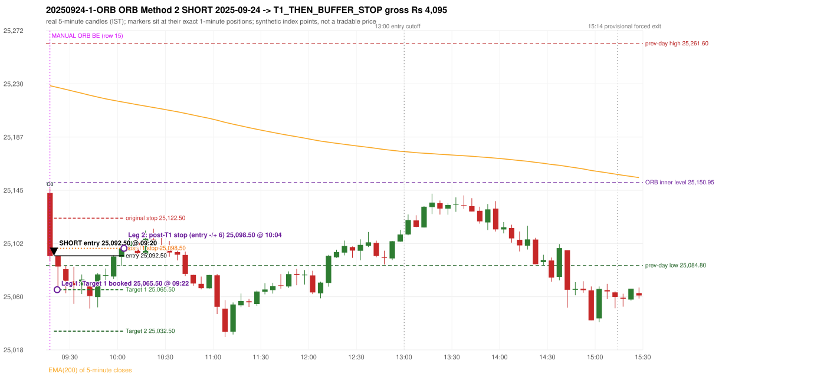

# Trading journal - 2025-09-24 (Wednesday)

> Automated reconstruction of the Phase 3.6 combined backtest: the Phase 3.0 controller, stops, targets and sizing with PDR = the body-based engine (wicks ignored; open strictly above the zone; numeric pattern thresholds and zone-lower-boundary conventions are provisional research assumptions, NOT approved by the strategy author). Synthetic NIFTY 50 index-point P&L (the index is not tradable). The owner's review status is intentionally blank.

## A. Trading day overview

| item | value |
|---|---|
| Date / weekday | 2025-09-24 / Wednesday |
| Session type | USABLE_WITH_FLAGS / VALID |
| Original session open (first 1-minute open) | 25,142.55 |
| Previous session | 2025-09-23 |
| Previous-day high / low (wicks included) | 25,261.60 / 25,084.80 |
| Previous-day highest BODY high (the body-based PDR ceiling; wicks ignored) | 25,251.75 |
| Previous-day official close / last 5-minute close | 25,169.50 / 25,184.90 |
| Raw engine records / confirmed signals / fully valid signals | 3 / 1 / 1 |
| Setups that did not complete (invalidated / incomplete) | 2 |
| Executed trades | 1 20250924-1-ORB |
| Gross P&L (Rs, synthetic) | 4,095.00 |
| Illustrative net P&L (Rs; Rs 500/trade + 0.5 pt/fill) | 3,205.00 |
| Day-end portfolio status | DAY_FINISHED |
| Manual journal trades (matched / unmatched) | 1 (1 / 0) |
| Extra automated trades | 0 |

## B. Daily strategy signal timeline (confirmed signals, chronological)

| time | strategy | method | dir | entry-rule status | valid for execution | <= 13:00 | portfolio state | accepted / ignored | specific reason | competing (same minute) |
|---|---|---|---|---|---|---|---|---|---|---|
| 09:20 | ORB | Method 2 | SHORT | RESEARCH_VARIANT | True | True | FIRST_TRADE_ACTIVE | ACCEPTED -> 20250924-1-ORB | first eligible signal of the day; trade 1: T1_THEN_BUFFER_STOP |  |

Engine setups that did not complete (2); the complete list with failed rule ids is in `rejected_signals.csv`:

| candle | strategy | method | dir | status | precise reason | failed rules |
|---|---|---|---|---|---|---|
| 09:15 | PDS | Method 1/2/3 | SHORT | INVALIDATED | GAP_DOWN_OPEN_NOT_BELOW_ZONE | PDS-006 |
| 09:55 | RF | RF | LONG | INVALIDATED | TREND:EMA_PREV_SESSION_CLOSE wrong side | RF-001;RF-008 |

## C. Detailed trade journals

### 20250924-1-ORB: ORB Method 2 SHORT (FIRST trade)

Chart: 

**Rule configuration:** CFG-phase36_body_based-866f954e55 - signal verification status **RESEARCH_VARIANT** (never VERIFIED while a rule rests on a proposal).

#### 1. Setup identification

ORB Method 2 SHORT (research variant): the first candle closed at 25,092.30, beyond the inner support 25,150.95 built from the previous session's latest fractal (15:10), with a supportive trendline (25,189.78); its body occupied 86.64% of its range and its lower wick 6.98% (thresholds 60% / 20%): the strong-bearish candle test passed. The source gives no construction for the inner level or the trendline.

#### 2. Candle and indicator calculations

| role | session | candle | O | H | L | C | range | body % | upper wick % | lower wick % | direction | EMA(200) | strong bull / bear | pin bull / bear | small (body<=30%) | used for |
|---|---|---|---|---|---|---|---|---|---|---|---|---|---|---|---|---|
| first_candle | TODAY | 09:15-09:20 | 25,142.55 | 25,146.25 | 25,088.25 | 25,092.30 | 58.00 | 86.64 | 6.38 | 6.98 | BEARISH | 25,228.06 | False / True | False / False | False | the 09:15 first five-minute candle - the ORB decision candle |
| inner_level_candle | PREVIOUS | 15:10-15:15 | 25,162.85 | 25,186.10 | 25,150.95 | 25,171.90 | 35.15 | 25.75 | 40.40 | 33.85 | BULLISH | 25,231.15 | False / False | False / False | True | inner level: latest 5-candle fractal extreme of the previous session inside its range |
| prev_session_last_candle | PREVIOUS | 15:25-15:30 | 25,166.75 | 25,185.50 | 25,165.55 | 25,184.90 | 19.95 | 90.98 | 3.01 | 6.01 | BULLISH | 25,229.42 | True / False | False / False | False | trend: previous session's last 5-minute close vs its EMA(200) |
| trendline_point_1 | PREVIOUS | 14:05-14:10 | 25,230.20 | 25,261.60 | 25,225.60 | 25,251.30 | 36.00 | 58.61 | 28.61 | 12.78 | BULLISH | 25,236.19 | False / False | False / False | False | first fractal point of the trendline |
| trendline_point_2 | PREVIOUS | 14:35-14:40 | 25,206.95 | 25,236.25 | 25,196.85 | 25,206.95 | 39.40 | 0.00 | 74.37 | 25.63 | DOJI | 25,234.72 | False / False | False / True | True | second fractal point of the trendline |

Every condition, with the rule, the calculation, the observed values and the result:

| # | group | rule | result | status / numeric definition | calculation | observed | required | available at | why it matters |
|---|---|---|---|---|---|---|---|---|---|
| 1 | SELECTION | SEL-FIRST-001 | PASS | USER_APPROVED / USER_APPROVED | earliest CONFIRMED signal of the day across IRF/ORB/PDR/PDS/RF that passed the controller's checks | 0 confirmed signal(s) earlier today; 1 confirmed signals in the day in total, this one at 09:20 | no earlier executable signal | 2025-09-24 09:20 | the shared controller trades only the first valid signal; the five strategies are not independent positions |
| 2 | SELECTION | SEL-TIE-001 | PASS | USER_APPROVED / USER_APPROVED | other CONFIRMED signals with exactly the same confirmation timestamp | none | no different-strategy / opposite-direction signal in the same minute (otherwise an unresolved conflict, no trade) | 2025-09-24 09:20 | an unresolved same-minute collision would have produced no trade at all |
| 3 | SELECTION | ENTRY-CUTOFF-001 | PASS | USER_APPROVED / USER_APPROVED | fill timestamp vs 13:00:00 IST | signal confirmed 09:20; fill 09:20 | fill at or before 13:00:00 IST | 2025-09-24 09:20 | no new position may be entered with a fill after 13:00 IST |
| 4 | SELECTION | EXE-FILL-001 | PASS | PROPOSED_FOR_REVIEW / PROPOSED_FOR_REVIEW | fill = open of the 1-minute bar that starts at the signal candle's end | bar 09:20 O 25,092.50 H 25,092.50 L 25,078.50 C 25,083.10; executable=True; entry 25,092.50 | fill bar exists, starts exactly at the signal end, is fillable; entry = its open | 2025-09-24 09:20 | a 5-minute signal is known only when its candle closes; the first price that can be traded is the next minute's open |
| 5 | SELECTION | DAY-MAX-001 | PASS | USER_APPROVED / USER_APPROVED | number of entries today | trade 1 of at most 2 | <= 2 entries per day | 2025-09-24 09:20 | daily trade cap |
| 6 | SETUP | ORB-GLOBAL-001 | PASS | SOURCE_VERIFIED / EXPLICIT_IN_SOURCE | decision is taken once the first 5-minute candle (09:15-09:20) has closed | candle 09:15-09:20; signal confirmed 09:20 | decision at 09:20, never before the close | 2025-09-24 09:20 | the close of the first candle is unknown before 09:20 |
| 7 | SETUP | ORB-GLOBAL-002 | PASS | SOURCE_VERIFIED / EXPLICIT_IN_SOURCE | direction | SHORT | same rules in both directions | 2025-09-24 09:20 | ORB trades the side of the break |
| 8 | SETUP | ORB-GLOBAL-004 | PASS | SOURCE_VERIFIED / QUALITATIVE_SOURCE_NUMERIC_DEFINITION_PROPOSED_FOR_REVIEW | entry at 09:20, after the first-candle close | signal confirmed 09:20; fill 09:20 at the open of that minute | 09:20 entry | 2025-09-24 09:20 | the guide enters at 9:20; the fill price convention (next minute open) is a proposal |
| 9 | SETUP | ORB-M2-SHORT-001 | PASS | UNRESOLVED / UNRESOLVED | inner level = latest fractal (k=2) extreme of the previous session below the day's high / above the day's low | inner support 25,150.95 from the 15:10 candle of 2025-09-23 (previous range 25,084.80 - 25,261.60; engine recorded 25,150.95) | an inner level inside yesterday's range | 2025-09-23 15:25 | the source gives NO objective construction for the inner level: this is a research variant |
| 10 | SETUP | ORB-M2-SHORT-002 | PASS | SOURCE_VERIFIED / EXPLICIT_IN_SOURCE | first candle breaks and closes beyond the inner level | close 25,092.30 vs inner level 25,150.95: 58.65 points beyond | high/low and close beyond the level | 2025-09-24 09:20 | the breakout itself |
| 11 | TREND | ORB-TREND-001 | PASS | SOURCE_VERIFIED / QUALITATIVE_SOURCE_NUMERIC_DEFINITION_PROPOSED_FOR_REVIEW | previous session's final completed 5-minute candle: close vs its EMA(200 of 5-minute closes) | previous session 2025-09-23 last candle 15:25-15:30 close 25,184.90 vs EMA(200) 25,229.42: 44.52 points below the EMA -> trend bearish (EMA_PREV_SESSION_CLOSE; research variant A, EMA-only) | close < EMA(200) | 2025-09-23 15:30 | the opening gap can never create the trend: only information that existed before today's open is used |
| 12 | TREND | ORB-TREND-002 | PASS | SOURCE_VERIFIED / QUALITATIVE_SOURCE_NUMERIC_DEFINITION_PROPOSED_FOR_REVIEW | price location versus the 200 EMA is the basic confirmation; structure is only 'supporting' | 44.52 points below the EMA(200) on the previous session's last 5-minute close; swing structure not used in variant A | price on the trend side of the 200 EMA | 2025-09-23 15:30 | the rulebook calls EMA position 'a basic confirmation, supported by bullish structure'; the structure part has no numeric definition |
| 13 | TREND | TREND-SWING-001 | NOT_APPLICABLE | PROPOSED_FOR_REVIEW / PROPOSED_FOR_REVIEW | confirmed swing structure | not required by the active trend variant (variant A is the EMA price location only) | n/a | 2025-09-23 15:30 | variant B would additionally require higher-high/higher-low swings; it is a separate labelled scenario |
| 14 | CONFIRMATION | ORB-M2-SHORT-001 | PASS | UNRESOLVED / UNRESOLVED | trendline through the last two fractal lows (long) / highs (short) of the previous session | points 14:05 25,261.60 and 14:35 25,236.25 (6 candles apart): slope -4.2250 per candle; line value at the 09:15 candle 25,189.78; first-candle close 25,092.30 is on the supportive side (engine recorded 25,189.78) | rising (long) / falling (short) line with price on the trend side | 2025-09-23 14:40 | the guide requires a trendline but defines no construction or 'near' distance: research variant |
| 15 | CONFIRMATION | ORB-M2-SHORT-003 | PASS | SOURCE_VERIFIED / QUALITATIVE_SOURCE_NUMERIC_DEFINITION_PROPOSED_FOR_REVIEW | candle quality: strong body and limited opposite wick (or pin bar) | 09:15-09:20 O 25,142.55 H 25,146.25 L 25,088.25 C 25,092.30; range 58.00, body 50.25 (86.64%), upper wick 3.70 (6.38%), lower wick 4.05 (6.98%), bearish. Strong-bearish test: bearish close, body >= 60% (observed 86.64%), lower wick <= 20% (observed 6.98%) -> PASS | strong candle or pin bar | 2025-09-24 09:20 | same proposed thresholds as Method 1 |
| 16 | CONFIRMATION | ORB-M2-SHORT-004 | PASS | SOURCE_VERIFIED / QUALITATIVE_SOURCE_NUMERIC_DEFINITION_PROPOSED_FOR_REVIEW | if the close is near the 5-minute EMA(200) a convincing close beyond it is needed | EMA(200) at the 09:15 candle 25,228.06; close 25,092.30 is 135.76 points below it; 'near' band 15 points -> not near, test not applicable | outside the 15-point band, or beyond the EMA by >= 5 | 2025-09-24 09:20 | ORB p.5: 'if the breakout is near the EMA, wait for a convincing close' |
| 17 | EXECUTION | ORB-GLOBAL-003 | PASS | SOURCE_VERIFIED / EXPLICIT_IN_SOURCE | initial stop = entry + 30 points | entry 25,092.50 -> stop 25,122.50 | stop 30 index points (BASELINE) | 2025-09-24 09:20 | defines the loss if the setup fails before Target 1 |
| 18 | EXECUTION | EXE-T1-001 | PASS | SOURCE_VERIFIED / EXPLICIT_IN_SOURCE | Target 1 = entry +/- 27 points | T1 25,065.50 | 27 points | 2025-09-24 09:20 | Leg 1 (3 lots) is booked at Target 1 |
| 19 | EXECUTION | ORB-GLOBAL-003 | PASS | SOURCE_VERIFIED / EXPLICIT_IN_SOURCE | Target 2 = entry +/- 60 points | T2 25,032.50 | 60 points | 2025-09-24 09:20 | Leg 2 (3 lots) is booked at Target 2 |
| 20 | EXECUTION | POST-T1-STOP-006 | PASS | USER_APPROVED / USER_APPROVED | after T1 the Leg-2 stop = entry + 6 (no trailing) | post-T1 stop 25,098.50 | entry -6 (LONG) / +6 (SHORT) | 2025-09-24 09:20 | protects the remaining three lots once the first three are booked |
| 21 | EXECUTION | SIZE-LOT-001 | PASS | USER_APPROVED / USER_APPROVED | 6 lots x 65 = 390, Leg 1 = 3 lots = 195, Leg 2 = 195 | 6 lots, lot size 65, legs 3+3 | 6 lots in two equal legs | 2025-09-24 09:20 | position size for the synthetic P&L |
| 22 | NOTE | ORB-MA-001 | UNRESOLVED | CONFLICTING / CONFLICTING | which moving average the code uses | EMA(200) of 5-minute closes (the guide says '200 DMA' in some places and '200 EMA' in others); active ma_mode EMA200_5M | the source terminology conflicts | 2025-09-24 09:20 | a daily 200 DMA would give different values |
| 23 | NOTE | NOTE-UNRESOLVED-DEPENDENCIES | UNRESOLVED | NOT_A_RULE / NOT_A_REGISTRY_RULE | rules the signal depends on that the sources leave unresolved | engine-recorded unresolved rule ids: ORB-M2-SHORT-001, ORB-MA-001; verification status RESEARCH_VARIANT | n/a (disclosure) | 2025-09-24 09:20 | the entry is only as verified as the rules it rests on |

#### 3. Entry decision and explanation

ORB Method 2 SHORT (research variant): the first candle closed at 25,092.30, beyond the inner support 25,150.95 built from the previous session's latest fractal (15:10), with a supportive trendline (25,189.78); its body occupied 86.64% of its range and its lower wick 6.98% (thresholds 60% / 20%): the strong-bearish candle test passed. The source gives no construction for the inner level or the trendline.

**Why this trade ahead of the other strategies:** This ORB Method 2 signal was the earliest executable signal of the day: 0 confirmed signal(s) earlier, 0 other in the same minute. No later signal was generated. State of the other four engines at that moment: [IRF: no setup record before this time (a base condition was not met, or nothing triggered)] [PDR: no setup record before this time (a base condition was not met, or nothing triggered)] [PDS: Method 1/2/3 invalidated at 09:15: GAP_DOWN_OPEN_NOT_BELOW_ZONE] [RF: no setup record before this time (a base condition was not met, or nothing triggered)]

#### 4. Actual entry execution

| item | value |
|---|---|
| Signal candle | 09:15-09:20 |
| Signal confirmed | 2025-09-24 09:20 |
| Fill timestamp | 2025-09-24 09:20 |
| Entry price | 25,092.50 |
| Source partition / 1-minute bar | data/processed/nifty50/year=2025/month=09/candles.parquet / 2025-09-24 09:20 |
| Source bar O / H / L / C | 25,092.50 / 25,092.50 / 25,078.50 / 25,083.10 |
| Fill assumption | open of the 1-minute bar starting at the signal candle's end (EXE-FILL-001, PROPOSED causal convention) |
| Initial stop / T1 / T2 / post-T1 stop | 25,122.50 / 25,065.50 / 25,032.50 / 25,098.50 |
| Position | 6 lots x 65 = 390 units (Leg 1 195, Leg 2 195) |

#### 5-8. Trade progress, Target 1, post-T1 stop and final exit

Between the 09:20 entry bar and the final exit (45 one-minute bars) the best excursion in favour was 41.95 points at 09:43 and the worst against was 11.40 points at 10:04. At 09:22 price reached Target 1 25,065.50 and three lots exited. At 09:22 the remaining three lots' protective stop was set to 25,098.50 (entry + 6; no trailing, no further change); the engine applies it from the Target-1 bar onward and tests it within that same bar. At 10:04 the remaining three lots stopped out at 25,098.50. T1_THEN_BUFFER_STOP: no second trade that day (DAY-BUF-001).

| leg | qty | exit time | exit price | reason | source 1-minute bar | O / H / L / C | gross points | gross Rs | slippage pts | flags |
|---|---|---|---|---|---|---|---|---|---|---|
| 1 | 195 | 09:22 | 25,065.50 | TARGET_1 | 09:22 | 25,079.80 / 25,079.80 / 25,063.80 / 25,072.85 | 27.00 | 5,265.00 | 0.00 |  |
| 2 | 195 | 10:04 | 25,098.50 | POST_T1_STOP_ENTRY_MINUS_PLUS_6 | 10:04 | 25,095.65 / 25,103.90 / 25,095.65 / 25,098.10 | -6.00 | -1,170.00 | 0.00 |  |

Exit evidence per leg:

* Leg 1: 1-minute bar 09:22 O 25,079.80 H 25,079.80 L 25,063.80 C 25,072.85: low 25,063.80 reached Target 1 25,065.50; Leg 1 booked at the target level
* Leg 2: 1-minute bar 10:04 O 25,095.65 H 25,103.90 L 25,095.65 C 25,098.10: high 25,103.90 reached the post-T1 stop 25,098.50; Leg 2 exits at 25,098.50 at the stop level

#### 9. Gross and illustrative net P&L

| item | value (Rs) |
|---|---|
| Leg 1 gross | 5,265.00 |
| Leg 2 gross | -1,170.00 |
| Trade gross (= Leg 1 + Leg 2) | 4,095.00 |
| Illustrative fixed cost | -500.00 |
| Illustrative slippage (0.5 pt on every fill, entry + exits, all units) | -390.00 |
| Illustrative net | 3,205.00 |

#### 10. Manual journal comparison

EXACT_MATCH: manual ORB labelled 09:15 (candle start) vs automated ORB Method 2 SHORT candle 09:15, filled 09:20 at 25,092.50; time difference 0 minutes. Journal outcome BE vs automated T1_THEN_BUFFER_STOP (same outcome class). The journal records no entry or exit price.

## D. Manual journal comparison

| comparison | journal row | journal strategy | manual time | manual direction | manual outcome | match class | trade | auto entry | auto outcome | explanation |
|---|---|---|---|---|---|---|---|---|---|---|
| M015 | 15 | ORB | 09:15 | UNKNOWN | BE | EXACT_MATCH | 20250924-1-ORB | 09:20 @ 25,092.50 | T1_THEN_BUFFER_STOP | EXACT_MATCH: manual ORB labelled 09:15 (candle start) vs automated ORB Method 2 SHORT candle 09:15, filled 09:20 at 25,092.50; time difference 0 minutes. Journal outcome BE vs automated T1_THEN_BUFFER_STOP (same outcome class). The journal records no entry or exit price. |

The journal records no entry price and no exit price (NOT_RECORDED); matching uses date, strategy and candle start only - never P&L.

## E. Daily conclusion

* **Traded:** 20250924-1-ORB - ORB Method 2 SHORT at 09:20 (entry 25,092.50), outcome T1_THEN_BUFFER_STOP, gross Rs 4,095.00, illustrative net Rs 3,205.00. **Why:** This ORB Method 2 signal was the earliest executable signal of the day: 0 confirmed signal(s) earlier, 0 other in the same minute. No later signal was generated. State of the other four engines at that moment: [IRF: no setup record before this time (a base condition was not met, or nothing triggered)] [PDR: no setup record before this time (a base condition was not met, or nothing triggered)] [PDS: Method 1/2/3 invalidated at 09:15: GAP_DOWN_OPEN_NOT_BELOW_ZONE] [RF: no setup record before this time (a base condition was not met, or nothing triggered)] **How it ended:** At 09:22 price reached Target 1 25,065.50 and three lots exited. At 09:22 the remaining three lots' protective stop was set to 25,098.50 (entry + 6; no trailing, no further change); the engine applies it from the Target-1 bar onward and tests it within that same bar. At 10:04 the remaining three lots stopped out at 25,098.50. T1_THEN_BUFFER_STOP: no second trade that day (DAY-BUF-001).
* **Open strategy-definition issues that affected this day:** NOTE-UNRESOLVED-DEPENDENCIES, ORB-MA-001 (Terminology conflict: '200 DMA / EMA' (p.2), '200 EMA' (pp.3,5,7), '200 DMA' (pp.1,8,9,12) for what the charts show as one curved line on a 5-minute chart)
* **Automated triage (not an approval; the owner's review status stays blank):** MATCHED_EXACT_NO_FLAGS
