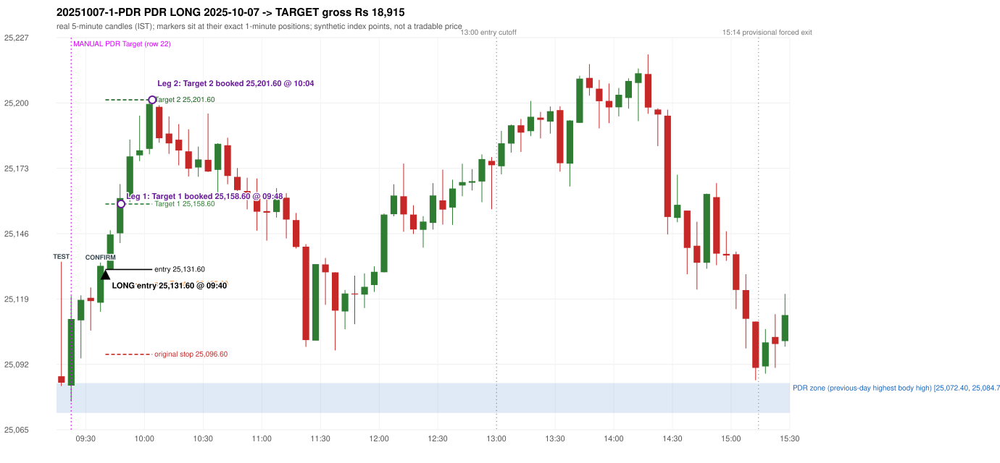

# Trading journal - 2025-10-07 (Tuesday)

> Automated reconstruction of the Phase 3.6 combined backtest: the Phase 3.0 controller, stops, targets and sizing with PDR = the body-based engine (wicks ignored; open strictly above the zone; numeric pattern thresholds and zone-lower-boundary conventions are provisional research assumptions, NOT approved by the strategy author). Synthetic NIFTY 50 index-point P&L (the index is not tradable). The owner's review status is intentionally blank.

## A. Trading day overview

| item | value |
|---|---|
| Date / weekday | 2025-10-07 / Tuesday |
| Session type | USABLE / VALID |
| Original session open (first 1-minute open) | 25,087.55 |
| Previous session | 2025-10-06 |
| Previous-day high / low (wicks included) | 25,095.70 / 24,881.90 |
| Previous-day highest BODY high (the body-based PDR ceiling; wicks ignored) | 25,084.70 |
| Previous-day official close / last 5-minute close | 25,077.65 / 25,072.55 |
| Raw engine records / confirmed signals / fully valid signals | 12 / 10 / 10 |
| Setups that did not complete (invalidated / incomplete) | 2 |
| Executed trades | 1 20251007-1-PDR |
| Gross P&L (Rs, synthetic) | 18,915.00 |
| Illustrative net P&L (Rs; Rs 500/trade + 0.5 pt/fill) | 18,025.00 |
| Day-end portfolio status | DAY_FINISHED |
| Manual journal trades (matched / unmatched) | 1 (1 / 0) |
| Extra automated trades | 0 |

## B. Daily strategy signal timeline (confirmed signals, chronological)

| time | strategy | method | dir | entry-rule status | valid for execution | <= 13:00 | portfolio state | accepted / ignored | specific reason | competing (same minute) |
|---|---|---|---|---|---|---|---|---|---|---|
| 09:40 | PDR | PDR | LONG | RESEARCH_VARIANT | True | True | FIRST_TRADE_ACTIVE | ACCEPTED -> 20251007-1-PDR | first eligible signal of the day; trade 1: TARGET |  |
| 11:00 | IRF | Method 2A | SHORT | PROPOSAL_DEPENDENT | True | True | DAY_FINISHED | IGNORED | DAY_FINISHED [blocked by PDR#1] |  |
| 11:25 | IRF | Method 1 | SHORT | PROPOSAL_DEPENDENT | True | True | DAY_FINISHED | IGNORED | DAY_FINISHED [blocked by PDR#1] |  |
| 12:15 | IRF | Method 2B | SHORT | PROPOSAL_DEPENDENT | True | True | DAY_FINISHED | IGNORED | DAY_FINISHED [blocked by PDR#1] |  |
| 13:00 | IRF | Method 2B | SHORT | PROPOSAL_DEPENDENT | True | True | DAY_FINISHED | IGNORED | DAY_FINISHED [blocked by PDR#1] |  |
| 13:35 | IRF | Method 2A | SHORT | PROPOSAL_DEPENDENT | True | False | DAY_FINISHED | IGNORED | DAY_FINISHED [blocked by PDR#1] |  |
| 14:00 | IRF | Method 2B | SHORT | PROPOSAL_DEPENDENT | True | False | DAY_FINISHED | IGNORED | DAY_FINISHED [blocked by PDR#1] |  |
| 14:30 | IRF | Method 2A | SHORT | PROPOSAL_DEPENDENT | True | False | DAY_FINISHED | IGNORED | DAY_FINISHED [blocked by PDR#1] |  |
| 14:45 | IRF | Method 1 | SHORT | PROPOSAL_DEPENDENT | True | False | DAY_FINISHED | IGNORED | DAY_FINISHED [blocked by PDR#1] |  |
| 15:05 | IRF | Method 1 | SHORT | PROPOSAL_DEPENDENT | True | False | DAY_FINISHED | IGNORED | DAY_FINISHED [blocked by PDR#1] |  |

Engine setups that did not complete (2); the complete list with failed rule ids is in `rejected_signals.csv`:

| candle | strategy | method | dir | status | precise reason | failed rules |
|---|---|---|---|---|---|---|
| 14:25 | IRF | Method 1/2 | SHORT | INCOMPLETE_AT_EOD | SESSION_ENDED_BEFORE_CONFIRMATION |  |
| 09:15 | ORB | Method 2 | LONG | INVALIDATED | TRENDLINE_NOT_SUPPORTIVE | ORB-M2-LONG-001 |

## C. Detailed trade journals

### 20251007-1-PDR: PDR LONG (FIRST trade)

Chart: 

**Rule configuration:** CFG-phase36_body_based-866f954e55 - signal verification status **RESEARCH_VARIANT** (never VERIFIED while a rule rests on a proposal).

#### 1. Setup identification

PDR LONG (body-based engine, A_HIGHEST_BODY_HIGH): the session opened 9.90 points above the previous close and 2.85 points above the previous-day highest BODY high 25,084.70 (zone [25,072.40, 25,084.70] from the 15:00 candle of 2025-10-06; the highest wick 25,095.70 is ignored). The 09:15 candle (25,083.50 - 25,134.80) tested the zone; the 09:35 candle (green, O 25,117.90 H 25,134.45 L 25,114.15 C 25,133.10) passed GOOD_GREEN_BODY and closed 48.40 points above the zone ceiling, confirming the entry at 09:40. The pattern thresholds and the zone's lower boundary are provisional research assumptions, not approved by the strategy author.

#### 2. Candle and indicator calculations

| role | session | candle | O | H | L | C | range | body % | upper wick % | lower wick % | direction | EMA(200) | strong bull / bear | pin bull / bear | small (body<=30%) | used for |
|---|---|---|---|---|---|---|---|---|---|---|---|---|---|---|---|---|
| zone_source_candle | PREVIOUS | 15:00-15:05 | 25,084.70 | 25,084.70 | 25,071.00 | 25,072.40 | 13.70 | 89.78 | 0.00 | 10.22 | BEARISH | 24,904.74 | False / True | False / False | False | candle of the previous session's highest BODY high (A_HIGHEST_BODY_HIGH) |
| prev_day_wick_high_candle | PREVIOUS | 14:50-14:55 | 25,057.10 | 25,095.70 | 25,054.60 | 25,077.25 | 41.10 | 49.03 | 44.89 | 6.08 | BULLISH | 24,901.24 | False / False | False / False | False | candle of the previous session's highest WICK (ignored by the author's rule; shown for comparison) |
| interaction_candle | TODAY | 09:15-09:20 | 25,087.55 | 25,134.80 | 25,083.50 | 25,084.90 | 51.30 | 5.17 | 92.11 | 2.73 | BEARISH | 24,914.89 | False / False | False / True | True | first candle whose range overlaps the zone (the test) |
| confirmation_candle | TODAY | 09:35-09:40 | 25,117.90 | 25,134.45 | 25,114.15 | 25,133.10 | 20.30 | 74.88 | 6.65 | 18.47 | BULLISH | 24,922.96 | True / False | False / False | False | candle that satisfies one of the three patterns and closes above the zone ceiling |

Every condition, with the rule, the calculation, the observed values and the result:

| # | group | rule | result | status / numeric definition | calculation | observed | required | available at | why it matters |
|---|---|---|---|---|---|---|---|---|---|
| 1 | SELECTION | SEL-FIRST-001 | PASS | USER_APPROVED / USER_APPROVED | earliest CONFIRMED signal of the day across IRF/ORB/PDR/PDS/RF that passed the controller's checks | 0 confirmed signal(s) earlier today; 10 confirmed signals in the day in total, this one at 09:40 | no earlier executable signal | 2025-10-07 09:40 | the shared controller trades only the first valid signal; the five strategies are not independent positions |
| 2 | SELECTION | SEL-TIE-001 | PASS | USER_APPROVED / USER_APPROVED | other CONFIRMED signals with exactly the same confirmation timestamp | none | no different-strategy / opposite-direction signal in the same minute (otherwise an unresolved conflict, no trade) | 2025-10-07 09:40 | an unresolved same-minute collision would have produced no trade at all |
| 3 | SELECTION | ENTRY-CUTOFF-001 | PASS | USER_APPROVED / USER_APPROVED | fill timestamp vs 13:00:00 IST | signal confirmed 09:40; fill 09:40 | fill at or before 13:00:00 IST | 2025-10-07 09:40 | no new position may be entered with a fill after 13:00 IST |
| 4 | SELECTION | EXE-FILL-001 | PASS | PROPOSED_FOR_REVIEW / PROPOSED_FOR_REVIEW | fill = open of the 1-minute bar that starts at the signal candle's end | bar 09:40 O 25,131.60 H 25,141.60 L 25,131.60 C 25,141.05; executable=True; entry 25,131.60 | fill bar exists, starts exactly at the signal end, is fillable; entry = its open | 2025-10-07 09:40 | a 5-minute signal is known only when its candle closes; the first price that can be traded is the next minute's open |
| 5 | SELECTION | DAY-MAX-001 | PASS | USER_APPROVED / USER_APPROVED | number of entries today | trade 1 of at most 2 | <= 2 entries per day | 2025-10-07 09:40 | daily trade cap |
| 6 | SETUP | PDR-004 | PASS | SOURCE_VERIFIED / EXPLICIT_WORDING_DETAIL_PROPOSED_FOR_REVIEW | gap = first 1-minute open of today - previous session's OFFICIAL close | today's open 25,087.55 (first 1-minute bar 09:15) - previous close 25,077.65 (DAILY_VENDOR, 2025-10-06) = +9.90 points -> gap UP | gap UP (more than 0 points) | 2025-10-07 09:15 | approved convention: the original first-minute open, never the vendor daily open |
| 7 | SETUP | PDR-B03 | PASS | AUTHOR_APPROVED / AUTHOR_STATEMENT_NUMERIC_DETAILS_ARE_SEPARATE_PROPOSED_ROWS | the session opens strictly above the previous day's resistance zone (author-approved) | today's first 1-minute open 25,087.55 vs zone ceiling 25,084.70: 2.85 points above (open - ceiling = +2.85) | open > zone ceiling (equal or inside the zone rejects the setup) | 2025-10-07 09:15 | the original first-minute open is used, never a vendor daily open |
| 8 | ZONE | PDR-001 | PASS | SOURCE_VERIFIED / EXPLICIT_IN_SOURCE | direction | LONG (PDR is long only) | long-only | 2025-10-07 09:40 | PDR buys a retest of previous-day resistance after a gap up |
| 9 | ZONE | PDR-B01a | PASS | AUTHOR_APPROVED / AUTHOR_STATEMENT_NUMERIC_DETAILS_ARE_SEPARATE_PROPOSED_ROWS | wicks ignored, bodies considered: body_high = max(open, close) of every completed previous-session 5-minute candle; ceiling = the highest body_high; floor = body low of that candle | previous session 2025-10-06: highest body high 25,084.70 on the 15:00 candle (O 25,084.70 C 25,072.40; wick high of that candle 25,084.70, ignored); four highest body highs: 25,084.70 (15:00); 25,083.80 (14:55); 25,082.60 (15:05); 25,081.75 (15:10). Highest WICK of the session 25,095.70 (14:50 candle) is 11.00 points above the ceiling and plays no part. Zone [25,072.40 (body low), 25,084.70 (body high)]; engine recorded [25,072.40, 25,084.70] | ceiling = highest body high of the previous session (author: wick ignored, body considered) | 2025-10-06 15:30 | a wick-only price never becomes resistance; the zone is drawn from candle bodies |
| 10 | ZONE | PDR-B02 | UNRESOLVED | AUTHOR_APPROVED / AUTHOR_STATEMENT_NUMERIC_DETAILS_ARE_SEPARATE_PROPOSED_ROWS | multiple highs connected into one zone (author principle; candidate B) | candidate A (used): [25,072.40, 25,084.70]. Candidate B (multiple-body-high cluster, tolerance 5 points) would be [25,072.40, 25,084.70] (MULTIPLE_BODY_HIGH_CLUSTER, 3 touch(es), member body highs 25,080.50, 25,084.70, 25,081.60); ceiling difference 0.00 points | a zone that connects all relevant highs (numbers not given by the author) | 2025-10-06 15:30 | candidate B has the same ceiling by construction, so this signal is unaffected by the choice; the lower boundary and the cluster numbers are research parameters |
| 11 | ZONE | PDR-003 | PASS | SOURCE_VERIFIED / EXPLICIT_IN_SOURCE | the zone is an area, not a single price | zone height 12.30 points [25,072.40, 25,084.70] | a rectangle with positive height (a zero-height zone is left unresolved by the engine) | 2025-10-06 15:30 | price may touch any part of the area |
| 12 | CONFIRMATION | PDR-B03b | PASS | PRESERVED_FROM_PHASE2 / PRESERVED_FROM_PHASE2 | the first candle whose [low, high] overlaps the zone (+/- proximity) is the test; the confirmation must come strictly after it | 09:15-09:20 O 25,087.55 H 25,134.80 L 25,083.50 C 25,084.90; range 51.30, body 2.65 (5.17%), upper wick 47.25 (92.11%), lower wick 1.40 (2.73%), bearish; low 25,083.50 vs zone ceiling 25,084.70, high 25,134.80 vs zone floor 25,072.40; proximity 0; confirmation candle 09:35 is candle no. 5, the test candle no. 1 | range overlaps the zone; confirmation after the test | 2025-10-07 09:20 | the retest of the previous-day resistance |
| 13 | CONFIRMATION | PDR-B04c | PASS | PROPOSED_FOR_REVIEW / NUMERIC_DEFINITION_PROPOSED_FOR_REVIEW | Pattern 1: good green body on the 09:35-09:40 candle (O 25,117.90 H 25,134.45 L 25,114.15 C 25,133.10); the numeric thresholds are PROVISIONAL (RESEARCH_DEFAULT), not author-approved | colour green; body 74.88%; upper wick 6.65% -> PASSES | green, body >= 60% and upper wick <= 20% of the range | 2025-10-07 09:40 | one of the three patterns is enough (author: one good green body OR lower price rejection OR hammer); fixed thresholds are not required by the author, so the numbers are a research convention; a pattern that does not pass is not an error |
| 14 | CONFIRMATION | PDR-B04c | NOT_APPLICABLE | PROPOSED_FOR_REVIEW / NUMERIC_DEFINITION_PROPOSED_FOR_REVIEW | Pattern 2: lower-price rejection candle on the 09:35-09:40 candle (O 25,117.90 H 25,134.45 L 25,114.15 C 25,133.10); the numeric thresholds are PROVISIONAL (RESEARCH_DEFAULT), not author-approved | lower wick 3.75 = 0.25 x body 15.20; close 6.65% below the high; low 25,114.15; low did NOT reach the zone ceiling 25,084.70 -> does not pass | lower wick >= 2 x body, close within the top 30% of the range, low <= zone ceiling (colour not required) | 2025-10-07 09:40 | one of the three patterns is enough (author: one good green body OR lower price rejection OR hammer); fixed thresholds are not required by the author, so the numbers are a research convention; a pattern that does not pass is not an error |
| 15 | CONFIRMATION | PDR-B04c | NOT_APPLICABLE | PROPOSED_FOR_REVIEW / NUMERIC_DEFINITION_PROPOSED_FOR_REVIEW | Pattern 3: hammer candle on the 09:35-09:40 candle (O 25,117.90 H 25,134.45 L 25,114.15 C 25,133.10); the numeric thresholds are PROVISIONAL (RESEARCH_DEFAULT), not author-approved | lower wick 3.75 = 0.25 x body; upper wick 6.65%; body bottom at 18.47% of the range -> does not pass | lower wick >= 2 x body, upper wick <= 10%, body bottom >= 60% of the range (colour not required) | 2025-10-07 09:40 | one of the three patterns is enough (author: one good green body OR lower price rejection OR hammer); fixed thresholds are not required by the author, so the numbers are a research convention; a pattern that does not pass is not an error |
| 16 | CONFIRMATION | PDR-B04 | PASS | AUTHOR_APPROVED / AUTHOR_STATEMENT_NUMERIC_DETAILS_ARE_SEPARATE_PROPOSED_ROWS | at least one of the three patterns passes (OR logic; every passing pattern is recorded) | patterns passed: GOOD_GREEN_BODY (engine recorded: GOOD_GREEN_BODY) | at least one pattern | 2025-10-07 09:40 | the author's entry candle requirement |
| 17 | CONFIRMATION | PDR-B05 | PASS | AUTHOR_APPROVED / AUTHOR_STATEMENT_NUMERIC_DETAILS_ARE_SEPARATE_PROPOSED_ROWS | the confirmation candle must close above the zone | close 25,133.10 vs zone ceiling 25,084.70: +48.40 points (floor 25,072.40; low 25,114.15 stayed above the zone) | close > zone ceiling, strictly (lower wick may penetrate the zone) | 2025-10-07 09:40 | no pattern overrides the close rule |
| 18 | CONFIRMATION | PDR-B06 | PASS | USER_APPROVED / USER_APPROVED | no entry at the open and no look-ahead: the order is placed only after the confirmation candle has completed | test candle 09:15 (no. 1) precedes the confirmation candle 09:35-09:40; signal stamped 09:40; fill 09:40 at the open of that 1-minute bar = 25,131.60 | interaction before the confirmation; fill after the confirmation candle's end | 2025-10-07 09:40 | existing causal fill convention (EXE-FILL-001) |
| 19 | EXECUTION | EXE-STOP-001 | PASS | USER_APPROVED / USER_APPROVED | initial stop = entry - 35 points | entry 25,131.60 -> stop 25,096.60 | stop 35 index points (BASELINE) | 2025-10-07 09:40 | defines the loss if the setup fails before Target 1 |
| 20 | EXECUTION | EXE-T1-001 | PASS | SOURCE_VERIFIED / EXPLICIT_IN_SOURCE | Target 1 = entry +/- 27 points | T1 25,158.60 | 27 points | 2025-10-07 09:40 | Leg 1 (3 lots) is booked at Target 1 |
| 21 | EXECUTION | PDR-008 | PASS | SOURCE_VERIFIED / EXPLICIT_IN_SOURCE | Target 2 = entry +/- 70 points | T2 25,201.60 (the guide says 70; the performance report's winners suggest 60 - CONFLICTING, recorded) | 70 points | 2025-10-07 09:40 | Leg 2 (3 lots) is booked at Target 2 |
| 22 | EXECUTION | POST-T1-STOP-006 | PASS | USER_APPROVED / USER_APPROVED | after T1 the Leg-2 stop = entry - 6 (no trailing) | post-T1 stop 25,125.60 | entry -6 (LONG) / +6 (SHORT) | 2025-10-07 09:40 | protects the remaining three lots once the first three are booked |
| 23 | EXECUTION | SIZE-LOT-001 | PASS | USER_APPROVED / USER_APPROVED | 6 lots x 65 = 390, Leg 1 = 3 lots = 195, Leg 2 = 195 | 6 lots, lot size 65, legs 3+3 | 6 lots in two equal legs | 2025-10-07 09:40 | position size for the synthetic P&L |
| 24 | NOTE | PDR-B04x | UNRESOLVED | PROPOSED_FOR_REVIEW / NUMERIC_DEFINITION_PROPOSED_FOR_REVIEW | provisional parameters this signal rests on | pattern thresholds RESEARCH_DEFAULT: {'green_body_min': 0.6, 'green_upper_wick_max': 0.2, 'reject_wick_to_body_min': 2.0, 'reject_close_fraction_max': 0.3, 'hammer_wick_to_body_min': 2.0, 'hammer_upper_wick_max': 0.1, 'hammer_body_position_min': 0.6}; zone lower boundary = hull of the member bodies; zero-height policy UNRESOLVED_NO_SETUP; wait policy WAIT_FOR_QUALIFYING_CANDLE; cluster parameters (candidate B only) tolerance 5, touches 2, separation 2 | n/a (disclosure) | 2025-10-07 09:40 | the strategy author has NOT approved these numbers or conventions; the signal is a RESEARCH_VARIANT, never VERIFIED |
| 25 | NOTE | PDR-012 | NOT_APPLICABLE | PROPOSED_FOR_REVIEW / PROPOSED_FOR_REVIEW | repeated PDR signals today | 1 confirmed PDR signal(s) in the session | n/a (disclosure) | 2025-10-07 09:40 | this engine reports EVERY qualifying signal (the per-session cap is lifted); the controller trades only the first (and a PDR/PDS second trade after an initial full stop) |
| 26 | NOTE | PDR-B07 | NOT_APPLICABLE | PROPOSED_FOR_REVIEW / NUMERIC_DEFINITION_PROPOSED_FOR_REVIEW | state of the zone between the test and the confirmation (the author and the guide are silent on price crossing below the zone) | test candle 09:15 (no. 1), confirmation candle 09:35 (no. 5): 4 candle(s) later; no candle in between closed below the zone floor | n/a (disclosure; the wait policy is a research parameter) | 2025-10-07 09:40 | the engine keeps a tested setup armed until a candle qualifies; whether a zone that price has closed through should still count is an owner decision |
| 27 | NOTE | PDR-009 | UNRESOLVED | UNRESOLVED / UNRESOLVED | stop 35 or 40 'depending on the situation' | the guide gives no selection rule; baseline fixed 35 points | unresolved in the source | 2025-10-07 09:40 | PDR stop selection is left to the owner |
| 28 | NOTE | NOTE-UNRESOLVED-DEPENDENCIES | UNRESOLVED | NOT_A_RULE / NOT_A_REGISTRY_RULE | rules the signal depends on that the sources leave unresolved | engine-recorded unresolved rule ids: PDR-B01b, PDR-B02a, PDR-B02b, PDR-B02c, PDR-B02d, PDR-B02e, PDR-B02f, PDR-B02g, PDR-B02h, PDR-B04b, PDR-B04c, PDR-B05a, PDR-B07; verification status RESEARCH_VARIANT | n/a (disclosure) | 2025-10-07 09:40 | the entry is only as verified as the rules it rests on |

#### 3. Entry decision and explanation

PDR LONG (body-based engine, A_HIGHEST_BODY_HIGH): the session opened 9.90 points above the previous close and 2.85 points above the previous-day highest BODY high 25,084.70 (zone [25,072.40, 25,084.70] from the 15:00 candle of 2025-10-06; the highest wick 25,095.70 is ignored). The 09:15 candle (25,083.50 - 25,134.80) tested the zone; the 09:35 candle (green, O 25,117.90 H 25,134.45 L 25,114.15 C 25,133.10) passed GOOD_GREEN_BODY and closed 48.40 points above the zone ceiling, confirming the entry at 09:40. The pattern thresholds and the zone's lower boundary are provisional research assumptions, not approved by the strategy author.

**Why this trade ahead of the other strategies:** This PDR signal was the earliest executable signal of the day: 0 confirmed signal(s) earlier, 0 other in the same minute. 9 later confirmed signal(s) (IRF x9) are logged as ignored or rejected. State of the other four engines at that moment: [IRF: no setup record before this time (a base condition was not met, or nothing triggered)] [ORB: Method 2 invalidated at 09:15: TRENDLINE_NOT_SUPPORTIVE] [PDS: no setup record before this time (a base condition was not met, or nothing triggered)] [RF: no setup record before this time (a base condition was not met, or nothing triggered)]

#### 4. Actual entry execution

| item | value |
|---|---|
| Signal candle | 09:35-09:40 |
| Signal confirmed | 2025-10-07 09:40 |
| Fill timestamp | 2025-10-07 09:40 |
| Entry price | 25,131.60 |
| Source partition / 1-minute bar | data/processed/nifty50/year=2025/month=10/candles.parquet / 2025-10-07 09:40 |
| Source bar O / H / L / C | 25,131.60 / 25,141.60 / 25,131.60 / 25,141.05 |
| Fill assumption | open of the 1-minute bar starting at the signal candle's end (EXE-FILL-001, PROPOSED causal convention) |
| Initial stop / T1 / T2 / post-T1 stop | 25,096.60 / 25,158.60 / 25,201.60 / 25,125.60 |
| Position | 6 lots x 65 = 390 units (Leg 1 195, Leg 2 195) |

#### 5-8. Trade progress, Target 1, post-T1 stop and final exit

Between the 09:40 entry bar and the final exit (25 one-minute bars) the best excursion in favour was 70.35 points at 10:04 and the worst against was 0.00 points at 09:40. At 09:48 price reached Target 1 25,158.60 and three lots exited. At 09:48 the remaining three lots' protective stop was set to 25,125.60 (entry - 6; no trailing, no further change); the engine applies it from the Target-1 bar onward and tests it within that same bar. At 10:04 price reached Target 2 25,201.60 and the remaining three lots exited. No further trade that day (DAY-T2-001).

| leg | qty | exit time | exit price | reason | source 1-minute bar | O / H / L / C | gross points | gross Rs | slippage pts | flags |
|---|---|---|---|---|---|---|---|---|---|---|
| 1 | 195 | 09:48 | 25,158.60 | TARGET_1 | 09:48 | 25,156.05 / 25,166.85 / 25,156.05 / 25,163.65 | 27.00 | 5,265.00 | 0.00 |  |
| 2 | 195 | 10:04 | 25,201.60 | TARGET_2 | 10:04 | 25,195.75 / 25,201.95 / 25,190.40 / 25,199.90 | 70.00 | 13,650.00 | 0.00 |  |

Exit evidence per leg:

* Leg 1: 1-minute bar 09:48 O 25,156.05 H 25,166.85 L 25,156.05 C 25,163.65: high 25,166.85 reached Target 1 25,158.60; Leg 1 booked at the target level
* Leg 2: 1-minute bar 10:04 O 25,195.75 H 25,201.95 L 25,190.40 C 25,199.90: high 25,201.95 reached Target 2 25,201.60; Leg 2 booked at the target level

#### 9. Gross and illustrative net P&L

| item | value (Rs) |
|---|---|
| Leg 1 gross | 5,265.00 |
| Leg 2 gross | 13,650.00 |
| Trade gross (= Leg 1 + Leg 2) | 18,915.00 |
| Illustrative fixed cost | -500.00 |
| Illustrative slippage (0.5 pt on every fill, entry + exits, all units) | -390.00 |
| Illustrative net | 18,025.00 |

#### 10. Manual journal comparison

TIME_SHIFTED_MATCH: manual PDR labelled 09:20 (candle start) vs automated PDR PDR LONG candle 09:35, filled 09:40 at 25,131.60; time difference 15 minutes. Journal outcome Target vs automated TARGET (same outcome class). The journal records no entry or exit price.

## D. Manual journal comparison

| comparison | journal row | journal strategy | manual time | manual direction | manual outcome | match class | trade | auto entry | auto outcome | explanation |
|---|---|---|---|---|---|---|---|---|---|---|
| M022 | 22 | PDR | 09:20 | LONG | Target | TIME_SHIFTED_MATCH | 20251007-1-PDR | 09:40 @ 25,131.60 | TARGET | TIME_SHIFTED_MATCH: manual PDR labelled 09:20 (candle start) vs automated PDR PDR LONG candle 09:35, filled 09:40 at 25,131.60; time difference 15 minutes. Journal outcome Target vs automated TARGET (same outcome class). The journal records no entry or exit price. |

The journal records no entry price and no exit price (NOT_RECORDED); matching uses date, strategy and candle start only - never P&L.

## E. Daily conclusion

* **Traded:** 20251007-1-PDR - PDR PDR LONG at 09:40 (entry 25,131.60), outcome TARGET, gross Rs 18,915.00, illustrative net Rs 18,025.00. **Why:** This PDR signal was the earliest executable signal of the day: 0 confirmed signal(s) earlier, 0 other in the same minute. 9 later confirmed signal(s) (IRF x9) are logged as ignored or rejected. State of the other four engines at that moment: [IRF: no setup record before this time (a base condition was not met, or nothing triggered)] [ORB: Method 2 invalidated at 09:15: TRENDLINE_NOT_SUPPORTIVE] [PDS: no setup record before this time (a base condition was not met, or nothing triggered)] [RF: no setup record before this time (a base condition was not met, or nothing triggered)] **How it ended:** At 09:48 price reached Target 1 25,158.60 and three lots exited. At 09:48 the remaining three lots' protective stop was set to 25,125.60 (entry - 6; no trailing, no further change); the engine applies it from the Target-1 bar onward and tests it within that same bar. At 10:04 price reached Target 2 25,201.60 and the remaining three lots exited. No further trade that day (DAY-T2-001).
* **Ignored / rejected signals:** IRF IGNORED DAY_FINISHED x9
* **Open strategy-definition issues that affected this day:** NOTE-UNRESOLVED-DEPENDENCIES, PDR-009 (Stop-loss 35 or 40 'depending on the situation'; choose before entering, do not move after entry), PDR-B02, PDR-B04x
* **Automated triage (not an approval; the owner's review status stays blank):** REVIEW: TIME_SHIFTED
