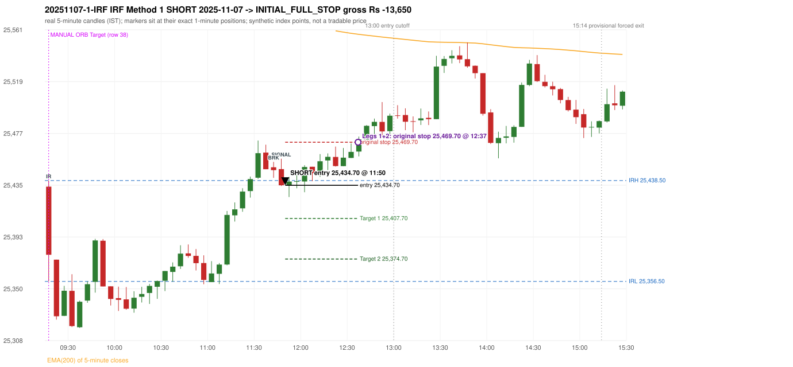
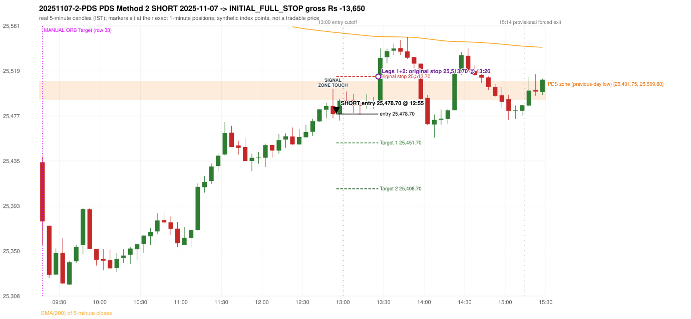

# Trading journal - 2025-11-07 (Friday)

> Automated reconstruction of the Phase 3.6 combined backtest: the Phase 3.0 controller, stops, targets and sizing with PDR = the body-based engine (wicks ignored; open strictly above the zone; numeric pattern thresholds and zone-lower-boundary conventions are provisional research assumptions, NOT approved by the strategy author). Synthetic NIFTY 50 index-point P&L (the index is not tradable). The owner's review status is intentionally blank.

## A. Trading day overview

| item | value |
|---|---|
| Date / weekday | 2025-11-07 / Friday |
| Session type | USABLE / VALID |
| Original session open (first 1-minute open) | 25,433.55 |
| Previous session | 2025-11-06 |
| Previous-day high / low (wicks included) | 25,678.15 / 25,491.75 |
| Previous-day highest BODY high (the body-based PDR ceiling; wicks ignored) | 25,659.55 |
| Previous-day official close / last 5-minute close | 25,509.70 / 25,519.95 |
| Raw engine records / confirmed signals / fully valid signals | 11 / 6 / 6 |
| Setups that did not complete (invalidated / incomplete) | 5 |
| Executed trades | 2 20251107-1-IRF;20251107-2-PDS |
| Gross P&L (Rs, synthetic) | -27,300.00 |
| Illustrative net P&L (Rs; Rs 500/trade + 0.5 pt/fill) | -29,080.00 |
| Day-end portfolio status | DAY_FINISHED |
| Manual journal trades (matched / unmatched) | 1 (0 / 1) |
| Extra automated trades | 2 |

## B. Daily strategy signal timeline (confirmed signals, chronological)

| time | strategy | method | dir | entry-rule status | valid for execution | <= 13:00 | portfolio state | accepted / ignored | specific reason | competing (same minute) |
|---|---|---|---|---|---|---|---|---|---|---|
| 11:50 | IRF | Method 1 | SHORT | PROPOSAL_DEPENDENT | True | True | FIRST_TRADE_ACTIVE | ACCEPTED -> 20251107-1-IRF | first eligible signal of the day; trade 1: INITIAL_FULL_STOP |  |
| 12:55 | PDS | Method 2 | SHORT | PROPOSAL_DEPENDENT | True | True | SECOND_TRADE_ACTIVE | ACCEPTED -> 20251107-2-PDS | permitted second trade: newly confirmed PDR/PDS after the original full stop; trade 2: INITIAL_FULL_STOP |  |
| 13:05 | PDS | Method 2 | SHORT | PROPOSAL_DEPENDENT | True | False | SECOND_TRADE_ACTIVE | IGNORED | POSITION_ACTIVE (signal kept for diagnostics only; never reused) [blocked by PDS#2] |  |
| 14:05 | IRF | Method 2A | SHORT | PROPOSAL_DEPENDENT | True | False | DAY_FINISHED | IGNORED | DAY_FINISHED [blocked by PDS#2] | IRF Method 2B SHORT; PDS Method 3 SHORT |
| 14:05 | IRF | Method 2B | SHORT | PROPOSAL_DEPENDENT | True | False | DAY_FINISHED | IGNORED | DAY_FINISHED [blocked by PDS#2] | IRF Method 2A SHORT; PDS Method 3 SHORT |
| 14:05 | PDS | Method 3 | SHORT | PROPOSAL_DEPENDENT | True | False | DAY_FINISHED | IGNORED | DAY_FINISHED [blocked by PDS#2] | IRF Method 2A SHORT; IRF Method 2B SHORT |

Engine setups that did not complete (5); the complete list with failed rule ids is in `rejected_signals.csv`:

| candle | strategy | method | dir | status | precise reason | failed rules |
|---|---|---|---|---|---|---|
| 14:00 | IRF | Method 1/2 | SHORT | INCOMPLETE_AT_EOD | SESSION_ENDED_BEFORE_CONFIRMATION |  |
| 09:15 | ORB | Method 1 | SHORT | INVALIDATED | CANDLE_QUALITY(not a strong body / wick too large) | ORB-M1-SHORT-003 |
| 09:15 | ORB | Method 2 | SHORT | INVALIDATED | TRENDLINE_NOT_SUPPORTIVE | ORB-M2-SHORT-001 |
| 14:20 | PDS | Method 1/2/3 | SHORT | INCOMPLETE_AT_EOD | NO_QUALIFYING_ENTRY_BEFORE_SESSION_END |  |
| 09:45 | RF | RF | LONG | INVALIDATED | TREND:EMA_PREV_SESSION_CLOSE wrong side | RF-001;RF-008 |

## C. Detailed trade journals

### 20251107-1-IRF: IRF Method 1 SHORT (FIRST trade)

Chart: 

**Rule configuration:** CFG-phase36_body_based-866f954e55 - signal verification status **PROPOSAL_DEPENDENT** (never VERIFIED while a rule rests on a proposal).

#### 1. Setup identification

IRF Method 1 SHORT: the completed 11:40 candle closed at 25,446.95, 8.45 points above the initial range high 25,438.50 (range [25,356.50, 25,438.50] from the 09:15 candle); the immediately following completed 11:45 candle closed at 25,434.70, back inside the range. The short signal was confirmed at 11:50 on that close. Entry reference close 25,434.70 is 3.80 points below IRH 25,438.50.

#### 2. Candle and indicator calculations

| role | session | candle | O | H | L | C | range | body % | upper wick % | lower wick % | direction | EMA(200) | strong bull / bear | pin bull / bear | small (body<=30%) | used for |
|---|---|---|---|---|---|---|---|---|---|---|---|---|---|---|---|---|
| initial_range_candle | TODAY | 09:15-09:20 | 25,433.55 | 25,438.50 | 25,356.50 | 25,378.15 | 82.00 | 67.56 | 6.04 | 26.40 | BEARISH | 25,634.62 | False / False | False / False | False | initial range = high/low of the 09:15 candle |
| signal_candle | TODAY | 11:45-11:50 | 25,447.85 | 25,456.25 | 25,434.10 | 25,434.70 | 22.15 | 59.37 | 37.92 | 2.71 | BEARISH | 25,568.43 | False / False | False / False | False | candle whose close completed the trigger |
| breakout_candle | TODAY | 11:40-11:45 | 25,449.30 | 25,453.70 | 25,440.75 | 25,446.95 | 12.95 | 18.15 | 33.98 | 47.88 | BEARISH | 25,569.77 | False / False | False / False | True | breakout candle: a completed candle closing above IRH |

Every condition, with the rule, the calculation, the observed values and the result:

| # | group | rule | result | status / numeric definition | calculation | observed | required | available at | why it matters |
|---|---|---|---|---|---|---|---|---|---|
| 1 | SELECTION | SEL-FIRST-001 | PASS | USER_APPROVED / USER_APPROVED | earliest CONFIRMED signal of the day across IRF/ORB/PDR/PDS/RF that passed the controller's checks | 0 confirmed signal(s) earlier today; 6 confirmed signals in the day in total, this one at 11:50 | no earlier executable signal | 2025-11-07 11:50 | the shared controller trades only the first valid signal; the five strategies are not independent positions |
| 2 | SELECTION | SEL-TIE-001 | PASS | USER_APPROVED / USER_APPROVED | other CONFIRMED signals with exactly the same confirmation timestamp | none | no different-strategy / opposite-direction signal in the same minute (otherwise an unresolved conflict, no trade) | 2025-11-07 11:50 | an unresolved same-minute collision would have produced no trade at all |
| 3 | SELECTION | ENTRY-CUTOFF-001 | PASS | USER_APPROVED / USER_APPROVED | fill timestamp vs 13:00:00 IST | signal confirmed 11:50; fill 11:50 | fill at or before 13:00:00 IST | 2025-11-07 11:50 | no new position may be entered with a fill after 13:00 IST |
| 4 | SELECTION | EXE-FILL-001 | PASS | PROPOSED_FOR_REVIEW / PROPOSED_FOR_REVIEW | fill = open of the 1-minute bar that starts at the signal candle's end | bar 11:50 O 25,434.70 H 25,434.80 L 25,425.10 C 25,430.40; executable=True; entry 25,434.70 | fill bar exists, starts exactly at the signal end, is fillable; entry = its open | 2025-11-07 11:50 | a 5-minute signal is known only when its candle closes; the first price that can be traded is the next minute's open |
| 5 | SELECTION | DAY-MAX-001 | PASS | USER_APPROVED / USER_APPROVED | number of entries today | trade 1 of at most 2 | <= 2 entries per day | 2025-11-07 11:50 | daily trade cap |
| 6 | SETUP | IRF-GLOBAL-001 | PASS | SOURCE_VERIFIED / EXPLICIT_IN_SOURCE | initial range = high and low (wicks included) of the first completed 5-minute candle | 09:15-09:20 IRH 25,438.50, IRL 25,356.50 (range 82.00; engine recorded IRH 25,438.50, IRL 25,356.50) | high/low of the 09:15-09:20 candle | 2025-11-07 09:20 | all three IRF methods measure price against this range |
| 7 | SETUP | IRF-GLOBAL-003 | PASS | SOURCE_VERIFIED / EXPLICIT_IN_SOURCE | closes confirm, wicks do not: every trigger is evaluated on a completed 5-minute candle | trigger candle 11:45-11:50 was complete when the signal was stamped 11:50; decision uses its close 25,434.70 | completed candle close, not an intra-candle wick | 2025-11-07 11:50 | an intra-candle wick can reverse before the candle closes |
| 8 | SETUP | IRF-GLOBAL-002 | PASS | SOURCE_VERIFIED / EXPLICIT_IN_SOURCE | direction | SHORT (IRF trades short only) | short only | 2025-11-07 11:50 | IRF fades failed upside breakouts |
| 9 | SETUP | IRF-M1-001 | PASS | SOURCE_VERIFIED / EXPLICIT_IN_SOURCE | breakout candle close vs IRH | 11:40-11:45 O 25,449.30 H 25,453.70 L 25,440.75 C 25,446.95; range 12.95, body 2.35 (18.15%), upper wick 4.40 (33.98%), lower wick 6.20 (47.88%), bearish; close 25,446.95 is 8.45 points above IRH 25,438.50 | close > IRH (a wick above IRH is not a breakout) | 2025-11-07 11:45 | starts every IRF setup |
| 10 | CONFIRMATION | IRF-M1-002 | PASS | SOURCE_VERIFIED / EXPLICIT_IN_SOURCE | candle after the breakout closes back inside [IRL, IRH) | 11:45-11:50 O 25,447.85 H 25,456.25 L 25,434.10 C 25,434.70; range 22.15, body 13.15 (59.37%), upper wick 8.40 (37.92%), lower wick 0.60 (2.71%), bearish; close 25,434.70 vs range [25,356.50, 25,438.50) | IRL <= close < IRH | 2025-11-07 11:50 | the failed breakout: price could not hold above the opening range |
| 11 | CONFIRMATION | IRF-M1-004 | PASS | SOURCE_VERIFIED / EXPLICIT_IN_SOURCE | failure candle is the candle immediately after the breakout (k = 1) | breakout 11:40, failure candle 11:45: k = 1 | k = 1 (pp.5, 6, 13); the p.14 'next or following' reading (IRF-M1-C001) is CONFLICTING and not used in the baseline | 2025-11-07 11:50 | the guide's worked example enters at the close of the very next candle; no support/resistance break is required |
| 12 | EXECUTION | EXE-STOP-001 | PASS | USER_APPROVED / USER_APPROVED | initial stop = entry + 35 points | entry 25,434.70 -> stop 25,469.70 | stop 35 index points (BASELINE) | 2025-11-07 11:50 | defines the loss if the setup fails before Target 1 |
| 13 | EXECUTION | EXE-T1-001 | PASS | SOURCE_VERIFIED / EXPLICIT_IN_SOURCE | Target 1 = entry +/- 27 points | T1 25,407.70 | 27 points | 2025-11-07 11:50 | Leg 1 (3 lots) is booked at Target 1 |
| 14 | EXECUTION | IRF-TGT-001 | PASS | SOURCE_VERIFIED / EXPLICIT_IN_SOURCE | Target 2 = entry +/- 60 points | T2 25,374.70 | 60 points | 2025-11-07 11:50 | Leg 2 (3 lots) is booked at Target 2 |
| 15 | EXECUTION | POST-T1-STOP-006 | PASS | USER_APPROVED / USER_APPROVED | after T1 the Leg-2 stop = entry + 6 (no trailing) | post-T1 stop 25,440.70 | entry -6 (LONG) / +6 (SHORT) | 2025-11-07 11:50 | protects the remaining three lots once the first three are booked |
| 16 | EXECUTION | SIZE-LOT-001 | PASS | USER_APPROVED / USER_APPROVED | 6 lots x 65 = 390, Leg 1 = 3 lots = 195, Leg 2 = 195 | 6 lots, lot size 65, legs 3+3 | 6 lots in two equal legs | 2025-11-07 11:50 | position size for the synthetic P&L |
| 17 | NOTE | IRF-GLOBAL-004 | UNRESOLVED | UNRESOLVED / UNRESOLVED | which close above IRH of the session produced this attempt; repeat setups | this breakout is upward crossing no. 1 of the session (a close above IRH after a close at/below it) | the source states no first-breakout-only, re-arming, expiry or trades-per-day rule | 2025-11-07 11:50 | IRF re-arms on every later breakout in the code, producing many raw setups; the controller keeps only the first |
| 18 | NOTE | NOTE-IRF-REPEATED-SETUPS | NOT_APPLICABLE | NOT_A_RULE / NOT_A_REGISTRY_RULE | other IRF signals later in the session (not traded) | 2 further confirmed IRF signal(s): Method 2A@14:05, Method 2B@14:05 | disclosure of repeated raw setups | 2025-11-07 11:50 | repeated raw IRF setups are not hidden; they are logged as ignored |
| 19 | NOTE | IRF-SL-001 | NOT_APPLICABLE | SOURCE_VERIFIED / QUALITATIVE_SOURCE_NUMERIC_DEFINITION_PROPOSED_FOR_REVIEW | the guide's 35-or-40 rule: 35 if the most recent green candle's high is within 35 points of entry, else 40 | most recent green candle high 25,471.05 is 36.35 points from the entry 25,434.70: the guide's rule would select 40 points; the baseline applies a fixed 35 (USER_APPROVED research baseline; the 35-vs-40 selection and the 40-point variant are separate labelled scenarios) | source selection rule | 2025-11-07 11:50 | the stop distance is a modelling choice and changes losses, not entries |
| 20 | NOTE | NOTE-UNRESOLVED-DEPENDENCIES | UNRESOLVED | NOT_A_RULE / NOT_A_REGISTRY_RULE | rules the signal depends on that the sources leave unresolved | engine-recorded unresolved rule ids: IRF-GLOBAL-004; verification status PROPOSAL_DEPENDENT | n/a (disclosure) | 2025-11-07 11:50 | the entry is only as verified as the rules it rests on |

#### 3. Entry decision and explanation

IRF Method 1 SHORT: the completed 11:40 candle closed at 25,446.95, 8.45 points above the initial range high 25,438.50 (range [25,356.50, 25,438.50] from the 09:15 candle); the immediately following completed 11:45 candle closed at 25,434.70, back inside the range. The short signal was confirmed at 11:50 on that close. Entry reference close 25,434.70 is 3.80 points below IRH 25,438.50.

**Why this trade ahead of the other strategies:** This IRF Method 1 signal was the earliest executable signal of the day: 0 confirmed signal(s) earlier, 0 other in the same minute. 5 later confirmed signal(s) (IRF x2, PDS x3) are logged as ignored or rejected. State of the other four engines at that moment: [ORB: Method 1 invalidated at 09:15: CANDLE_QUALITY(not a strong body / wick too large); Method 2 invalidated at 09:15: TRENDLINE_NOT_SUPPORTIVE] [PDR: no setup record before this time (a base condition was not met, or nothing triggered)] [PDS: no setup record before this time (a base condition was not met, or nothing triggered)] [RF: RF invalidated at 09:45: TREND:EMA_PREV_SESSION_CLOSE wrong side]

#### 4. Actual entry execution

| item | value |
|---|---|
| Signal candle | 11:45-11:50 |
| Signal confirmed | 2025-11-07 11:50 |
| Fill timestamp | 2025-11-07 11:50 |
| Entry price | 25,434.70 |
| Source partition / 1-minute bar | data/processed/nifty50/year=2025/month=11/candles.parquet / 2025-11-07 11:50 |
| Source bar O / H / L / C | 25,434.70 / 25,434.80 / 25,425.10 / 25,430.40 |
| Fill assumption | open of the 1-minute bar starting at the signal candle's end (EXE-FILL-001, PROPOSED causal convention) |
| Initial stop / T1 / T2 / post-T1 stop | 25,469.70 / 25,407.70 / 25,374.70 / 25,440.70 |
| Position | 6 lots x 65 = 390 units (Leg 1 195, Leg 2 195) |

#### 5-8. Trade progress, Target 1, post-T1 stop and final exit

Between the 11:50 entry bar and the final exit (48 one-minute bars) the best excursion in favour was 9.60 points at 11:50 and the worst against was 37.40 points at 12:37. At 12:37 price reached the original stop 25,469.70 before Target 1 25,407.70, so all six lots exited together at 25,469.70. This is an INITIAL_FULL_STOP: one more trade is allowed that day, only a newly confirmed PDR/PDS signal.

| leg | qty | exit time | exit price | reason | source 1-minute bar | O / H / L / C | gross points | gross Rs | slippage pts | flags |
|---|---|---|---|---|---|---|---|---|---|---|
| 1 | 195 | 12:37 | 25,469.70 | ORIGINAL_STOP_BEFORE_T1 | 12:37 | 25,464.05 / 25,472.10 / 25,462.15 / 25,469.15 | -35.00 | -6,825.00 | 0.00 |  |
| 2 | 195 | 12:37 | 25,469.70 | ORIGINAL_STOP_BEFORE_T1 | 12:37 | 25,464.05 / 25,472.10 / 25,462.15 / 25,469.15 | -35.00 | -6,825.00 | 0.00 |  |

Exit evidence per leg:

* Leg 1: 1-minute bar 12:37 O 25,464.05 H 25,472.10 L 25,462.15 C 25,469.15: high 25,472.10 reached the original stop 25,469.70 before Target 1 25,407.70 was touched; both legs exit at the stop level 25,469.70
* Leg 2: 1-minute bar 12:37 O 25,464.05 H 25,472.10 L 25,462.15 C 25,469.15: high 25,472.10 reached the original stop 25,469.70 before Target 1 25,407.70 was touched; both legs exit at the stop level 25,469.70

#### 9. Gross and illustrative net P&L

| item | value (Rs) |
|---|---|
| Leg 1 gross | -6,825.00 |
| Leg 2 gross | -6,825.00 |
| Trade gross (= Leg 1 + Leg 2) | -13,650.00 |
| Illustrative fixed cost | -500.00 |
| Illustrative slippage (0.5 pt on every fill, entry + exits, all units) | -390.00 |
| Illustrative net | -14,540.00 |

#### 10. Manual journal comparison

EXTRA_AUTOMATED_TRADE: the automated system took IRF Method 1 SHORT at 11:50 (manual traded only other strategies: ORB 09:15 Target). The setup rests on: IRF-GLOBAL-004: IRF trades per day / time window / re-arming are not stated in the guide | NOTE-UNRESOLVED-DEPENDENCIES: Disclosure of unresolved source rules behind this signal. The journal shows no corresponding entry.

### 20251107-2-PDS: PDS Method 2 SHORT (SECOND trade)

Chart: 

**Rule configuration:** CFG-phase36_body_based-866f954e55 - signal verification status **PROPOSAL_DEPENDENT** (never VERIFIED while a rule rests on a proposal).

#### 1. Setup identification

PDS Method 2 SHORT: the session opened 58.20 points below the previous-day-low zone [25,491.75, 25,509.80]; price rose to the zone at 12:50 and the first red candle at the zone (12:50, close 25,478.45) was a higher-price-rejection pin bar; confirmed 12:55.

#### 2. Candle and indicator calculations

| role | session | candle | O | H | L | C | range | body % | upper wick % | lower wick % | direction | EMA(200) | strong bull / bear | pin bull / bear | small (body<=30%) | used for |
|---|---|---|---|---|---|---|---|---|---|---|---|---|---|---|---|---|
| zone_source_candle | PREVIOUS | 15:10-15:15 | 25,509.80 | 25,511.20 | 25,491.75 | 25,500.60 | 19.45 | 47.30 | 7.20 | 45.50 | BEARISH | 25,640.95 | False / False | False / False | False | previous-day low candle that defines the zone (A_LOWEST_LOW) |
| zone_retest_candle | TODAY | 12:50-12:55 | 25,486.20 | 25,502.35 | 25,474.75 | 25,478.45 | 27.60 | 28.08 | 58.51 | 13.41 | BEARISH | 25,555.19 | False / False | False / True | True | first candle whose range reaches the zone from below |
| signal_candle | TODAY | 12:50-12:55 | 25,486.20 | 25,502.35 | 25,474.75 | 25,478.45 | 27.60 | 28.08 | 58.51 | 13.41 | BEARISH | 25,555.19 | False / False | False / True | True | trigger candle |

Every condition, with the rule, the calculation, the observed values and the result:

| # | group | rule | result | status / numeric definition | calculation | observed | required | available at | why it matters |
|---|---|---|---|---|---|---|---|---|---|
| 1 | SELECTION | DAY-SL-001 | PASS | USER_APPROVED / USER_APPROVED | first trade outcome, strategy of this signal, position-close time vs this signal's timestamp | first trade IRF Method 1 closed as INITIAL_FULL_STOP at 12:37; position free from 12:38; this PDS signal confirmed 12:55 | first trade INITIAL_FULL_STOP before Target 1, and a NEWLY confirmed PDR/PDS signal after the first position closed | 2025-11-07 12:55 | the only way a second trade is allowed |
| 2 | SELECTION | DAY-NOREUSE-001 | PASS | USER_APPROVED / USER_APPROVED | signals confirmed while the first position was open | 1 signal(s) were ignored during the first trade (never reused): IRF Method 1 SHORT @11:50 | this trade comes from a signal confirmed after the first exit, not from an ignored one | 2025-11-07 12:55 | an ignored signal can never become the second trade |
| 3 | SELECTION | ENTRY-CUTOFF-001 | PASS | USER_APPROVED / USER_APPROVED | fill timestamp vs 13:00:00 IST | signal confirmed 12:55; fill 12:55 | fill at or before 13:00:00 IST | 2025-11-07 12:55 | no new position may be entered with a fill after 13:00 IST |
| 4 | SELECTION | EXE-FILL-001 | PASS | PROPOSED_FOR_REVIEW / PROPOSED_FOR_REVIEW | fill = open of the 1-minute bar that starts at the signal candle's end | bar 12:55 O 25,478.70 H 25,483.05 L 25,475.65 C 25,475.65; executable=True; entry 25,478.70 | fill bar exists, starts exactly at the signal end, is fillable; entry = its open | 2025-11-07 12:55 | a 5-minute signal is known only when its candle closes; the first price that can be traded is the next minute's open |
| 5 | SELECTION | DAY-MAX-001 | PASS | USER_APPROVED / USER_APPROVED | number of entries today | trade 2 of at most 2 | <= 2 entries per day | 2025-11-07 12:55 | daily trade cap |
| 6 | SETUP | PDS-003 | PASS | SOURCE_VERIFIED / EXPLICIT_WORDING_DETAIL_PROPOSED_FOR_REVIEW | gap = first 1-minute open of today - previous session's OFFICIAL close | today's open 25,433.55 (first 1-minute bar 09:15) - previous close 25,509.70 (DAILY_VENDOR, 2025-11-06) = -76.15 points -> gap DOWN | gap DOWN (more than 0 points) | 2025-11-07 09:15 | approved convention: the original first-minute open, never the vendor daily open |
| 7 | SETUP | PDS-006 | PASS | SOURCE_VERIFIED / QUALITATIVE_SOURCE_NUMERIC_DEFINITION_PROPOSED_FOR_REVIEW | gap-down open below the zone | today's open 25,433.55 vs zone low 25,491.75: 58.20 points below | open < zone low | 2025-11-07 09:15 | the guide: 'price is trading below the previous day's support zone' after the gap; a PROPOSED strict reading |
| 8 | SETUP | PDS-004 | PASS | SOURCE_VERIFIED / EXPLICIT_IN_SOURCE | PDS is not a breakdown strategy: the zone must be tested from below first | open 25,433.55 below the zone floor 25,491.75; the first candle to reach the zone is 12:50 | price rises to the zone before any short | 2025-11-07 09:15 | a short below the level without a retest is not this strategy |
| 9 | SETUP | PDS-005 | PASS | SOURCE_VERIFIED / QUALITATIVE_SOURCE_NUMERIC_DEFINITION_PROPOSED_FOR_REVIEW | price comes up to the zone: first candle whose [low, high] intersects it (+/- proximity) | 12:50-12:55 O 25,486.20 H 25,502.35 L 25,474.75 C 25,478.45; range 27.60, body 7.75 (28.08%), upper wick 16.15 (58.51%), lower wick 3.70 (13.41%), bearish; high 25,502.35 vs zone low 25,491.75 | range intersects the zone | 2025-11-07 12:55 | PDS is not a breakdown strategy: the zone must be tested from below first |
| 10 | ZONE | PDS-001 | PASS | SOURCE_VERIFIED / EXPLICIT_IN_SOURCE | direction | SHORT (PDS is short only) | short-only | 2025-11-07 12:55 | PDS sells a retest of previous-day support from below |
| 11 | ZONE | PDS-002 | PASS | SOURCE_VERIFIED / QUALITATIVE_SOURCE_NUMERIC_DEFINITION_PROPOSED_FOR_REVIEW | zone = [lowest low, body top] of the previous session's absolute-low candle (method A_LOWEST_LOW; the lower wick is part of the zone) | zone [25,491.75, 25,509.80] from the 15:10 candle of 2025-11-06 (15:10-15:15 O 25,509.80 H 25,511.20 L 25,491.75 C 25,500.60; range 19.45, body 9.20 (47.30%), upper wick 1.40 (7.20%), lower wick 8.85 (45.50%), bearish); engine recorded [25,491.75, 25,509.80] | previous trading day's low where price took support (body + lower wick) | 2025-11-06 15:15 | the reference level of the strategy; the exact candle(s) are a research choice (PDS-ZONE-002) |
| 12 | CONFIRMATION | PDS-M-001 | PASS | SOURCE_VERIFIED / QUALITATIVE_SOURCE_NUMERIC_DEFINITION_PROPOSED_FOR_REVIEW | Methods 1/2 apply to the FIRST red candle at the zone | first red candle at the zone: 12:50; signal candle 12:50 | the trigger is the first red candle at the zone | 2025-11-07 12:55 | a later red candle would only qualify through Method 3 |
| 13 | CONFIRMATION | PDS-M2-001 | PASS | SOURCE_VERIFIED / QUALITATIVE_SOURCE_NUMERIC_DEFINITION_PROPOSED_FOR_REVIEW | red higher-price-rejection pin bar: upper wick >= 2 x body, close within the lowest 30% of the range, high reaches the zone | 12:50-12:55 O 25,486.20 H 25,502.35 L 25,474.75 C 25,478.45; range 27.60, body 7.75 (28.08%), upper wick 16.15 (58.51%), lower wick 3.70 (13.41%), bearish; upper wick / body = 2.08; close position from the low 13.41% of range; high 25,502.35 vs zone low 25,491.75 | bearish pin bar and high >= zone low | 2025-11-07 12:55 | the guide: wick-to-body ratio 'not specified'; these thresholds are an owner recommendation (proposal) |
| 14 | EXECUTION | EXE-STOP-001 | PASS | USER_APPROVED / USER_APPROVED | initial stop = entry + 35 points | entry 25,478.70 -> stop 25,513.70 | stop 35 index points (BASELINE) | 2025-11-07 12:55 | defines the loss if the setup fails before Target 1 |
| 15 | EXECUTION | EXE-T1-001 | PASS | SOURCE_VERIFIED / EXPLICIT_IN_SOURCE | Target 1 = entry +/- 27 points | T1 25,451.70 | 27 points | 2025-11-07 12:55 | Leg 1 (3 lots) is booked at Target 1 |
| 16 | EXECUTION | PDS-TGT-001 | PASS | SOURCE_VERIFIED / EXPLICIT_IN_SOURCE | Target 2 = entry +/- 70 points | T2 25,408.70 (the guide says 70; the report suggests 60 - CONFLICTING) | 70 points | 2025-11-07 12:55 | Leg 2 (3 lots) is booked at Target 2 |
| 17 | EXECUTION | POST-T1-STOP-006 | PASS | USER_APPROVED / USER_APPROVED | after T1 the Leg-2 stop = entry + 6 (no trailing) | post-T1 stop 25,484.70 | entry -6 (LONG) / +6 (SHORT) | 2025-11-07 12:55 | protects the remaining three lots once the first three are booked |
| 18 | EXECUTION | SIZE-LOT-001 | PASS | USER_APPROVED / USER_APPROVED | 6 lots x 65 = 390, Leg 1 = 3 lots = 195, Leg 2 = 195 | 6 lots, lot size 65, legs 3+3 | 6 lots in two equal legs | 2025-11-07 12:55 | position size for the synthetic P&L |
| 19 | NOTE | PDS-007 | NOT_APPLICABLE | PROPOSED_FOR_REVIEW / PROPOSED_FOR_REVIEW | repeated PDS signals today | 3 confirmed PDS signal(s) in the session | n/a (disclosure) | 2025-11-07 12:55 | the per-session cap is lifted for the controller runs; the controller trades only the first (or the permitted second) trade |
| 20 | NOTE | PDS-SL-001 | NOT_APPLICABLE | SOURCE_VERIFIED / QUALITATIVE_SOURCE_NUMERIC_DEFINITION_PROPOSED_FOR_REVIEW | the guide's 35-or-40 rule: 35 if the most recent green candle's high is within 35 points of entry, else 40 | most recent green candle high 25,488.90 is 10.20 points from the entry 25,478.70: the guide's rule would select 35 points; the baseline applies a fixed 35 (USER_APPROVED research baseline; the 35-vs-40 selection and the 40-point variant are separate labelled scenarios) | source selection rule | 2025-11-07 12:55 | the stop distance is a modelling choice and changes losses, not entries |
| 21 | NOTE | NOTE-UNRESOLVED-DEPENDENCIES | NOT_APPLICABLE | NOT_A_RULE / NOT_A_REGISTRY_RULE | rules the signal depends on that the sources leave unresolved | engine-recorded unresolved rule ids: none; verification status PROPOSAL_DEPENDENT | n/a (disclosure) | 2025-11-07 12:55 | the entry is only as verified as the rules it rests on |

#### 3. Entry decision and explanation

PDS Method 2 SHORT: the session opened 58.20 points below the previous-day-low zone [25,491.75, 25,509.80]; price rose to the zone at 12:50 and the first red candle at the zone (12:50, close 25,478.45) was a higher-price-rejection pin bar; confirmed 12:55.

**Why this trade ahead of the other strategies:** The first trade (IRF Method 1) was stopped out before Target 1 at 12:37; this newly confirmed PDS signal at 12:55 is the first PDR/PDS signal after that exit, so it is the day's permitted second trade. State of the other engines at that moment: [IRF: 1 confirmed signal(s) up to this time (Method 1@11:50)] [ORB: Method 1 invalidated at 09:15: CANDLE_QUALITY(not a strong body / wick too large); Method 2 invalidated at 09:15: TRENDLINE_NOT_SUPPORTIVE] [PDR: no setup record before this time (a base condition was not met, or nothing triggered)] [RF: RF invalidated at 09:45: TREND:EMA_PREV_SESSION_CLOSE wrong side]

#### 4. Actual entry execution

| item | value |
|---|---|
| Signal candle | 12:50-12:55 |
| Signal confirmed | 2025-11-07 12:55 |
| Fill timestamp | 2025-11-07 12:55 |
| Entry price | 25,478.70 |
| Source partition / 1-minute bar | data/processed/nifty50/year=2025/month=11/candles.parquet / 2025-11-07 12:55 |
| Source bar O / H / L / C | 25,478.70 / 25,483.05 / 25,475.65 / 25,475.65 |
| Fill assumption | open of the 1-minute bar starting at the signal candle's end (EXE-FILL-001, PROPOSED causal convention) |
| Initial stop / T1 / T2 / post-T1 stop | 25,513.70 / 25,451.70 / 25,408.70 / 25,484.70 |
| Position | 6 lots x 65 = 390 units (Leg 1 195, Leg 2 195) |

#### 5-8. Trade progress, Target 1, post-T1 stop and final exit

Between the 12:55 entry bar and the final exit (32 one-minute bars) the best excursion in favour was 6.15 points at 12:57 and the worst against was 47.90 points at 13:26. At 13:26 price reached the original stop 25,513.70 before Target 1 25,451.70, so all six lots exited together at 25,513.70. This is an INITIAL_FULL_STOP: one more trade is allowed that day, only a newly confirmed PDR/PDS signal.

| leg | qty | exit time | exit price | reason | source 1-minute bar | O / H / L / C | gross points | gross Rs | slippage pts | flags |
|---|---|---|---|---|---|---|---|---|---|---|
| 1 | 195 | 13:26 | 25,513.70 | ORIGINAL_STOP_BEFORE_T1 | 13:26 | 25,491.70 / 25,526.60 / 25,491.70 / 25,525.20 | -35.00 | -6,825.00 | 0.00 |  |
| 2 | 195 | 13:26 | 25,513.70 | ORIGINAL_STOP_BEFORE_T1 | 13:26 | 25,491.70 / 25,526.60 / 25,491.70 / 25,525.20 | -35.00 | -6,825.00 | 0.00 |  |

Exit evidence per leg:

* Leg 1: 1-minute bar 13:26 O 25,491.70 H 25,526.60 L 25,491.70 C 25,525.20: high 25,526.60 reached the original stop 25,513.70 before Target 1 25,451.70 was touched; both legs exit at the stop level 25,513.70
* Leg 2: 1-minute bar 13:26 O 25,491.70 H 25,526.60 L 25,491.70 C 25,525.20: high 25,526.60 reached the original stop 25,513.70 before Target 1 25,451.70 was touched; both legs exit at the stop level 25,513.70

#### 9. Gross and illustrative net P&L

| item | value (Rs) |
|---|---|
| Leg 1 gross | -6,825.00 |
| Leg 2 gross | -6,825.00 |
| Trade gross (= Leg 1 + Leg 2) | -13,650.00 |
| Illustrative fixed cost | -500.00 |
| Illustrative slippage (0.5 pt on every fill, entry + exits, all units) | -390.00 |
| Illustrative net | -14,540.00 |

#### 10. Manual journal comparison

EXTRA_AUTOMATED_TRADE: the automated system took PDS Method 2 SHORT at 12:55 (manual traded only other strategies: ORB 09:15 Target). The setup rests on: no unresolved rule. The journal shows no corresponding entry.

## D. Manual journal comparison

| comparison | journal row | journal strategy | manual time | manual direction | manual outcome | match class | trade | auto entry | auto outcome | explanation |
|---|---|---|---|---|---|---|---|---|---|---|
| M038 | 38 | ORB | 09:15 | UNKNOWN | Target | SIGNAL_REJECTED_BY_ENTRY_RULE |  |  |  | SIGNAL_REJECTED_BY_ENTRY_RULE: SETUP_INVALIDATED Method 1 - CANDLE_QUALITY(not a strong body / wick too large); failed=ORB-M1-SHORT-003. Heuristic primary cause: PROPOSED_NUMERICAL_THRESHOLD; blocked by: n/a |
| E016 |  |  |  |  |  | EXTRA_AUTOMATED_TRADE | 20251107-1-IRF | 11:50 @ 25,434.70 | INITIAL_FULL_STOP | EXTRA_AUTOMATED_TRADE: the automated system took IRF Method 1 SHORT at 11:50 (manual traded only other strategies: ORB 09:15 Target). The setup rests on: IRF-GLOBAL-004: IRF trades per day / time window / re-arming are not stated in the guide \| NOTE-UNRESOLVED-DEPENDENCIES: Disclosure of unresolved source rules behind this signal. The journal shows no corresponding entry. |
| E017 |  |  |  |  |  | EXTRA_AUTOMATED_TRADE | 20251107-2-PDS | 12:55 @ 25,478.70 | INITIAL_FULL_STOP | EXTRA_AUTOMATED_TRADE: the automated system took PDS Method 2 SHORT at 12:55 (manual traded only other strategies: ORB 09:15 Target). The setup rests on: no unresolved rule. The journal shows no corresponding entry. |

The journal records no entry price and no exit price (NOT_RECORDED); matching uses date, strategy and candle start only - never P&L.

## E. Daily conclusion

* **Traded:** 20251107-1-IRF - IRF Method 1 SHORT at 11:50 (entry 25,434.70), outcome INITIAL_FULL_STOP, gross Rs -13,650.00, illustrative net Rs -14,540.00. **Why:** This IRF Method 1 signal was the earliest executable signal of the day: 0 confirmed signal(s) earlier, 0 other in the same minute. 5 later confirmed signal(s) (IRF x2, PDS x3) are logged as ignored or rejected. State of the other four engines at that moment: [ORB: Method 1 invalidated at 09:15: CANDLE_QUALITY(not a strong body / wick too large); Method 2 invalidated at 09:15: TRENDLINE_NOT_SUPPORTIVE] [PDR: no setup record before this time (a base condition was not met, or nothing triggered)] [PDS: no setup record before this time (a base condition was not met, or nothing triggered)] [RF: RF invalidated at 09:45: TREND:EMA_PREV_SESSION_CLOSE wrong side] **How it ended:** At 12:37 price reached the original stop 25,469.70 before Target 1 25,407.70, so all six lots exited together at 25,469.70. This is an INITIAL_FULL_STOP: one more trade is allowed that day, only a newly confirmed PDR/PDS signal.
* **Traded:** 20251107-2-PDS - PDS Method 2 SHORT at 12:55 (entry 25,478.70), outcome INITIAL_FULL_STOP, gross Rs -13,650.00, illustrative net Rs -14,540.00. **Why:** The first trade (IRF Method 1) was stopped out before Target 1 at 12:37; this newly confirmed PDS signal at 12:55 is the first PDR/PDS signal after that exit, so it is the day's permitted second trade. State of the other engines at that moment: [IRF: 1 confirmed signal(s) up to this time (Method 1@11:50)] [ORB: Method 1 invalidated at 09:15: CANDLE_QUALITY(not a strong body / wick too large); Method 2 invalidated at 09:15: TRENDLINE_NOT_SUPPORTIVE] [PDR: no setup record before this time (a base condition was not met, or nothing triggered)] [RF: RF invalidated at 09:45: TREND:EMA_PREV_SESSION_CLOSE wrong side] **How it ended:** At 13:26 price reached the original stop 25,513.70 before Target 1 25,451.70, so all six lots exited together at 25,513.70. This is an INITIAL_FULL_STOP: one more trade is allowed that day, only a newly confirmed PDR/PDS signal.
* **Ignored / rejected signals:** IRF IGNORED DAY_FINISHED x2; PDS IGNORED POSITION_ACTIVE x1; PDS IGNORED DAY_FINISHED x1
* **Unmatched manual trade (row 38, ORB 09:15 Target):** SIGNAL_REJECTED_BY_ENTRY_RULE: SETUP_INVALIDATED Method 1 - CANDLE_QUALITY(not a strong body / wick too large); failed=ORB-M1-SHORT-003. Heuristic primary cause: PROPOSED_NUMERICAL_THRESHOLD; blocked by: n/a
* **Extra automated trade 20251107-1-IRF:** EXTRA_AUTOMATED_TRADE: the automated system took IRF Method 1 SHORT at 11:50 (manual traded only other strategies: ORB 09:15 Target). The setup rests on: IRF-GLOBAL-004: IRF trades per day / time window / re-arming are not stated in the guide | NOTE-UNRESOLVED-DEPENDENCIES: Disclosure of unresolved source rules behind this signal. The journal shows no corresponding entry.
* **Extra automated trade 20251107-2-PDS:** EXTRA_AUTOMATED_TRADE: the automated system took PDS Method 2 SHORT at 12:55 (manual traded only other strategies: ORB 09:15 Target). The setup rests on: no unresolved rule. The journal shows no corresponding entry.
* **Open strategy-definition issues that affected this day:** IRF-GLOBAL-004 (NOT STATED: how many IRF trades per day, a latest entry time, and whether a new breakout may re-arm a setup after a signal), NOTE-UNRESOLVED-DEPENDENCIES
* **Automated triage (not an approval; the owner's review status stays blank):** REVIEW: UNMATCHED_MANUAL+EXTRA_AUTOMATED
