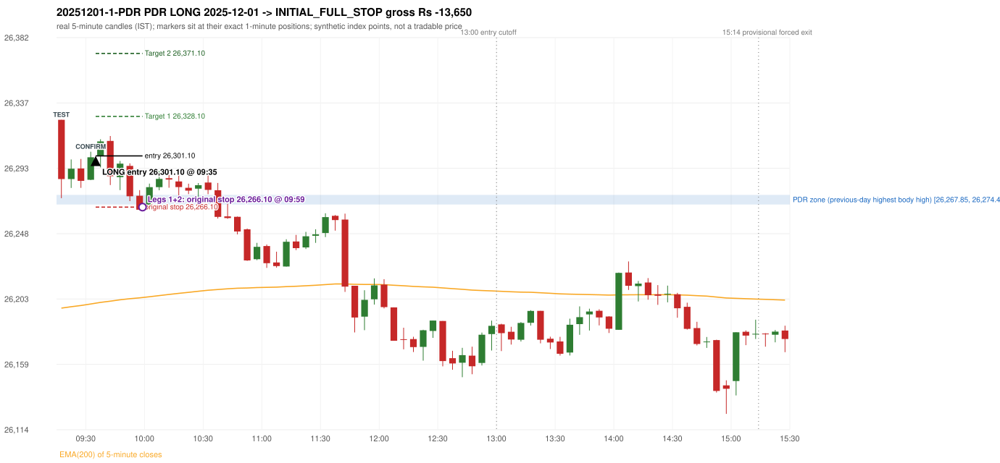
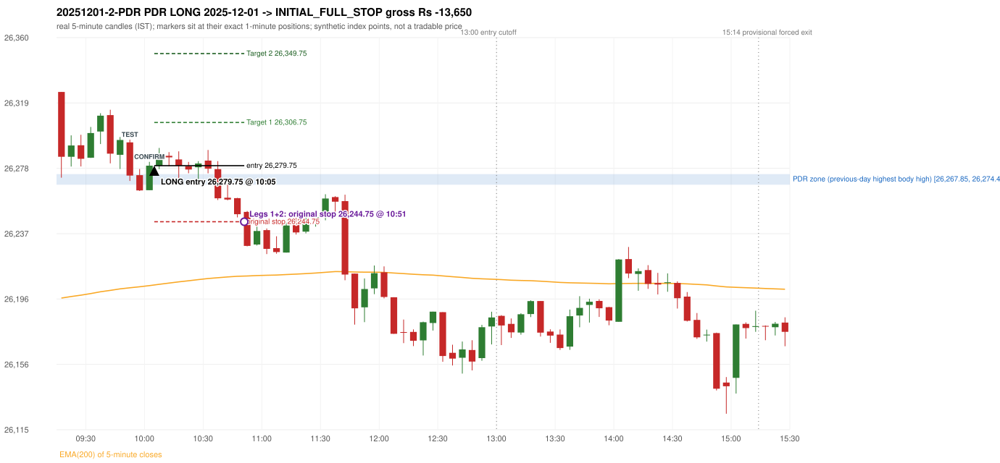

# Trading journal - 2025-12-01 (Monday)

> Automated reconstruction of the Phase 3.6 combined backtest: the Phase 3.0 controller, stops, targets and sizing with PDR = the body-based engine (wicks ignored; open strictly above the zone; numeric pattern thresholds and zone-lower-boundary conventions are provisional research assumptions, NOT approved by the strategy author). Synthetic NIFTY 50 index-point P&L (the index is not tradable). The owner's review status is intentionally blank.

## A. Trading day overview

| item | value |
|---|---|
| Date / weekday | 2025-12-01 / Monday |
| Session type | USABLE_WITH_FLAGS / VALID |
| Original session open (first 1-minute open) | 26,325.80 |
| Previous session | 2025-11-28 |
| Previous-day high / low (wicks included) | 26,280.20 / 26,172.90 |
| Previous-day highest BODY high (the body-based PDR ceiling; wicks ignored) | 26,274.45 |
| Previous-day official close / last 5-minute close | 26,202.95 / 26,204.55 |
| Raw engine records / confirmed signals / fully valid signals | 7 / 3 / 3 |
| Setups that did not complete (invalidated / incomplete) | 4 |
| Executed trades | 2 20251201-1-PDR;20251201-2-PDR |
| Gross P&L (Rs, synthetic) | -27,300.00 |
| Illustrative net P&L (Rs; Rs 500/trade + 0.5 pt/fill) | -29,080.00 |
| Day-end portfolio status | DAY_FINISHED |
| Manual journal trades (matched / unmatched) | 0 (0 / 0) |
| Extra automated trades | 2 |

## B. Daily strategy signal timeline (confirmed signals, chronological)

| time | strategy | method | dir | entry-rule status | valid for execution | <= 13:00 | portfolio state | accepted / ignored | specific reason | competing (same minute) |
|---|---|---|---|---|---|---|---|---|---|---|
| 09:35 | PDR | PDR | LONG | RESEARCH_VARIANT | True | True | FIRST_TRADE_ACTIVE | ACCEPTED -> 20251201-1-PDR | first eligible signal of the day; trade 1: INITIAL_FULL_STOP |  |
| 10:05 | PDR | PDR | LONG | RESEARCH_VARIANT | True | True | SECOND_TRADE_ACTIVE | ACCEPTED -> 20251201-2-PDR | permitted second trade: newly confirmed PDR/PDS after the original full stop; trade 2: INITIAL_FULL_STOP |  |
| 10:30 | PDR | PDR | LONG | RESEARCH_VARIANT | True | True | SECOND_TRADE_ACTIVE | IGNORED | POSITION_ACTIVE (signal kept for diagnostics only; never reused) [blocked by PDR#2] |  |

Engine setups that did not complete (4); the complete list with failed rule ids is in `rejected_signals.csv`:

| candle | strategy | method | dir | status | precise reason | failed rules |
|---|---|---|---|---|---|---|
| 09:15 | ORB | Method 1 | LONG | INVALIDATED | CANDLE_QUALITY(not a strong body / wick too large) | ORB-M1-LONG-003 |
| 09:15 | ORB | Method 2 | LONG | INVALIDATED | CANDLE_QUALITY | ORB-M2-LONG-003 |
| 10:35 | PDR | PDR | LONG | INCOMPLETE_AT_EOD | NO_QUALIFYING_CONFIRMATION_BEFORE_SESSION_END |  |
| 10:00 | RF | RF | LONG | INVALIDATED | GAP_UP_OUTSIDE_YESTERDAYS_RANGE | RF-004 |

## C. Detailed trade journals

### 20251201-1-PDR: PDR LONG (FIRST trade)

Chart: 

**Rule configuration:** CFG-phase36_body_based-866f954e55 - signal verification status **RESEARCH_VARIANT** (never VERIFIED while a rule rests on a proposal).

#### 1. Setup identification

PDR LONG (body-based engine, A_HIGHEST_BODY_HIGH): the session opened 122.85 points above the previous close and 51.35 points above the previous-day highest BODY high 26,274.45 (zone [26,267.85, 26,274.45] from the 10:40 candle of 2025-11-28; the highest wick 26,280.20 is ignored). The 09:15 candle (26,272.25 - 26,325.80) tested the zone; the 09:30 candle (green, O 26,284.75 H 26,303.95 L 26,284.55 C 26,300.15) passed GOOD_GREEN_BODY and closed 25.70 points above the zone ceiling, confirming the entry at 09:35. The pattern thresholds and the zone's lower boundary are provisional research assumptions, not approved by the strategy author.

#### 2. Candle and indicator calculations

| role | session | candle | O | H | L | C | range | body % | upper wick % | lower wick % | direction | EMA(200) | strong bull / bear | pin bull / bear | small (body<=30%) | used for |
|---|---|---|---|---|---|---|---|---|---|---|---|---|---|---|---|---|
| zone_source_candle | PREVIOUS | 10:40-10:45 | 26,267.85 | 26,274.45 | 26,264.35 | 26,274.45 | 10.10 | 65.35 | 0.00 | 34.65 | BULLISH | 26,175.42 | True / False | False / False | False | candle of the previous session's highest BODY high (A_HIGHEST_BODY_HIGH) |
| prev_day_wick_high_candle | PREVIOUS | 10:45-10:50 | 26,273.95 | 26,280.20 | 26,269.30 | 26,273.45 | 10.90 | 4.59 | 57.34 | 38.07 | BEARISH | 26,176.40 | False / False | False / False | True | candle of the previous session's highest WICK (ignored by the author's rule; shown for comparison) |
| interaction_candle | TODAY | 09:15-09:20 | 26,325.80 | 26,325.80 | 26,272.25 | 26,285.30 | 53.55 | 75.63 | 0.00 | 24.37 | BEARISH | 26,197.06 | False / False | False / False | False | first candle whose range overlaps the zone (the test) |
| confirmation_candle | TODAY | 09:30-09:35 | 26,284.75 | 26,303.95 | 26,284.55 | 26,300.15 | 19.40 | 79.38 | 19.59 | 1.03 | BULLISH | 26,199.87 | True / False | False / False | False | candle that satisfies one of the three patterns and closes above the zone ceiling |

Every condition, with the rule, the calculation, the observed values and the result:

| # | group | rule | result | status / numeric definition | calculation | observed | required | available at | why it matters |
|---|---|---|---|---|---|---|---|---|---|
| 1 | SELECTION | SEL-FIRST-001 | PASS | USER_APPROVED / USER_APPROVED | earliest CONFIRMED signal of the day across IRF/ORB/PDR/PDS/RF that passed the controller's checks | 0 confirmed signal(s) earlier today; 3 confirmed signals in the day in total, this one at 09:35 | no earlier executable signal | 2025-12-01 09:35 | the shared controller trades only the first valid signal; the five strategies are not independent positions |
| 2 | SELECTION | SEL-TIE-001 | PASS | USER_APPROVED / USER_APPROVED | other CONFIRMED signals with exactly the same confirmation timestamp | none | no different-strategy / opposite-direction signal in the same minute (otherwise an unresolved conflict, no trade) | 2025-12-01 09:35 | an unresolved same-minute collision would have produced no trade at all |
| 3 | SELECTION | ENTRY-CUTOFF-001 | PASS | USER_APPROVED / USER_APPROVED | fill timestamp vs 13:00:00 IST | signal confirmed 09:35; fill 09:35 | fill at or before 13:00:00 IST | 2025-12-01 09:35 | no new position may be entered with a fill after 13:00 IST |
| 4 | SELECTION | EXE-FILL-001 | PASS | PROPOSED_FOR_REVIEW / PROPOSED_FOR_REVIEW | fill = open of the 1-minute bar that starts at the signal candle's end | bar 09:35 O 26,301.10 H 26,302.90 L 26,293.70 C 26,294.30; executable=True; entry 26,301.10 | fill bar exists, starts exactly at the signal end, is fillable; entry = its open | 2025-12-01 09:35 | a 5-minute signal is known only when its candle closes; the first price that can be traded is the next minute's open |
| 5 | SELECTION | DAY-MAX-001 | PASS | USER_APPROVED / USER_APPROVED | number of entries today | trade 1 of at most 2 | <= 2 entries per day | 2025-12-01 09:35 | daily trade cap |
| 6 | SETUP | PDR-004 | PASS | SOURCE_VERIFIED / EXPLICIT_WORDING_DETAIL_PROPOSED_FOR_REVIEW | gap = first 1-minute open of today - previous session's OFFICIAL close | today's open 26,325.80 (first 1-minute bar 09:15) - previous close 26,202.95 (DAILY_VENDOR, 2025-11-28) = +122.85 points -> gap UP | gap UP (more than 0 points) | 2025-12-01 09:15 | approved convention: the original first-minute open, never the vendor daily open |
| 7 | SETUP | PDR-B03 | PASS | AUTHOR_APPROVED / AUTHOR_STATEMENT_NUMERIC_DETAILS_ARE_SEPARATE_PROPOSED_ROWS | the session opens strictly above the previous day's resistance zone (author-approved) | today's first 1-minute open 26,325.80 vs zone ceiling 26,274.45: 51.35 points above (open - ceiling = +51.35) | open > zone ceiling (equal or inside the zone rejects the setup) | 2025-12-01 09:15 | the original first-minute open is used, never a vendor daily open |
| 8 | ZONE | PDR-001 | PASS | SOURCE_VERIFIED / EXPLICIT_IN_SOURCE | direction | LONG (PDR is long only) | long-only | 2025-12-01 09:35 | PDR buys a retest of previous-day resistance after a gap up |
| 9 | ZONE | PDR-B01a | PASS | AUTHOR_APPROVED / AUTHOR_STATEMENT_NUMERIC_DETAILS_ARE_SEPARATE_PROPOSED_ROWS | wicks ignored, bodies considered: body_high = max(open, close) of every completed previous-session 5-minute candle; ceiling = the highest body_high; floor = body low of that candle | previous session 2025-11-28: highest body high 26,274.45 on the 10:40 candle (O 26,267.85 C 26,274.45; wick high of that candle 26,274.45, ignored); four highest body highs: 26,274.45 (10:40); 26,273.95 (10:45); 26,271.90 (10:50); 26,271.20 (10:55). Highest WICK of the session 26,280.20 (10:45 candle) is 5.75 points above the ceiling and plays no part. Zone [26,267.85 (body low), 26,274.45 (body high)]; engine recorded [26,267.85, 26,274.45] | ceiling = highest body high of the previous session (author: wick ignored, body considered) | 2025-11-28 15:30 | a wick-only price never becomes resistance; the zone is drawn from candle bodies |
| 10 | ZONE | PDR-B02 | UNRESOLVED | AUTHOR_APPROVED / AUTHOR_STATEMENT_NUMERIC_DETAILS_ARE_SEPARATE_PROPOSED_ROWS | multiple highs connected into one zone (author principle; candidate B) | candidate A (used): [26,267.85, 26,274.45]. Candidate B (multiple-body-high cluster, tolerance 5 points) would be [26,267.85, 26,274.45] (ISOLATED_BODY_HIGH, 1 touch(es), member body highs 26,274.45); ceiling difference 0.00 points | a zone that connects all relevant highs (numbers not given by the author) | 2025-11-28 15:30 | candidate B has the same ceiling by construction, so this signal is unaffected by the choice; the lower boundary and the cluster numbers are research parameters |
| 11 | ZONE | PDR-003 | PASS | SOURCE_VERIFIED / EXPLICIT_IN_SOURCE | the zone is an area, not a single price | zone height 6.60 points [26,267.85, 26,274.45] | a rectangle with positive height (a zero-height zone is left unresolved by the engine) | 2025-11-28 15:30 | price may touch any part of the area |
| 12 | CONFIRMATION | PDR-B03b | PASS | PRESERVED_FROM_PHASE2 / PRESERVED_FROM_PHASE2 | the first candle whose [low, high] overlaps the zone (+/- proximity) is the test; the confirmation must come strictly after it | 09:15-09:20 O 26,325.80 H 26,325.80 L 26,272.25 C 26,285.30; range 53.55, body 40.50 (75.63%), upper wick 0.00 (0.00%), lower wick 13.05 (24.37%), bearish; low 26,272.25 vs zone ceiling 26,274.45, high 26,325.80 vs zone floor 26,267.85; proximity 0; confirmation candle 09:30 is candle no. 4, the test candle no. 1 | range overlaps the zone; confirmation after the test | 2025-12-01 09:20 | the retest of the previous-day resistance |
| 13 | CONFIRMATION | PDR-B04c | PASS | PROPOSED_FOR_REVIEW / NUMERIC_DEFINITION_PROPOSED_FOR_REVIEW | Pattern 1: good green body on the 09:30-09:35 candle (O 26,284.75 H 26,303.95 L 26,284.55 C 26,300.15); the numeric thresholds are PROVISIONAL (RESEARCH_DEFAULT), not author-approved | colour green; body 79.38%; upper wick 19.59% -> PASSES | green, body >= 60% and upper wick <= 20% of the range | 2025-12-01 09:35 | one of the three patterns is enough (author: one good green body OR lower price rejection OR hammer); fixed thresholds are not required by the author, so the numbers are a research convention; a pattern that does not pass is not an error |
| 14 | CONFIRMATION | PDR-B04c | NOT_APPLICABLE | PROPOSED_FOR_REVIEW / NUMERIC_DEFINITION_PROPOSED_FOR_REVIEW | Pattern 2: lower-price rejection candle on the 09:30-09:35 candle (O 26,284.75 H 26,303.95 L 26,284.55 C 26,300.15); the numeric thresholds are PROVISIONAL (RESEARCH_DEFAULT), not author-approved | lower wick 0.20 = 0.01 x body 15.40; close 19.59% below the high; low 26,284.55; low did NOT reach the zone ceiling 26,274.45 -> does not pass | lower wick >= 2 x body, close within the top 30% of the range, low <= zone ceiling (colour not required) | 2025-12-01 09:35 | one of the three patterns is enough (author: one good green body OR lower price rejection OR hammer); fixed thresholds are not required by the author, so the numbers are a research convention; a pattern that does not pass is not an error |
| 15 | CONFIRMATION | PDR-B04c | NOT_APPLICABLE | PROPOSED_FOR_REVIEW / NUMERIC_DEFINITION_PROPOSED_FOR_REVIEW | Pattern 3: hammer candle on the 09:30-09:35 candle (O 26,284.75 H 26,303.95 L 26,284.55 C 26,300.15); the numeric thresholds are PROVISIONAL (RESEARCH_DEFAULT), not author-approved | lower wick 0.20 = 0.01 x body; upper wick 19.59%; body bottom at 1.03% of the range -> does not pass | lower wick >= 2 x body, upper wick <= 10%, body bottom >= 60% of the range (colour not required) | 2025-12-01 09:35 | one of the three patterns is enough (author: one good green body OR lower price rejection OR hammer); fixed thresholds are not required by the author, so the numbers are a research convention; a pattern that does not pass is not an error |
| 16 | CONFIRMATION | PDR-B04 | PASS | AUTHOR_APPROVED / AUTHOR_STATEMENT_NUMERIC_DETAILS_ARE_SEPARATE_PROPOSED_ROWS | at least one of the three patterns passes (OR logic; every passing pattern is recorded) | patterns passed: GOOD_GREEN_BODY (engine recorded: GOOD_GREEN_BODY) | at least one pattern | 2025-12-01 09:35 | the author's entry candle requirement |
| 17 | CONFIRMATION | PDR-B05 | PASS | AUTHOR_APPROVED / AUTHOR_STATEMENT_NUMERIC_DETAILS_ARE_SEPARATE_PROPOSED_ROWS | the confirmation candle must close above the zone | close 26,300.15 vs zone ceiling 26,274.45: +25.70 points (floor 26,267.85; low 26,284.55 stayed above the zone) | close > zone ceiling, strictly (lower wick may penetrate the zone) | 2025-12-01 09:35 | no pattern overrides the close rule |
| 18 | CONFIRMATION | PDR-B06 | PASS | USER_APPROVED / USER_APPROVED | no entry at the open and no look-ahead: the order is placed only after the confirmation candle has completed | test candle 09:15 (no. 1) precedes the confirmation candle 09:30-09:35; signal stamped 09:35; fill 09:35 at the open of that 1-minute bar = 26,301.10 | interaction before the confirmation; fill after the confirmation candle's end | 2025-12-01 09:35 | existing causal fill convention (EXE-FILL-001) |
| 19 | EXECUTION | EXE-STOP-001 | PASS | USER_APPROVED / USER_APPROVED | initial stop = entry - 35 points | entry 26,301.10 -> stop 26,266.10 | stop 35 index points (BASELINE) | 2025-12-01 09:35 | defines the loss if the setup fails before Target 1 |
| 20 | EXECUTION | EXE-T1-001 | PASS | SOURCE_VERIFIED / EXPLICIT_IN_SOURCE | Target 1 = entry +/- 27 points | T1 26,328.10 | 27 points | 2025-12-01 09:35 | Leg 1 (3 lots) is booked at Target 1 |
| 21 | EXECUTION | PDR-008 | PASS | SOURCE_VERIFIED / EXPLICIT_IN_SOURCE | Target 2 = entry +/- 70 points | T2 26,371.10 (the guide says 70; the performance report's winners suggest 60 - CONFLICTING, recorded) | 70 points | 2025-12-01 09:35 | Leg 2 (3 lots) is booked at Target 2 |
| 22 | EXECUTION | POST-T1-STOP-006 | PASS | USER_APPROVED / USER_APPROVED | after T1 the Leg-2 stop = entry - 6 (no trailing) | post-T1 stop 26,295.10 | entry -6 (LONG) / +6 (SHORT) | 2025-12-01 09:35 | protects the remaining three lots once the first three are booked |
| 23 | EXECUTION | SIZE-LOT-001 | PASS | USER_APPROVED / USER_APPROVED | 6 lots x 65 = 390, Leg 1 = 3 lots = 195, Leg 2 = 195 | 6 lots, lot size 65, legs 3+3 | 6 lots in two equal legs | 2025-12-01 09:35 | position size for the synthetic P&L |
| 24 | NOTE | PDR-B04x | UNRESOLVED | PROPOSED_FOR_REVIEW / NUMERIC_DEFINITION_PROPOSED_FOR_REVIEW | provisional parameters this signal rests on | pattern thresholds RESEARCH_DEFAULT: {'green_body_min': 0.6, 'green_upper_wick_max': 0.2, 'reject_wick_to_body_min': 2.0, 'reject_close_fraction_max': 0.3, 'hammer_wick_to_body_min': 2.0, 'hammer_upper_wick_max': 0.1, 'hammer_body_position_min': 0.6}; zone lower boundary = hull of the member bodies; zero-height policy UNRESOLVED_NO_SETUP; wait policy WAIT_FOR_QUALIFYING_CANDLE; cluster parameters (candidate B only) tolerance 5, touches 2, separation 2 | n/a (disclosure) | 2025-12-01 09:35 | the strategy author has NOT approved these numbers or conventions; the signal is a RESEARCH_VARIANT, never VERIFIED |
| 25 | NOTE | PDR-012 | NOT_APPLICABLE | PROPOSED_FOR_REVIEW / PROPOSED_FOR_REVIEW | repeated PDR signals today | 3 confirmed PDR signal(s) in the session | n/a (disclosure) | 2025-12-01 09:35 | this engine reports EVERY qualifying signal (the per-session cap is lifted); the controller trades only the first (and a PDR/PDS second trade after an initial full stop) |
| 26 | NOTE | PDR-B07 | NOT_APPLICABLE | PROPOSED_FOR_REVIEW / NUMERIC_DEFINITION_PROPOSED_FOR_REVIEW | state of the zone between the test and the confirmation (the author and the guide are silent on price crossing below the zone) | test candle 09:15 (no. 1), confirmation candle 09:30 (no. 4): 3 candle(s) later; no candle in between closed below the zone floor | n/a (disclosure; the wait policy is a research parameter) | 2025-12-01 09:35 | the engine keeps a tested setup armed until a candle qualifies; whether a zone that price has closed through should still count is an owner decision |
| 27 | NOTE | PDR-009 | UNRESOLVED | UNRESOLVED / UNRESOLVED | stop 35 or 40 'depending on the situation' | the guide gives no selection rule; baseline fixed 35 points | unresolved in the source | 2025-12-01 09:35 | PDR stop selection is left to the owner |
| 28 | NOTE | NOTE-UNRESOLVED-DEPENDENCIES | UNRESOLVED | NOT_A_RULE / NOT_A_REGISTRY_RULE | rules the signal depends on that the sources leave unresolved | engine-recorded unresolved rule ids: PDR-B01b, PDR-B02a, PDR-B02b, PDR-B02c, PDR-B02d, PDR-B02e, PDR-B02f, PDR-B02g, PDR-B02h, PDR-B04b, PDR-B04c, PDR-B05a, PDR-B07; verification status RESEARCH_VARIANT | n/a (disclosure) | 2025-12-01 09:35 | the entry is only as verified as the rules it rests on |

#### 3. Entry decision and explanation

PDR LONG (body-based engine, A_HIGHEST_BODY_HIGH): the session opened 122.85 points above the previous close and 51.35 points above the previous-day highest BODY high 26,274.45 (zone [26,267.85, 26,274.45] from the 10:40 candle of 2025-11-28; the highest wick 26,280.20 is ignored). The 09:15 candle (26,272.25 - 26,325.80) tested the zone; the 09:30 candle (green, O 26,284.75 H 26,303.95 L 26,284.55 C 26,300.15) passed GOOD_GREEN_BODY and closed 25.70 points above the zone ceiling, confirming the entry at 09:35. The pattern thresholds and the zone's lower boundary are provisional research assumptions, not approved by the strategy author.

**Why this trade ahead of the other strategies:** This PDR signal was the earliest executable signal of the day: 0 confirmed signal(s) earlier, 0 other in the same minute. 2 later confirmed signal(s) (PDR x2) are logged as ignored or rejected. State of the other four engines at that moment: [IRF: no setup record before this time (a base condition was not met, or nothing triggered)] [ORB: Method 1 invalidated at 09:15: CANDLE_QUALITY(not a strong body / wick too large); Method 2 invalidated at 09:15: CANDLE_QUALITY] [PDS: no setup record before this time (a base condition was not met, or nothing triggered)] [RF: no setup record before this time (a base condition was not met, or nothing triggered)]

#### 4. Actual entry execution

| item | value |
|---|---|
| Signal candle | 09:30-09:35 |
| Signal confirmed | 2025-12-01 09:35 |
| Fill timestamp | 2025-12-01 09:35 |
| Entry price | 26,301.10 |
| Source partition / 1-minute bar | data/processed/nifty50/year=2025/month=12/candles.parquet / 2025-12-01 09:35 |
| Source bar O / H / L / C | 26,301.10 / 26,302.90 / 26,293.70 / 26,294.30 |
| Fill assumption | open of the 1-minute bar starting at the signal candle's end (EXE-FILL-001, PROPOSED causal convention) |
| Initial stop / T1 / T2 / post-T1 stop | 26,266.10 / 26,328.10 / 26,371.10 / 26,295.10 |
| Position | 6 lots x 65 = 390 units (Leg 1 195, Leg 2 195) |

#### 5-8. Trade progress, Target 1, post-T1 stop and final exit

Between the 09:35 entry bar and the final exit (25 one-minute bars) the best excursion in favour was 13.60 points at 09:40 and the worst against was 37.15 points at 09:59. At 09:59 price reached the original stop 26,266.10 before Target 1 26,328.10, so all six lots exited together at 26,266.10. This is an INITIAL_FULL_STOP: one more trade is allowed that day, only a newly confirmed PDR/PDS signal.

| leg | qty | exit time | exit price | reason | source 1-minute bar | O / H / L / C | gross points | gross Rs | slippage pts | flags |
|---|---|---|---|---|---|---|---|---|---|---|
| 1 | 195 | 09:59 | 26,266.10 | ORIGINAL_STOP_BEFORE_T1 | 09:59 | 26,273.65 / 26,274.25 / 26,263.95 / 26,264.30 | -35.00 | -6,825.00 | 0.00 |  |
| 2 | 195 | 09:59 | 26,266.10 | ORIGINAL_STOP_BEFORE_T1 | 09:59 | 26,273.65 / 26,274.25 / 26,263.95 / 26,264.30 | -35.00 | -6,825.00 | 0.00 |  |

Exit evidence per leg:

* Leg 1: 1-minute bar 09:59 O 26,273.65 H 26,274.25 L 26,263.95 C 26,264.30: low 26,263.95 reached the original stop 26,266.10 before Target 1 26,328.10 was touched; both legs exit at the stop level 26,266.10
* Leg 2: 1-minute bar 09:59 O 26,273.65 H 26,274.25 L 26,263.95 C 26,264.30: low 26,263.95 reached the original stop 26,266.10 before Target 1 26,328.10 was touched; both legs exit at the stop level 26,266.10

#### 9. Gross and illustrative net P&L

| item | value (Rs) |
|---|---|
| Leg 1 gross | -6,825.00 |
| Leg 2 gross | -6,825.00 |
| Trade gross (= Leg 1 + Leg 2) | -13,650.00 |
| Illustrative fixed cost | -500.00 |
| Illustrative slippage (0.5 pt on every fill, entry + exits, all units) | -390.00 |
| Illustrative net | -14,540.00 |

#### 10. Manual journal comparison

EXTRA_AUTOMATED_TRADE: the automated system took PDR PDR LONG at 09:35 (no manual trade that day). The setup rests on: PDR-B02: Multiple-body-high zone not applied (candidate A used); the numeric details are research parameters | PDR-B04x: PDR body-based: numeric thresholds and zone conventions are provisional research assumptions | PDR-009: PDR stop selection rule is not defined | NOTE-UNRESOLVED-DEPENDENCIES: Disclosure of unresolved source rules behind this signal. The journal shows no corresponding entry.

### 20251201-2-PDR: PDR LONG (SECOND trade)

Chart: 

**Rule configuration:** CFG-phase36_body_based-866f954e55 - signal verification status **RESEARCH_VARIANT** (never VERIFIED while a rule rests on a proposal).

#### 1. Setup identification

PDR LONG (body-based engine, A_HIGHEST_BODY_HIGH): the session opened 122.85 points above the previous close and 51.35 points above the previous-day highest BODY high 26,274.45 (zone [26,267.85, 26,274.45] from the 10:40 candle of 2025-11-28; the highest wick 26,280.20 is ignored). The 09:50 candle (26,270.20 - 26,296.00) tested the zone; the 10:00 candle (green, O 26,264.45 H 26,282.15 L 26,264.45 C 26,279.75) passed GOOD_GREEN_BODY and closed 5.30 points above the zone ceiling, confirming the entry at 10:05. The pattern thresholds and the zone's lower boundary are provisional research assumptions, not approved by the strategy author.

#### 2. Candle and indicator calculations

| role | session | candle | O | H | L | C | range | body % | upper wick % | lower wick % | direction | EMA(200) | strong bull / bear | pin bull / bear | small (body<=30%) | used for |
|---|---|---|---|---|---|---|---|---|---|---|---|---|---|---|---|---|
| zone_source_candle | PREVIOUS | 10:40-10:45 | 26,267.85 | 26,274.45 | 26,264.35 | 26,274.45 | 10.10 | 65.35 | 0.00 | 34.65 | BULLISH | 26,175.42 | True / False | False / False | False | candle of the previous session's highest BODY high (A_HIGHEST_BODY_HIGH) |
| prev_day_wick_high_candle | PREVIOUS | 10:45-10:50 | 26,273.95 | 26,280.20 | 26,269.30 | 26,273.45 | 10.90 | 4.59 | 57.34 | 38.07 | BEARISH | 26,176.40 | False / False | False / False | True | candle of the previous session's highest WICK (ignored by the author's rule; shown for comparison) |
| interaction_candle | TODAY | 09:50-09:55 | 26,294.30 | 26,296.00 | 26,270.20 | 26,273.55 | 25.80 | 80.43 | 6.59 | 12.98 | BEARISH | 26,203.48 | False / True | False / False | False | first candle whose range overlaps the zone (the test) |
| confirmation_candle | TODAY | 10:00-10:05 | 26,264.45 | 26,282.15 | 26,264.45 | 26,279.75 | 17.70 | 86.44 | 13.56 | 0.00 | BULLISH | 26,204.83 | True / False | False / False | False | candle that satisfies one of the three patterns and closes above the zone ceiling |

Every condition, with the rule, the calculation, the observed values and the result:

| # | group | rule | result | status / numeric definition | calculation | observed | required | available at | why it matters |
|---|---|---|---|---|---|---|---|---|---|
| 1 | SELECTION | DAY-SL-001 | PASS | USER_APPROVED / USER_APPROVED | first trade outcome, strategy of this signal, position-close time vs this signal's timestamp | first trade PDR PDR closed as INITIAL_FULL_STOP at 09:59; position free from 10:00; this PDR signal confirmed 10:05 | first trade INITIAL_FULL_STOP before Target 1, and a NEWLY confirmed PDR/PDS signal after the first position closed | 2025-12-01 10:05 | the only way a second trade is allowed |
| 2 | SELECTION | DAY-NOREUSE-001 | PASS | USER_APPROVED / USER_APPROVED | signals confirmed while the first position was open | 1 signal(s) were ignored during the first trade (never reused): PDR PDR LONG @09:35 | this trade comes from a signal confirmed after the first exit, not from an ignored one | 2025-12-01 10:05 | an ignored signal can never become the second trade |
| 3 | SELECTION | ENTRY-CUTOFF-001 | PASS | USER_APPROVED / USER_APPROVED | fill timestamp vs 13:00:00 IST | signal confirmed 10:05; fill 10:05 | fill at or before 13:00:00 IST | 2025-12-01 10:05 | no new position may be entered with a fill after 13:00 IST |
| 4 | SELECTION | EXE-FILL-001 | PASS | PROPOSED_FOR_REVIEW / PROPOSED_FOR_REVIEW | fill = open of the 1-minute bar that starts at the signal candle's end | bar 10:05 O 26,279.75 H 26,288.80 L 26,278.70 C 26,287.10; executable=True; entry 26,279.75 | fill bar exists, starts exactly at the signal end, is fillable; entry = its open | 2025-12-01 10:05 | a 5-minute signal is known only when its candle closes; the first price that can be traded is the next minute's open |
| 5 | SELECTION | DAY-MAX-001 | PASS | USER_APPROVED / USER_APPROVED | number of entries today | trade 2 of at most 2 | <= 2 entries per day | 2025-12-01 10:05 | daily trade cap |
| 6 | SETUP | PDR-004 | PASS | SOURCE_VERIFIED / EXPLICIT_WORDING_DETAIL_PROPOSED_FOR_REVIEW | gap = first 1-minute open of today - previous session's OFFICIAL close | today's open 26,325.80 (first 1-minute bar 09:15) - previous close 26,202.95 (DAILY_VENDOR, 2025-11-28) = +122.85 points -> gap UP | gap UP (more than 0 points) | 2025-12-01 09:15 | approved convention: the original first-minute open, never the vendor daily open |
| 7 | SETUP | PDR-B03 | PASS | AUTHOR_APPROVED / AUTHOR_STATEMENT_NUMERIC_DETAILS_ARE_SEPARATE_PROPOSED_ROWS | the session opens strictly above the previous day's resistance zone (author-approved) | today's first 1-minute open 26,325.80 vs zone ceiling 26,274.45: 51.35 points above (open - ceiling = +51.35) | open > zone ceiling (equal or inside the zone rejects the setup) | 2025-12-01 09:15 | the original first-minute open is used, never a vendor daily open |
| 8 | ZONE | PDR-001 | PASS | SOURCE_VERIFIED / EXPLICIT_IN_SOURCE | direction | LONG (PDR is long only) | long-only | 2025-12-01 10:05 | PDR buys a retest of previous-day resistance after a gap up |
| 9 | ZONE | PDR-B01a | PASS | AUTHOR_APPROVED / AUTHOR_STATEMENT_NUMERIC_DETAILS_ARE_SEPARATE_PROPOSED_ROWS | wicks ignored, bodies considered: body_high = max(open, close) of every completed previous-session 5-minute candle; ceiling = the highest body_high; floor = body low of that candle | previous session 2025-11-28: highest body high 26,274.45 on the 10:40 candle (O 26,267.85 C 26,274.45; wick high of that candle 26,274.45, ignored); four highest body highs: 26,274.45 (10:40); 26,273.95 (10:45); 26,271.90 (10:50); 26,271.20 (10:55). Highest WICK of the session 26,280.20 (10:45 candle) is 5.75 points above the ceiling and plays no part. Zone [26,267.85 (body low), 26,274.45 (body high)]; engine recorded [26,267.85, 26,274.45] | ceiling = highest body high of the previous session (author: wick ignored, body considered) | 2025-11-28 15:30 | a wick-only price never becomes resistance; the zone is drawn from candle bodies |
| 10 | ZONE | PDR-B02 | UNRESOLVED | AUTHOR_APPROVED / AUTHOR_STATEMENT_NUMERIC_DETAILS_ARE_SEPARATE_PROPOSED_ROWS | multiple highs connected into one zone (author principle; candidate B) | candidate A (used): [26,267.85, 26,274.45]. Candidate B (multiple-body-high cluster, tolerance 5 points) would be [26,267.85, 26,274.45] (ISOLATED_BODY_HIGH, 1 touch(es), member body highs 26,274.45); ceiling difference 0.00 points | a zone that connects all relevant highs (numbers not given by the author) | 2025-11-28 15:30 | candidate B has the same ceiling by construction, so this signal is unaffected by the choice; the lower boundary and the cluster numbers are research parameters |
| 11 | ZONE | PDR-003 | PASS | SOURCE_VERIFIED / EXPLICIT_IN_SOURCE | the zone is an area, not a single price | zone height 6.60 points [26,267.85, 26,274.45] | a rectangle with positive height (a zero-height zone is left unresolved by the engine) | 2025-11-28 15:30 | price may touch any part of the area |
| 12 | CONFIRMATION | PDR-B03b | PASS | PRESERVED_FROM_PHASE2 / PRESERVED_FROM_PHASE2 | the first candle whose [low, high] overlaps the zone (+/- proximity) is the test; the confirmation must come strictly after it | 09:50-09:55 O 26,294.30 H 26,296.00 L 26,270.20 C 26,273.55; range 25.80, body 20.75 (80.43%), upper wick 1.70 (6.59%), lower wick 3.35 (12.98%), bearish; low 26,270.20 vs zone ceiling 26,274.45, high 26,296.00 vs zone floor 26,267.85; proximity 0; confirmation candle 10:00 is candle no. 10, the test candle no. 8 | range overlaps the zone; confirmation after the test | 2025-12-01 09:55 | the retest of the previous-day resistance (re-armed after the earlier signal: scanning restarted after the 09:30 candle) |
| 13 | CONFIRMATION | PDR-B04c | PASS | PROPOSED_FOR_REVIEW / NUMERIC_DEFINITION_PROPOSED_FOR_REVIEW | Pattern 1: good green body on the 10:00-10:05 candle (O 26,264.45 H 26,282.15 L 26,264.45 C 26,279.75); the numeric thresholds are PROVISIONAL (RESEARCH_DEFAULT), not author-approved | colour green; body 86.44%; upper wick 13.56% -> PASSES | green, body >= 60% and upper wick <= 20% of the range | 2025-12-01 10:05 | one of the three patterns is enough (author: one good green body OR lower price rejection OR hammer); fixed thresholds are not required by the author, so the numbers are a research convention; a pattern that does not pass is not an error |
| 14 | CONFIRMATION | PDR-B04c | NOT_APPLICABLE | PROPOSED_FOR_REVIEW / NUMERIC_DEFINITION_PROPOSED_FOR_REVIEW | Pattern 2: lower-price rejection candle on the 10:00-10:05 candle (O 26,264.45 H 26,282.15 L 26,264.45 C 26,279.75); the numeric thresholds are PROVISIONAL (RESEARCH_DEFAULT), not author-approved | lower wick 0.00 = 0.00 x body 15.30; close 13.56% below the high; low 26,264.45; low reached the zone ceiling 26,274.45 -> does not pass | lower wick >= 2 x body, close within the top 30% of the range, low <= zone ceiling (colour not required) | 2025-12-01 10:05 | one of the three patterns is enough (author: one good green body OR lower price rejection OR hammer); fixed thresholds are not required by the author, so the numbers are a research convention; a pattern that does not pass is not an error |
| 15 | CONFIRMATION | PDR-B04c | NOT_APPLICABLE | PROPOSED_FOR_REVIEW / NUMERIC_DEFINITION_PROPOSED_FOR_REVIEW | Pattern 3: hammer candle on the 10:00-10:05 candle (O 26,264.45 H 26,282.15 L 26,264.45 C 26,279.75); the numeric thresholds are PROVISIONAL (RESEARCH_DEFAULT), not author-approved | lower wick 0.00 = 0.00 x body; upper wick 13.56%; body bottom at 0.00% of the range -> does not pass | lower wick >= 2 x body, upper wick <= 10%, body bottom >= 60% of the range (colour not required) | 2025-12-01 10:05 | one of the three patterns is enough (author: one good green body OR lower price rejection OR hammer); fixed thresholds are not required by the author, so the numbers are a research convention; a pattern that does not pass is not an error |
| 16 | CONFIRMATION | PDR-B04 | PASS | AUTHOR_APPROVED / AUTHOR_STATEMENT_NUMERIC_DETAILS_ARE_SEPARATE_PROPOSED_ROWS | at least one of the three patterns passes (OR logic; every passing pattern is recorded) | patterns passed: GOOD_GREEN_BODY (engine recorded: GOOD_GREEN_BODY) | at least one pattern | 2025-12-01 10:05 | the author's entry candle requirement |
| 17 | CONFIRMATION | PDR-B05 | PASS | AUTHOR_APPROVED / AUTHOR_STATEMENT_NUMERIC_DETAILS_ARE_SEPARATE_PROPOSED_ROWS | the confirmation candle must close above the zone | close 26,279.75 vs zone ceiling 26,274.45: +5.30 points (floor 26,267.85; low 26,264.45 dipped into/below the zone) | close > zone ceiling, strictly (lower wick may penetrate the zone) | 2025-12-01 10:05 | no pattern overrides the close rule |
| 18 | CONFIRMATION | PDR-B06 | PASS | USER_APPROVED / USER_APPROVED | no entry at the open and no look-ahead: the order is placed only after the confirmation candle has completed | test candle 09:50 (no. 8) precedes the confirmation candle 10:00-10:05; signal stamped 10:05; fill 10:05 at the open of that 1-minute bar = 26,279.75 | interaction before the confirmation; fill after the confirmation candle's end | 2025-12-01 10:05 | existing causal fill convention (EXE-FILL-001) |
| 19 | EXECUTION | EXE-STOP-001 | PASS | USER_APPROVED / USER_APPROVED | initial stop = entry - 35 points | entry 26,279.75 -> stop 26,244.75 | stop 35 index points (BASELINE) | 2025-12-01 10:05 | defines the loss if the setup fails before Target 1 |
| 20 | EXECUTION | EXE-T1-001 | PASS | SOURCE_VERIFIED / EXPLICIT_IN_SOURCE | Target 1 = entry +/- 27 points | T1 26,306.75 | 27 points | 2025-12-01 10:05 | Leg 1 (3 lots) is booked at Target 1 |
| 21 | EXECUTION | PDR-008 | PASS | SOURCE_VERIFIED / EXPLICIT_IN_SOURCE | Target 2 = entry +/- 70 points | T2 26,349.75 (the guide says 70; the performance report's winners suggest 60 - CONFLICTING, recorded) | 70 points | 2025-12-01 10:05 | Leg 2 (3 lots) is booked at Target 2 |
| 22 | EXECUTION | POST-T1-STOP-006 | PASS | USER_APPROVED / USER_APPROVED | after T1 the Leg-2 stop = entry - 6 (no trailing) | post-T1 stop 26,273.75 | entry -6 (LONG) / +6 (SHORT) | 2025-12-01 10:05 | protects the remaining three lots once the first three are booked |
| 23 | EXECUTION | SIZE-LOT-001 | PASS | USER_APPROVED / USER_APPROVED | 6 lots x 65 = 390, Leg 1 = 3 lots = 195, Leg 2 = 195 | 6 lots, lot size 65, legs 3+3 | 6 lots in two equal legs | 2025-12-01 10:05 | position size for the synthetic P&L |
| 24 | NOTE | PDR-B04x | UNRESOLVED | PROPOSED_FOR_REVIEW / NUMERIC_DEFINITION_PROPOSED_FOR_REVIEW | provisional parameters this signal rests on | pattern thresholds RESEARCH_DEFAULT: {'green_body_min': 0.6, 'green_upper_wick_max': 0.2, 'reject_wick_to_body_min': 2.0, 'reject_close_fraction_max': 0.3, 'hammer_wick_to_body_min': 2.0, 'hammer_upper_wick_max': 0.1, 'hammer_body_position_min': 0.6}; zone lower boundary = hull of the member bodies; zero-height policy UNRESOLVED_NO_SETUP; wait policy WAIT_FOR_QUALIFYING_CANDLE; cluster parameters (candidate B only) tolerance 5, touches 2, separation 2 | n/a (disclosure) | 2025-12-01 10:05 | the strategy author has NOT approved these numbers or conventions; the signal is a RESEARCH_VARIANT, never VERIFIED |
| 25 | NOTE | PDR-012 | NOT_APPLICABLE | PROPOSED_FOR_REVIEW / PROPOSED_FOR_REVIEW | repeated PDR signals today | 3 confirmed PDR signal(s) in the session | n/a (disclosure) | 2025-12-01 10:05 | this engine reports EVERY qualifying signal (the per-session cap is lifted); the controller trades only the first (and a PDR/PDS second trade after an initial full stop) |
| 26 | NOTE | PDR-B07 | UNRESOLVED | PROPOSED_FOR_REVIEW / NUMERIC_DEFINITION_PROPOSED_FOR_REVIEW | state of the zone between the test and the confirmation (the author and the guide are silent on price crossing below the zone) | test candle 09:50 (no. 8), confirmation candle 10:00 (no. 10): 2 candle(s) later; 1 candle(s) in between CLOSED BELOW the zone floor 26,267.85 (lowest close 26,264.30) before price returned above the ceiling | n/a (disclosure; the wait policy is a research parameter) | 2025-12-01 10:05 | the engine keeps a tested setup armed until a candle qualifies; whether a zone that price has closed through should still count is an owner decision |
| 27 | NOTE | PDR-009 | UNRESOLVED | UNRESOLVED / UNRESOLVED | stop 35 or 40 'depending on the situation' | the guide gives no selection rule; baseline fixed 35 points | unresolved in the source | 2025-12-01 10:05 | PDR stop selection is left to the owner |
| 28 | NOTE | NOTE-UNRESOLVED-DEPENDENCIES | UNRESOLVED | NOT_A_RULE / NOT_A_REGISTRY_RULE | rules the signal depends on that the sources leave unresolved | engine-recorded unresolved rule ids: PDR-B01b, PDR-B02a, PDR-B02b, PDR-B02c, PDR-B02d, PDR-B02e, PDR-B02f, PDR-B02g, PDR-B02h, PDR-B04b, PDR-B04c, PDR-B05a, PDR-B07; verification status RESEARCH_VARIANT | n/a (disclosure) | 2025-12-01 10:05 | the entry is only as verified as the rules it rests on |

#### 3. Entry decision and explanation

PDR LONG (body-based engine, A_HIGHEST_BODY_HIGH): the session opened 122.85 points above the previous close and 51.35 points above the previous-day highest BODY high 26,274.45 (zone [26,267.85, 26,274.45] from the 10:40 candle of 2025-11-28; the highest wick 26,280.20 is ignored). The 09:50 candle (26,270.20 - 26,296.00) tested the zone; the 10:00 candle (green, O 26,264.45 H 26,282.15 L 26,264.45 C 26,279.75) passed GOOD_GREEN_BODY and closed 5.30 points above the zone ceiling, confirming the entry at 10:05. The pattern thresholds and the zone's lower boundary are provisional research assumptions, not approved by the strategy author.

**Why this trade ahead of the other strategies:** The first trade (PDR PDR) was stopped out before Target 1 at 09:59; this newly confirmed PDR signal at 10:05 is the first PDR/PDS signal after that exit, so it is the day's permitted second trade. State of the other engines at that moment: [IRF: no setup record before this time (a base condition was not met, or nothing triggered)] [ORB: Method 1 invalidated at 09:15: CANDLE_QUALITY(not a strong body / wick too large); Method 2 invalidated at 09:15: CANDLE_QUALITY] [PDS: no setup record before this time (a base condition was not met, or nothing triggered)] [RF: RF invalidated at 10:00: GAP_UP_OUTSIDE_YESTERDAYS_RANGE]

#### 4. Actual entry execution

| item | value |
|---|---|
| Signal candle | 10:00-10:05 |
| Signal confirmed | 2025-12-01 10:05 |
| Fill timestamp | 2025-12-01 10:05 |
| Entry price | 26,279.75 |
| Source partition / 1-minute bar | data/processed/nifty50/year=2025/month=12/candles.parquet / 2025-12-01 10:05 |
| Source bar O / H / L / C | 26,279.75 / 26,288.80 / 26,278.70 / 26,287.10 |
| Fill assumption | open of the 1-minute bar starting at the signal candle's end (EXE-FILL-001, PROPOSED causal convention) |
| Initial stop / T1 / T2 / post-T1 stop | 26,244.75 / 26,306.75 / 26,349.75 / 26,273.75 |
| Position | 6 lots x 65 = 390 units (Leg 1 195, Leg 2 195) |

#### 5-8. Trade progress, Target 1, post-T1 stop and final exit

Between the 10:05 entry bar and the final exit (47 one-minute bars) the best excursion in favour was 11.10 points at 10:09 and the worst against was 44.35 points at 10:51. At 10:51 price reached the original stop 26,244.75 before Target 1 26,306.75, so all six lots exited together at 26,244.75. This is an INITIAL_FULL_STOP: one more trade is allowed that day, only a newly confirmed PDR/PDS signal.

| leg | qty | exit time | exit price | reason | source 1-minute bar | O / H / L / C | gross points | gross Rs | slippage pts | flags |
|---|---|---|---|---|---|---|---|---|---|---|
| 1 | 195 | 10:51 | 26,244.75 | ORIGINAL_STOP_BEFORE_T1 | 10:51 | 26,247.45 / 26,247.95 / 26,235.40 / 26,236.60 | -35.00 | -6,825.00 | 0.00 |  |
| 2 | 195 | 10:51 | 26,244.75 | ORIGINAL_STOP_BEFORE_T1 | 10:51 | 26,247.45 / 26,247.95 / 26,235.40 / 26,236.60 | -35.00 | -6,825.00 | 0.00 |  |

Exit evidence per leg:

* Leg 1: 1-minute bar 10:51 O 26,247.45 H 26,247.95 L 26,235.40 C 26,236.60: low 26,235.40 reached the original stop 26,244.75 before Target 1 26,306.75 was touched; both legs exit at the stop level 26,244.75
* Leg 2: 1-minute bar 10:51 O 26,247.45 H 26,247.95 L 26,235.40 C 26,236.60: low 26,235.40 reached the original stop 26,244.75 before Target 1 26,306.75 was touched; both legs exit at the stop level 26,244.75

#### 9. Gross and illustrative net P&L

| item | value (Rs) |
|---|---|
| Leg 1 gross | -6,825.00 |
| Leg 2 gross | -6,825.00 |
| Trade gross (= Leg 1 + Leg 2) | -13,650.00 |
| Illustrative fixed cost | -500.00 |
| Illustrative slippage (0.5 pt on every fill, entry + exits, all units) | -390.00 |
| Illustrative net | -14,540.00 |

#### 10. Manual journal comparison

EXTRA_AUTOMATED_TRADE: the automated system took PDR PDR LONG at 10:05 (no manual trade that day). The setup rests on: PDR-B02: Multiple-body-high zone not applied (candidate A used); the numeric details are research parameters | PDR-B04x: PDR body-based: numeric thresholds and zone conventions are provisional research assumptions | PDR-B07: Wait policy / zone that price closed through before the confirmation (research assumption) | PDR-009: PDR stop selection rule is not defined | NOTE-UNRESOLVED-DEPENDENCIES: Disclosure of unresolved source rules behind this signal. The journal shows no corresponding entry.

## D. Manual journal comparison

| comparison | journal row | journal strategy | manual time | manual direction | manual outcome | match class | trade | auto entry | auto outcome | explanation |
|---|---|---|---|---|---|---|---|---|---|---|
| E028 |  |  |  |  |  | EXTRA_AUTOMATED_TRADE | 20251201-1-PDR | 09:35 @ 26,301.10 | INITIAL_FULL_STOP | EXTRA_AUTOMATED_TRADE: the automated system took PDR PDR LONG at 09:35 (no manual trade that day). The setup rests on: PDR-B02: Multiple-body-high zone not applied (candidate A used); the numeric details are research parameters \| PDR-B04x: PDR body-based: numeric thresholds and zone conventions are provisional research assumptions \| PDR-009: PDR stop selection rule is not defined \| NOTE-UNRESOLVED-DEPENDENCIES: Disclosure of unresolved source rules behind this signal. The journal shows no corresponding entry. |
| E029 |  |  |  |  |  | EXTRA_AUTOMATED_TRADE | 20251201-2-PDR | 10:05 @ 26,279.75 | INITIAL_FULL_STOP | EXTRA_AUTOMATED_TRADE: the automated system took PDR PDR LONG at 10:05 (no manual trade that day). The setup rests on: PDR-B02: Multiple-body-high zone not applied (candidate A used); the numeric details are research parameters \| PDR-B04x: PDR body-based: numeric thresholds and zone conventions are provisional research assumptions \| PDR-B07: Wait policy / zone that price closed through before the confirmation (research assumption) \| PDR-009: PDR stop selection rule is not defined \| NOTE-UNRESOLVED-DEPENDENCIES: Disclosure of unresolved source rules behind this signal. The journal shows no corresponding entry. |

The journal records no entry price and no exit price (NOT_RECORDED); matching uses date, strategy and candle start only - never P&L.

## E. Daily conclusion

* **Traded:** 20251201-1-PDR - PDR PDR LONG at 09:35 (entry 26,301.10), outcome INITIAL_FULL_STOP, gross Rs -13,650.00, illustrative net Rs -14,540.00. **Why:** This PDR signal was the earliest executable signal of the day: 0 confirmed signal(s) earlier, 0 other in the same minute. 2 later confirmed signal(s) (PDR x2) are logged as ignored or rejected. State of the other four engines at that moment: [IRF: no setup record before this time (a base condition was not met, or nothing triggered)] [ORB: Method 1 invalidated at 09:15: CANDLE_QUALITY(not a strong body / wick too large); Method 2 invalidated at 09:15: CANDLE_QUALITY] [PDS: no setup record before this time (a base condition was not met, or nothing triggered)] [RF: no setup record before this time (a base condition was not met, or nothing triggered)] **How it ended:** At 09:59 price reached the original stop 26,266.10 before Target 1 26,328.10, so all six lots exited together at 26,266.10. This is an INITIAL_FULL_STOP: one more trade is allowed that day, only a newly confirmed PDR/PDS signal.
* **Traded:** 20251201-2-PDR - PDR PDR LONG at 10:05 (entry 26,279.75), outcome INITIAL_FULL_STOP, gross Rs -13,650.00, illustrative net Rs -14,540.00. **Why:** The first trade (PDR PDR) was stopped out before Target 1 at 09:59; this newly confirmed PDR signal at 10:05 is the first PDR/PDS signal after that exit, so it is the day's permitted second trade. State of the other engines at that moment: [IRF: no setup record before this time (a base condition was not met, or nothing triggered)] [ORB: Method 1 invalidated at 09:15: CANDLE_QUALITY(not a strong body / wick too large); Method 2 invalidated at 09:15: CANDLE_QUALITY] [PDS: no setup record before this time (a base condition was not met, or nothing triggered)] [RF: RF invalidated at 10:00: GAP_UP_OUTSIDE_YESTERDAYS_RANGE] **How it ended:** At 10:51 price reached the original stop 26,244.75 before Target 1 26,306.75, so all six lots exited together at 26,244.75. This is an INITIAL_FULL_STOP: one more trade is allowed that day, only a newly confirmed PDR/PDS signal.
* **Ignored / rejected signals:** PDR IGNORED POSITION_ACTIVE x1
* **Extra automated trade 20251201-1-PDR:** EXTRA_AUTOMATED_TRADE: the automated system took PDR PDR LONG at 09:35 (no manual trade that day). The setup rests on: PDR-B02: Multiple-body-high zone not applied (candidate A used); the numeric details are research parameters | PDR-B04x: PDR body-based: numeric thresholds and zone conventions are provisional research assumptions | PDR-009: PDR stop selection rule is not defined | NOTE-UNRESOLVED-DEPENDENCIES: Disclosure of unresolved source rules behind this signal. The journal shows no corresponding entry.
* **Extra automated trade 20251201-2-PDR:** EXTRA_AUTOMATED_TRADE: the automated system took PDR PDR LONG at 10:05 (no manual trade that day). The setup rests on: PDR-B02: Multiple-body-high zone not applied (candidate A used); the numeric details are research parameters | PDR-B04x: PDR body-based: numeric thresholds and zone conventions are provisional research assumptions | PDR-B07: Wait policy / zone that price closed through before the confirmation (research assumption) | PDR-009: PDR stop selection rule is not defined | NOTE-UNRESOLVED-DEPENDENCIES: Disclosure of unresolved source rules behind this signal. The journal shows no corresponding entry.
* **Open strategy-definition issues that affected this day:** NOTE-UNRESOLVED-DEPENDENCIES, PDR-009 (Stop-loss 35 or 40 'depending on the situation'; choose before entering, do not move after entry), PDR-B02, PDR-B04x, PDR-B07
* **Automated triage (not an approval; the owner's review status stays blank):** REVIEW: EXTRA_AUTOMATED
