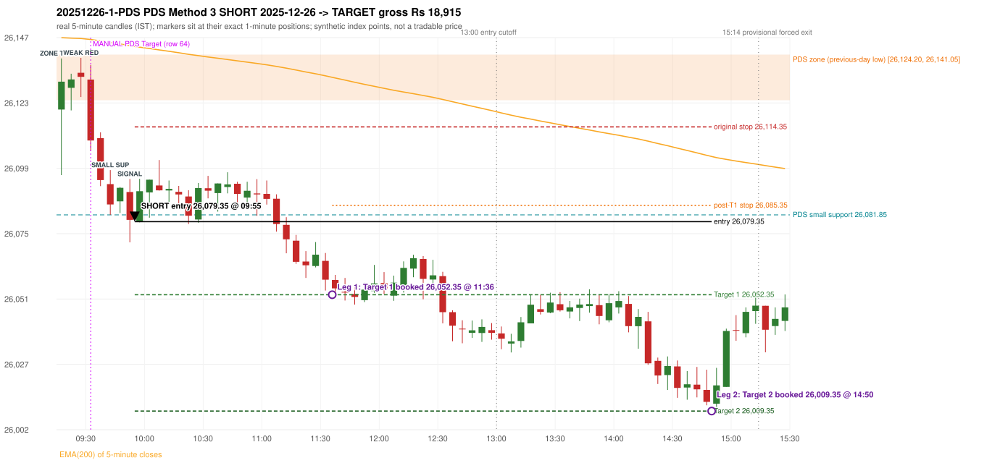

# Trading journal - 2025-12-26 (Friday)

> Automated reconstruction of the Phase 3.6 combined backtest: the Phase 3.0 controller, stops, targets and sizing with PDR = the body-based engine (wicks ignored; open strictly above the zone; numeric pattern thresholds and zone-lower-boundary conventions are provisional research assumptions, NOT approved by the strategy author). Synthetic NIFTY 50 index-point P&L (the index is not tradable). The owner's review status is intentionally blank.

## A. Trading day overview

| item | value |
|---|---|
| Date / weekday | 2025-12-26 / Friday |
| Session type | USABLE_WITH_FLAGS / VALID |
| Original session open (first 1-minute open) | 26,120.75 |
| Previous session | 2025-12-24 |
| Previous-day high / low (wicks included) | 26,236.30 / 26,124.20 |
| Previous-day highest BODY high (the body-based PDR ceiling; wicks ignored) | 26,230.95 |
| Previous-day official close / last 5-minute close | 26,142.10 / 26,141.65 |
| Raw engine records / confirmed signals / fully valid signals | 2 / 1 / 1 |
| Setups that did not complete (invalidated / incomplete) | 1 |
| Executed trades | 1 20251226-1-PDS |
| Gross P&L (Rs, synthetic) | 18,915.00 |
| Illustrative net P&L (Rs; Rs 500/trade + 0.5 pt/fill) | 18,025.00 |
| Day-end portfolio status | DAY_FINISHED |
| Manual journal trades (matched / unmatched) | 1 (0 / 1) |
| Extra automated trades | 1 |

## B. Daily strategy signal timeline (confirmed signals, chronological)

| time | strategy | method | dir | entry-rule status | valid for execution | <= 13:00 | portfolio state | accepted / ignored | specific reason | competing (same minute) |
|---|---|---|---|---|---|---|---|---|---|---|
| 09:55 | PDS | Method 3 | SHORT | PROPOSAL_DEPENDENT | True | True | FIRST_TRADE_ACTIVE | ACCEPTED -> 20251226-1-PDS | first eligible signal of the day; trade 1: TARGET |  |

Engine setups that did not complete (1); the complete list with failed rule ids is in `rejected_signals.csv`:

| candle | strategy | method | dir | status | precise reason | failed rules |
|---|---|---|---|---|---|---|
| 09:35 | RF | RF | LONG | INCOMPLETE_AT_EOD | NO_RETURN_INSIDE_BEFORE_SESSION_END |  |

## C. Detailed trade journals

### 20251226-1-PDS: PDS Method 3 SHORT (FIRST trade)

Chart: 

**Rule configuration:** CFG-phase36_body_based-866f954e55 - signal verification status **PROPOSAL_DEPENDENT** (never VERIFIED while a rule rests on a proposal).

#### 1. Setup identification

PDS Method 3 SHORT: the session opened 3.45 points below the previous-day-low zone [26,124.20, 26,141.05]; the first red candle at the zone (09:25) was weak (body 10.38%), so the engine waited for a small support; the 09:40 candle's low 26,081.85 (42.35 points below the zone floor) was broken by the close of the 09:50 candle (26,080.00); confirmed 09:55.

#### 2. Candle and indicator calculations

| role | session | candle | O | H | L | C | range | body % | upper wick % | lower wick % | direction | EMA(200) | strong bull / bear | pin bull / bear | small (body<=30%) | used for |
|---|---|---|---|---|---|---|---|---|---|---|---|---|---|---|---|---|
| zone_source_candle | PREVIOUS | 14:35-14:40 | 26,136.15 | 26,141.05 | 26,124.20 | 26,141.05 | 16.85 | 29.08 | 0.00 | 70.92 | BULLISH | 26,147.92 | False / False | True / False | True | previous-day low candle that defines the zone (A_LOWEST_LOW) |
| zone_retest_candle | TODAY | 09:15-09:20 | 26,120.75 | 26,139.65 | 26,096.55 | 26,131.05 | 43.10 | 23.90 | 19.95 | 56.15 | BULLISH | 26,147.32 | False / False | True / False | True | first candle whose range reaches the zone from below |
| signal_candle | TODAY | 09:50-09:55 | 26,090.30 | 26,095.10 | 26,071.70 | 26,080.00 | 23.40 | 44.02 | 20.51 | 35.47 | BEARISH | 26,144.35 | False / False | False / False | False | trigger candle |
| weak_first_red_candle | TODAY | 09:25-09:30 | 26,134.35 | 26,139.85 | 26,125.40 | 26,132.85 | 14.45 | 10.38 | 38.06 | 51.56 | BEARISH | 26,147.02 | False / False | False / False | True | first red candle at the zone that failed the quality rule |
| small_support_pivot | TODAY | 09:40-09:45 | 26,093.20 | 26,098.40 | 26,081.85 | 26,085.70 | 16.55 | 45.32 | 31.42 | 23.26 | BEARISH | 26,145.53 | False / False | False / False | False | small support: latest 3-candle fractal low after the weak candle |

Every condition, with the rule, the calculation, the observed values and the result:

| # | group | rule | result | status / numeric definition | calculation | observed | required | available at | why it matters |
|---|---|---|---|---|---|---|---|---|---|
| 1 | SELECTION | SEL-FIRST-001 | PASS | USER_APPROVED / USER_APPROVED | earliest CONFIRMED signal of the day across IRF/ORB/PDR/PDS/RF that passed the controller's checks | 0 confirmed signal(s) earlier today; 1 confirmed signals in the day in total, this one at 09:55 | no earlier executable signal | 2025-12-26 09:55 | the shared controller trades only the first valid signal; the five strategies are not independent positions |
| 2 | SELECTION | SEL-TIE-001 | PASS | USER_APPROVED / USER_APPROVED | other CONFIRMED signals with exactly the same confirmation timestamp | none | no different-strategy / opposite-direction signal in the same minute (otherwise an unresolved conflict, no trade) | 2025-12-26 09:55 | an unresolved same-minute collision would have produced no trade at all |
| 3 | SELECTION | ENTRY-CUTOFF-001 | PASS | USER_APPROVED / USER_APPROVED | fill timestamp vs 13:00:00 IST | signal confirmed 09:55; fill 09:55 | fill at or before 13:00:00 IST | 2025-12-26 09:55 | no new position may be entered with a fill after 13:00 IST |
| 4 | SELECTION | EXE-FILL-001 | PASS | PROPOSED_FOR_REVIEW / PROPOSED_FOR_REVIEW | fill = open of the 1-minute bar that starts at the signal candle's end | bar 09:55 O 26,079.35 H 26,084.40 L 26,079.10 C 26,082.25; executable=True; entry 26,079.35 | fill bar exists, starts exactly at the signal end, is fillable; entry = its open | 2025-12-26 09:55 | a 5-minute signal is known only when its candle closes; the first price that can be traded is the next minute's open |
| 5 | SELECTION | DAY-MAX-001 | PASS | USER_APPROVED / USER_APPROVED | number of entries today | trade 1 of at most 2 | <= 2 entries per day | 2025-12-26 09:55 | daily trade cap |
| 6 | SETUP | PDS-003 | PASS | SOURCE_VERIFIED / EXPLICIT_WORDING_DETAIL_PROPOSED_FOR_REVIEW | gap = first 1-minute open of today - previous session's OFFICIAL close | today's open 26,120.75 (first 1-minute bar 09:15) - previous close 26,142.10 (DAILY_VENDOR, 2025-12-24) = -21.35 points -> gap DOWN | gap DOWN (more than 0 points) | 2025-12-26 09:15 | approved convention: the original first-minute open, never the vendor daily open |
| 7 | SETUP | PDS-006 | PASS | SOURCE_VERIFIED / QUALITATIVE_SOURCE_NUMERIC_DEFINITION_PROPOSED_FOR_REVIEW | gap-down open below the zone | today's open 26,120.75 vs zone low 26,124.20: 3.45 points below | open < zone low | 2025-12-26 09:15 | the guide: 'price is trading below the previous day's support zone' after the gap; a PROPOSED strict reading |
| 8 | SETUP | PDS-004 | PASS | SOURCE_VERIFIED / EXPLICIT_IN_SOURCE | PDS is not a breakdown strategy: the zone must be tested from below first | open 26,120.75 below the zone floor 26,124.20; the first candle to reach the zone is 09:15 | price rises to the zone before any short | 2025-12-26 09:15 | a short below the level without a retest is not this strategy |
| 9 | SETUP | PDS-005 | PASS | SOURCE_VERIFIED / QUALITATIVE_SOURCE_NUMERIC_DEFINITION_PROPOSED_FOR_REVIEW | price comes up to the zone: first candle whose [low, high] intersects it (+/- proximity) | 09:15-09:20 O 26,120.75 H 26,139.65 L 26,096.55 C 26,131.05; range 43.10, body 10.30 (23.90%), upper wick 8.60 (19.95%), lower wick 24.20 (56.15%), bullish; high 26,139.65 vs zone low 26,124.20 | range intersects the zone | 2025-12-26 09:20 | PDS is not a breakdown strategy: the zone must be tested from below first |
| 10 | ZONE | PDS-001 | PASS | SOURCE_VERIFIED / EXPLICIT_IN_SOURCE | direction | SHORT (PDS is short only) | short-only | 2025-12-26 09:55 | PDS sells a retest of previous-day support from below |
| 11 | ZONE | PDS-002 | PASS | SOURCE_VERIFIED / QUALITATIVE_SOURCE_NUMERIC_DEFINITION_PROPOSED_FOR_REVIEW | zone = [lowest low, body top] of the previous session's absolute-low candle (method A_LOWEST_LOW; the lower wick is part of the zone) | zone [26,124.20, 26,141.05] from the 14:35 candle of 2025-12-24 (14:35-14:40 O 26,136.15 H 26,141.05 L 26,124.20 C 26,141.05; range 16.85, body 4.90 (29.08%), upper wick 0.00 (0.00%), lower wick 11.95 (70.92%), bullish); engine recorded [26,124.20, 26,141.05] | previous trading day's low where price took support (body + lower wick) | 2025-12-24 14:40 | the reference level of the strategy; the exact candle(s) are a research choice (PDS-ZONE-002) |
| 12 | CONFIRMATION | PDS-M-001 | PASS | SOURCE_VERIFIED / QUALITATIVE_SOURCE_NUMERIC_DEFINITION_PROPOSED_FOR_REVIEW | Method 3 is used when the first red candle at the zone is not satisfying | first red candle at the zone: 09:25-09:30 O 26,134.35 H 26,139.85 L 26,125.40 C 26,132.85; range 14.45, body 1.50 (10.38%), upper wick 5.50 (38.06%), lower wick 7.45 (51.56%), bearish; strong-bearish test body >= 60%, lower wick <= 20% -> not met; pin bar -> not met | first red candle is neither strong nor a pin bar | 2025-12-26 09:30 | the quality rule keeps weak candles out; Method 3 waits for a support break instead |
| 13 | CONFIRMATION | PDS-M3-001 | PASS | SOURCE_VERIFIED / QUALITATIVE_SOURCE_NUMERIC_DEFINITION_PROPOSED_FOR_REVIEW | small support = latest 3-candle fractal low (k=1) formed at/after the weak candle with low <= zone high (26,141.05); definition SWING_K1_NEAR_ZONE | support 26,081.85 from the 09:40 candle; engine recorded 26,081.85; distance below the zone floor 42.35 points (zone floor 26,124.20); the guide says 'near the zone' but defines no distance - the code has no lower bound | a small support near the zone | 2025-12-26 09:50 | 'near' and the size of the small support are undefined in the guide |
| 14 | CONFIRMATION | PDS-M3-001 | PASS | SOURCE_VERIFIED / QUALITATIVE_SOURCE_NUMERIC_DEFINITION_PROPOSED_FOR_REVIEW | trigger: candle closes below the small support (break basis CLOSE) | 09:50 close 26,080.00 vs support 26,081.85: 1.85 points below | close < support | 2025-12-26 09:55 | the guide does not say close or touch; the close is used |
| 15 | EXECUTION | EXE-STOP-001 | PASS | USER_APPROVED / USER_APPROVED | initial stop = entry + 35 points | entry 26,079.35 -> stop 26,114.35 | stop 35 index points (BASELINE) | 2025-12-26 09:55 | defines the loss if the setup fails before Target 1 |
| 16 | EXECUTION | EXE-T1-001 | PASS | SOURCE_VERIFIED / EXPLICIT_IN_SOURCE | Target 1 = entry +/- 27 points | T1 26,052.35 | 27 points | 2025-12-26 09:55 | Leg 1 (3 lots) is booked at Target 1 |
| 17 | EXECUTION | PDS-TGT-001 | PASS | SOURCE_VERIFIED / EXPLICIT_IN_SOURCE | Target 2 = entry +/- 70 points | T2 26,009.35 (the guide says 70; the report suggests 60 - CONFLICTING) | 70 points | 2025-12-26 09:55 | Leg 2 (3 lots) is booked at Target 2 |
| 18 | EXECUTION | POST-T1-STOP-006 | PASS | USER_APPROVED / USER_APPROVED | after T1 the Leg-2 stop = entry + 6 (no trailing) | post-T1 stop 26,085.35 | entry -6 (LONG) / +6 (SHORT) | 2025-12-26 09:55 | protects the remaining three lots once the first three are booked |
| 19 | EXECUTION | SIZE-LOT-001 | PASS | USER_APPROVED / USER_APPROVED | 6 lots x 65 = 390, Leg 1 = 3 lots = 195, Leg 2 = 195 | 6 lots, lot size 65, legs 3+3 | 6 lots in two equal legs | 2025-12-26 09:55 | position size for the synthetic P&L |
| 20 | NOTE | PDS-007 | NOT_APPLICABLE | PROPOSED_FOR_REVIEW / PROPOSED_FOR_REVIEW | repeated PDS signals today | 1 confirmed PDS signal(s) in the session | n/a (disclosure) | 2025-12-26 09:55 | the per-session cap is lifted for the controller runs; the controller trades only the first (or the permitted second) trade |
| 21 | NOTE | PDS-MISSING-001 | UNRESOLVED | UNRESOLVED / UNRESOLVED | entry timing | signal on the candle close; fill at the next minute's open | the guide does not say whether entry is intra-candle or after the close | 2025-12-26 09:55 | causal convention: nothing is entered before the trigger candle has closed |
| 22 | NOTE | PDS-SL-001 | NOT_APPLICABLE | SOURCE_VERIFIED / QUALITATIVE_SOURCE_NUMERIC_DEFINITION_PROPOSED_FOR_REVIEW | the guide's 35-or-40 rule: 35 if the most recent green candle's high is within 35 points of entry, else 40 | most recent green candle high 26,092.15 is 12.80 points from the entry 26,079.35: the guide's rule would select 35 points; the baseline applies a fixed 35 (USER_APPROVED research baseline; the 35-vs-40 selection and the 40-point variant are separate labelled scenarios) | source selection rule | 2025-12-26 09:55 | the stop distance is a modelling choice and changes losses, not entries |
| 23 | NOTE | NOTE-UNRESOLVED-DEPENDENCIES | NOT_APPLICABLE | NOT_A_RULE / NOT_A_REGISTRY_RULE | rules the signal depends on that the sources leave unresolved | engine-recorded unresolved rule ids: none; verification status PROPOSAL_DEPENDENT | n/a (disclosure) | 2025-12-26 09:55 | the entry is only as verified as the rules it rests on |

#### 3. Entry decision and explanation

PDS Method 3 SHORT: the session opened 3.45 points below the previous-day-low zone [26,124.20, 26,141.05]; the first red candle at the zone (09:25) was weak (body 10.38%), so the engine waited for a small support; the 09:40 candle's low 26,081.85 (42.35 points below the zone floor) was broken by the close of the 09:50 candle (26,080.00); confirmed 09:55.

**Why this trade ahead of the other strategies:** This PDS Method 3 signal was the earliest executable signal of the day: 0 confirmed signal(s) earlier, 0 other in the same minute. No later signal was generated. State of the other four engines at that moment: [IRF: no setup record before this time (a base condition was not met, or nothing triggered)] [ORB: no setup record before this time (a base condition was not met, or nothing triggered)] [PDR: no setup record before this time (a base condition was not met, or nothing triggered)] [RF: no setup record before this time (a base condition was not met, or nothing triggered)]

#### 4. Actual entry execution

| item | value |
|---|---|
| Signal candle | 09:50-09:55 |
| Signal confirmed | 2025-12-26 09:55 |
| Fill timestamp | 2025-12-26 09:55 |
| Entry price | 26,079.35 |
| Source partition / 1-minute bar | data/processed/nifty50/year=2025/month=12/candles.parquet / 2025-12-26 09:55 |
| Source bar O / H / L / C | 26,079.35 / 26,084.40 / 26,079.10 / 26,082.25 |
| Fill assumption | open of the 1-minute bar starting at the signal candle's end (EXE-FILL-001, PROPOSED causal convention) |
| Initial stop / T1 / T2 / post-T1 stop | 26,114.35 / 26,052.35 / 26,009.35 / 26,085.35 |
| Position | 6 lots x 65 = 390 units (Leg 1 195, Leg 2 195) |

#### 5-8. Trade progress, Target 1, post-T1 stop and final exit

Between the 09:55 entry bar and the final exit (296 one-minute bars) the best excursion in favour was 70.30 points at 14:50 and the worst against was 22.75 points at 10:08. At 11:36 price reached Target 1 26,052.35 and three lots exited. At 11:36 the remaining three lots' protective stop was set to 26,085.35 (entry + 6; no trailing, no further change); the engine applies it from the Target-1 bar onward and tests it within that same bar. At 14:50 price reached Target 2 26,009.35 and the remaining three lots exited. No further trade that day (DAY-T2-001).

| leg | qty | exit time | exit price | reason | source 1-minute bar | O / H / L / C | gross points | gross Rs | slippage pts | flags |
|---|---|---|---|---|---|---|---|---|---|---|
| 1 | 195 | 11:36 | 26,052.35 | TARGET_1 | 11:36 | 26,055.25 / 26,057.85 / 26,052.25 / 26,056.30 | 27.00 | 5,265.00 | 0.00 |  |
| 2 | 195 | 14:50 | 26,009.35 | TARGET_2 | 14:50 | 26,012.10 / 26,014.80 / 26,009.05 / 26,011.10 | 70.00 | 13,650.00 | 0.00 |  |

Exit evidence per leg:

* Leg 1: 1-minute bar 11:36 O 26,055.25 H 26,057.85 L 26,052.25 C 26,056.30: low 26,052.25 reached Target 1 26,052.35; Leg 1 booked at the target level
* Leg 2: 1-minute bar 14:50 O 26,012.10 H 26,014.80 L 26,009.05 C 26,011.10: low 26,009.05 reached Target 2 26,009.35; Leg 2 booked at the target level

#### 9. Gross and illustrative net P&L

| item | value (Rs) |
|---|---|
| Leg 1 gross | 5,265.00 |
| Leg 2 gross | 13,650.00 |
| Trade gross (= Leg 1 + Leg 2) | 18,915.00 |
| Illustrative fixed cost | -500.00 |
| Illustrative slippage (0.5 pt on every fill, entry + exits, all units) | -390.00 |
| Illustrative net | 18,025.00 |

#### 10. Manual journal comparison

EXTRA_AUTOMATED_TRADE: the automated system took PDS Method 3 SHORT at 09:55 (same strategy manual trade at another time: PDS 09:30 Target). The setup rests on: PDS-MISSING-001: PDS entry timing is not specified in the guide. The journal shows no corresponding entry.

## D. Manual journal comparison

| comparison | journal row | journal strategy | manual time | manual direction | manual outcome | match class | trade | auto entry | auto outcome | explanation |
|---|---|---|---|---|---|---|---|---|---|---|
| M064 | 64 | PDS | 09:30 | SHORT | Target | MISSING_AUTOMATED_SIGNAL |  |  |  | MISSING_AUTOMATED_SIGNAL: NO_CONFIRMED_SIGNAL_WITHIN_TOLERANCE_AND_NO_ANCHORED_SETUP_RECORD; NEAREST_CONFIRMED_Method 3_09:55 - GAP_DOWN_AND_ZONE_EXIST. Heuristic primary cause: UNKNOWN (the evidence does not decide - UNKNOWN); blocked by: n/a |
| E038 |  |  |  |  |  | EXTRA_AUTOMATED_TRADE | 20251226-1-PDS | 09:55 @ 26,079.35 | TARGET | EXTRA_AUTOMATED_TRADE: the automated system took PDS Method 3 SHORT at 09:55 (same strategy manual trade at another time: PDS 09:30 Target). The setup rests on: PDS-MISSING-001: PDS entry timing is not specified in the guide. The journal shows no corresponding entry. |

The journal records no entry price and no exit price (NOT_RECORDED); matching uses date, strategy and candle start only - never P&L.

## E. Daily conclusion

* **Traded:** 20251226-1-PDS - PDS Method 3 SHORT at 09:55 (entry 26,079.35), outcome TARGET, gross Rs 18,915.00, illustrative net Rs 18,025.00. **Why:** This PDS Method 3 signal was the earliest executable signal of the day: 0 confirmed signal(s) earlier, 0 other in the same minute. No later signal was generated. State of the other four engines at that moment: [IRF: no setup record before this time (a base condition was not met, or nothing triggered)] [ORB: no setup record before this time (a base condition was not met, or nothing triggered)] [PDR: no setup record before this time (a base condition was not met, or nothing triggered)] [RF: no setup record before this time (a base condition was not met, or nothing triggered)] **How it ended:** At 11:36 price reached Target 1 26,052.35 and three lots exited. At 11:36 the remaining three lots' protective stop was set to 26,085.35 (entry + 6; no trailing, no further change); the engine applies it from the Target-1 bar onward and tests it within that same bar. At 14:50 price reached Target 2 26,009.35 and the remaining three lots exited. No further trade that day (DAY-T2-001).
* **Unmatched manual trade (row 64, PDS 09:30 Target):** MISSING_AUTOMATED_SIGNAL: NO_CONFIRMED_SIGNAL_WITHIN_TOLERANCE_AND_NO_ANCHORED_SETUP_RECORD; NEAREST_CONFIRMED_Method 3_09:55 - GAP_DOWN_AND_ZONE_EXIST. Heuristic primary cause: UNKNOWN (the evidence does not decide - UNKNOWN); blocked by: n/a
* **Extra automated trade 20251226-1-PDS:** EXTRA_AUTOMATED_TRADE: the automated system took PDS Method 3 SHORT at 09:55 (same strategy manual trade at another time: PDS 09:30 Target). The setup rests on: PDS-MISSING-001: PDS entry timing is not specified in the guide. The journal shows no corresponding entry.
* **Open strategy-definition issues that affected this day:** PDS-MISSING-001 (Entry timing (during the candle or after it closes) is not specified)
* **Automated triage (not an approval; the owner's review status stays blank):** REVIEW: UNMATCHED_MANUAL+EXTRA_AUTOMATED
