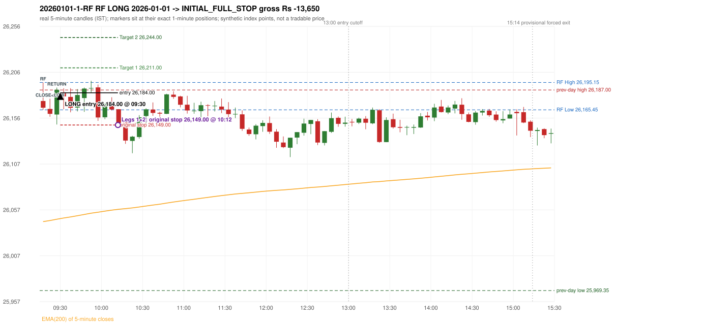

# Trading journal - 2026-01-01 (Thursday)

> Automated reconstruction of the Phase 3.6 combined backtest: the Phase 3.0 controller, stops, targets and sizing with PDR = the body-based engine (wicks ignored; open strictly above the zone; numeric pattern thresholds and zone-lower-boundary conventions are provisional research assumptions, NOT approved by the strategy author). Synthetic NIFTY 50 index-point P&L (the index is not tradable). The owner's review status is intentionally blank.

## A. Trading day overview

| item | value |
|---|---|
| Date / weekday | 2026-01-01 / Thursday |
| Session type | USABLE_WITH_FLAGS / VALID |
| Original session open (first 1-minute open) | 26,175.05 |
| Previous session | 2025-12-31 |
| Previous-day high / low (wicks included) | 26,187.00 / 25,969.35 |
| Previous-day highest BODY high (the body-based PDR ceiling; wicks ignored) | 26,184.15 |
| Previous-day official close / last 5-minute close | 26,129.60 / 26,141.85 |
| Raw engine records / confirmed signals / fully valid signals | 2 / 1 / 1 |
| Setups that did not complete (invalidated / incomplete) | 1 |
| Executed trades | 1 20260101-1-RF |
| Gross P&L (Rs, synthetic) | -13,650.00 |
| Illustrative net P&L (Rs; Rs 500/trade + 0.5 pt/fill) | -14,540.00 |
| Day-end portfolio status | SECOND_TRADE_ELIGIBLE |
| Manual journal trades (matched / unmatched) | 0 (0 / 0) |
| Extra automated trades | 1 |

## B. Daily strategy signal timeline (confirmed signals, chronological)

| time | strategy | method | dir | entry-rule status | valid for execution | <= 13:00 | portfolio state | accepted / ignored | specific reason | competing (same minute) |
|---|---|---|---|---|---|---|---|---|---|---|
| 09:30 | RF | RF | LONG | PROPOSAL_DEPENDENT | True | True | FIRST_TRADE_ACTIVE | ACCEPTED -> 20260101-1-RF | first eligible signal of the day; trade 1: INITIAL_FULL_STOP |  |

Engine setups that did not complete (1); the complete list with failed rule ids is in `rejected_signals.csv`:

| candle | strategy | method | dir | status | precise reason | failed rules |
|---|---|---|---|---|---|---|
| 09:15 | PDR | PDR | LONG | INVALIDATED | OPEN_NOT_STRICTLY_ABOVE_ZONE |  |

## C. Detailed trade journals

### 20260101-1-RF: RF LONG (FIRST trade)

Chart: 

**Rule configuration:** CFG-phase36_body_based-866f954e55 - signal verification status **PROPOSAL_DEPENDENT** (never VERIFIED while a rule rests on a proposal).

#### 1. Setup identification

RF LONG (research proposal for direction/target): the session gapped +45.45 points up inside yesterday's range [25,969.35, 26,187.00] after an EMA-only uptrend; the 09:20 candle closed at 26,161.10, 4.35 points below RF Low 26,165.45, and the 09:25 candle closed back inside the range at 26,187.20, activating the setup at 09:30.

#### 2. Candle and indicator calculations

| role | session | candle | O | H | L | C | range | body % | upper wick % | lower wick % | direction | EMA(200) | strong bull / bear | pin bull / bear | small (body<=30%) | used for |
|---|---|---|---|---|---|---|---|---|---|---|---|---|---|---|---|---|
| rf_range_candle | TODAY | 09:15-09:20 | 26,175.05 | 26,195.15 | 26,165.45 | 26,167.80 | 29.70 | 24.41 | 67.68 | 7.91 | BEARISH | 26,044.20 | False / False | False / True | True | first 5-minute candle: RF High / RF Low |
| prev_session_last_candle | PREVIOUS | 15:25-15:30 | 26,128.30 | 26,141.85 | 26,125.20 | 26,141.85 | 16.65 | 81.38 | 0.00 | 18.62 | BULLISH | 26,042.95 | True / False | False / False | False | trend: previous session's last 5-minute close vs its EMA(200) |
| close_below_candle | TODAY | 09:20-09:25 | 26,166.45 | 26,177.55 | 26,157.95 | 26,161.10 | 19.60 | 27.30 | 56.63 | 16.07 | BEARISH | 26,045.36 | False / False | False / True | True | first candle closing below RF Low |
| return_inside_candle | TODAY | 09:25-09:30 | 26,160.35 | 26,189.60 | 26,149.55 | 26,187.20 | 40.05 | 67.04 | 5.99 | 26.97 | BULLISH | 26,046.77 | True / False | False / False | False | first later candle closing back inside the first-candle range |

Every condition, with the rule, the calculation, the observed values and the result:

| # | group | rule | result | status / numeric definition | calculation | observed | required | available at | why it matters |
|---|---|---|---|---|---|---|---|---|---|
| 1 | SELECTION | SEL-FIRST-001 | PASS | USER_APPROVED / USER_APPROVED | earliest CONFIRMED signal of the day across IRF/ORB/PDR/PDS/RF that passed the controller's checks | 0 confirmed signal(s) earlier today; 1 confirmed signals in the day in total, this one at 09:30 | no earlier executable signal | 2026-01-01 09:30 | the shared controller trades only the first valid signal; the five strategies are not independent positions |
| 2 | SELECTION | SEL-TIE-001 | PASS | USER_APPROVED / USER_APPROVED | other CONFIRMED signals with exactly the same confirmation timestamp | none | no different-strategy / opposite-direction signal in the same minute (otherwise an unresolved conflict, no trade) | 2026-01-01 09:30 | an unresolved same-minute collision would have produced no trade at all |
| 3 | SELECTION | ENTRY-CUTOFF-001 | PASS | USER_APPROVED / USER_APPROVED | fill timestamp vs 13:00:00 IST | signal confirmed 09:30; fill 09:30 | fill at or before 13:00:00 IST | 2026-01-01 09:30 | no new position may be entered with a fill after 13:00 IST |
| 4 | SELECTION | EXE-FILL-001 | PASS | PROPOSED_FOR_REVIEW / PROPOSED_FOR_REVIEW | fill = open of the 1-minute bar that starts at the signal candle's end | bar 09:30 O 26,184.00 H 26,187.90 L 26,175.60 C 26,187.90; executable=True; entry 26,184.00 | fill bar exists, starts exactly at the signal end, is fillable; entry = its open | 2026-01-01 09:30 | a 5-minute signal is known only when its candle closes; the first price that can be traded is the next minute's open |
| 5 | SELECTION | DAY-MAX-001 | PASS | USER_APPROVED / USER_APPROVED | number of entries today | trade 1 of at most 2 | <= 2 entries per day | 2026-01-01 09:30 | daily trade cap |
| 6 | SETUP | RF-002 | PASS | SOURCE_VERIFIED / EXPLICIT_IN_SOURCE | RF High / Low = high / low (wicks included) of the first 5-minute candle | 09:15-09:20 RF High 26,195.15, RF Low 26,165.45 (engine recorded 26,195.15 / 26,165.45) | first-candle range | 2026-01-01 09:20 | the zone price must dip below and return into |
| 7 | SETUP | RF-003 | PASS | SOURCE_VERIFIED / EXPLICIT_WORDING_DETAIL_PROPOSED_FOR_REVIEW | gap = first 1-minute open of today - previous session's OFFICIAL close | today's open 26,175.05 (first 1-minute bar 09:15) - previous close 26,129.60 (DAILY_VENDOR, 2025-12-31) = +45.45 points -> gap UP | gap UP (more than 0 points) | 2026-01-01 09:15 | approved convention: the original first-minute open, never the vendor daily open |
| 8 | SETUP | RF-004 | PASS | SOURCE_VERIFIED / EXPLICIT_IN_SOURCE | gap-up open inside yesterday's trading range | open 26,175.05 vs previous session 2025-12-31 range [25,969.35, 26,187.00]: inside (previous close 26,129.60, gap +45.45) | previous low <= open <= previous high | 2026-01-01 09:15 | a huge gap beyond yesterday's range is rejected; the source gives no number, the test is the previous session's high/low |
| 9 | TREND | RF-001 | PASS | SOURCE_VERIFIED / QUALITATIVE_SOURCE_NUMERIC_DEFINITION_PROPOSED_FOR_REVIEW | previous session's final completed 5-minute candle: close vs its EMA(200 of 5-minute closes) | previous session 2025-12-31 last candle 15:25-15:30 close 26,141.85 vs EMA(200) 26,042.95: 98.90 points above the EMA -> trend bullish (EMA_PREV_SESSION_CLOSE; research variant A, EMA-only) | close > EMA(200) | 2025-12-31 15:30 | the opening gap can never create the trend: only information that existed before today's open is used |
| 10 | TREND | RF-008 | PASS | SOURCE_VERIFIED / QUALITATIVE_SOURCE_NUMERIC_DEFINITION_PROPOSED_FOR_REVIEW | the uptrend must exist BEFORE the gap (a gap cannot create it) | trend measured on the previous session only (2025-12-31); today's gap is not used | established uptrend, not a sudden gap above the EMA | 2025-12-31 15:30 | RF rejects a previous downtrend followed by a sudden large gap above the EMA |
| 11 | TREND | TREND-SWING-001 | NOT_APPLICABLE | PROPOSED_FOR_REVIEW / PROPOSED_FOR_REVIEW | confirmed swing structure | not required by the active trend variant (variant A is the EMA price location only) | n/a | 2025-12-31 15:30 | variant B would additionally require higher-high/higher-low swings; it is a separate labelled scenario |
| 12 | CONFIRMATION | RF-005 | PASS | SOURCE_VERIFIED / EXPLICIT_IN_SOURCE | a candle CLOSES below RF Low (a wick is not enough) | 09:20-09:25 O 26,166.45 H 26,177.55 L 26,157.95 C 26,161.10; range 19.60, body 5.35 (27.30%), upper wick 11.10 (56.63%), lower wick 3.15 (16.07%), bearish; close 26,161.10 vs RF Low 26,165.45: 4.35 points below | close < RF Low | 2026-01-01 09:25 | the failed-breakdown leg of the setup |
| 13 | CONFIRMATION | RF-006 | PASS | SOURCE_VERIFIED / QUALITATIVE_SOURCE_NUMERIC_DEFINITION_PROPOSED_FOR_REVIEW | price returns inside the first-candle range - definition R1 (first later candle whose CLOSE is within [RF Low, RF High]) | 09:25-09:30 O 26,160.35 H 26,189.60 L 26,149.55 C 26,187.20; range 40.05, body 26.85 (67.04%), upper wick 2.40 (5.99%), lower wick 10.80 (26.97%), bullish; close 26,187.20 within [26,165.45, 26,195.15]; 1 candle(s) after the close-below candle (09:20) | RF Low <= close <= RF High | 2026-01-01 09:30 | completes the activation; the source does not say 'close' vs 'touch' nor any time limit |
| 14 | CONFIRMATION | RF-007 | PASS | SOURCE_VERIFIED / EXPLICIT_IN_SOURCE | order of the four steps | trend (previous session) -> gap 09:15 open -> close below 09:20 -> return 09:25 | uptrend, gap up in range, close below, return | 2026-01-01 09:30 | the source requires this order |
| 15 | CONFIRMATION | RF-013 | PASS | SOURCE_VERIFIED / EXPLICIT_IN_SOURCE | gap up without the break-and-return sequence gives no RF activation | sequence complete: close below 09:20, return inside 09:25 | both steps present | 2026-01-01 09:30 | the gap alone never activates RF |
| 16 | EXECUTION | EXE-STOP-001 | PASS | USER_APPROVED / USER_APPROVED | initial stop = entry - 35 points | entry 26,184.00 -> stop 26,149.00 | stop 35 index points (BASELINE) | 2026-01-01 09:30 | defines the loss if the setup fails before Target 1 |
| 17 | EXECUTION | EXE-T1-001 | PASS | SOURCE_VERIFIED / EXPLICIT_IN_SOURCE | Target 1 = entry +/- 27 points | T1 26,211.00 | 27 points | 2026-01-01 09:30 | Leg 1 (3 lots) is booked at Target 1 |
| 18 | EXECUTION | RF-011 | UNRESOLVED | UNRESOLVED / UNRESOLVED | Target 2 = entry +/- 60 points | T2 26,244.00 (the RF guide leaves the target OPEN: 60 is a research proposal) | 60 points | 2026-01-01 09:30 | Leg 2 (3 lots) is booked at Target 2 |
| 19 | EXECUTION | POST-T1-STOP-006 | PASS | USER_APPROVED / USER_APPROVED | after T1 the Leg-2 stop = entry - 6 (no trailing) | post-T1 stop 26,178.00 | entry -6 (LONG) / +6 (SHORT) | 2026-01-01 09:30 | protects the remaining three lots once the first three are booked |
| 20 | EXECUTION | SIZE-LOT-001 | PASS | USER_APPROVED / USER_APPROVED | 6 lots x 65 = 390, Leg 1 = 3 lots = 195, Leg 2 = 195 | 6 lots, lot size 65, legs 3+3 | 6 lots in two equal legs | 2026-01-01 09:30 | position size for the synthetic P&L |
| 21 | NOTE | RF-014 | NOT_APPLICABLE | PROPOSED_FOR_REVIEW / PROPOSED_FOR_REVIEW | first activation per session | only the first completed sequence of the session is reported | n/a (engineering proposal) | 2026-01-01 09:30 | the source is silent on re-activation |
| 22 | NOTE | RF-009 | UNRESOLVED | UNRESOLVED / UNRESOLVED | stop selection | baseline stop 35 points (USER_APPROVED research baseline) | the guide: 35-40 'depending on what is logical', fixed vs candle-extreme not stated | 2026-01-01 09:30 | the source does not define the RF stop rule |
| 23 | NOTE | RF-012 | UNRESOLVED | PROPOSED_FOR_REVIEW / PROPOSED_FOR_REVIEW | trade direction | LONG (implied: 'opposite of IRF', 'uptrend only' and the long-position reference screenshots; the word long never appears) | the guide does not state the direction | 2026-01-01 09:30 | the direction is a labelled research proposal, not source-verified |
| 24 | NOTE | RF-010 | UNRESOLVED | UNRESOLVED / UNRESOLVED | entry price | signal reference = close of the return candle 26,187.20; fill = next minute open 26,184.00 | the guide's rule-readiness table lists the exact entry price as OPEN, i.e. unspecified | 2026-01-01 09:30 | causal convention applied to every strategy |
| 25 | NOTE | NOTE-UNRESOLVED-DEPENDENCIES | UNRESOLVED | NOT_A_RULE / NOT_A_REGISTRY_RULE | rules the signal depends on that the sources leave unresolved | engine-recorded unresolved rule ids: RF-009, RF-011; verification status PROPOSAL_DEPENDENT | n/a (disclosure) | 2026-01-01 09:30 | the entry is only as verified as the rules it rests on |

#### 3. Entry decision and explanation

RF LONG (research proposal for direction/target): the session gapped +45.45 points up inside yesterday's range [25,969.35, 26,187.00] after an EMA-only uptrend; the 09:20 candle closed at 26,161.10, 4.35 points below RF Low 26,165.45, and the 09:25 candle closed back inside the range at 26,187.20, activating the setup at 09:30.

**Why this trade ahead of the other strategies:** This RF signal was the earliest executable signal of the day: 0 confirmed signal(s) earlier, 0 other in the same minute. No later signal was generated. State of the other four engines at that moment: [IRF: no setup record before this time (a base condition was not met, or nothing triggered)] [ORB: no setup record before this time (a base condition was not met, or nothing triggered)] [PDR: PDR invalidated at 09:15: OPEN_NOT_STRICTLY_ABOVE_ZONE] [PDS: no setup record before this time (a base condition was not met, or nothing triggered)]

#### 4. Actual entry execution

| item | value |
|---|---|
| Signal candle | 09:25-09:30 |
| Signal confirmed | 2026-01-01 09:30 |
| Fill timestamp | 2026-01-01 09:30 |
| Entry price | 26,184.00 |
| Source partition / 1-minute bar | data/processed/nifty50/year=2026/month=01/candles.parquet / 2026-01-01 09:30 |
| Source bar O / H / L / C | 26,184.00 / 26,187.90 / 26,175.60 / 26,187.90 |
| Fill assumption | open of the 1-minute bar starting at the signal candle's end (EXE-FILL-001, PROPOSED causal convention) |
| Initial stop / T1 / T2 / post-T1 stop | 26,149.00 / 26,211.00 / 26,244.00 / 26,178.00 |
| Position | 6 lots x 65 = 390 units (Leg 1 195, Leg 2 195) |

#### 5-8. Trade progress, Target 1, post-T1 stop and final exit

Between the 09:30 entry bar and the final exit (43 one-minute bars) the best excursion in favour was 13.00 points at 09:52 and the worst against was 35.75 points at 10:12. At 10:12 price reached the original stop 26,149.00 before Target 1 26,211.00, so all six lots exited together at 26,149.00. This is an INITIAL_FULL_STOP: one more trade is allowed that day, only a newly confirmed PDR/PDS signal.

| leg | qty | exit time | exit price | reason | source 1-minute bar | O / H / L / C | gross points | gross Rs | slippage pts | flags |
|---|---|---|---|---|---|---|---|---|---|---|
| 1 | 195 | 10:12 | 26,149.00 | ORIGINAL_STOP_BEFORE_T1 | 10:12 | 26,155.40 / 26,156.30 / 26,148.25 / 26,149.45 | -35.00 | -6,825.00 | 0.00 |  |
| 2 | 195 | 10:12 | 26,149.00 | ORIGINAL_STOP_BEFORE_T1 | 10:12 | 26,155.40 / 26,156.30 / 26,148.25 / 26,149.45 | -35.00 | -6,825.00 | 0.00 |  |

Exit evidence per leg:

* Leg 1: 1-minute bar 10:12 O 26,155.40 H 26,156.30 L 26,148.25 C 26,149.45: low 26,148.25 reached the original stop 26,149.00 before Target 1 26,211.00 was touched; both legs exit at the stop level 26,149.00
* Leg 2: 1-minute bar 10:12 O 26,155.40 H 26,156.30 L 26,148.25 C 26,149.45: low 26,148.25 reached the original stop 26,149.00 before Target 1 26,211.00 was touched; both legs exit at the stop level 26,149.00

#### 9. Gross and illustrative net P&L

| item | value (Rs) |
|---|---|
| Leg 1 gross | -6,825.00 |
| Leg 2 gross | -6,825.00 |
| Trade gross (= Leg 1 + Leg 2) | -13,650.00 |
| Illustrative fixed cost | -500.00 |
| Illustrative slippage (0.5 pt on every fill, entry + exits, all units) | -390.00 |
| Illustrative net | -14,540.00 |

#### 10. Manual journal comparison

EXTRA_AUTOMATED_TRADE: the automated system took RF RF LONG at 09:30 (no manual trade that day). The setup rests on: RF-009: RF stop selection rule is not defined | RF-012: RF trade direction is implied, not stated | RF-010: RF entry price is not specified | RF-011: Target is OPEN (not specified). Phase 2.2: a CONFIGURABLE research value of 60 p | NOTE-UNRESOLVED-DEPENDENCIES: Disclosure of unresolved source rules behind this signal. The journal shows no corresponding entry.

## D. Manual journal comparison

| comparison | journal row | journal strategy | manual time | manual direction | manual outcome | match class | trade | auto entry | auto outcome | explanation |
|---|---|---|---|---|---|---|---|---|---|---|
| E041 |  |  |  |  |  | EXTRA_AUTOMATED_TRADE | 20260101-1-RF | 09:30 @ 26,184.00 | INITIAL_FULL_STOP | EXTRA_AUTOMATED_TRADE: the automated system took RF RF LONG at 09:30 (no manual trade that day). The setup rests on: RF-009: RF stop selection rule is not defined \| RF-012: RF trade direction is implied, not stated \| RF-010: RF entry price is not specified \| RF-011: Target is OPEN (not specified). Phase 2.2: a CONFIGURABLE research value of 60 p \| NOTE-UNRESOLVED-DEPENDENCIES: Disclosure of unresolved source rules behind this signal. The journal shows no corresponding entry. |

The journal records no entry price and no exit price (NOT_RECORDED); matching uses date, strategy and candle start only - never P&L.

## E. Daily conclusion

* **Traded:** 20260101-1-RF - RF RF LONG at 09:30 (entry 26,184.00), outcome INITIAL_FULL_STOP, gross Rs -13,650.00, illustrative net Rs -14,540.00. **Why:** This RF signal was the earliest executable signal of the day: 0 confirmed signal(s) earlier, 0 other in the same minute. No later signal was generated. State of the other four engines at that moment: [IRF: no setup record before this time (a base condition was not met, or nothing triggered)] [ORB: no setup record before this time (a base condition was not met, or nothing triggered)] [PDR: PDR invalidated at 09:15: OPEN_NOT_STRICTLY_ABOVE_ZONE] [PDS: no setup record before this time (a base condition was not met, or nothing triggered)] **How it ended:** At 10:12 price reached the original stop 26,149.00 before Target 1 26,211.00, so all six lots exited together at 26,149.00. This is an INITIAL_FULL_STOP: one more trade is allowed that day, only a newly confirmed PDR/PDS signal.
* **Extra automated trade 20260101-1-RF:** EXTRA_AUTOMATED_TRADE: the automated system took RF RF LONG at 09:30 (no manual trade that day). The setup rests on: RF-009: RF stop selection rule is not defined | RF-012: RF trade direction is implied, not stated | RF-010: RF entry price is not specified | RF-011: Target is OPEN (not specified). Phase 2.2: a CONFIGURABLE research value of 60 p | NOTE-UNRESOLVED-DEPENDENCIES: Disclosure of unresolved source rules behind this signal. The journal shows no corresponding entry.
* **Open strategy-definition issues that affected this day:** NOTE-UNRESOLVED-DEPENDENCIES, RF-009 (Stop-loss 35-40 'depending on what is logical'; fixed vs candle-extreme not stated (PARTIAL)), RF-010 (Exact entry price is OPEN (not specified)), RF-011 (Target is OPEN (not specified)), RF-012 (Trade direction is never stated)
* **Automated triage (not an approval; the owner's review status stays blank):** REVIEW: EXTRA_AUTOMATED
