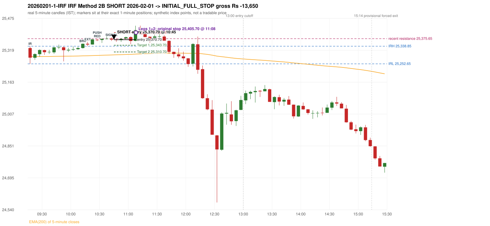

# Trading journal - 2026-02-01 (Sunday)

> Automated reconstruction of the Phase 3.6 combined backtest: the Phase 3.0 controller, stops, targets and sizing with PDR = the body-based engine (wicks ignored; open strictly above the zone; numeric pattern thresholds and zone-lower-boundary conventions are provisional research assumptions, NOT approved by the strategy author). Synthetic NIFTY 50 index-point P&L (the index is not tradable). The owner's review status is intentionally blank.

## A. Trading day overview

| item | value |
|---|---|
| Date / weekday | 2026-02-01 / Sunday |
| Session type | USABLE_WITH_FLAGS / VALID_SPECIAL_SESSION / WEEKEND_SPECIAL_SESSION |
| Original session open (first 1-minute open) | 25,329.80 |
| Previous session | 2026-01-30 |
| Previous-day high / low (wicks included) | 25,370.60 / 25,213.80 |
| Previous-day highest BODY high (the body-based PDR ceiling; wicks ignored) | 25,366.65 |
| Previous-day official close / last 5-minute close | 25,320.65 / 25,315.80 |
| Raw engine records / confirmed signals / fully valid signals | 7 / 4 / 4 |
| Setups that did not complete (invalidated / incomplete) | 3 |
| Executed trades | 1 20260201-1-IRF |
| Gross P&L (Rs, synthetic) | -13,650.00 |
| Illustrative net P&L (Rs; Rs 500/trade + 0.5 pt/fill) | -14,540.00 |
| Day-end portfolio status | SECOND_TRADE_ELIGIBLE |
| Manual journal trades (matched / unmatched) | 0 (0 / 0) |
| Extra automated trades | 1 |

## B. Daily strategy signal timeline (confirmed signals, chronological)

| time | strategy | method | dir | entry-rule status | valid for execution | <= 13:00 | portfolio state | accepted / ignored | specific reason | competing (same minute) |
|---|---|---|---|---|---|---|---|---|---|---|
| 10:45 | IRF | Method 2B | SHORT | PROPOSAL_DEPENDENT | True | True | FIRST_TRADE_ACTIVE | ACCEPTED -> 20260201-1-IRF | first eligible signal of the day; trade 1: INITIAL_FULL_STOP |  |
| 11:45 | IRF | Method 1 | SHORT | PROPOSAL_DEPENDENT | True | True | SECOND_TRADE_ELIGIBLE | REJECTED | SECOND_TRADE_RESTRICTED_TO_PDR_PDS [blocked by IRF#1] | IRF Method 2A SHORT |
| 11:45 | IRF | Method 2A | SHORT | PROPOSAL_DEPENDENT | True | True | SECOND_TRADE_ELIGIBLE | REJECTED | SECOND_TRADE_RESTRICTED_TO_PDR_PDS [blocked by IRF#1] | IRF Method 1 SHORT |
| 13:55 | IRF | Method 2A | SHORT | PROPOSAL_DEPENDENT | True | False | SECOND_TRADE_ELIGIBLE | REJECTED | SECOND_TRADE_RESTRICTED_TO_PDR_PDS [blocked by IRF#1] |  |

Engine setups that did not complete (3); the complete list with failed rule ids is in `rejected_signals.csv`:

| candle | strategy | method | dir | status | precise reason | failed rules |
|---|---|---|---|---|---|---|
| 09:15 | ORB | Method 2 | SHORT | INVALIDATED | TREND:EMA_PREV_SESSION_CLOSE wrong side | ORB-TREND-001;ORB-TREND-002 |
| 09:15 | PDR | PDR | LONG | INVALIDATED | OPEN_NOT_STRICTLY_ABOVE_ZONE |  |
| 12:00 | RF | RF | LONG | INCOMPLETE_AT_EOD | NO_RETURN_INSIDE_BEFORE_SESSION_END |  |

## C. Detailed trade journals

### 20260201-1-IRF: IRF Method 2B SHORT (FIRST trade)

Chart: 

**Rule configuration:** CFG-phase36_body_based-866f954e55 - signal verification status **PROPOSAL_DEPENDENT** (never VERIFIED while a rule rests on a proposal).

#### 1. Setup identification

IRF Method 2B SHORT: the 10:10-10:15 candle closed at 25,351.00, above IRH 25,338.85, and the next candle did not close back inside the range, so the setup is Method 2 and price stayed above it until the trigger. Extension candle 10:15-10:20, red candle 10:25-10:30. The trigger came 6 candles after the breakout candle: a red candle closed back below the first-push resistance after price had traded above it (10:40-10:45); confirmed at 10:45 with close 25,371.30. Entry reference close 25,371.30 is 32.45 points above IRH 25,338.85.

#### 2. Candle and indicator calculations

| role | session | candle | O | H | L | C | range | body % | upper wick % | lower wick % | direction | EMA(200) | strong bull / bear | pin bull / bear | small (body<=30%) | used for |
|---|---|---|---|---|---|---|---|---|---|---|---|---|---|---|---|---|
| initial_range_candle | TODAY | 09:15-09:20 | 25,329.80 | 25,338.85 | 25,252.65 | 25,282.80 | 86.20 | 54.52 | 10.50 | 34.98 | BEARISH | 25,287.95 | False / False | False / False | False | initial range = high/low of the 09:15 candle |
| signal_candle | TODAY | 10:40-10:45 | 25,376.40 | 25,382.25 | 25,364.40 | 25,371.30 | 17.85 | 28.57 | 32.77 | 38.66 | BEARISH | 25,296.14 | False / False | False / False | True | candle whose close completed the trigger |
| breakout_candle | TODAY | 10:10-10:15 | 25,330.20 | 25,352.10 | 25,327.25 | 25,351.00 | 24.85 | 83.70 | 4.43 | 11.87 | BULLISH | 25,291.67 | True / False | False / False | False | breakout candle: a completed candle closing above IRH |
| extension_candle | TODAY | 10:15-10:20 | 25,350.90 | 25,360.35 | 25,338.60 | 25,347.15 | 21.75 | 17.24 | 43.45 | 39.31 | BEARISH | 25,292.22 | False / False | False / False | True | extension: first later candle trading above the breakout candle's high |
| red_candle | TODAY | 10:25-10:30 | 25,370.25 | 25,375.65 | 25,363.90 | 25,368.25 | 11.75 | 17.02 | 45.96 | 37.02 | BEARISH | 25,293.77 | False / False | False / False | True | first red candle during the extension |
| first_push_top | TODAY | 10:25-10:30 | 25,370.25 | 25,375.65 | 25,363.90 | 25,368.25 | 11.75 | 17.02 | 45.96 | 37.02 | BEARISH | 25,293.77 | False / False | False / False | True | recent resistance = top of the first push after the breakout |

Every condition, with the rule, the calculation, the observed values and the result:

| # | group | rule | result | status / numeric definition | calculation | observed | required | available at | why it matters |
|---|---|---|---|---|---|---|---|---|---|
| 1 | SELECTION | SEL-FIRST-001 | PASS | USER_APPROVED / USER_APPROVED | earliest CONFIRMED signal of the day across IRF/ORB/PDR/PDS/RF that passed the controller's checks | 0 confirmed signal(s) earlier today; 4 confirmed signals in the day in total, this one at 10:45 | no earlier executable signal | 2026-02-01 10:45 | the shared controller trades only the first valid signal; the five strategies are not independent positions |
| 2 | SELECTION | SEL-TIE-001 | PASS | USER_APPROVED / USER_APPROVED | other CONFIRMED signals with exactly the same confirmation timestamp | none | no different-strategy / opposite-direction signal in the same minute (otherwise an unresolved conflict, no trade) | 2026-02-01 10:45 | an unresolved same-minute collision would have produced no trade at all |
| 3 | SELECTION | ENTRY-CUTOFF-001 | PASS | USER_APPROVED / USER_APPROVED | fill timestamp vs 13:00:00 IST | signal confirmed 10:45; fill 10:45 | fill at or before 13:00:00 IST | 2026-02-01 10:45 | no new position may be entered with a fill after 13:00 IST |
| 4 | SELECTION | EXE-FILL-001 | PASS | PROPOSED_FOR_REVIEW / PROPOSED_FOR_REVIEW | fill = open of the 1-minute bar that starts at the signal candle's end | bar 10:45 O 25,370.70 H 25,376.65 L 25,370.20 C 25,374.25; executable=True; entry 25,370.70 | fill bar exists, starts exactly at the signal end, is fillable; entry = its open | 2026-02-01 10:45 | a 5-minute signal is known only when its candle closes; the first price that can be traded is the next minute's open |
| 5 | SELECTION | DAY-MAX-001 | PASS | USER_APPROVED / USER_APPROVED | number of entries today | trade 1 of at most 2 | <= 2 entries per day | 2026-02-01 10:45 | daily trade cap |
| 6 | SETUP | IRF-GLOBAL-001 | PASS | SOURCE_VERIFIED / EXPLICIT_IN_SOURCE | initial range = high and low (wicks included) of the first completed 5-minute candle | 09:15-09:20 IRH 25,338.85, IRL 25,252.65 (range 86.20; engine recorded IRH 25,338.85, IRL 25,252.65) | high/low of the 09:15-09:20 candle | 2026-02-01 09:20 | all three IRF methods measure price against this range |
| 7 | SETUP | IRF-GLOBAL-003 | PASS | SOURCE_VERIFIED / EXPLICIT_IN_SOURCE | closes confirm, wicks do not: every trigger is evaluated on a completed 5-minute candle | trigger candle 10:40-10:45 was complete when the signal was stamped 10:45; decision uses its close 25,371.30 | completed candle close, not an intra-candle wick | 2026-02-01 10:45 | an intra-candle wick can reverse before the candle closes |
| 8 | SETUP | IRF-GLOBAL-002 | PASS | SOURCE_VERIFIED / EXPLICIT_IN_SOURCE | direction | SHORT (IRF trades short only) | short only | 2026-02-01 10:45 | IRF fades failed upside breakouts |
| 9 | SETUP | IRF-M2-001 | PASS | SOURCE_VERIFIED / EXPLICIT_IN_SOURCE | breakout candle close vs IRH | 10:10-10:15 O 25,330.20 H 25,352.10 L 25,327.25 C 25,351.00; range 24.85, body 20.80 (83.70%), upper wick 1.10 (4.43%), lower wick 2.95 (11.87%), bullish; close 25,351.00 is 12.15 points above IRH 25,338.85 | close > IRH (a wick above IRH is not a breakout) | 2026-02-01 10:15 | starts every IRF setup |
| 10 | SETUP | IRF-M2-004 | PASS | SOURCE_VERIFIED / EXPLICIT_IN_SOURCE | the candle after the breakout must NOT close back inside the range (else the setup is Method 1) | 10:15 close 25,347.15 vs [25,252.65, 25,338.85) | not (IRL <= close < IRH) | 2026-02-01 10:20 | separates Method 2 (price holds above) from Method 1 (immediate failure) |
| 11 | SETUP | IRF-M2-002 | PASS | SOURCE_VERIFIED / QUALITATIVE_SOURCE_NUMERIC_DEFINITION_PROPOSED_FOR_REVIEW | extension = a later candle whose high exceeds the breakout candle's high (research definition E1) | 10:15 high 25,360.35 vs breakout candle high 25,352.10 (+8.25) | high > breakout candle high | 2026-02-01 10:20 | the guide says price 'extends further upward'; the numeric test is a proposal |
| 12 | SETUP | IRF-M2-003 | PASS | SOURCE_VERIFIED / QUALITATIVE_SOURCE_NUMERIC_DEFINITION_PROPOSED_FOR_REVIEW | a red candle (close < open) forms after the extension | 10:25-10:30 O 25,370.25 H 25,375.65 L 25,363.90 C 25,368.25; range 11.75, body 2.00 (17.02%), upper wick 5.40 (45.96%), lower wick 4.35 (37.02%), bearish | close < open, at or after the candle following the extension | 2026-02-01 10:30 | the red candle shows the first pause/reversal inside the extension |
| 13 | CONFIRMATION | IRF-M2-005 | PASS | SOURCE_VERIFIED / EXPLICIT_IN_SOURCE | a red candle alone is not confirmation: a level break is required | red trigger candle 10:40 also closes below the resistance (see IRF-M2B-003) | a red candle plus a closing break of the level | 2026-02-01 10:45 | a red candle with no level break does not qualify |
| 14 | CONFIRMATION | IRF-M2B-001 | PASS | SOURCE_VERIFIED / QUALITATIVE_SOURCE_NUMERIC_DEFINITION_PROPOSED_FOR_REVIEW | recent resistance = first 3-candle fractal high (k=1) at/after the breakout candle (FIRST_PUSH_TOP) | 10:25 high 25,375.65; engine recorded 25,375.65 | first push top | 2026-02-01 10:35 | the level whose retake-and-fail completes Method 2B (definition is a proposal) |
| 15 | CONFIRMATION | IRF-M2B-002 | PASS | SOURCE_VERIFIED / QUALITATIVE_SOURCE_NUMERIC_DEFINITION_PROPOSED_FOR_REVIEW | price trades back above the resistance after the first push | first candle with high above 25,375.65: 10:35 high 25,386.80 | some candle after the first push has high > resistance (the push may be the trigger candle: m2b_push_must_precede_red_candle = False) | 2026-02-01 10:45 | the guide's figure shows three separate candles; the engine also accepts a single candle |
| 16 | CONFIRMATION | IRF-M2B-003 | PASS | SOURCE_VERIFIED / EXPLICIT_IN_SOURCE | trigger = a red candle closing back below the resistance | 10:40-10:45 O 25,376.40 H 25,382.25 L 25,364.40 C 25,371.30; range 17.85, body 5.10 (28.57%), upper wick 5.85 (32.77%), lower wick 6.90 (38.66%), bearish; close 25,371.30 vs resistance 25,375.65 | red candle and close < resistance | 2026-02-01 10:45 | completes Method 2B |
| 17 | EXECUTION | EXE-STOP-001 | PASS | USER_APPROVED / USER_APPROVED | initial stop = entry + 35 points | entry 25,370.70 -> stop 25,405.70 | stop 35 index points (BASELINE) | 2026-02-01 10:45 | defines the loss if the setup fails before Target 1 |
| 18 | EXECUTION | EXE-T1-001 | PASS | SOURCE_VERIFIED / EXPLICIT_IN_SOURCE | Target 1 = entry +/- 27 points | T1 25,343.70 | 27 points | 2026-02-01 10:45 | Leg 1 (3 lots) is booked at Target 1 |
| 19 | EXECUTION | IRF-TGT-001 | PASS | SOURCE_VERIFIED / EXPLICIT_IN_SOURCE | Target 2 = entry +/- 60 points | T2 25,310.70 | 60 points | 2026-02-01 10:45 | Leg 2 (3 lots) is booked at Target 2 |
| 20 | EXECUTION | POST-T1-STOP-006 | PASS | USER_APPROVED / USER_APPROVED | after T1 the Leg-2 stop = entry + 6 (no trailing) | post-T1 stop 25,376.70 | entry -6 (LONG) / +6 (SHORT) | 2026-02-01 10:45 | protects the remaining three lots once the first three are booked |
| 21 | EXECUTION | SIZE-LOT-001 | PASS | USER_APPROVED / USER_APPROVED | 6 lots x 65 = 390, Leg 1 = 3 lots = 195, Leg 2 = 195 | 6 lots, lot size 65, legs 3+3 | 6 lots in two equal legs | 2026-02-01 10:45 | position size for the synthetic P&L |
| 22 | NOTE | IRF-M2-006 | UNRESOLVED | UNRESOLVED / UNRESOLVED | delay between the breakout candle and this trigger; expiry rule | 6 candles after the breakout; expiry none configured | the source states no expiry | 2026-02-01 10:45 | an old breakout can still trigger hours later |
| 23 | NOTE | IRF-M2-006 | UNRESOLVED | UNRESOLVED / UNRESOLVED | did price stay above IRH between the breakout and the trigger? | 0 closes at or below IRH between 10:15 and 10:40; trigger close 25,371.30 above IRH 25,338.85 | the engine does not require price to stay above IRH | 2026-02-01 10:45 | the guide describes price 'holding above IRH and keeping rising'; the code only needs the level break |
| 24 | NOTE | IRF-GLOBAL-004 | UNRESOLVED | UNRESOLVED / UNRESOLVED | which close above IRH of the session produced this attempt; repeat setups | this breakout is upward crossing no. 1 of the session (a close above IRH after a close at/below it) | the source states no first-breakout-only, re-arming, expiry or trades-per-day rule | 2026-02-01 10:45 | IRF re-arms on every later breakout in the code, producing many raw setups; the controller keeps only the first |
| 25 | NOTE | NOTE-IRF-REPEATED-SETUPS | NOT_APPLICABLE | NOT_A_RULE / NOT_A_REGISTRY_RULE | other IRF signals later in the session (not traded) | 3 further confirmed IRF signal(s): Method 1@11:45, Method 2A@11:45, Method 2A@13:55 | disclosure of repeated raw setups | 2026-02-01 10:45 | repeated raw IRF setups are not hidden; they are logged as ignored |
| 26 | NOTE | IRF-SL-001 | NOT_APPLICABLE | SOURCE_VERIFIED / QUALITATIVE_SOURCE_NUMERIC_DEFINITION_PROPOSED_FOR_REVIEW | the guide's 35-or-40 rule: 35 if the most recent green candle's high is within 35 points of entry, else 40 | most recent green candle high 25,386.80 is 16.10 points from the entry 25,370.70: the guide's rule would select 35 points; the baseline applies a fixed 35 (USER_APPROVED research baseline; the 35-vs-40 selection and the 40-point variant are separate labelled scenarios) | source selection rule | 2026-02-01 10:45 | the stop distance is a modelling choice and changes losses, not entries |
| 27 | NOTE | NOTE-UNRESOLVED-DEPENDENCIES | UNRESOLVED | NOT_A_RULE / NOT_A_REGISTRY_RULE | rules the signal depends on that the sources leave unresolved | engine-recorded unresolved rule ids: IRF-GLOBAL-004; verification status PROPOSAL_DEPENDENT | n/a (disclosure) | 2026-02-01 10:45 | the entry is only as verified as the rules it rests on |

#### 3. Entry decision and explanation

IRF Method 2B SHORT: the 10:10-10:15 candle closed at 25,351.00, above IRH 25,338.85, and the next candle did not close back inside the range, so the setup is Method 2 and price stayed above it until the trigger. Extension candle 10:15-10:20, red candle 10:25-10:30. The trigger came 6 candles after the breakout candle: a red candle closed back below the first-push resistance after price had traded above it (10:40-10:45); confirmed at 10:45 with close 25,371.30. Entry reference close 25,371.30 is 32.45 points above IRH 25,338.85.

**Why this trade ahead of the other strategies:** This IRF Method 2B signal was the earliest executable signal of the day: 0 confirmed signal(s) earlier, 0 other in the same minute. 3 later confirmed signal(s) (IRF x3) are logged as ignored or rejected. State of the other four engines at that moment: [ORB: Method 2 invalidated at 09:15: TREND:EMA_PREV_SESSION_CLOSE wrong side] [PDR: PDR invalidated at 09:15: OPEN_NOT_STRICTLY_ABOVE_ZONE] [PDS: no setup record before this time (a base condition was not met, or nothing triggered)] [RF: no setup record before this time (a base condition was not met, or nothing triggered)]

#### 4. Actual entry execution

| item | value |
|---|---|
| Signal candle | 10:40-10:45 |
| Signal confirmed | 2026-02-01 10:45 |
| Fill timestamp | 2026-02-01 10:45 |
| Entry price | 25,370.70 |
| Source partition / 1-minute bar | data/processed/nifty50/year=2026/month=02/candles.parquet / 2026-02-01 10:45 |
| Source bar O / H / L / C | 25,370.70 / 25,376.65 / 25,370.20 / 25,374.25 |
| Fill assumption | open of the 1-minute bar starting at the signal candle's end (EXE-FILL-001, PROPOSED causal convention) |
| Initial stop / T1 / T2 / post-T1 stop | 25,405.70 / 25,343.70 / 25,310.70 / 25,376.70 |
| Position | 6 lots x 65 = 390 units (Leg 1 195, Leg 2 195) |

#### 5-8. Trade progress, Target 1, post-T1 stop and final exit

Between the 10:45 entry bar and the final exit (24 one-minute bars) the best excursion in favour was 21.80 points at 11:04 and the worst against was 36.80 points at 11:08. At 11:08 price reached the original stop 25,405.70 before Target 1 25,343.70, so all six lots exited together at 25,405.70. This is an INITIAL_FULL_STOP: one more trade is allowed that day, only a newly confirmed PDR/PDS signal.

| leg | qty | exit time | exit price | reason | source 1-minute bar | O / H / L / C | gross points | gross Rs | slippage pts | flags |
|---|---|---|---|---|---|---|---|---|---|---|
| 1 | 195 | 11:08 | 25,405.70 | ORIGINAL_STOP_BEFORE_T1 | 11:08 | 25,382.75 / 25,407.50 / 25,380.20 / 25,404.70 | -35.00 | -6,825.00 | 0.00 |  |
| 2 | 195 | 11:08 | 25,405.70 | ORIGINAL_STOP_BEFORE_T1 | 11:08 | 25,382.75 / 25,407.50 / 25,380.20 / 25,404.70 | -35.00 | -6,825.00 | 0.00 |  |

Exit evidence per leg:

* Leg 1: 1-minute bar 11:08 O 25,382.75 H 25,407.50 L 25,380.20 C 25,404.70: high 25,407.50 reached the original stop 25,405.70 before Target 1 25,343.70 was touched; both legs exit at the stop level 25,405.70
* Leg 2: 1-minute bar 11:08 O 25,382.75 H 25,407.50 L 25,380.20 C 25,404.70: high 25,407.50 reached the original stop 25,405.70 before Target 1 25,343.70 was touched; both legs exit at the stop level 25,405.70

#### 9. Gross and illustrative net P&L

| item | value (Rs) |
|---|---|
| Leg 1 gross | -6,825.00 |
| Leg 2 gross | -6,825.00 |
| Trade gross (= Leg 1 + Leg 2) | -13,650.00 |
| Illustrative fixed cost | -500.00 |
| Illustrative slippage (0.5 pt on every fill, entry + exits, all units) | -390.00 |
| Illustrative net | -14,540.00 |

#### 10. Manual journal comparison

EXTRA_AUTOMATED_TRADE: the automated system took IRF Method 2B SHORT at 10:45 (no manual trade that day). The setup rests on: IRF-M2-006: No expiry / validity window for a Method 2 attempt | IRF-M2-006: Engine does not test that price held above IRH | IRF-GLOBAL-004: IRF trades per day / time window / re-arming are not stated in the guide | NOTE-UNRESOLVED-DEPENDENCIES: Disclosure of unresolved source rules behind this signal. The journal shows no corresponding entry.

## D. Manual journal comparison

| comparison | journal row | journal strategy | manual time | manual direction | manual outcome | match class | trade | auto entry | auto outcome | explanation |
|---|---|---|---|---|---|---|---|---|---|---|
| E050 |  |  |  |  |  | EXTRA_AUTOMATED_TRADE | 20260201-1-IRF | 10:45 @ 25,370.70 | INITIAL_FULL_STOP | EXTRA_AUTOMATED_TRADE: the automated system took IRF Method 2B SHORT at 10:45 (no manual trade that day). The setup rests on: IRF-M2-006: No expiry / validity window for a Method 2 attempt \| IRF-M2-006: Engine does not test that price held above IRH \| IRF-GLOBAL-004: IRF trades per day / time window / re-arming are not stated in the guide \| NOTE-UNRESOLVED-DEPENDENCIES: Disclosure of unresolved source rules behind this signal. The journal shows no corresponding entry. |

The journal records no entry price and no exit price (NOT_RECORDED); matching uses date, strategy and candle start only - never P&L.

## E. Daily conclusion

* **Traded:** 20260201-1-IRF - IRF Method 2B SHORT at 10:45 (entry 25,370.70), outcome INITIAL_FULL_STOP, gross Rs -13,650.00, illustrative net Rs -14,540.00. **Why:** This IRF Method 2B signal was the earliest executable signal of the day: 0 confirmed signal(s) earlier, 0 other in the same minute. 3 later confirmed signal(s) (IRF x3) are logged as ignored or rejected. State of the other four engines at that moment: [ORB: Method 2 invalidated at 09:15: TREND:EMA_PREV_SESSION_CLOSE wrong side] [PDR: PDR invalidated at 09:15: OPEN_NOT_STRICTLY_ABOVE_ZONE] [PDS: no setup record before this time (a base condition was not met, or nothing triggered)] [RF: no setup record before this time (a base condition was not met, or nothing triggered)] **How it ended:** At 11:08 price reached the original stop 25,405.70 before Target 1 25,343.70, so all six lots exited together at 25,405.70. This is an INITIAL_FULL_STOP: one more trade is allowed that day, only a newly confirmed PDR/PDS signal.
* **Ignored / rejected signals:** IRF REJECTED SECOND_TRADE_RESTRICTED_TO_PDR_PDS x3
* **Extra automated trade 20260201-1-IRF:** EXTRA_AUTOMATED_TRADE: the automated system took IRF Method 2B SHORT at 10:45 (no manual trade that day). The setup rests on: IRF-M2-006: No expiry / validity window for a Method 2 attempt | IRF-M2-006: Engine does not test that price held above IRH | IRF-GLOBAL-004: IRF trades per day / time window / re-arming are not stated in the guide | NOTE-UNRESOLVED-DEPENDENCIES: Disclosure of unresolved source rules behind this signal. The journal shows no corresponding entry.
* **Open strategy-definition issues that affected this day:** IRF-GLOBAL-004 (NOT STATED: how many IRF trades per day, a latest entry time, and whether a new breakout may re-arm a setup after a signal), IRF-M2-006 (How long a Method 2 setup stays valid (expiry / invalidation before a level breaks) is not stated), NOTE-UNRESOLVED-DEPENDENCIES
* **Automated triage (not an approval; the owner's review status stays blank):** REVIEW: EXTRA_AUTOMATED
