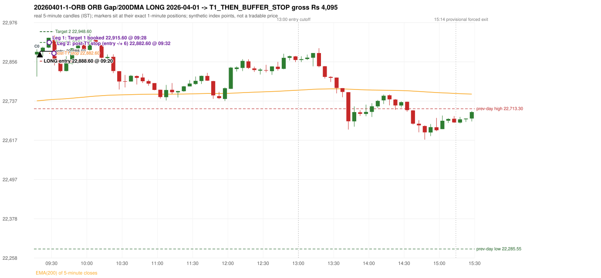

# Trading journal - 2026-04-01 (Wednesday)

> Automated reconstruction of the Phase 3.6 combined backtest: the Phase 3.0 controller, stops, targets and sizing with PDR = the body-based engine (wicks ignored; open strictly above the zone; numeric pattern thresholds and zone-lower-boundary conventions are provisional research assumptions, NOT approved by the strategy author). Synthetic NIFTY 50 index-point P&L (the index is not tradable). The owner's review status is intentionally blank.

## A. Trading day overview

| item | value |
|---|---|
| Date / weekday | 2026-04-01 / Wednesday |
| Session type | USABLE_WITH_FLAGS / VALID |
| Original session open (first 1-minute open) | 22,878.90 |
| Previous session | 2026-03-30 |
| Previous-day high / low (wicks included) | 22,713.30 / 22,285.55 |
| Previous-day highest BODY high (the body-based PDR ceiling; wicks ignored) | 22,683.60 |
| Previous-day official close / last 5-minute close | 22,331.40 / 22,379.20 |
| Raw engine records / confirmed signals / fully valid signals | 11 / 7 / 6 |
| Setups that did not complete (invalidated / incomplete) | 4 |
| Executed trades | 1 20260401-1-ORB |
| Gross P&L (Rs, synthetic) | 4,095.00 |
| Illustrative net P&L (Rs; Rs 500/trade + 0.5 pt/fill) | 3,205.00 |
| Day-end portfolio status | DAY_FINISHED |
| Manual journal trades (matched / unmatched) | 0 (0 / 0) |
| Extra automated trades | 1 |

## B. Daily strategy signal timeline (confirmed signals, chronological)

| time | strategy | method | dir | entry-rule status | valid for execution | <= 13:00 | portfolio state | accepted / ignored | specific reason | competing (same minute) |
|---|---|---|---|---|---|---|---|---|---|---|
| 09:20 | ORB | Gap/200DMA | LONG | RESEARCH_VARIANT | True | True | FIRST_TRADE_ACTIVE | ACCEPTED -> 20260401-1-ORB | first eligible signal of the day; trade 1: T1_THEN_BUFFER_STOP |  |
| 09:35 | IRF | Method 1 | SHORT | PROPOSAL_DEPENDENT | True | True | DAY_FINISHED | IGNORED | DAY_FINISHED [blocked by ORB#1] |  |
| 10:00 | IRF | Method 1 | SHORT | PROPOSAL_DEPENDENT | True | True | DAY_FINISHED | IGNORED | DAY_FINISHED [blocked by ORB#1] |  |
| 10:10 | IRF | Method 2B | SHORT | PROPOSAL_DEPENDENT | True | True | DAY_FINISHED | IGNORED | DAY_FINISHED [blocked by ORB#1] |  |
| 10:15 | IRF | Method 1 | SHORT | PROPOSAL_DEPENDENT | True | True | DAY_FINISHED | IGNORED | DAY_FINISHED [blocked by ORB#1] |  |
| 14:10 | PDR | PDR | LONG | RESEARCH_VARIANT | True | False | DAY_FINISHED | IGNORED | DAY_FINISHED [blocked by ORB#1] |  |
| 15:30 | PDR | PDR | LONG | RESEARCH_VARIANT | False | False | DAY_FINISHED | IGNORED | DAY_FINISHED [blocked by ORB#1] |  |

Engine setups that did not complete (4); the complete list with failed rule ids is in `rejected_signals.csv`:

| candle | strategy | method | dir | status | precise reason | failed rules |
|---|---|---|---|---|---|---|
| 13:15 | IRF | Method 3 | SHORT | INVALIDATED | WICK_SHARE_OUT_OF_BAND | IRF-M3-003 |
| 09:15 | ORB | Method 1 | LONG | INVALIDATED | TREND:EMA_PREV_SESSION_CLOSE wrong side | ORB-TREND-001;ORB-TREND-002 |
| 09:15 | ORB | Method 2 | LONG | INVALIDATED | TREND:EMA_PREV_SESSION_CLOSE wrong side | ORB-TREND-001;ORB-TREND-002 |
| 10:35 | RF | RF | LONG | INVALIDATED | TREND:EMA_PREV_SESSION_CLOSE wrong side | RF-001;RF-008 |

## C. Detailed trade journals

### 20260401-1-ORB: ORB Gap/200DMA LONG (FIRST trade)

Chart: 

**Rule configuration:** CFG-phase36_body_based-866f954e55 - signal verification status **RESEARCH_VARIANT** (never VERIFIED while a rule rests on a proposal).

#### 1. Setup identification

ORB Gap/200 DMA LONG: the open 22,878.90 gapped +547.50 points from the previous close 22,331.40, through the EMA(200) (22,735.86 -> 22,737.37); the first candle closed at 22,887.00, beyond the average; its body occupied 9.72% of its range and its upper wick 9.24% (thresholds 60% / 20%): the strong-candle test FAILED; the candle was admitted through the conditional PIN-BAR alternative instead (the lower wick 67.50 points is 8.33 x the body, required 2x; the close is 9.24% of the range from the high, allowed 30%). The 'excessively extended' filter has no numeric definition and was not applied.

#### 2. Candle and indicator calculations

| role | session | candle | O | H | L | C | range | body % | upper wick % | lower wick % | direction | EMA(200) | strong bull / bear | pin bull / bear | small (body<=30%) | used for |
|---|---|---|---|---|---|---|---|---|---|---|---|---|---|---|---|---|
| first_candle | TODAY | 09:15-09:20 | 22,878.90 | 22,894.70 | 22,811.40 | 22,887.00 | 83.30 | 9.72 | 9.24 | 81.03 | BULLISH | 22,737.37 | False / False | True / False | True | the 09:15 first five-minute candle - the ORB decision candle |
| prev_session_last_candle | PREVIOUS | 15:25-15:30 | 22,376.00 | 22,391.00 | 22,359.15 | 22,379.20 | 31.85 | 10.05 | 37.05 | 52.90 | BULLISH | 22,735.86 | False / False | False / False | True | previous session's last candle: the EMA(200) before the gap |

Every condition, with the rule, the calculation, the observed values and the result:

| # | group | rule | result | status / numeric definition | calculation | observed | required | available at | why it matters |
|---|---|---|---|---|---|---|---|---|---|
| 1 | SELECTION | SEL-FIRST-001 | PASS | USER_APPROVED / USER_APPROVED | earliest CONFIRMED signal of the day across IRF/ORB/PDR/PDS/RF that passed the controller's checks | 0 confirmed signal(s) earlier today; 7 confirmed signals in the day in total, this one at 09:20 | no earlier executable signal | 2026-04-01 09:20 | the shared controller trades only the first valid signal; the five strategies are not independent positions |
| 2 | SELECTION | SEL-TIE-001 | PASS | USER_APPROVED / USER_APPROVED | other CONFIRMED signals with exactly the same confirmation timestamp | none | no different-strategy / opposite-direction signal in the same minute (otherwise an unresolved conflict, no trade) | 2026-04-01 09:20 | an unresolved same-minute collision would have produced no trade at all |
| 3 | SELECTION | ENTRY-CUTOFF-001 | PASS | USER_APPROVED / USER_APPROVED | fill timestamp vs 13:00:00 IST | signal confirmed 09:20; fill 09:20 | fill at or before 13:00:00 IST | 2026-04-01 09:20 | no new position may be entered with a fill after 13:00 IST |
| 4 | SELECTION | EXE-FILL-001 | PASS | PROPOSED_FOR_REVIEW / PROPOSED_FOR_REVIEW | fill = open of the 1-minute bar that starts at the signal candle's end | bar 09:20 O 22,888.60 H 22,902.40 L 22,886.50 C 22,894.70; executable=True; entry 22,888.60 | fill bar exists, starts exactly at the signal end, is fillable; entry = its open | 2026-04-01 09:20 | a 5-minute signal is known only when its candle closes; the first price that can be traded is the next minute's open |
| 5 | SELECTION | DAY-MAX-001 | PASS | USER_APPROVED / USER_APPROVED | number of entries today | trade 1 of at most 2 | <= 2 entries per day | 2026-04-01 09:20 | daily trade cap |
| 6 | SETUP | ORB-GLOBAL-001 | PASS | SOURCE_VERIFIED / EXPLICIT_IN_SOURCE | decision is taken once the first 5-minute candle (09:15-09:20) has closed | candle 09:15-09:20; signal confirmed 09:20 | decision at 09:20, never before the close | 2026-04-01 09:20 | the close of the first candle is unknown before 09:20 |
| 7 | SETUP | ORB-GLOBAL-002 | PASS | SOURCE_VERIFIED / EXPLICIT_IN_SOURCE | direction | LONG | same rules in both directions | 2026-04-01 09:20 | ORB trades the side of the break |
| 8 | SETUP | ORB-GLOBAL-004 | PASS | SOURCE_VERIFIED / QUALITATIVE_SOURCE_NUMERIC_DEFINITION_PROPOSED_FOR_REVIEW | entry at 09:20, after the first-candle close | signal confirmed 09:20; fill 09:20 at the open of that minute | 09:20 entry | 2026-04-01 09:20 | the guide enters at 9:20; the fill price convention (next minute open) is a proposal |
| 9 | SETUP | ORB-GAP-LONG-001 | PASS | SOURCE_VERIFIED / EXPLICIT_WORDING_DETAIL_PROPOSED_FOR_REVIEW | gap = first 1-minute open of today - previous session's OFFICIAL close | today's open 22,878.90 (first 1-minute bar 09:15) - previous close 22,331.40 (DAILY_VENDOR, 2026-03-30) = +547.50 points -> gap UP | gap UP (more than 0 points) | 2026-04-01 09:15 | approved convention: the original first-minute open, never the vendor daily open |
| 10 | SETUP | ORB-GAP-LONG-002 | PASS | SOURCE_VERIFIED / QUALITATIVE_SOURCE_NUMERIC_DEFINITION_PROPOSED_FOR_REVIEW | the gap carries the open through the moving average (EMA200_5M: EMA(200) of 5-minute closes) | previous close 22,331.40 < previous-session EMA 22,735.86; today's open 22,878.90 > today's first-candle EMA 22,737.37 (engine recorded 22,737.37 / 22,735.86) | previous close on one side, open on the other | 2026-04-01 09:20 | the Gap/200 DMA setup needs the gap to push price through the MA (the source text vs figures is a documented conflict: ORB-MA-001) |
| 11 | CONFIRMATION | ORB-GAP-LONG-003 | PASS | SOURCE_VERIFIED / EXPLICIT_IN_SOURCE | first candle closes beyond the moving average | close 22,887.00 vs EMA 22,737.37: 149.63 points above | close above (long) / below (short) the MA | 2026-04-01 09:20 | a candle that only crosses the line does not qualify |
| 12 | CONFIRMATION | ORB-GAP-LONG-004 | PASS | SOURCE_VERIFIED / QUALITATIVE_SOURCE_NUMERIC_DEFINITION_PROPOSED_FOR_REVIEW | candle quality (strong body or pin bar) and no strong rejection wick | 09:15-09:20 O 22,878.90 H 22,894.70 L 22,811.40 C 22,887.00; range 83.30, body 8.10 (9.72%), upper wick 7.70 (9.24%), lower wick 67.50 (81.03%), bullish. Strong-bullish test: bullish close, body >= 60% (observed 9.72%), upper wick <= 20% (observed 9.24%) -> not met; pin-bar alternative: wick >= 2 x body and close within the favourable 30% -> met; rejection wick 9.24% vs limit 33% | strong body or pin bar, and the rejection wick below the limit | 2026-04-01 09:20 | the thresholds are proposals |
| 13 | EXECUTION | ORB-GLOBAL-003 | PASS | SOURCE_VERIFIED / EXPLICIT_IN_SOURCE | initial stop = entry - 30 points | entry 22,888.60 -> stop 22,858.60 | stop 30 index points (BASELINE) | 2026-04-01 09:20 | defines the loss if the setup fails before Target 1 |
| 14 | EXECUTION | EXE-T1-001 | PASS | SOURCE_VERIFIED / EXPLICIT_IN_SOURCE | Target 1 = entry +/- 27 points | T1 22,915.60 | 27 points | 2026-04-01 09:20 | Leg 1 (3 lots) is booked at Target 1 |
| 15 | EXECUTION | ORB-GLOBAL-003 | PASS | SOURCE_VERIFIED / EXPLICIT_IN_SOURCE | Target 2 = entry +/- 60 points | T2 22,948.60 | 60 points | 2026-04-01 09:20 | Leg 2 (3 lots) is booked at Target 2 |
| 16 | EXECUTION | POST-T1-STOP-006 | PASS | USER_APPROVED / USER_APPROVED | after T1 the Leg-2 stop = entry - 6 (no trailing) | post-T1 stop 22,882.60 | entry -6 (LONG) / +6 (SHORT) | 2026-04-01 09:20 | protects the remaining three lots once the first three are booked |
| 17 | EXECUTION | SIZE-LOT-001 | PASS | USER_APPROVED / USER_APPROVED | 6 lots x 65 = 390, Leg 1 = 3 lots = 195, Leg 2 = 195 | 6 lots, lot size 65, legs 3+3 | 6 lots in two equal legs | 2026-04-01 09:20 | position size for the synthetic P&L |
| 18 | NOTE | ORB-MA-001 | UNRESOLVED | CONFLICTING / CONFLICTING | which moving average the code uses | EMA(200) of 5-minute closes (the guide says '200 DMA' in some places and '200 EMA' in others); active ma_mode EMA200_5M | the source terminology conflicts | 2026-04-01 09:20 | a daily 200 DMA would give different values |
| 19 | NOTE | ORB-GAP-LONG-005 | UNRESOLVED | UNRESOLVED / UNRESOLVED | 'excessively extended' opening move | gap +547.50 points; maximum gap configured: None | the source gives no number, so no limit is applied | 2026-04-01 09:20 | a very large gap would be rejected by a human; the engine has no defined limit |
| 20 | NOTE | NOTE-UNRESOLVED-DEPENDENCIES | UNRESOLVED | NOT_A_RULE / NOT_A_REGISTRY_RULE | rules the signal depends on that the sources leave unresolved | engine-recorded unresolved rule ids: ORB-MA-001, ORB-GAP-LONG-005; verification status RESEARCH_VARIANT | n/a (disclosure) | 2026-04-01 09:20 | the entry is only as verified as the rules it rests on |

#### 3. Entry decision and explanation

ORB Gap/200 DMA LONG: the open 22,878.90 gapped +547.50 points from the previous close 22,331.40, through the EMA(200) (22,735.86 -> 22,737.37); the first candle closed at 22,887.00, beyond the average; its body occupied 9.72% of its range and its upper wick 9.24% (thresholds 60% / 20%): the strong-candle test FAILED; the candle was admitted through the conditional PIN-BAR alternative instead (the lower wick 67.50 points is 8.33 x the body, required 2x; the close is 9.24% of the range from the high, allowed 30%). The 'excessively extended' filter has no numeric definition and was not applied.

**Why this trade ahead of the other strategies:** This ORB Gap/200DMA signal was the earliest executable signal of the day: 0 confirmed signal(s) earlier, 0 other in the same minute. 6 later confirmed signal(s) (IRF x4, PDR x2) are logged as ignored or rejected. State of the other four engines at that moment: [IRF: no setup record before this time (a base condition was not met, or nothing triggered)] [PDR: no setup record before this time (a base condition was not met, or nothing triggered)] [PDS: no setup record before this time (a base condition was not met, or nothing triggered)] [RF: no setup record before this time (a base condition was not met, or nothing triggered)]

#### 4. Actual entry execution

| item | value |
|---|---|
| Signal candle | 09:15-09:20 |
| Signal confirmed | 2026-04-01 09:20 |
| Fill timestamp | 2026-04-01 09:20 |
| Entry price | 22,888.60 |
| Source partition / 1-minute bar | data/processed/nifty50/year=2026/month=04/candles.parquet / 2026-04-01 09:20 |
| Source bar O / H / L / C | 22,888.60 / 22,902.40 / 22,886.50 / 22,894.70 |
| Fill assumption | open of the 1-minute bar starting at the signal candle's end (EXE-FILL-001, PROPOSED causal convention) |
| Initial stop / T1 / T2 / post-T1 stop | 22,858.60 / 22,915.60 / 22,948.60 / 22,882.60 |
| Position | 6 lots x 65 = 390 units (Leg 1 195, Leg 2 195) |

#### 5-8. Trade progress, Target 1, post-T1 stop and final exit

Between the 09:20 entry bar and the final exit (13 one-minute bars) the best excursion in favour was 48.30 points at 09:30 and the worst against was 43.15 points at 09:32. At 09:28 price reached Target 1 22,915.60 and three lots exited. At 09:28 the remaining three lots' protective stop was set to 22,882.60 (entry - 6; no trailing, no further change); the engine applies it from the Target-1 bar onward and tests it within that same bar. At 09:32 the remaining three lots stopped out at 22,882.60. T1_THEN_BUFFER_STOP: no second trade that day (DAY-BUF-001).

| leg | qty | exit time | exit price | reason | source 1-minute bar | O / H / L / C | gross points | gross Rs | slippage pts | flags |
|---|---|---|---|---|---|---|---|---|---|---|
| 1 | 195 | 09:28 | 22,915.60 | TARGET_1 | 09:28 | 22,906.60 / 22,919.60 / 22,906.60 / 22,919.00 | 27.00 | 5,265.00 | 0.00 |  |
| 2 | 195 | 09:32 | 22,882.60 | POST_T1_STOP_ENTRY_MINUS_PLUS_6 | 09:32 | 22,890.40 / 22,890.40 / 22,845.45 / 22,849.55 | -6.00 | -1,170.00 | 0.00 |  |

Exit evidence per leg:

* Leg 1: 1-minute bar 09:28 O 22,906.60 H 22,919.60 L 22,906.60 C 22,919.00: high 22,919.60 reached Target 1 22,915.60; Leg 1 booked at the target level
* Leg 2: 1-minute bar 09:32 O 22,890.40 H 22,890.40 L 22,845.45 C 22,849.55: low 22,845.45 reached the post-T1 stop 22,882.60; Leg 2 exits at 22,882.60 at the stop level

#### 9. Gross and illustrative net P&L

| item | value (Rs) |
|---|---|
| Leg 1 gross | 5,265.00 |
| Leg 2 gross | -1,170.00 |
| Trade gross (= Leg 1 + Leg 2) | 4,095.00 |
| Illustrative fixed cost | -500.00 |
| Illustrative slippage (0.5 pt on every fill, entry + exits, all units) | -390.00 |
| Illustrative net | 3,205.00 |

#### 10. Manual journal comparison

EXTRA_AUTOMATED_TRADE: the automated system took ORB Gap/200DMA LONG at 09:20 (no manual trade that day). The setup rests on: ORB-MA-001: 200 DMA versus 200 EMA terminology conflict | ORB-GAP-LONG-005: Reject if the opening move is excessively extended or the candle shows strong re | NOTE-UNRESOLVED-DEPENDENCIES: Disclosure of unresolved source rules behind this signal. The journal shows no corresponding entry.

## D. Manual journal comparison

| comparison | journal row | journal strategy | manual time | manual direction | manual outcome | match class | trade | auto entry | auto outcome | explanation |
|---|---|---|---|---|---|---|---|---|---|---|
| E060 |  |  |  |  |  | EXTRA_AUTOMATED_TRADE | 20260401-1-ORB | 09:20 @ 22,888.60 | T1_THEN_BUFFER_STOP | EXTRA_AUTOMATED_TRADE: the automated system took ORB Gap/200DMA LONG at 09:20 (no manual trade that day). The setup rests on: ORB-MA-001: 200 DMA versus 200 EMA terminology conflict \| ORB-GAP-LONG-005: Reject if the opening move is excessively extended or the candle shows strong re \| NOTE-UNRESOLVED-DEPENDENCIES: Disclosure of unresolved source rules behind this signal. The journal shows no corresponding entry. |

The journal records no entry price and no exit price (NOT_RECORDED); matching uses date, strategy and candle start only - never P&L.

## E. Daily conclusion

* **Traded:** 20260401-1-ORB - ORB Gap/200DMA LONG at 09:20 (entry 22,888.60), outcome T1_THEN_BUFFER_STOP, gross Rs 4,095.00, illustrative net Rs 3,205.00. **Why:** This ORB Gap/200DMA signal was the earliest executable signal of the day: 0 confirmed signal(s) earlier, 0 other in the same minute. 6 later confirmed signal(s) (IRF x4, PDR x2) are logged as ignored or rejected. State of the other four engines at that moment: [IRF: no setup record before this time (a base condition was not met, or nothing triggered)] [PDR: no setup record before this time (a base condition was not met, or nothing triggered)] [PDS: no setup record before this time (a base condition was not met, or nothing triggered)] [RF: no setup record before this time (a base condition was not met, or nothing triggered)] **How it ended:** At 09:28 price reached Target 1 22,915.60 and three lots exited. At 09:28 the remaining three lots' protective stop was set to 22,882.60 (entry - 6; no trailing, no further change); the engine applies it from the Target-1 bar onward and tests it within that same bar. At 09:32 the remaining three lots stopped out at 22,882.60. T1_THEN_BUFFER_STOP: no second trade that day (DAY-BUF-001).
* **Ignored / rejected signals:** IRF IGNORED DAY_FINISHED x4; PDR IGNORED DAY_FINISHED x2
* **Extra automated trade 20260401-1-ORB:** EXTRA_AUTOMATED_TRADE: the automated system took ORB Gap/200DMA LONG at 09:20 (no manual trade that day). The setup rests on: ORB-MA-001: 200 DMA versus 200 EMA terminology conflict | ORB-GAP-LONG-005: Reject if the opening move is excessively extended or the candle shows strong re | NOTE-UNRESOLVED-DEPENDENCIES: Disclosure of unresolved source rules behind this signal. The journal shows no corresponding entry.
* **Open strategy-definition issues that affected this day:** NOTE-UNRESOLVED-DEPENDENCIES, ORB-GAP-LONG-005 (Reject if the opening move is excessively extended or the candle shows strong rejection wicks), ORB-MA-001 (Terminology conflict: '200 DMA / EMA' (p.2), '200 EMA' (pp.3,5,7), '200 DMA' (pp.1,8,9,12) for what the charts show as one curved line on a 5-minute chart)
* **Automated triage (not an approval; the owner's review status stays blank):** REVIEW: EXTRA_AUTOMATED
